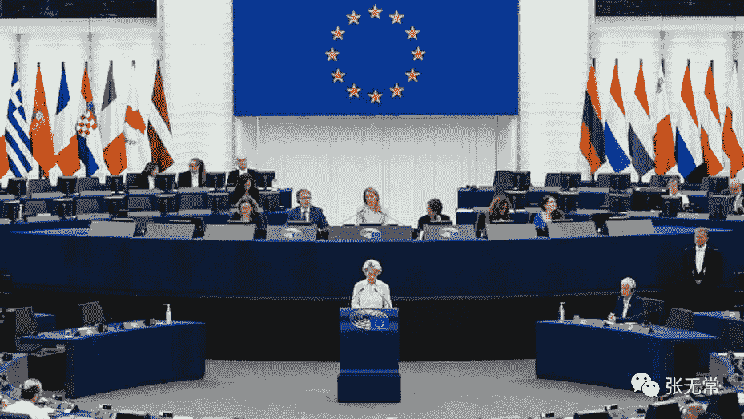
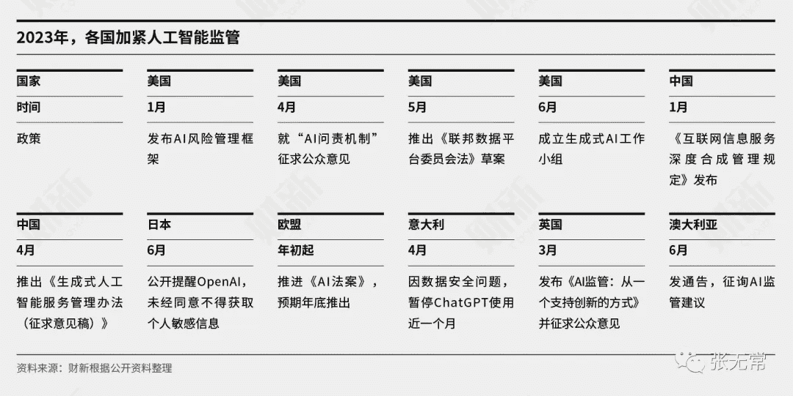

# 为什么欧盟是AI监管最严的地区？

> 来源：[https://agijuejin.feishu.cn/docx/Ql3ddTguOomnv5xtl8wcUO4jnRg](https://agijuejin.feishu.cn/docx/Ql3ddTguOomnv5xtl8wcUO4jnRg)

> 张海庚｜[阅读原文](https://mp.weixin.qq.com/s?__biz=MzIwODA3MDUwOQ==&mid=2652773290&idx=1&sn=2095e5517faf19ce831ede38ab7977d3&scene=21#wechat_redirect)

> 转载请联系原作者取得授权

不知道有没有人和我有一样的疑问，从移动互联网时代到生成式AI，欧盟一直是监管最严的地区，向来杀伐果断、雷厉风行，宁可杀错不可放过——为什么？

比如，过去欧盟基于GDPR（《通用数据保护条例》）等监管政策，在数据隐私和反垄断监管上动作频频，对亚马逊、Meta和谷歌有过天价罚款，单次最高罚款达12亿欧元。

这**波生成式AI监管，欧盟也是**走在全球前列：欧盟议会6月18日宣布，《人工智能法案》进入最终讨论阶段，预计23年年底达成协议，这将是 世界上首个综合性AI法律 ——此时距离OpenAl推出ChatGPT仅仅半年。

作为革命性的新技术，AI要监管，基本上是全球共识，而且全球对Al监管的底层逻辑也基本一致： 一方面要治理Al的危害，另一方面又要支持本国AI发展。

但偏偏只有欧盟，似乎总是 更倾向天平上治理危害的一边，甚至不惜限制自身AI的发展 ——背后的原因是什么？

有一个重要原因是， 欧洲发生过先进技术被国家机器滥用于监控民众的历史。

「欧洲民众有过『警察国家』的经历，例如纳粹和东德的史塔西，这令他们强烈反对这些些技术。」这是欧洲智库布勒哲尔研究所（Bruegel）高级研究员马科斯（J.ScottMarcus）的解读。

布勒哲尔研究所成立于2005年，是一个非营利性学术机构，也是欧盟唯一接受成员国资助的智库，致力于全球经济研究，旨在为欧盟经济政策制定提供一个基于事实研究、分析和讨论的开放平台。

**理解这段历史，对于理解**欧洲民众为何 总是下意识抵触新技术 非常关键。

马科斯说，「在欧洲，当新事物出现时，人们的 第一反应往往是『我们需要监管』 ，几乎都是事后才会说『我们需要什么么样的监管』」。

欧盟委员会的监管逻辑是： 先识别出一个危害，然后寻找可能的方法来解决这个危害， 然后将最有效的干预与不作任何改变对比，看哪边的成本收益更高。

上面是群众基础，还有一个原因来自实际经济考量：

大AI公司大多不是欧盟公司，因此监管者对保护创新创业的顾虑也较少。

理解了上述原因，大概也能理解为什么奥特曼的世界巡游之旅会花最多时间在欧洲——和德国总理朔尔茨、法国总统马克龙、英国首相苏纳克等政要，以及包括伦敦大学、慕尼黑工业大学在内的高校多次沟通了。

欧盟的监管有多严呢？有个例子可以侧面反映：

一向以温文儒雅的形象示众的奥特曼，在欧洲甚至被逼急了，扬言如果过度监管，就会撤出欧洲市场。欧盟哪吃这套，奥特曼也许发现没用，第二天冷静下来，改口「不会离开欧洲」。大棒没有用，还得递萝卜。

其实，监管从严的问题，也不止是欧盟，美国也有，根据报道和我实际调研的情况看，虽然技术发展领先于中国，但美国从群众到监管机构，都对生成式AI更谨慎。

**我理解，在**更大的意义上说，这也许就是发达国家的「 路径依赖 」吧：我们已经过得挺好了，为什么还要搞革命性技术颠覆现在的生活呢？什么？！还要让我失业？下地狱吧！

当然，这也是其他国家有机会 **弯道超车 **的原因之一吧，所谓 **后发优势 **。

那么，欧洲都是这样吗？ 也有例外：

成功脱欧的英国，今年已经俨然成为最激进支持AI发展的欧洲国家：

3月，英国发表人工智能白皮书，加大包括1亿英镑预算在内的投资，后来加码到10亿，支持半导体投资。

——看得出来很努力了，但说实话，这点钱对大模型来收，杯水车薪：美国和欧盟的资金规模分别达到了500亿美元和430亿欧元。

5月底，英国首相苏纳克会晤DeepMind、OpenAI等AI企业负责人，商讨监管框架。

6月，苏纳克宣布，科技投资人和AI专家伊恩·霍加斯将领导英国人工智能基础模型任务组，以研究人工智能带来的安全风险。

短短11周内，任务组就建立了一个由人工智能先驱（以Bengio为首）和国家安全领导者组成的专家咨询委员会，招募了顶级的人工智能研究人员，并开始与领先的技术组织进行合作。

英国还计划在11月1日和2日举办有史以来的首个人工智能安全峰会，并邀请中国参加。

有一个重要背景是， 英国是多家全球重要研发机构的所在地，包括开发了AlphaGo和AlphaFold的DeepMind，其最近与Google Brain合并为GoogleDeepMind。研发了ChatGPT的美国实验室OpenAI也将其首个海外分部设在伦敦。

此外，英国AI领域的创业和投资都十分活跃。自2011年以来，平均每年有269家新公司在英国注册成立；自2016年以来，英国AI公司已获得总计188亿英镑的私人投资，其中2021年是AI投资创纪录的一年，共筹集了超过50亿英镑。

根据英国媒体 TortoiseMedia 今年6月底发布的最新一期全球人工智能指数报告，英国人工智能领域的综合情况目前全球排名第四，前三名分别是美国、中国和新加坡。

然而，Tortoise的报告也指出，英国AI发展亦面临着不少挑战，主要体现在运营发展环境和基础设施两方面……

越来越有意思了，技术、产品、资本、商业之外，生成式AI的国家之争、众所周知的半导体地缘政治……一盘大棋，波诡云谲，且拭目以待。

相关阅读：

+   一个产品经理的大模型观察、反思与预测

+   AI龙虎榜：全球5000+AI产品盘点（2023年8月）

+   无常的大模型世界观_2023年7月

+   [我的苹果发布会观察](http://mp.weixin.qq.com/s?__biz=MzIwODA3MDUwOQ==&mid=2652773055&idx=1&sn=68bc855c49fdef77e6a98b654325d234&chksm=8ce208bdbb9581ab55e42c9b1cb691695751951f2e3138afca8ed8409bcd27ed88806ef9798e&scene=21#wechat_redirect)

参考资料：

> https://weekly.caixin.com/2023-07-01/102071215.html?p0#page2

> http://aoc.ouc.edu.cn/_t719/2017/0818/c9825a68930/page.psp

> https://www.stcn.com/article/detail/954232.html

> https://news.sina.com.cn/c/2023-09-20/doc-imzniunk4063432.shtml?cre=tianyi&mod=pchp&loc=35&r=0&rfunc=88&tj=cxvertical_pc_hp&tr=12

我是Hayes海庚，一个关注AI的大厂产品经理/战略，最近打算和更多人交流，如果你也关注这轮AI浪潮，希望和包括 字节、百度、阿里、腾讯和一线大模型创业公司 同学一起交流讨论，欢迎在公众号「张无常」后台回复「茶水间」或 加微信hayeszhang13 入群，麻烦备注【 称呼-公司/学校-职位-来意】。