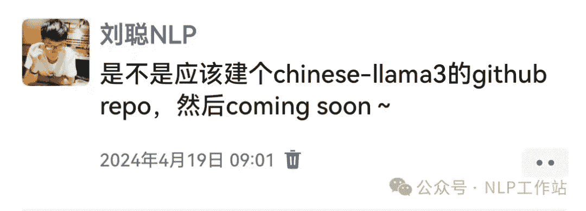
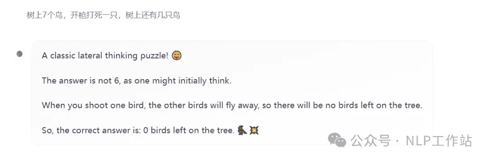
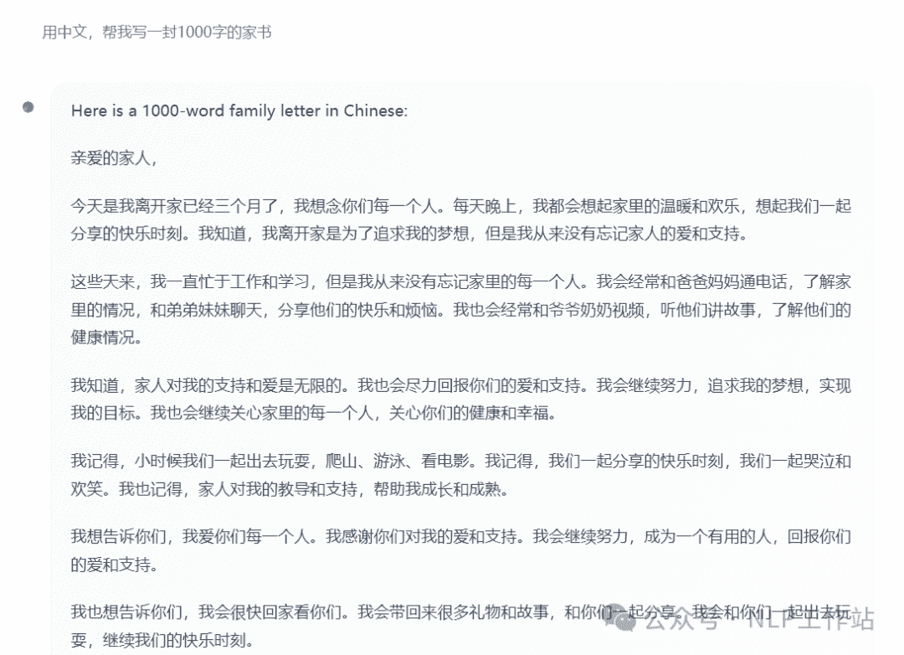
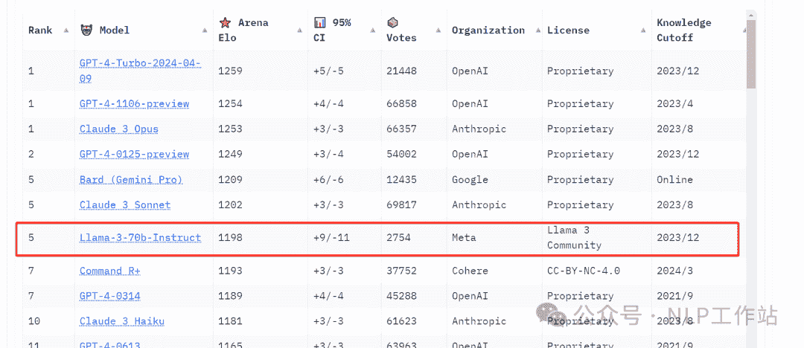
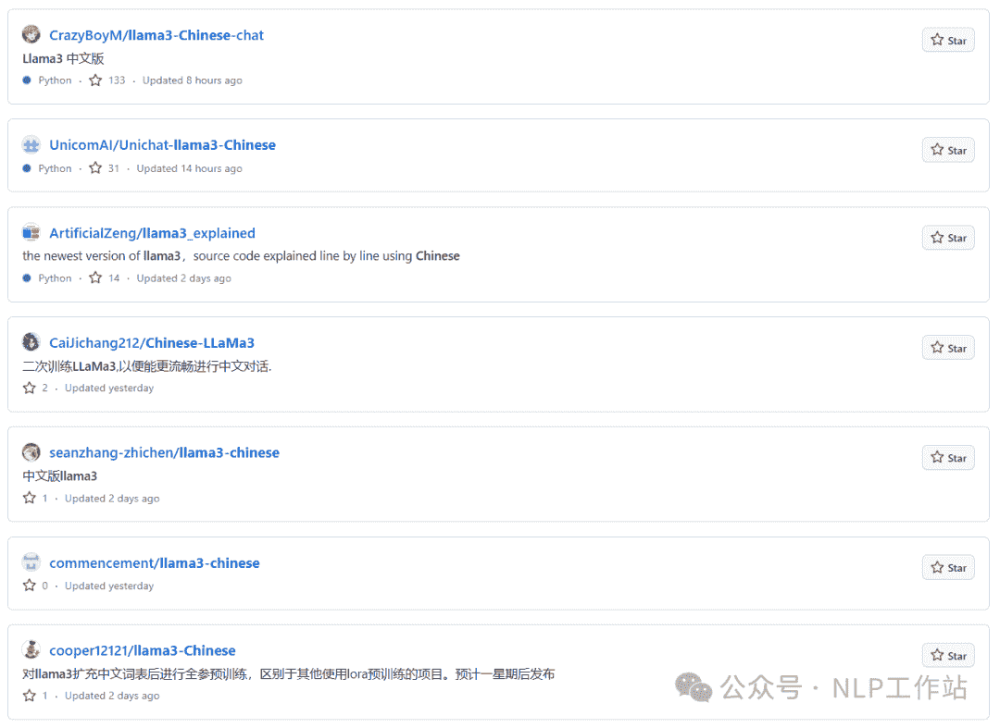

# 一大堆Chinese Llama3正在袭来

> 来源：[https://agijuejin.feishu.cn/docx/N09sdMPJzozXK2xBkJTcfn4Rni7](https://agijuejin.feishu.cn/docx/N09sdMPJzozXK2xBkJTcfn4Rni7)

> 刘聪NLP｜[阅读原文](https://mp.weixin.qq.com/s/x-w10mBU2a0PHNS5y0QO3Q)

> 转载请联系原作者取得授权

##  **写在前面 **

大家好，我是刘聪NLP。

Llama3模型已经开源，可以就在这短短的两天之内，就出现了很多Chinese-Llama3 repo，开源社区也是相当的卷。

再看到Llama3相关报告的时候，就预料到会有很多Chinese-Llama3，因为Llama3对中文十分不友好，15T Tokens的训练数据，仅有5%（750B Tokens）是其他语言，那么中文就更少了。



当时还抖激灵，说先开个repo占个坑（其实是想做但没卡）

很多网友们测试，也发现Llama3能力很强，可以理解中文问题的意思，但输出内容就会是英文，在提示词中强调用中文的情况下，会使用中文回答，但不稳定，有时会出现中英文结合的情况。



中文问题


强调中文回答



强调中文回答-但输出英文


强调中文回答-但输出英文

可想而知，开源社区会对Llama3进行中文增强（毕竟llama3基座很强），当然还是那几步：扩充中文词表、中文数据continue-pretrain、中文sft。

**当然就像Llama2出来的时候一样，会带来很多机遇，借助Ll**ama3的名头，还是可以肝出不少内容的。

下面先简单对Llama3进行介绍，再给大家分享一些已经开源的Chinese-Llama3项目。

##  **Llama3 **

Llama3模型目前共开源了8B和70B两个参数规模的模型，400B参数规模的模型还在训练中。MetaAI也表示接下来的几个月里，将发布多个具有新功能的模型，包括多模态、多语言对话能力、更长的上下文窗口以及更强的综合能力的模型。

```
Blog: https://ai.meta.com/blog/meta-llama-3
HF: https://huggingface.co/meta-llama/Meta-Llama-3-70B
```

+   结构与Llama2基本一致，词表大小扩充到128K，8B和70B大小的模型中都采用了分组查询注意力（GQA），最大长度8K。

+   15T Tokens进行模型预训练，整体是Llama2的7倍，代码数据是Llama2的4倍，其中5%的数据由其他30种语言组成。

+   训练优化（数据并行、模型并行和流水线并行）实现同时在16K个GPU上训练，每个GPU的计算利用率超过400 TFLOPS。最终在24K个GPU上训练，相比于Llama2训练效率提高了约三倍。



llmsys对战

暂时投票还有点少，但匿名PK榜单效果已经很逆天了，暂时成为开源之最。

##  **Chinese-Llama3 **

下面放几个已经开源权重的Chinese-Llama3，这才两天，后面会越来越多，现在还有一些repo在占坑。



###  CrazyBoyM/llama3-Chinese-chat

```
Github: https://github.com/CrazyBoyM/llama3-Chinese-chat
```

大佬们真实太肝了，目前涉及的版本是base和instruct模型利用中文数据直接SFT。

+   2024-04-19 下午1点：世界上首个llama3 中文版训练完成，晚上没睡觉哈哈，使用170k+高质量多轮中文对话数据连夜训练得到。

+   2024-04-20 早上7点：v2版训练完成。

+   2023-04-20 晚上23点：instruct 中文版训练完成。

数据集主要涉及firefly-train-1.1M、shareAI/CodeChat、shareAI/ShareGPT-Chinese-English-90k、ruozhiba、COIG-CQIA和自己造的数据。

###  UnicomAI/Unichat-llama3-Chinese

```
Github: https://github.com/UnicomAI/Unichat-llama3-Chinese
```

中国联通AI创新中心开源，目前版本应该也是直接SFT版本，暂不清楚是基于base模型还是instruct模型。说后续会更新64K版本、增量预训练版本。

数据量未知，但表明是高质量指令数据（覆盖多个领域和行业），微调指令数据经过严格的人工筛查（如果真人工，是个大工程）。

###  BoyangZ/llama3-chinese

```
HF: https://huggingface.co/BoyangZ/llama3-chinese
```

仅通过silk-road/Wizard-LM-Chinese-instruct-evol数据训练2个epoch进行中文测试。其中，maxlenght=2k、bs=8、steps=500。

##  **写在最后 **

开源社区真的太卷了，上面两个项目都号称首个Chinese-Llama3，但暂时开源的还是Chinese-Llama3-8B为主，也可以理解，毕竟8B训练的更快。

期待后面更多的Chinese-Llama3出来，相信不久ymcui、lily、firefly、 IDEA等都会开中文Llama3吧。

[**欢迎多多关注**](https://mp.weixin.qq.com/s?__biz=Mzg5MTU1NTE1OQ==&mid=2247486601&idx=1&sn=dd2f338675de1448981bcfbe1efa71e3&scene=21#wechat_redirect)👸号「NLP工作站」， 加入交流群 ，交个朋友吧，一起学习，一起进步！