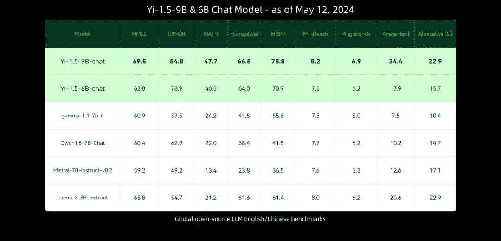
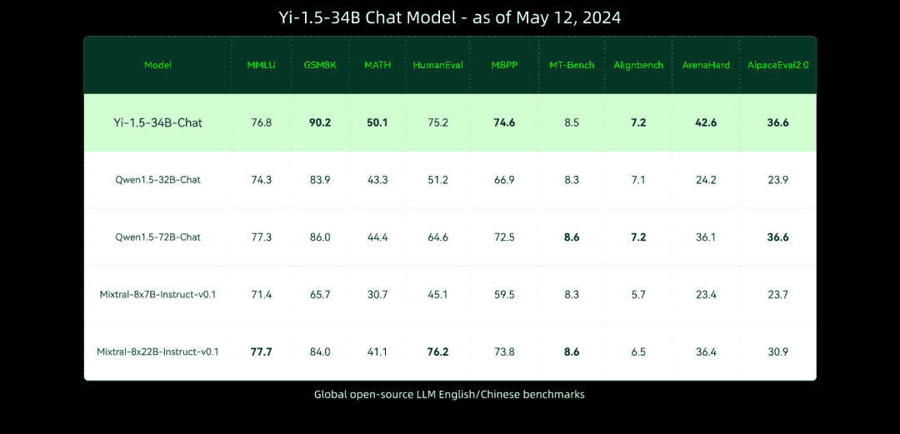
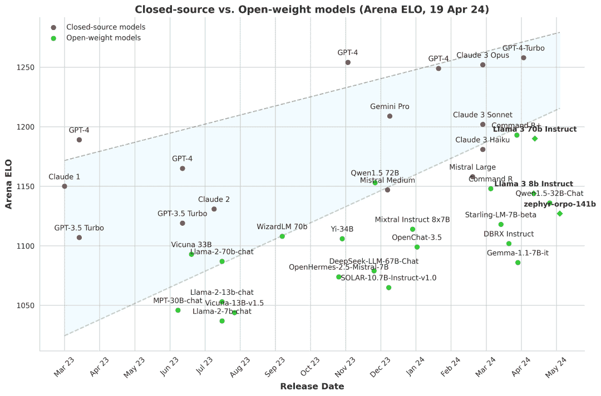

# 零一万物开源Yi-1.5系列大模型

> 来源：[https://agijuejin.feishu.cn/docx/Ddifdfur1o5wm5xz4ZecKsvXnje](https://agijuejin.feishu.cn/docx/Ddifdfur1o5wm5xz4ZecKsvXnje)

> 刘聪NLP｜[阅读原文](https://mp.weixin.qq.com/s/d-ogq4hcFbsuL348ExJxpA)

> 转载请联系原作者取得授权

## **写在前面 **

大家好，我是刘聪NLP。

今天早上看到零一万物发布了新的模型Yi-1.5系列，涉及6B、9B和34B三种规模，前有Qwen1.5后有Yi1.5，开源卷起来。

```
Github: https://github.com/01-ai/Yi-1.5
HF: https://huggingface.co/collections/01-ai/yi-15-2024-05-663f3ecab5f815a3eaca7ca8
```

##  **介绍 **

Yi-1.5系列模型在结构上与Yi系列模型保持一致，是Yi系列模型的增量预训练版本，Base模型使用500B Tokens的高质量语料库进行的增量预训练，Chat模型是在Base模型上使用300万指令数据微调得来。

模型的上下文长度为4K。

[**之前分析过Yi的技术报告**](https://mp.weixin.qq.com/s?__biz=Mzg5MTU1NTE1OQ==&mid=2247488248&idx=1&sn=da8b5d9b5aa374d56f1641a1e4938283&scene=21#wechat_redirect)，详见： 《Yi技术报告细节分享》

与Yi系列模型相比，Yi-1.5系列模型在编码、数学、推理、指令遵循、语言理解、常识推理和阅读理解等多方面展现了更为出色的能力。

Yi-1.5系列模型整体上看，优于Qwen1.5同等规模的模型，34B-Chat模型部分指标甚至超过Qwen1.5-72B模型，尤其是在代码、数学能力上，尤为突出。



6B-Chat和9B-Chat模型



34B-Chat模型

此外，Yi-1.5系列模型的开源协议为Apache 2.0。

##  **模型使用 **

直[**接transformer**](https://mp.weixin.qq.com/s?__biz=Mzg5MTU1NTE1OQ==&mid=2247487260&idx=1&sn=a6db35312dd894c6df84bf9ba5515845&scene=21#wechat_redirect)s走起，以34B-Chat模型为例。PS：模型下载有困难的同学，详见我之前写的一篇文章 《大模型下载使我痛苦》 。

赶紧玩起来，实测一波。

```
from transformers import AutoModelForCausalLM, AutoTokenizer

model_path = &#x27;01-ai/Yi-1.5-34B-Chat&#x27;

tokenizer = AutoTokenizer.from_pretrained(model_path, use_fast=False)

model = AutoModelForCausalLM.from_pretrained(
    model_path,
    device_map=&quot;auto&quot;,
    torch_dtype=&#x27;auto&#x27;
).eval()

messages = [
    {&quot;role&quot;: &quot;user&quot;, &quot;content&quot;: &quot;你是谁&quot;}
]

input_ids = tokenizer.apply_chat_template(conversation=messages, tokenize=True, add_generation_prompt=True, return_tensors=&#x27;pt&#x27;)
output_ids = model.generate(input_ids.to(&#x27;cuda&#x27;))
response = tokenizer.decode(output_ids[0][input_ids.shape[1]:], skip_special_tokens=True)
```

##  **写在最后 **

大模型开源社区也是越来越繁荣昌盛，个人认为与闭源之间的差距是在缩小的，请各位头部开源组织继续加油，我会紧紧跟随。



[**欢迎多多关注**](https://mp.weixin.qq.com/s?__biz=Mzg5MTU1NTE1OQ==&mid=2247486601&idx=1&sn=dd2f338675de1448981bcfbe1efa71e3&scene=21#wechat_redirect)👸号「NLP工作站」， 加入交流群 ，交个朋友吧，一起学习，一起进步！