# Qwen2模型开源，你值得拥有！

> 来源：[https://agijuejin.feishu.cn/docx/ZUJvdnHbDovgkaxjt4Bcgdqqn6b](https://agijuejin.feishu.cn/docx/ZUJvdnHbDovgkaxjt4Bcgdqqn6b)

> 刘聪NLP｜[阅读原文](https://mp.weixin.qq.com/s/YMf6EmmSfy-SnihM5wP0RA)

> 转载请联系原作者取得授权

##  **写在前面 **

期待已久的Qwen2，他如约而至，他来了，他带着5个尺寸的大模型迎面走来了。

```
Blog: https://qwenlm.github.io/blog/qwen2/
HF: https://huggingface.co/collections/Qwen/qwen2-6659360b33528ced941e557f
```

Qwen2本次开源了4个Dense模型和1个MoE模型，Dense模型包括0.5B、1.5B、7B和72B 4个尺寸，MoE模型总参数为57B，激活参数14B。

Qwen2系列模型为多语言模型，除英文和中文外，还支持其他27种语言；同时具有RAG、工具调用、角色扮演、Agent等多种功能。

##  **模型细节 **

Qwen2模型跟Qwen1.5模型一致，主要采用更多的数据（据说数据量在7T以上）进行模型训练。

几种模型支持最大上下文不同：

+   0.5B、1.5B模型支持最大上下文为32K；

+   57B-A14B MoE模型支持最大上下文为64K；

+   7B、72B模型支持最大上下文为128K。

除英文和中文外的27种语言如下：

+   西欧：德语、法语、西班牙语、葡萄牙语、 意大利语、荷兰语

+   东欧及中欧：俄语、捷克语、波兰语

+   中东：阿拉伯语、波斯语、希伯来语、土耳其语

+   东亚：日语、韩语

+   东南亚：越南语、泰语、印尼语、马来语、老挝语、缅甸语、宿务语、高棉语、菲律宾语

+   南亚：印地语、孟加拉语、乌尔都语

其中，MoE模型的共有72个专家，其中，8个共享专家和64个路由专家，每次模型推理时，8个共享专家一直被使用，路由专家则从64个中选择8个激活。

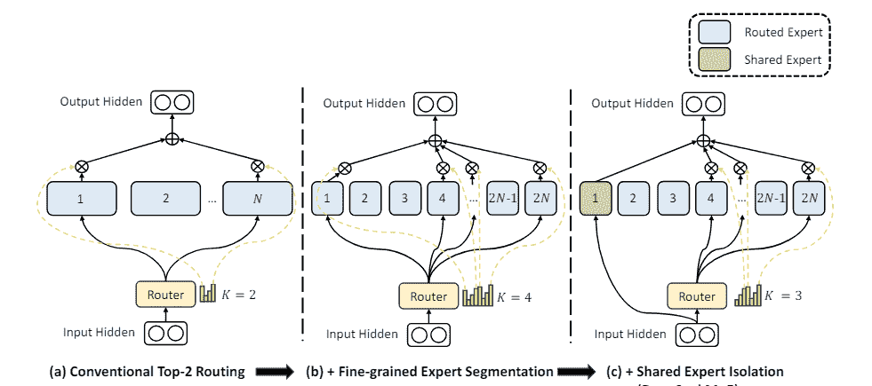

##  **效果分析 **

Qwen2系列模型效果整体超于Qwen1.5等尺寸系列模型，相对于其他开源模型也展现出了优异的效果。

0.5B和1.5B两个小模型，在中文相关榜单上效果较**好，但推理相关榜单不如Phi-2模**型（ 但现在网上有一种说法Phi系列模型是overfit，真实使用效果很不理想 ）。

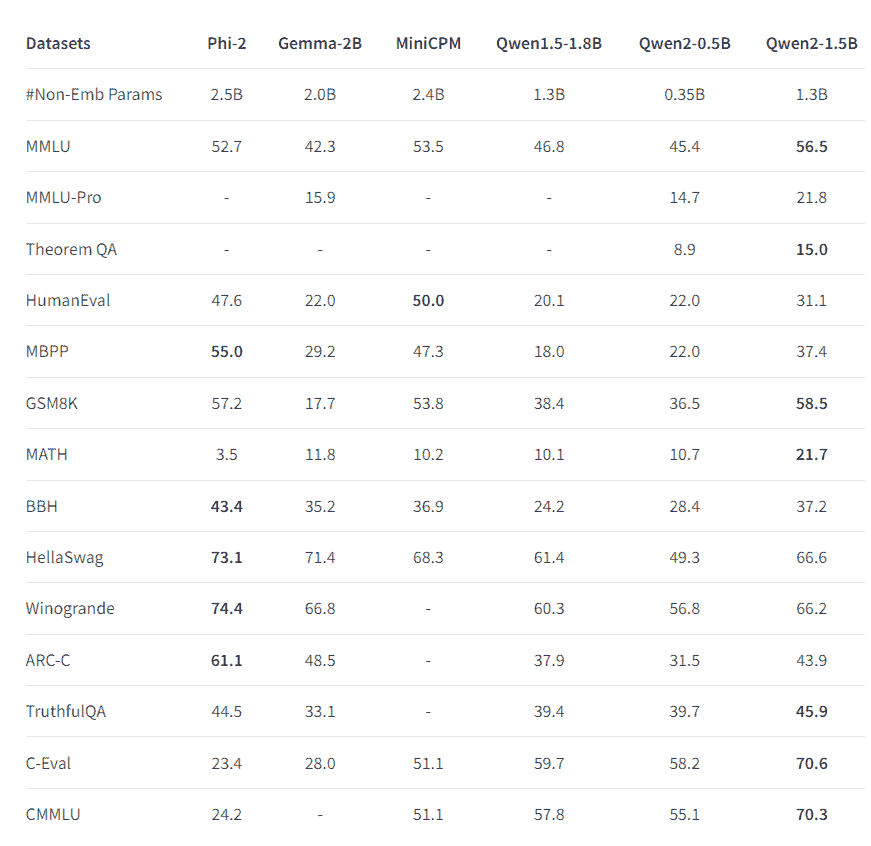

Base模型

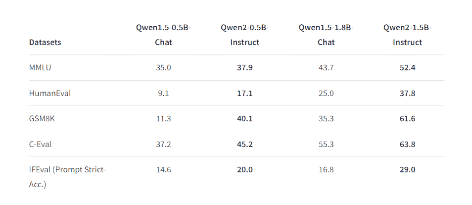

Instruct模型

7B模型相较于同等尺寸模型（Llama-3-8B、Yi-9B、GLM4-9B）在代码、中文上效果更为优异。

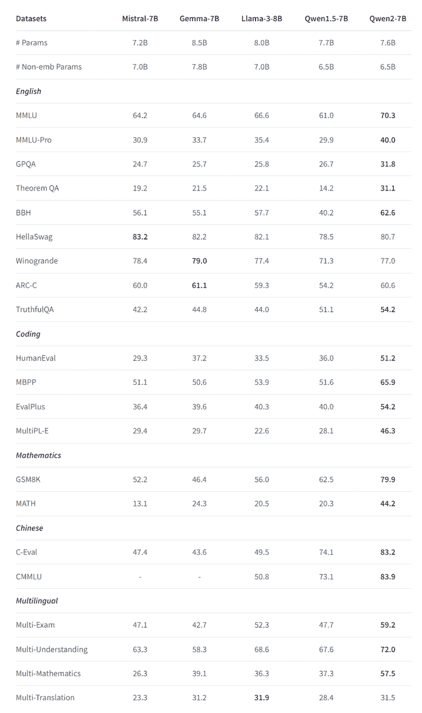

Base模型

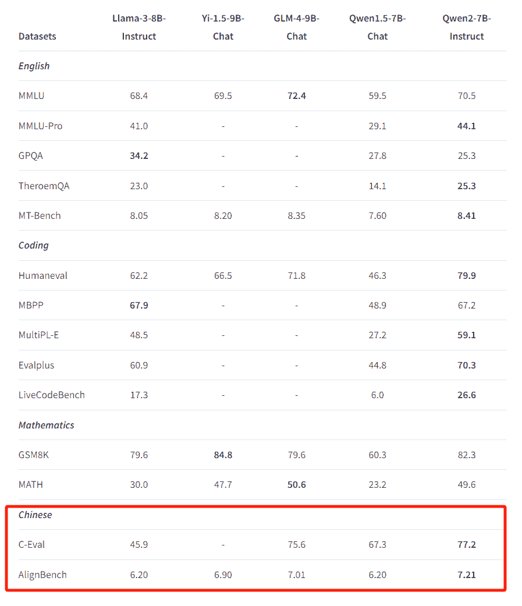

Instruct模型

**Qwen2-72B模型的效果在****大多数榜单上 优于**Qwen1.5-110B ，并且在指标是基本上都优于，尤其在 代码、数学、中文 对应榜单上效果提高的尤为明显

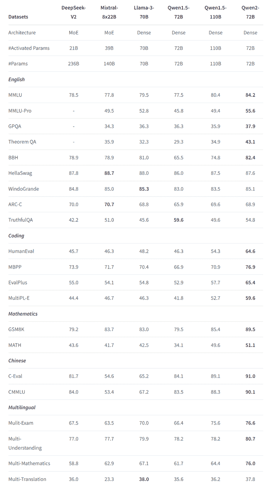

Base模型

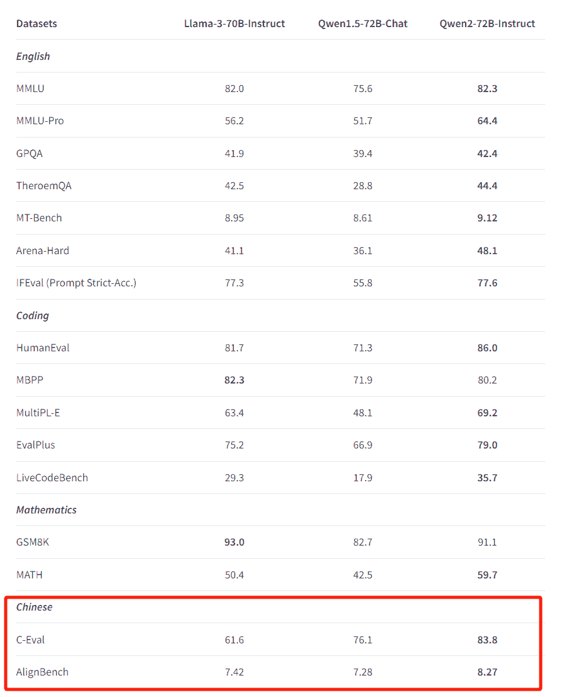

Instruct模型

Qwen2-57B-A14B MoE模型相较于32B级别模型，不仅效果更好，推理速度也是更快。

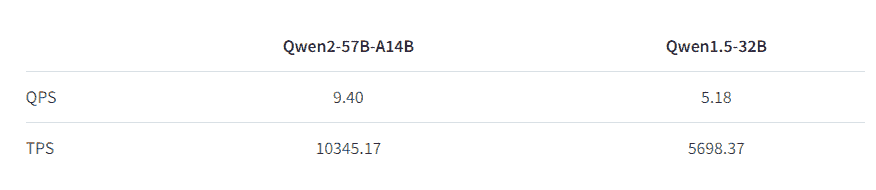

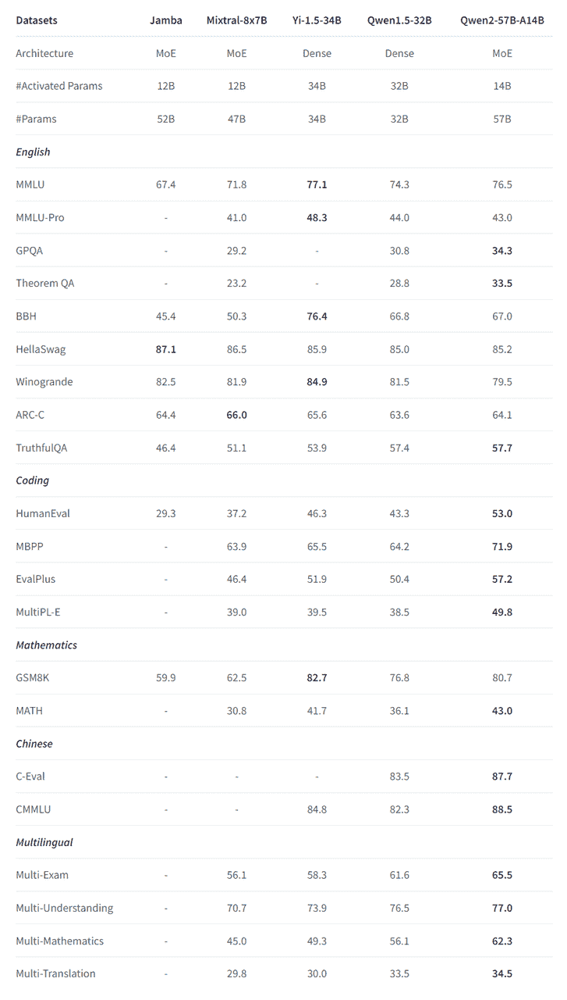

##  利用Agent解决大模型上下文窗口问题

同时，还发一篇贴，主要介绍如何让8K上下文长度模型更好地理解百万字词的文档。

```
blog: https://qwenlm.github.io/blog/qwen-agent-2405/
```

涉及三个级别：

+   Level1：采用正常增强检索生成，将上下文分成小块，最后仅保留最相关的块，长度限制在8k上下文中，利用大模型进行回复。

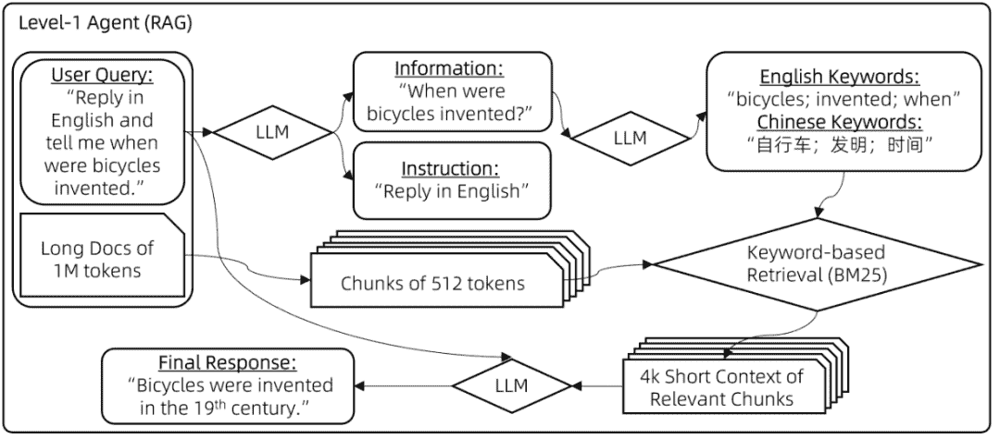

+   Level2：采用分块阅读，对每个小块均进行大模型并行预测，相关则返回相关句子，不相关则返回无，最后将相关句子融合在限制在8k上下文中，利用大模型进行最终回复。

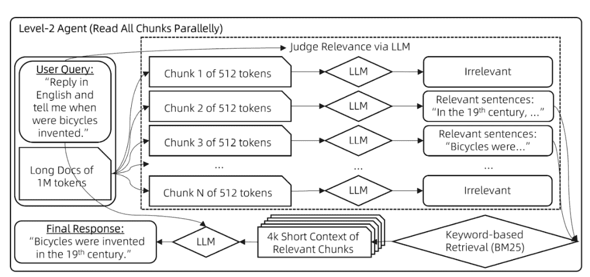

+   Level3：采用逐步推理，就是如果是复杂问题，则将问题拆解，并将拆解问题采用Level2的分块阅读方法，得到答案；再将答案与第二个问题组成新的问题，再次采用Level2的分块阅读方法，得到最终答案。

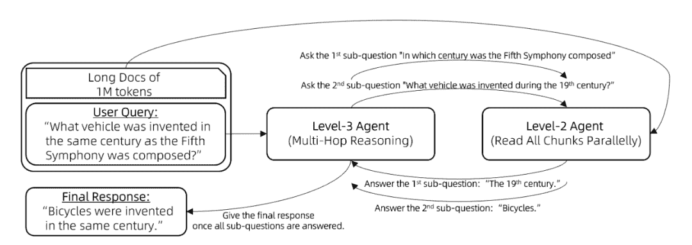

可以发现，Agent方法在大海捞针和LV-Eval上都要好于利用模型直接外推或RAG方法。

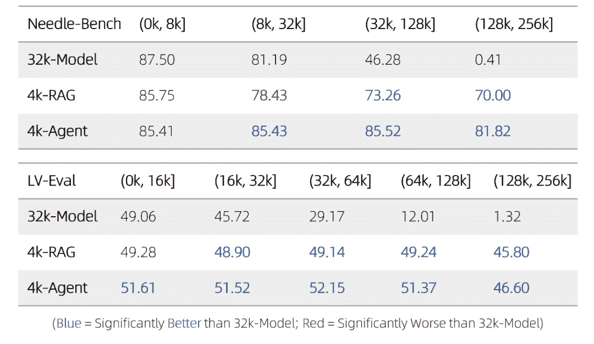

256K上下文实验

```
Agent框架：https://github.com/QwenLM/Qwen-Agent
```

##  **快速上手 **

直接transformers走起，以Qwen2-72B-Instruct模型为例。

[**PS：模型下载有困难的同**](https://mp.weixin.qq.com/s?__biz=Mzg5MTU1NTE1OQ==&mid=2247487260&idx=1&sn=a6db35312dd894c6df84bf9ba5515845&scene=21#wechat_redirect)学，详见我之前写的一篇文章 《大模型下载使我痛苦》 。

```
from transformers import AutoModelForCausalLM, AutoTokenizer

device = &quot;cuda&quot;
model = AutoModelForCausalLM.from_pretrained(&quot;Qwen/Qwen2-72B-Instruct&quot;, 
                                             torch_dtype=&quot;auto&quot;, 
                                             device_map=&quot;auto&quot;)
tokenizer = AutoTokenizer.from_pretrained(&quot;Qwen/Qwen2-72B-Instruct&quot;)

prompt = &quot;你知道刘聪NLP是谁吗&quot;
messages = [{&quot;role&quot;: &quot;system&quot;, &quot;content&quot;: &quot;You are a helpful assistant.&quot;},
            {&quot;role&quot;: &quot;user&quot;, &quot;content&quot;: prompt}]
text = tokenizer.apply_chat_template(messages,
                                     tokenize=False,
                                     add_generation_prompt=True)
model_inputs = tokenizer([text], return_tensors=&quot;pt&quot;).to(device)

generated_ids = model.generate(model_inputs.input_ids,
                               max_new_tokens=512)
generated_ids = [output_ids[len(input_ids):] for input_ids, output_ids in zip(model_inputs.input_ids, generated_ids)]
response = tokenizer.batch_decode(generated_ids, skip_special_tokens=True)[0]
```

##  **写在最后 **

Qwen2依然很硬核，全面开源，模型又多效果又好，不枉费期待那么久。

因为前一段时间Qwen2-72B-Instruct模型已经**在竞技场上了，期待**后面对战榜上的效果， 有望成为开源第一 。

开源真的越来越好了，现在有种莫名的幸福感。

[**欢迎多多关注**](https://mp.weixin.qq.com/s?__biz=Mzg5MTU1NTE1OQ==&mid=2247486601&idx=1&sn=dd2f338675de1448981bcfbe1efa71e3&scene=21#wechat_redirect)公众号「NLP工作站」， 加入交流群 ，交个朋友吧，一起学习，一起进步！