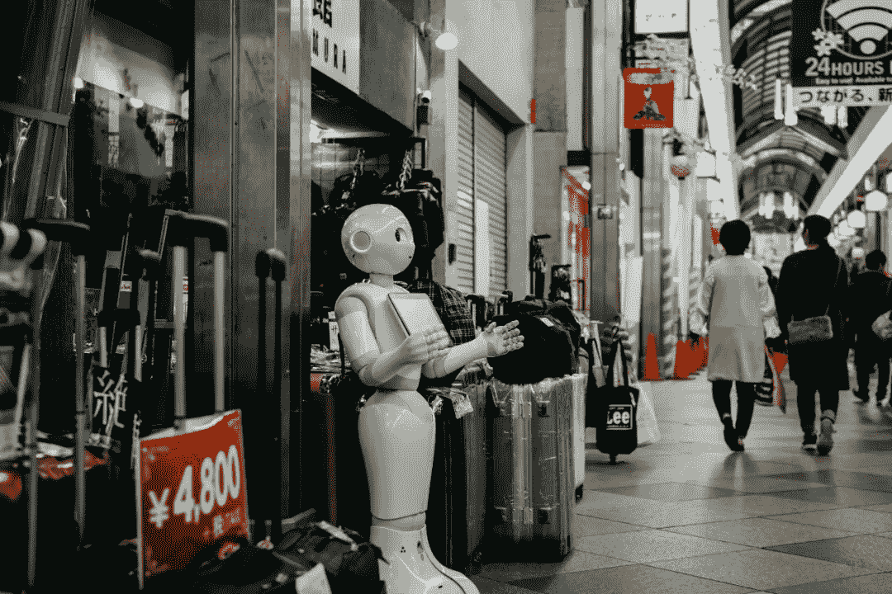
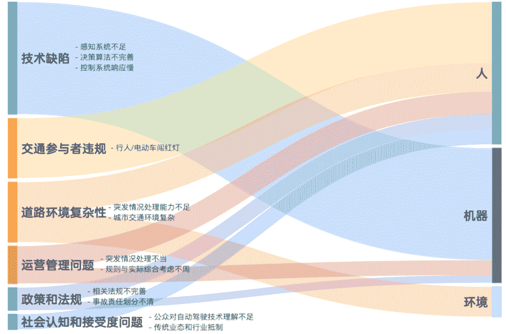
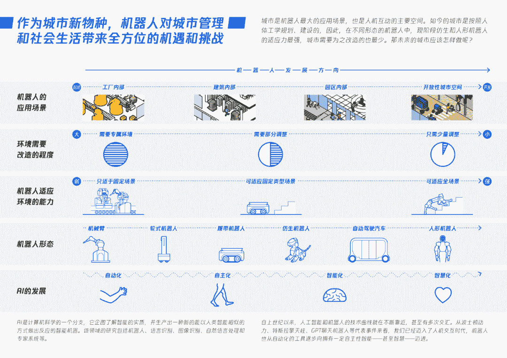
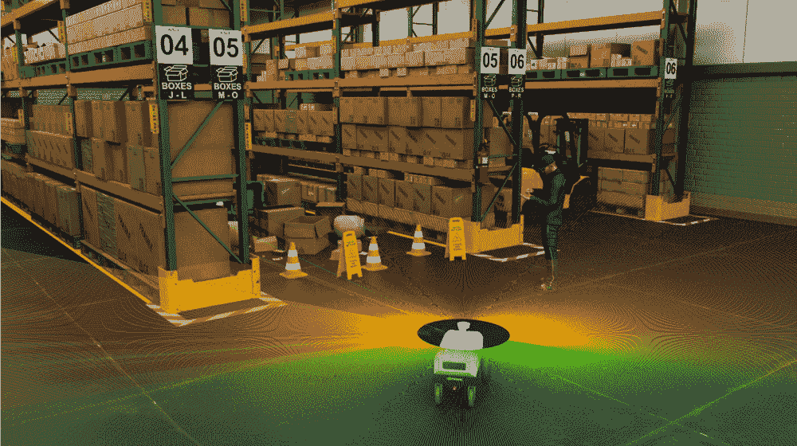
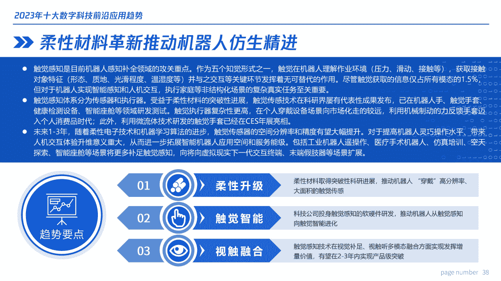
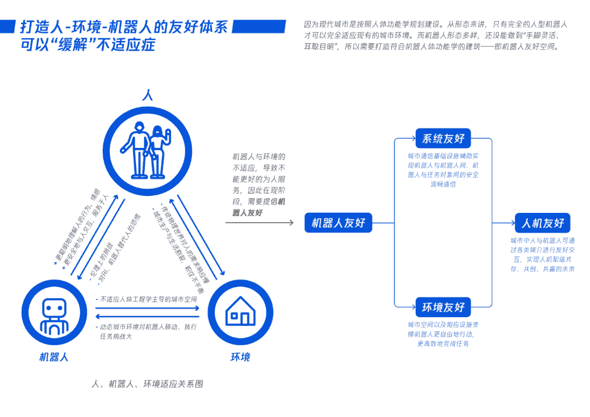

# 自动驾驶落地之难，提醒了机器人产业别忽视一个重要维度

> 来源：[https://agijuejin.feishu.cn/docx/ArxDdP4MQo6HmMxYSbMcumjnnIf](https://agijuejin.feishu.cn/docx/ArxDdP4MQo6HmMxYSbMcumjnnIf)

> 腾讯研究院｜[阅读原文](https://mp.weixin.qq.com/s/vZEAJ8WQ-u37xeeAi-ShvQ)

> 转载请联系原作者取得授权

**徐一平 ** 腾讯研究院高级研究员

### **前言：机器人与环境的不适配性**

武汉自动驾驶汽车与行人相撞事件，在社会层面引发了较为激烈的讨论。折射出当前技术水平下的自动驾驶汽车对人机关系、特别是社会接受度方面的挑战。

因自动驾驶汽车出现事故引发广泛讨论，已经不是第一次。根据经济观察报报道，本次事故是2024年7月7日下午，武汉市汉阳区发生一起涉及“萝卜快跑"无人驾驶出租车的交通事故。事故发生在鹦鹉大道与国博大道交叉口，无人车在绿灯亮起启动时与一名闯红灯的行人发生轻微碰撞。

当下，人们讨论人机关系剧烈变迁，往往从人机关系的冲突出发。以此次和既往事件为例，讨论重点通常多围绕无人车安全性，事故当事人和司机群体等。而容易忽略掉环境在其中扮演的重要因素 。

图表1 国内外公开新闻对自动驾驶汽车系列事故原因的分析

资料来源：根据AI对公开资料的分析，腾讯研究院助理研究员苏笠涵绘制，截止2024年7月11日

自**动驾驶汽车也可以说是一种机器人。主要是因为它们具备了智能决策、自主学习、环境适应和复**杂交互等机器人的核心特征。 容易忽略掉的是，机器人是具有实体形态的AI。既然是服务人类活动的物理实体，则必然存在在三维物理空间，存在在社会经济生产关系中。因此，不应忽视机器人与环境的不适配性。

自动驾驶汽车面临的问题也提示我们： 环境维度也是未来影响机器人落地应用、成为新质生产力的重要因素。

**而环**境应该是三个方面，除了社会环境，也包括物理环境和数字环境。物理环境包括但不限于机器人运行的城市、建筑和道路等物理空间，以及机器人硬件本体的交互环境；数字环境有计算、网络环境，也包括机器人训练的仿真环境等。

### **一、谁需要机器人？**

不知道你有没有这种经历：刚刚做完手术在家休养，凌晨2点从睡梦中惊醒，非常想喝一口温热的水，却因不能牵动伤口而无法起身。只能无奈推醒身边已经因为陪床一周、累到打鼾的家人。如果这时候家人非但没有一点脾气，反而在睡眼惺忪中一边道歉自己睡着了，一边快速起身去倒水，病人甚至会更加歉疚。

这段非常感性的描述就发生在我身边。其实，辅助饮水只是家庭照护的很小一个侧面。还有诸如环境控制、体位调整、体征监测甚至心理陪伴等都是极为典型的照护场景，却极容易因处理不当等综合因素，引发病人和照护者的双重压力。如果机器人能做为人工照护的补充，不仅可以提高病人的自主性和舒适度，也能减轻照护者的压力。

最近有一个新闻引发社会广泛关注，一位北大教授照护罹患重度阿尔兹海默老母亲，接受采访中教授明确提出希望能有机器人照护母亲。当然，还有一个原因是很难找到长期居家护工。

正如我在今年3月接受总台经济之声访谈的时候提到：在国家大力推动和布局下，在大模型带来机器人对任务理解能力增强等因素触发下，机器人有望成为一个‘智能执行体’，作为我们新一代交互终端，改变我们的城市生活，甚至整个生活范式。

图表2 作为城市新物种，机器人对城市管理和社会生活带来全方位的机遇和挑战

（资料来源：《人机友好空间探索》，腾讯研究院等）

[这](https://mp.weixin.qq.com/s?__biz=MjM5OTE0ODA2MQ==&mid=2650976474&idx=1&sn=ca6961554e7cbd59740de5e386bbc5fd&scene=21#wechat_redirect)当然是一个复杂、开放同时长期的话题。 在我最近一次与各界专家对话中，大家普遍认为家庭场景会在10年以上，而工厂包括公共空间会优先落地，最快预期3年。

**那我们的人机环境做好准备了吗？从这次武汉无人车事件**看，个人认为还有进一步探讨解题思路空间。

### **二、大模型催生机器人3.0阶段来**临，环境成为推动机器人落地应用的重要因素

如果从自动驾驶汽车也是机器人这个角度看，也反映了人机的交互紧密程度日渐加强。中国是全球主要的网联汽车 （也是大家说的无人驾驶汽车） 应用国之一。根据2024年6月公开数据，已经有至少16座城市允许公共道路测试无人驾驶汽车。而从全球看，2018年开始Uber、Waymo和Cruise等也在全球多个城市投产。

而包括自动驾驶汽车在内的机器人，走出真实物理空间前，需要在仿真器和实验室经过大量“出厂前培训”。 从训练的复杂程度来看，机器人难度更高。 举个简单的数据对比，不包含方向向量，人形机器人本体就有40多个关节。自动驾驶汽车则更为规则，动作主要包括左转、右转、前进、倒退、停止等。如果叠加各种复杂的环境和任务，难度系数会更高。

但**为什么我们已经可以在酒店、商场等环境中大量看到机器人？人形**机器人已经在工厂安装配件、在家里冲泡咖啡、叠衣服？ 相比于自动驾驶汽车，机器人的安全训练如何进行？如何提升机器人性能和环境响应水平，让我们感觉更放心？

就像汽车上要装载各种雷达、摄像头等传感器，机器人本身也会有很多信号采集装置来提高感知系统灵敏度。随着传感器技术的成熟和商业化，以及机器人运行规则算法被验证，扫地、配送机器人得以进入生活场景。我认为这是机器人从实现的技术能力来讲，应用2.0阶段已经实现的目标。 （1.0是应用在工业生产。）

而在大模型这一波技术浪潮中，AI对训练也起到非常决定性因素，来提高决策算法的鲁棒性以及响应速度。同时，本体柔性控制甚至穿戴电子皮肤的软硬一体化也在逐步突破中。这是应用3.0阶段需要突破的难点。目前我们看到的交通案例、家庭案例，也都反映了这个阶段的挑战。

### 三、物理环境和数字环境如何推动机器人进化？

机器人在出厂前进行模拟训练，以提高AI的能力，从而避免撞人？ 我采访了腾讯Robotics X实验室的高级研究员田野。田野认为攻克机器人安全难题目前主要围绕三个层面展开。在上层 （规划层 ） ，机器人需要能够深度理解复杂逻辑和世界知识，比如居家环境，不能把铁盘子放在微波炉发热。在中层 （控制层 ） ，更多是仿真和真实训练。通过给机器人设定安全强化学习的奖励和惩罚，来不断鼓励机器人规避危险。这个过程中，模型就像小孩子蹒跚学步的时候，摔倒的痛苦让小孩子学会避免危险动作。而在底层 （本体侧） ，机器人的本体也需要更加进化，通过合理的机械限位设计限制机器人的运动范围、力、扭矩和触觉传感器使用则让机器人更好地感知反馈。

图表3 Isaac Sim 2022.2机器人模拟

（资料来源：https://developer.nvidia.com/zh-cn/blog/accelerate-ai-enabled-robotics-with-advanced-simulation-and-perception-tools-in-nvidia-isaac-platform/）

**那**么进展如何呢？总结来说，当前仿真环境无法完全模拟真实物理环境；具身智能的仿真训练更是着重在机器人本身的性能。

首先，在模型方面，当前机器人的大模型主要在大脑和小脑的研究。云端大模型主要是解决上层规划问题，小脑更像人的应激反应，在机器人本体上会更加有效。田野以Figure 01举例：上层是大语言模型，而每个抓取放置的任务即每个动作由小模型支撑。在训练中，会通过给机器人强化学习的奖励和惩罚，或者通过模仿学习，让机器人建立“安全意识”。

当前，仿真训练因为已经非常经济，所以被广泛使用。这就需要大量真实和模拟数据喂给机器人做学习、训练和进化。而数据缺乏是当前工程化难题之一。 这个在我作为主理人的对话中，银河通用机器人公司创始人王鹤有详细说明。

但是另一方面，训练中的covercase永远无法穷举。一线城市的交通干道交叉路口，人机混合的密度非常高。这就进一步要求机器人和人一样拥有进化学习的能力，以此需要处理突发情况。

除了仿真训练，在机器人本体中要有性能良好的计算设备，可以处理端侧的模型和规则，让机器人的小脑更发达。此外，还需要数字环境例如相对高速、流畅的网络环境加持，以此应对机器人“断网”无法调用云端大模型的问题。这是机器人在数字环境面临的一些主要挑战和应对思路。

举几个数据的例子。自动驾驶汽车需要非常灵敏的环境感知能力才能规避危险，因而对端侧算力要求极高。2022年地平线联合创始人&CTO黄畅表示，目前自动/智能驾驶领域行业的基础算力需求是：L2级需10TOPS左右；L2+则需要几十TOPS；L3需要100TOPS以上；L4需要1000TOPS，要充分满足L4级要求，甚至需要几千个TOPS，这对经济性是极大的挑战。而对机器人大模型来说，以能够推理7B大模型的单张NVIDIA A100举例，其TOPS峰值达1248，腾讯Robotics X实验室田野认为。因而，建立云边端协同的数字算力环境，对保障各类机器人的感知、计算和处理能力至关重要。

此外，给机器人赋予多模态特别是触觉感知，在3.0阶段的人机交互中至关重要。我在 《2023年十大科技应用趋势报告》 机器人专篇中，研究了柔性材料革新对机器人感知补全的重要作用。尽管触觉获取的信息仅占所有模态的1.5%，但对于机器人实现智能感知和人机交互，执行家庭等非结构化场景的复杂真实任务至关重要。

图表4 柔性材料革新推动机器人仿生精进

（资料来源：《2023年十大科技应用趋势报告》，腾讯研究院）

### 四、我们应该忧虑发展中的新科技吗？

当前，机器人目前还没有走出建筑执行自动化无人服务。人机交互密度最高的酒店机器人如何避免撞人，可以一定程度解答我们对人机交互安全性的疑虑。

中国是全球应用机器人酒店绝对值数量最高的国家。根据估算，目前国内机器人投放量已经超过4万家酒店，平均每1000平的酒店客房面积就有一个机器人服务。在雄安，已经有机器人在商务中心提供包括会议支持在内的各项服务。

如果你是一个出差在外、应酬到很晚的空中飞人，一定有过深夜醒来，呼叫酒店服务的经历。我想，如果机器人在凌晨两点敲响你的房门，从机仓中取出矿泉水，应该不会让机器人有“起床气”，也不会让饱受差旅辛苦的你产生愧疚。

2.0阶段，往往通过强化机器人地图构建能力，应用VSLAM技术进行机器识别并标定禁行线。此外，强化避障算法和传感，防止与行人发生冲突并能更好、更灵敏地识别地面上障碍物。另外，酒店机器人也是低速无人驾驶，一般控制在1.2-1.8m/s。

当前在酒店中，三个环境对机器人的运行仍有一定影响。在物理环境方面，因酒店环境特殊性造成的隐患，比如清洗地毯、会议设备设施、装饰品摆放等造成的地面环境改变造成机器人识别故障引起的机器人路径识别错误；在社会环境层面，在电梯中与人或其他发生优先乘坐电梯的纠纷；在数字环境层面，酒店组网方式让机器人在电梯或角落位置出现的通信失败等等。

图表5 机器人面临三类不适应症

（资料来源：《2023年十大科技应用趋势报告》，腾讯研究院）

### 五、重视环境，特别是新科技在城市空间的双向适配

机器人的目标，应该是更好地利用物理规则、模仿人类思考、行为方式和智能，从而帮助人类解决问题。当下，人们讨论人机关系剧烈变迁，往往忽略了机器人是具有实体时态的AI。既然是服务人类活动的物理实体，则必然存在在三维物理空间，存在在社会经济生产关系中。

因此，应该从人-机-环三者关系看待机器人，并为其更好地为人服务，探索让机器人和环境双向适配的合理路径。腾讯研究院多家单位联合[腾讯Robotics ](https://mp.weixin.qq.com/s?__biz=MjM5OTE0ODA2MQ==&mid=2650976523&idx=1&sn=62116fc63bef65402880e775c1eba8b4&scene=21#wechat_redirect)X实验室、腾讯基建、清华大学未来实验室、清华大学无障碍发展研究院和帝都绘、机器人大讲堂编制完成的 《人机友好空间探索》 在7月8日研究院主办的AI&Society论坛发布 ， 文字版将于近日正式发布。在研究中，我们建议打造人-机-环友好体系，让机器人和环境更好的“双向奔赴“，最终目标是推动更好地为人服务。

图表6 人机器友好理论体系

资料来源：《人机友好空间探索》，腾讯研究院等

在 《2022年十大科技应用趋势报告》 中我们研判：随着多模态融合感知、非结构化场景AI分析与柔性本体等核心技术的突破，家庭服务机器人有望成为新蓝海。在城市道路、酒店、工厂和家居等各类人居环境中机器人逐步会从新物种变成人类的助手。

就业替代还是就业补充成为被广泛讨论的议题，其实反应了对三个环境中的社会环境的重视。从我们的调研中，也看到了机器人这个新物种出现后催生的一些“新岗位”。比如机器人遥操作员、机器人厨师培训师：遥操作员成为了具身智能训练、处理机器人故障的必备一环；从颠勺到编菜单，厨师成为了炒菜机器人的“老师”。这可能是未来新型人机关系的一瞥。人机环境的双向适应性改造，则为整合这类科技创新资源，形成新质生产力提出了一个新的思路。

> **参考资料:**

> [1] https://mp.weixin.qq.com/s/aYi2atucpavTV8h7Xqp70A

> [2] https://cn.nytimes.com/business/20240613/china-driverless-cars/

> [3] https://new.qq.com/rain/a/20240709A04X6P00

> [4] https://cn.nytimes.com/business/20240614/china-driverless-car-safety/

> [5] https://www.bbc.com/zhongwen/simp/science-59593949

> [6] https://xxgk.mot.gov.cn/2020/jigou/ysfws/202312/t20231205_3962490.html

> [7] https://www.chinaev100.com/focus/detail/273?catid=44

> [8] https://finance.sina.com.cn/roll/2024-07-09/doc-inccptpc0320474.shtml

> [9] http://mp.cnfol.com/26196/article/1720530004-141411190.html

> [10] https://m.yicai.com/news/102182983.html

> [11] https://www.163.com/dy/article/J6O2NIE805359IL8.html

> [12] https://www.fortunechina.com/shangye/c/2024-07/10/content_456096.htm

> [13] https://mp.weixin.qq.com/s/bR2tRrCUIKONL1aLtu0Yfw