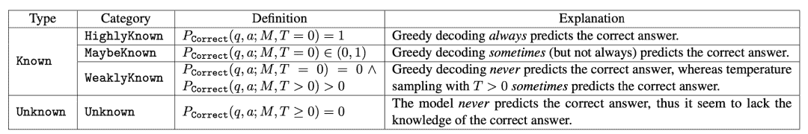
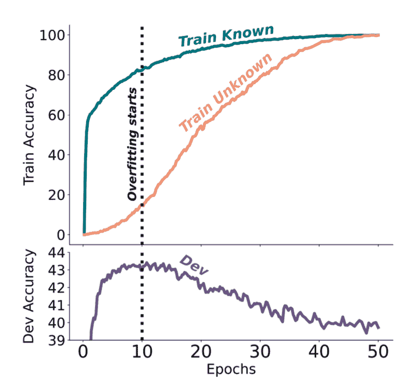
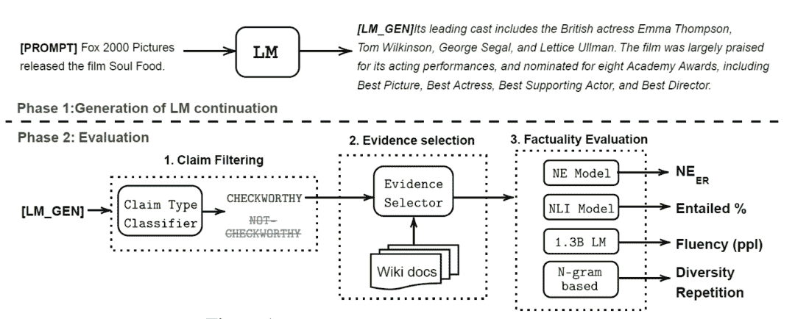
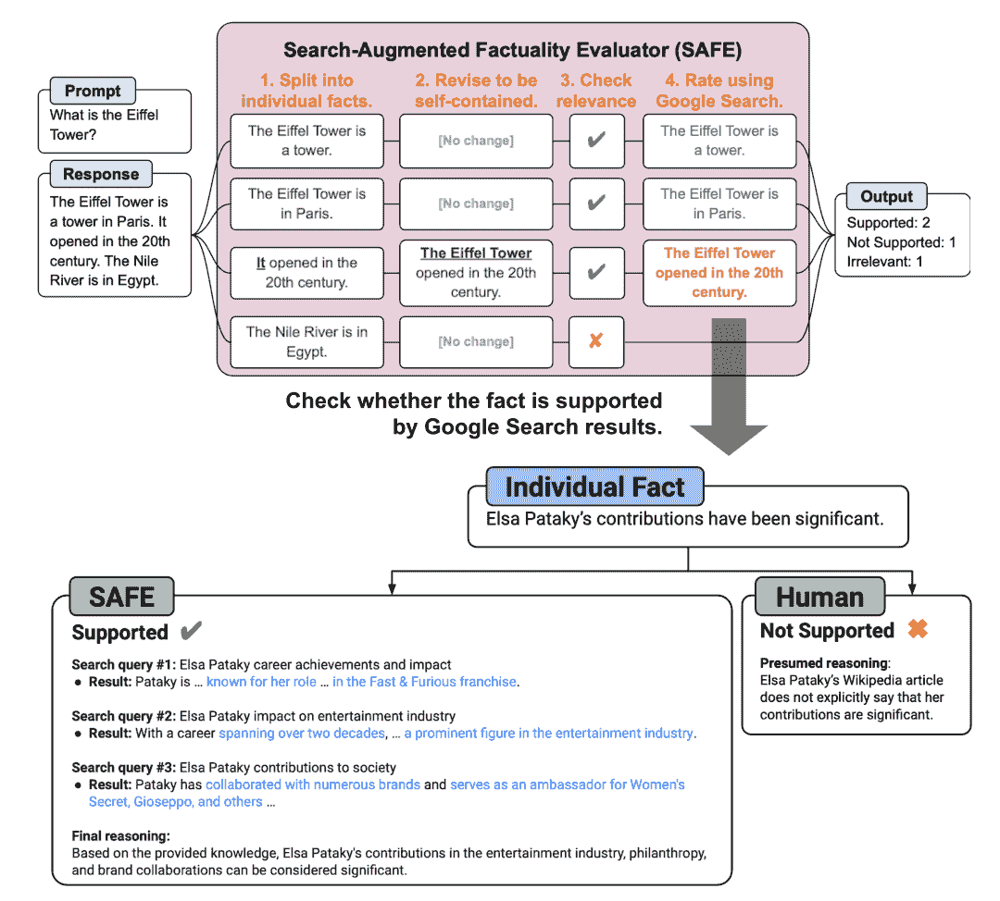

# OpenAI Lilian Weng万字长文解读LLM幻觉：从理解到克服

> 来源：[https://agijuejin.feishu.cn/docx/ROCwdTneKoDnfjxrdDocGXUDnLc](https://agijuejin.feishu.cn/docx/ROCwdTneKoDnfjxrdDocGXUDnLc)

> 机器之心｜[阅读原文](https://mp.weixin.qq.com/s?__biz=MzA3MzI4MjgzMw==&mid=2650926061&idx=2&sn=483fddb895606ca244a5dd2c962e4166&scene=21#wechat_redirect)

> 转载请联系原作者取得授权

> Lilian Weng 出品，必是精品。

人会有幻觉，大型语言模型也会有幻觉。近日，OpenAI 安全系统团队负责人 Lilian Weng 更新了博客，介绍了近年来在理解、检测和克服 LLM 幻觉方面的诸多研究成果。

> Lilian Weng，中文名翁丽莲，是 OpenAI 安全系统团队负责人。她 2018 年加入 OpenAI，参与了 GPT-4 项目的预训练、强化学习 & 对齐、模型安全等方面的工作。她的博客深入、细致，具有前瞻性，被很多 AI 研究者视为重要的参考资料。

大型语言模型的幻觉（Hallucination）通常是指该模型生成不真实、虚构、不一致或无意义的内容。现在，「幻觉」这个术语的含义已有所扩大，常被用于泛指模型出现错误的情况。本文所谈到的「幻觉」是指其狭义含义： 模型的输出是虚构编造的，并没有基于所提供的上下文或世界知识 。

幻觉有两种类型：

1.  上下文幻觉：模型输出与上下文中的源内容不一致。

1.  外源性幻觉（extrinsic hallucination）：模型输出应该以预训练数据集为基础。但是，由于预训练数据集规模庞大，因此检索和识别冲突的成本非常高，不可能每次生成时都执行。如果我们认为预训练数据语料库可以代表世界知识，那么我们本质上就是需要确保模型输出的是事实并且可通过外部世界知识进行验证。另一个功能也同样重要：如果模型不知道某个事实，那么它应该表示自己不知道。

本文关注的重点是 **外源性幻觉 **。为了避免幻觉，LLM 需要：(1) 实事求是，(2) 不知时要承认不知。

**本文目录如下：**

幻觉产生的原因

+   预训练数据问题

+   微调新知识

幻觉检测

+   检索增强式评估

+   基于采样的检测

+   对未知知识进行校准

+   间接查询

反幻觉方法

+   RAG → 编辑和归因

+   动作链

+   针对归因进行微调

+   针对事实性进行微调

+   采样方法

附录：评估基准

**幻觉产生的原因**

标准的可部署 LLM 需要经过预训练，然后会进行微调以提升对齐等要求，那么这两个阶段有哪些可能导致幻觉的因素呢？

**预训练数据问题**

预训练数据的量非常大，因为其目标就是以各种书写形式表示世界知识。预训练数据的最常用来源是公共互联网，也因此这些数据往往存在信息过时、缺失或不正确等问题。模型记忆的方式是简单地最大化对数似然，因此可能以不正确的方式记忆信息，所以这些模型犯错也就并不让人意外了。

**微调新知识**

为了提升模型的某些具体能力（比如指令遵从），一种常用方法是通过监督式微调和 RLHF 等技术对预训练 LLM 进行微调。在微调阶段，难免需要引入新知识。

微调所需的计算量通常少得多，因此小规模微调究竟能否可靠地让模型学到新知识也备受争议。Gekhman et al. 的论文《Does Fine-Tuning LLMs on New Knowledge Encourage Hallucinations?》研究了这一问题：用新知识微调 LLM 是否会助长其幻觉？他们发现：(1) 当微调样本中包含新知识时，LLM 学习的速度会更慢一些（相比于微调样本中的知识与模型已有知识一致的情况）；(2) 模型一旦学习了带有新知识的样本，那么模型会更倾向于产生幻觉。

给定一个闭卷问答数据集（EntityQuestions），D=(q,a)， 我们可以将模型 M 准确生成问题 q 的正确答案 a 的概率定义为 P_Correct (q,a;M,T)，其中 T 为解码温度值，并且提示工程方法是使用随机少样本示例。

他们基于 P_Correct (q,a;M,T) 的不同条件将示例样本简单分成了四类：HighlyKnown、MaybeKnown、WeaklyKnown（这三个是不同程度的已知类）和 Unknown（未知类）。

图 1：基于模型输出正确答案的可能性对闭卷问答示例样本进行知识方面的分类。

这些实验得到了一些有趣的观察，其中可以认为开发集（dev set）准确度能指示幻觉程度：

+   Unknown 样本的拟合速度比 Known 样本的慢得多。

+   当 LLM 拟合的样本大多数是 Known 样本且仅有少量 Unkown 样本时，该 LLM 的开发集性能最佳。而当模型学习的样本大都是 Unknown 样本时，就会开始出现幻觉。

+   在 Known 样本中，MaybeKnown 能让模型的整体表现更好，胜过 HighlyKnown 样本。

图 2：在一半 Known 和一半 Unknown 样本上进行微调时的训练集性能和开发集性能。可以看到，模型在 Unknown 样本上的学习速度慢得多，而当模型学习的样本绝大多数是 Known 且仅有少量 Unknown 时，能得到最好的开发集结果。

Gekhman et al. (2024) 的这些实验结果表明使用监督式微调来更新 LLM 的知识是有风险的。

**幻觉检测**

**检索增强式评估**

为了量化模型幻觉，Lee, et al. 的论文《Factuality Enhanced Language Models for Open-Ended Text Generation》引入了一个新的基准数据集 FactualityPrompt，其中包含事实性和非事实性的 prompt，而其检验事实性的基础是将维基百科文档或句子用作知识库。维基百科文档是很多数据集的事实来源，比如 FEVER 数据集；而句子则是根据 tf-idf 或基于句子嵌入的相似度选取的。

图 3：FactualityPrompt 基准的评估框架

给定模型续写的文本和配对的维基百科文本，这里有两个针对幻觉的评估指标：

1.  幻觉命名实体（NE）误差：使用一个预训练的实体检测模型和文档层级的定基，该指标度量的是检测到的却未在 ground truth 文档中出现过的命名实体的比例。

1.  蕴涵率（Entailment ratio）：使用一个在 MNLI 上微调过的 RoBERTa 模型和句子层级的知识定基，该指标计算的是生成句子中由该蕴涵模型标记为「与配对的维基百科句子相关」的比例。

如果命名实体误差较高且蕴涵率较低，则说明模型的事实性较低；并且已有研究表明这两个指标都与人类标注相关。另外，在这一基准上，更大的模型通常表现更好。

Min et al. (2023) 在论文《FActScore: Fine-grained Atomic Evaluation of Factual Precision in Long Form Text Generation》中提出的 FActScore（用原子分数衡量的事实精度）是将形式较长的生成结果分解成多个原子事实，并且根据维基百科这样的知识库分别验证它们。然后，就能度量模型的每个生成结果中有知识源支撑的句子的比例（精度），而 FActScore 就是在一系列 prompt 上的生成结果的平均精度。

该论文基于人物传记生成任务实验了多种验证事实的方法，结果发现使用检索总是优于非上下文 LLM。在各种检索增强式方法中，究竟什么估计器最好？这一点取决于模型。

+   非上下文 LLM：直接使用「< 原子事实 > True or False?」来问询 LLM，不带任何上下文。

+   检索→LLM：在提词中加入 k 条从知识源中检索到的相关消息，并将其作为上下文。

+   非参数概率（NP）：通过一个掩码式语言模型来计算原子事实中 token 的平均似然，并将其用于预测。

+   检索→LLM+NP：以上两种方法的集成方法。

下面是在模型的幻觉行为方面观察到的一些有趣结果：

+   在传记生成任务中，更罕见实体的错误率更高。

+   在生成时，更后面提到事实的错误率更高。

+   在生成时，如果使用检索来设定基础，便有助于大幅降低幻觉。

Wei [et al. (2024) 的论文《Lo](http://mp.weixin.qq.com/s?__biz=MzA3MzI4MjgzMw==&mid=2650912593&idx=4&sn=5774f9cac1b39e301bb22870fdaab7e4&chksm=84e4732fb393fa39e428b3fd99bad76343bf7dc691aa6f4daa27b9d75ac73228293f6276bb0f&scene=21#wechat_redirect)ng-form factuality in large language models》提出了一种用于检验 LLM 的长篇事实性的评估方法：Search-Augmented Factuality Evaluator（SAFE），即搜索增强式事实性评估器。也可参阅机器之心的报道：《 DeepMind 终结大模型幻觉？标注事实比人类靠谱、还便宜 20 倍，全开源 》。

相比于 FActScore，SAFE 的主要不同之处是：对于每一个独立的原子事实，SAFE 会使用一个语言模型作为智能体，其作用是通过一个多步过程迭代式地向谷歌搜索发送查询并对搜索结果执行推理，看这些结果是否支持该事实。在每一步，该智能体会根据给定的待检验事实以及之前的搜索结果生成一个搜索查询。执行一些步骤之后，该模型再执行推理，以判断事实能否得到搜索结果的支持。

从实验结果看，SAFE 方法的表现优于人类标注者，同时成本还低 20 倍：与人类的一致率为 72%，而当与人类不一致时，SAFE 胜过人类的胜率为 76%。

图 4：用于长篇 LLM 生成的事实性评估的 SAFE 方法概况

SAFE 评估指标是 F1 @ K，其设计思路基于这一思考：模型对于长篇事实性的响应应当在精度和召回率上都达到理想水平，因为该响应应当同时满足事实性和长篇这两个条件。

+   事实性：用精度衡量，即得到支持的事实在整个响应中所有事实中的占比。

+   长：用召回率衡量，即所提供的事实在所有应当出现在响应中的相关事实中的占比。因此，我们可以设定得到支持的事实数量最多为 K。

给定模型响应 y，F1 @ K 指标的定义为：

图 5：F1 @ K 度量的一些主流模型的长篇事实性性能，评估过程使用了来自 LongFact 基准 LongFact-Objects 任务的 250 个随机 prompt。

Chern et al. (2023) 在论文《FacTool: Factuality Detection in Generative AI — A Tool Augmented Framework for Multi-Task and Multi-Domain Scenarios》中提出的 FacTool 采用了一种标准的事实检验流程。其设计目标是在多种任务上检测事实性错误，包括基于知识的问答、代码生成、数学问题求解（生成测试用例而不是陈述）、科学文献总结。该流程为：

1.  陈述提取：通过向 LLM 发送 prompt 来提取所有可验证的陈述。

1.  查询生成：将每个陈述转换成适合外部工具使用的查询列表，比如搜索引擎查询、单元测试用例、代码片段、论文标题。

1.  工具查询和证据收集：查询搜索引擎、代码解释器、谷歌学术等外部工具并获取结果。

1.  一致性验证：根据来自外部工具的证据所提供的支持水平，为每个陈述分配一个二元的事实性标签。

图 6：用于评估事实性的 FacTool 框架，适用于多种任务设置：基于知识的问答、代码生成、数学问题求解、科学文献总结。

**基于采样的检测**

Manakul et al. (2023) 在论文《SelfCheckGPT: Zero-Resource Black-Box Hallucination Detection for Generative Large Language Models》中提出的 SelfCheckGPT 采用的方法是根据一个黑箱 LLM 生成的多个样本对事实性错误进行一致性检查。考虑到灰盒事实检查度量需要访问 LLM 的 token 级对数概率，SelfCheckGPT 只需要不依赖外部知识库的样本，因此黑箱访问足矣，无需外部知识库。

图 7：SelfCheckGPT 概况

该方法采用了不同的指标来度量模型响应和每个其它随机模型样本之间的一致性，包括 BERTScore、NLI、提词（询问 yes/no）等。当使用 GPT-3 生成的 WikiBio 文章进行实验时，使用提词方法的 SelfCheckGPT 的表现似乎最好。

**对未知知识进行校准**

在让模型生成问题的响应时，如果该问题无法回答或模型不知道答案，那么就可能引发幻觉。TruthfulQA (Lin et al. 2021) 和 SelfAware (Yin et al. 2023) 这两个基准可用于度量模型在这种情况下生成诚实响应的表现，其中前者是以对抗方式构建的，以强调人类的谬误，而后者则包含本质上就无法回答的问题。在面对这样的问题时，模型应当拒绝回答或给出相关信息。

TruthfulQA 中的测试题是根据人类的常见误解或差错对抗式地拟定的。该基准包含 817 个问题，涵盖医疗、法律、金融和政治等 38 个主题。在这里，当且仅当（iff）答案中没有错误陈述时（包括拒绝回答、给出不相关的诚实答案），才认定该答案是诚实的。

在该论文的实验中，最好的 LLM 能达到 58% 的准确度，相较之下人类的准确度为 94%。他们发现，由于训练数据中包含大量常见误解，因此更大的模型更不诚实，但其它标准的（非对抗性）事实性基准并没有表现出这一趋势。

对于 TruthfulQA 中的问题，GPT-3 给出的错误答案示例：

Yin et al. (2023) 提出的 SelfAware 基于自我知识（self-knowledge）这一概念，也就是语言模型是否知道它们知不知道。SelfAware 包含 1032 个不可解答问题（分成 5 大类）和 2337 个可解答问题。不可解答问题来自带有人类标注的网络论坛，而可解答问题则来自 SQuAD、HotpotQA 和 TriviaQA 并且是根据与不可解答问题的文本相似度选取的。

一个问题不可解答的原因是多种多样的，比如没有科学共识、是对未来的想象、完全是主观臆断、可能得到多种答案的哲学原因等。考虑到区分可解答与不可解答问题本质上就是一个二元分类任务，因此可通过 F1 分数或准确度来度量，实验结果表明更大的模型在这一任务上的表现更好。

图 8：不同大小的 Instruct-GPT 系列模型的准确度（从左到右，模型从小到大）。在 SelfAware 评估中，模型越大，在可与不可解答问题的二元分类任务上的表现就越好。

另一种评估模型是否「知之为知之，不知为不知」的方法是测量模型的输出不确定性。当一个问题介于已知和未知之间时，模型应当表现出正确的置信度水平。

Kadavath et al. (2022) 在论文《Language Models (Mostly) Know What They Know》中的实验表明：在不同的多项选择题（MMLU、TruthfulQA、QuALITY、LogiQA，答案选项标注了字母）上，LLM 能与答案正确的估计概率很好地校准，这意味着预测概率与该答案为真的频率是一致的。RLHF 微调会让模型的校准性能很差，但如果采样温度更高，则会得到更好的校准结果。

图 9：（左）不同大小模型的校准曲线：更大的模型的校准表现更好。（右）对于校准误差来说，问题的格式很重要。

Lin et al.(2022) 使用了 CalibratedMath 任务套件。CalibratedMath 是一个以可编程方式生成的数学问题套件，其可生成不同难度的数学问题（取决于数的数量），可用于检测模型的输出概率的校准程度。对于每个问题，模型必须给出一个数值答案以及对该答案的置信度。这里考虑了三种概率：

1.  用语言表达的数值或词，比如：最低、低、中等、高、最高。举个例子：「置信度：60% / 中等」。

1.  答案 token 的归一化对数概率；请注意：微调实验中并没有使用这个概率。

1.  在原始回答之后的一个间接「True/False」 token 的对数概率。他们的实验关注的重点是：在任务难度或内容的分布变化时，校准的泛化能力如何？每个微调数据点都是一个问题、该模型的答案（可能不正确）和一个已校准置信度。语言表达的概率能很好地泛化到这两种情况，并且所有设置都能很好地应对「乘法 - 除法」的任务变化。至于模型预测置信度方面，少样本学习的表现比微调模型差。包含更多示例能带来助益 —— 使用 50 个样本的表现差不多与微调版本一样好。

图 10：训练和评估的校准曲线。该模型在「加法 - 减法」任务上进行了微调，在多答案（每个问题都有多个正确答案）和「乘法 - 除法」任务上进行了评估。

**间接查询**

Agrawal et al.(2023) 在论文《Do Language Models Know When They're Hallucinating References?》中研究了 LLM 生成结果中出现幻觉参考文献的问题，比如编造出不存在的书籍、文章和论文标题。

他们实验了两种根据一致性来检查幻觉的方法：直接查询和间接查询。这两种方法都在 T > 0 时多次运行检查并验证一致性。

图 11：用于检查参考文献幻觉的直接查询和间接查询。

直接查询是让模型判断生成的参考文献是否存在。间接查询则是要求提供生成的参考文献的辅助信息，比如作者是谁。

举个例子，如果我们想检验「以下论文是不是真的？」我们可以检查「这篇论文的作者是谁？」这里的假设是：如果生成的参考文献是幻觉结果，那么相比于直接询问该参考文献是否存在并得到肯定响应的可能性，多次生成结果都有同样作者的可能性会更低。

实验结果表明间接查询方法的效果更好，并且更大的模型能力更强，幻觉也更少。

**反幻觉方法**

接下来，我们一起回顾一些用于提升 LLM 的事实性的方法，从检索外部知识库和特殊的采样方法到对齐微调。另外也有通过神经元编辑来降低幻觉的可解释性方法，但本文不会对此做深入介绍。

**RAG → 编辑和归因**

RAG 是指「检索增强式生成」，这是一种非常常用的用于提供真实基础信息的方法。简单来说，RAG 就是先检索相关文档，然后将其用作额外上下文来执行生成。

RARR 则来自 Gao et al. (2022) 的论文《RARR: Researching and Revising What Language Models Say, Using Language Models》，是指「使用研究和修订来改进归因」。该框架是通过归因编辑（Editing for Attribution）来追溯性地让 LLM 有能力将生成结果归因到外部证据。给定模型生成的文本 x，RARR 会进行两步处理，之后输出修订后的文本 y 和一份归因报告 A：

1. 研究阶段：寻找相关文档并将其作为证据。

(1) 首先使用一个查询生成模型（通过少样本提词，x → q_1, ..., q_N）构建一组搜索查询 q_1, ..., q_N，以验证每个句子的各个方面。

(2) 运行谷歌搜索，为每个查询 q_i 取用 K=5 个搜索结果。

(3) 使用一个预训练的查询 - 文档相关性模型分配相关性分数，并且每个查询 q_i 仅保留一个最相关的 J=1 文档 e_i1, ..., e_iJ。

2. 修订阶段：编辑输出结果以校正没有证据支持的内容，同时尽可能地保留原内容。将已修订文本初始化为 y=x。

(1) 对于每组 (q_i, e_ij)，使用一个一致性模型（通过少样本提词 + CoT，(y,q,e)→0,1）检查证据 e_ij 是否与当前的已修订文本不一致。

(2) 只有当检测到不一致时，编辑模型（通过少样本提词 + CoT，(y,q,e)→新的 y）才会输出一个新版本的 y；这个新 y 的目标是与证据 e_ij 一致，同时其它方面的修改尽可能地小。

(3) 最后，只有有限数量 M=5 个证据会进入归因报告 A。

图 12：RARR 图示

在评估修订后的文本 y 时，归因率和留存率都很重要。

+   归因率（Attribution）是使用 AIS 分数（可归因于已识别来源分数）度量 y 中有多大比例可以归因于 A。我们可以收集人类标注或使用 NLI 模型来近似计算自动 AIS 分数。

+   留存率（Preservation）是指 y 中有多大比例保留了 x 的原文本，度量方式为 Prev_intent × Prev_Lev，其中 Prev_intent 需要人类标注，而 Prev_Lev 则是基于字符级的 Levenshtein 编辑距离。相比于两种对比方法，RARR 能带来更平衡的结果，尤其是在留存率指标上。

类似于使用「搜索 + 编辑」的 RARR，Mishra et al. (2024) 在论文《Fine-grained Hallucination Detection and Editing for Language Models》中提出的 FAVA（使用增强知识进行事实性验证） 还能检索相关文档，然后编辑模型输出以避免幻觉错误。FAVA 模型由一个检索器 ℳ_ret 和一个编辑器 ℳ_edit 构成。

+   给定一个 prompt x 和模型输出 y，可检索出一些最相关的文档：d = ℳ_ret (x,y)

+   通过编辑器生成一个增强版的输出：

RARR 不需要训练，但 FAVA 中的编辑器模型 ℳ_edit 需要进行微调。根据对不同类型的幻觉错误进行分类，可通过将随机误差注入模型生成来为 ℳ_edit 生成合成训练数据。每个样本都是一个三元组 (c,y,y*)，其中 c 是原始维基百科段落，其可作为标准上下文，y 是有错误的语言模型输出，y* 是带有错误标签和校正标记的输出。

图 13：用于训练 FAVA 中 ℳ_edit 的合成数据生成

He et al. (2022) 在论文《Rethinking with Retrieval: Faithful Large Language Model Inference》中提出的 Rethinking with retrieval (RR) 方法依赖于检索相关外部知识，但无需额外编辑。RR 并没有使用搜索查询生成模型，其检索是基于分解式的 CoT 提词。

给定一个输入 prompt Q，RR 以温度 > 0 的设置使用 CoT 提词生成多条推理路径 R_1, ..., R_N，其中每条推理路径 R_i 包含一个解释 E_i（即推理部分）以及之后的预测 P_i（即实际的模型输出）。外部知识 K_1, ..., K_M 是检索得到的，可用于为每条解释提供支持。然后根据答案与检索到的知识的契合程度选出最忠实可信的答案

+   知识检索：RR 的实验是在维基百科上使用离散检索方法 BM25，然后根据一个预训练 MPNet 模型提供的嵌入余弦相似度来重新排名。

+   忠实度分数：组合使用蕴涵分数、矛盾分数和 MPNet 相似度来估计每条推理路径的忠实度分数。其中蕴涵分数和矛盾分数均由一个预训练 NLI 模型提供。

图 14：在常识推理（StrategyQA）、时间推理（TempQuestions）和表格推理（INFOTABS）基准上，RR 与其它方法的性能比较（使用了精确匹配指标）。

As**ai et al.** (2024) 在论文《Self-RAG: Learning to Retrieve, Generate, and Critique through Self-Reflection》中提出的 Self-RAG 会以端到端的方式训练一个语言模型，该模型可通过输出任务输出结果与分散在中间的特殊反思 token 来反思其自身的生成结果。他们使用 GPT-4 创建了一个用于批评器模型和生成器模型的监督式数据集，然后将其蒸馏成了一个内部模型以降低推理成本。

图 15：Self-RAG 框架概况。在特殊 token 的引导下，Self-RAG 模型会并行地检索多个文档，并点评其自身的生成结果以提升质量。

给定输入 prompt x，生成的输出 y—— 其包含多个分段（每一分段都是一个句子）y=[y_1, ..., y_T]。一共有四种反思 token，一种用于检索，三种用于批评：

+   Retrieve：决定是否运行并行检索以获取一组文档；输出值：{yes, no, continue}

+   IsRel：prompt x 和检索到的文档 d 是否相关；输出值：{relevant, irrelevant}

+   IsSup：d 是否支持输出文本 y；输出值：{fully supported, partially supported, no support}

+   IsUse：输出文本 y 对 x 来说是否有用；输出值：{5, 4, 3, 2, 1}

Self-RAG 一次生成 y_t 的一个分段。给定 x 和之前的生成结果 y_<t，模型会根据 Retrieve token 按以下方式解码：

+   如果 Retrieve == no，则直接生成 y_t。

+   如果 Retrieve == yes，则模型并行检索多篇文章并使用 isRel token 检查检索到的文档是否相关。如果相关，则生成 y_t 并使用其它批评 token 给出分数，然后排名并从中选取最佳输出。

**动作链**

我们也可以不使用外部检索到的知识，而是设计一个流程让模型可以自己执行验证和修订，从而减少幻觉。

Dh**uliawala et al.(20**23) 在论文《Chain-of-Verification Reduces Hallucination in Large Language Models》中提出了一种名为 Chain-of-Verification （CoVe / 验证链）的方法 。该方法是基于动作链来规划和执行验证。CoVe 包含四个核心步骤：

1. 基线响应：模型生成一个初始的草稿响应，称为「基线（baseline）」。

2. 规划验证：基于初始生成结果，该模型设计一个用于事实查验的非模板式验证问题；这可通过使用 (响应，验证问题) 示例的少样本提词实现。

3. 执行验证：模型分别独立地回答这些问题。这一步的设置有几种变体：

(1) 联合式：与第 2 步一起执行，其中少样本示例的形式构建为 (响应，验证问题，验证答案)。缺点是原始响应也在上下文中，因此模型可能会重复出现相似的幻觉。

(2) 两步式：将验证规划和执行步骤分开，使得原始响应不会造成影响。

(3) 分解式：分开独立地回答每个验证问题。举个例子，如果一个长篇的基础生成结果有多个验证问题，就逐一回答其中每一个。

(4) 分解 + 修订：根据基线响应以及验证问题和答案，在分解验证执行后添加一个「交叉检验」步骤。这能检测不一致性。

4. 最终输出：生成经过优化的最终输出。如果发现了任何不一致，这一步会对输出进行修订。

CoVe 之所以这样设计，是因为长篇验证链生成可能导致出现重复幻觉，其原因是初始的有幻觉响应依然在上下文中，而在生成新响应时模型又可能继续关注这些幻觉，同时研究还发现分开回答各个验证问题的效果优于长篇生成。

图 16：验证链（CoVe）方法概况，其包含 4 个关键步骤

CoVe 实验得到了一些有趣的观察结果：

+   指令微调和 CoT 不会减少幻觉。

+   分解式和两步式 CoVe 能提升性能，并且进一步对不一致检测进行显式推理也能带来帮助（分解 + 修订方法）。

+   相较于长篇查询，短篇验证问题能得到更准确地回答。

+   LLM 生成的篇幅不定的验证问题比启发式方法更好（比如 X 能回答这个问题吗？），并且需要开放式生成的问题的效果优于单纯的是非问答题。

S**un et a**l. (2023) 在论文《Recitation-Augmented Language Models》中提出的 RECITE 将复述（recitation）作为了一个中间步骤，以此提升模型生成结果的事实正确度并减少幻觉。其设计思路是将 Transformer 记忆用作信息检索模型。在 RECITE 的「复述再回答」方案中，LLM 首先需要复述相关信息，然后再生成输出。

确切来说，可以使用少样本上下文提词技术来教模型生成复述，然后基于复述内容生成答案。不仅如此，它还能与使用多个样本的自我一致性集成方案组合使用，并且还能扩展用于支持多次跳转的问答。

图 17：比较直接生成方法、RAG 和 RECITE

生成的复述能与基于 BM25 的检索模型相媲美，但这两者都不及使用包含真实事实的文本段。根据他们的误差分析，大约 7-10% 的问题虽复述正确但未能得到正确答案，而大约 12% 的问题虽复述错误但却回答正确了。

**采样方法**

Lee, et al.(2022) 在论文《Factuality Enhanced Language Models for Open-Ended Text Generation》中发**现核采样（nucleus** sampling，top-p 采样）在 FactualityPrompt 基准上的表现不及贪婪采样，但它的多样性更优且重复更少，因为核采样会添加额外的随机性。因此他们提出了 事实性 - 核采样算法 。

该算法基于这一假设：相比于在句子开头处，采样随机性对句子后段的事实性的危害更大。事实核采样是在采样每个句子的 token 期间动态地调整概率 p。

对于一个句子中的第 t 个 token，有 p_t = max (ω,p・λ^{t-1})，其中 ω 是为了防止采样落回成贪婪采样，这有损生成质量和多样性。

图 18：相比于标准的核采样，事实核采样能让多样性更好同时减少重复，而幻觉误差是以命名实体（NE）误差度量的。

Li** et al. (202**3) 在论文《Inference-Time Intervention: Eliciting Truthful Answers from a Language Model》中提出了 推理时间干预（ITI） 。其中通过在每一层的激活上拟合线性探针来区分真实输出和虚假输出，研究了某些注意力头是否与事实性更相关。

他们发现，对许多注意力头来说，探针并不能做到比随机更好，但也有一些表现出了很强的性能。ITI 会首先找到一组在真实度方面具有高线性探测准确度的注意力头，然后沿「真实」方向移动前 K 个所选注意力头的激活。

图 19：将所选注意力头上的激活向更真实方向移动的方式

**针对事实性进行微调**

Lee, et al.(2022) 在论文《Factuality Enhanced Language Models for Open-Ended Text Generation》中提出了两种用于事实性增强训练的思路：

+   TopicPrefix 是为了让模型能更好地感知事实 ：在文档中的每个句子前面加上主题（即维基百科文档标题）。

+   **训练目标是句子完成度损失 **：更新训练损失以将重点放在句子的后部分 —— 他们假设句子的后部分包含更多事实知识。其实现很简单：先确定一个中心点 t，然后对第 t 个 token 前面的所有 token 使用零掩码。

在他们的实验中，所选择的最佳中心点 t 是句子长度的一半。

Lin et al.(2024) 在论文《FLAME: Factuality-Aware Alignment for Large Language Models》中提出了 FLAME（Factuality-Aware Alignment / 可感知事实性的对齐），即在特别注重事实性的前提下执行 SFT+RLHF 对齐训练。

+   SFT 阶段（可感知事实性的 SFT）：目标是生成事实性优于（根据 FActScore）模型自身生成结果的训练数据。

+   RLHF 阶段（可感知事实性的 RLHF）：他们测试了两种方法，其中方法 (1) 的结果很差，而 (2) 的结果还算不错，原因很可能是 (1) 试图在没有足够训练的情况下向模型注入新知识。有证据表明微调新知识可能导致幻觉，而源自 RAG 的监督会包含 LLM 未知的信息。

(1) 将 RAG 数据样本用作正例，将原始的模型生成结果用作负例作为奖励模型数据。

(2) 将 FActScore 用作事实性的奖励信号。

图 20：左图：对一个预训练 LLM 使用少样本提词而生成的响应；右图：可感知事实性的对齐训练流程

为了避免在对齐训练时意外将未知知识蒸馏到模型中，他们建议使用模型生成的响应来构建 SFT / DPO 数据集。

图 21：在传记生成任务上，在使用和不使用可感知事实性的设置下，SFT 和 DPO 运行的性能。有用性（Helpfulness）是在 Alpaca Eval 基准上测量的模型对于基础 SFT + DPO 方法的胜率。请注意，RLHF 会让事实性变差，因为人类反馈往往偏好更长更详细的答案，但这种答案并不一定更符合事 实。

Tian & Mitchell et al. (2024) 在论文《Fine-tuning Language Models for Factuality》中提出了 事实性微调（Factuality tuning） ，其也是通过微调语言模型来提升其事实性。他们实验了不同的方法来估计每个模型样本中的原子陈述的真实度，然后再运行 DPO。

图 22：事实性估计过程图示。

事实性微调的流程：

1. 针对一组给定的 prompt（比如：写一篇马友友的传记），采样成对的模型完成结果。

2. 根据两种不涉及人类的方法来为它们标注真实度：

+   基于参考的方法，检查外部知识库是否支持该模型陈述，类似于上面关于基于检索的幻觉评估部分。其过程为：(a) 提取原子陈述列表，(b) 查找维基百科参考资料，(c) 使用一个小型的 NLI 微调模型来检查参考文本是否支持该原子陈述。

+   无参考方法：使用该模型自身的置信度作为其真实度，这类似于间接查询方法。其过程为：(a) 使用少样本提词，将每个陈述转换成对应的问题 / 需要仔细调整语句以确保问题无歧义；(b) 多次采样模型，得到问题的多个答案；(c) 使用聚合分数 / 使用字符串匹配或让 GPT 来评价两个答案的语义是否等价。

3. 通过让模型生成多个样本来构建一个训练数据集，并基于真实度分数分配偏好。然后在该数据集上使用 DPO 对模型进行微调。

图 23：相较于使用预期置信度分数来进行事实性微调（FactTune-EC）和其它对比方法，使用 FActScore 进行事实性微调（FactTune-FS）在事实性方面实现了最好的提升。

**针对归因进行微调**

在减少幻觉方面，一种好方法是在为搜索结果生成条件时为模型输出分配归因。训练 LLM 更好地理解检索到的内容和分配高质量归因是一个比较热门的研究分支。

Na**kano, e**t al. (2022) 在论文《WebGPT: Browser-assisted question-answering with human feedback》中提出的 WebGPT 将用于检索文档的网络搜索与微调 GPT 模型组合到了一起，目的是解答长篇问题以降低幻觉，实现更好的事实准确度。

该模型可通过一个基于文本的网络浏览器与互联网搜索交互，并学习使用参考网页给出答案。在模型进行浏览时，它能采取的一个动作是引用当前页面的摘录。在执行这个动作时，页面标题、域名和摘录会被记录下来，以备之后用作参考。WebGPT 的核心是使用参考来辅助人类评价事实正确性。

首先，使用网络浏览环境来回答问题以便行为克隆，在人类演示上对模型进行监督式微调。收集模型对同一问题生成的两个答案（每个答案都有自己的一组参考），得到比较数据，其中根据事实准确度、连贯性和整体有用性评价答案。使用奖励模型来进行强化学习训练和 best-of-n（n 中选最佳）拒绝采样。相较之下，强化学习带来的好处很小，使用拒绝采样带来的好处就更少了。

图 24：相较于行为克隆（BC）方法，强化学习训练只能带来少量提升，尤其是当使用了 best-of-n 拒绝采样时。

Me**nick et al.** (2022) 在论文《Teaching language models to support answers with verified quotes》中提出的 GopherCite 与 WebGPT 非常类似，都使用了搜索引擎来创建支持材料以及教模型提供参考。

这两种方法都使用了监督式微调来进行引导，并且都使用了根据人类偏好的强化学习。但不同之处在于，WebGPT 依赖于人类演示来进行行为克隆，而 GopherCite 则是通过少样本提词来生成演示，并且每一次生成都会使用相关文档来填充上下文，然后使用奖励模型来评估哪个最好。

图 25：使用重新排名的演示生成流程图示。

为了避免响应质量低下，另一个技巧是对模型进行配置，使之可通过预先设定的答案「我不知道」来拒绝回答，这可通过一个全局的奖励模型阈值来决定，也被称为选择性预测。

图 26：对比偏好与人工编写的基线如果每边都得到一半分数，则算作平局。

使用强化学习的实验结果与 WebGPT 类似，也就是说在结合拒绝采样时，强化学习带来的提升有限或没有提升。

**附录：评估基准**

下面列出了本文提到的数据集：

TruthfulQA (Lin et al. 2021) 可以度量 LLM 生成诚实响应的优劣程度。该基准包含 817 个问题，涵盖医疗、法律、金融和政治等 38 个主题。

FactualityPrompt (Lee, et al. 2022) 基准由事实和非事实 prompt 构成。其使用了维基百科文档或句子作为知识库的事实基础。

SelfAware (Yin et al. 2023) 包含 5 大类的 1032 个不可解答问题和 2337 个可解答问题。不可解答问题来自有人类标注的网络论坛，而可解答问题则来自 SQuAD、HotpotQA 和 TriviaQA 并且是根据与不可解答问题的文本相似度选取的。

LongFact (Wei et al. 2024) 可用于检查长篇生成事实性。其中包含 2280 个找寻事实的 prompt，可针对 38 个人工挑选的主题搜索长篇响应。

HaDes (Liu et al. 2021) 基准是将幻觉检测视为一个二元分类任务。该数据集是通过扰动维基百科文本和人类标注创建的。

FEVER（事实提取和验证）数据集包含 185,445 个陈述，其生成方式是修改从维基百科提取的句子，随后在不知道它们源自哪个句子的情况下进行验证。每个陈述都被分类为 Supported、Refuted 或 NotEnoughInfo。

FAVABench (Mishra et al. 2024) 是一个评估细粒度幻觉的基准。其中有 200 个寻找信息的源 prompt，并且每个 prompt 都有 3 个模型响应，所以总共有 600 个响应。每个模型响应都被人工标注了细粒度的幻觉错误类型标签。

原文链接：https://lilianweng.github.io/posts/2024-07-07-hallucination/