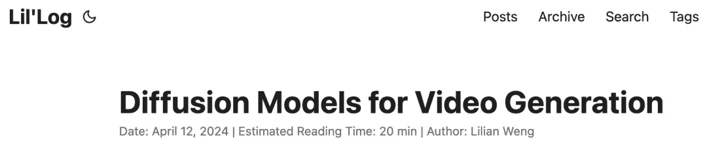
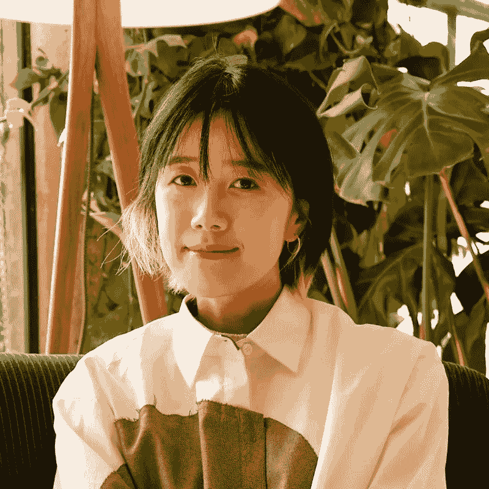
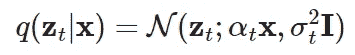
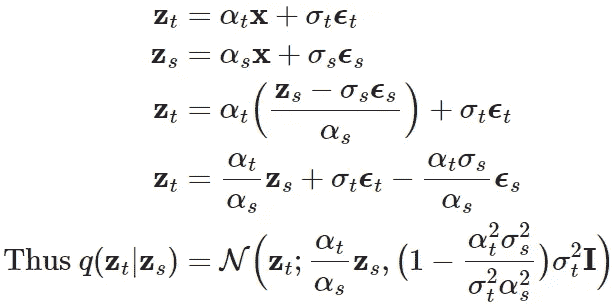
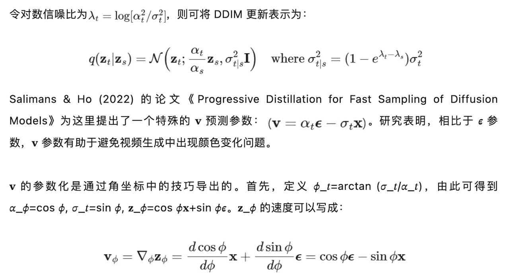

# Sora之后，OpenAI Lilian Weng亲自撰文教你从头设计视频生成扩散模型

> 来源：[https://agijuejin.feishu.cn/docx/Oco9dXsUwog0htx0z5AcMVrGnub](https://agijuejin.feishu.cn/docx/Oco9dXsUwog0htx0z5AcMVrGnub)

> 机器之心｜[阅读原文](https://mp.weixin.qq.com/s?__biz=MzA3MzI4MjgzMw==&mid=2650915338&idx=1&sn=ec8402e95052fd2a21d7024be06ac01b&chksm=84e40674b3938f629a86e37751d7a1b5afa69088da0ffe093421d2b7160ba0152f6d7c5a24c1&scene=21#wechat_redirect)

> 转载请联系原作者取得授权

> 选自 Lil’Log｜作者：Lilian Weng｜机器之心编译｜编辑：Panda

过去几年来，扩散模型强大的图像合成能力已经得到充分证明。研究社区现在正在攻克一个更困难的任务：视频生成。近日，OpenAI 安全系统（Safety Systems）负责人 Lilian Weng 写了一篇关于视频生成的扩散模型的博客。

Lilian Weng

机器之心对这篇博客进行了不改变原意的编译、整理，以下是博客原文：

视频生成 任务本身是图像合成的超集，因为图像就是单帧视频。 视频合成的难度要大得多，原因是：

1. 视频合成还需要不同帧之间保持时间一致性，很自然，这需要将更多世界知识编码到模型之中。

2. 相比于文本或图像，收集大量高质量、高维度的视频数据要更为困难，更遑论配对的文本 - 视频数据了。

如果你想了解扩散模型在图像生成方面的应用，可参读本文作者 Lilian Weng 之前发布的博文《What are Diffusion Models?》链接：https://lilianweng.github.io/posts/2021-07-11-diffusion-models/

**从头建模视频生成**

首先，我们先来看看如何从头设计和训练扩散视频模型，也就是说不使用已经预训练好的图像生成器。

**参数化和采样**

这里使用的变量定义与之前那篇文章稍有不同，但数学形式是一致的。令 𝐱~𝑞_real 是从该真实数据分布采样的一个数据点。现在，在时间中添加少量高斯噪声，创建出 𝐱 的一个有噪声变体序列，记为：{𝐳_𝑡 | 𝑡 = 1..., 𝑇}，其中噪声随 𝑡 的增加而增长，而最后的 𝑞(𝐳_𝑇)~𝒩(𝟎,𝐈)。这个添加噪声的前向过程是一个高斯过程。令 𝛼_𝑡 和 𝜎_𝑡 为这个高斯过程的可微噪声调度（differentiable noise schedule）：

为了表示 𝑞(𝐳_𝑡|𝐳_𝑠)，其中 0≤𝑠<𝑡≤𝑇，有：

然后可以推导出：

DDIM 更新规则就可以据此更新：

除了其自身对应的有噪声变量之外，𝐱^𝑏 的采样还需要基于 𝐱^𝑎。Ho & Salimans 等人 2022 年的视频扩散模型（VDM）提出使用一种经过调整的去噪模型来实现重构引导方法，这样就可以很好地以 𝐱^𝑎 为基础实现 𝐱^𝑏 的采样：

其中 是 𝐱^𝑎 和 𝐱^𝑏 根据所提供的去噪模型的重构。而 𝑤_𝑟 是一个加权因子，可以寻找一个较大的 𝑤_𝑟 > 1 来提升采样质量。请注意，使用同样的重建引导方法，也有可能基于低分辨率视频来扩展样本，使之变成高分辨率样本。

模型架构：3D U-Net 和 DiT

类似于文生图扩散模型，U-Net 和 Transformer 依然是常用的架构选择。谷歌基于 U-net 架构开发了一系列扩散视频建模论文，OpenAI 近期的 Sora 模型则是利用了 Transformer 架构。

VDM 采用了标准的扩散模型设置，但对架构进行了一些修改，使之更适合视频建模任务。它对 2D U-net 进行了扩展，使其能处理 3D 数据，其中每个特征图（feature map）都表示一个 4D 张量：帧数 x 高度 x 宽度 x 通道数。这个 3D U-net 是在空间和时间上进行分解，也就是说每一层都仅会操作空间或时间一个维度，而不会同时操作两者。

+   处理空间： 原本和 2D U-net 中一样的 2D 卷积层会被扩展成仅针对空间的 3D 卷积，具体来说，就是 3x3 卷积变成 1x3x3 卷积。 每一个空间注意力模块依然是关注空间的注意力，其中第一个轴（frames）则被当成批（batch）维度处理。

+   处理时间：每个空间注意力模块之后会添加一个时间注意力模块。其关注的是第一个轴（frames）并将空间轴视为批维度。使用这种相对位置嵌入可以跟踪帧的顺序。这个时间注意力模块可让模型获得很好的时间一致性。

图 2：3D U-net 架构。该网络的输入是有噪声视频 z_𝑡、条件信息 c 和对数信噪比（log-SNR）λ_𝑡。通道乘数 M_1,...,M_𝐾 表示各层的通道数量。

Ho, et al. 在 2022 年提出的 Imagen Video 基于一组级联的扩散模型，其能提升视频生成的质量，并将输出升级成 24 帧率的 1280x768 分辨率视频。Imagen Video 架构由以下组件构成，总计 7 个扩散模型。

+   一个冻结的 T5 文本编码器，用以提供文本嵌入作为条件输入。

+   一个基础视频扩散模型。

+   一组级联的交织放置的空间和时间超分辨率扩散模型，包含 3 个 TSR（时间超分辨率）和 3 个 SSR（空间超分辨率）组件。

图 3：Imagen Video 的级联式采样流程。在实践中，文本嵌入会被注入到所有组件中，而不只是基础模型中。

基础去噪模型使用共享的参数同时在 所 有帧上执行空间操作，然后时间层将各帧的激活混合起来，以更好地实现时间一 致性； 事实证明这种方法的效果优于帧自回归方法。

图 4：Imagen Video 扩散模型中一个空间 - 时间可分离模块的架构。

SSR 和 TSR 模型都基于在通道方面连接了有噪声数据 𝐳_𝑡 的上采样的输入。SSR 是通过双线性大小调整来上采样，而 TSR 则是通过重复帧或填充空白帧来上采样。

Imagen Video 还应用了渐进式蒸馏来加速采样，每次蒸馏迭代都可以将所需的采样步骤减少一半。在实验中，他们能够将所有 7 个视频扩散模型蒸馏为每个模型仅 8 个采样步骤，同时不会对感知质量造成任何明显损失。

为了更好地扩大模型规模，Sora 采用了 DiT（扩散 Transformer）架构，其操作的是视频和图像隐代码的时空块（spacetime patch）。其会将视觉输入表示成一个时空块序列，并将这些时空块用作 Transformer 输入 token。

图 5：Sora 是一个扩散 Transformer 模型。

**调整图像模型来生成视频**

在扩散视频建模方面，另一种重要方法是通过插入时间层来「扩增」预训练的文生图扩散模型，然后就可以选择仅在视频上对新的层进行微调或完全避免进行额外的训练。这个新模型会继承文本 - 图像对的先验知识，由此可以帮助缓解对文本 - 视频对数据的需求。

**在视频数据上进行微调**

Singer et al. 在 2022 年提出的 Make-A-Video 是在一个预训练扩散图像模型的基础上扩展一个时间维度，其包含三个关键组件：

1. 一个在文本 - 图像对数据上训练的基础文生图模型。

2. 时空卷积和注意力层，使网络覆盖时间维度。

3. 一个帧插值网络，用于高帧率生成。

图 6：Make-A-Video 工作流程示意图。

最终的视频推理方案的数学形式可以写成这样：

其中：

时空超分辨率层包含伪 3D 卷积层和伪 3D 注意力层：

+   伪 3D 卷积层： 每个空间 2D 卷积层（由预训练图像模型初始化）后面跟着一个时间 1D 层（由恒等函数初始化）。 从概念上讲，其中的 2D 卷积层首先生成多帧，然后这些帧会被调整为一段视频。

+   伪 3D 注意力层：在每个（预训练）空间注意力层之后堆叠一个时间注意力层，从而近似得到一个完整的时空注意力层。

图 7：伪 3D 卷积（左）和注意力（右）层的工作方式。

它们可以表示成：

训练时，Make-A-Video 工作流程中的不同组件是分开训练的。

Wu et al. 在 2023 年提出的 Tune-A-Video 是对一个预训练图像扩散模型进行扩展，使之可以实现单样本视频微调：给定一段包含 𝑚 帧的视频 𝒱={ 𝑣_𝑖 | 𝑖=1,...,𝑚}，搭配上描述性的 prompt 𝜏，任务目标是基于经过稍有编辑且相关的文本 prompt 𝜏* 生成一段新视频 𝒱*。举个例子，𝜏 = "A man is skiing" 可以扩展成 𝜏* ="Spiderman is skiing on the beach"。Tune-A-Video 的设计目的是用于对象编辑、背景修改和风格迁移。

除了扩展 2D 卷积层之外，Tune-A-Video 的 U-Net 架构还整合了 ST-Attention（时空注意力）模块，可通过查询在之前帧中的相关位置来实现时间一致性。给定帧 𝑣_𝑖、前一帧 𝑣_{𝑖-1} 和第一帧 𝑣_1 的隐含特征（它们被投射成查询 𝐐、键 𝐊 和值 𝐕），ST-Attention 的定义是：

图 8：Tune-A-Video 架构概况。在采样阶段之前，它首先在单个视频上运行一个轻量加权的微调阶段。请注意整个时间自注意力（T-Attn）层都会得到微调，因为它们是新加入的，但在微调阶段，ST-Attn 和 Cross-Attn 中只有查询投射会被更新，以保留先验的文生图知识。ST-Attn 能提升时空一致性，Cross-Attn 能优化文本 - 视频的对齐。

Esser et al. 在 2023 年提出的 Gen-1 模型（Runway）针对的任务是根据文本输入编辑给定视频。它在考虑生成条件时会将视频的结构和内容分开处理：p (𝐱 | 𝑠,c)。但是，要将这两方面清楚地分开实非易事。

+   内容 𝑐 是指视频的外观和语义，其可从文本采样来进行条件化编辑。视频帧的 CLIP 嵌入能很好地表示内容，并且能在很大程度上与结构特征保持正交。

+   结构 𝑠 描述了几何性质和动态情况，包括形状、位置、物体的时间变化情况，𝑠 是从输入视频采样的。可以使用深度估计或其它针对特定任务的辅助信息（比如用于人类视频合成的人体姿势或人脸标识信息）。

Gen-1 中的架构变化相当标准，即在其残差模块中的每个 2D 空间卷积层之后添加 1D 时间卷积层，在其注意力模块中的每个 2D 空间注意力模块之后添加 1D 时间注意力模块。训练期间，结构变量 𝑠 会与扩散隐变量 𝐳 连接起来，其中内容变量 𝑐 会在交叉注意力层中提供。在推理时间，会通过一个先验来转换 CLIP 嵌入 —— 将其从 CLIP 文本嵌入转换成 CLIP 图像嵌入。

图 9：Gen-1 模型的训练流程概况。

图 10：一个用于图像合成的预训练 LDM 被扩展成一个视频生成器。B、𝑇、𝐶、𝐻、𝑊 分别是批量大小、序列长度、通道数、高度和宽度。𝐜_S 是一个可选的条件 / 上下文帧。

但是，LDM 的预训练自动编码器依然还有问题：它只能看见图像，永远看不见视频。直接使用它来生成视频会产生闪动的伪影，这样的时间一致性就很差。因此 Video LDM 向解码器添加了额外的时间层，并使用一个用 3D 卷积构建的逐块时间判别器在视频数据进行微调，同时编码器保持不变，这样就依然还能复用预训练的 LDM。在时间解码器微调期间，冻结的编码器会独立地处理视频中每一帧，并使用一个视频感知型判别器强制在帧之间实现在时间上一致的重建。

图 11：视频隐扩散模型中自动编码器的训练工作流程。其中编码器的微调目标是通过新的跨帧判别器获得时间一致性，而编码器保持不变。

类似于 Video LDM，Blattmann et al. 在 2023 年提出的 Stable Video Diffusion（SVD）的架构设计也是基于 LDM，其中每一个空间卷积和注意力层之后都插入时间层，但 SVD 是在整个模型层面上执行微调。训练视频 LDM 分为三个阶段：

1. 文生图预训练很重要，有助于提升质量以及遵从 prompt 的能力。

2. 将视频预训练分开是有利的，理想情况下应当在更大规模的经过整编的数据集上进行。

3. 使用一段更小的、高视觉保真度的预先标注了字幕的视频进行高质量视频微调。

SVD 专门强调了数据集整编对模型性能的关键作用。他们使用了一个剪辑检测流程来从每段视频获得更多剪辑，然后对其使用三个不同的字幕标注器模型：(1) 用于中间帧的 CoCa，(2) 用于视频字幕的 V-BLIP，(3) 基于前两个标注使用 LLM 来进行标注。然后他们还能继续提升视频数据集，其做法包括移除运动更少的视频片段（通过以 2 fps 速度计算低光流分数进行过滤）、清除过多的文本（使用光学字符识别来识别具有大量文本的视频）、清除看起来不够美的视频（使用 CLIP 嵌入标注每段视频的第一帧、中间帧和最后帧并计算美学分数和文本 - 图像相似度）。实验表明，使用经过过滤的更高质量的数据集能得到更好的模型质量，即便这个数据集要小得多。

对于首先生成远距离关键帧然后再使用时间超分辨率进行插值的方法，其中的关键挑战是如何维持高质量的时间一致性。Bar-Tal et al. 在 2024 年提出的 Lumiere 则是采用了一种时空 U-Net（STUNet）架构，其可在单次通过中一次性生成整段时间上持续的视频，这样就无需依赖 TSR（时间超分辨率）组件了。STUNet 会在时间和空间维度上对视频进行下采样，因此会在一个紧凑的时间 - 空间隐空间内具备很高的计算成本。

图 12：Lumiere 无需 TSR（时间超分辨率）模型。由于内存限制，经过扩展的 SSR 网络可以仅使用视频的短片段，因此 SSR 模型可以使用较短但重叠的视频片段集。

STUNet 在预训练文生图 U-Net 上扩展之后能够同时在时间和空间维度上对视频进行下采样和上采样。基于卷积的模块由预训练的文生图层构成，之后是分解的时空卷积。而在最粗粒度 U-Net 层面上的基于注意力的模块包含这个预训练文生图模块，之后是时间注意力。只有新添加的层需要进一步训练。

图 13：架构示意图：(a) 时空 U-Net（STUNet）、(b) 基于卷积的模块、(c) 基于注意力的模块。

**无训练适应 **

也有可能不使用任何训练就让预训练的文生图模型输出视频，这多少有点让人惊讶。

如果我们直接简单地随机采样一个隐含代码的序列，然后用解码出来的对应图像构建一段视频，那么无法保证物体和语义在时间上的一致性。Khachatryan et al. 在 2023 年提出的 Text2Video-Zero 可实现零样本无训练的视频生成，其做法是让预训练的图像扩散模型具备用于时间一致性的两个关键机制。

1. 采样具有运动动态的隐含代码序列，以保证全局场景和背景的时间一致性。

2. 使用一个新的跨帧注意力（每一帧在第一帧上的注意力）重新编程帧层面的自注意力，以保证前景事物的上下文、外观和身份信息的一致性。

图 14：Text2Video-Zero 工作流程示意图。

下面用数学描述这个采样带有运动信息的隐含变量序列的过程：

此外，Text2Video-Zero 还换掉了预训练 SD 模型中的自注意力层，并代之以一种参考第一帧的新型跨帧注意力机制。 其目标是在生成的视频结果中保留前景事物的上下文、外观和身份信息。

另外还可以选择使用背景掩码，以让视频背景过渡更平滑并进一步提升背景一致性。假设我们已经使用某种方法得到了第 𝑘 帧相应的前景掩码 𝐌_𝑘，然后背景平滑操作可根据以下背景矩阵将实际隐含代码和扩散步骤 𝑡 扭曲过的隐含代码融合起来：

1. 跨帧注意力：在自注意力模块中添加完整的跨帧交互。它引入了所有帧之间的交互，其做法是将所有时间步骤的隐含帧映射到 𝐐、𝐊、𝐕 矩阵，这不同于 Text2Video-Zero（其是让所有帧都关注第一帧）。

2. 交替式帧平滑器（interleaved-frame smoother）机制是通过在交替帧上采用帧插值来减少闪烁效应。在每个时间步骤 𝑡，该平滑器会插值偶数或奇数帧，以平滑其相应的三帧剪辑。 请注意，平滑步骤后帧数会随时间推移 而减少。

3. 分层式采样器能在内存限制下保证长视频的时间一致性。一段长视频会被分割成多段短视频，其中每一段短视频都会选出一帧关键帧。该模型会使用完全跨帧注意力预生成这些关键帧以实现长期一致性，而每段相应的短视频都基于这些关键帧按顺序合成。

图 15：ControlVideo 概览。

原文链接：https://lilianweng.github.io/posts/2024-04-12-diffusion-video/