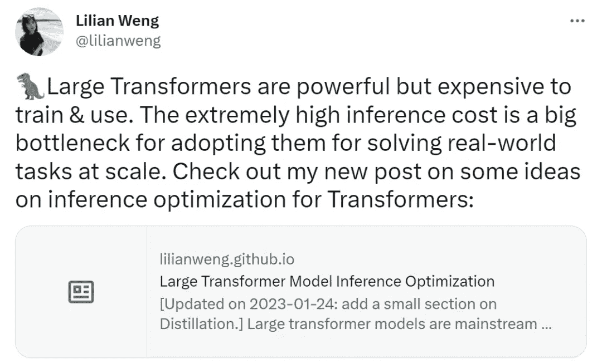
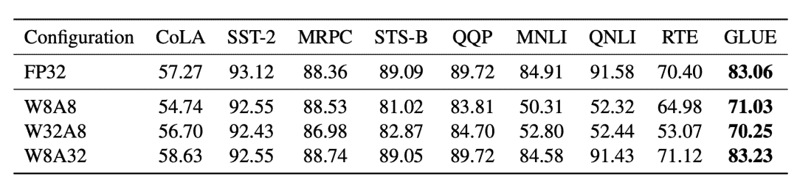
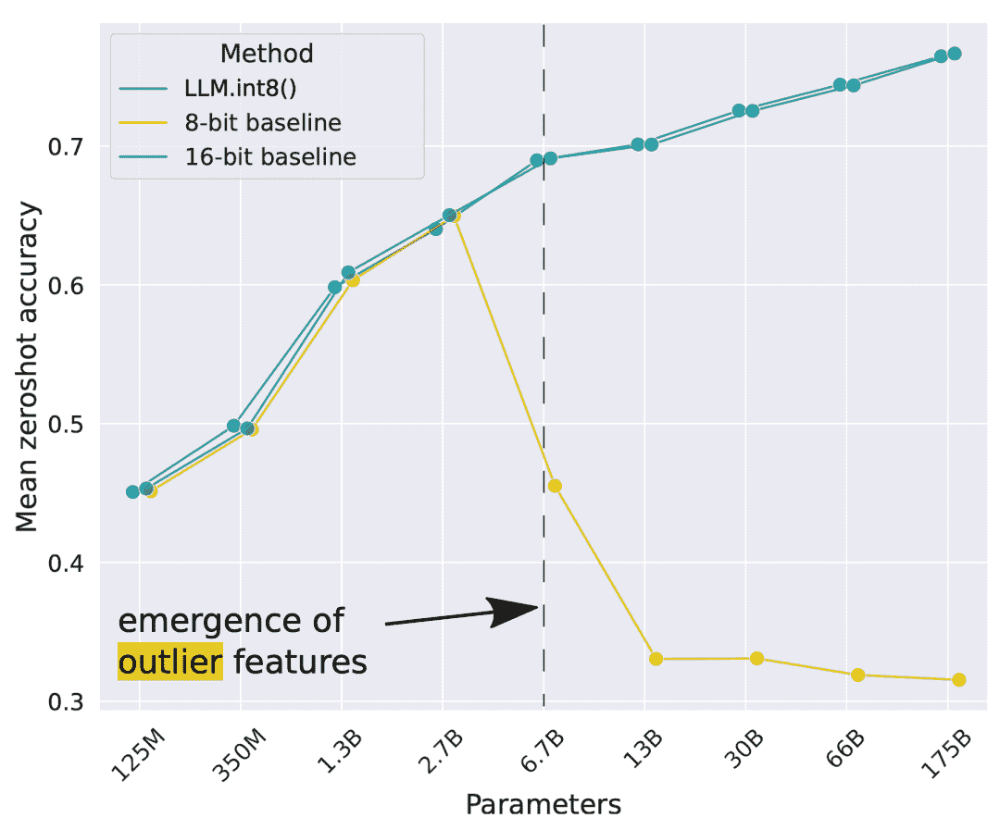
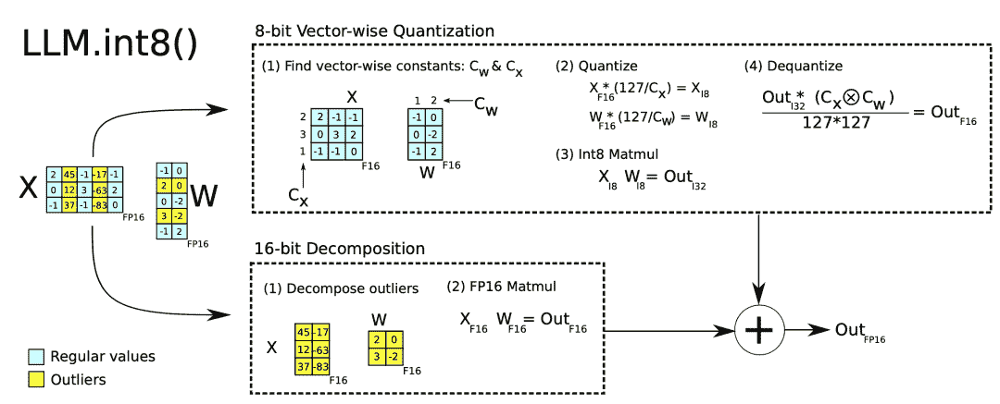
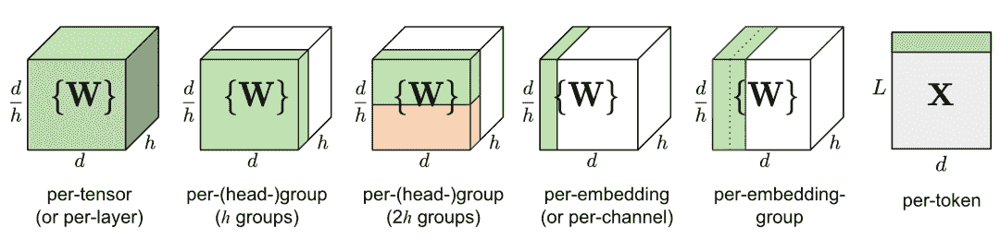

# 为内存塞不下Transformer犯愁？OpenAI应用AI研究负责人写了份指南

> 来源：[https://agijuejin.feishu.cn/docx/QvFedfeJhoydNZxueXccm3omn9g](https://agijuejin.feishu.cn/docx/QvFedfeJhoydNZxueXccm3omn9g)

> 机器之心｜[阅读原文](https://mp.weixin.qq.com/s?__biz=MzA3MzI4MjgzMw==&mid=2650867558&idx=3&sn=146062b9f571a9f6c990b80b90d63174&chksm=84e4c318b3934a0e06e502a5de0ceab3a07325e45a9ee7615f82a958d4cc5eeed0cd61c65fde&scene=21#wechat_redirect)

> 转载请联系原作者取得授权

> 选自 Lilian Weng 的博客｜作者：Lilian Weng｜机器之心编译｜编辑：赵阳

> 本文是一篇综述性的博客，探讨总结当下常用的大型 transformer 效率优化方案。

大型 Transformer 模型如今已经成为主流，为各种任务创造了 SOTA 结果。诚然这些模型很强大，但训练和使用起来代价非常昂贵。在时间和内存方面存在有极高的推理成本。概括来说，使用大型 T ransformer 模型进行推理的难点，除了模型的规模不断扩大外，还有两个不可忽略的地方：

+   **内存消耗大 **：推理时，需要把模型参数和中间状态都保存到内存中。例如：KV 存储机制下的缓存中的内容在解码期间需要存储在内存中，举例来说，对于 batch size 为 512，上下文长度为 2048 的设置来说，KV 缓存里需要的空间规模为 3TB，这是模型大小的 3 倍；注意力机制的推理成本和输入序列的长度呈正相关；

+   **低并行性 **：推理生成过程以自回归的方式执行，使解码过程难以并行。

在这篇文章中，领导 OpenAI 应用研究的 Lilian **W**eng 写了一篇博客，文中介绍了几种 提高 transformer 推理效率的方法 。一些是通用的网络压缩方法，而另一些则应用于特定的 transformer 架构 。

Lilian Weng 现为 OpenAI 应用人工智能研究负责人，主要从事机器学习、深度学习等研究 。她本科毕业于香港大学，硕士毕业于北京大学信息系统与计算机科学系，之后前往印度安纳大学布鲁顿分校攻读博士。

**模型综述**

通常将以下内容视为模型推理优化的目标：

+   使用更少的 GPU 设备和更少的 GPU 内存，减少模型的内存占用；

+   减少所需的 FLOP，降低计算复杂度；

+   减少推理延迟，运行得更快。

可以使用几种方法来降低推理过程在内存中的成本，并且加快速度。

+   在多 GPU 上应用各种并行机制来实现对模型的扩展。模型组件和数据的智能并行使得运行具有万亿级参数的大模型成为可能；

+   将暂时未使用的数据卸载到 CPU，并在以后需要时读回。这样做对内存比较友好，但会导致更高的延迟；

+   智能批处理策略；例如 EffectiveTransformer 将连续的序列打包在一起，以删除单个批次中的 padding；

+   神经网络压缩技术，例如剪枝、量化、蒸馏。就参数数量或位宽而言，小尺寸的模型应该需要少量的内存，也就运行得更快；

+   特定于目标模型架构的改进。许多架构上的变化，尤其是注意力层的变化，有助于提高 transformer 的解码速度。

本篇文章的重点是网络压缩技术和 transformer 模型在特定体系结构下的改进。

**量化策略**

在 深度神经网络上应用量化策略有两种常见的方法 ：

+   训练后量化（PTQ）：首先需要模型训练至收敛，然后将其权重的精度降低。与训练过程相比，量化操作起来往往代价小得多；

+   量化感知训练 (QAT)：在预训练或进一步微调期间应用量化。QAT 能够获得更好的性能，但需要额外的计算资源，还需要使用具有代表性的训练数据。

值得注意的是，理论上的最优量化策略与实际在硬件内核上的表现存在着客观的差距。由于 GPU 内核对某些类型的矩阵乘法（例如 INT4 x FP16）缺乏支持，并非下面所有的方法都会加速实际的推理过程。

Transformer 量化挑战

许多关于 Transformer 模型量化的研究都有相同的观察结果： 训练后将参数简单地量化为低精度（例如 8 位）会导致性能显着下降 ，这主要是由于普通的激活函数量化策略无法覆盖全部的取值区间。

图 1. 只将模型权重量化为 8 位，激活函数使用完整的精度的时候能取得较好的效果（W8A32）；激活函数量化为 8 位时，无论权重是否为低精度（W8A8 和 W32A8）效果都不如 W8A32。

Bondarenko 等人在一个小型 BERT 模型中观察到，由于输出张量中存在强异常值，FFN 的输入和输出具有非常不同的取值区间。因此，FFN 残差和的逐个张量的量化可能会导致显著的误差。

**随着模型参数规模继续增长到数十亿的级别， 高量级的离**群特征开始在所有 transformer 层中出现，导致简单的低位量化效果不佳。 Dettmers 等人观察到大于 6.7B 参数的 OPT 模型就会出现这种现象。模型大了，有极端离群值的网络层也会变多，这些离群值特征对模型的性能有很大的影响。在几个维度上的激活函数异常值的规模就可以比其他大部分数值大 100 倍左右。

图 2. 不同规模的 OPT 模型在四个语言任务（WinoGrande、HellaSwag、PIQA、LAMBADA）上的平均零样本准确率。

**混合精度量化 **

解决上述量化挑战的最直接方法是 以不同的精度对权重和激活函数进行量化 。

GOBO 模型是首批将训练后量化应用于 transformer 的模型之一（即小型 BERT 模型）。GOBO 假设每一层的模型权重服从高斯分布，因此可以通过跟踪每层的均值和标准差来检测异常值。异常值特征保持原始形式，而其他值被分到多个 bin 中，并且仅存储相应的权重索引和质心值。

基于对 BERT 中只有某些激活层（例如 FFN 之后的残差连接）导致性能大幅下降现象的观察，Bondarenko 等人通过在有问题的激活函数上使用 16 位量化而在其他激活函数上使用 8 位来采用混合精度量化。

LLM.int8 () 中的混合精度量化是通过两个混合精度分解实现的：

+   因为矩阵乘法包含一组行和列向量之间的独立内积，所以可以对每个内积进行独立量化。每一行和每一列都按最大值进行缩放，然后量化为 INT8；

+   异常值激活特征（例如比其他维度大 20 倍）仍保留在 FP16 中，但它们只占总权重的极小部分，不过需要经验性地识别离群值。

图 3.LLM.int8() 两种混合精度分解方法。

**细粒度量化**

图 4. 不同粒度量化对比。d 是模型大小 / 隐空间维度，h 是一个 MHSA（多头自注意力）组件中的头数。

简单地量化一层中的整个权重矩阵（逐个张量或逐个层量化）是最容易实现的，但量化粒度往往不尽如人意。

Q-BERT 将分组量化应用于微调的 BERT 模型，将 MHSA（多头自注意力）中每个头的单个矩阵 W 视为一个组，然后应用基于 Hessian 矩阵的混合精度量化。

Per-embedding group (PEG) 激活函数量化的设计动机是观察到离群值仅出现在少数几个维度中。对每个嵌入层都量化的代价非常昂贵，相比之下，PEG 量化将激活张量沿嵌入维度分成几个大小均匀的组，其中同一组中的元素共享量化参数。为确保所有异常值都分组在一起，PEG 应用了一种基于取值范围的嵌入维度排列算法，其中维度按其取值范围排序。

ZeroQuant 与 Q-BERT 一样都对权重使用分组量化，然后还对激活函数使用了 token-wise 量化策略。为了避免代价昂贵的量化和反量化计算，ZeroQuant 构建了独特的内核来将量化操作与其之前的运算符融合。

**使用二阶信息量化 **

Q-BERT 针对混合精度量化开发了 Hessian AWare 量化 (HAWQ)。其动机是，具有更高 Hessian 谱的参数对量化更敏感，因此需要更高的精度。这种方法本质上是一种识别异常值的方法。

从另一个角度来看，量化问题是一个优化问题。给定一个权重矩阵 W 和一个输入矩阵 X ，想要找到一个量化的权重矩阵 W^ 来最小化如下所示的 MSE 损失：

GPTQ 将权重矩阵 W 视为行向量 w 的集合，并对每一行独立量化。GPTQ 使用贪心策略来选择需要量化的权重，并迭代地进行量化，来最小化量化误差。更新被选定的权重会生成 Hessian 矩阵形式的闭合解。GPTQ 可以将 OPT-175B 中的权重位宽减少到 3 或 4 位，还不会造成太大的性能损失，但它仅适用于模型权重而不适用于激活函数。

**异常值平滑 **

众所周知，Transformer 模型中激活函数比权重更难量化。SmoothQuant 提出了一种智能解决方案，通过数学等效变换将异常值特征从激活函数平滑到权重，然后对权重和激活函数进行量化 (W8A8)。正因为如此，SmoothQuant 具有比混合精度量化更好的硬件效率。

图 5. SmoothQuant 将尺度方差从激活函数迁移到离线权重，以降低激活函数量化的难度。由此产生的新权重和激活矩阵都易于量化。

基于每个通道的平滑因子 s，SmoothQuant 根据以下公式缩放权重：

根据平滑因子

可以很容易地在离线状态下融合到前一层的参数中。超参数 α 控制从激活函数迁移到权重的程度。该研究发现 α=0.5 是实验中许多 LLM 的最佳取值。对于激活异常值较大的模型，可以将 α 调大。

**量化感知训练 (QAT) **

量化感知训练将量化操作融合到预训练或微调过程中。这种方法会直接学习低位表示的模型权重，并以额外的训练时间和计算为代价获得更好的性能。

最直接的方法是在与预训练数据集相同或代表预训练数据集的训练数据集上量化后微调模型。训练目标可以与预训练目标相同（例如通用语言模型训练中的 NLL/MLM）或特定于的下游任务（例如用于分类的交叉熵）。

另一种方法是将全精度模型视为教师模型，将低精度模型视为学生模型，然后使用蒸馏损失优化低精度模型。蒸馏通常不需要使用原始数据集。

**剪枝 **

网络剪枝是在保留模型容量的情况下，通过 修剪不重要的模型权重或连接来减小模型大小 。剪枝可能需要也可能不需要重新训练。剪枝可以是非结构化的也可以是结构化的。

+   非结构化剪枝允许丢弃任何权重或连接，因此它不保留原始网络架构。非结构化剪枝通常对硬件要求比较苛刻，并且不会加速实际的推理过程；

+   结构化剪枝不改变权重矩阵本身的稀疏程度，可能需要遵循某些模式限制才能使用硬件内核支持的内容。本文专注于那些能实现 transformer 模型的高稀疏性的结构化剪枝。

构建剪枝网络的常规工作流程包含三个步骤：

1. 训练密集型的神经网络直到收敛；

2. 修剪网络以去除不需要的结构；

3. （可选择）重新训练网络，让新权重保持之前的训练效果。

通过剪枝在密集模型中发现稀疏结构，同时稀疏网络仍然可以保持相似性能的灵感是由彩票假设激发的：这是一个随机初始化的密集前馈网络，它包含一个子网络池。其中只有一个子集（稀疏网络）是中奖彩票（winning tickets），这个中奖彩票在独立训练时可以达到最佳性能。

**如何剪枝**

Magnitude pruning 是最简单但同时又非常有效的剪枝方法 - 只裁剪那些绝对值最小的权重。事实上，一些研究发现，简单的量级剪枝方法可以获得与复杂剪枝方法相当或更好的结果，例如变分 dropout 和 l_0 正则化。Magnitude pruning 很容易应用于大型模型，并在相当大的超参数范围内实现相当一致的性能。

Zhu & Gupta 发现，大型稀疏模型能够比小型但密集的模型获得更好的性能。他们提出了 Gradual Magnitude Pruning (GMP) 算法，该算法在训练过程中逐渐增加网络的稀疏性。在每个训练步骤中，具有最小绝对值的权重被屏蔽为零以达到所需的稀疏度并且屏蔽的权重在反向传播期间不会得到梯度更新。所需的稀疏度随着训练步骤的增加而增加。GMP 过程对学习率步长策略很敏感，学习率步长应高于密集网络训练中所使用的，但不能太高以防止收敛。

迭代剪枝多次迭代上述三个步骤中的第 2 步（剪枝）和第 3 步（重新训练），每次只有一小部分权重被剪枝，并且在每次迭代中重新训练模型。不断重复该过程，直到达到所需的稀疏度级别。

**如何再训练 **

再训练可以通过使用相同的预训练数据或其他特定于任务的数据集进行简单的微调来实现。

Lottery Ticket Hypothesis 提出了一种权重 rewinding 再训练方法：剪枝后，将未剪枝的权重重新初始化回训练初期的原始值，然后以相同的学习率时间表进行再训练。

学习率 rewinding 仅将学习率重置回其早期值，而保持未剪枝的权重自最后一个训练阶段结束以来不变。研究者观察到 (1) 使用权重 rewinding 的再训练结果优于通过跨网络和数据集进行微调的再训练，以及 (2) 在所有测试场景中学习率 rewinding 与权重 rewinding 的效果持平甚至更优。

**稀疏化**

稀疏化是扩大模型容量同时保持模型推理计算效率的有效方法。本文考虑两种类型的 transformer 稀疏性：

+   稀疏化的全连接层，包括自注意力层和 FFN 层；

+   稀疏模型架构，即 MoE 组件的合并操作。

通过剪枝实现的 N:M 稀疏化

N:M 稀疏化是一种结构化的稀疏化模式，适用于现代 GPU 硬件优化，其中每 M 个连续元素中的 N 个元素为零。例如，英伟达 A100 GPU 的稀疏张量核心支持 2:4 稀疏度以加快推理速度。

图 6. 2:4 结构化稀疏矩阵及其压缩表示。

为了使密集型神经网络的稀疏化遵循 N:M 结构化稀疏模式，英伟达建议使用三步操作来训练剪枝后的网络：训练 –> 剪枝以满足 2:4 稀疏性 –> 重新训练。

(1) 对矩阵中的列进行排列可以在剪枝过程中提供更多可能，以保持参数的数量或满足特殊限制，如 N:M 稀疏性。只要两个矩阵对应的轴按相同的顺序排列，矩阵乘法的结果就不会改变。例如，(1) 在自注意力模块中，如果 query 的嵌入矩阵 Q 的轴 1 和 key 嵌入矩阵 K^⊤的轴 0 采用相同的排列顺序，则 QK^⊤的矩阵乘法最终结果保持不变。

图 7. Q（轴 1）和 K^⊤（轴 0）上相同排列，自注意力模块的结果不变。

(2) 在包含两个 MLP 层和一个 ReLU 非线性层的 FFN 层内，可以将第一个线性权重矩阵 W_1 沿轴 1 排列，然后第二个线性权重矩阵 W_2 沿轴 0 按相同顺序排列。

图 8. W_1（轴 1）和 W_2（轴 0）上有着相同的排列，可以保持 FFN 层的输出不变。为简单起见，图示省略了偏差项，但也应对它们应用相同的排列。

为了推动 N:M 结构稀疏化，需要将一个矩阵的列拆分为 M 列的多个 slide（也称为 stripe），这样可以很容易地观察到每个 stripe 中的列顺序和 stripe 的顺序对 N:M 稀疏化产生的限制。

Pool 和 Yu 提出了一种迭代式的贪心算法来寻找最优排列，使 N:M 稀疏化的权重幅度最大化。所有通道对都被推测性地交换，并且只采用幅度增加最大的交换，然后生成新的排列并结束单次迭代。贪心算法可能只会找到局部极小值，因此他们引入了两种技术来逃避局部极小值：

1. 有界回归：在实践中，两个随机通道的最大交换次数是固定的。每次搜索只有一个通道可以进行交换，以保持搜索空间宽而浅；

2. 窄且深的搜索：选择多个 stripe 并同时优化它们。

图 9. 贪心算法实现迭代地寻找 N:M 稀疏化最佳排列的算法。

与按默认通道顺序对网络进行剪枝相比，如果在剪枝之前对网络进行置换，可以获得更好的性能。

为了从头开始训练具有 N:M 稀疏化的模型，Zhou & Ma 扩展了常用于模型量化中的反向传播更新的 STE，用于幅度剪枝和稀疏参数更新。

图 10. STE 和 SR-STE 的对比。⊙的比较是元素乘积；⊗是矩阵乘法。

与 STE 或 SR-STE 不同，Top-KAST 方法可以在前向和反向传播的整个训练过程中保持恒定的稀疏性，还不需要使用具有稠密参数或梯度的前向传播。

在训练到第 t 步时，Top-KAST 过程如下：

训练分为两个阶段，集合 B∖A 中的附加坐标控制引入的探索量。探索量会在训练过程中逐渐减少，最终掩码会稳定下来。

图 11. Top-KAST 的剪枝掩码会随时间稳定下来。

为了防止马太效应，Top-KAST 通过 L2 正则化损失来惩罚激活权重，以鼓励产生更多新的探索。在更新期间，B∖A 中的参数比 A 受到更多的惩罚以稳定掩码。

**稀疏 Transformer **

稀疏 Transformer 将 Transformer 架构中的自注意力层和 FFN 层稀疏化，使单个样本推理的速度提高了 37 倍。

图 12. 当在不同网络层上应用稀疏化时，Transformer 模型解码单个 token（非批量推理）的速度。

稀疏 FFN 层：每个 FFN 层包含 2 个 MLP 和中间的一个 ReLU。因为 ReLU 会引入很多零值，所以该方法在激活函数上设计了一个固定结构，来强制要求在一个包含 N 个元素的块中只包含 1 个非零值。稀疏模式是动态的，每个 token 都不同。

图 13. (a) 稀疏 FFN 层；红色列未加载到内存中以进行更快的推理。(b) 1:4 稀疏度的稀疏 FFN 控制器。

稀疏注意力层：在注意力层中，维度 d_(model) 被划分为 S 个模块，每个模块的大小为 M=d_(model)/S。为了确保每个细分都可以访问嵌入的任何部分，Scaling Transformer 引入了一个乘法层（即，一个乘法层将来自多个神经网络层的输入按元素相乘），它可以表示任意排列，但包含的参数少于全连接层。

图 14. (a) 引入乘法层以使分区能够访问嵌入的任何部分。(b) 乘法全连接层和二维卷积层的结合减少了注意力层的参数数量和计算时间。

为了更好地处理长序列数据，Scaling Transformer 进一步配备了来自 Reformer 的 LSH（局部敏感哈希）注意力和 FFN 块循环，从而产生了 Terraformer 模型。

**混合专家系统 MoE **

专家混合系统 (MoE) 模型是一种专家网络的集合，每个样本仅激活网络的一个子集来获得预测结果。这个想法起源于上世纪九十年代并且与集成方法密切相关。有关如何将 MoE 模块合并到 Transformer 的详细信息，可以查看本文作者之前写的关于大型模型训练技术的帖子和 Fedus 等人关于 MoE 的论文。

使用 MoE 架构，在解码时仅使用部分参数，因此节省了推理成本。每个专家的容量可以通过超参数容量因子 C 进行调整，专家容量定义为：

每个 token 需要选择前 k 个专家。较大的 C 会扩大专家容量，提高性能，但这样做计算成本更高。当 C>1 时，需要增加一个松弛容量；当 C<1 时，路由网络需要忽略一些 token。

**路由策略改进 **

MoE 层有一个路由网络来为每个输入 token 分配一个专家子集。原生 MoE 模型中的路由策略是将每个 token 以不同的方式路由到按自然顺序出现的首选专家。如果路由到的专家已经没有多余的空间，token 将被标记为溢出并被跳过。

V-MoE 将 MoE 层添加到 ViT (Vision Transformer) 中。它与以前的 SOTA 模型的性能相匹配，但只需要一半的推理计算。V-MoE 可以扩展成一千五百万个参数。有研究者在实验中将 k=2、专家需要 32 位，每 2 位专家间放置一层 MoE。

由于每个专家的能力有限，如果某些重要且信息丰富的 token 在预定义的序列顺序（例如句子中的单词顺序或图像中 patch 的顺序）中出现得太晚，则可能不得不丢弃它们。为了避免原生路由方案中的这种缺陷，V-MoE 采用 BPR（批量优先路由）首先将专家分配给具有高优先级分数的 token。BPR 在专家分配之前计算每个 token 的优先级分数（前 k 名路由器得分的最大值或总和），并相应地更改 token 的顺序。这保证了核心的 token 能优先使用专家容量的缓冲区。

图 15. 当 C<1 时，根据优先级分数丢弃图像 patch 的方式。

当 C≤0.5 时，BPR 比普通路由效果更好，此时模型开始丢弃大量 token。这使模型即使在非常低的容量下也能与稠密网络一较高低。

在研究如何解释图像的类别与专家之间的关系时，研究者观察到早期的 MoE 层更通用，而后期的 MoE 层可以专门用于某类图像。

任务级 MoE 将任务信息考虑在内，并且将路由 token 在任务级的视角来处理。研究者以 MNMT（多语言神经机器翻译）为例，根据目标语言或语言对进行翻译任务分组。

Token 级路由是动态的，每个 token 的路由决策是不相交的。因此，在推理时，服务器需要预加载所有专家。相比之下，任务级路由是静态的，甚至是固定的任务，因此一个任务的推理服务器只需要预加载 k 个专家（假设 top-k 才有路由）。根据研究者的实验，与稠密模型的 baseline 相比，任务级 MoE 可以实现与 token MoE 类似的性能增益，峰值吞吐量高 2.6 倍，解码器小 1.6%。

任务级 MoE 本质上是根据预定义的启发式方法对任务分布进行分类，并将此类人类知识纳入路由器。当这种启发式不存在时，任务级 MoE 就难以使用了。

PR MoE 让每个 token 通过一个固定的 MLP 和一个选定的专家。由于靠后的 MoE 更有价值，PR MoE 在靠后的层上设计了更多的出口。DeepSpeed 库实现了灵活的多专家、多数据并行，以支持使用不同数量的专家来训练 PR MoE。

图 16。PR MoE 架构与标准 MoE 的对比图。

**内核方面的改进措施**

专家网络可以托管在不同的设备上。然而，当 GPU 数量增加时，每个 GPU 上的专家数量就会减少，专家之间的通信成本变得更加昂贵。跨多个 GPU 的专家之间的多对多通信依赖于 NCCL 的 P2P API，这个接口不能占据高速链路所有的带宽，这是因为使用的节点越多，单个 chunk 越小。现有的多对多算法在大规模问题上性能较差，单个 GPU 的工作量不能提升。针对这种情况，有多种内核改进措施来实现更高效的 MoE 计算，例如使多对多通信更便宜 / 更快。

DeepSpeed 库和 TUTEL 都实现了基于树的分层多对多算法，该算法在节点内使用多对多算法处理，然后再在节点间实现多对多。这种算法将通信跳数从 O（G）减少到

，其中 G 是 GPU 节点的总数，G_(node) 是每个节点的 GPU 内核数。尽管在这样的实现中通信量增加了一倍，但当批大小较小时 1×1 卷积层存在延迟，因此可以更好地扩展 batch 的规模。

DynaMoE 使用动态再编译使计算资源适应专家之间的动态工作负载。再编译机制需要从头开始编译计算图，并且只在需要时重新分配资源。它会琢磨分配给每个专家的样本数量，并动态调整其容量因子 C，以减少运行时的内存和计算需求。这种方法基于在训练早期对专家和样本的分配关系的观察，在模型收敛后引入样本分配缓存，然后使用再编译算法消除门控网络和专家之间的依赖性。

**架构优化**

论文《Efficient Transformers: A Survey》回顾了一系列新的 Transformer 架构，并针对提高计算和内存效率进行了一些改进，除此以外，大家还可以阅读这篇文章《The Transformer Family》，以深入了解几种类型的 Transformer 改进。

图 17. 高效 transformer 模型的分类

自注意力机制的二次时间复杂度和内存复杂性问题是提高 transformer 解码效率的主要瓶颈，因此所有高效 transformer 模型都对原本稠密的注意力层应用了某种形式的稀疏化措施。

1. 固定模式：使用预定义的固定模式限制注意力矩阵的感受野：

+   可以将输入序列分成固定的块；

+   图像 transformer 使用了局部注意力；

+   稀疏 transformer 使用了跨线注意力模式；

+   Longformer 使用了 dilated 注意力窗口；

+   可以使用 strided 卷积压缩注意力来减少序列长度。

2. 组合模式：对输入的 token 进行排序 / 聚类以实现更优化的序列全局视图，同时保持固定模式的效率优势

+   稀疏 transformer 结合了跨步和局部注意力；

+   给定高维输入张量，axial transformer 不会将输入 flattened 后再使用注意力机制，而是使用多注意力机制，一个注意力对应着输入张量的一个轴；

+   Big Bird 模型设计了一些关键组件，即（1）全局 token，（2）随机注意力（query 向量随机绑定 key 向量）和（3）固定模式（局部滑动窗口）。

3. 可学习模式：通过学习确定最佳注意力模式：

+   Reformer 使用局部敏感哈希将 token 聚类；

+   路由 transformer 用 k-means 将 token 聚类；

+   Sinkhorn 排序网络会对输入序列块的排序算法进行学习。

4. 递归：通过递归连接多个 block/segment：

+   Transformer-XL 通过在 segment 之间重用隐藏状态来获取更长的上下文；

+   通用 transformer 将自注意力与 RNN 中的循环机制相结合；

+   Compressive transformer 是 Transformer-XL 的扩展，具有额外的内存，具有 n_m 个内存槽和 n_(cm) 个压缩内存槽。每当有新的输入段被输入到模型当中时，主内存中最久未更新的前 n_s 个激活函数都会被转移到压缩内存中。

5.Side Memory：使用可以一次访问多个 token 的 Side Memory 模块

+   Set Transformer 设计了一种受归纳点方法启发的新注意力；

+   ETC（Extended transformer construction）是 Sparse Transformer 的变体，具有新的全局 - 局部注意力机制；

+   Longformer 也是 Sparse Transformer 的变体，使用 dilated 滑动窗口。随着模型网络的深入，感受野也会逐渐增加。

6. 节省内存：更改架构以使用更少的内存：

+   Linformer 将 key 和 value 的代表长度的维度投影到低维表示（N→k），因此内存复杂度从 N×N 降低到 N×k；

+   Shazeer 等人提出了多 query 注意力，在不同注意力头之间共享 key 和 value，大大减少了这些张量的大小和内存成本。

7. 使用内核：使用内核可以让自注意力机制的公式书写起来更简单。需要注意的使，这里的内核是指内核方法中的内核，而不是 GPU 操作程序。

8. 自适应注意力：让模型学习最佳注意力广度，或决定何时按每个 token 提前退出：

+   自适应注意力广度训练模型，通过 token 和其他 key 之间的 soft mask 机制，为每个 token、每个注意力头学习最佳的注意力广度；

+   通用 transformer 结合了循环机制，并使用 ACT（自适应计算时间）来动态决定循环几次；

+   深度自适应 transformer 和 CALM 使用一些置信度度量方法来学习何时提前退出每个 token 的计算层，这样可以在性能和效率之间找到一种平衡。

原文链接：https://lilianweng.github.io/posts/2023-01-10-inference-optimization/