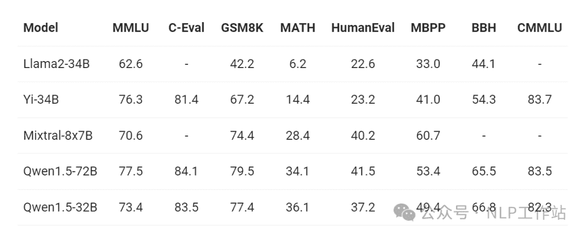
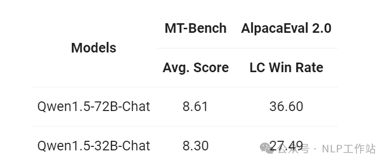
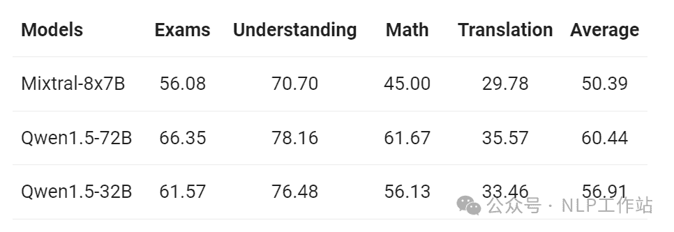

# Qwen1.5开源32B模型-将开源进行到底

> 来源：[https://agijuejin.feishu.cn/docx/LVZhdGFE9ocxXdxqAaAcPWFqnpc](https://agijuejin.feishu.cn/docx/LVZhdGFE9ocxXdxqAaAcPWFqnpc)

> 刘聪NLP｜[阅读原文](https://mp.weixin.qq.com/s/WOiyQYSs5XZzSsn6hdb_Ww)

> 转载请联系原作者取得授权

##  **写在前面 **

大家好，我是刘聪NLP。

阿里开源的千问系列模型，一直受到业界好评，之前版本有0.5B、1.8B、7B、14B、72B， 但一直缺少的30B级别开源模型，这也一直是一个遗憾 。

怎么说呢？72B模型太大，很多人用不起来，无论是微调，还是模型推理部署，成本太高；而14B又有点小，很多场景中效果不理想，因此需要一个处在中间状态的模型-30B左右。

周二有群友透露，本周会开源30B级别模型。


群友果然靠谱， **在**清明节期间，放出来了Qwen1.5的32B模型，不仅涉及Base模型、Chat模型、还有量化的系列模型 ，详细见下面链接。

```
HF: https://huggingface.co/Qwen/Qwen1.5-32B
Blog: https://qwenlm.github.io/blog/qwen1.5-32b/
```

PS：千问真是开源走到了底，不给其他家留余地，之前30B级别的Yi怎么办呀！！！

##  **模型介绍 **

模型参数：词表大小152064，64层、隐藏层维度5120，支持32k长度。

```
{
  &quot;architectures&quot;: [
    &quot;Qwen2ForCausalLM&quot;
  ],
  &quot;attention_dropout&quot;: 0.0,
  &quot;bos_token_id&quot;: 151643,
  &quot;eos_token_id&quot;: 151643,
  &quot;hidden_act&quot;: &quot;silu&quot;,
  &quot;hidden_size&quot;: 5120,
  &quot;initializer_range&quot;: 0.02,
  &quot;intermediate_size&quot;: 27392,
  &quot;max_position_embeddings&quot;: 32768,
  &quot;max_window_layers&quot;: 35,
  &quot;model_type&quot;: &quot;qwen2&quot;,
  &quot;num_attention_heads&quot;: 40,
  &quot;num_hidden_layers&quot;: 64,
  &quot;num_key_value_heads&quot;: 8,
  &quot;rms_norm_eps&quot;: 1e-06,
  &quot;rope_theta&quot;: 1000000.0,
  &quot;sliding_window&quot;: 32768,
  &quot;tie_word_embeddings&quot;: false,
  &quot;torch_dtype&quot;: &quot;bfloat16&quot;,
  &quot;transformers_version&quot;: &quot;4.37.2&quot;,
  &quot;use_cache&quot;: true,
  &quot;use_sliding_window&quot;: false,
  &quot;vocab_size&quot;: 152064
}
```

看看指标。



从指标上来看，Qwen1.5-32B模型，相较于72B模型有一些差距，但是由于Yi-34B和Llama2-34B很多。Yi在30B级别的地位不保啦。

32B-Chat版本模型在MT-Bench榜单上超过8分，并且与72B-Chat版本模型差距较小。



Qwen1.5-32B还支持多语言，包括阿拉伯语、西班牙语、法语、葡萄牙语、德语、意大利语、俄语、日语、韩语、越南语、泰语和印尼语等，相关评测如下。



在32k长度上，进行大海捞针实验，也相对比较出色。


##  **快速使用 **

```
from transformers import AutoModelForCausalLM, AutoTokenizer
device = &quot;cuda&quot; # the device to load the model onto

model = AutoModelForCausalLM.from_pretrained(
    &quot;Qwen/Qwen1.5-32B-Chat&quot;,
    torch_dtype=&quot;auto&quot;,
    device_map=&quot;auto&quot;
)
tokenizer = AutoTokenizer.from_pretrained(&quot;Qwen/Qwen1.5-32B-Chat&quot;)

prompt = &quot;Give me a short introduction to large language model.&quot;
messages = [
    {&quot;role&quot;: &quot;system&quot;, &quot;content&quot;: &quot;You are a helpful assistant.&quot;},
    {&quot;role&quot;: &quot;user&quot;, &quot;content&quot;: prompt}
]
text = tokenizer.apply_chat_template(
    messages,
    tokenize=False,
    add_generation_prompt=True
)
model_inputs = tokenizer([text], return_tensors=&quot;pt&quot;).to(device)

generated_ids = model.generate(
    model_inputs.input_ids,
    max_new_tokens=512
)
generated_ids = [
    output_ids[len(input_ids):] for input_ids, output_ids in zip(model_inputs.input_ids, generated_ids)
]

response = tokenizer.batch_decode(generated_ids, skip_special_tokens=True)[0]
```

##  **写在最后 **

阿里的千问系列模型真实将开源进行到底了，吾辈之楷模！！！

[**欢迎多多关注**](https://mp.weixin.qq.com/s?__biz=Mzg5MTU1NTE1OQ==&mid=2247486601&idx=1&sn=dd2f338675de1448981bcfbe1efa71e3&scene=21#wechat_redirect)👸号「NLP工作站」， 加入交流群 ，交个朋友吧，一起学习，一起进步！