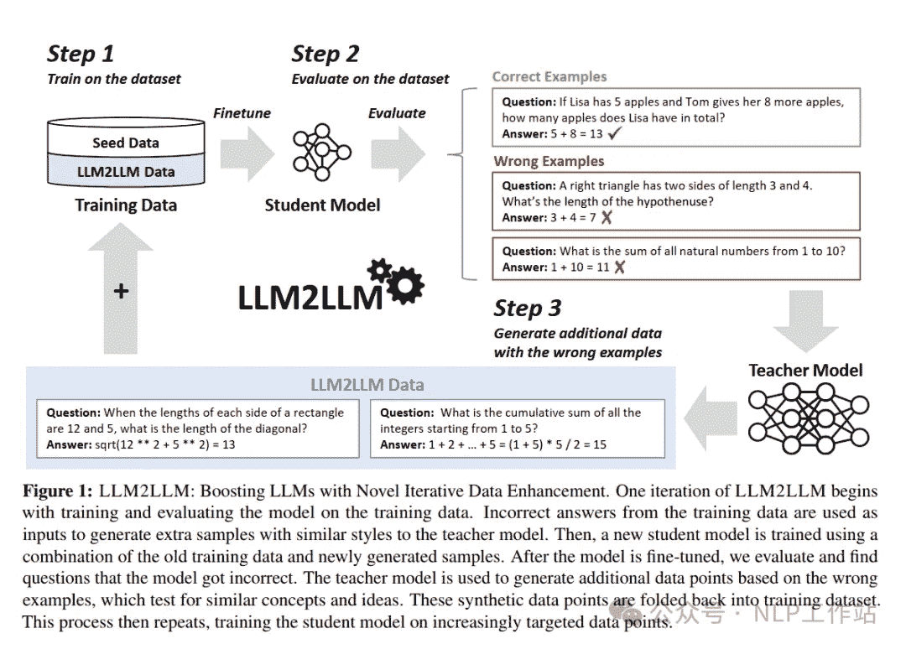
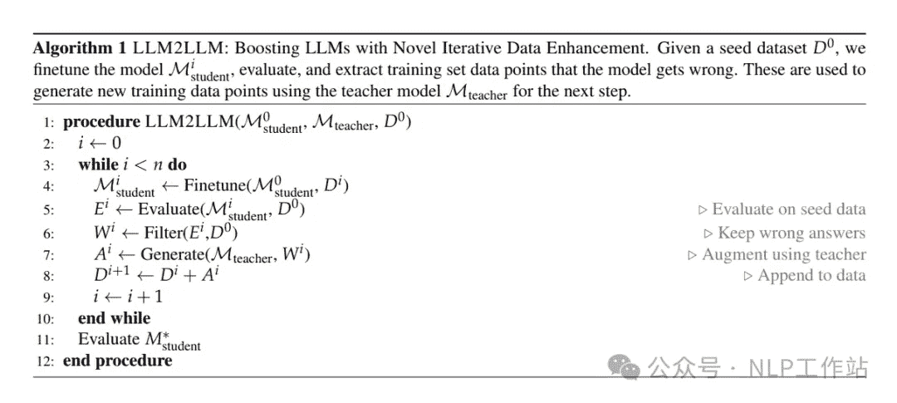
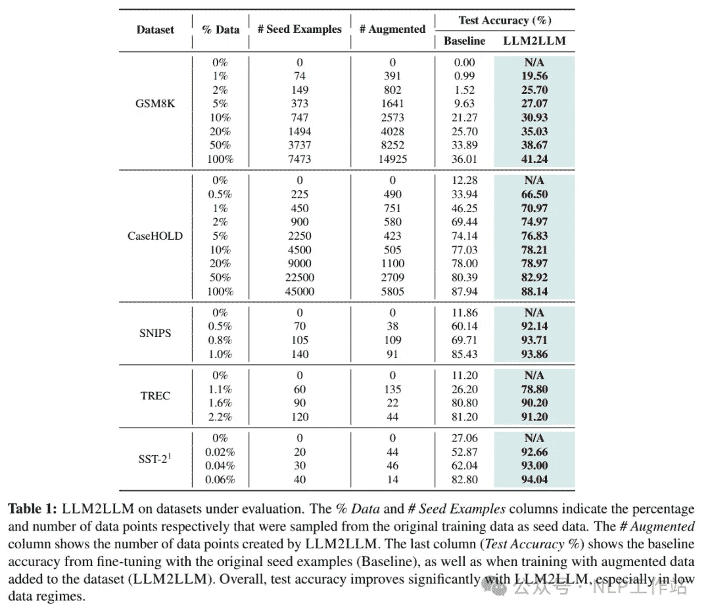
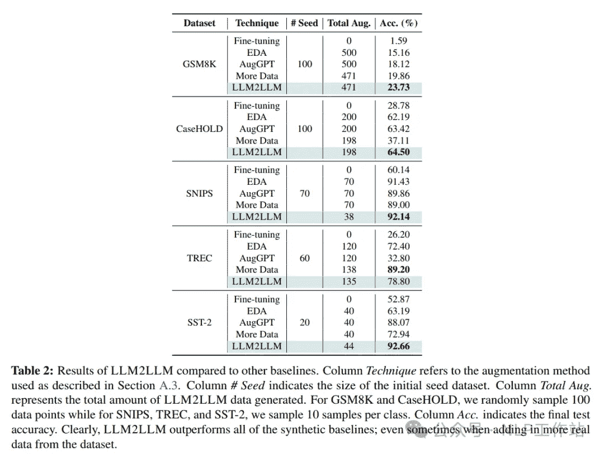
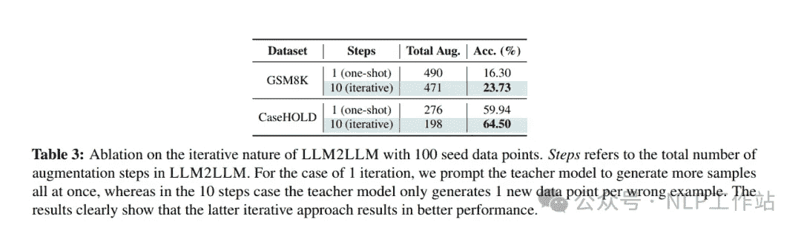
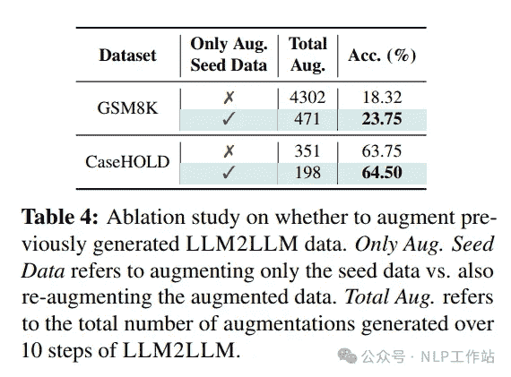
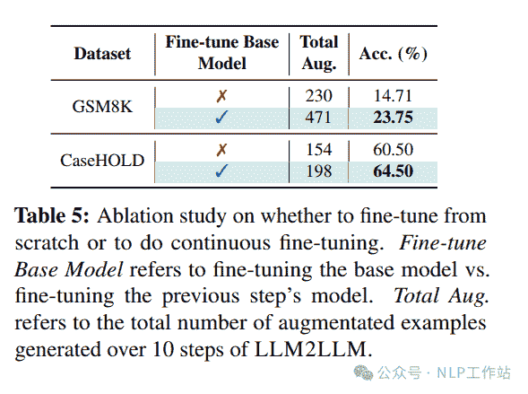
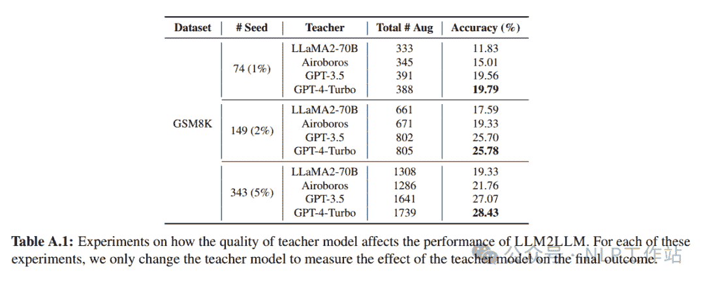

# LLM2LLM：迭代式数据增强策略提升大模型微调效果

> 来源：[https://agijuejin.feishu.cn/docx/PkLudv1vbo8RKjxk4nrcrxVonTg](https://agijuejin.feishu.cn/docx/PkLudv1vbo8RKjxk4nrcrxVonTg)

> 刘聪NLP｜[阅读原文](https://mp.weixin.qq.com/s/GC3-3ypip5MpxdHf9_qI6g)

> 转载请联系原作者取得授权

## **写在前面 **

大家好，我是刘聪NLP。

大模型目前已经在很多领域、很多场景中都取得了较为优异的效果，但很多实际场景中仍然需要进行模型微调，那么如何在有限数据情况下提高大模型微调效果呢？

今天给大家带来一篇针对性和迭代式的数据增强策略-L**LM2LLM，主要在**LLM训练**的过程中 发**现预测错误的数据 ，并将其 放大&增强 ，重新融合到训练数据集中， 让LLM更专注于更有挑战的样本 ，显著提高LLM在低资源环境下的效果。

```
Paper: https://arxiv.org/abs/2403.15042
Github: https://github.com/SqueezeAILab/LLM2LLM
```

##  **方法 **

LLM2LLM的主要流程如下：

+   在初始种子数据集中微调学生模型；

+   评估并提取学生模型在训练集中预测错误的数据；

+   利用教师模型对这些错误数据生成额外数据，将其加如原始训练数据中迭代训练学生模型。





**值得注意的是，每一次数据增强**时， 仅对种子数据的进行数据扩充 ，以防止多次**迭代时教师模型生成的错误示**例影响整体数据集质量，导致数据退化，同时也可以 进一步约束生成数据的总量 。

##  **结果分析 **

实验主要针对LLaMA2-7B模型，在GSM8K、CaseHOLD、SNIPS、TREC和SST-2数据集上，**以0.02%到50%不同的抽样率对这些数据集进行采**样，以评估在不同低数据环境下的LLM2LLM方法的性能，如下表所示， 不同数量级的训练数据下，LLM2LLM方法均有效果提高，当数据较少的情况下，提高比例更大。



同时比较了与EDA和AugGPT增强方法之间的差异，如下表所示，LLM2LLM方法提升幅度更大。



对**比了迭代增强与一次性增加等量数据的方法直接的差异，如下表**所示，使用一次增强的效果显著低于执行10次LLM2LLM迭代增强的方法， 说明即使是对错误数据的学习，也应该逐步分析，有的错误数据更难，在数据训练过程中即使调整数据分布。



分**析仅在原始种子数据集上和在整体数据上进行数据增强的差异**，如下表所示，仅在原始种子数据上进行数据增强效果更好， 说明增强部分数据由于模型生成，可能存在错误数据，多次迭代过程中，可能会导致误差累积，数据退化。



对**比从头微调和增量微调方法**，如下表所示，从头开始微调始终显著优于增量微调方法，可能是由于在小种子数据集上 多次增量微调存在过拟合 ，影响模型推理测试。



当然，不同的教师模型，对LLM2LLM方法影响也比较大，越好的教师模型，带来的效果越好，如下图所示， GPT4的效果最好，其次是GPT3.5 。



##  **写在最后 **

LLM2LLM方法就像是bad case分析，只不过是反复对训练集的bad case进行针对性优化，让大模型更专注困难样本。

[**欢迎多多关注**](https://mp.weixin.qq.com/s?__biz=Mzg5MTU1NTE1OQ==&mid=2247486601&idx=1&sn=dd2f338675de1448981bcfbe1efa71e3&scene=21#wechat_redirect)👸号「NLP工作站」， 加入交流群 ，交个朋友吧，一起学习，一起进步！