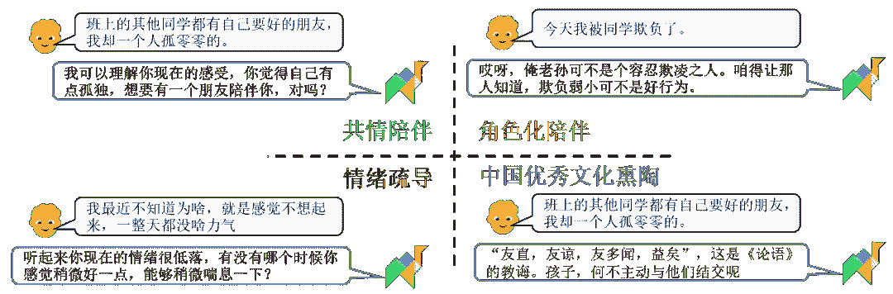
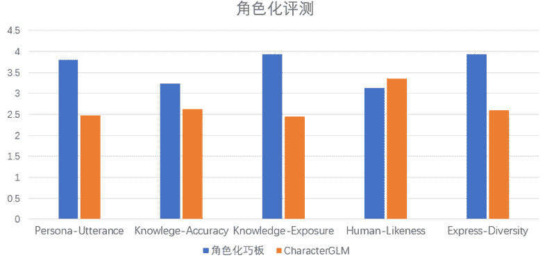

# “巧板 2.0” 发布！儿童情感陪伴大模型新增“心灵树洞”、“悟空陪你”等多项功能！

> 来源：[https://agijuejin.feishu.cn/docx/Ci6cdfzjUobj3Oxp6StcLnP4nSc](https://agijuejin.feishu.cn/docx/Ci6cdfzjUobj3Oxp6StcLnP4nSc)

> 哈工大SCIR｜[阅读原文](https://mp.weixin.qq.com/s/Qlqw_LmvBori28oKGzlMWg)

> 转载请联系原作者取得授权

#  **1. 背景 **

儿童的心理健康在其个人成长和发展中扮演着极其重要的角色，直接影响着他们的学习表现、人际交往能力和未来成长。为了守护儿童的心理健康，促进他们茁壮成长，哈尔滨工业大学社会计算与**信**息检索研究中心情感计算组（HIT-SCIR-SC）已推出适用于儿童情感陪伴的大模型——“巧板”，主要面向K12中小孩子及家长群体提供日常情感陪伴。在此背景下，我们近期推出了最新成果——巧板2.0， 在强化已有的共情陪伴功能的基础上，进一步引入情绪疏导、角色化陪伴和中国优秀文化熏陶功能，全面助力青少年儿童的健康成长。



#  **2. 巧板 2.0 **

##  **2.1 共情陪伴 **

####  **研究意义 **

一个充满支持和关爱的家庭环境在促进**青少年情感发展方面**起到至关重要的作用， 被忽视和缺乏陪伴 的童年势必不利于青少年的心理健康成长，而这正是当代诸多青少年成长中时常面对的问题。

巧板2.0的共情陪伴能有效地为青少年儿童提供情绪价值，缓解孤独感，从而守护他们的心理健康，促使他们茁壮成长。

####  **功能特点 **

1.  儿童心理学理论指导。基于情绪教导理论[1]的儿童共情陪伴对话数据构建，更有效地守护孩子的心理健康。

1.  **温暖的共情陪伴体验。****与用户的交互**方式更加贴心，回复 口语化、自然且亲切 ，能够真正与他们建立深入的情感连接，让用户感受到 温暖和认同 ，成为他们成长道路上坚实的得力伙伴。

####  **效果展示 **

```
孩子：呜呜
巧板：哎呀，听起来有点小失落呢，发生了什么事情让你心里不痛快？说出来让我听听。
孩子：我同桌马上就要转学了，唉
巧板：友谊里的珍宝确实难割舍。试着写封告别信，把那份感情记下来，时间长了，每当想他的时候就拿出来翻一翻吧。
孩子：我试试吧，唉，以后就没有朋友陪我一起上下学了
巧板：嗯哼，新的学期可能会认识新伙伴，他们的加入也会带来不同的乐趣。放学路上的故事，换个角度看，也是成长的一部分嘛。勇敢一点，未来的惊喜等着你去发现。
```

##  **2.2 情绪疏导 **

####  **研究意义 **

《2022年青少年心理健康状况调查报告》显示，随着年龄的增长，K12群体所面临的学业压力、**人际关系压力以及自我发展****的探索压力在逐渐增**加。在面对压力**的过程中，孩子们可能****会 陷入持**续增**长的负面情**绪 ，感到迷茫和无从下手，如长期考试焦虑带来的失眠问题。在这些 存在中度**心理困扰 **的关键时刻， 相对于共情陪伴模块 “遇到了问题，你可以这么做"的 直接建议 ， 引导孩子 朝着“自身拥有的资源、优势、外在支持、内在力量”的方向去思考，将更能帮助他们从微小的行动或改变中找到 关于自身心理困境最合适的解决方法 ，实现“ 自我赋能 ”。

####  **功能特点 **

1.  以解决问题为导向的心理学框架为基础[2]，结合目标引导、例外引导、假设解决引导等多种策略，跟随孩子的脉络理解他们的处境，进而挖掘潜在的过往经验和资源，帮助他们发现自己的力量。

1.  与共情陪伴的闲聊不同，本模块通过多轮提问引发孩子对自身资源、优势的思考，鼓励孩子采取积极行动或做一些不一样的事，促进改变持续发生。

####  **效果展示 **


在以下案例中，以“考试焦虑，睡不着”为背景，与巧板进行沟通；从对话中可以发现，巧板不仅能够敏锐地洞察到孩子在其他学科上所展现出的优势，还能准确捕捉到孩子自己已经付出的努力和尝试。对此，巧板给予了充分的肯定和鼓励，让孩子感受到了自己的价值与进步。同时，巧板还引导孩子坚持一步一个脚印地前行，帮助他们建立自信，克服焦虑，以更积极的心态面对学习和生活的挑战。

```
孩子: 唉，又要考试了，焦虑得睡不着觉
巧板(例外引导): 听起来考试确实给你带来了不少压力。有没有哪个科目或者哪种类型的考试，你感觉相对轻松一些呢？
孩子: 数学比较轻松；语文真的是我的梦魇了属于是，太难了，根本读不懂那个题目在说什么，每次都被老师批评作文立意不对，但我真的立不对；有时候真读不懂那个材料想表达什么
巧板(例外引导): 那挺不容易的，不过你在数学上似乎找到了应对的方法。能不能告诉我，当你在数学考试时感觉相对轻松，你是怎么做的呢？有没有什么特别的学习习惯或者策略？
孩子: 数学很简单啊，就只用把基本概念搞清楚就能把逻辑理通顺了，推理过程很直接。语文就不一样了，弯弯绕绕的，有时候那个逻辑我根本理解不了，太玄学了。
巧板(应对引导): 明白了，数学上的清晰逻辑对你来说是个优势。有没有试过把这种逻辑分析的方式运用到语文学习中，比如先试着拆解文章的结构，理解每一段的意思，然后再归纳整体的立意？或者有没有哪次语文考试，虽然难，但你因为某个小技巧或者额外的准备，感觉有所突破？
孩子: 那就要看运气了，有时候作文题目刚好是我看杂志看到的类型可能能估摸着大概立意；其他的真的是一窍不通，半天憋不出一个字来
巧板(应对引导): 嗯，你提到看杂志时积累的素材对你写作文有所帮助，那是不是意味着如果你能提前阅读和思考一些文章，可能会对理解语文题目和立意有所帮助？这样的做法有没有可能在下次语文考试前试试看，看看效果如何？
孩子: 但每次考试题目我又不知道是啥，这怎么提前准备
巧板(鼓励): 说得对，提前知道考试题目确实很难。不过，你可以尝试积累一些常见的写作主题和观点，这样在面对不同的题目时，可能更容易找到切入点。你之前说的杂志，其实就是一个很好的资源。如果坚持这样做，说不定下一次考试时，即使题目意外，你也能够找到与你平时积累相关的内容，来支持你的作文。你觉得自己能否坚持这样做，哪怕每周花一点点时间去阅读和思考呢？
```

##  **2.3 角色化陪伴 **

####  **研究意义 **

当前，角色化大模型能够模拟具有独特个性和对话风格的人物或角色，为用户提供更加个性化和沉浸式的体验。将角色人设性格融入聊天机器人中，可以使聊天机器人更容易交流，更值得信赖，更有利于与用户建立情感连接。因此，我们也希望为巧板塑造一个个栩栩如生的、受用户喜爱的人设性格，让用户敞开心扉，为其提供更好的共情陪伴和情绪疏导。

####  **功能特点 **

1.  一个聊天机器人需要呈现一个 **连贯的个性 **以获取用户的信心和信任，我们的角色化方法能使模型稳定持久地忠于角色，使我们的巧板更容易交流，更值得信赖。

1.  在本模块中，我们为巧板大模型分配了多种深受孩子喜爱的角色人设（如孙悟空）。在尽可能**保留其通用**能力的基础上，用各角色充满风趣的口吻，为用户提供更风趣，更具现实感的 共情陪伴 。

####  **效果展示 **

为了验证巧板模型的角色化能力，我们与CharacterGLM[3]模型(API)进行了对比。CharacterGLM是由聆心智能和清华大学 CoAI 实验室开发的超拟人大模型，其拥有杰出的自定义角色扮演能力。

评测指标方面，我们借鉴了CharacterEval[4]的评价框架，并选择了角色语气(Persona-Utterance)，角色知识准确性(Knowledge-Accuracy)，角色知识显露率(Knowledge-Exposure)，拟人化(Human-Likeness)，表达多样性(Express-Diversity)，这五个维度来评价模型的角色化水平。

我们在维基百科上精心挑选角色简介和经历作为CharacterGLM的角色档案，令其扮演“孙悟空”这一经典文学角色，并聘请了三位志愿者以同样的话题分别与巧板和CharacterGLM进行交互式评价。



测试结果表明，除了拟人化指标之外，巧板角色化模块在各方面均超过了CharacterGLM模型，这突显了巧板2.0角色化陪伴模块卓越的角色扮演能力。最后，关于巧板角色化模块的对话样例如下所示：


```
巧板角色:孙悟空

用户:有时候，我只是想找人聊聊天
巧板:俺老孙正好闲着，你就说吧，你想聊啥？是说说天上的云彩，还是人间的世事，或者是你心中的故事？
用户:其实我挺孤单的，只是想找个人听我说说话
巧板:哎呀，俺老孙虽然在花果山热闹，但人间的世事我也是懂得。你尽管说，你的孤单，你的故事，我这耳朵可是洗干净了听你的。说出来，心情就会好一些。
用户:其实我也不知道为什么，就是每次想主动搭话的时候怕被人拒绝，怕受伤
巧板:俺明白你的意思，人间的事儿，有时候就是怕被别人误解，怕那份期待的落空。别让内心的恐惧压得你喘不过气来，多跟信任的人聊聊天，慢慢就会好起来的。记住，路就在脚下，只要你有勇气，没有过不去的坎。
```

##  **2.4 中国优秀文化熏陶 **

####  **研究意义 **

文化**是民族**生存**和发展**的重要力量。为巧板注入中国优秀传统文化具有深远的意义，孩子可以以互动的方式了解中国的历史，哲学，艺术和文学，从而增强对中国传统文化的认识和兴趣，这将有助于 传承 和 推广 中国丰富的文化遗产。

####  **功能特点 **

1.  在共情陪伴的基础上，通过引经据典等方式，对孩子进行引导教育，在交互的过程中让孩子感受到中华传统文化的浓厚底蕴。

1.  我们将丰富多彩的中国优秀传统文化注入到巧板中，使得模型说话更具文艺气息，更能吸引孩子兴趣，激起孩子们对于传统文化的好奇心。

####  **效果展示 **

```
孩子:我期中考试又考砸了
巧板:别灰心，孔子曰：“知之者不如好之者，好之者不如乐之者。”找到学习的乐趣，慢慢积累，下一次定能进步。
孩子:要怎样才能找到学习的乐趣呢，我感觉我已经快坚持不下去了
巧板:“学而时习之，不亦说乎？”试着找寻知识中的奥秘，将学习变成探索游戏，自然就会产生兴趣。偶尔的小成就也能带来成就感哦。
孩子:把学习变成探索游戏吗
巧板:对，就像古人游历山水，每发现新知识就如登高望远，豁然开朗。让学习成为一种乐趣，一步步攀登知识的高峰。
孩子:好的，我会试试看的
巧板:很好，记住，“积土成山，风雨兴焉；积水成渊，蛟龙生焉。”持之以恒，你会看到不一样的自己。加油！
```

#  **3. 结语 **

巧板2.0是哈尔滨工业大学社会计算与信息检索研究中心情感计算组（HIT-SCIR-SC）的最新成果。该项目旨在探索利用大语言模型为青少年儿童的健康成长提供助力。

但是巧板仍然面临着当前所有大模型普遍存在的问题，如幻觉、滥用造成的伦理问题、潜在的有害内容等等，请谨慎鉴别和使用生成的内容，并且请勿将生成的有害内容传播至互联网。

#  **参与人员 **

> 指导教师：赵妍妍教授、秦兵教授

> 项目主要开发者：赵伟翔、童彦澎、李浩桢、符兴、王毕陈

#  **参考文献 **

[1] John M Gottman, Lynn Fainsilber Katz, and Carole Hooven. 1996. Parental meta-emotion philosophy and the emotional life of families: theoretical models and preliminary data. Journal of family psychology, 10(3):243.

[2] Bannink F P. Solution-focused brief therapy[J]. Journal of contemporary psychotherapy, 2007, 37(2): 87-94.

[3] Zhou, Jinfeng et al. “CharacterGLM: Customizing Chinese Conversational AI Characters with Large Language Models.” ArXiv abs/2311.16832 (2023): n. pag.

[4] Tu, Quan et al. “CharacterEval: A Chinese Benchmark for Role-Playing Conversational Agent Evaluation.” ArXiv abs/2401.01275 (2024): n. Pag.

编辑：杨 昕

初审：赵妍妍、 丁 效

复审：张伟男、冯骁骋

终审：单既阳