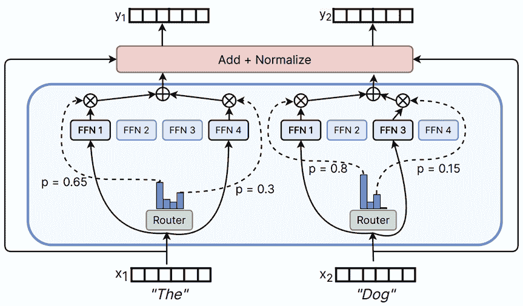
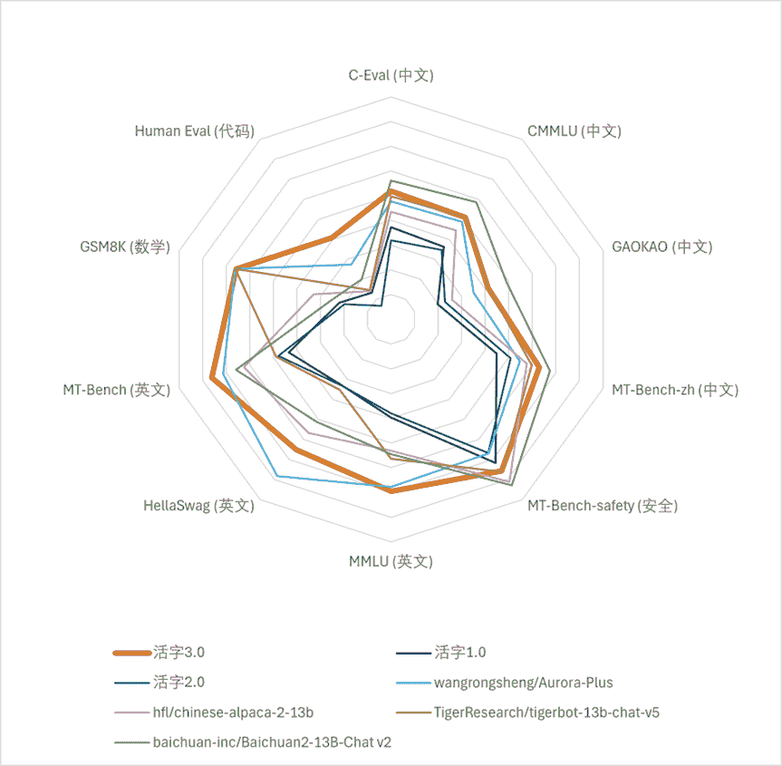
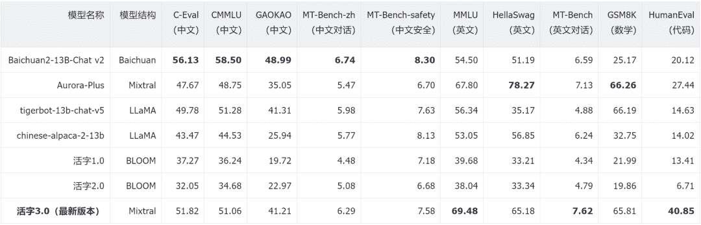
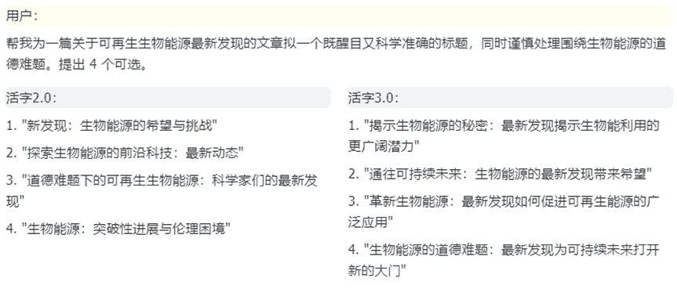
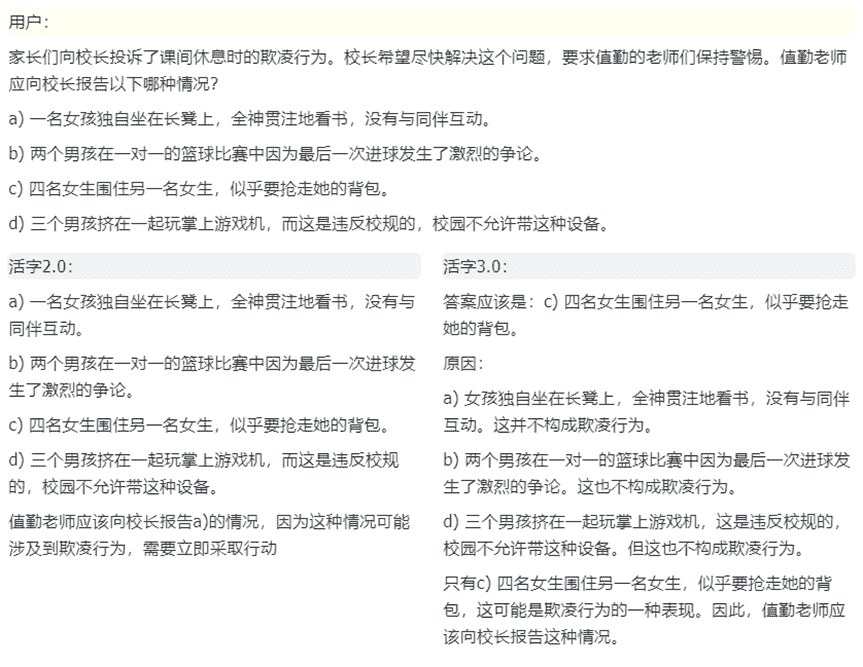
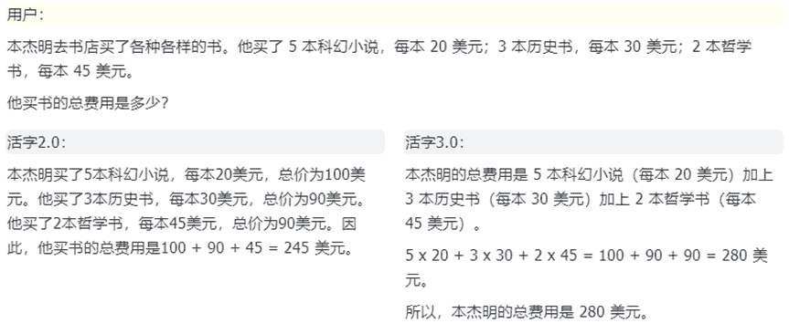
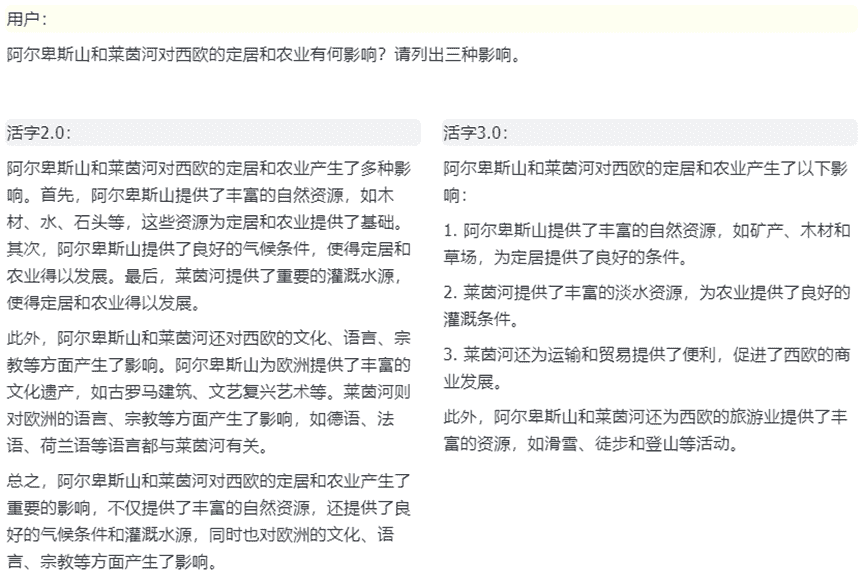
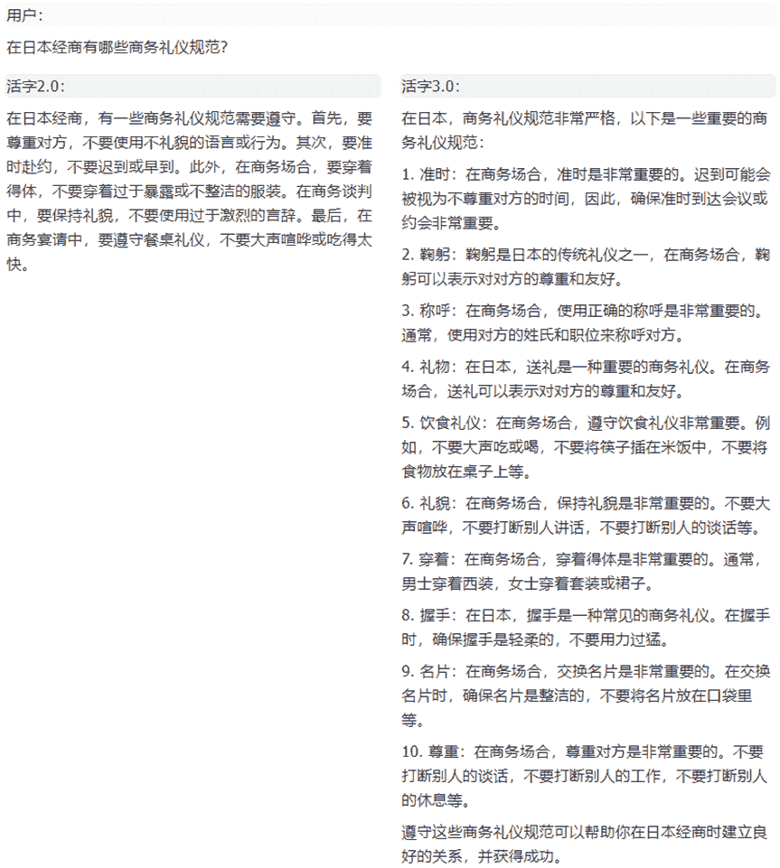

# 哈工大开源“活字”对话大模型3.0版本

> 来源：[https://agijuejin.feishu.cn/docx/PuM8dHIuaoTWFJxYkw7cNFapn5g](https://agijuejin.feishu.cn/docx/PuM8dHIuaoTWFJxYkw7cNFapn5g)

> 哈工大SCIR｜[阅读原文](https://mp.weixin.qq.com/s/SGppkCePJtKd2-4PstnEtg)

> 转载请联系原作者取得授权

# **一、介绍 **

大规模**语言模型（L**LM）在自然语言处理领域取得了显著的进展，并在广泛的应用场景中展现了其强大的潜力。这一技术不仅吸引了学术界的广泛关注，也成为了工业界的热点。在此背景下，哈尔滨工业大学社会计算与信息检索研究中心（HIT-SCIR）近期推出了最新成果—— 活字3.0 ，致力于为自然语言处理的研究和实际应用提供更多可能性和选择。

我们的模型发布于：https://github.com/HIT-SCIR/huozi（点击“阅读原文”跳转链接）

活字3.0是基于 **Chinese****-Mixtr**al-8**x7B ，在大约30****万行指令数据上**微调**得到的模**型。该模型支持 32K上下文 ，能够有效处理长文本。活字3.0继承了基座模型丰富的 中英文知识 ，并在 数学推理、代码生成 等任务上具有强大性能。经过指令微调，活字3.0还在 指令遵循能力 和 安全性 方面实现了显著提升。

此外，我们开源了 **中文 MT-Bench **数据集。这是一个中文开放问题集，包括80组对话任务，用于评估模型的多轮对话和指令遵循能力。该数据集是根据原始MT-Bench翻译得来的，每组问题均经过人工校对和中文语境下的适当调整。我们还对原始MT-Bench中的部分错误答案进行了修正。

##  **模型结构 **

活字3.0是一个稀疏混合专家模型（SMoE），使用了Mixtral-8x7B[1]的模型结构。它区别于LLaMA、BLOOM等常见模型，该模型的每个前馈神经网络（FFN）层被替换为了“专家层”，该层包含8个FFN和一个“路由器”。这种设计使得模型在推理过程中，可以独立地将每个Token路由到最适合处理它的两个专家中。该模型共拥有46.7B个参数，但得益于其稀疏激活的特性，实际推理时仅需激活13B参数，有效提升了计算效率和处理速度。

图1 活字3.0采用的SMoE结构示意图[2]

##  **训练过程 **

由于Mixtral-8x7B词表不支持中文，因此对中文的编解码效率较低，限制了中文场景下的实用性。我们首先基于Mixtral-8x7B进行了中文扩词表增量预训练，显著提高了模型对中文的编解码效率，并使模型具备了强大的中文生成和理解能力。这项成果名为 Chinese-Mixtral-8x7B ，我们已于2024年1月18日开源了其模型权重和训练代码。基于此，我们进一步对模型进行指令微调，最终推出了活字3.0。这一版本的中文编码、指令遵循、安全回复等能力都有显著提升。

图2 活字3.0训练过程

#  **二、模型性能 **

图3 活字3.0综合性能对比

针对大模型综合能力评价，我们分别使用以下评测数据集对活字3.0进行评测：

+   C-Eval [3]：一个全面的中文基础模型评估套件。它包含了13948个多项选择题，涵盖了52个不同的学科和四个难度级别。

+   CMMLU [4]：一个综合性的中文评估基准，专门用于评估语言模型在中文语境下的知识和推理能力，涵盖了从基础学科到高级专业水平的67个主题。

+   GAOKAO [5]：一个以中国高考题目为数据集，旨在提供和人类对齐的，直观，高效地测评大模型语言理解能力、逻辑推理能力的测评框架。

+   MMLU [6]：一个包含57个多选任务的英文评测数据集，涵盖了初等数学、美国历史、计算机科学、法律等，难度覆盖高中水平到专家水平，是目前主流的LLM评测数据集之一。

+   HellaSwag [7]：一个极具挑战的英文NLI评测数据集，每一个问题都需要对上下文进行深入理解，而不能基于常识进行回答。

+   GSM8K [8]：一个高质量的小学数学应用题的数据集，这些问题需要 2 到 8 个步骤来解决，解决方案主要涉及使用基本算术运算，可用于评价多步数学推理能力。

+   HumanEval [9]：一个由 164 个原创编程问题组成的数据集，通过衡量从文档字符串生成程序的功能正确性，来够评估语言理解、算法和简单的数学能力。

+   MT-Bench [10]：一个开放的英文问题集，包括80个多轮对话任务，用于评估聊天机器人的多轮对话和指令遵循能力，并通过大模型裁判（GPT-4）对模型回答进行打分。

+   MT-Bench-zh：我们根据MT-Bench翻译得来的中文问题集，每组问题均经过人工校对和中文语境下的适当调整。我们已在本仓库开源MT-Bench-zh数据集。

+   MT-Bench-safety：我们手工构造的安全数据集，包括暴力、色情、敏感等风险内容。该数据集为封闭数据集。

+   活字3.0在推理时仅激活13B参数。下表为活字3.0与其他13B规模的中文模型以及旧版活字在各个评测数据集上的结果：

图4 活字3.0详细评测指标

> 我们在C-Eval、CMMLU、MMLU采用5-shot，GSM8K采用4-shot，HellaSwag、HumanEval采用0-shot，HumanEval采用pass@1指标。所有测试均采用greedy策略。我们使用OpenCompass作为评测框架，commit hash为4c87e77。

根据上表中的测试结果，活字3.0较旧版活字取得了巨大的性能提升。在中文知识方面，活字3.0达到了与Tigerbot-13B-chat-v5相当的性能，并是在中文对话和指令遵循方面表现得更加优秀。在英文知识方面，得益于原版Mixtral-8x7B的强大性能，活字3.0超过了Baichuan2-13B-Chat v2和LLaMA系列的扩词表模型，并在英文对话和指令遵循能力上达到了较高水平。在数学推理和代码生成任务上，活字3.0均展现出强大的性能，这说明活字3.0对复杂问题的深层次理解、多步推理、以及结构化信息处理等方面具有较强水平。由于我们采用了较高质量的代码数据集，活字3.0的代码生成能力也超越了同为Mixtral结构的Aurora-Plus模型。

#  **三、生成样例 **

下面是活字3.0在MT-Bench-zh评测集上的生成效果展示，并与活字2.0（RLHF版本）进行对比：

样例1

样例2

样例3

样例4

样例5

#  **四、结语 **

活字3.0是哈尔滨工业大学社会计算与信息检索研究中心（HIT-SCIR）的最新成果。该项目的开源性质鼓励了更广泛的参与和尝试，有助于推动自然语言处理技术的研究和应用。但是活字仍然可能生成有害内容，请谨慎鉴别和使用生成的内容，请勿将生成的有害内容传播至互联网。最后，诚邀您访问我们的GitHub项目页面，体验活字大模型，并共同探讨中文自然语言处理的未来发展。

#  **五、开源协议 **

对本仓库源码的使用遵循开源许可协议 Apache 2.0。

活字支持商用。 如果将活字模型或其衍生品用作商业用途，请您按照如下方式联系许可方，以进行登记并向许可方申请书面授权。

联系邮箱： jngao@ir.hit.edu.cn。

#  **六、引用**

| LaTeX  @misc{huozi,  author = {Huozi-Team}.  title = {Huozi: Leveraging Large Language Models for Enhanced Open-Domain Chatting}  year = {2024},  publisher = {GitHub},  journal = {GitHub repository}  howpublished = {\url{https://github.com/HIT-SCIR/huozi}}  } |
| --- |

#  **七、参考文献 **

[1] Jiang A Q, Sablayrolles A, Roux A, et al. Mixtral of Experts[J]. arXiv preprint arXiv:2401.04088, 2024.

[2] Fedus W, Dean J, Zoph B. A review of sparse expert models in deep learning[J]. arXiv preprint arXiv:2209.01667, 2022.

[3] Huang Y, Bai Y, Zhu Z, et al. C-eval: A multi-level multi-discipline chinese evaluation suite for foundation models[J]. arXiv preprint arXiv:2305.08322, 2023.

[4] Li H, Zhang Y, Koto F, et al. CMMLU: Measuring massive multitask language understanding in Chinese[J]. arXiv preprint arXiv:2306.09212, 2023.

[5] Zhang X, Li C, Zong Y, et al. Evaluating the Performance of Large Language Models on GAOKAO Benchmark[J]. arXiv preprint arXiv:2305.12474, 2023.

[6] Hendrycks D, Burns C, Basart S, et al. Measuring massive multitask language understanding[J]. arXiv preprint arXiv:2009.03300, 2020.

[7] Zellers R, Holtzman A, Bisk Y, et al. Hellaswag: Can a machine really finish your sentence?[J]. arXiv preprint arXiv:1905.07830, 2019.

[8] Cobbe K, Kosaraju V, Bavarian M, et al. Training verifiers to solve math word problems[J]. arXiv preprint arXiv:2110.14168, 2021.

[9] Chen M, Tworek J, Jun H, et al. Evaluating large language models trained on code[J]. arXiv preprint arXiv:2107.03374, 2021.

[10] Zheng L, Chiang W L, Sheng Y, et al. Judging LLM-as-a-judge with MT-Bench and Chatbot Arena[J]. arXiv preprint arXiv:2306.05685, 2023.

本期责任编辑：车万翔

本期编辑：童彦澎