# 今日arXiv最热NLP大模型论文：做到头了！清华和哈工大把大模型量化做到了1比特

> 来源：[https://agijuejin.feishu.cn/docx/EmOrd5reeoe1T1xOlsLcIVd1nlf](https://agijuejin.feishu.cn/docx/EmOrd5reeoe1T1xOlsLcIVd1nlf)

> 夕小瑶科技说｜[阅读原文](https://mp.weixin.qq.com/s/uhZFOxecg7CkkIsEcMiSGw)

> 转载请联系原作者取得授权

**夕小瑶科技说 原创****

作者 | 谢年**年

在追求更高效的机器学习模型部署时，模型量化技术应运而生，它通过降低权重矩阵的位宽来显著减少大型语言模型的存储和计算需求。

我们一般的双精度浮点型double是64位，单精度浮点型float是32位。早年RoBERTa等大模型训练时把精度压缩到了16位的半精度FP16。近年来，大语言模型量化一般都只敢玩到4位或8位量化，因为要是把位宽压得太狠，性能就会直线下滑。

**最近，清华和哈**工大**提出了一个名为 One**Bit 的 1位量化感知训练框架 把大模型量化做到了1比特，同时保证了时间和空间效率以及模型性能之间的平衡，至少能达到非量化性能的83%，而且训练过程还特别稳定。

OneBit框架采用创新的1比特参数表示方法，精确量化LLM。同时，结合高效的矩阵分解初始化策略——Sign-Value-Independent Decomposition（SVID），显著提升框架收敛速度。通过量化感知知识蒸馏，成功将教师模型的能力迁移至1比特对应模型。

**论文标题：**

OneBit: Towards Extremely Low-bit Large Language Models

公众号「夕小瑶科技说」后台回复“OneBit”获取论文PDF！

## ** ****背景知识**

量化与剪枝和知识蒸馏（KD）同属于模型压缩的主流方法。模型量化的主要思想是将模型中的每个权重矩阵  从FP32或FP16格式压缩为低比特值。比如经常将transformer中的Linear层的权重矩阵量化为8位、4位，甚至2位。

大多数量化研究主要采用最近舍入（round-to-nearest (RTN)）方法，即将权重  舍入到量化网格中的最近值。其数学表达形式可以表示为

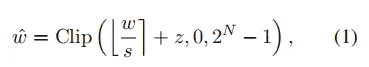

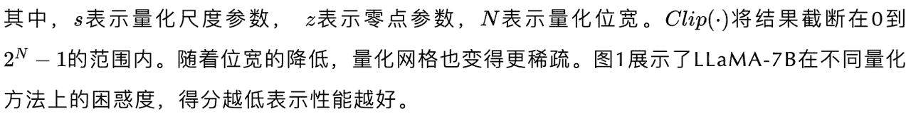

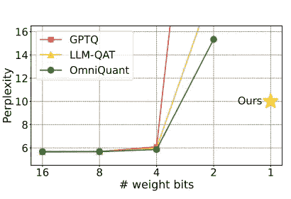

从图中可以看出，基于RTN方法的量化在4位时可能会达到最佳性能。进一步压缩，将模型量化至2位值将导致显著下降。

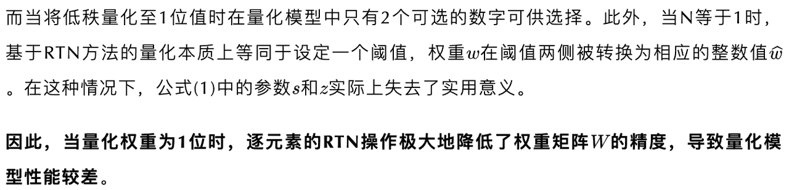

## ** ****OneBit框架**

OneBit框架的核心思想是将LLMs的权重矩阵大胆地量化到1位。1位量化意味着每个权重值只能用1位二进制数表示，即只有两种可能的状态（+1或-1）。同时引入两个FP16格式的值向量以补偿由于量化导致的精度损失。这种设计不仅保持了原始权重矩阵的高秩，而且通过值向量提供了必要的浮点精度，有助于模型的训练和知识迁移。

下图展示了二进制量化线性层与常规的FP16线性层的区别，左侧是原始的FP16线性层，其中激活X和权重矩阵W都是以FP16格式呈现。右侧是本文提出的架构OneBit。只有值向量g和h是以FP16格式呈现，而权重矩阵由±1组成。

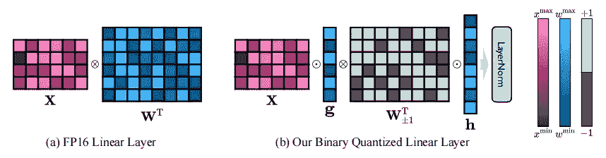

###  1. 线性层的OneBit架构设计

由于1比特权重量化存在严重的精度损失，基于RTN将Linear层中的权重矩阵直接从FP32/16转换为1比特格式具有挑战性。作者提出了一种线性层的1-bit架构设计，如下公式所示：

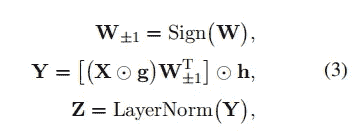

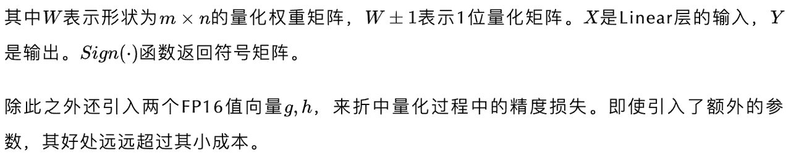

这里作者举了一个例子来说明：设为4096 × 4096的权重矩阵进行量化时，每个分量中的比特数为：

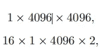

其中第一个是用于1位量化的权重矩阵， 第二个是用于两个FP16值向量。因此，总比特数为16, 908, 288。此外，参数数量为4096 ×4096 + 2 × 4096 × 1= 16, 785, 408。因此，这个Linear层量化结果的平均位宽为16, 908, 288 ÷16, 785, 408 ≈ 1.0073。

### ** 2. SVID **

为了使用完全训练好的权重初始化1比特模型，作者引入了权重矩阵W的Sign-Value-Independent Decomposition，SVID。

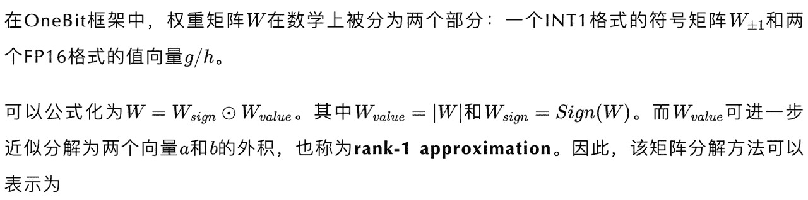

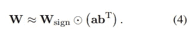

这里可以利用一些广泛使用的矩阵分解方法进行rank-1逼近，例如奇异值分解SVD和NMF非负矩阵分解。本文选用NMF，可以获得更好的性能。

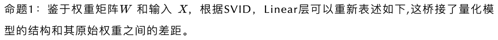

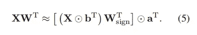

▲具体证明过程见原文。

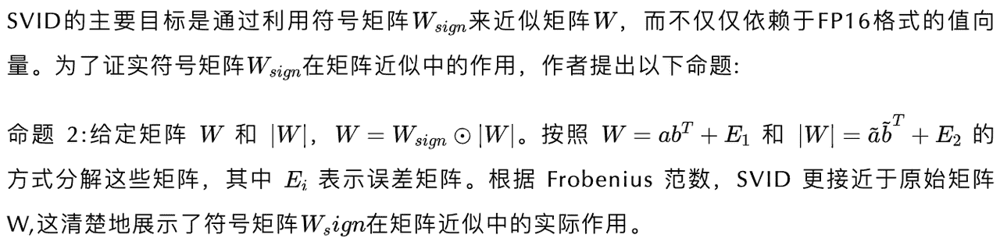

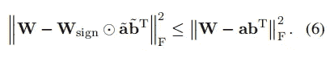

SVID并不旨在精确复制原始模型的参数，而是为进一步训练提供了一个有效的起点，以充分利用原始模型的广泛训练。

### ** 3. 知识迁移 **

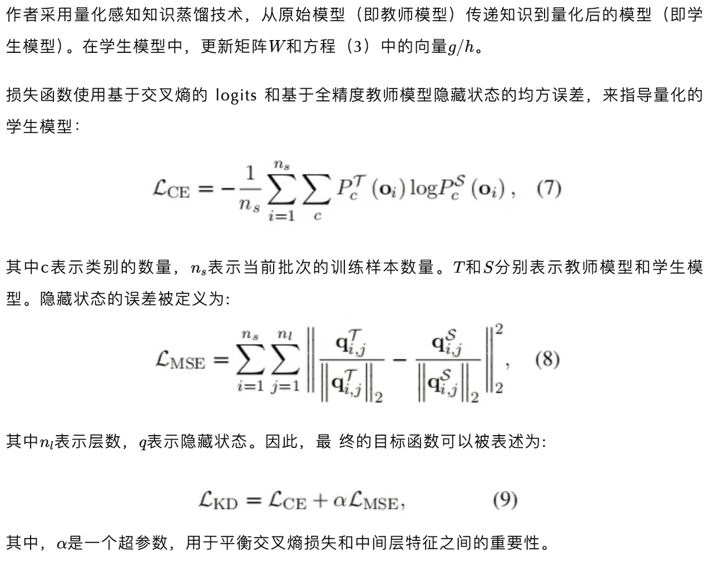

## ** ****实验设置**

### ** 数据 **

使用原始教师模型的下一个令牌生成合成语料库。它从词汇中随机选择第一个令牌，并迭代生成下一个令牌，直到达到<EOS>令牌或最大长度。具体来说，前3到5个令牌的top-1预测是确定性选择的，其后的令牌则进行随机抽样。本文利用LLaMA-7B生成了总共132k个数据条目，每个条目的最大长度为2,048。

### ** 训练细节 **

每次知识蒸馏实验都会学习50个epoch的训练数据，选择2048个token片段。采用scikit-learn中的NMF来分解SVID中的权重矩阵。量化学生模型通过Adam优化器进行优化，学习率通过cosine策略进行调度。其他训练细节如下表所示：

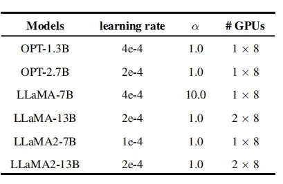

### ** 评估指标 **

通过在WikiText2和C4这两个数据集上测试困惑度来评估量化模型的性能。较低的困惑度意味着压缩模型在保持原始模型输出分布方面做得更好。此外，还报告了多个零样本任务的准确性，包括Winogrande、HellaSwag、PIQA、BoolQ和ARC，以检验原始模型在下游任务中的能力是否得以保留。所有这些评估都是通过开源工具包“LM-Evaluation-Harness”来完成的。

## ** **主要实验结果：OneBit的性能表现

在对LLMs进行极低比特宽度量化的研究中，OneBit框架展现了显著的性能。实验结果如下表所示：

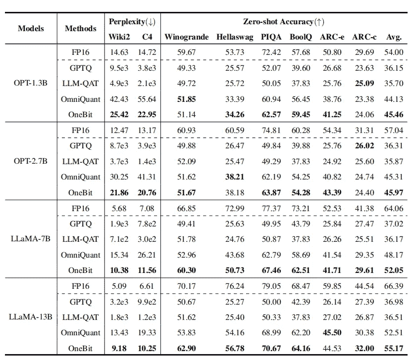

+   从困惑度指标来看，OneBit显著优于其他方法。虽然QAT方法随着模型大小增加，性能显著提升。但而本文的方法有明显的优势，并且逐渐接近FP16的性能，尤其在LLaMA-13B模型上，困惑度下降明显。

+   对于零样本任务准确率，OneBit方法在多数模型中实现了与FP16基线接近的性能，仅在少数任务上落后于OmniQuant，但相差不大。

## ** **模型能力分析：OneBit在实际问题解决中的表现

所有方法在1比特权重量化中都不可避免地面临性能下降，因此作者还评测OneBit解决实际问题的能力，重点专注常识推理和世界知识能力。

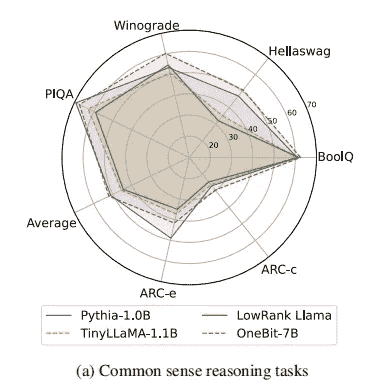

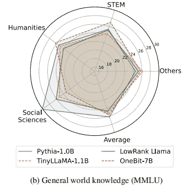

尽管其他模型参数更多且训练更充分，但OneBit模型在常识推理方面仍然具有优势。这反映了OneBit很好的继承了更大的7B模型中的知识与能力。

而在世界知识方面，尽管OneBit在社会科学领域存在一定损失，但在其他领域中表现超过了完全训练Pythia-1B模型。

## ** ****分析与讨论**

### ** 1. 效率 **

显然，将模型权重量化为极低位可以大幅度减少其内存占用。实际上，如表3所示，随着模型规模的增大，压缩比也在不断提高。这一点对于大型模型来说尤为重要，因为它使得将这类模型部署到单个GPU上成为可能，从而极大地提高了模型的实际应用性和灵活性。

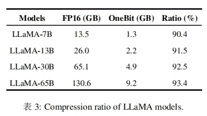

虽然该方法在实施过程中可能会导致一定的性能损失，但如图4所示，它在空间占用和模型性能之间达到了良好的平衡。

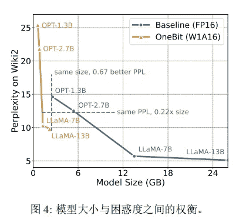

比如只需使用原始模型空间的0.2倍，即可实现与FP16相当的性能表现。此外，通过将权重量化为±1，能够进一步加速**CPU上的矩阵乘法操作。这是因为在**这种量化方式下，原本需要进行的浮点乘法可以转换为速度更快的位操作，显著提升计算效率。 因此，该方法的内存占用显著减少，更符合个人电脑和智能手机等设备的部署需求。

### ** 2. 鲁棒性 **

极低比特量化使训练过程对学习率高度敏感，当学习率过小或过大时，使模型难以收敛。这主要是由于权重元素在+1和-1之间波动时产生的梯度幅度较大，导致Linear层输出显著波动。

下图显示了另一种1位量化架构BitNet在使用不同学习率训练时的表现，可以看到非常不稳定：

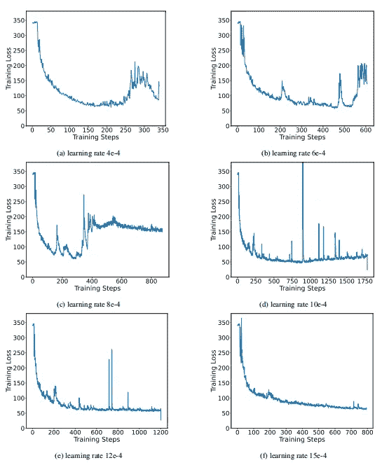

而OneBit通过引入两个FP16格式的值向量来补充必要的浮点数值精度，同时限制了量化后矩阵乘法结果的波动范围，从而提高了模型的鲁棒性，展现出更稳定的训练过程，并且对学习率不敏感。

### ** 3. 不同组件的影响 **

OneBit主要的可变组件包括Post-LayerNorm、参数初始化等。

+   Post-LayerNorm：在量化感知训练期间，模型存在浮点数溢出的问题，尤其在模型深度增加时，激活值容易急剧增长。为应对此问题，本文选择了Post-LayerNorm策略，而非Pre-LayerNorm。因为在实际应用中，Pre-LayerNorm有时可能无法有效地控制激活值的增长。

+   参数初始化：在使用SVID做参数初始化时，非负矩阵分解和奇异值分解均可用于分解|W|，但推荐使用奇异值分解。它能加快训练收敛速度，如下图所示，NMF初始化有助于获得更好的性能。

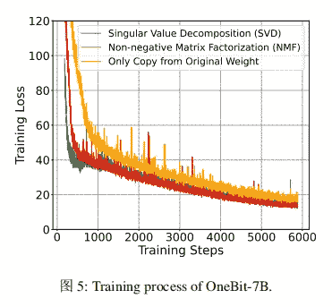

## ** ****总结**

OneBit框架提出了一种大胆的1位量化方法，极大地减少了模型部署时的存储和计算开销。尽管存在一些性能损失，但其在模型压缩和部署效率方面的潜力是显而易见的，为研究极低位量化模型提供了一条新的探索途径。

公众号「夕小瑶科技说」后台回复“OneBit”获取论文pdf。