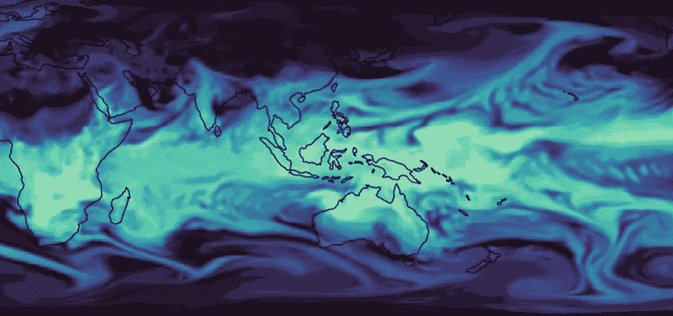
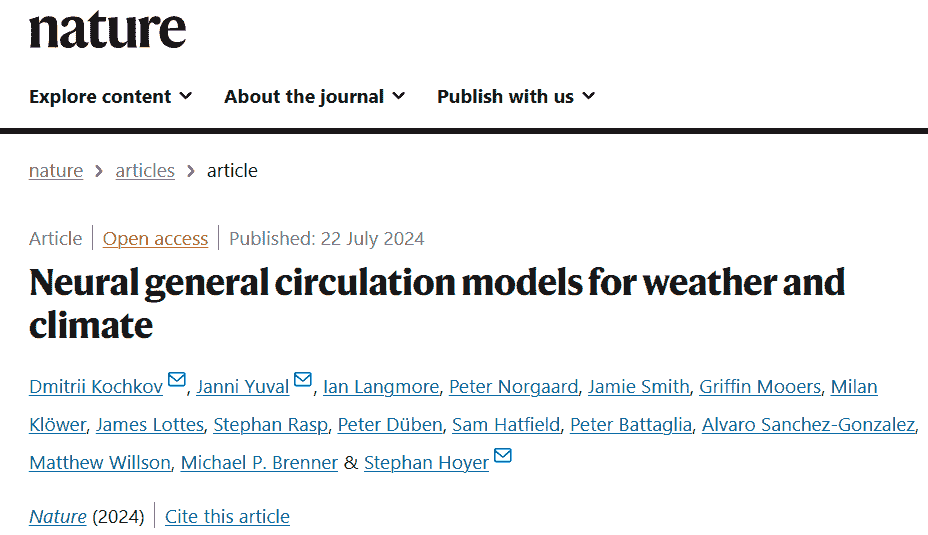
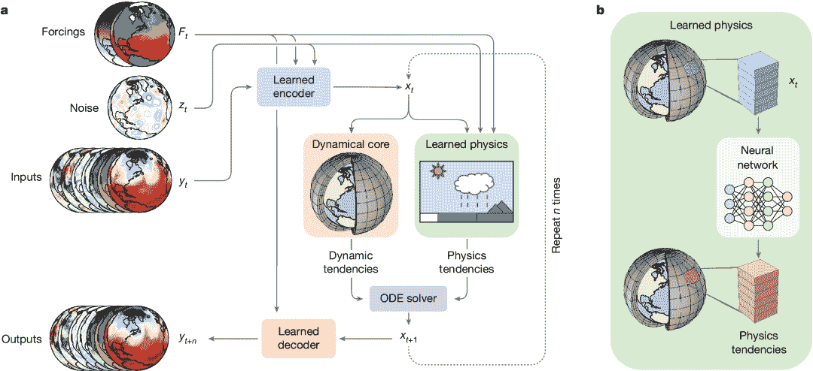
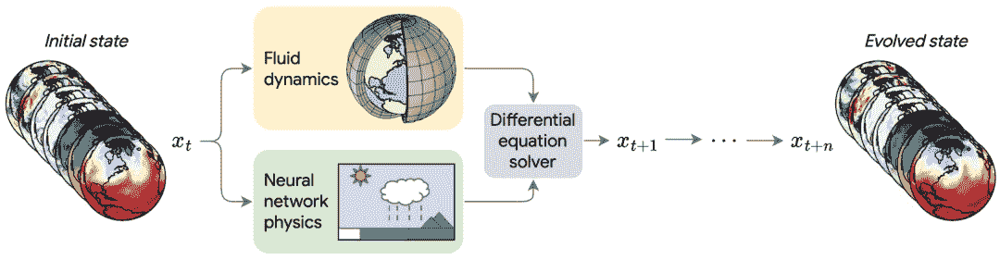
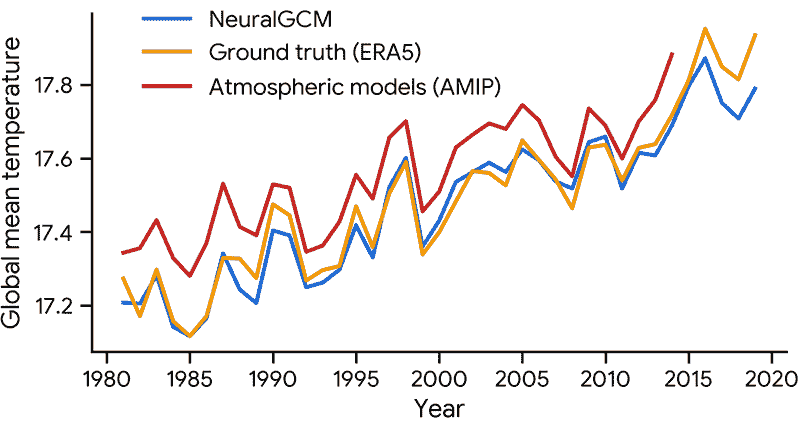
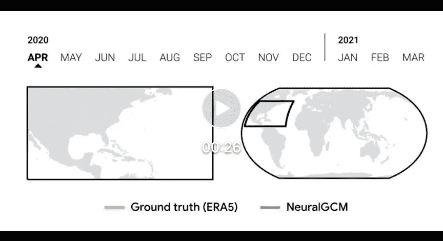
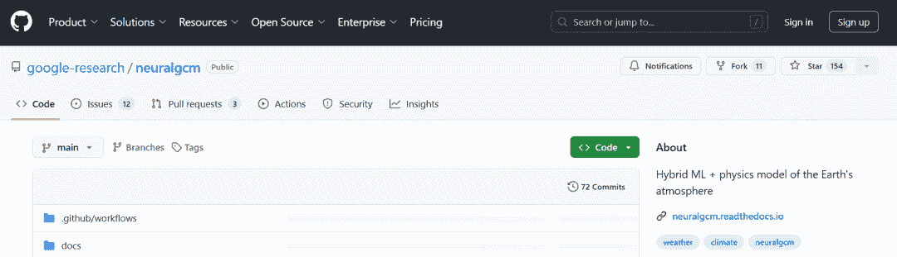

# 强过「黄金标准」，快3,500倍，成本低10万倍，物理建模融合AI，谷歌天气模型登Nature

> 来源：[https://agijuejin.feishu.cn/docx/XWicdzdx5oAGUtxBR9TceS3wntg](https://agijuejin.feishu.cn/docx/XWicdzdx5oAGUtxBR9TceS3wntg)

> 机器之心 ScienceAI｜[阅读原文](https://www.jiqizhixin.com/articles/2024-07-23-7)

> 转载请联系原作者取得授权

编辑 | KX

地球正以前所未有的方式变暖，但气温升高对我们的未来意味着什么尚不完全清楚。全球哪些地区将面临长期干旱？大型热带风暴将使哪些沿海地区的洪灾更加频繁？为了回答这些问题，科学家需要能够准确预测地球气候。

现在，Google Research 研究团队提出一种将传统的基于物理建模与 ML 相结合的新方法——NeuralGCM，可以准确高效地模拟地球大气层。比现有模型更快、计算成本更低、更准确。

NeuralGCM 可以生成 2-15 天的天气预报，比目前基于物理的「黄金标准」模型更准确。在 1 至 10 天预报方面与机器学习模型相媲美，在 1 至 15 天预报方面与欧洲中期天气预报中心的集合预报相媲美。

所得到的模型非常快速且准确，在相似或更高准确度下，计算效率比当前最先进的模型高出 3 到 5 个数量级。

相关研究以「 Neural general circulation models for weather and climate 」为题，于 7 月 22 日发布在《 Nature 》上。

论文链接： https://www.nature.com/articles/s41586-024-07744-y

**NeuralGCM 架构**

NeuralGCM 将基于物理的大气循环模型与用于小规模过程的神经网络相结合。

NeuralGCM 的两个关键组成部分是：一个可微分的动力学 core，用于求解离散化的动力学控制方程；以及一个使用神经网络参数化物理过程的学习物理模块。

动力学 core 模拟在重力和科里奥利力（Coriolis Force）作用下大尺度流体运动和热力学过程。学习物理模块利用神经网络预测未解决过程对模拟场的影响，如云的形成、辐射传输、降水和亚网格尺度动力学。

图示：NeuralGCM 模型的结构。（来源：论文）

NeuralGCM 中的可微分动力学 core 允许采用端到端训练方法，即在采用随机梯度下降之前将模型推进多个时间步骤，以尽量减少模型预测和重新分析之间的差异。通过数百个模拟步骤的扩展反向传播使神经网络能够考虑学习到的物理和动力学核心之间的相互作用。训练确定性和随机性 NeuralGCM 模型，每个模型都使用不同的训练协议。

研究训练了一系列水平分辨率的 NeuralGCM 模型，网格间距为 2.8°、1.4° 和 0.7°。在适合天气预报和气候模拟的一系列时间尺度上评估了 NeuralGCM 的性能。

NeuralGCM 转变气候建模

与传统模型一样，NeuralGCM 将地球大气层划分为立方体，并对空气和水分运动等大规模过程进行物理计算。但它不是依靠科学家制定的参数化来模拟云形成等小规模方面，而是使用神经网络从现有天气数据中学习这些事件的物理特性。

NeuralGCM 的一项关键创新是，研究人员在 JAX 中从头开始重写了大规模过程的数值求解器。这使其能够使用基于梯度的优化在多个时间步骤上「在线」调整耦合系统的行为。

相比之下，之前使用 ML 增强气候模型的尝试在数值稳定性方面遇到了很大困难，因为它们使用了「离线」训练，忽略了随着时间的推移而积累的小规模和大规模过程之间的关键反馈。在 JAX 中编写整个模型的另一个好处是它可以在 TPU 和 GPU 上高效运行，而传统的气候模型主要在 CPU 上运行。

图示：NeuralGCM 将传统的流体动力学求解器与用于小规模物理的神经网络相结合。这些组件由微分方程求解器组合，使系统在时间上按顺序向前推进。（来源：Google Research）

研究人员使用 ECMWF 1979 年至 2019 年的天气数据（分辨率为 0.7°、1.4° 和 2.8°）训练了一套 NeuralGCM 模型。虽然该模型是根据天气预报进行训练的，但将 NeuralGCM 设计成通用大气模型。

**准确的天气预报和气候预测**

迄今为止，ML 预测研究主要集中在短期预报上，远远低于气候预测所需的几年到几十年的时间。由于难以对数十年的气候预测进行稳健验证，研究人员使用已建立的 WeatherBench 2 基准对气候尺度预测以及天气模型对 NeuralGCM 进行了评估。

NeuralGCM 的确定性模型在 0.7° 分辨率下的性能与当前最先进的模型相当，天气预报准确率可达 5 天。

NeuralGCM 的 1.4° 分辨率集合模型在 5 到 15 天的预测精度方面优于之前最先进的模型。这是由于 NeuralGCM 能够产生与 ECMWF 最先进的基于物理的模型 ECMWF-ENS 相媲美的集合天气预报，而 NeuralGCM 是第一个基于 ML 的模型。

在 2-15 天的预报中，NeuralGCM 集合的准确性在 95% 的时间内优于 ECMWF-ENS。

NeuralGCM 在气候时间尺度的预测方面也优于最先进的大气模型。由于 NeuralGCM 仅模拟地球气候的大气成分，因此将其性能与基于物理的大气模型进行了比较。在预测 1980 年至 2020 年间的 40 年间的温度时，NeuralGCM 的 2.8° 确定性模型的平均误差是气候模型比对项目的仅大气模型 (AMIP) 的三分之一——0.25 摄氏度对 0.75 摄氏度。

图示：比较 NeuralGCM 和 AMIP 在预测 1980 年至 2020 年期间 1000 hPa 全球平均气温方面的表现。全球平均气温 (C) 来自 ECMWF 再分析 v5 ERA5 数据集。（来源：Google Research）

由于传统大气模型难以模拟地球大气的某些方面，气候科学家有时会使用 X-SHiELD 等更高分辨率的模型，这些模型更准确，但计算成本较高。与 X-SHiELD 相比，NeuralGCM 的 1.4° 确定性模型在预测 2020 年的湿度和温度数据时误差减少了 15-50%，2020 年的数据是美国国家海洋和大气管理局 (NOAA) 研究人员提供的一年的数据。

在 2020 年的气候模拟中，NeuralGCM 还预测了与当年在同一地区观测到的风暴数量和强度相匹配的热带气旋模式。NeuralGCM 是第一个能够生成此类模式的基于 ML 的模型。

视频链接： [https://mp.weixin.qq.com/s/ni](https://mp.weixin.qq.com/s/niZ_CpF1cI-2_dCzqdUanQ)Z_CpF1cI-2_dCzqdUanQ

NeuralGCM 预测了 2020 年全球热带气旋的路径。预测的风暴与 ECMWF 再分析 v5（ERA5）数据集中显示的当年实际气旋的数量和强度相匹配。（来源：Google Research）

**开源、快速、高效的模型**

NeuralGCM 比传统的 GCM 节省了几个数量级的计算量，计算成本也更低。

NeuralGCM 的 1.4° 模型比 X-SHiELD 快 3,500 倍以上，这意味着如果研究人员使用 X-SHiELD 模拟一年的大气，需要 20 天，而使用 NeuralGCM 只需 8 分钟。

虽然科学家只需要一台带有单个 TPU 的计算机即可运行 NeuralGCM，但他们需要请求访问具有 13,000 个 CPU 的超级计算机才能运行 X-SHiELD。

总体而言，使用 NeuralGCM 进行气候模拟的计算成本比使用 X-SHiELD 低 100,000 倍，速度的提高相当于高性能计算 25 年的进步。

NeuralGCM 可以比最先进的物理模型更快地模拟大气，同时以相当的精度生成预测。（来源：Google Research）

研究人员已将 NeuralGCM 的源代码和模型权重在 GitHub 上公开，供非商业使用。

开源地址： https://github.com/google-research/neuralgcm

此外，由于 NeuralGCM 可以在笔记本电脑上运行，而不需要超级计算机，研究人员希望更多的气候研究人员可以在他们的工作中使用这种最先进的模型。

**未来方向**

NeuralGCM 目前仅模拟地球大气层。研究人员希望最终将地球气候系统的其他方面（例如海洋和碳循环）纳入模型。这样，NeuralGCM 将在更长的时间尺度上进行预测，而不仅仅是预测几天和几周的天气，而是在气候时间尺度上进行预测。

NeuralGCM 提出了一种构建气候模型的新方法，这种方法可能比现有模型更快、计算成本更低、更准确。

基于物理定律和经验关系的模型在科学中无处不在。研究人员相信 NeuralGCM 的可微分混合建模方法有潜力将模拟技术转化为广泛的应用，例如材料发现、蛋白质折叠和多物理工程设计。

参考内容：

https://research.google/blog/fast-accurate-climate-modeling-with-neuralgcm/

https://x.com/GoogleAI/status/1815419503230287969

https://x.com/shoyer/status/1815453653710631271