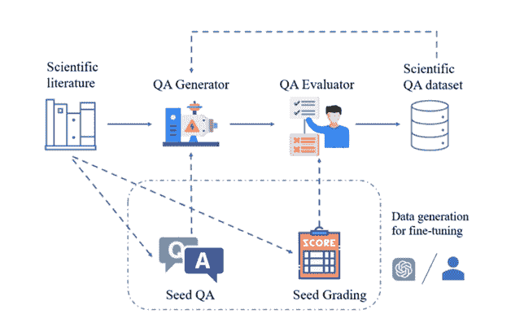
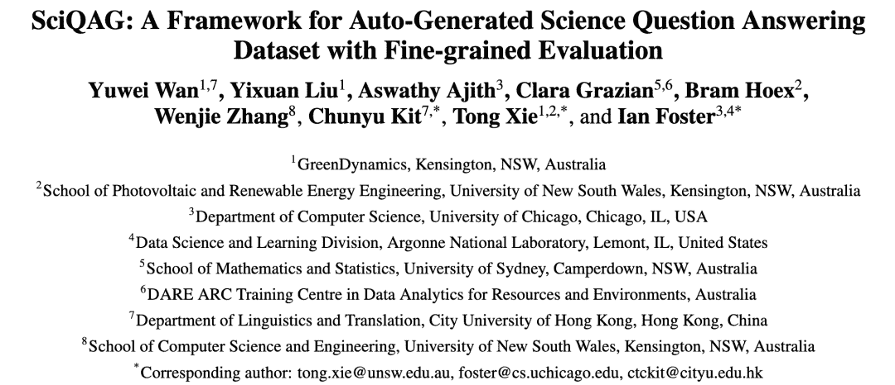
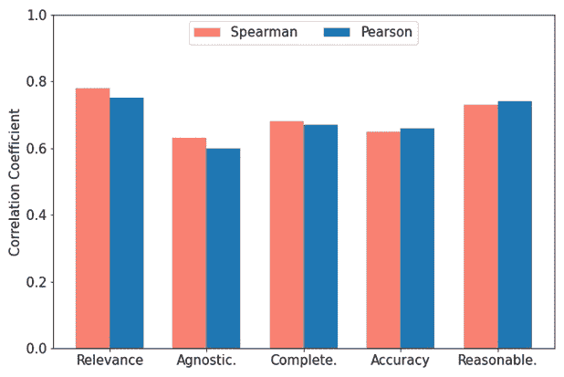
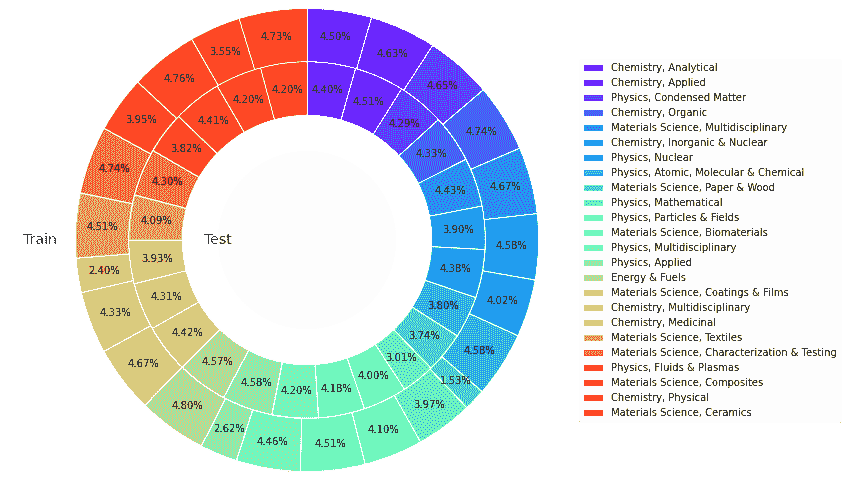
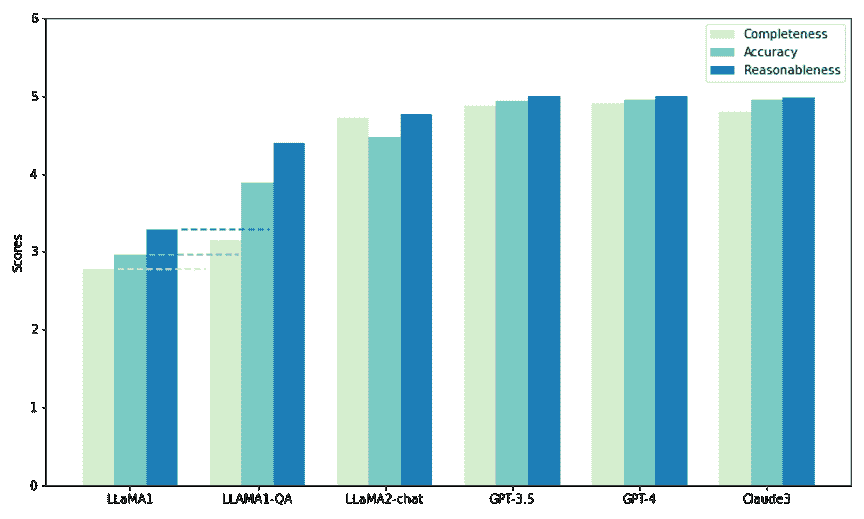
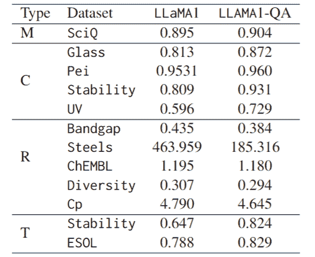

# 为大模型提供全新科学复杂问答基准与测评体系，UNSW、阿贡、芝加哥大学等多家机构联合推出SciQAG框架

> 来源：[https://agijuejin.feishu.cn/docx/MfgmdbWk2oZ0VBxtea8czAgBnse](https://agijuejin.feishu.cn/docx/MfgmdbWk2oZ0VBxtea8czAgBnse)

> 机器之心 ScienceAI｜[阅读原文](https://www.jiqizhixin.com/articles/2024-07-24-7)

> 转载请联系原作者取得授权

编辑 | ScienceAI

问答（QA）数据集在推动 自然语言处理 （NLP）研究发挥着至关重要的作用。高质量QA数据集不仅可以用于微调模型，也可以有效评估大 语言模型 （LLM）的能力，尤其是针对科学知识的理解和推理能力。

尽管当前已有许多科学QA数据集，涵盖了医学、化学、生物等领域，但这些数据集仍存在一些不足。

其一，数据形式较为单一，大多数为多项选择题（multiple-choice questions），它们易于进行评估，但限制了模型的 答案选择 范围，无法充分测试模型的科学问题解答能力。相比之下，开放式问答(openQA)可以更加全面地评估模型的能力，但缺乏合适的评估指标。

其二，现有数据集的内容很多来源于大学及以下等级的教科书，难以评估LLM在实际学术研究或生产环境中的高层次知识保持能力。

其三，这些 基准 数据集的创建依赖人类专家标注。

应对这些挑战对建立更全面的QA数据集至关重要，也有利于对科学LLM的更精准评估。

图示：从科学文献中生成高质量科学问答对的SciQAG框架。

为此，美国Argonne国家实验室、芝加哥大学Ian Foster 教授（2002年戈登贝尔奖得主）团队、澳大利亚新南威尔士大学Bram Hoex教授UNSW AI4Science团队、AI4Science 公司GreenDynamics 与香港城市大学揭春雨教授团队联合提出了 SciQAG，第一个基于大 语言模型 （LLM）从大型科学文献 语料库 中自动生成高质量科学开放性问答对的新型框架。

论文链接： https://arxiv.org/abs/2405.09939

github链接： https://github.com/MasterAI-EAM/SciQAG

基于SciQAG，研究人员构建了一个大规模、高质量、开放式的科学QA数据集 SciQAG-24D ，包含从24个科学领域的22,743篇科学论文中提取的188,042 个QA对，旨在服务LLM的微调和科学问题解答能力评估。

实验证明，在 SciQAG-24D 数据集上对 LLM 进行微调可以显著提高它们在开放式问题解答和科学任务中的性能。

数据集、模型和评估代码已经开源(https://github.com/MasterAI-EAM/SciQAG)，以促进AI for Science社区对开放式科学问答的共同开发。

SciQAG框架与SciQAG-24D 基准 数据集

SciQAG由QA生成器和QA评估器组成，旨在大规模快速生成基于科学文献的多样化开放式问答对。首先，生成器将科学论文转换为问答对，然后评估器过滤掉不符合质量标准的问答对，从而获得高质量的科学问答数据集。

**QA生成器**

研究人员经过对比实验设计了两步提示词（prompt），令LLM先提取关键词，再基于关键词生成问答对。

由于生成的问答数据集采用「闭卷」模式，即不提供原始论文，只关注提取出的科学知识本身，prompt要求生成的问答对不依赖或参考原始论文中的特有信息（例如不得出现代称如「本/该论文」，「本/该研究」等字样，或向文中表格/图片提问）。

为了平衡性能和成本，研究人员选择微调一个开源LLM作为生成器。SciQAG用户可以根据自身情况选择任何开源或闭源LLM作为生成器，既可以使用微调，也可以使用提示词工程。

**QA评估器**

评估器用于完成两个目的：（1）评估生成的问答对质量；（2）基于设定标准摒弃低质量的问答对。

研究人员开发了一个综合评估指标 RACAR，它由五个维度组成：相关性（relevance）、不可知性（agnosticism）、完整性（completeness）、准确性（accuracy）和合理性（reasonableness）。

在本研究中，研究人员直接使用 GPT-4 作为 QA 评估器，按照RACAR对生成的 QA 对进行评估，评估等级为 1-5（1 表示不可接受，5 表示完全可以接受）。

如图所示，为了衡量 GPT-4 与人工评估之间的一致性，两位领域专家使用 RACAR 指标对 10 篇文章（共 100 问答对）进行人工评估。用户可以根据自身需求选择任何开源或闭源LLM作为评估器。

图示：GPT-4 分配分数与专家标注分数之间的 Spearman 和 Pearson 相关性。

**SciQAG 框架的运用**

该研究从Web of Science (WoS)核心合集 数据库 中获取了24类高引用论文共计22,743篇，来自材料科学、化学、物理、能源等领域，旨在构建一个可靠、丰富、平衡且具有代表性的科学知识来源。

为了微调开源LLM以形成QA生成器，研究人员从论文集合中随机选择426篇论文作为输入，通过提示GPT-4生成4260个种子QA对。

然后，研究人员在这些种子数据上微调了Vicuna-7b模型，生成提示被转换为指令<instruction>，论文内容填充输入<input>字段，输出<output>为生成的QA对，以标准监督的方式训练模型生成实例输出。

使用经过训练的QA生成器在剩余论文上进行推理，共生成227,430个QA对（包括种子QA对）。从每个类别中抽取50篇论文（共1,200篇），使用GPT-4计算每个生成的QA对的RACAR分数，过滤掉任一维分数低于3的QA对作为测试集。

对于余下的QA对，则使用基于规则的方法过滤掉所有包含论文特有信息的问答对以形成训练集。

SciQAG-24D 基准 数据集

基于以上，研究人员建立了开放式科学 QA 基准 数据集 SciQAG-24D，筛选后的训练集包括 21,529 篇论文和 179,511 个 QA 对，而筛选后的测试集包含 1,199 篇论文和 8,531 个 QA 对。

统计显示，99.15%回答中的数据来自原论文，87.29%的问题相似度在0.3以下，且回答对原文内容的覆盖度达到78.26%。

该数据集应用广泛：训练集可用于微调 LLM，为其注入科学知识；测试集可⽤于评估LLM在某特定或整体科学领域中的开放式QA任务表现。由于测试集较大，因此它也可以作为高质量数据用于微调。

图示：SciQAG-24D数据集训练和测试中不同类别的文章比例。

**实验结果**

研究人员进行了全面的实验以对比不同 语言模型 之间的科学问答性能差异及探索微调的影响。

零样本设定（zero-shot setting)

研究人员使用 SciQAG-24D 中的部分测试集对五个模型进行了零样本性能对比。其中两个是开源的 LLM：LLaMA1 (7B) 和 LLaMA2-chat (7B)，其余的是闭源 LLM 。

通过API调用：GPT3.5 (gpt-3.5-turbo)、GPT-4 (gpt-4-1106-preview) 和 Claude 3 (claude-3-opus-20240229)。每个模型在测试中被提示了 1000 个问题，并通过 CAR 指标（由RACAR指标调整而来，只关注回答评估）评估其输出，以衡量其在回答科学研究问题方面的零样本能力。

如图所示，在所有模型中，GPT-4 在完备性（4.90）和合理性（4.99）方面得分最高，而 Claude 3 的准确性得分最高（4.95）。GPT-3.5 的表现也非常出色，在所有指标上的得分都紧随 GPT-4 和 Claude 3 之后。

值得注意的是，LLaMA1 在所有三个维度上的得分都最低。相比之下，LLaMA2-chat 模型虽然得分不如 GPT 模型高，但在所有指标上都比原来的 LLaMA1 有了大幅提高。结果表明了商用LLM在回答科学问题方面的卓越性能，同时开源模型（如 LLaMA2-chat）也在这个方面取得了显著进步。

图示：SciQAG-24D上的零样本测试和微调测试（LLAMA1-QA）

微调设定（fine-tuning setting）

研究人员选择了零样本性能最差的 LLaMA1 在SciQAG-24D的训练集上进行微调，以获得 LLaMA1-QA。通过三个实验，研究人员证明 SciQAG-24D 可以作为有效的微调数据，提高下游科学任务的性能：

**（a）LLaMA-QA与原始 LLaMA1的在未见过的**SciQAG-24D测试集上的表现比较。

如上图所示，与原始 LLaMA1相比，LLaMA1-QA的性能有了显著提高（完整性提高了13%，准确性和合理性提高了 超过30%）。这表明LLaMA1已经从SciQAG-24D的训练数据中学习了回答科学问题的 逻辑 ，并内化了一些科学知识。

（b）在 SciQ（一个科学 MCQ 基准 ）上的微调表现比较。

下表的第一行显示LLaMA1-QA比LLaMA1稍有进步（+1%）。根据观察，微调也增强了模型的指令跟随能力：无法解析输出的概率从LLaMA1的 4.1%降至LLaMA1-QA的 1.7%。

（c）在多种科学任务上的微调表现比较。

评估指标上，分类任务使用F1-score，回归任务使用MAE，转换任务使用KL散度。如下表所示，科学任务中LLaMA1-QA与LLaMA1模型相比有明显改善。

最明显的改进体现在回归任务中，MAE从463.96降至185.32。这些发现表明，在训练过程中加入QA对可以增强模型学习和应用科学知识的能力，从而提高其在下游预测任务中的表现。

令人惊讶的是，与专门设计的具有特征的 机器学习 模型相比，LLM 可以在某些任务中取得相当甚至超越它们的结果。例如，在带隙任务中，虽然LLaMA1-QA 的表现不如 MODNet 等模型（0.3327），但它已经超过了AMMExpress v2020（0.4161）。

在多样性任务中，LLaMA1-QA 的表现优于 深度学习 基线（0.3198）。这些研究结果表明，LLM在特定科学任务中具有巨大潜力。

图示：LLaMA1和LLaMA1-QA在SciQ和科学任务上的微调表现（M代表多项选择，C代表分类，R代表回归，T代表转换）

**总结与展望**

（1）SciQAG是一个从科学文献中生成QA对的框架，结合用于评估和筛选QA对的RACAR指标，可高效地为资源匮乏的科学领域生成大量基于知识的QA数据。

（2）团队生成了一个包含188,042个QA对的综合开源科学QA数据集，称为SciQAG-24D。训练集用于微调LLM，测试集评估LLM在开放式闭卷科学QA任务上的表现。

对SciQAG-24D测试集上几个LLM的零样本性能进行了比较，并在SciQAG-24D训练集上微调了LLaMA1，得到了LLaMA1-QA。这种微调显著提高了其在多个科学任务上的表现。

（3）研究表明，LLM在科学任务中具有潜⼒，LLaMA1-QA的结果可以达到甚⾄超过 机器学习 基线的⽔平。这证明了SciQAG-24D的多方面效用，表明将科学QA数据纳入训练过程可以增强LLM的学习和应用科学知识的能力。