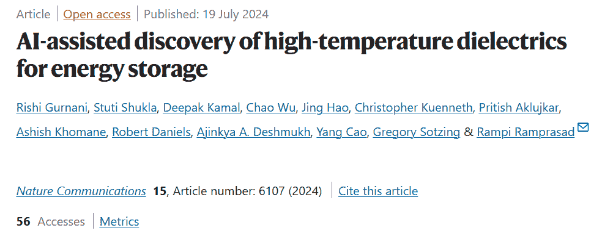
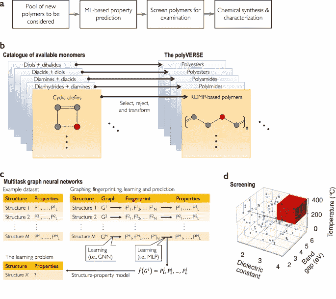
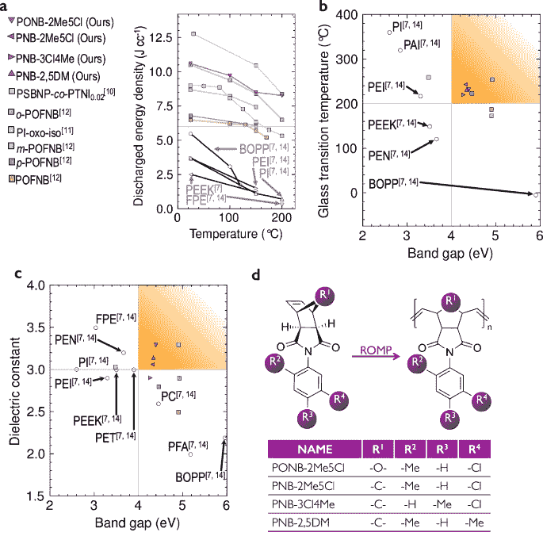

# 性能强11倍，佐治亚理工、清华团队用AI辅助发现储能新材料，登Nature子刊

> 来源：[https://agijuejin.feishu.cn/docx/FgDSd8SueoWnicxvAuCcjNZ0nRb](https://agijuejin.feishu.cn/docx/FgDSd8SueoWnicxvAuCcjNZ0nRb)

> 机器之心 ScienceAI｜[阅读原文](https://www.jiqizhixin.com/articles/2024-07-24-9)

> 转载请联系原作者取得授权

编辑 | 萝卜皮

静电电容器是国防、航空、能源和交通领域先进电力系统中的关键储能元件。能量密度是静电电容器的品质因数，主要由介电材料的选择决定。

大多数工业级聚合物介电材料都是柔性聚烯烃或刚性芳族化合物，具有高能量密度或高热稳定性，但不能同时具有这两种特性。

在这里，佐治亚理工学院（Georgia Institute of Technology）、康涅狄格大学（University of Connecticut）以及 清华大学 的研究团队利用 人工智能 （AI）、聚合物化学和分子工程，来发现聚降冰片烯和聚酰亚胺系列中的一系列电介质。

许多发现的电介质在很宽的温度范围内表现出高热稳定性和高能量密度。其中一种电介质在 200 °C 时的能量密度为 8.3 J/cc，是此温度下任何市售聚合物电介质的 11 倍。

研究人员还评估了进一步增强聚降冰片烯和聚酰亚胺系列的途径，使这些电容器在要求苛刻的应用（例如航空航天）中表现良好，同时又具有环境可持续性。

这些发现扩展了静电电容器在 85-200°C 温度范围内的潜在应用；也展示了 人工智能 对化学结构生成和性质预测的影响，凸显了超越静电电容器的材料设计进步的潜力。

该研究以「 AI-assisted discovery of high-temperature dielectrics for energy storage 」为题，于 2024 年 7 月 19 日发布在《 Nature Communications 》。

**静电电容器需要新材料**

静电电容器作为现代电气系统中的储能设备发挥着至关重要的作用。与电池、燃料电池和超级电容器等其他储能设备相比，静电电容器提供了无与伦比的功率密度（107 W/kg），使其在包括风力变桨控制（最高温度约125 °C）、混合动力和全电动汽车（约150 °C）、脉冲功率系统（约180 °C）、飞机及其发射器（约300 °C）和太空探索（约480 °C）等多个领域中具有显著优势。

然而，显著提高静电电容器在高温下的能量密度 Ue 仍是一大挑战，这对于实现空间和重量的显著节省尤为关键。

目前，双轴取向聚丙烯（BOPP）作为介电材料已经使用了三十多年，尽管具有低介电损耗和大电子带隙 Eg，但其介电常数和高温稳定性较差。

虽然商业上已经探索了具有高热稳定性的 BOPP 替代品，这些聚合物却往往以低 Eg 和低 Ue 为代价。这些材料还不足以满足现代和未来技术的需求。

**材料发现的挑战**

聚合物的功能在很大程度上受其化学成分的支配。通过化学变换，单一聚合物可产生的变种数量惊人。

在所有聚合物的化学可能性中，可能存在许多高性能介电材料有待发现。训练有素并校准的 人工智能 （AI），能够处理超出人类想象的大量数据，可以快速帮助发现非凡的新材料。

材料发现的有效进步涉及选择或生成化学子空间、估计其中每种材料的属性，然后至少部分地基于估计的属性选择候选材料进行合成和测试。

挑战在于（1）创建一个足够广阔的子空间来发现有趣的未知材料，同时（2）限制 假阳性 ，即难以合成的假设材料。此外，性质估计必须 (3) 准确且 (4) 高效，随着化学子空间的扩大，后者变得越来越重要。

但是，同时解决所有这些问题并非易事。

**新范式 polyVERSE**

在最新的研究中，佐治亚理工学院、 清华大学 等机构的研究人员引入了 polyVERSE（polymers designed by Virtually-Executed Rule-Based Synthesis Experiments）范式，展示了其在高温电介质搜索背景下实现这四个属性的成功。

在这种 人工智能 驱动的方法中，使用 专家系统 从市售单体生成聚合物，并使用多任务 图神经网络 估计特性。这些性质估计可用于指导从较大的群体中选择（筛选）有前景的聚合物。

图示：用于储能的聚合物的 人工智能 辅助设计。（来源：论文）

这里研究人员报告了一种之前未知的聚降冰片烯电介质，名为 PONB-2Me5Cl，它在很宽的温度范围内具有高 Ue。

在 200°C 时，该聚合物的 Ue 为 8.3 J/cc。该值比任何商业替代品的值高出一个数量级，并使其成为有史以来在此温度下报道的最佳聚合物电介质之一。

在 200°C 以下，PONB-2Me5Cl 也表现出高能量密度，超过所有商业聚合物，仅落后于 PSBNP-co-PTNI0.02。

值得注意的是，对于 PSBNP-co-PTNI0.02，由于它是共聚物，并且其共聚单体的复杂性，其合成可能涉及更多步骤（与 PONB-2Me5Cl 相比）。不过，先前研究中使用的测量协议与该研究中使用的测量协议也可能存在差异。

图示：填充介电空隙。（来源：论文）

PONB-2Me5Cl 是使用 polyVERSE 在计算机中发现的，随后进行了合成和表征。高性能 PONB-2Me5Cl 聚合物的发现和 polyVERSE 范式的开发是这项工作的两个成果。

此外，该团队提出了一系列未来需要考虑的聚合物设计优化。这些包括 PONB-2Me5Cl 的改良版本（通过 R 基团工程或加入纳米填料或涂层实现）和精选聚酰亚胺，这是研究人员根据现有的功能性高温聚合物优先考虑的一类。

这些设计显示出提高高温 Ue 和减少损失的潜力，同时还允许使用绿色溶剂进行合成。

仅使用众多聚合模板中的一种，这项研究就展示了 人工智能 在生产具有出色能量存储能力的先进聚合物电介质方面的强大功能。

论文链接： https://www.nature.com/articles/s41467-024-50413-x