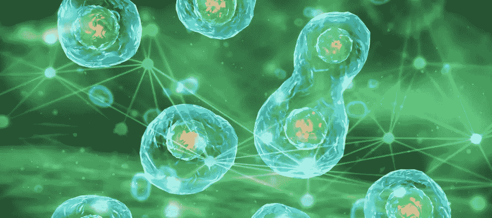
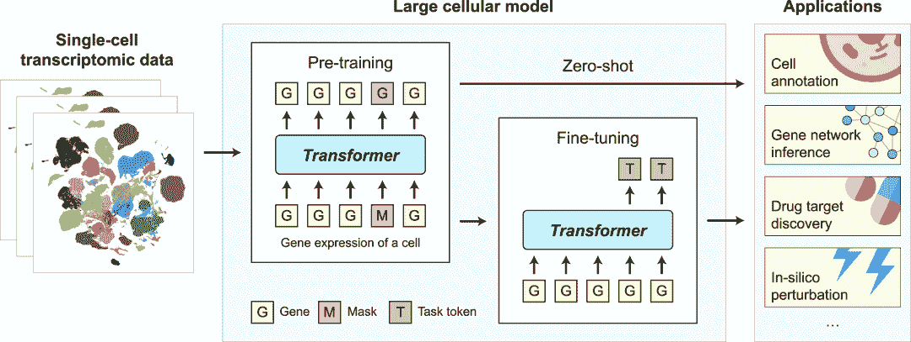
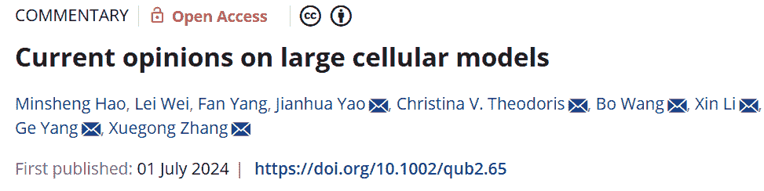
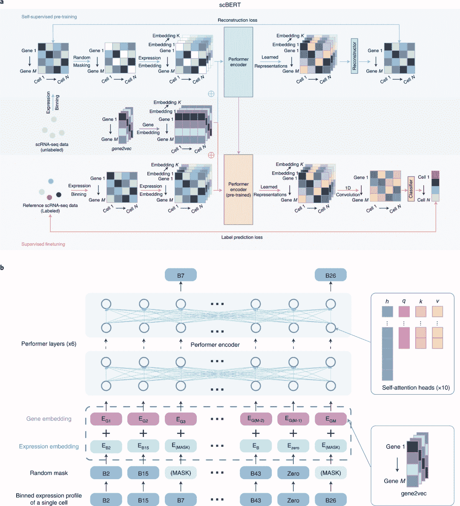
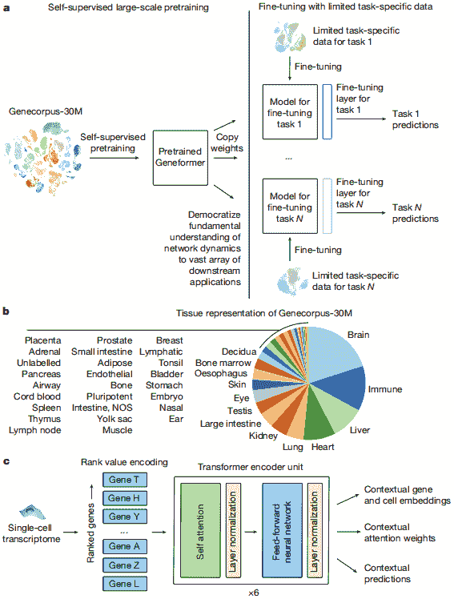
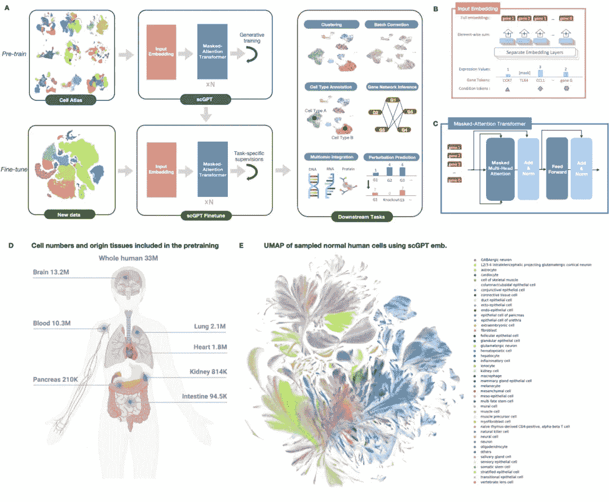
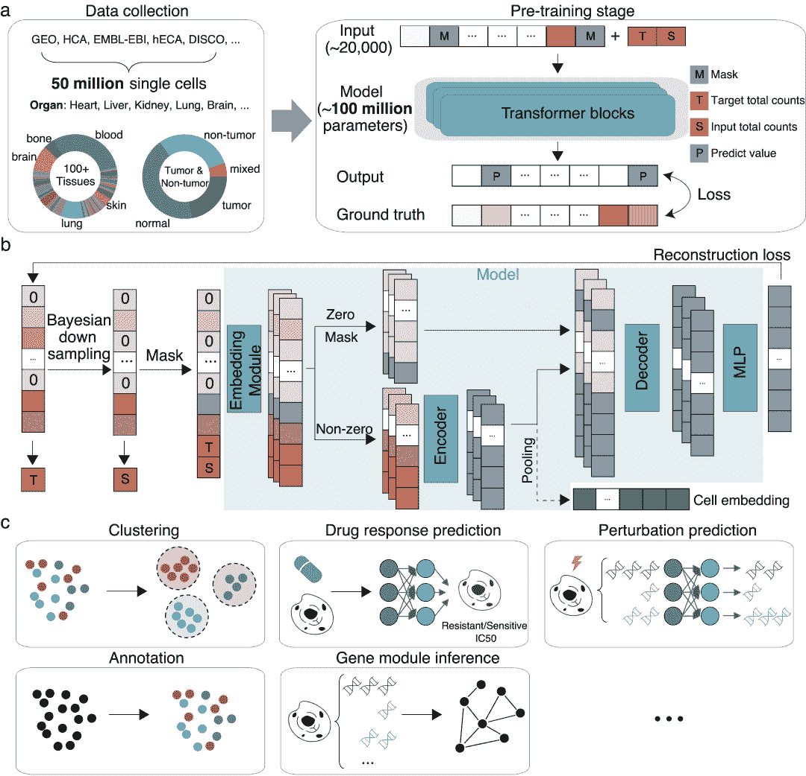
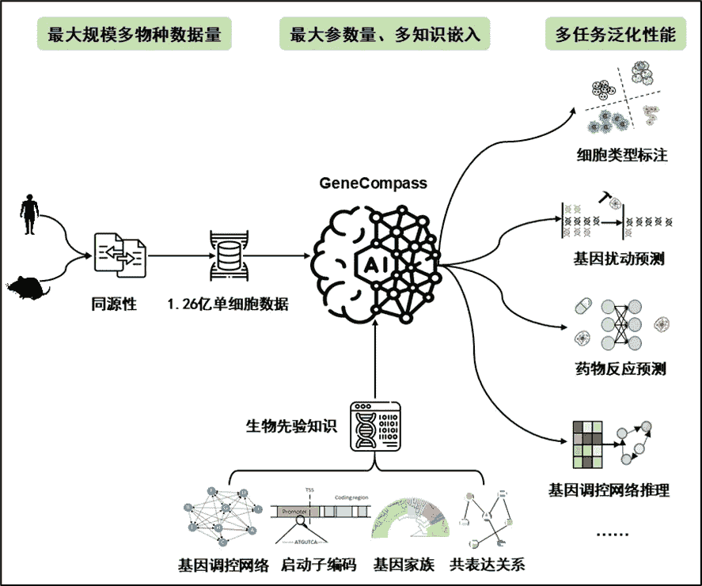

# 万字长文，腾讯、清华等多位生物大模型作者专访，畅谈AI生物学，解析大型细胞模型技术

> 来源：[https://agijuejin.feishu.cn/docx/XDiQduuLCoETMexD5MxckRPenPg](https://agijuejin.feishu.cn/docx/XDiQduuLCoETMexD5MxckRPenPg)

> 机器之心 ScienceAI｜[阅读原文](https://www.jiqizhixin.com/articles/2024-07-25-7)

> 转载请联系原作者取得授权

编辑 | KX

大型语言模型（LLM）在自然语言处理和理解领域已取得重大突破。

在生物学领域，一些采用类似 `LLM` 结构的大型细胞模型（Large Cellular Model，`LCM`）被开发用于单细胞转录组学，比如：`scBERT`、`Geneformer`、`scGPT`、`scFoundation` 和 `GeneCompass`。

这些模型展示了 `LCM` 在各种生物任务中的应用潜力，并说明了 `LCM` 彻底改变未来生物学研究的可能性。

大型细胞模型的示意图。

近日，《 Quantitative Biology 》期刊采访了一些最具影响力的 `LCM` 背后的有影响力的作者。例如：腾讯 AI Lab 杨帆和姚建华（`scBERT`）、加州大学 Christina V. Theodoris（`Geneformer`）、多伦多大学 王波（`scGPT`）、清华大学 张学工（`scFoundation`）以及中国科学院李鑫和杨戈（`GeneCompass`）。

该评论文章详细介绍了这些模型背后的总体框架和核心人工智能概念，并前瞻性地讨论了这些模型如何与生物学知识有效结合。还讨论了 `LCM` 研究和开发过程中面临的关键挑战，包括缩放规律问题和数据预训练的必要性。

这些观点阐明了 `LCM` 对生物研究的变革性影响，并让我们看到了 AI 和生命科学融合，回答有关生命的关键问题的未来。

论文链接：`https://onlinelibrary.wiley.com/doi/10.1002/qub2.65`

ScienceAI 对原论文进行了不改变原意的编辑、整理：

## 对所有作者的问题

### Quantitative Biology：你能否简要介绍一下你的模型是什么，以及它可以用于什么？

杨帆&姚建华：`scBERT` 是一种预训练语言模型，旨在将单细胞转录组数据转换为通用嵌入。这种基于 `Transformer` 的模型使用 `BERT` 范式进行训练，可用于各种应用，包括细胞类型注释、新细胞类型的发现和新标记基因的识别。

Christina V. Theodoris：`Geneformer` 是一种基础深度学习模型，在约 3000 万个单细胞转录组的大规模语料库上进行预训练，通过迁移学习，在网络生物学中数据有限的环境中实现上下文特定的预测。通过零样本学习和有限数据微调，`Geneformer` 在一系列具有生物学意义的下游任务中持续提高了预测准确性。我们展示了 `Geneformer` 获得新生物学见解的能力，包括通过零样本学习发现心肌细胞中的新转录因子，以及使用有限的患者数据揭示心肌病的候选治疗靶点，这两项我们都通过细胞功能分析进行了实验验证。`Geneformer` 对基因网络动态的基本理解现在可以推广到大量下游任务，以加速发现关键网络调节器和候选治疗靶点。

王波：[`scGPT`](http://mp.weixin.qq.com/s?__biz=MzI3MjM3ODk0NQ==&mid=2247496047&idx=1&sn=5c4b611d3c61317f90d75eccf21dae8c&chksm=eb31cc41dc46455716b27c8d7396c8f964c5da172d6c0f636d93648f233fd99fdff93ef23818&scene=21#wechat_redirect) 是一个在 3300 万个人类细胞上进行预训练的单细胞基础模型。受 `LLM` 的启发，`scGPT` 作为基础模型，首先从大规模多样化的人类细胞预训练数据集中学习单细胞生物学，然后有效地将知识转移到各种下游任务。

`scGPT` 利用注意力机制的 `Transformer` 主干来捕捉基因之间错综复杂的互连性。更重要的是，`scGPT` 设计了一种特殊的注意机制，具有细胞提示和基因提示，能够以自回归的方式使用非序列 `scRNA-seq` 数据进行生成训练。预训练的 `scGPT` 模型表现出对新数据集的稳健外推能力，在零样本实验中准确地聚类细胞类型并与已知的基因网络对齐。通过微调，其知识可以转移到各种任务中，在细胞类型注释和扰动预测任务中始终优于专门的模型。

张学工：`scFoundation` 是一个在单细胞转录组学数据上进行预训练的模型，在参数大小、基因维数和训练数据大小方面规模很大。得益于模型架构设计和训练策略，它可以为单细胞和批量分析提供有价值的嵌入。这些嵌入可以应用于各种细胞级任务，例如增强基因表达、注释细胞类型以及预测组织和单个细胞中的药物反应。此外，`scFoundation` 可以生成基因级嵌入，用于推断基因网络和预测扰动对单细胞的影响。

李鑫&杨戈：`GeneCompass` 是一个知识型跨物种基础模型，在超过 1.2 亿个人类和小鼠单细胞转录组上进行了预训练。启动子序列、基因家族、基因调控网络 (`GRN`) 和共表达关系这四种先验知识通过将其编码到输入中而被整合到 `GeneCompass` 中。`GeneCompass` 可以促进整个生物领域的广泛应用，包括跨物种细胞类型注释、`GRN` 预测、药物剂量反应预测和扰动预测。此外，`GeneCompass` 可以通过在高维嵌入空间中进行计算机基因扰动来加速关键细胞命运调节因子的发现。

## 关于 scBERT 的访谈

### Quantitative Biology：scBERT 是第一个针对单细胞 RNA 序列数据开发的类 `Transformer` 模型吗？您是如何启动这个项目的，以及在工作中遇到了哪些主要挑战？

杨帆&姚建华：我们于 2021 年初启动了 `scBERT` 项目，并于 2021 年 12 月发布了代码和预印本论文。据我们所知，`scBERT` 是第一个针对单细胞 RNA 序列数据的类 `Transformer` 模型。受 `BERT` 范式在 `NLP` 中的成功的启发，我们将 `BERT` 应用于单细胞 RNA 序列数据。

这项开创性的工作带来了几个挑战，其中最主要的是将单细胞 RNA 序列数据（通常为计数矩阵格式）转换为 `Transformer` 的输入嵌入。在彻底研究了 scRNA 数据的性质并与 `NLP` 专家讨论后，我们设计了基因嵌入和表达嵌入，类似于 `NLP` 中的位置嵌入和词嵌入。这些嵌入的成功实现启发了后续几个基于 `Transformer` 的模型的设计。其他挑战包括收集大量合适的训练数据，以及如何有效地进行自监督预训练。

### Quantitative Biology：您认为 AI 模型扩展或应用于生命科学任务的关键技术挑战是什么？

杨帆&姚建华：我认为 AI 扩展或应用于生命科学任务的关键技术挑战在于定义问题，并将具有生物学价值的问题公式化为 AI 算法可优化的对象。另一个重要的技术挑战是如何基于极其稀缺的实验数据构建高性能模型。我认为这是生命科学中常见的场景。

`scBERT` 模型概述。

### Quantitative Biology：scBERT 是 3 年前建立的。从那以后，你们实验室的研究进展如何？

杨帆&姚建华：从那时起，我们就一直在探索 AI 在空间组学和单细胞蛋白质组学中的应用。在空间组学方面，我们开发了一种细胞类型注释算法和一种微环境分析工具。至于单细胞蛋白质组学，我们开发了一个通用嵌入框架和一种反卷积算法。我们所有的工作都集中在中心法则及其潜在的生物学应用上。

### Quantitative Biology：您对 AI 模型在生物学研究中的潜在应用有何看法？

杨帆&姚建华：AI 可以促进生物学研究的各个方面，从理解、发现到创造。分析单细胞多组学数据使我们能够从系统的角度了解单个细胞中 DNA、RNA 和蛋白质之间的相互作用。将这些数据（可选的其他模态数据）与表型（如患者级标签）联系起来，可以帮助我们了解疾病过程并发现新疗法的新靶点。通过对蛋白质与其他分子之间的原子级相互作用进行建模，我们可以从头设计（创造）新型蛋白质结合药物。本质上，我们可以利用人工智能帮助我们了解生命的本质并改善我们的生活质量。

### Quantitative Biology：人工智能和生物学领域都在快速发展，技术以前所未有的速度更新甚至革命。您如何看待人工智能在生物研究中的应用？

杨帆&姚建华：众所周知，`AlphaFold 2` 通过相对准确地从序列预测蛋白质结构，彻底改变了结构生物学。已经出现了更多模型来预测蛋白质与其他分子相互作用的复合物的结构，例如核酸、化学药物和共价修饰。在不久的将来，我认为用于蛋白质复合物分析的人工智能，结合单细胞多组学提供的细胞背景，有望为生物研究带来有价值的应用。

## 关于 Geneformer 的访谈

### Quantitative Biology：您在实际生物学问题上应用 `Geneformer` 时取得了哪些重大生物学发现？这些发现是否也能通过更传统的统计或机器学习方法找到？

Christina V. Theodoris：我们展示了 `Geneformer` 能够通过零样本学习和微调在各种生物学环境中进行预测的能力，包括基因网络动力学、染色质动力学、动态细胞轨迹和疾病依赖性失调。我们将 `Geneformer` 应用于广泛的组织、疾病和发育阶段，以确认其基本知识的普遍性。我们还将 `Geneformer` 与随机森林、支持向量机和逻辑回归等替代机器学习方法进行了比较，发现 `Geneformer` 始终提高了预测准确性。

在新发现方面，我们设计了一种计算机扰动方法，通过零样本学习发现了心肌细胞中的一种新型转录因子，我们通过实验证实了该转录因子对细胞产生收缩力的能力至关重要。尽管之前对心肌细胞进行了数十年的研究，但 `Geneformer` 仍然能够发现这种新型调节剂，并且这些预测被证实对细胞具有真正的生物学效应，这让我们感到兴奋。

然后，我们将我们的方法扩展到计算机治疗策略，该方法发现了心肌细胞中的新型治疗靶点，可显著提高心肌病诱导多能干细胞疾病模型中细胞产生收缩力的能力。我们很高兴该模型能够预测对细胞表型具有真正生物学影响的新型治疗靶点，并期待看到其他人如何使用 `Geneformer` 推动未来在其他疾病和生物学环境中的发现。

### Quantitative Biology：您是一位研究心血管疾病的科学家，您能否在心血管研究中给出一些您认为人工智能尤其是 `LCM` 将发挥重要作用的场景？

Christina V. Theodoris：从更广泛的角度看，生物学的主要障碍之一是，要在湿实验室实验中测试所有天文数字的扰动，以发现网络调节因子和治疗靶点，这是不可行的，而且成本过高。人工智能的主要前景之一是能够以无偏见、数据驱动的方式有效地计算下游实验的优先级。此外，通过采用闭环方法，湿实验室中优先考虑的下游实验的数据可以向模型提供反馈，说明其预测在哪里是正确的，在哪里是错误的，从而不断利用真实世界的数据改进模型的预测。

### Quantitative Biology：在您文章的讨论部分，你预测「随着公开可用的转录组数据的数量不断扩大，未来的模型在更大规模的语料库上进行预训练，可能会有机会在越来越有限的特定任务数据中实现更难以捉摸的任务的有意义的预测」，你能给一些可能属于这一类的任务的例子吗？

Christina V. Theodoris：我们在 2021 年 6 月对 `Geneformer` 进行了预训练，从那时起，公共领域可用的单细胞转录组数据的数量和多样性迅速增加。我们在 `Geneformer` 手稿中测试的最困难的任务之一是预测转录因子是否在短距离或长距离作用于其靶标。对于模型来说，仅使用转录组数据进行预测是一项特别困难的任务，而没有关于基因组距离的信息。然而，该模型能够在一定程度上预测转录因子的这种高阶属性，而更传统的机器学习方法则具有随机预测。

随着模型在更大量的数据上进行预训练，它们可能会获得更多的基础知识，从而更好地预测基因的这些高阶特征。此外，`Geneformer` 能够用少至 ∼800 个任务特定细胞来预测基因的网络中心性。随着模型在更大规模的预训练过程中获得更多的基础知识，这些任务可以用更少的任务特定细胞来完成，甚至可以在没有微调数据的情况下通过零样本学习来完成。

### Quantitative Biology：您的实验室在开发生物学 AI 模型时面临哪些障碍？

Christina V. Theodoris：最大的障碍仍然是获取足够的 `GPU` 计算资源来训练我们感兴趣的模型类型，与工业界公司可用的资源相比，这是大多数学术机构面临的问题。另一个主要障碍是统一存储在公共领域的数据，这些数据格式极其多变，而且很多时候几乎没有关于数据之前如何处理或相关元数据的信息，例如样本是来自健康人还是疾病患者等。随着我们认识到 AI 在生物医学研究中的前景，开发系统从而将数据结构化为 AI 就绪数据非常重要，这样才能最大限度地利用全球投入到生物研究的巨额资金。`CELLxGENE` 就是这样一种数据库，它允许基于应用程序编程接口 (`API`) 高效访问大量单细胞数据，为其他类型的生物数据提供了一个效仿的例子。

`Geneformer` 架构和 迁移学习 策略。

### Quantitative Biology：您的研究成果发表已经一年多了，您能否向我们简要介绍一下您实验室正在进行的研究，这些研究是基于 `Geneformer` 或其他大型细胞模型建立的或与之相关的吗？如今，许多生物学家都对将人工智能（尤其是大型模型）引入他们的研究感兴趣，您对他们有什么建议吗？让他们的工作更顺利，或者他们可能需要注意的陷阱是什么？

Christina V. Theodoris：我们的实验室利用人工智能和实验基因组学来解决基因网络生物学的主要挑战。我们实验室的一部分专注于开发新的人工智能模型，扩展我们的迁移学习方法，以解决新的方向，例如基因网络如何通过空间和时间影响细胞相互作用。我们实验室的另一部分是应用这些模型来研究基因调控中尚未解答的基本问题，并确定人类疾病的网络校正疗法。我们强调计算和实验成员之间的密切合作，以促进闭环人工智能和实验基因组学策略，从而加速我们的发现。

在将 AI 融入生物研究方面，一个常见的陷阱是用户将默认超参数应用于他们感兴趣的所有任务，而超参数调整非常重要，并且可能是模型完全不学习或具有近乎完美的预测准确性之间的区别。其他建议包括确保数据在其他潜在混杂属性之间保持平衡，并收集足够的数据以按样本/个体分成单独的训练、验证和测试集，而不是对所有分割的所有条件的细胞进行子采样。值得注意的是，如果使用验证集来优化超参数，则使用单独的保留测试集来确认最佳模型对未见数据的通用性。

### Quantitative Biology：AI 和生物学领域都在快速发展，技术以前所未有的速度更新甚至革命。您如何看待 AI 在生物和医学研究中的应用？

Christina V. Theodoris：这是 AI 和生物学领域极其激动人心的时刻。随着当前大规模生物数据的蓬勃发展，我们现在正进入一个可以训练大规模人工智能模型以对生物学有基本了解的领域。随着基础模型方法被生物研究界采用，也有机会根据生物系统的独特特征推动人工智能的创新，例如需要遵守限制物理上可能的蛋白质结构的物理定律等。

## scGPT 访谈

### Quantitative Biology：人们对大型细胞模型在生物学研究中的应用寄予厚望，但也有人怀疑大型模型的必要性。有人认为，`LCM` 在许多单细胞分析任务上的卓越性能也可以通过针对这些特定任务精心设计的方法实现，但这些方法在数据和计算成本方面可以更轻量。您对这种怀疑有何看法？

王波：毫无疑问，更简单的模型可以进行优化，从而在特定任务的特定数据集上表现良好。`LCM` 可以弥补「小模型」方法的两个局限性。

首先，小模型的建模能力受到参数大小的限制。由于这一限制，大多数当前的分析方法严重依赖可变基因选择或其他预处理步骤来减少输入大小和异质性。另一方面，`LCM` 使用注意力来从整个基因组中捕获基因水平的相互作用，从而呈现更完整的基因相互作用图，这可能有助于更广泛的假设生成。

其次，生物实验的观察结果很嘈杂。小型模型通常难以推广到看不见的数据集或实验条件，并且容易对手头实验的噪声过度拟合。让模型从大规模异构数据中学习细胞表征有助于从噪声中辨别生物信号，从而呈现对潜在生物学的更公正的看法。

### Quantitative Biology：当前的 `LCM` 都基于最初为 `NLP` 中的任务开发的基本 `Transformer` 结构。不同的 `LCM` 使用不同的方式采用基本结构以适用于生物数据。根据您在开发 `scGPT` 方面的经验，将 `LLM` 用于 `LCM` 的主要挑战是什么？您是否认为有必要或有可能专门为生物数据和任务设计根本不同的结构？

王波：考虑到单细胞数据的非序列性质，我们在开发 `scGPT` 时面临的关键挑战是如何将 `LLM` 中使用的生成预训练最好地适应 `LCM`。从高层次来看，自回归训练和生成与捕获基因相互作用的级联并预测细胞对扰动的反应的想法一致。替代架构包括 `BERT` 和扩散模型，它们也值得在不假设序列的情况下进行探索。

`scGPT` 模型概述。

# scGPT 访谈

## Quantitative Biology：一些生物信息学家表示，随着大型模型的参与，与大多数研究都可以使用相对简单的数学模型和基于较小数据的更简单的算法完成的「美好旧时代」相比，进行生物信息学研究的成本激增。您是否同意这个观点，或者您对计算资源较少的生物信息学实验室有什么建议，关于他们如何从当前 AI 的进步中受益？

王波：我们的目标是开发有益于社区并协助生物学家日常工作的工具。具体来说，对于 `scGPT`，我们将模型托管在 scGPT Hub 上，生物学家可以通过上传数据集来微调模型。在设计新模型时，考虑可访问性非常重要，随着我们进入 LCM 时代，我们设想生物学家将能够轻松获得更多基于云的平台，从而降低计算障碍。

## Quantitative Biology：人工智能 和生物学领域都在快速发展，技术以前所未有的速度更新甚至革命。您如何看待 人工智能 在生物和医学研究中的应用？

王波：人工智能 是一种有价值的工具，它为生物学家提供了更多的建模能力，以模拟生物学中的复杂过程。临床研究中的最新预测模型使医院和诊所的日常工作流程受益，提高了患者护理的标准。我们设想 人工智能 以类似的方式融入生物研究，生物学家参与其中，帮助他们更有效、更高效地解决问题。

# scFoundation 访谈

## Quantitative Biology：社区中存在一些误解，认为 LCM 只是将 Transformer 直接应用于单细胞数据。根据您的经验，设计适用于细胞数据的模型的关键挑战是什么？scFoundation 与其他 LCM 的区别是什么？

张学工：设计模型的关键挑战在于处理 scRNA-seq 数据的高维性和高稀疏性特性，以及消除生物变异带来的技术 噪音 。具体来说，当将每个细胞建模为一个句子，将每个基因表达值建模为一个单词时，近 20,000 个蛋白质编码基因使「句子」异常长，这是传统 Transformer 难以处理的场景。至于技术 噪音 ，不同技术和实验室的 scRNA-seq 数据在测序读取深度方面表现出很大的差异。

为了应对这些挑战，scFoundation 采用了可扩展的基于 Transformer 的架构 `xTrimoGene` 和一种基于掩码语言建模原理的新型读取深度 感知 (RDA) 预训练任务。

`xTrimoGene` 架构具有一个嵌入模块，可将连续基因表达值转换为可学习的高维向量而无需近似，并且具有非对称编码器-解码器结构，该结构经过量身定制，可有效学习 20,000 个基因之间的关系，同时适应单细胞基因表达数据的高稀疏性。

在 RDA 建模中，任务是使用同一细胞内其他基因提供的上下文来预测细胞中的掩码基因表达，无论这些基因表达是具有原始的还是降低的读取深度。这种方法不仅可以捕获基因-基因关系，还可以协调不同测序深度的细胞，具有 scFoundation 在其他 LCM 中的独特设计。

## Quantitative Biology：许多生物学家都渴望将 LCM 引入他们的项目，生物学家或生物信息学家在工作中使用 scFoundation 的最典型方式是什么？他们可以从这些应用中期待什么好处？

张学工：为了研究将 scFoundation 等 LCM 整合到生物学研究中，将其应用分为两大类很有帮助：细胞级任务和基因级任务。细胞级任务通常侧重于识别细胞的特征，例如细胞类型注释或药物敏感性预测。基因级任务更多地是了解基因之间的关系或预测基因表达的变化，例如通过基因网络推断或基因扰动预测。

对于细胞级任务，scFoundation 的常见方法是利用模型的编码器获得读取深度增强的嵌入。这些嵌入可以快速生成并应用于各种下游任务，在短短几分钟内提供读取深度增强的丰富细胞潜在表示，而无需大量计算资源或耗时的微调。此过程有效地将嵌入的生成与下游分析分离开来，为后续模型的应用提供了极大的灵活性。

对于基因级任务，典型的用法包括从模型的解码器中提取基因嵌入。重要的是，scFoundation 为每个细胞内的所有基因提供上下文嵌入，从而能够构建细胞特异性基因共表达网络。对于希望开发更复杂、更准确的算法的用户来说，此功能非常宝贵。例如，这些上下文嵌入可以作为扰动预测模型的输入，从而提高其预测的准确性。这种双重应用方法允许用户利用 scFoundation 显著推进他们的研究，无论是在效率方面还是在科学洞察力方面。

## Quantitative Biology：一些生物信息学家表示，随着大型模型的参与，与大多数研究都可以使用相对简单的数学模型和基于较小数据的更简单的算法进行相比，进行生物信息学研究的成本激增。您是否同意这一观点，或者您对计算资源较少的生物信息学实验室有什么建议，告诉他们如何从当前 AI 的进步中受益？

张学工：我们完全理解人们对 LCM 和传统生物信息学方法之间的成本比较的担忧。然而，我们认为这两种方法不是竞争对手，而是互补的。例如，在我们的 scFoundation 工作中，我们证明了虽然 scFoundation 模型在针对特定任务进行微调时性能出色，但它也可以有效地与现有模型结合以提高整体性能。这种整合突出了将大规模基础模型纳入用户工作流程的未来方向，从而减轻了训练的繁重计算需求。

为了帮助计算资源有限的实验室，我们提倡开源模型代码和 权重 ，例如 scFoundation 和其它在 GitHub/Hugging Face Model Hub 上可用的 LCM。此外，我们还为 scFoundation 开发了在线 Web 服务和 API，允许用户直接利用预训练的嵌入执行后续任务。该 API 为各个实验室提供了更易于访问和实用的解决方案，无需针对特定数据集进行重新训练或微调。

scFoundation 模型及下游应用场景。

## Quantitative Biology：在 NLP 领域，人们说他们观察到一种「缩放定律」，即当涉及更多数据和更大模型时，模型的性能总是会提高。您在 LCM 上观察到了同样的定律吗？有没有办法确定「合适的」模型规模？

张学工：确实，我们在工作中观察到了与 NLP 中类似的缩放定律。我们用 3、10 和 1 亿个 参数 对 scFoundation 模型进行了预训练，并注意到模型准确预测掩蔽细胞基因表达的能力随着规模的增加而增加。这表明更大的 scFoundation 模型可能会提供更高的预测性能，这表明我们尚未达到模型规模的上限。

确定「合适的」模型规模涉及几个因素。首先，积累尽可能多的单细胞数据集对于有效扩展模型至关重要。我们在 `xTrimoGene` 论文中的发现证实，更大的数据集可以显著提高性能。其次，模型架构本身至关重要；鉴于 LCM 与 NLP 相比具有独特的 损失函数 和数据模式，设计保持缩放定律的预训练模型至关重要。

解决这些因素后，就可以通过参考使用类似数据标记量训练的 NLP 模型来衡量 LCM 的适当大小。最后，还必须考虑部署成本。由于我们仍处于 LCM 开发的起点，因此必须平衡用户的成本影响和他们的期望。在 scFoundation 的情况下，我们努力最大化模型大小，同时确保它仍然可管理，例如可在单个 A100 GPU 上训练并可在更常见的 GPU（如 RTX4090）上部署。这种方法有助于我们在计算能力和可访问性之间保持平衡。

## Quantitative Biology：鉴于 scFoundation 保留了所有用于训练的基因，该模型是否可以扩展以包含多组学数据？这种扩展可能为深入了解细胞生物过程提供途径。

张学工：整合多组学数据确实可以提供细胞状态的整体视角。为了扩展 scFoundation 的功能以涵盖多组学数据（例如 ATAC/RNA 整合），我们可以进行几种可能的策略。一种可能的方法是设计利用基因表达和 ATAC-seq 数据的任务。例如，我们可以开发模型来根据 ATAC-seq 上下文预测基因表达值，反之亦然。具体而言，在预测 ATAC-seq 信息时，我们可以通过合并针对从预训练的 scFoundation 派生的每个基因上下文嵌入量身定制的附加 Transformer 块来增强现有的 scFoundation 架构。然后，这些嵌入将由新的 Transformer 处理，以预测与特定基因区域相关的染色质可及性峰。考虑到可访问峰的数量可能非常庞大，探索高级 Transformer 架构以有效处理数据可能是明智之举。

## Quantitative Biology：世界正在见证 人工智能 领域的快速发展，即文本、图像、语音和视频等多模态信息的高保真生成。您认为这些技术很快也会被应用于生物学研究吗？

张学工：生成学习是当前大型 AI 模型中的一个重要范式，在许多任务中都取得了巨大的成功。在 scFoundation 成功的鼓舞下，我们开发了一个新模型 scMulan，它使用纯生成范式来学习细胞语言，包括基因表达数据和各种类型的元数据。初步实验已经证明了它在某些任务中的优势，以及在有条件生成可以携带真实生物信息的合成单细胞转录组数据方面的强大功能。它在进行虚拟细胞实验方面表现出了巨大的潜力，例如在计算机中扰动和沿着生物事件轨迹生成细胞。

跨多种生物模态的数据学习和生成是许多实验室正在研究的课题。我们相信，多媒体数据理解和生成的技术进步，必将提供解决方案或解决方案的提示。然而，很难预测这会在多久后取得成功。生物场景和多媒体场景的一个根本区别在于，人们擅长理解多媒体数据及其潜在含义，但还远未真正理解许多模态中的生物数据及其潜在含义。这是一个值得探索的方向，但找到与当前技术、数据和知识可用性兼容的可行角度至关重要。

# 关于 GeneCompass 的访谈

## Quantitative Biology：与其他已发布的 LCM 相比，GeneCompass 的一个独特之处在于它使用来自人类和小鼠的数据进行训练。您认为这种设置有什么好处？有哪些下游任务只能用 GeneCompass 完成，而仅使用人类数据进行预训练的 LCM 无法完成？

李鑫&杨戈：正如背景中提到的，大量单细胞数据对于预训练 LCM 至关重要。人们认为，多样性更高、容量更大的数据可以实现更好的性能。与仅使用人类数据进行预训练的 LCM 相比，GeneCompass 是使用最多数据进行预训练的 LCM，超过 1.2 亿个细胞，这使得它在几个下游任务上的表现优于一些早期的 LCM。其内在的生物学原理是人类和小鼠之间的 GRN 保守性。通过同源基因 映射 ，一个物种中学习到的潜在基因关系将转移到另一个物种，这对于需要 ChIP-seq 数据的下游任务至关重要。如果只在人类数据上，跨物种细胞类型注释是无法完成的下游任务之一。

基于预训练的 GeneCompass，我们利用小鼠细胞类型作为参考，在来自四个不同器官（视网膜、大脑、胰腺和睾丸）的七对数据集上注释人类细胞。与 CAME 相比，在视网膜上观察到 7.5% 的改进，表明 GeneCompass 可以与领先的专业跨物种细胞注释工具相媲美，甚至超越它。

## Quantitative Biology：GeneCompass 的一个新功能是将知识整合到基因建模中。许多人认为，在设计 AI 系统时整合数据和知识是复杂生物任务的未来解决方案。您能否根据自己的实践，就这个主题的可能策略或方法发表见解？

李鑫&杨戈：大多数现有的 LCM 仅通过 自监督学习 范式由数据驱动。引入累积的 先验知识 可以补充训练数据可能不包含的生命信息。知识整合策略应根据知识类型而变化。对于 GeneCompass，我们整合了四种类型的知识，包括启动子序列、基因家族、GRN 和共表达关系，方法是将每种知识编码到嵌入向量中，并将它们与单细胞转录组的嵌入连接起来。这是一种输入级的整合策略。此外，还有一些其他策略，例如知识引导的预训练任务和知识监督损失。最佳策略仍然是正在进行的研究领域，也将是我们未来工作的重点。

## Quantitative Biology：当您为跨物种数据构建模型时，GeneCompass 模型及其预训练方法的开发面临的关键挑战是什么？

李鑫&杨戈：开发跨物种 LCM 的关键挑战是如何整合来自人类和小鼠的单细胞数据，它们的基因彼此不同。连接它们的基因列表可能是一种简单易行的解决方案，但不能利用基因保守性。超长的基因列表需要更多的计算能力和内存空间。为了解决这个问题，我们设计了一种同源比对策略，根据同源关系在人类和小鼠之间 映射 基因。同源基因将在我们的基因列表中共享相同的基因 ID。此外，我们将人类和小鼠的 先验知识 编码到统一的表示空间中，以确保跨物种的语义一致性。我们比较同源基因嵌入相似性与非同源基因嵌入相似性的实验结果验证了该策略的有效性。

## Quantitative Biology：您的工作包括识别关键转录因子的例子。由于大多数可用的单细胞数据都是获取样本时基因表达的静态快照，您认为 LCM 如何有助于理解动态细胞过程（例如细胞状态转变）并识别可能驱动此类过程的关键因素？

李鑫&杨戈：与一般 NLP 领域的 LLM 一样，预训练 LCM 的基本理念是，对从各种来源收集的各种数据集进行大量训练有助于模型学习对细胞、环境和生命的广泛理解。虽然大多数可用的单细胞数据都是静态快照，但广泛的预训练数据涵盖了细胞转变的不同阶段。根据预训练的 LCM，相似的细胞状态数据在编码的嵌入空间中具有很强的相似性，这将有助于理解动态细胞过程。

为了确定关键因素，我们进行了计算机基因扰动，以过度表达或敲除基因到一定的表达水平。通过对比扰动细胞与原细胞和靶细胞的相似度，可以识别出潜在的关键因子。我们的实验结果和 Geneformer 的结果都验证了该方法的有效性。我们的湿实验结果也证明了所识别的关键因子的部分功能。这对于发现关键的细胞命运调控因子和候选药物靶点具有重要意义。

GeneCompass：首个跨物种生命基础大模型。

## Quantitative Biology：人工智能 和生物学领域都在快速发展，技术以前所未有的速度更新甚至革命。您如何看待 人工智能 在生物和医学研究中的应用？

李鑫&杨戈：我相信 人工智能 与生命科学的交叉学科将推动生物和医学研究的重大突破。特别是随着基础模型的出现，LCM 可以很好地推广到新的、未见过的任务，而无需特定的面向任务的训练或使用相对较小的数据集进行微调，使其成为一系列下游应用的万能工具。

一方面，使用 LCM 将大大减少与生物和医学研究相关的时间和经济成本。越来越多的体内和体外实验将通过 LCM 进行模拟，这将有助于提高传统湿实验任务（如 药物发现 、蛋白质结构设计等）的成功率。另一方面，已经出现了不同生命过程水平的 AI 模型，例如转录组水平的 LCM、蛋白质水平的 AlphaFold 和 ESMFold，以及 DNA 水平的 EVO。还有多模态 LLM 可用于理解医学图像等表型数据。我相信将会有一个统一的模型来整合生物学并模拟中心法则，从而建立所有生命体基因型和表型之间的复杂关系。

# 结束语

这些 LCM 在许多下游生物学任务中取得了巨大成功，但整个领域仍处于早期发展阶段。现在问什么是单细胞转录组学数据的最佳或 收敛 模型结构还为时过早。

几位 LCM 作者分享了他们针对生物对象开发和采用基于 Transformer 的 AI 模型的关键技术挑战的策略和考虑，这是很有价值的，例如将复杂的单细胞数据转换为 AI 兼容的格式、处理高维和稀疏性，以及在有限的数据和资源下优化模型性能。

他们还分享了模型开发和优化的策略，包括将通用预训练技术应用于非序列单细胞数据，以及设计能够从噪声中辨别生物信号的模型。还包括对下游用户计算资源挑战以及开发云平台，使大型 AI 模型更易于生物学家使用。作者还提供了他们的观点和建议，以便在未来的生物学研究中更好地使用 LCM。

与 NLP 和 计算机视觉 中的 AI 领域相比，生物学领域缺乏用于开发 机器学习 技术的系统 基准 数据集、任务和测量。每项研究都有自己的数据，并设计自己的实验来测试他们的模型和算法，并展示他们的方法的有用性。这种情况不利于该领域的健康发展。

生物学是复杂的，我们不能梦想任何技术能够突然回答所有主要的生物学问题，即使该技术已经在许多其他领域被证明是成功的。建立一个系统的多层次的测试场，用于开发、评估和选择适合生物学问题性质的技术，是生命科学 人工智能 研究的一个关键，但尚未得到充分研究的课题。
