# DPO是否比PPO更适合LLM，清华吴翼团队最新揭秘

> 来源：[https://agijuejin.feishu.cn/docx/RSg7dTelxouUbsxrDH0c70y9nOV](https://agijuejin.feishu.cn/docx/RSg7dTelxouUbsxrDH0c70y9nOV)

> 机器之心｜[阅读原文](https://www.jiqizhixin.com/articles/2024-07-22-7)

> 转载请联系原作者取得授权

**吴翼 ， 清**华大学 交叉信息院助理教授，曾任 OpenAI 全职研究员，研究领域为 强化学习 ，大模型对齐， 人机交互 ，机器人学习等。2019 年在美国加州大学伯克利分校获得博士学位，师从 Stuart Russell 教授；2014 年本科毕业于 清华大学 交叉信息院（姚班）。其代表作包括：NIPS2016 最佳论文，Value Iteration Network；多智能体深度 强化学习 领域最高引用论文，MADDPG 算法；OpenAI hide-and-seek 项目等。

如何让大模型更好的遵从人类指令和意图？如何让大模型有更好的推理能力？如何让大模型避免幻觉？能否解决这些问题，是让大模型真正广泛可用，甚至实现超级智能（Super Intelligence）最为关键的技术挑战。这些最困难的挑战也是 吴翼 团队长期以来的研究重点，大模型对齐技术（Alignment）所要攻克的难题。

对齐技术中，最重要的算法框架就是根据人类反馈的 强化学习 （RLHF, Reinforcement Learning from Human Feedback）。RLHF 根据人类对大模型输出的偏好反馈，来学习基于人类反馈的奖励函数（Reward Model），并进一步对大模型进行 强化学习 训练，让大模型在反复迭代中学会辨别回复的好坏，并实现模型能力提升。目前世界上最强的 语言模型 ，比如 OpenAI 的 GPT 模型和 Anthropic 的 Claude 模型，都极其强调 RLHF 训练的重要性。OpenAI 和 Anthropic 内部也都开发了基于大规模 PPO 算法的 RLHF 训练系统进行大模型对齐。

然而，由于 PPO 算法流程复杂，算力消耗大，美国 AI 公司的大规模 RLHF 训练系统也从不开源，所以尽管 PPO 算法非常强大，学术界的对齐工作却一直很少采用复杂的 PPO 算法进行 RLHF 研究，转而普遍使用 SFT（监督微调）或者 DPO（Direct Policy Optimization）等更简化、更直接、对训练系统要求更低的对齐算法。

那么，简单的对齐算法一定效果更好吗？ 吴翼 团队发表在 ICML 2024 的工作 “Is DPO Superior to PPO for LLM Alignment? A Comprehensive Study” 仔细探讨了 DPO 与 PPO 算法的特点，并指出提升 RLHF 算法效果的关键点。在该工作中， 吴翼 团队基于自研的大规模 RLHF 训练系统，首次采用 PPO 算法及 参数 量更少的开源模型，在公认最困难的挑战 —— 代码生成任务 CodeContest—— 上超过闭源大模型 AlphaCode 41B。

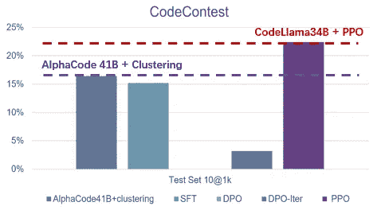

相关成果被 ICML 2024 录用为 Oral Presentation，并将在 7 月 23 日于 ICML 2024 第一个 Oral session Alignment-1 上和 OpenAI、Anthropic 等知名机构的工作一起进行公开汇报。

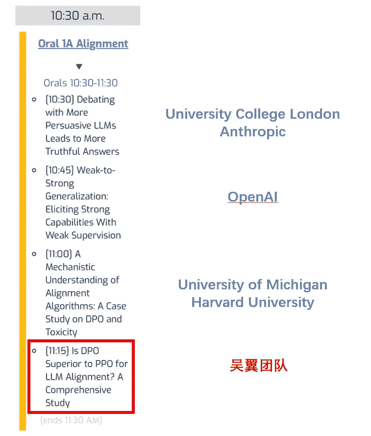

接下来让我们对比一下 GPT-4 和经过 PPO 算法训练的 CodeLlama 34B 模型在代码生成上的效果，在例子 1 中，经过 PPO 算法训练的 CodeLlama 34B 模型与 GPT-4 模型生成了质量相当的代码。

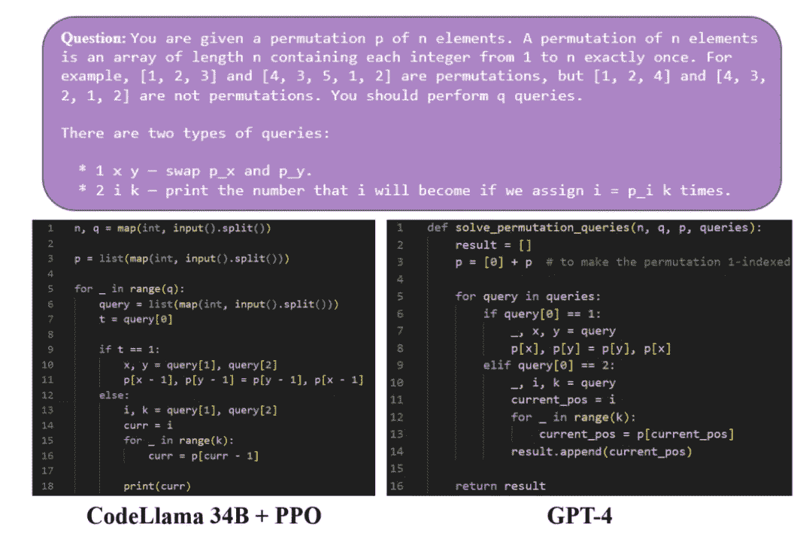

在示例 2 中，可以看到经过 PPO 算法训练的 CodeLlama 34B 模型与 GPT-4 模型都能生成完整并且可运行的 python 代码。然而，在这个例子下，GPT-4 生成了错误的代码，在测试数据上无法正确输出。而经过 PPO 算法训练的 CodeLlama 34B 模型生成的代码可以通过测试。

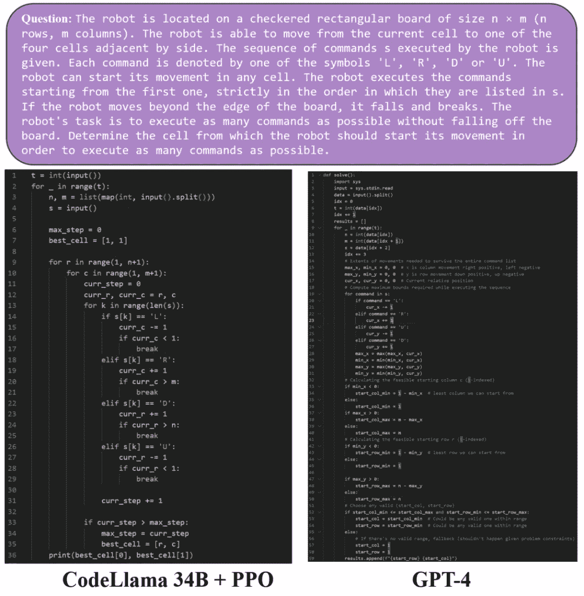

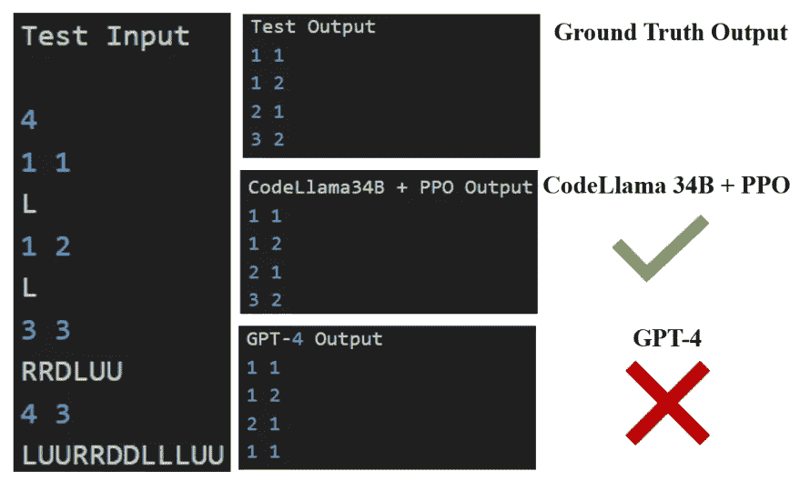

在 ICML 2024 的这篇论文中，研究团队详细探讨了 DPO 与 PPO 算法的特点，并指出提升 DPO 和 PPO 能力的关键点。

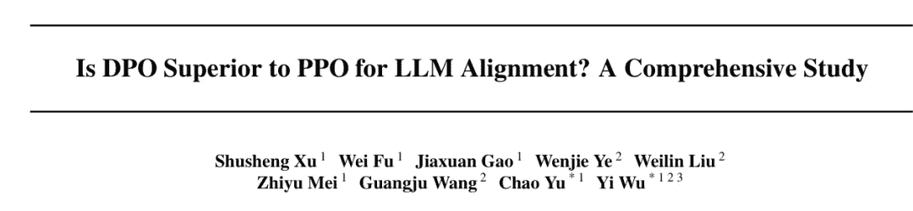

+   论文标题：Is DPO Superior to PPO for LLM Alignment? A Comprehensive Study

+   论文地址：https://arxiv.org/pdf/2404.10719

**DPO 算法的局限性**

相比于 PPO，DPO 使用离线数据而非在线采样数据训练。经分析，DPO 算法会导致训练出的模型对训练数据分布之外的输出产生偏好，在某些情况下产生不可预料的回复。

**于是，为了提升 DPO 算法的能力，研究**团队总结了两个关键技术： 在 RLHF 训练前进行额外的 SFT 训练，以及使用在线采样数据而非离线数据 。

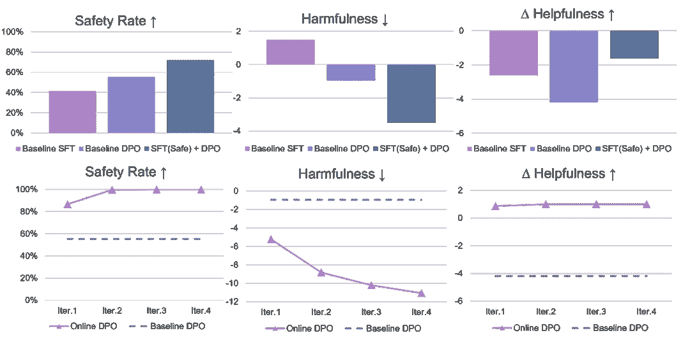

实验表明，使用额外的 SFT 训练可以使 base 模型以及 reference 模型更偏向于数据集内的分布，大大提升 DPO 算法效果；另一方面，使用在线采样数据进行迭代训练的 DPO 算法可以得到稳步提升，表现远远优于基础的 DPO 算法。

**PPO 算法的关键点**

除去 DPO，论文中也总结了发挥 PPO 最大能力的三个关键点：

+   使用大的批大小（large batch size）

+   优势归一化（advantage normalization）

+   以及对 reference model 使用指数移动平均进行更新（exponential moving average for the reference model）。

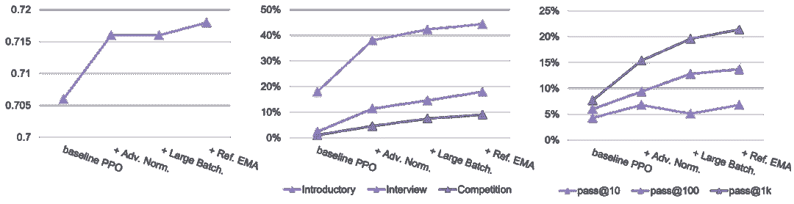

研究团队成功使用 PPO 算法在对话任务 Safe-RLHF/HH-RLHF 以及代码生成任务 APPS/CodeContest 上达到了 SOTA 的效果。

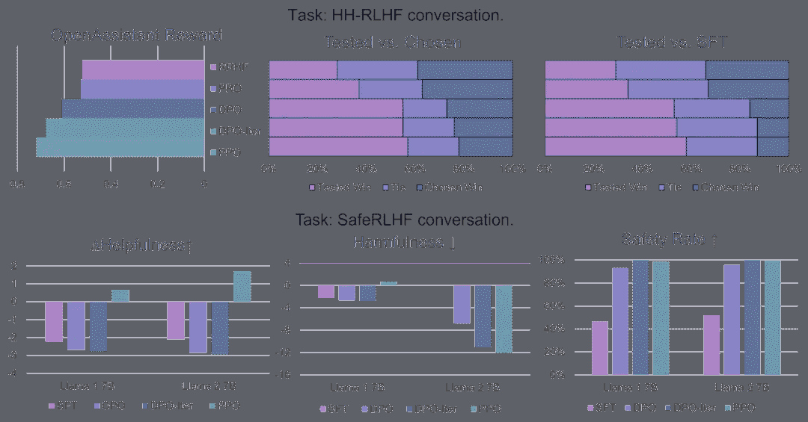

在对话任务上，研究团队发现综合了三个关键点的 PPO 算法显著优于 DPO 算法以及在线采样的 DPO 算法 DPO-Iter。

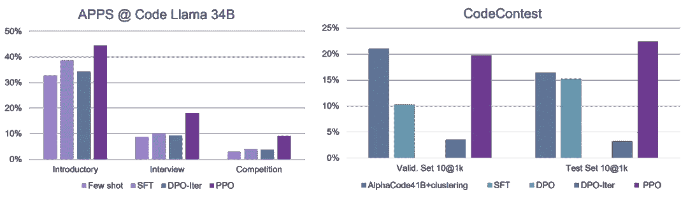

在代码生成任务 APPS 和 CodeContest 上，基于开源模型 Code Llama 34B，PPO 算法也达到了最强的水平，在 CodeContest 上超越了之前的 SOTA，AlphaCode 41B。

想要实现效果较好的大模型对齐，高效率的训练系统是不可缺少的，在实现大规模 强化学习 训练上， 吴翼 团队有长期的积累，从 2021 年开始就搭建了专属的分布式 强化学习 框架。

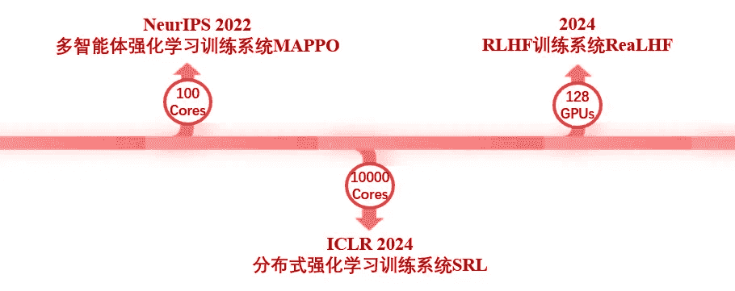

+   NeurIPS 2022 The Surprising Effectiveness of PPO in Cooperative Multi-Agent Games [1]：提出并开源了用于多智能体的 强化学习 并行训练框架 MAPPO，支持合作场景下的多智能体训练，该工作被大量多智能体领域工作采用，目前论文引用量已超过 1k。

+   ICLR 2024 Scaling Distributed Reinforcement Learning to Over Ten Thousand Cores [2]: 提出了用于 强化学习 的分布式训练框架，可轻松扩展至上万个核心，加速比超越 OpenAI 的大规模 强化学习 系统 Rapid。

+   ReaLHF: Optimized RLHF Training for Large Language Models through Parameter Reallocation [3]: 最近， 吴翼 团队进一步实现了分布式 RLHF 训练框架 ReaLHF。 吴翼 团队的 ICML Oral 论文正是基于 ReaLHF 系统产出的。ReaLHF 系统经过长时间的开发，经历大量的细节打磨，达到最优性能。相比于之前的开源工作，ReaLHF 可以在 RLHF 这个比预训练更复杂的场景下达到近乎线性的拓展性，同时具有更高的资源利用率，在 128 块 A100 GPU 上也能稳定快速地进行 RLHF 训练，相关工作已开源：https://github.com/openpsi-project/ReaLHF

除了提升大 语言模型 代码能力之外， 吴翼 团队还采用多种将 强化学习 算法和大模型结合的方式，实现了多种复杂 LLM Agent，并可以和人类进行复杂交互。

在 MiniRTS 中使用 强化学习 既能听从人类指令也能做出最优决策的语言智能体 [4]。

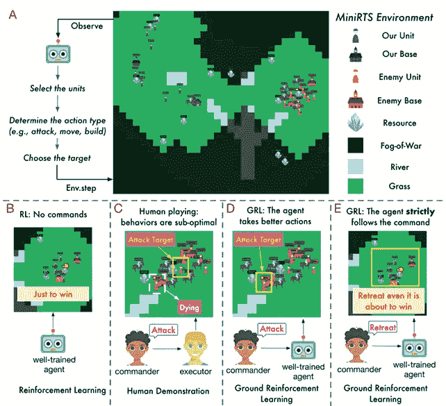

在狼人杀中训练策略多样化的 强化学习 策略以提升大模型的决策能力 [5]。

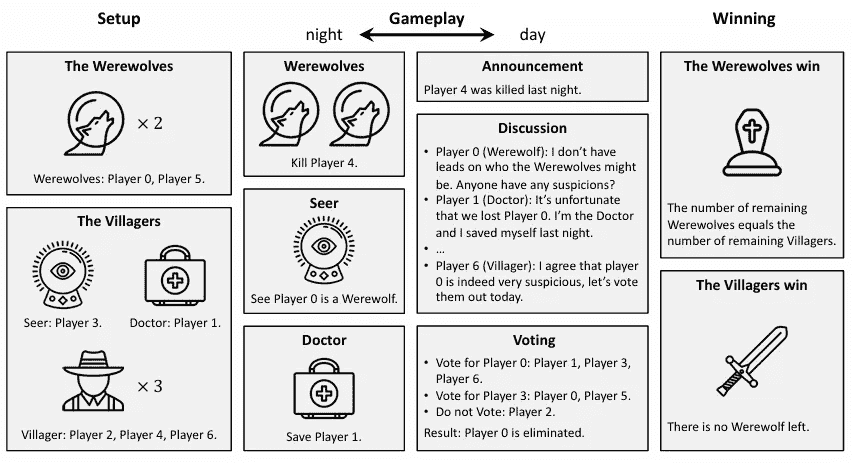

在 Overcooked 游戏中结合小模型与大模型实现能进行实时反馈的合作 Language Agent [6]。

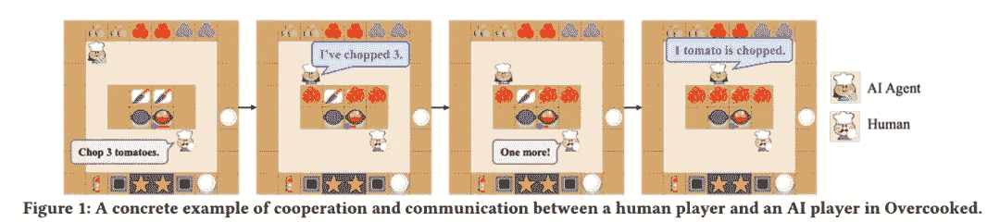

结合 强化学习 训练的机器人控制策略与大 语言模型 推理能力让机器人能够执行一系列复杂任务 [7]。

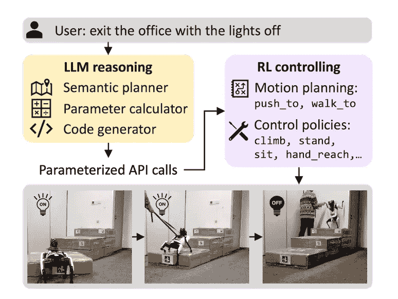

为了使大模型能真正走进千家万户，对齐技术是至关重要的，对于学术界和大模型从业者来说，好的开源工作和论文无疑会大大降低实验成本和开发难度，也期待随着技术发展，会有更多服务于人类的大模型出现。

[1] Yu, Chao, Akash Velu, Eugene Vinitsky, Jiaxuan Gao, Yu Wang, Alexandre Bayen, and Yi Wu. "The surprising effectiveness of ppo in cooperative multi-agent games."

[2] Mei, Zhiyu, Wei Fu, Guangju Wang, Huanchen Zhang, and Yi Wu. "SRL: Scaling Distributed Reinforcement Learning to Over Ten Thousand Cores."

[3] Mei, Zhiyu, Wei Fu, Kaiwei Li, Guangju Wang, Huanchen Zhang, and Yi Wu. "ReaLHF: Optimized RLHF Training for Large Language Models through Parameter Reallocation."

[4] Xu, Shusheng, Huaijie Wang, Jiaxuan Gao, Yutao Ouyang, Chao Yu, and Yi Wu. "Language-guided generation of physically realistic robot motion and control."

[5] Xu, Zelai, Chao Yu, Fei Fang, Yu Wang, and Yi Wu. "Language agents with reinforcement learning for strategic play in the werewolf game."

[6] Liu, Jijia, Chao Yu, Jiaxuan Gao, Yuqing Xie, Qingmin Liao, Yi Wu, and Yu Wang. "Llm-powered hierarchical language agent for real-time human-ai coordination."

[7] Ouyang, Yutao, Jinhan Li, Yunfei Li, Zhongyu Li, Chao Yu, Koushil Sreenath, and Yi Wu. "Long-horizon Locomotion and Manipulation on a Quadrupedal Robot with Large Language Models."