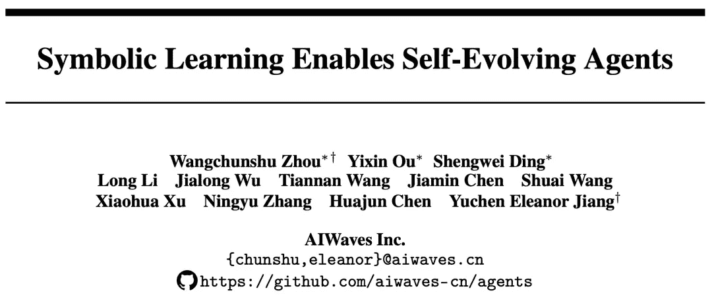
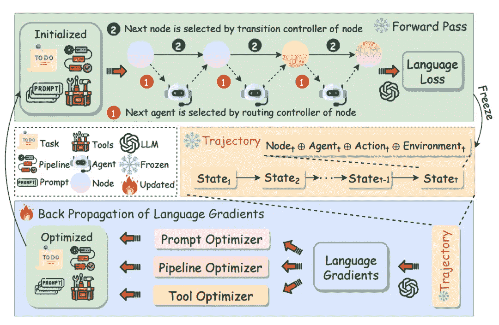
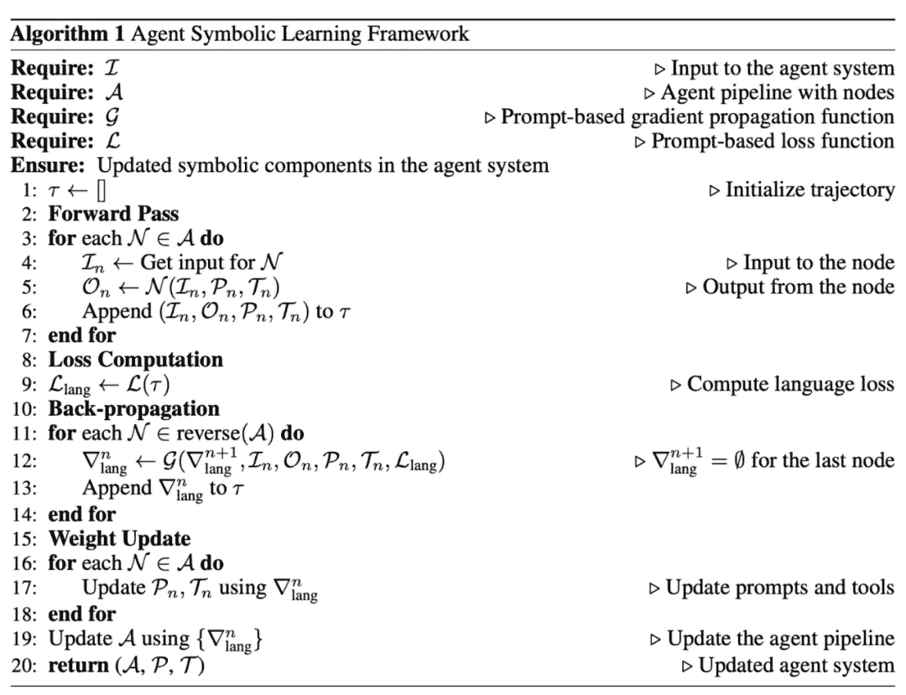
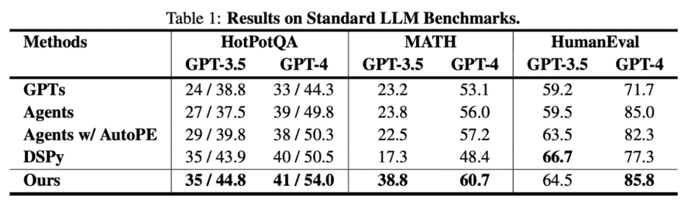
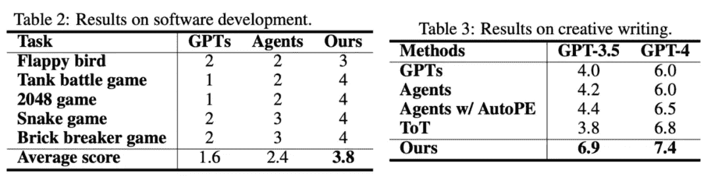
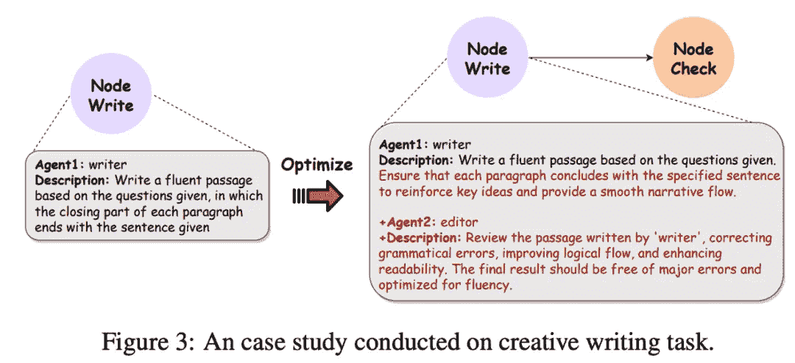

# 可「自主进化」的Agent？首个端到端智能体符号化训练框架开源了

> 来源：[https://agijuejin.feishu.cn/docx/CgL4d5QKsolIxoxK719ce3pnnJe](https://agijuejin.feishu.cn/docx/CgL4d5QKsolIxoxK719ce3pnnJe)

> 机器之心｜[阅读原文](https://www.jiqizhixin.com/articles/2024-07-22)

> 转载请联系原作者取得授权

**本文主**要作者来自波形智能、浙江大学、和北京航空航天大学。共同一作中，周王春澍是波形智能的联合创始人和 CTO，欧翌昕是浙江大学硕士二年级，丁盛为为北京航空航天大学四年级本科生。文章的通讯作者为周王春澍和姜昱辰，姜昱辰是波形智能的联合创始人和 CEO。

随着各类大模型 API 的迭代以及各类 AI Agent 框架的开源，基于大模型的智能体在学术界和工业界收获了广泛的关注、研究、和应用。

尽管基于大模型的智能体 (AI Agent) 在很多场景都取得了不错的效果，并且在一些场景下已经能够实际落地应用，AI Agent 的研究和开发的进展仍然局限于 “expert-centric”，或者说 “engineering-centric” 的范式中。也就是说，现在的 Agent 的创建和调优过程还是几乎完全依赖人类专家 (算法工程师) 的人力和经验来设计智能体的 promtps, tools，和 workflow。这样的过程费时费力，并且注定了无法使用海量数据对智能体的这些符号化元素进行学习和训练。而大部分智能体依赖于闭源的 API 调用，无法对大模型基座本身进行优化，即使使用开源大模型，对模型基座本身的优化也在大部分 AI 智能体的应用场景中受到资源、算力、稳定性等原因而无法实际进行。因此现在的智能体还处于 “ 专家系统 ” 的发展阶段。

众所周知， 神经网络 成为 机器学习 / 人工智能 的基础范式的重要原因正是因为可以高效地使用海量数据进行训练和优化，而不需要手工设计复杂的结构和学习算法。因此，来自波形智能的研究人员们认为，AI Agent 从以专家经验为核心 (expert-centric) 到以数据为核心 (data-centric) 的转变，将会是基于大模型的智能体的一个重要发展方向。

为了实现这个目标，来自波形智能的研究团队借鉴连接主义训练 神经网络 (connectionist learning) 的基本方式，即反向传播和 梯度下降 ，将 AI Agent 和 神经网络 进行类比，使用文本和大模型建模 损失函数 、梯度、和 优化器 ，模拟反向传播和 梯度下降 算法，实现对 Agent 的端到端的符号化训练算法，构建了一套可以对 AI 智能体进行端到端训练的算法框架，代码已经开源在 GitHub。

+   论文地址：https://arxiv.org/pdf/2406.18532

+   代码仓库：https://github.com/aiwaves-cn/agents

具体来说，团队首先将基于大模型的智能体解构为三个主要元素，即 prompts, tools, 和 agent pipeline (workflow)。接着，框架中将一个 Agent 系统看作是一个 “符号化” 神经网络 ，将 Agent workflow 中的每一个 node 看作是网络中的一个 layer，而将每个节点中的 prompts 和 tools 看作是这个 layer 的 weights，智能体的 workflow/pipeline 则可以看作是网络的计算图。这样下来，智能体系统可以看作是一个 权重 从数字 / 张量 空间变成离散符号空间 (文字，代码都是符号化的表示) 的 神经网络 ，而这种网络的训练自然也就可以参考传统 神经网络 的优化方式，即反向传播和 梯度下降 。

图 1: Agent Symbolic Learning 框架示意图

要使传统的反向传播和 梯度下降 能够处理符号化的 权重 空间，agent symbolic learning 框架中通过文本和大模型 + 提示词的方式建模了损失， 损失函数 ，反向传播的流程，梯度，以及基于梯度的 优化器 。具体来说，前向传播过程中，框架会将每一层的输入、 权重 、和输出都保存在计算图中。接下来，通过大模型 + 提示词的方式，在提示词中结合当前样本的输入，输出，和整体任务的描述，之后由大 语言模型 输出对当前样本任务完成情况的评价和总结。得到的文本形式的评价 / 总结，正如 神经网络 中的 loss 一样，用来衡量任务完成的好坏，研究团队将其称为 “文本形式的损失”，即 language-based loss。

之后，该研究通过大 语言模型 和精心设计的提示词工程，来生成智能体流程中对最后一个节点的 “反思”。反思中包括模型的输出应该怎样变化才能更符合要求，以及提示词和工具调用应该如何优化才能使输出朝这样的方向发生变化。这一内容和 神经网络 优化中梯度的作用刚好一致，都是包含了 参数 应该如何调整才能最小化整个模型的损失的信息，因此研究团队将这样的反思称作 “文本形式的梯度”，即 language-based gradient。

接下来要做的就是从后向前，得到每一层的梯度，这对于 神经网络 的优化至关重要。受到 神经网络 中基于 链式法则 的公式的反向传播的启发，波形智能的研究人员通过文本和大模型，用一套精心设计的 prompt 来模拟了传统 神经网络 优化的 链式法则 。具体来说，这套 prompts 让大模型基于上一层的梯度信息 (即对上一层执行任务的反思) 以及本层的输入、输出、以及 权重 (这些输入和反向传播公式中的 参数 完全对应)，输出对当前节点的 prompt/tool usage 的反思，即当前层的 language-based gradient。这样基于文本的反向传播的方案使得该研究能够得到一个包含多个节点和复杂 workflow 的智能体中每一节点 / 层的 参数 的梯度，也就可以直接优化每一个 prompt 和 tool 对整个智能体性能的作用，从而实现 end-to-end 的 joint optimization。

最后，得到了每组 参数 的 language-based gradient 之后，框架中使用基于大模型的 optimizer，使用精心设计的 prompt，以每一层的提示词和工具调用，以及基于文本的梯度作为输入，输出优化过后的 prompts 和 tools，从而实现对智能体 参数 的更新。

除此之外，框架中还支持了对网络结构，即 agent workflow 的优化。具体来说，框架中将 agent workflow 以特定的编程语言进行表示，这样就将智能体网络的 “计算图” 也处理成了符号化的 权重 。之后通过一个单独设计的基于大模型的 优化器 ，以当前智能体的工作流和工作流中的各个节点的文本形式的梯度为输入来对智能体的工作流进行更新。这在 神经网络 中训练中可以类比自动网络 结构搜索 相关的研究。

图 2: Agent Symbolic Learning 算法流程

图 3 大模型评测任务上的实验结果

图 4 智能体级别评测任务的实验结果

波形智能的研究人员在大模型和智能体的一系列 benchmark 上对该算法进行了评估，如图 3 和图 4 所示，agent symbolic learning 相比 DSpy 和传统的没有学习能力的智能体框架相比，在各类任务上都有了明显的提升，在一些任务上甚至使用 GPT-3.5 也能和其他智能体框架使用 GPT-4 的表现类似。而简单的对智能体中每一个节点中的提示词使用局部的基于大 语言模型 的提示词自动优化算法 (AutoPE) 则无法取得很明显的效果。另外，如图 5 所示，该算法在创意写作任务中，从初始的只基于一个提示词进行写作的单节点智能体，自主进化到了支持写作 + 编辑的工作流，并且将写作节点的提示词进行了更新和优化。

图 5 Agent Symbolic Learning 框架学习效果展示 (以创意写作任务为例)

波形智能的研究团队介绍了 Agent Symbolic Learning 的两种应用场景。首先，该框架可以用于开发者或研究人员创建和调优智能体系统中。像 神经网络 的训练一样，开发者和研究人员可以对指定的任务收集（或者使用框架中提供的自动生成）大量的样本，之后使用该框架在大量数据上完成 “data-centric” 的智能体的训练和优化，在之后像普通智能体的部署一样，在产品生产环境中以静态的方式部署优化过后的智能体。

除此之外，该框架的另一个重要应用场景是支持能够在环境 / 交互中自主进化的 Agent。具体来说，因为该训练框架本身只需要调用大模型的能力而不需要复杂的基于 GPU 的训练和部署，因此一个 Agent 可以将该训练框架作为其自身可以调用的一个工具，通过在环境中探索或者和人类进行交互的过程中，不断收集新的训练样本，定期或者主动调用智能体训练的算法工具，对自身的 prompts, tools, 和 workflow 进行更新。波形智能在 AIWaves Agents 的开源代码库中也支持了这样的部署 逻辑 ，实现了首个可以在被部署到实际产品和生产环境中之后，依然可以不断自主进化、自我迭代的智能体系统。

Agent Symbolic Learning 框架将 AI Agent 视作由复杂 workflow 中的 prompts 和 tools 连接而成的符号化 “ 神经网络 ”，通过基于自然语言模拟反向传播和 梯度下降 ，使得基于大模型的智能体可以自主对自身的 “网络 参数 ”，即 prompts 和 tools，以及 “网络结构”，即 agent workflow，进行优化，从而实现了能够高效利用大量数据和经验，进行 “data-centric learning” 的智能体框架，让能够持续自主进化的智能体系统变成了可能。目前，该框架已经在波形智能的多个产品和应用中发挥作用，解决了 Agent 人工优化和评测困难的问题。为了推进 “Data-centric Agent” 和 “Agent Learning” 的发展和研究，波形智能的研究团队也将算法的全部代码开源，期待智能体领域学术界和工业界一起探索更多更有趣的算法和应用。