# Meta生成式推荐模型GRs关键问题探讨

> 来源：[https://agijuejin.feishu.cn/docx/UFgXdWbDuotgcixC0oWcYe3ynkb](https://agijuejin.feishu.cn/docx/UFgXdWbDuotgcixC0oWcYe3ynkb)

> 蘑菇先生｜[阅读原文](https://mp.weixin.qq.com/s/gtAv_ya42UjdSyqJfAKS-g)

> 转载请联系原作者取得授权

[此前我们解读过Meta生成式推荐](http://mp.weixin.qq.com/s?__biz=MzU0MDA1MzI0Mw==&mid=2247497875&idx=1&sn=fa8cc6e2f8b2f02a21af1e2e5c69b633&chksm=fb3da307cc4a2a11b6249e48a7d6329b528011f80caafacb64834121e6fe7d216eb657e0edf6&scene=21#wechat_redirect)新作: 行动胜过言语: Meta落地工业界首个万亿级别参数的生成式推荐系统模型 ，整体工作很棒，但有一些关键问题没有交代特别清楚。在和作者交流的过程中了解到不少信息，同时作者也更新了两版paper，补充了很多关键信息和实现细节，我们有必要对更新的版本再次精读，对关键问题做进一步讨论。最新版本是5.6号上传的v3，我们针对这个版本完善的内容，重点探讨如下几类问题，期望在“落地生成式推荐”过程中能够起到一些帮助。

+   如何用 **生成式框架 **来重新定义召回和排序任务，相比于传统的DLRMs设定，GRs本质优势在哪？

+   在该 **生成式框架 **下，如何 **改造输入输出范式、 **损失目标建模范式、和传统DLRMs的样本流/特征流处理上，本质差异在哪？

+   离线训练和在线推理阶段， **输入输出范式 **存在什么差异？如何跨候选复用算力，做到更低时延？

上述是落地生成式推荐的3个关键问题，缺一不可。目前主要基于原paper的信息、开源代码、外加个人的一些理解，尝试做进一步的解读，多多指正。

#  关键问题 ：如何用生成式框架来重新定义召回和排序任务？

本部分重点讨论传统sequential recommender和DLRMs设定的缺陷，GRs如何通过一个全新的formulation视角来解决这些问题。本部分重点参考：原paper的Table 1、附录部分B.1. Background: Sequential Recommendations in Academia and Industry、Table10、Table 11、Figure 8、Figure 11。

**传统seq**uential recommender任务存在 如下问题 ：

+   **I**gnor**ance of fe**atures other than user-interacted items： 传统的序列推荐，通常只使用用户交互过的正样本item来构造序列。这里面包含两层含义，仅使用itemID来表征item、仅使用正反馈来构造序列。前者会忽略item的各类category语义信息、后者无法捕捉一些真实后验行为(如ctr)。GR通过两方面来分别解决这两个问题。a. 通过引入辅助信息并合并到主序列实现对category特征的建模。b. 对用户 超长行为序列建模， 各类正负反馈后验行为均保留，就能够通过attention来捕捉真实后验，不仅能起到数值型统计特征的作用，泛化性也更好。如果GRs模型仅在有交互的正样本itemID上学习，指标会下降非常多，即：2.6% NE的下降、1.3%的HitRate@100的下降。

+   **U**ser representations are computed in a target-independent setting： 用户的表征和待预测目标item之间互相独立，表达能力弱，这个主要是传统序列模型的问题，比如GRU4Rec、SASRec、BERT4Rec等，无法在输入侧进行交互，仅仅能通过输出侧的softmax来实现和目标item的弱交互。DLRMs中的DIN(Alibaba)、BST(Alibaba)、TWIN(Kwai)、TransAct(Pinterest)，引入了target-attention机制来缓解该问题。GRs通过将action看做新的模态，交错插入item和action，能够实现在causal autoregressive的设定下，使用 target-aware attention 实现更强的交互能力。

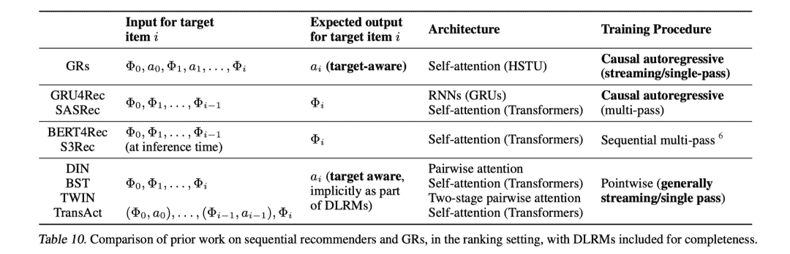

+

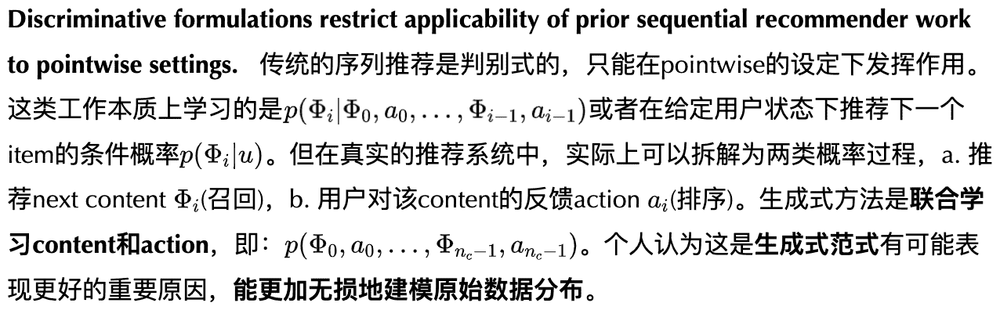

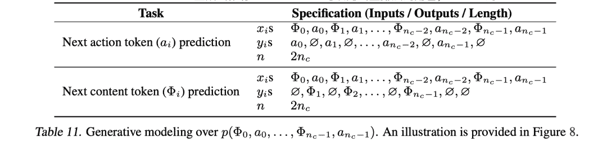

上图，Next Action Token prediction对应ranking任务，自回归预测的y是前一个item在action上的概率分布，也即该item的行为类型。Next content token prediction对应retrieval任务，自回归预测的y是next item，即在item物料上的概率分布。

模型对比图如下，左侧是传统的序列推荐模型，action只会在输入侧构建item表征时，作为额外的信息融入；输出端自回归的仍然是item本身；右侧是GR模型，输入端显式地将action也作为1种序列组成类型，输出端item和action均能够作为监督信号，来实现自回归预测。

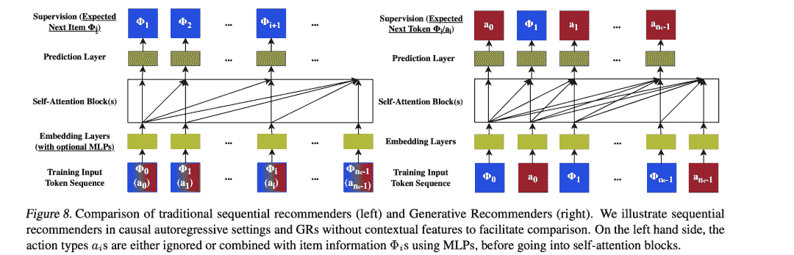

此处召排本质上可以是统一的模型，如图中所示，在1个任务中联合建模  和  ，此处拆成两个任务有一定取舍，可能是为了适配现有推荐系统链路。

除此之外，这一范式不仅能更好的建模数据分布，同时可以通过beam search生成item序列结果。这个相比于传统listwise的重排(如DPP和RL)，会更加有优势。也就是说，该方案还能充当重排层的角色，实现listwise的预测，这样就统一了召回、排序、重排，真正实现生成式推荐。

这个部分主要介绍整体的生成式框架，下面会介绍该框架下模型的样本和特征如何构建、以及线上推理如何计算候选打分。

#  关键问题：在该生成式框架下，模型 样本和特征如何构建？

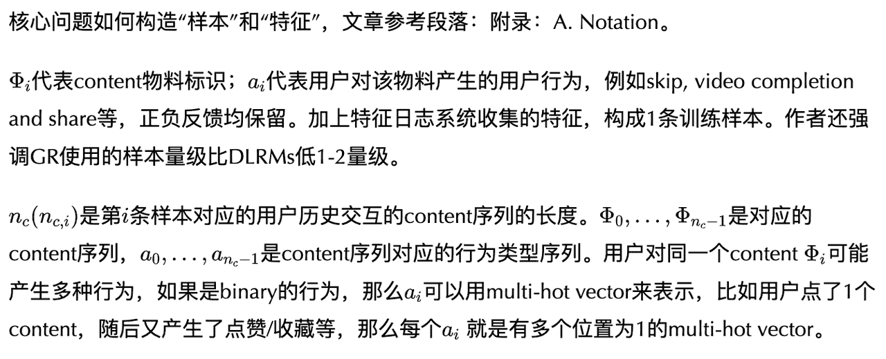

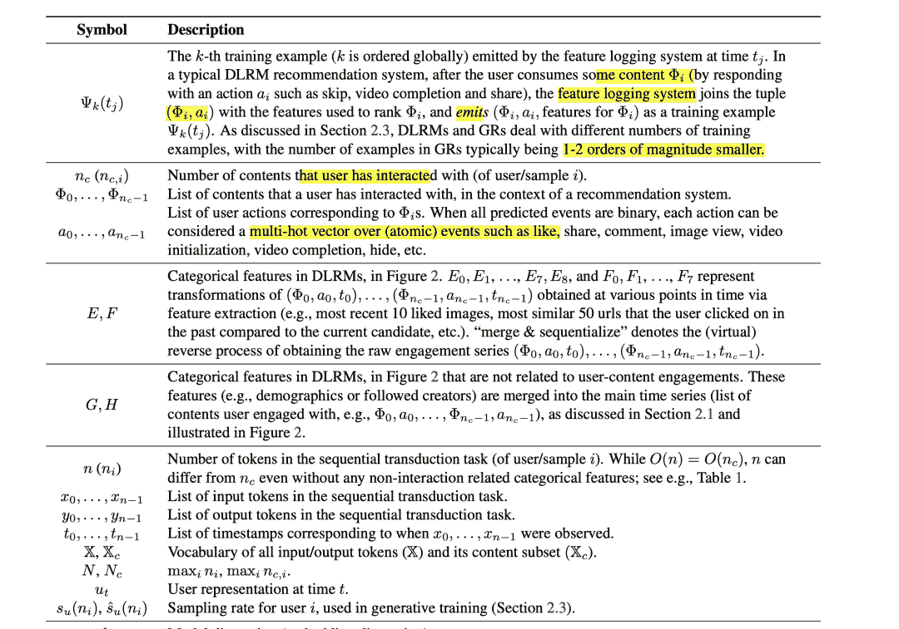

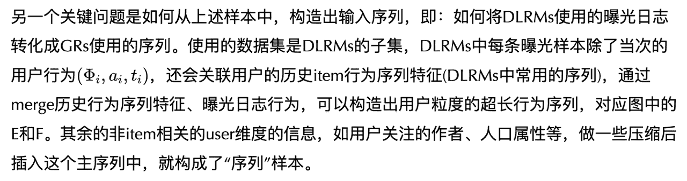

建模的时候，输入侧使用所有序列信息，输出侧的监督信号主要是序列中的item和action，屏蔽category等特征。

当然这里面仍然有非常多的细节需要实践的时候关注。

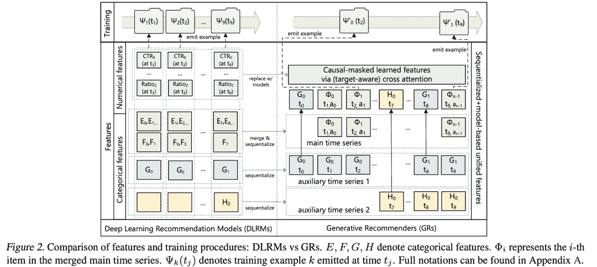

#  关键问题：排序任务训练和推理阶段的差异在哪，如何跨候选复用算力？

##  **训练 **

下图是训练示意图，看示意图是个召排统一的GR模型，输出侧的监督信号包括了item和action。

这个地方和前文描述的有一些出入。前文描述的排序任务输出侧监督信号主要是action，召回任务输出侧监督信号主要是item。但不影响理解。

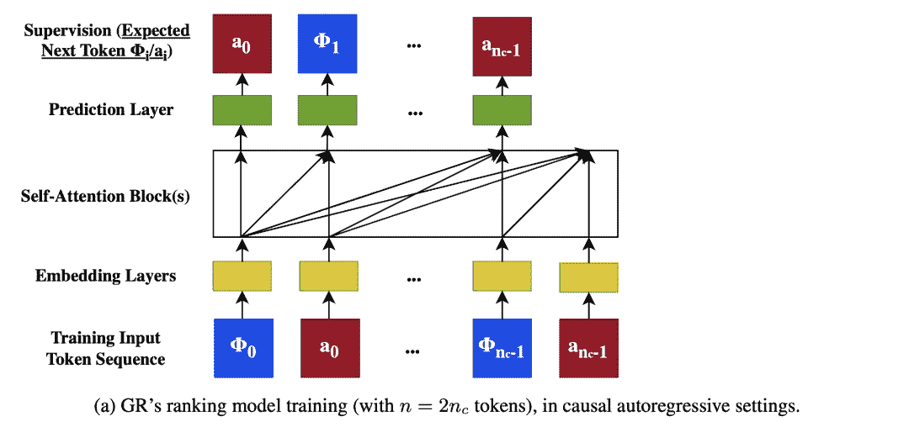

##  **推理 **

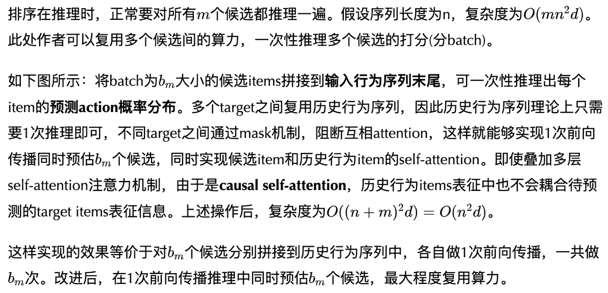

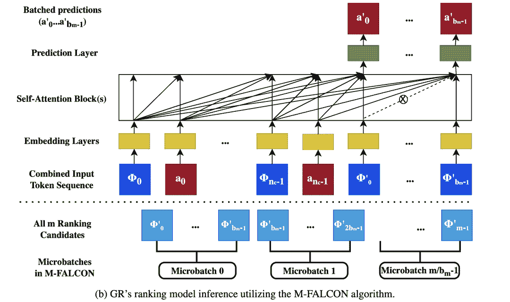

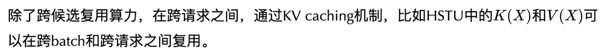

整体推理时的伪代码如下，值得好好学习。

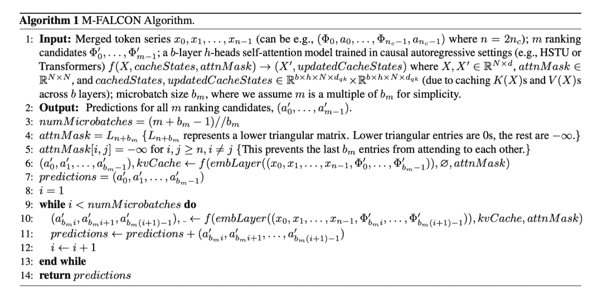

#  关键问题 ：基线DLRM水平如何？

##  **排序基线 **

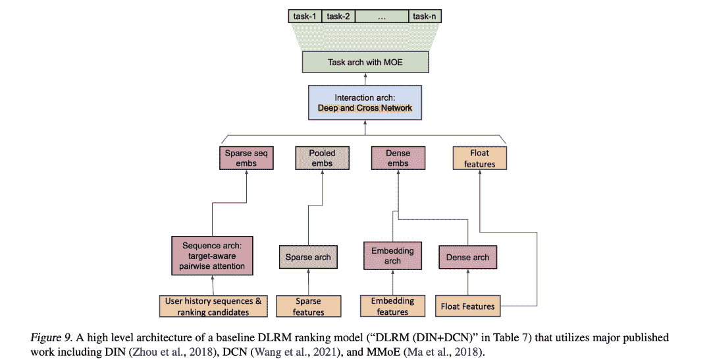

+   特征：1k+稠密特征、50+稀疏特征。

+   模型：MoE、DCN变体、DIN中的target-aware机制等，总之follow了最新的很多工作，是最好的DLRMs基线之一，是花费了数年迭代的成果，如Figure 9所示。

为了证明这点，作者给出了在相同特征集合下，和业界主流组件(DIN+DCN+MMoE)等的对比效果，比线上的DLRMs基线差不少，如Table 7所示，DLRM(DIN+DCN)是业界sota方案，DLRM是meta的方案，确实还是Meta的更好。

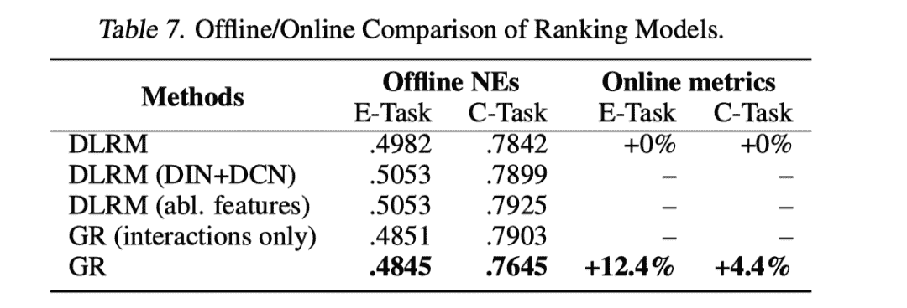

这里面虽然仍然缺少和SIM等长序列模型的对比，但能说明对比的基线就是原本Meta线上运行的最好结果。

##  **召回基线 **

标准的双塔设定，混排in-batch负采样和out-of-batch负采样策略。

##  **特征和序列长度 **

作者强调，DLRMs中使用的特征、以及用户历史交互行为序列(main user interaction history)均是GRs的超集。个人理解包括点击、曝光、交互等日志的时间周期，DLRMs用的跨度都更长。

#  **关键问题：开源代码？ **

最后，作者开源了主体代码：https://github.com/facebookresearch/generative-recommenders，使用的主要是开源数据集。截止到2024.06.23已经有449个Stars。感兴趣的可以学习一下。

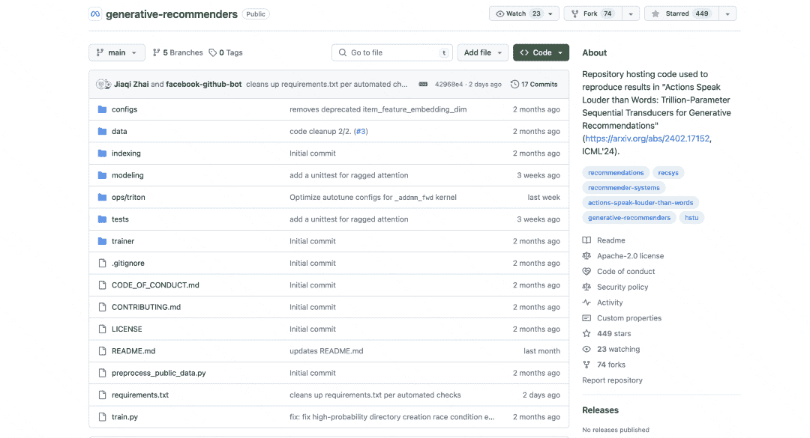

但工业界数据集和这些公开数据集还是存在差异，输入输出范式如何结合辅助信息等来构造，这里面还有不少细节，留待实践的时候进一步探索。

#  **总结 **

新版的paper补充了不少细节，外加开源的代码，想快速实现1个针对工业界数据的pipeline应该不难。进一步，这里面更困难的点在于海量数据建模、现有链路改造、模型离在线评估、线上推理等，如何和基线做公平的离线对比并能预估到线上指标变化、如何最低成本的实现链路改造、如何寻求工程协同实现线上推理可能都是比较关键的点。 btw，最 近因为 玩Recsys Cha llenge， 很久没更文章了，后续恢复发文~