# MLP一夜被干掉！MIT加州理工等革命性KAN破记录，发现数学定理碾压DeepMind

> 来源：[https://agijuejin.feishu.cn/docx/IFXfdHK9VoFQoFx53xLcUxTNnDe](https://agijuejin.feishu.cn/docx/IFXfdHK9VoFQoFx53xLcUxTNnDe)

> 新智元｜[阅读原文](https://mp.weixin.qq.com/s/vqhTFPbcUQaCsQnARZrn0g)

> 转载请联系原作者取得授权

> 新智元报道

> 编辑：桃子 LRS

> 【新智元导读】 无需怀念MLP，新网络KAN基于柯尔莫哥洛夫-阿诺德定理，带着更少的参数、更强的性能、更好的可解释性来了，深度学习架构革新进入新时代！

一夜之间，机器学习范式要变天了！

当今，统治深度学习领域的基础架构便是，多层感知器（MLP）——将激活函数放置在神经元上。

那么，除此之外，我们是否还有新的路线可走？

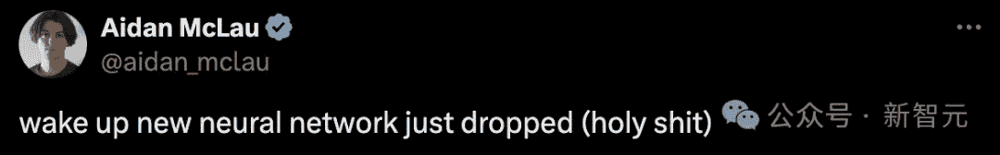

就在今天，来自MIT、加州理工、东北大学等机构的团队重磅发布了，全新的神经网络结构——Kolmogorov–Arnold Networks（KAN）。

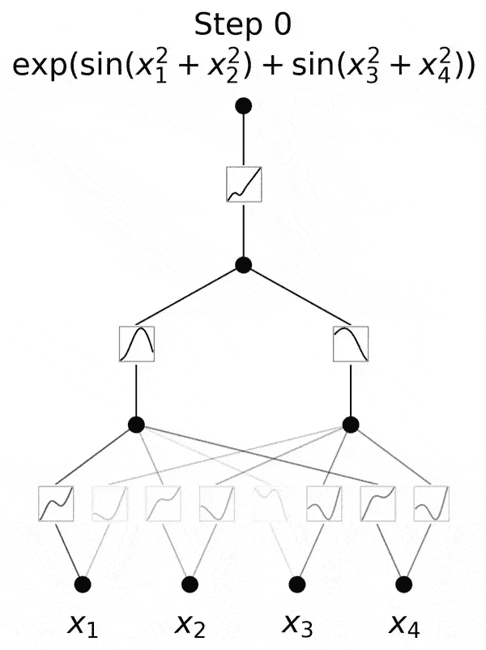

研究人员对MLP做了一个简单的改变，即将可学习的激活函数从节点（神经元）移到边（权重）上！

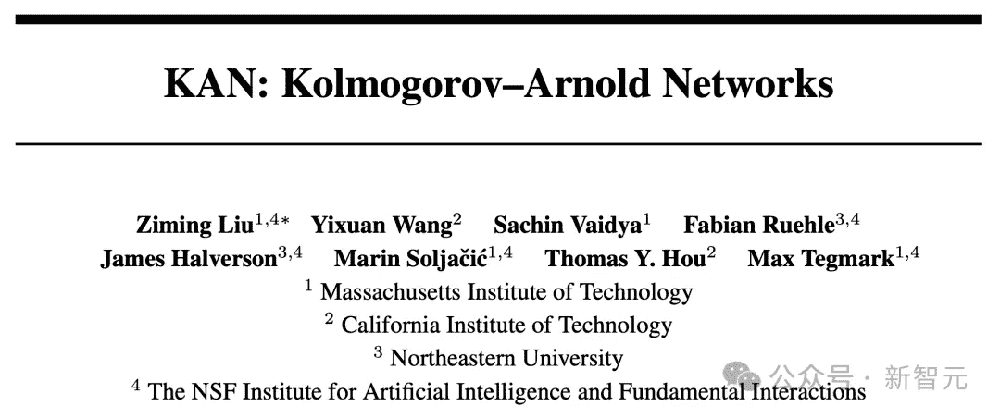

论文地址：`https://arxiv.org/pdf/2404.19756`

这个改变乍一听似乎毫无根据，但它与数学中的「逼近理论」（approximation theories）有着相当深刻的联系。

事实证明，Kolmogorov-Arnold表示对应两层网络，在边上，而非节点上，有可学习的激活函数。

正是从表示定理得到启发，研究人员用神经网络显式地，将Kolmogorov-Arnold表示参数化。

值得一提的是，KAN名字的由来，是为了纪念两位伟大的已故数学家Andrey Kolmogorov和Vladimir Arnold。

实验结果显示，KAN比传统的MLP有更加优越的性能，提升了神经网络的准确性和可解释性。

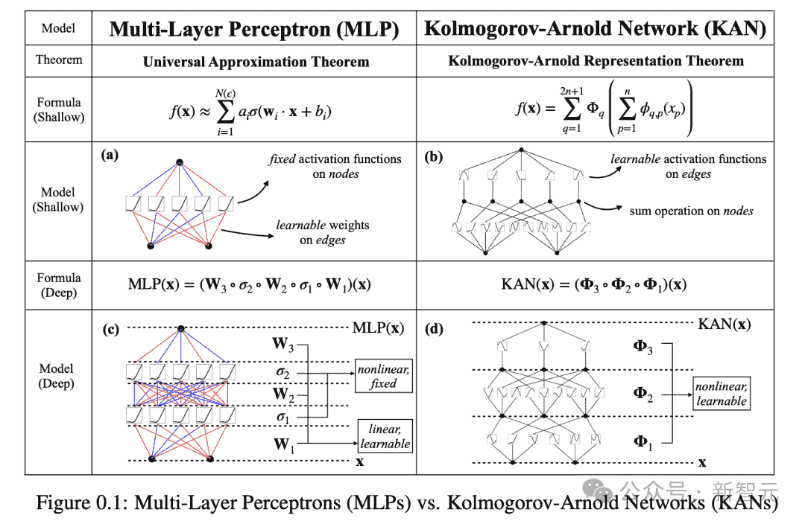

而最令人意想不到的是，KAN的可视化和交互性，让其在科学研究中具有潜在的应用价值，能够帮助科学家发现新的数学和物理规律。

研究中，作者用KAN重新发现了纽结理论（knot theory）中的数学定律！

而且，KAN以更小的网络和自动化方式，复现了DeepMind在2021年的结果。

在物理方面，KAN可以帮助物理学家研究Anderson局域化（这是凝聚态物理中的一种相变）。

对了，顺便提一句，研究中KAN的所有示例（除了参数扫描），在单个CPU上不到10分钟就可以复现。

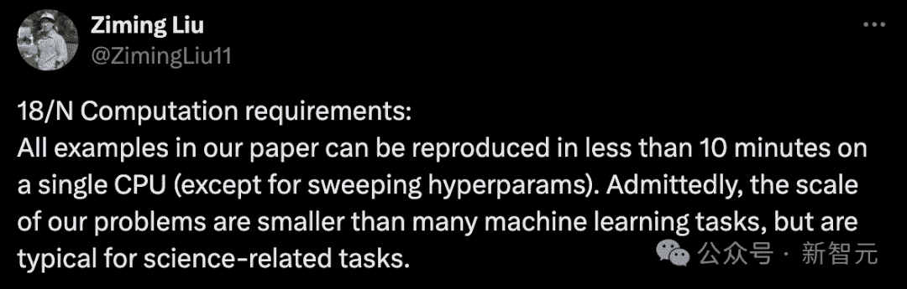

KAN的横空出世，直接挑战了一直以来统治机器学习领域的MLP架构，在全网掀起轩然大波。

## 机器学习新纪元开启

有人直呼，机器学习的新纪元开始了！

谷歌DeepMind研究科学家称，「Kolmogorov-Arnold再次出击！一个鲜为人知的事实是：这个定理出现在一篇关于置换不变神经网络（深度集）的开创性论文中，展示了这种表示与集合/GNN聚合器构建方式（作为特例）之间的复杂联系」。

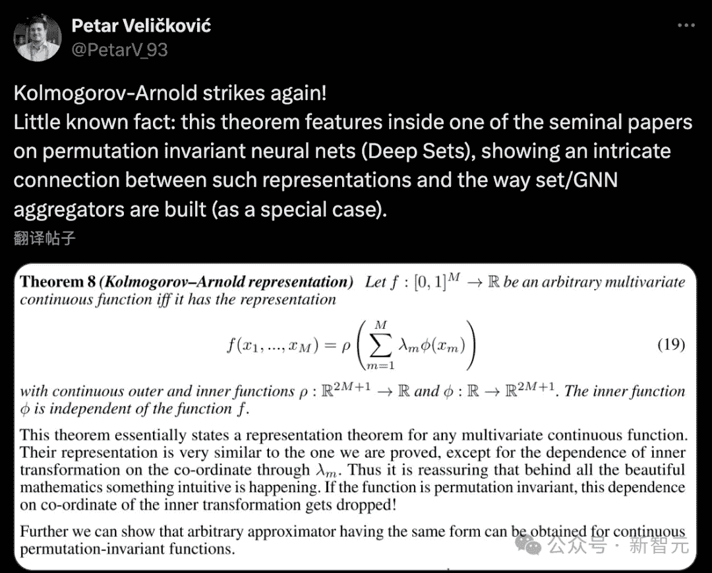

一个全新的神经网络架构诞生了！KAN将极大地改变人工智能的训练和微调方式。

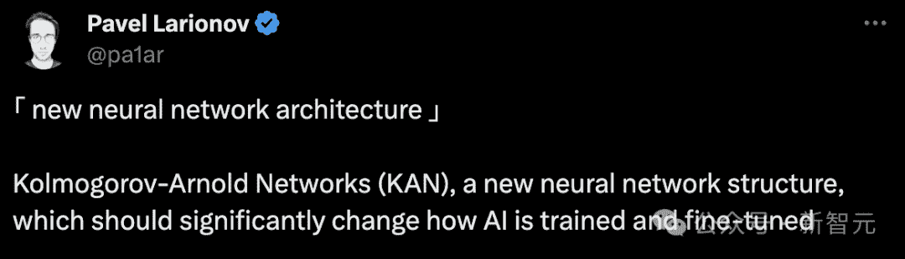

难道是AI进入了2.0时代？

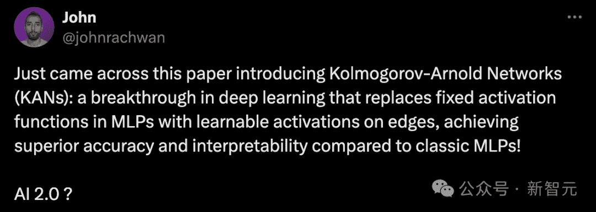

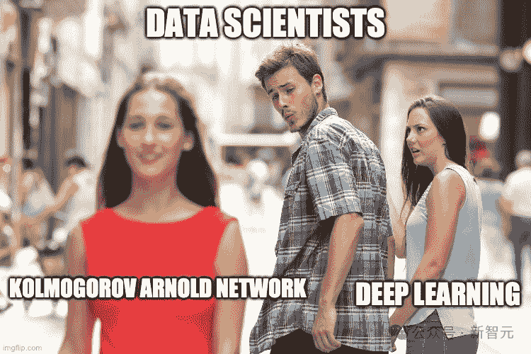

还有网友用通俗的语言，将KAN和MLP的区别，做了一个形象的比喻：

> Kolmogorov-Arnold网络（KAN）就像一个可以烤任何蛋糕的三层蛋糕配方，而多层感知器（MLP）是一个有不同层数的定制蛋糕。MLP更复杂但更通用，而KAN是静态的，但针对一项任务更简单、更快速。

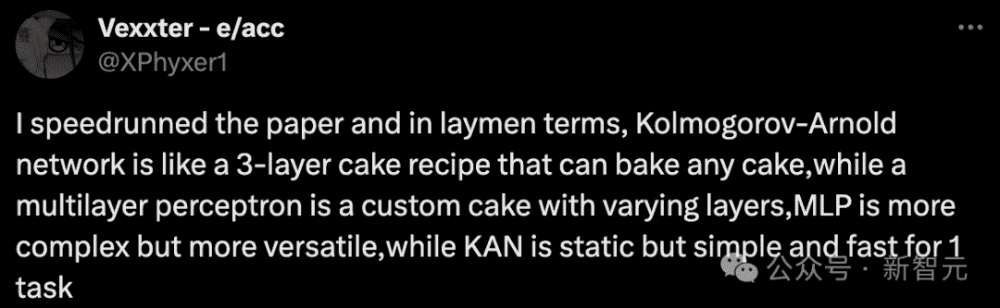

论文作者，MIT教授Max Tegmark表示，最新论文表明，一种与标准神经网络完全不同的架构，在处理有趣的物理和数学问题时，以更少的参数实现了更高的精度。

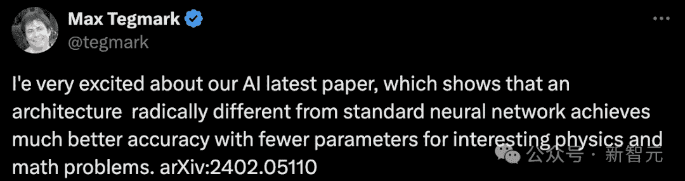

接下来，一起来看看代表深度学习未来的KAN，是如何实现的？

## 重回牌桌上的KAN

### KAN的理论基础

柯尔莫哥洛夫-阿诺德定理（Kolmogorov–Arnold representation theorem）指出，如果`f`是一个定义在有界域上的多变量连续函数，那么该函数就可以表示为多个单变量、加法连续函数的有限组合。

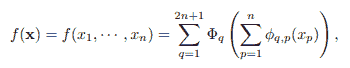

对于机器学习来说，该问题可以描述为：学习高维函数的过程可以简化成学习多项式数量的一维函数。

但这些一维函数可能是非光滑的，甚至是分形的（fractal），在实践中可能无法学习，也正是由于这种「病态行为」，柯尔莫哥洛夫-阿诺德表示定理在机器学习领域基本上被判了「死刑」，即理论正确，但实际无用。

在这篇文章中，研究人员仍然对该定理在机器学习领域的应用持乐观态度，并提出了两点改进：

1、原始方程中，只有两层非线性和一个隐藏层（`2n+1`），可以将网络泛化到任意宽度和深度；

2、科学和日常生活中的大多数函数大多是光滑的，并且具有稀疏的组合结构，可能有助于形成平滑的柯尔莫哥洛夫-阿诺德表示。类似于物理学家和数学家的区别，物理学家更关注典型场景，而数学家更关心最坏情况。

### KAN架构

柯尔莫哥洛夫-阿诺德网络（KAN）设计的核心思想是将多变量函数的逼近问题转化为学习一组单变量函数的问题。在这个框架下，每个单变量函数可以用B样条曲线来参数化，其中B样条是一种局部的、分段的多项式曲线，其系数是可学习的。

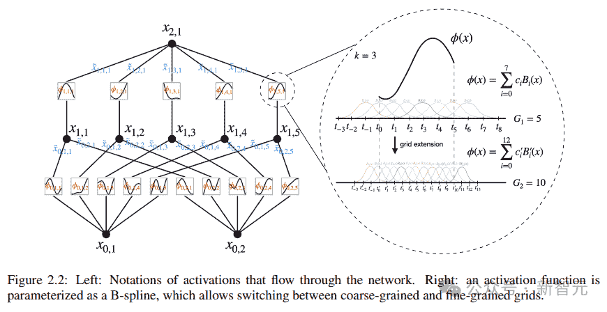

为了把原始定理中的两层网络扩展到更深、更宽，研究人员提出了一个更「泛化」的定理版本来支持设计KAN：

受MLPs层叠结构来提升网络深度的启发，文中同样引入了一个类似的概念，KAN层，由一个一维函数矩阵组成，每个函数都有可训练的参数。

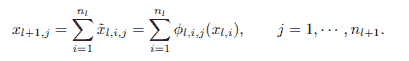

根据柯尔莫哥洛夫-阿诺德定理，原始的KAN层由内部函数和外部函数组成，分别对应于不同的输入和输出维度，这种堆叠KAN层的设计方法不仅扩展了KANs的深度，而且保持了网络的可解释性和表达能力，其中每个层都是由单变量函数组成的，可以对函数进行单独学习和理解。

下式中的`f`就等价于KAN

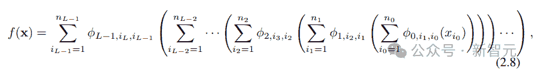

### 实现细节

虽然KAN的设计理念看起来简单，纯靠堆叠，但优化起来也并不容易，研究人员在训练过程中也摸索到了一些技巧。

1、残差激活函数：通过引入基函数`b(x)`和样条函数的组合，使用残差连接的概念来构建激活函数`ϕ(x)`，有助于训练过程的稳定性。

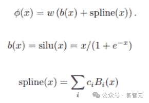

2、初始化尺度（scales）：激活函数的初始化设置为接近零的样条函数，权重`w`使用`Xavier`初始化方法，有助于在训练初期保持梯度的稳定。

3、更新样条网格：由于样条函数定义在有界区间内，而神经网络训练过程中激活值可能会超出这个区间，因此动态更新样条网格可以确保样条函数始终在合适的区间内运行。

### 参数量

1、网络深度：`L`

2、每层的宽度：`N`

3、每个样条函数是基于`G`个区间（`G+1`个网格点）定义的，`k`阶（通常`k=3`）

所以KANs的参数量约为

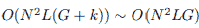

作为对比，MLP的参数量为`O(L*N^2)`，看起来比KAN效率更高，但KANs可以使用更小的层宽度（`N`），不仅可以提升泛化性能，还能提升可解释性。

## KAN比MLP，胜在了哪？

### 性能更强

作为合理性检验，研究人员构造了五个已知具有平滑KA（柯尔莫哥洛夫-阿诺德）表示的例子作为验证数据集，通过每200步增加网格点的方式对KANs进行训练，覆盖`G`的范围为`{3,5,10,20,50,100,200,500,1000}`

使用不同深度和宽度的MLPs作为基线模型，并且KANs和MLPs都使用`LBFGS`算法总共训练1800步，再用`RMSE`作为指标进行对比。

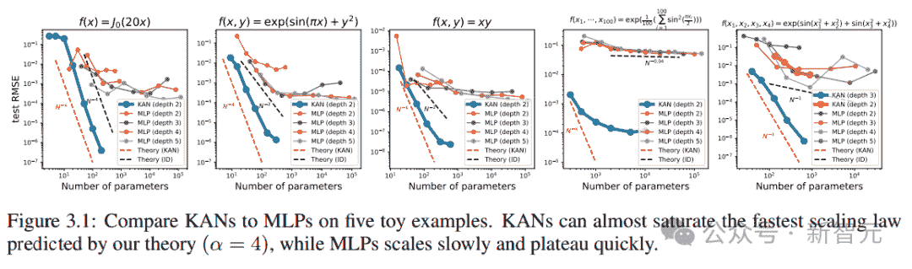

从结果中可以看到，KAN的曲线更抖，能够快速收敛，达到平稳状态；并且比MLP的缩放曲线更好，尤其是在高维的情况下。

还可以看到，三层KAN的性能要远远强于两层，表明更深的KANs具有更强的表达能力，符合预期。

### 交互解释KAN

研究人员设计了一个简单的回归实验，以展现用户可以在与KAN的交互过程中，获得可解释性最强的结果。

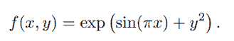

假设用户对于找出符号公式感兴趣，总共需要经过5个交互步骤。

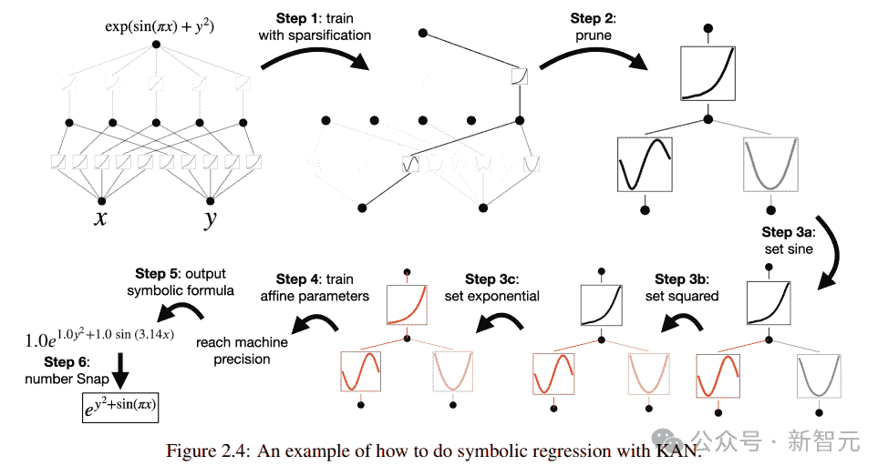

步骤 1：带有稀疏化的训练。

从全连接的KAN开始，通过带有稀疏化正则化的训练可以使网络变得更稀疏，从而可以发现隐藏层中，5个神经元中的4个都看起来没什么作用。

步骤 2：剪枝

自动剪枝后，丢弃掉所有无用的隐藏神经元，只留下一个KAN，把激活函数匹配到已知的符号函数上。

步骤 3：设置符号函数

假设用户可以正确地从盯着KAN图表猜测出这些符号公式，就可以直接设置

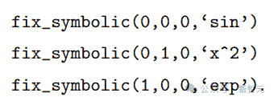

如果用户没有领域知识或不知道这些激活函数可能是哪些符号函数，研究人员提供了一个函数`suggest_symbolic`来建议符号候选项。

步骤 4：进一步训练

在网络中所有的激活函数都符号化之后，唯一剩下的参数就是仿射参数；继续训练仿射参数，当看到损失降到机器精度（`machine precision`）时，就能意识到模型已经找到了正确的符号表达式。

步骤 5：输出符号公式

使用`Sympy`计算输出节点的符号公式，验证正确答案。

### 可解释性验证

研究人员首先在一个有监督的玩具数据集中，设计了六个样本，展现KAN网络在符号公式下的组合结构能力。

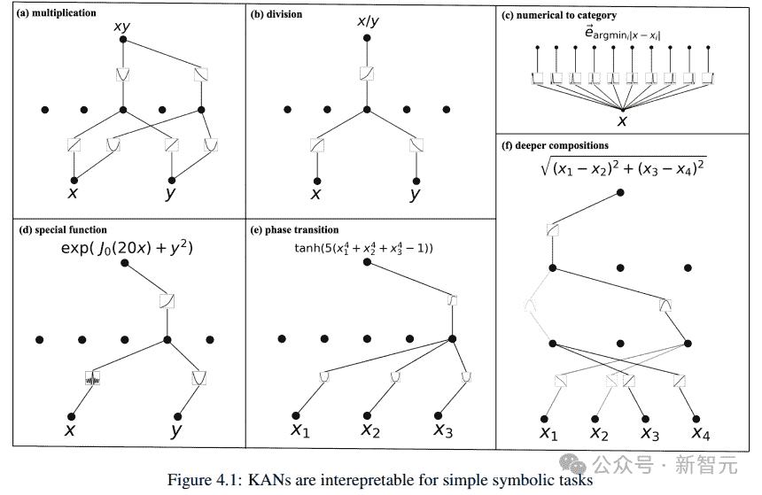

可以看到，KAN成功学习到了正确的单变量函数，并通过可视化的方式，可解释地展现出KAN的思考过程。

在无监督的设置下，数据集中只包含输入特征`x`，通过设计某些变量（`x1`, `x2`, `x3`）之间的联系，可以测试出KAN模型寻找变量之间依赖关系的能力。

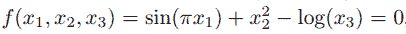

从结果来看，KAN模型成功找到了变量之间的函数依赖性，但作者也指出，目前仍然只是在合成数据上进行实验，还需要一种更系统、更可控的方法来发现完整的关系。

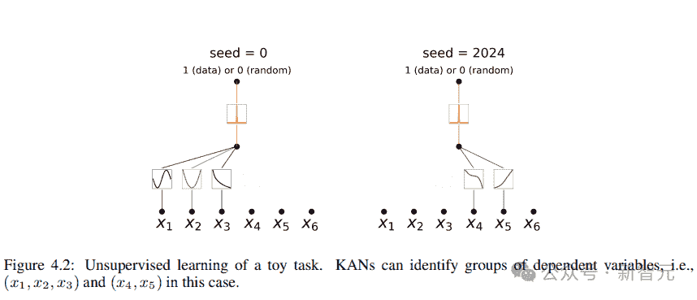

### 帕累托最优

通过拟合特殊函数，作者展示了KAN和MLP在由模型参数数量和`RMSE`损失跨越的平面中的帕累托前沿（`Pareto Frontier`）。

在所有特殊函数中，KAN始终比MLP具有更好的帕累托前沿。

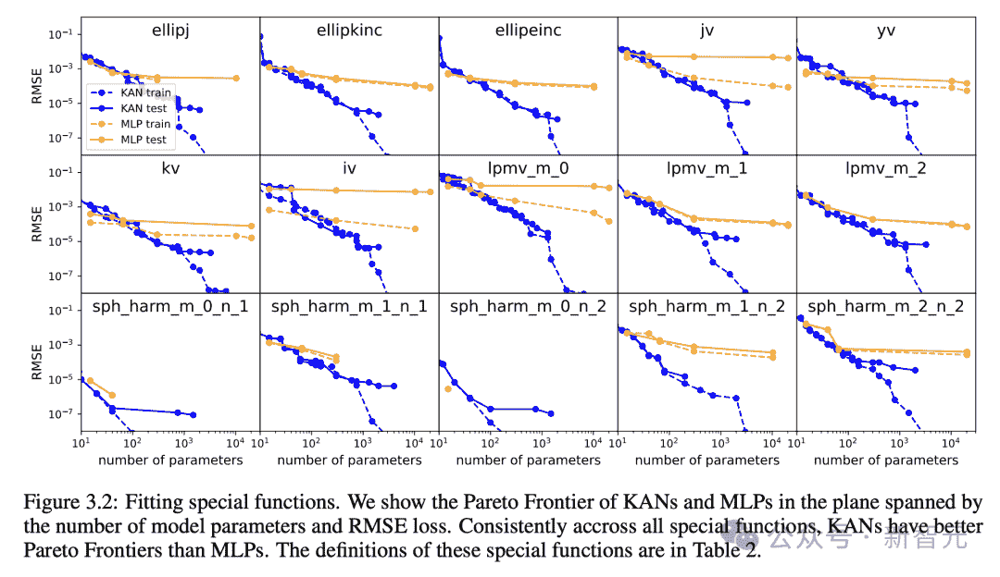

### 求解偏微方程

在求解偏微方程任务中， 研究人员绘制了预测解和真实解之间的`L2`平方和`H1`平方损失。

下图中，前两个是损失的训练动态，第三和第四是损失函数数量的扩展定律（Sacling Law）。

如下结果所示，与MLP相比，KAN的收敛速度更快，损失更低，并且具有更陡峭的扩展定律。

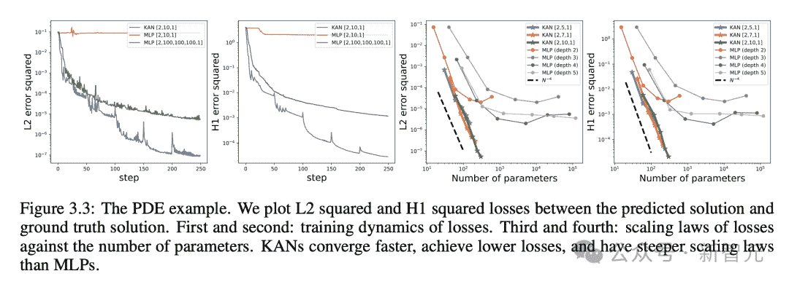

### 持续学习，不会发生灾难性遗忘

我们都知道，灾难性遗忘是机器学习中，一个严重的问题。

人工神经网络和大脑之间的区别在于，大脑具有放置在空间局部功能的不同模块。当学习新任务时，结构重组仅发生在负责相关技能的局部区域，而其他区域保持不变。

然而，大多数人工神经网络，包括MLP，却没有这种局部性概念，这可能是灾难性遗忘的原因。

而研究证明了，KAN具有局部可塑性，并且可以利用样条（splines）局部性，来避免灾难性遗忘。

这个想法非常简单，由于样条是局部的，样本只会影响一些附近的样条系数，而远处的系数保持不变。

相比之下，由于MLP通常使用全局激活（如`ReLU`/`Tanh`/`SiLU`），因此，任何局部变化都可能不受控制地传播到远处的区域，从而破坏存储在那里的信息。

研究人员采用了一维回归任务（由5个高斯峰组成）。每个峰值周围的数据按顺序（而不是一次全部）呈现给KAN和MLP。

结果如下图所示，KAN仅重构当前阶段存在数据的区域，而使之前的区域保持不变。

而MLP在看到新的数据样本后会重塑整个区域，从而导致灾难性的遗忘。

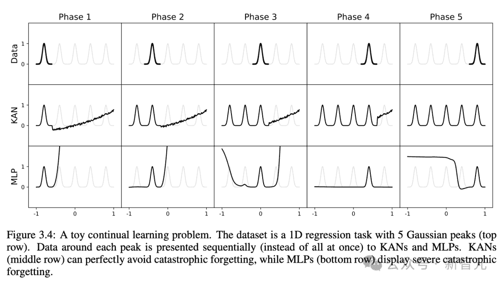

## 发现纽结理论，结果超越DeepMind

KAN的诞生对于机器学习未来应用，意味着什么？

纽结理论（Knot theory）是低维拓扑学中的一门学科，它揭示了三流形和四流形的拓扑学问题，并在生物学和拓扑量子计算等领域有着广泛的应用。

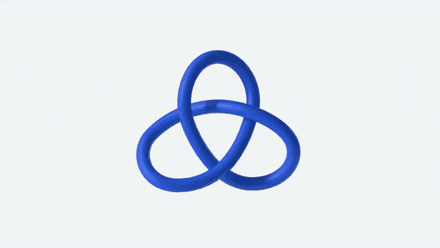

2021年，DeepMind团队曾首次用AI证明了纽结理论（knot theory）登上了Nature。

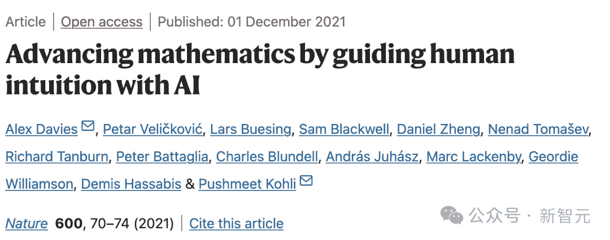

论文地址：`https://www.nature.com/articles/s41586-021-04086-x`

这项研究中，通过监督学习和人类领域专家，得出了一个与代数和几何结不变量相关的新定理。

即梯度显著性识别出了监督问题的关键不变量，这使得领域专家提出了一个猜想，该猜想随后得到了完善和证明。

对此，作者研究KAN是否可以在同一问题上取得良好的可解释结果，从而预测纽结的签名。

在DeepMind实验中，他们研究纽结理论数据集的主要结果是：

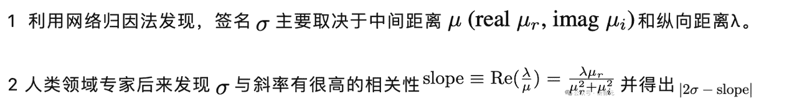

为了研究问题（1），作者将17个纽结不变量视为输入，将签名视为输出。

与DeepMind中的设置类似，签名（偶数）被编码为一热向量，并且网络通过交叉熵损失进行训练。

结果发现，一个极小的KAN能够达到81.6%的测试精度，而DeepMind的4层宽度300MLP，仅达到78%的测试精度。

如下表所示，KAN（`G = 3, k = 3`）有约200参数，而MLP约有300000参数量。

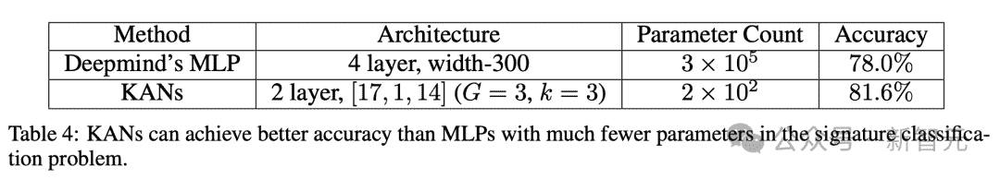

值得注意的是，KAN不仅更准确，而且更准确。同时比MLP的参数效率更高。

在可解释性方面，研究人员根据每个激活的大小来缩放其透明度，因此无需特征归因即可立即清楚，哪些输入变量是重要的。

然后，在三个重要变量上训练KAN，获得78.2%的测试准确率。

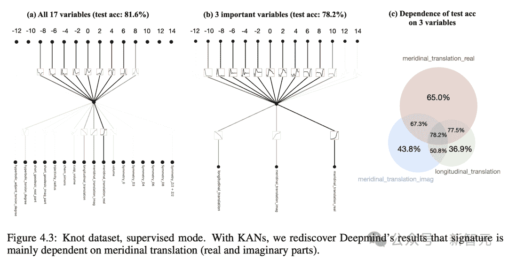

如下是，通过KAN，作者重新发现了纽结数据集中的三个数学关系。

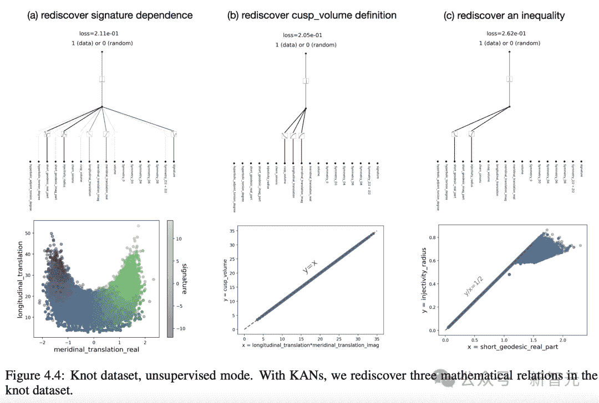

## 物理Anderson局域化有解了

而在物理应用中，KAN也发挥了巨大的价值。

Anderson是一种基本现象，其中量子系统中的无序会导致电子波函数的局域化，从而使所有传输停止。

在一维和二维中，尺度论证表明，对于任何微小的随机无序，所有的电子本征态都呈指数级局域化。

相比之下，在三维中，一个临界能量形成了一个相分界，将扩展态和局域态分开，这被称为移动性边缘。

理解这些移动性边缘对于解释固体中的金属-绝缘体转变等各种基本现象至关重要，以及在光子设备中光的局域化效应。

作者通过研究发现，KANs使得提取移动性边缘变得非常容易，无论是数值上的，还是符号上的。

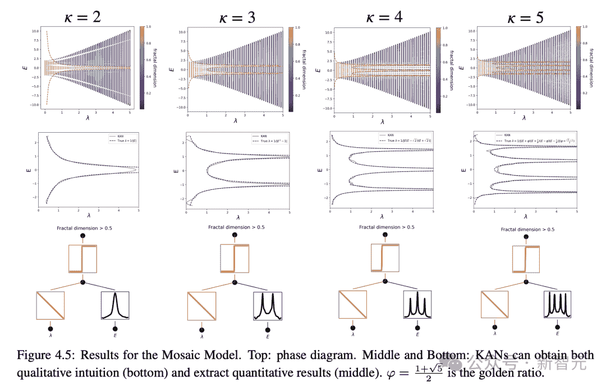

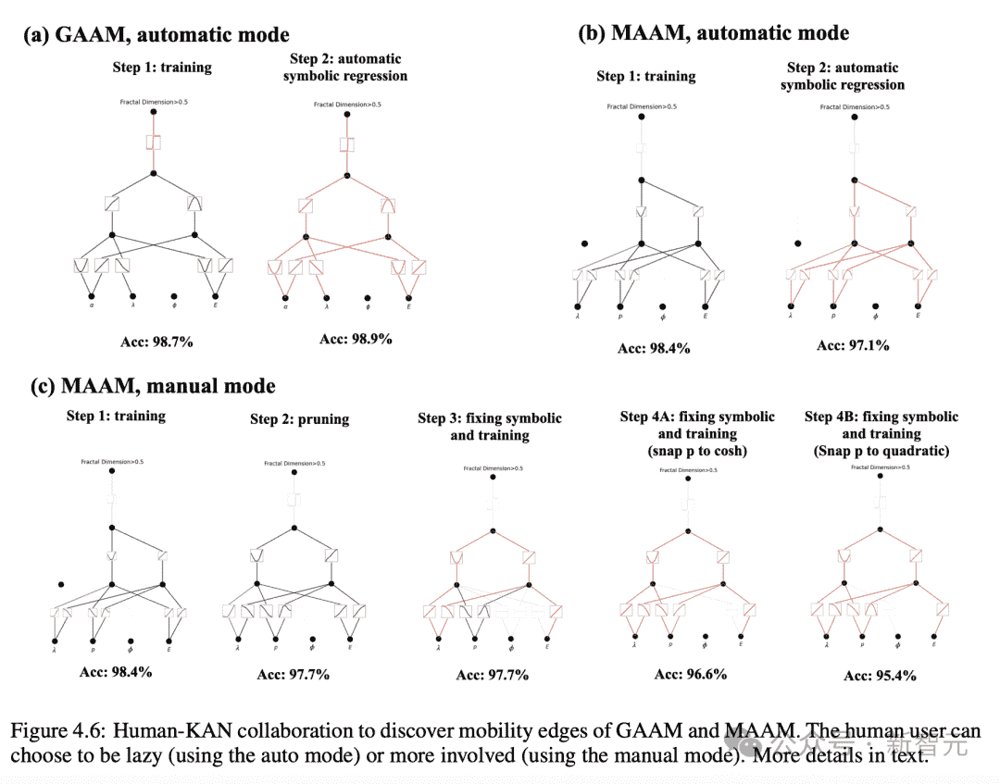

显然，KAN已然成为科学家的得力助手、重要的合作者。

总而言之，得益于准确性、参数效率和可解释性的优势，KAN将是`AI+Science`一个有用的模型/工具。

未来，KAN的进一步在科学领域中的应用，还待挖掘。

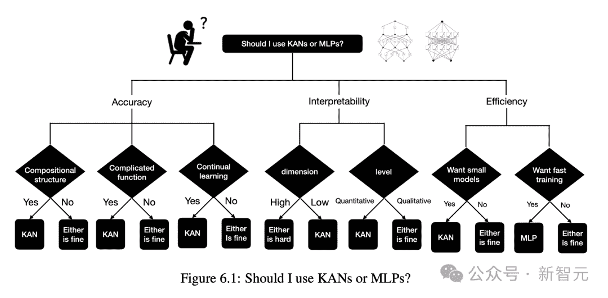

参考资料：

`https://twitter.com/zimingliu11/status/1785483967719981538`

`https://www.reddit.com/r/singularity/comments/1chqg13/mit_researchers_max_tegmark_and_others_develop/`
