# 行动胜过言语: Meta落地工业界首个万亿级别参数的生成式推荐系统模型

> 来源：[https://agijuejin.feishu.cn/docx/Qa99dQLDXo2OrAx37wpcEDLcn0g](https://agijuejin.feishu.cn/docx/Qa99dQLDXo2OrAx37wpcEDLcn0g)

> 蘑菇先生｜[阅读原文](https://mp.weixin.qq.com/s/aSFTa0hRim0_f31WvfFsxQ)

> 转载请联系原作者取得授权

大**家好，我是蘑**菇先生。今天分享一篇Meta最新的工作：借鉴LLMs思路**重塑推荐系统**范式，实现推荐系统的scaling。该工作第一次在 核心产品线 替换掉了近十年工业界长期使用的 基于海量异构特征的深度推荐模型， 在模型规模、业务效果、性能加速等方面都相当亮眼。有可能成为工业级推荐系统大规模scaling的 开创性工作 。

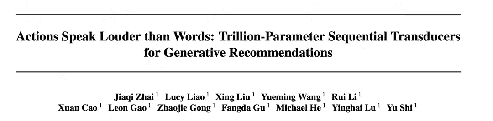

> 链接：https://arxiv.org/abs/2402.17152

## **Motivation **

**传统的大规模推荐系**统基于海量用户行为数据，构造海量 高基数和异构特征 进行深度模型训练。尽管模型规模已经很庞大了，但如果想进一步进行scaling，则非常困难。

受到近期大语言模型成功的启发，Meta团队重新审视了传统的推荐系统范式，数十亿用户规模的推荐系统所面临的三类主要挑战：

+   **特征缺乏显式结构 **：海量异构特征，如高基数ids、交叉特征、计数特征、比例特征等。

+   需要处理数十亿级别的动态词汇表 ：如ID/属性等。与语言模型中的10万量级静态词汇形成了鲜明对比。这种数十亿级别的动态词汇表不断变化，给训练带来很大挑战；且线上需要以目标感知target-aware的方式给数以万计的候选集打分，推理成本巨大。

+   计算成本是限制落地的最大瓶颈： GPT-3在1-2个月的时间内使用数千个GPU进行了总计**300B t**okens的训练。规模**确实很大，****但与推荐系**统用户行为的规模相**比就相**去甚远了。最大的互联网平台每天为 数十亿用户 提供服务，用户每天与 数十亿条 内容、图片和视频进行交互。在极端情况下，用户序列的长度可能高达 10^5 。因此，推荐系统 每天 需要处理的tokens数量甚至比语言模型在1-2个月内处理的数量还要大好几个数量级。

为了解决上述挑战，实现推荐系统的s**caling，Meta提出了一种新架构 HSTU (Hi**erarchical Sequential Transduction Unit ，层次化序列直推式单元) ，专为高基数、非平稳分布的流式数据而设计。核心贡献如下[1]：

+   **统一的生成式**推荐模型(GR) 第一次在 核心产品线 替换掉了近十年推荐工业界长期使用的分层海量特征建模范式；此处个人理解不是替换分层架构，而是将传统召排建模方法做了大升级，统一的模型复用到召排链路中，仍然是分层架构，只不过做了升级和技术方案统一；

+   新的encoder (HSTU) 通过新架构 + 算法稀疏性加速达到了模型质量超过Transformer + 实际训练侧效率比FlashAttention2 （目前最快的Transformer实现）快15.2倍 (8192长度序列)；

+   通过新的推理算法M-FALCON达成了推理侧700倍加速（285倍复杂模型，2.48x推理QPS）；

+   在传统测试集MovieLens/ Amazon Reviews上，相比经典的SASRec提升20.3%~65.8% NDCG@10；

+   实际中多产品界面上线，单特定ranking界面提升12.4%，如果把召排阶段提升加起来，可达到18.6%(排序12.4%，召回6.2%)；

+   通过新架构HSTU+训练算法GR，模型拥**有1.5万亿个参数，**模**型总计算量达到了 100**0x级的提升 ，第一次达到GPT-3 175b/LLaMa-2 70b等LLM训练算力，且第一次在推荐模系统中观测到了类LLM的的 scaling law 。

值得重点强调的是，GR的效果经验性地以 训练计算量的幂律方式进行scaling ，跨越了三个数量级，最高可达到GPT-3/LLaMa-2规模。如下图是过去几年深度学习模型的总计算量趋势图，GR(generative recommendation)是本文已部署的模型。可以看到GR-24已经接近LLaMa-2的量级了。

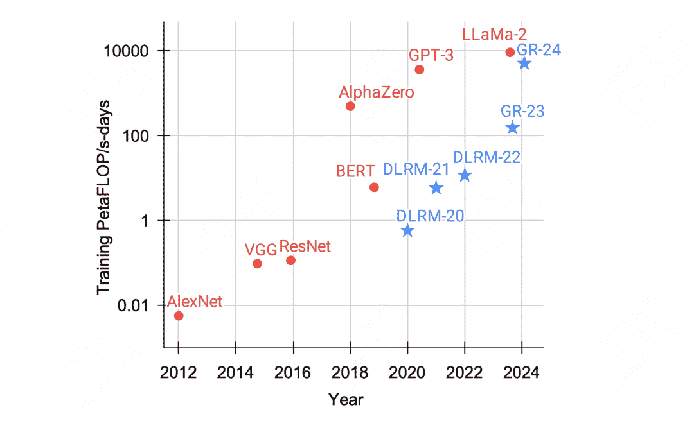

##  **Solution **

Solution的关键在于作者如**何重塑推荐系统问题**，技术细节反而是其次，且技术点可能在很多工作中似曾相似，比如NVIDIA2021的工作 Transformers4Rec [2]，但真正从推荐系统角度 抽象新的设计范式 的不多，这也是本文的“亮点”。

在推荐系统问题“ **重塑” **上，有几个核心洞察点：

+   **将“用户行为”当做一种新模态 **：传统非结构化的图片、视频、文本是模态；结构化的画像、属性也是模态；将用户行为定义为“新模态”，就能够实现海量词表所有模态间的充分交叉，无损信息输入。是这篇工作抽象出来最妙的点之一。

+   在给定合适的特征空间下，能够重塑推荐系统核心召回、核心排序问题 ：如何将传统海量的异构特征做转换，转成生成式任务输入格式也是非常基础非常重要的步骤。本文方案也有可能成为生成式推荐系统“标配”的输入范式。

+   **在**这一新范式下，能够让我们系统性地解决传统推荐系统中的特征冗余、计算冗余、推理冗余等关键性能瓶颈问题： 节省大量的计算资源和耗时，提升整体推荐系统的效率。例如，相比传统推荐系统分层架构给多个候选打分，新范式在多个候选集打分时能复用算力，实现1次推理同时预估所有候选items。节省下来的算力给到大模型1次更复杂的推理。整体系统耗时不一定会上涨。这也是工业界落地所亟需的。本文方案回答了困扰我们很久的问题，即：大模型在推荐系统的性能问题该怎么解决：在传统工程架构下叠加大模型能力肯定无法落地，但在新架构新范式下，是有可能实现整体系统层面耗时的摊销。

**上述3个核心洞**察，**能够实现推荐系**统的**scali**ng，解决传统推荐系统 海量异构特征 、 海量动态词表 、 计算瓶颈 这三个方面工业级难题。

+   **海量异构特征 **：通过给定适当的 **新特征空间， **将核心排序和检索任务转化为生成建模问题。

+   **海量动态词表 **：通过自回归建模、Transformers架构定制、采样优化等实现海量动态词表间高阶信息交互和提取。

+   **计算瓶颈 **：通过稀疏性优化、内存优化、算子融合、候选集算力复用和计算摊销来实现高吞吐、低时延。

下面分别围绕这3个方面展开介绍Solution："统一的特征空间"、"重塑召排问题"、"新Encoder架构HSTU"、"性能加速优化"。然后具体分析实验部分(Evaluation)并做总结(Conclusion)。

###  **统一的特征空间 **

**关键问题 **：如何将海量异构特征进行统一适配，作为GRs的输入？Unifying heterogeneous feature spaces in DLRMs。

现**代推荐系统通常在**海量稀疏类别型特征(sparse)和稠密型数值特征(dense)上训练。在GRs中，作者将这些特征统一编码进 时间行为序列中 ，如下图所示。

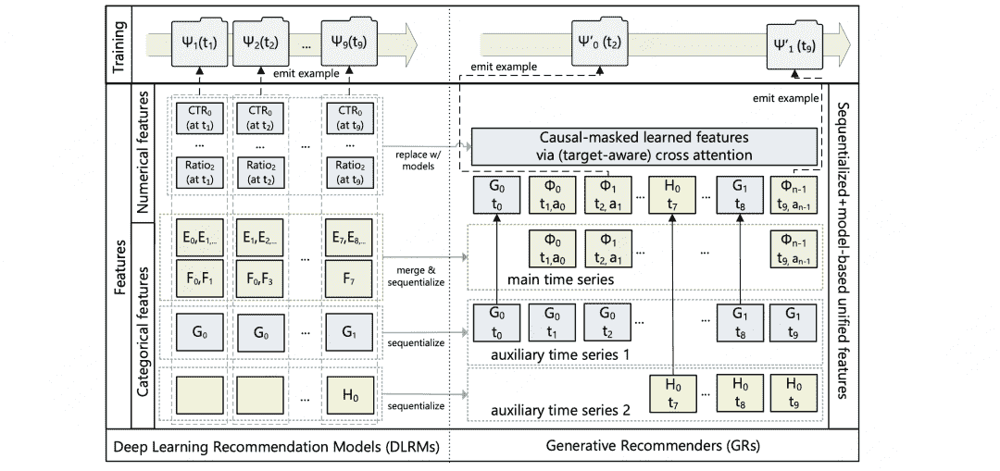

+   **类别型(稀疏)特征 **：如用户喜欢的item、品类、用户使用的语言、用户加**入的社群、发起请求的城市等。首**先，选择** 跨度**最长的序列作为**主时间序列 ，**通过 合并 用户交互的i**tem特**征来实现(We first select the longest time series, typically by merging the features that represent items user engaged with, as the main time series)。如上图右侧中间部分，main time series通常由交互的item构成，包括交互itemID、时间戳、行为类型等。辅助aux time series通常是随着时间缓慢变化的特征构成，如用户的人口统计学信息或已关注的作者等，会对aux时间序列做压缩，只保留 每个连续片段 的最早记录，然后将结果 合并到 主时间序列中，比如：图中aux time series 1 左侧3个连续行为保留第一个插入main series的最左端，这种方法不会显著增加整体序列的长度。

+   **数值型(稠密)特征 **：如user-item topic**的历史统计点击率特征。与分类**特征相比， 这些特征的变化频率要高得多 ，可能会**随着每个（用**户，**物品）交互**而发生变**化。因此，**从计算和存储的角度来看，将这些特征 完全序列化 是 不可行的 。然而，一个重要的洞察是，这类聚合统计特征，可以被大规模长序列建模所替代，通过直推式序列架构(sequential transduction architecture)以及目标感知(target-aware)的建模方式，也能捕捉和编码好用户兴趣，并且随着序列长度和计算量的增加，这种信息捕捉得会越好，意味着不需要显式数值统计类特征。这也是典型的 两个门派 ，长序列DNN端到端建模 VS 手动特征工程。海量样本/高频消费场景+长序列建模架构，是有可能更泛化地捕捉用户兴趣；反之，在规模不足的场景下，这类特征工程仍然是有必要的。现实中能达到前者要求的场景不多。

也就**是说，为了统一**海量的异构特征，作者将用户所有的正负反馈行为组织成序列，这个序列中既包括itemid、userid、也包括稀疏特征、交互行为类型等，摒弃了数值型特征，构造成生成式建模所需要的 统一输入格式 。

但这里也有很多疑问待解答，序列长度太长时，随时间缓慢变化的重要user/item类别特征信息做了去重，信息损失如何？没有考虑多模态非结构的特征(文本/图片等)建模，也有一些信息损失。

###  **重塑召排建模 **

本部分主要介绍2个方面内容：重定义召回和排序任务、Transformers架构定制。

####  **问题形式化 **

**关键问题 **：如何用生成式框架来重新定义召回和排序任务？Reformulating ranking and retrieval as sequential transduction tasks

> 这里面先引入一个概念transduction，即transductive learning(直推式学习)，相对应的是inductive learning (归纳式学习)[3]：

> 1）归纳式学习是从已有数据中归纳出模式来，应用于新的数据和任务，是我们比较常见的机器学习模式，如传统监督学习。

> 2）直推式学习由当前学习的知识直接推广到给定的数据上，即：首先观察全部数据，包括了训练和测试数据，我们从观测到的训练数据集上进行学习，然后在测试集上做预测。即便如此，我们不知道测试数据集上的标签，我们可以在训练时利用数据集上的模式和额外信息。

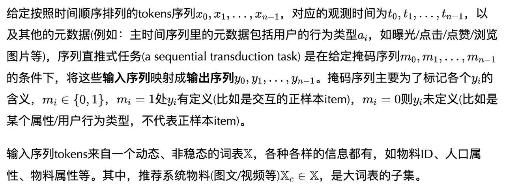

####  **召回任务 **

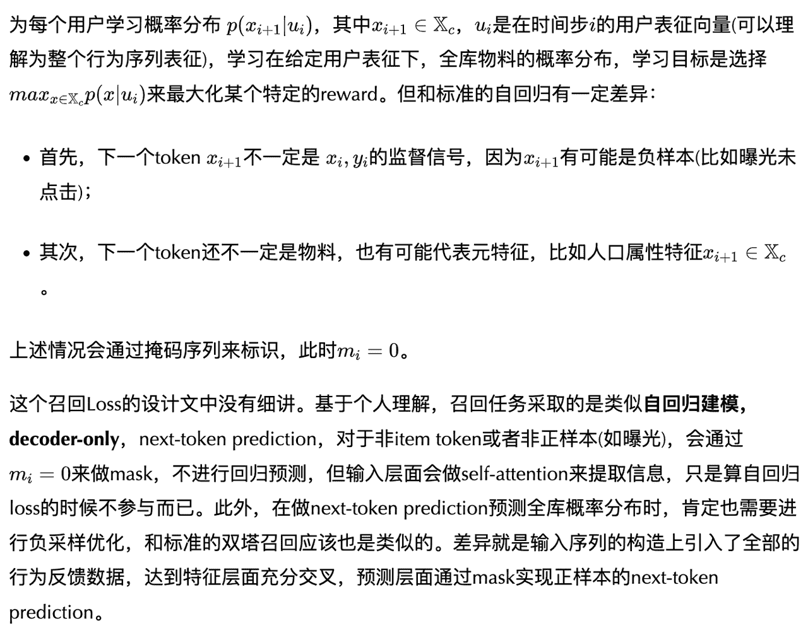

整个用户行为序列加工后的表征可以作为user embedding，最后使用的时候也可以是向量召回形式。这个部分论文实在是讲的太少，理解不对的地方多多指教。也期待作者后续更新arxiv。

####  **排序任务 **

精排通常需**要targ**et-aware的建模，即：将待预测的item和用户历史行为等做交叉，且要在深度模型底层更早地做交叉，而不能到深度模型输出侧才做交叉，那样效果大打折扣。在标准的自回归设定下，交叉只能在encoder输出后接softmax层进行，无法在encoder内部底层提早做交叉，效果上大打折扣。为了解决这样的问题，一种思路是对encoder的输入序列做改造，来实现底层交叉的目的。作者通过在序列上 交错插入 item和action来实现(We address this problem by interleaving items and actions in the main time series.)。也就是前文提到的将action当做是一种新模态，实现历史各种行为和target的充分交叉。

这个地方仍然没有讲清楚ranking的loss是怎么设计的，此处是否还有自回归？还是只有多目标？还是自回归+多目标。仍然按照个人的理解，ranking任务在content物料位置接多任务tower来实现训练和预测，且特定任务的tower参数应该是所有content位置共享的。个人认为排序中自回归目标不是必须的，但作为辅助目标是可以的。

线上要进行推理的时候，将待预估的候选item和信息插到历史行为序列(怎么插文中没提，比如插到末尾)中进行交叉和预测。历史用户行为序列计算实际上在所有候选items间是可以共享的，因此通过合理组织和“折叠对齐”候选items，是可以实现1次推理，全部候选items的预估(形式上是单次推理，实际上仍然是多次打分，复用了大部分算力)。这点非常香，能节省大量算力和资源。类Transformers架构的精排或重排模型，是有可能实现这一效果的，足够颠覆现有的预估范式。这个方法近期我们在做item维度下子粒度创意预估时有切身感受，通过折叠子候选集来实现算力复用，节省大量算力。

另外，召排的GRs是否有部分共享，还是只是基础架构一样，仍然是2个分开的模型？文中也没有讲这块。从技术实现上，自回归部分是能共享的，排序额外的多目标损失则是多出来的一块。

###  **新Encoder架构HSTU **

关键问题： HSTU相比Transformers有哪些优势 ？

新encoder定位：A High Performance Self-Attention Encoder for Generative Recommendations

为了让GR模型在工业界大规模推荐系统中实现高可扩展性，处理海量非稳态的词表和数据，作者设计了新一代的encoder架构，称为HSTU(Hierarchical Sequential Transduction Unit)。

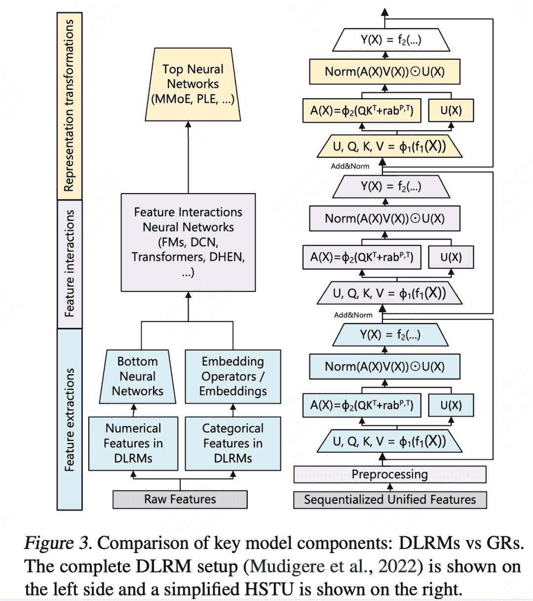

类似Transformers，HSTU堆叠多个层，层与层之间通过残差连接。每个层包含三个主要的子层：pointwise投影层，pointwise空间聚合层和pointwise转换层。

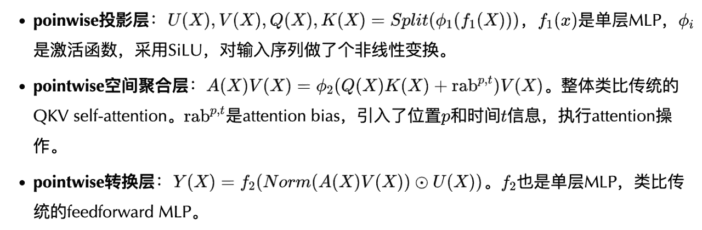

HSTU相比于Transformer，在推荐系统领域的改进点体现在上面3个层：

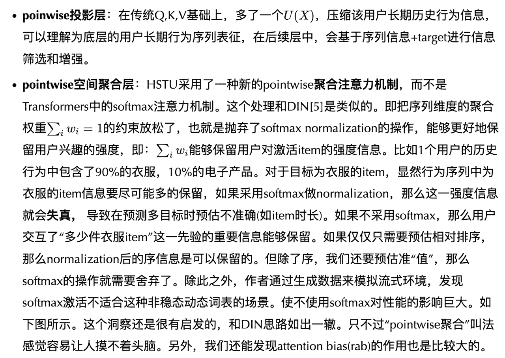

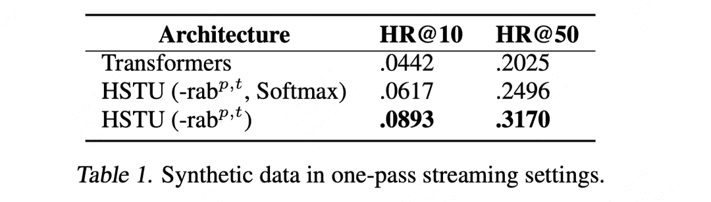

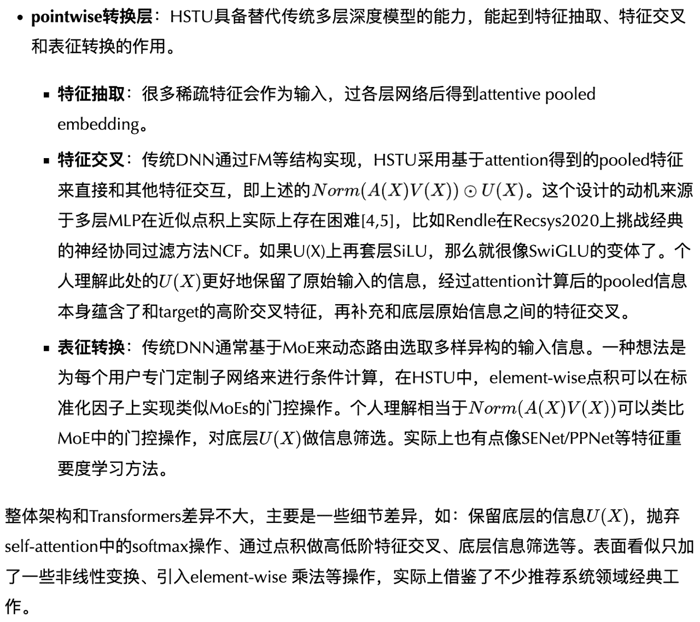

一句话总结， **在**Transformers主体架构下，汲取了DIN、MoEs、SENet等思路，做一些推荐系统领域的适配。

###  **性能优化 **

**关键问题 **：计算复杂度如何？如何在工业级别规模下落地？

涉及大量的在离线训练推理、gpu优化和性能加速等工程实践，有很多技术选型和定制化优化，是工程团队学习不可多得的好资料。

###  **流式训练 **

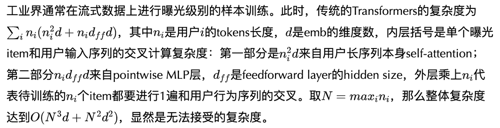

为了实现在长序列上计算的可扩展性，将传统曝光级别的样本训练范式(impression-level trai**ning**)迁移到生成式训练范式，将计算复杂度降到O(N)，如上图所示，通过这种方式，可以将encoder本身的计算成本 摊销到 原本要对所有target-item的训练上。这句话怎么理解？文中没有展开细说，讲讲我的理解，原本的训练是在曝光级别的样本上训练，比如1次请求下收集了20个曝光点击流式样本，那么可以构造20条样本，现在将1次请求下的20个候选doc和用户行为序列组织在一起，1次训练20个候选doc，复用大量算力，摊销了原本多次训练的计算开销。

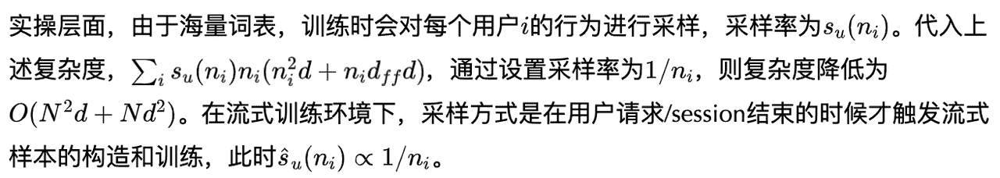

####  **稀疏性优化 **

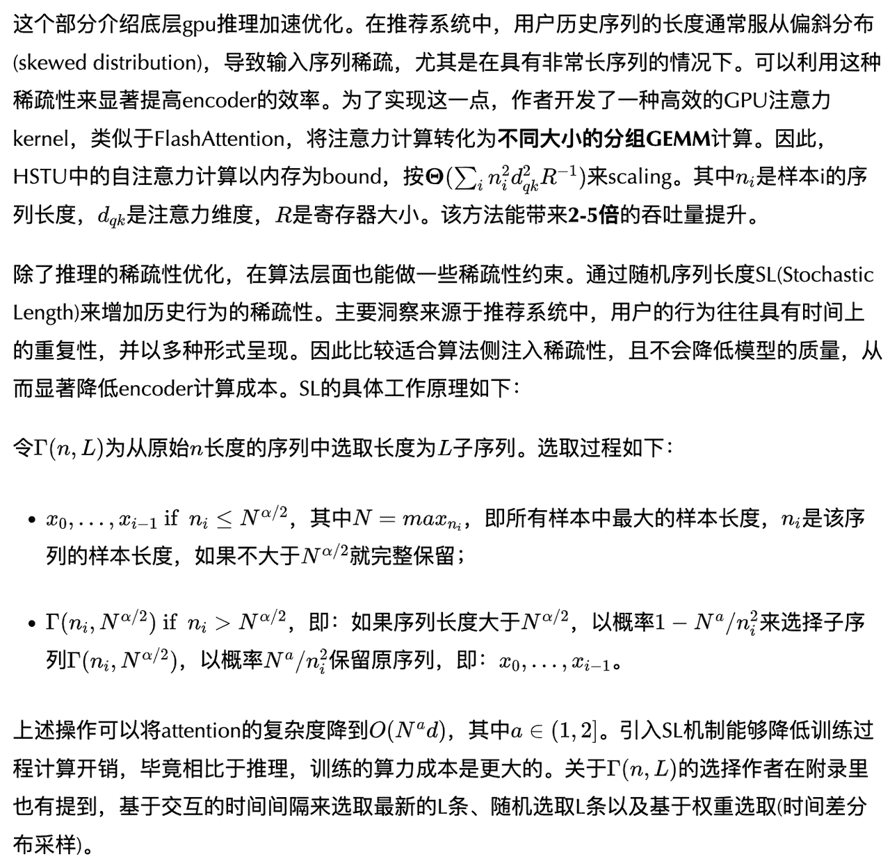

针对Meta用户历史30天规模的样本**。下图展示**了不同序列长度、不**同a**值下的 稀疏比例 (减少的样本量) ， 用蓝色部分标识(具体怎么算没说明清楚)。

+   alpha=2代表没有使用SL；

+   较小的 α 值适用于更长的序列，例如8192上a=16的稀疏性可以达到84.4%，能减少84.4%的训练样本；

+   这些结果有助于评估自监督学习在不同序列长度和 α 值下对模型性能的影响。

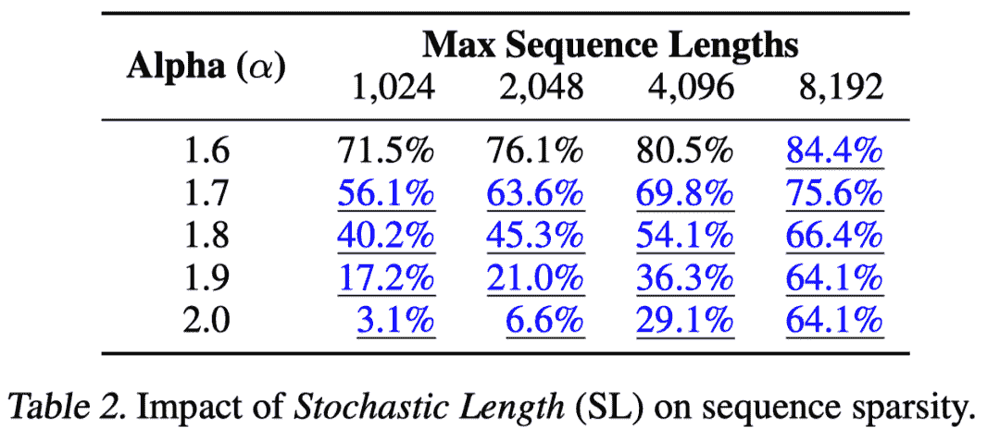

####  **内存优化 **

在推荐系统中，模型的效果/吞吐都和batch size息息相关，因此内存是是实现scaling重要的瓶颈。这和LLM通常在小的batch size上训练很不一样。为了减少内存的使用，与Transformer相比，HSTU采用了一种简化和算子融合的设计，显著减少了内存的使用。

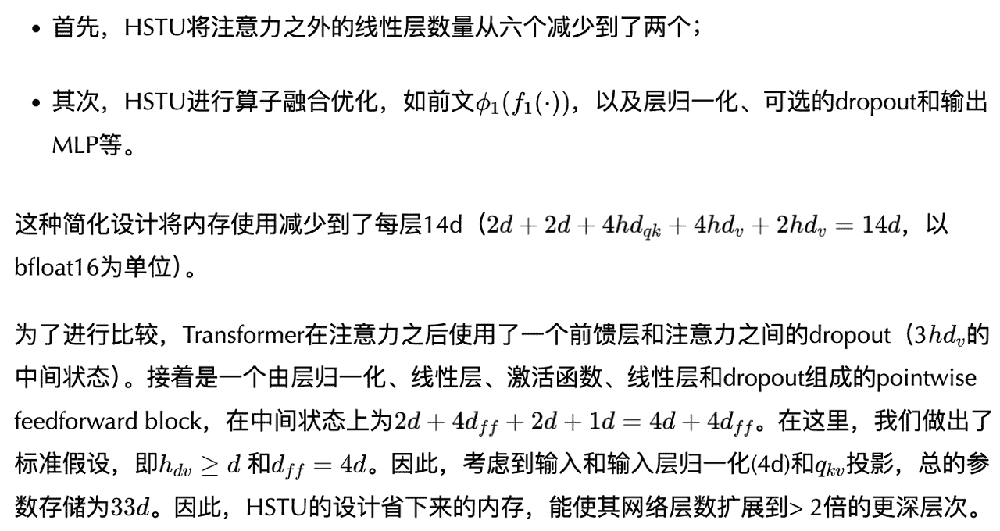

除此之外，词表ID也需要大量的内存使用。对于一个具有10亿量级的词汇表、512维的嵌入向量和Adam优化器，仅仅存储嵌入向量和优化器状态就需要60TB的内存。为了缓解内存压力，Meta采用了 rowwise AdamW优化器 ，并将优化器状态存储在DRAM上，从而将每个浮点数的HBM使用量从12字节减少到2字节。

####  **计算摊销 **

Scaling up inference via cost-amortization

最后一个挑战是推荐系统线上服务时需要推理大量的候选items。召回阶段的encoder成本是可以完全摊销的(向量召回，user维度1次推理即可)，并且已经存在针对MIPS的高效算法，包括基于量化、哈希或分区的方法，以及通过beam search或分层检索等来处理非MIPS的情况。

因此主要关注排序阶段的耗时。在排序阶段，面临着数以万计的候选items。作者提出了一种名为M-FALCON（Microbatched-Fast Attention Leveraging Cacheable OperatioNs）的算法，用于对m个候选项进行1次推理，输入序列的大小为n。顾名思义，通过将输入序列进行微小批次处理，结合快速注意力机制以及缓存操作的利用，M-FALCON算法能够高效地对大量候选items进行推理。

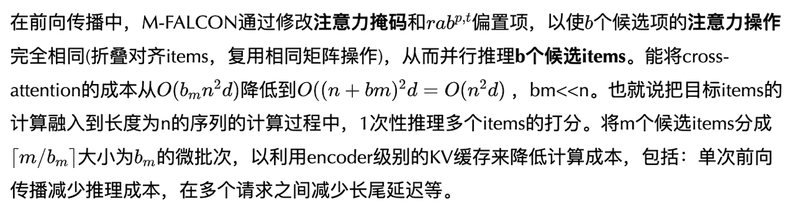

**总体而言，M-FA****LCON使**得模**型的复杂度能够按照 候选**集数量呈线性 关系来scaling。Meta成功部署了一个复杂度高出 285倍 的 目标感知交叉注意力模型 ，并在相同推理算力下，支撑线上1.5倍的吞吐量。

这个优化很牛，也很香，值得算法和工程团队思考。我们近期在做item维度下子粒度创意预估时有切身感受，通过折叠对齐子候选集来实现算力复用，节省大量算力。甚至能更进一步，候选items折叠对齐，复用算力，1次推理同时预估，是大规模scaling的前提。

##  **Evaluation **

###  **公开数据集 **

Movie Lens/Amazon Reviews，采用full-shuffle和multi-epoch training，这个设定不太适配工业界场景(流式+one-epoch training)，作者在文中也做了说明。这部分实验确实不够有说服力，暂时不展开。感觉应该有更合适的大规模序列建模数据，比如KDD CUP 2020 Debiasing、Kaggle Otto 2023、Kaggle H&M2022 比赛等数据，数据规模都算公开数据里较大的。

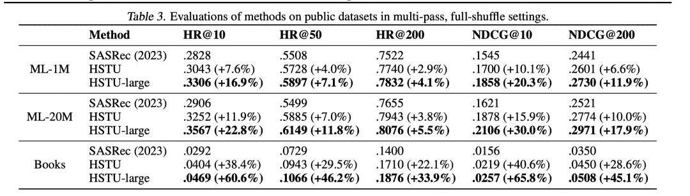

###  **工业界数据集 **

我们重点关注下Meta业务数据上的评测。遵循工业界流式设定。

对于精排任务，采用Normalized Entropy (NE)评估指标(一般排序用GAUC/NDCG等排序指标的比较多，准度指标一般用LogLoss/ECE/PCOC等，此处有些差异)。使用了1000亿条样本（与DLRM相应），每个job使用64-256张 H100 GPU卡，在多任务下评估，主要是engagement任务（“E-Task”）和consumption任务（“C-Task”）。在Meta精排中，NE下降0.001可以认为是显著的，通常会带来线上0.5%的总线指标提升。

对于召回（retrieval）任务，由于设置与语言建模类似，使用“对数困惑度”（log perplexity）评估指标（一般离线仍然采用Recall/HitRate@K评估)

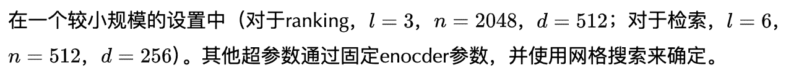

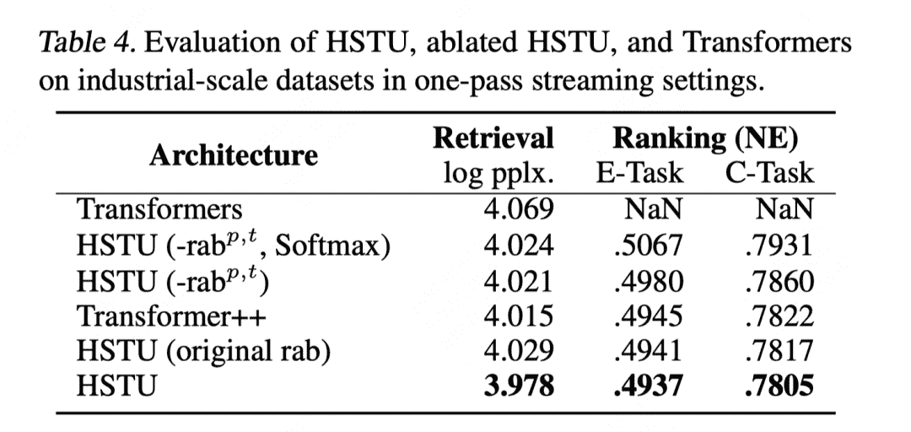

+   HSTU在ranking方面明显优于Transformers，作者认为归功于pointwise注意力机制、引入的注意力偏置。

+   HSTU的消融实验证实了设计的有效性。

+   由于训练的稳定性，softmax操作容易造成问题，作者调参发现基于Softmax的HSTU和Transfo**rmer的最佳学习率比其余模**型低约10倍。但即使采用了更低的学习率和预归一化残差连接，在ranking任务中仍经常遇到 标准Transformer 的损失NaN问题。

+   还尝试了下自家LLaMA中使用的Transformer变体Transformer++(使用RoPE和SwiGLU等)，比标准的Transformer效果好很多。

+   性能上，在小规模的设置中，HSTU能实现1.5x-2x倍更低的时延，且使用的HBM（高带宽内存）资源减少了50%。

整体离线实验还是比较显著的，但是个人认为选取的离线评估指标“不够主流”。不过NE指标离线到线上在Meta的换算比例文中也是明确说明的，从这个角度用NE也没问题。

###  **Encoder性能评估 **

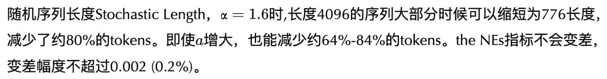

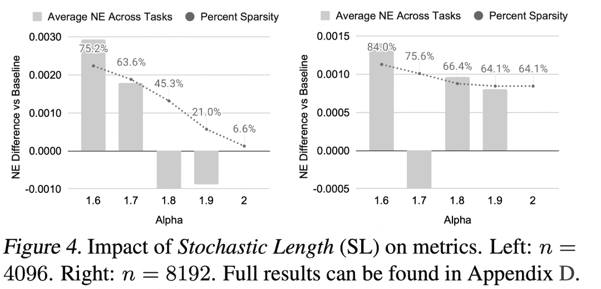

如上图所示，NE变差幅度基本不超过0.002。甚至有些情况下指标还更好(左图alpha=1.8、1.9；右图alpha=1.7的时候)。

下图(a)展示了不同序列长度和alpha下的指标。(b,c) 是相比FlashAttention优化的Transformers，HSTU在训练和推理阶段效率能分别提升15.2x、5.6x倍。此外，由于memory的节省，相比于Transformers，HSTU可以再叠深2层网络。

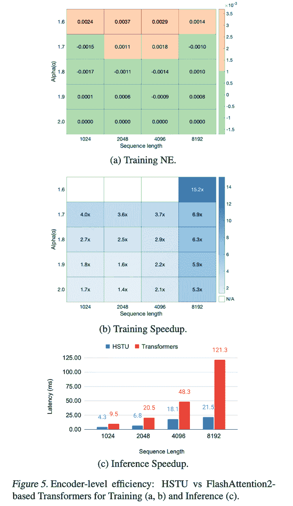

###  **线上实验 **

+   **baseline **：精排：DLRMs，文中写的是SOTA 深度推荐系统模型，由Meta数百人团队在多年间持续迭代的产物。附录里提到采用了1000个dense特征，50个稀疏特征，采用MoE、DCN、DIN，residual connection等技术。召回：双塔模型，in-batch and out-of-batch采样，输入特征包括id、稀疏特征等。通过残差连接MLP将输入压缩成user和item表征。

+   **exp **: 本文的GRs模型。精排和召回各一个。

**上述精排**baseline没有用 SIM 是容易被质疑的点之一，按照国内大厂的经验，直接升级到SIM也能带来10%+的指标提升。不过作者有强调test时，exp使用的序列长度是比base短的，能够一定程度解释不是由序列变长带来的提升。期待后续更多补充信息。

作者同时评估召回和排序的指标。对于召回，线上通常使用多路召回，作者同时报告了新增一路GR召回、以及替换下现有主要召回路的在线指标。GR不仅在离线环境下显著优于DLRMs，而且在在线A/B测试中带来了显著提升。

+   召回：相比于DLRM，新增一路GR，E任务能带来6.2%的提升，C任务带来5.0%的提升。如果替换DLRM，整体E任务提升5.1%，C任务提升1.9%。

+   排序：相比于DLRM，E-Task提升12.4%，C-Task提升4.4%。提升效果比召回侧更显著。

**召排整体加起****来E任务最**大提升幅度为 18.6% (12.4%+6.2%)；C任务最大提升幅度为 9.4% (4.4%+5.9%)。

作者还做了一些比较有意思的实验来证明GR的性能：

+   **传统DLRM里用了大量**的特征，如果把 DLRM的特征做消融 ，仅仅保留GR里用到的那些，那么模型效果会大打折扣，看离线指标降了很多。一方面说明传统DLRM没有特征不行，另一方面表明了新架构的优势。

+   在GR中如果仅考虑 **用户交互过的items **(interactions-only)，效果也会下降不少，但仍然好于DLRM。这里交互过的items，我的理解就是只关注用户的正样本行为，不考虑**负样本，比如曝光**未点击之类的不作为序列构成，这是大部分序列建模的方式。很可能DLRM base里也没有引入负反馈序列等，GR引入这些行为，除了本身建模能力强， 输入信息的增强 也可能是潜在提升点之一。

+   在GR中只考虑item的属性(content-based)，召回效果奇差，比baseline也低不少，说明用户行为中蕴含的高基数、高阶信息建模的重要性。

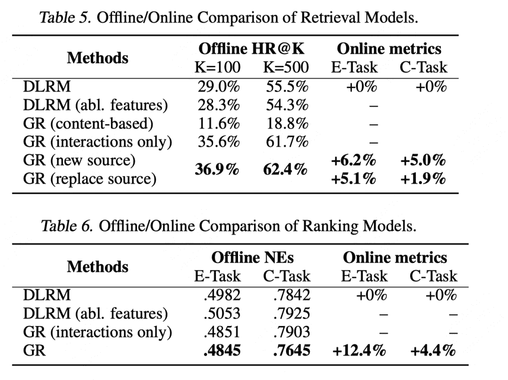

最后，作者还对比了GR相比于基线的线上推理性能。即使模型复杂度相比于基线高了285倍，当候选打分量级在1024时，能实现1.5x的吞吐，在候选打分量级在16384时，能实现2.48倍的吞吐。主要归功于HSTU的encoder设计以及M-FALCON算法。

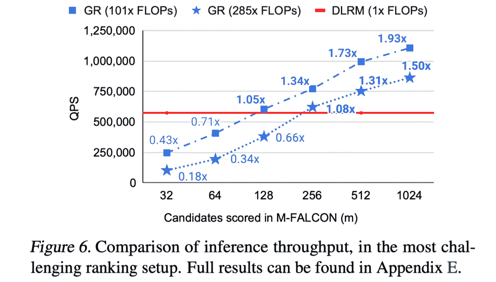

###  推荐系统的Scaling Law

最后讨论下推荐系统的scaling law。

在大规模工业环境中，DLRMs在特定的计算和参数配置情况下会达到质量饱和点。为了更好地理解这一现象，作者对GR和DLRMs的可扩展性进行了比较。

+   DLRMs的scaling：特征交叉层非常重要，作者尝试Transformers、DHEN、DCN等多种特征建模方法来scaling精排。对于召回的scaling，由于采用了残差连接，所以主要在hidden size，embedding dimension，layer层数等方面做scaling。

+   GRs的scaling：调整HSTU的超参数，包括残差层数、序列长度、embedding dim, attention heads数量。对召回而言，还额外调整了负样本的个数。

GRs表现出来了更强劲的scaling能力。在参数高达1.5万亿(1.5 trillion parameters)时还能scaling。而DLRMs在参数达到2000亿的时候性能就开始下降。但个人感觉上述设定不是特别公平，DLRMs里的序列长度、attention head数量、表现更好的特征重要度组件等没有做调整吗？

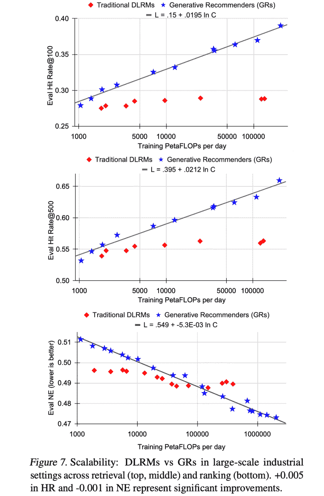

最后**，作者还研究了GRs** Scaling能力，即：推荐指标随模型规模/算力的变化情况。包括召回关注的Hit Rate@100和Hit Rate@500，以及排序关注的NE指标，与计算量呈现出 幂律scaling 趋势。作者在三个量级上做了该观测，最大的模型达到序列长度为8,192，嵌入维度为1,024，HSTU 24层。此时年归一化的总计算量接近于GPT-3和LLaMA2，见开篇的图。

不同于LLMs， **序列长度对GRs来说更重要。 **更长的序列能够捕捉更多的上下文和依赖关系，从而表现更好。因此在可能的情况下，扩大序列长度是很重要的。通过序列长度、embedding 维数等能够实现GRs模型的scaling。

这也是本文最核心的贡献，作者首次展示了从LLMs中得出的Scaling Law同样适用于大规模推荐系统，并能成功落地。

##  **Conclusion **

最**后做个总结**，作者提出了统一的生成式推荐模型(GR)，“行动胜过言语”。效果炸裂，属于推荐系统Scaling开创性工作，为探索推荐领域的首个 基础模型 铺平道路。

+   **效果上 **：在**传统公开测试**集、工业界真实流式数据上均取得了显著的提升，相比经典的SASRec提升20.3%~65.8% NDCG@10，相比于迭代数年的DLRMs基线模型，线上召排阶段相对提升达到18.6%。第一次在 核心产品线 替换掉了近十年推荐工业界长期使用的 传统海量异构特征的深度推荐模型 ；

+   **推理上 **：新的推理算法M-FALCON达成了推理侧700倍加速(285倍复杂模型，2.48x推理QPS)；

+   **Scaling Law **：模型参数量高达万亿，计算量提升1000x，第一次达到GPT-3 175b/LLaMa-2 70b等LLM训练算力，且第一次在推荐模态观测到了语言模态的scaling law。

除此之外，作者对本文工作意义做了进一步升华：

+   **通过减少推荐、****搜索和广告**系统对 大量异构特征 的依赖，可以使这些系统在改善用户体验的同时更加注重 隐私保护 。

+   传**统的推荐系****统往往是基**于用户的短期行为和偏好来生成推荐结果， 这可能导致用户被推送与其长期目标不一致的内容 。然而，通过使用全序列建模的方法，推荐系统可以考虑到用户的短期决策对其长期结果的影响。这种方法可以将用户的 长期目标 纳入推荐算法中，更准确地为用户提供符合其 长期目标 的内容，减少传播点击诱导和虚假内容。系统可以更加重视用户的长期利益和目标，筛选出真实、有价值并与用户价值相符的内容。

+   此**外，这种方法还可以****更好地将平台的激励与用户价值**相一致。传统的推荐系统常常通过最大化点击率或广告收入来优化自身。然而，通过将用户的 长期目标纳入考虑 ，推荐系统可以更好地满足用户的真实需求，提供有价值的内容，并 更好地与用户的价值观相契合 。

+   最后，基础模型和scaling定律的应用可以帮助减少推荐、搜索和相关使用场景所需的模型研究和开发所带来的碳足迹。有助于使模型开发更加可持续发展。

**最后说说我的看法，整体上，是今**年看到的 第一篇震撼性推荐系统领域好文 ，干货很多，虽然小部分技术细节的交代/实验设定上有一些瑕疵，但工作的核心贡献和影响力预计不小。

既不是对传统推荐系统范式直接颠覆，完全替代分层架构；也不是只在传统推荐范式上引入LLMs的能力小打小闹的改进。整体工作还是融合了传统推荐系统分层架构和算法设计特点、LLMs中Transformers Scaling优势：

+   特征空间：统一，取与舍；

+   模型建模：直推式序列建模，Transformers基础上，融入推荐系统DIN/MoE/SENet等主流设计做结构定制，简洁干净；

+   目标损失：自回归损失+主流多目标损失；

+   推理加速：序列直推式范式下，多个候选集打分之间复用算力，随着候选集线性scaling。包括采样、稀疏优化、算子融合、内存优化等也是大规模落地必不可少的环节。

最后，文章花了很多时间来啃，很多细节的推测有可能不准确，欢迎大家多多批评指正。

**搜广推下一个增长点在哪 **？期待Meta以及更多大厂的新工作。

##  **References **

[1] 如何评价Meta最新的推荐算法论文：统一的生成式推荐第一次打败了分层架构的深度推荐系统？https://www.zhihu.com/question/646766849/answer/3417573481

[2] de Souza Pereira Moreira G, Rabhi S, Lee J M, et al. Transformers4rec: Bridging the gap between nlp and sequential/session-based recommendation[C]//Proceedings of the 15th ACM conference on recommender systems. 2021: 143-153.

[3] 如何理解 inductive learning 与 transductive learning? https://www.zhihu.com/question/68275921/answer/529156908

[4] Rendle, S., Krichene, W., Zhang, L., and Anderson, J. Neural collaborative filtering vs. matrix factorization revisited. In Fourteenth ACM Conference on Recommender Systems (RecSys’20), pp. 240–248, 2020. ISBN 9781450375832.

[5] Zhai, J., Gong, Z., Wang, Y., Sun, X., Yan, Z., Li, F., and Liu, X. Revisiting neural retrieval on accelerators. In Proceedings of the 29th ACM SIGKDD Conference on Knowledge Discovery and Data Mining, KDD ’23, pp. 5520–5531, New York, NY, USA, 2023a. Association for Computing Machinery. ISBN 9798400701030. doi: 10. 1145/3580305.3599897. URL https://doi.org/ 10.1145/3580305.3599897.

[6] Zhou G, Zhu X, Song C, et al. Deep interest network for click-through rate prediction[C]//Proceedings of the 24th ACM SIGKDD international conference on knowledge discovery & data mining. 2018: 1059-1068.