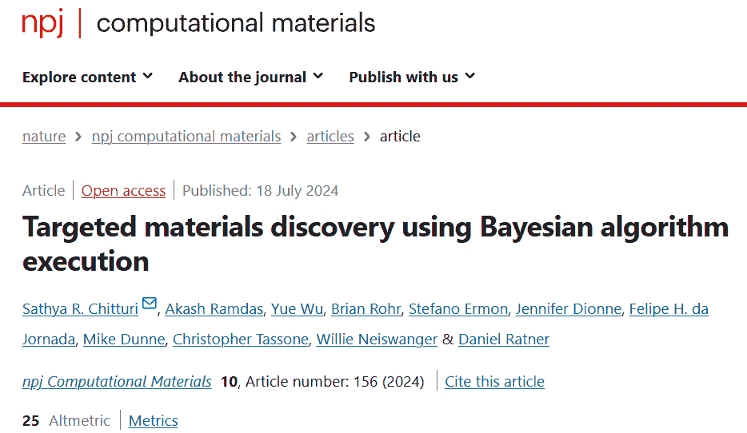
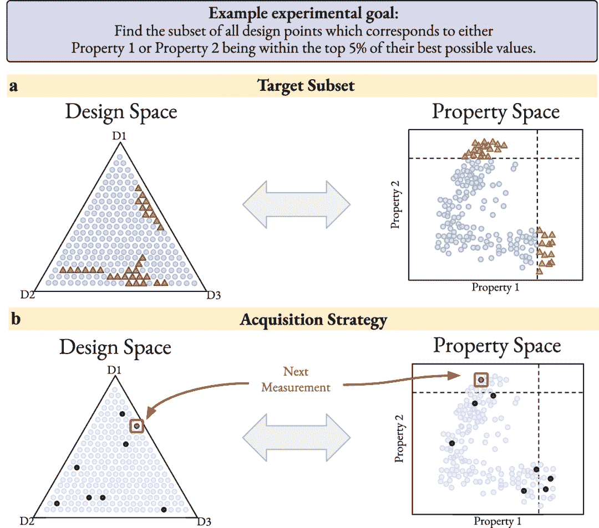
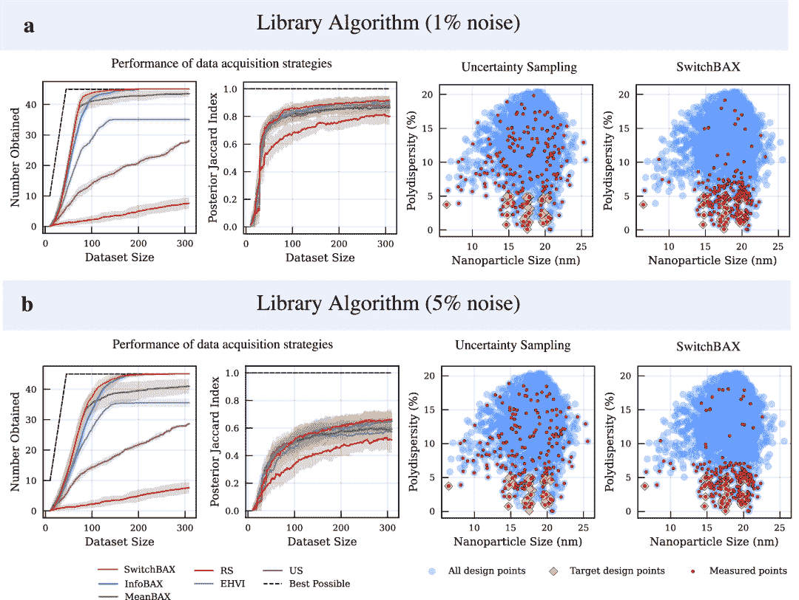
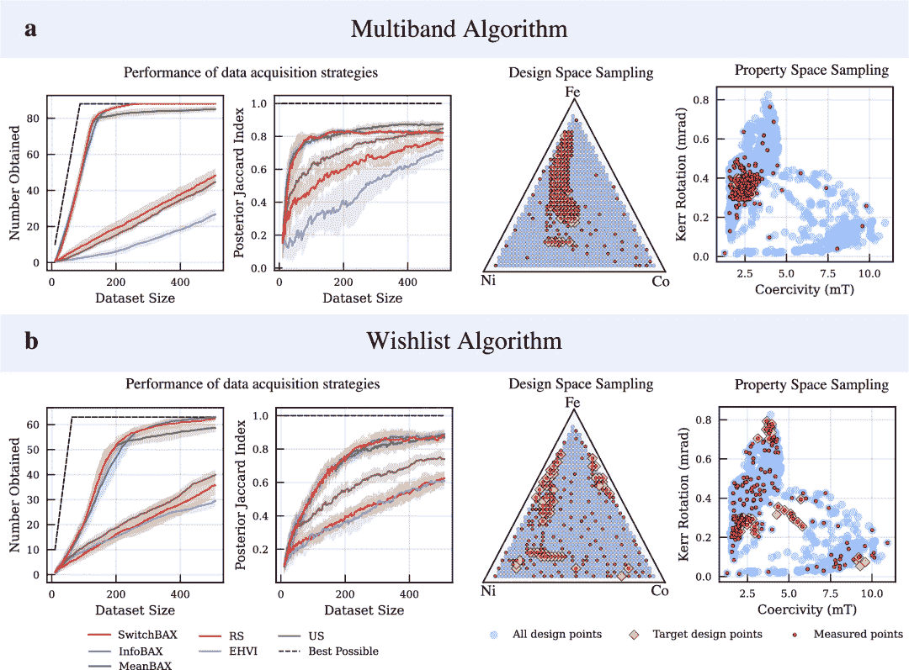

# 斯坦福 AI 方法加速目标材料发现，为「自动驾驶实验」奠定基础

> 来源：[https://agijuejin.feishu.cn/docx/KTT0dYQisoeiRhxuo7RcNXotnYe](https://agijuejin.feishu.cn/docx/KTT0dYQisoeiRhxuo7RcNXotnYe)

> 机器之心 ScienceAI｜[阅读原文](https://www.jiqizhixin.com/articles/2024-07-29-8)

> 转载请联系原作者取得授权

编辑 | KX

传统的材料发现过程既耗时又成本高昂。可能的材料空间也非常大，仅由四种元素组成的材料就有超过 100 亿种可能性，对于制药应用而言，挑战更大，大约有 10^60 种可能的类药分子。

斯坦福大学和美国能源部 SLAC 国家加速器实验室的科学家们，开发了一种 AI 方法，有助于在寻找新材料时更有效地收集数据，使研究人员能够以更高的精度和速度应对复杂的材料设计挑战。

研究人员提出了一个框架，通过简单的用户定义过滤算法来捕获实验目标。这些算法会自动转换为三种智能、无参数、顺序数据采集策略（SwitchBAX、InfoBAX 和 MeanBAX）之一，从而绕过了耗时且困难的任务特定采集函数设计过程。

研究人员在 TiO2 纳米粒子合成和磁性材料表征的数据集上证明了这种方法，表明该方法比最先进的方法效率高得多。

该研究为「自动驾驶实验」奠定了基础。新方法还可以快速发现新材料，这些材料可能在气候变化、量子计算和药物设计等领域大有可为。

相关研究成果以「 Targeted materials discovery using Bayesian algorithm execution 」为题，于 7 月 18 日发布在《 npj Computational Materials 》上。

论文链接： https://www.nature.com/articles/s41524-024-01326-2

快速发现和合成未来材料需要智能数据采集策略来导航大型设计空间。一种流行的策略是贝叶斯优化，旨在找到最大化材料性能的候选物；然而，材料设计通常需要找到满足更复杂或更专业目标的设计空间的特定子集。

智能顺序实验设计已成为一种快速搜索大型设计空间的有前途的方法。与经典技术（如析因实验设计）相比，顺序方法使用在每个步骤收集的数据来减少找到最佳设计所需的总实验次数。

当前的方法通常涉及两个部分：（1）经过训练的概率统计模型，用于预测设计空间中任何一点的可测量属性的值和不确定性；（2）「采集函数」，它为设计空间中的每个点分配相对数值分数。在这种模式下，测量是在采集值最高的设计点进行的。

无论模型的准确性如何，智能数据采集策略都会受到采集函数相关性的限制，即采集函数与用户的实验目标的契合程度。

在该研究中，研究人员专注于自动创建自定义采集函数以针对特定实验目标的问题。具体来说，研究人员将考虑寻找设计空间中满足用户定义的测量属性标准的「目标子集」的任务。

图示：示例实验目标的指定及其转化为自动数据采集策略。（来源：论文）

在此，研究人员提出了一个用于构建采集函数的框架，该框架可以精确定位与实验目标相对应的设计空间子集。用户通过算法程序定义他们的目标，如果已知底层映射，该程序将返回设计空间的正确子集。该算法会自动转换为可以指导未来实验的采集函数，无需为特定应用设计复杂的采集函数。

具体来说，研究人员调整了基于信息的贝叶斯算法执行 (InfoBAX) 和 Multipoint-BAX 来处理材料科学场景，其特点是离散设计空间和多属性测量。

其次，开发了一种使用模型后验的探索策略的多属性泛化，称之为 MeanBAX。观察到 MeanBAX 和 InfoBAX 分别在小数据和中数据范围内表现出互补的性能。为此，还设计了一种无参数策略，称为 SwitchBAX，它能够在 InfoBAX 和 MeanBAX 之间动态切换，在整个数据集大小范围内表现良好。

对于这三种方法，研究人员为科学家提供了一个简单的开源界面，以清晰而简单地表达复杂的实验目标，实现针对材料估算问题定制的各种自定义用户定义算法，并重要的是，评估 BAX 框架是否适合指导实际材料实验。

研究人员在纳米材料合成和磁性材料表征的各种自定义目标上测试了他们的方法。结果表明，他们的方法比现有技术效率高得多，尤其是在复杂场景中。

对于纳米粒子合成示例，实验目标为确定合成条件以开发单分散纳米粒子库。就 Number Obtained 而言，BAX 策略明显优于目标无关的采集函数（RS 和 US），该结果强调，将实验目标纳入数据采集过程可以使实验测量序列更有针对性、更有效。

图示：针对寻找单分散纳米粒子库这一具体目标设计获取策略。（来源：论文）

对于磁性材料数据集（真实实验测量），引入了两个任务：多波段和愿望清单估计。同样，与 RS、US 和 EHVI 相比，BAX 采集函数在 Number Obtained 方面表现良好。此外，BAX 策略在 Posterior Jaccard Index 指标上表现出色。

图示：为寻找满足多波段和愿望清单目标的三元组合这一具体目标设计采集策略。（来源：论文）

领导该研究的 SLAC 和斯坦福大学博士生 Sathya Chitturi 说：「我们的方法允许你指定复杂的目标，从而实现在大型设计空间上的自动优化，这增加了发现新的、令人惊叹的材料的可能性。贝叶斯算法执行框架让你以一种简单的方式捕捉材料设计任务的复杂性。」

例如，设计具有特定催化特性的材料的能力可以改善化学过程，从而以更高效和可持续的方式制造商品和材料，减少能源消耗和浪费。在制造业中，新材料可以增强 3D 打印等工艺，实现更精确和可持续的生产。在医疗保健领域，量身定制的药物输送系统可以改善治疗剂的靶向性和释放，提高疗效并减少副作用。

「通过将先进的算法与有针对性的实验策略相结合，我们的方法使发现新材料的过程变得更容易、更快捷，」合作者、斯坦福同步辐射光源 (SSRL) 材料科学部主任 Chris Tassone 说。「这可以在许多行业带来新的创新和应用。」

参考内容： https://phys.org/news/2024-07-ai-approach-materials-discovery-stage.html

注：封面来自网络