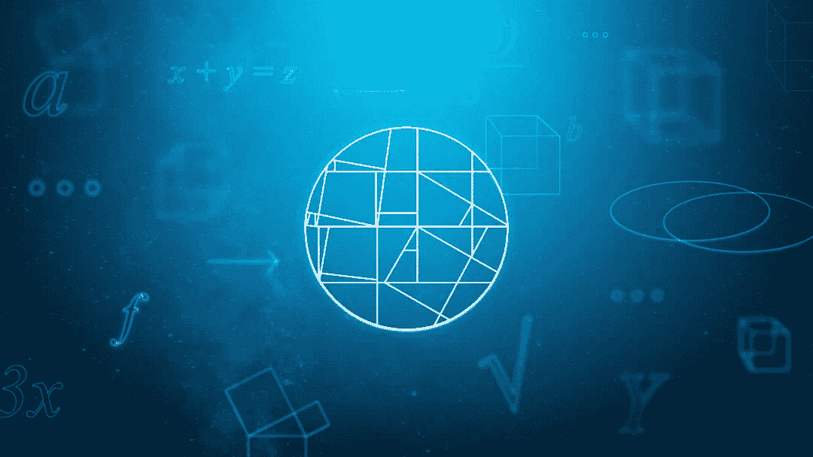
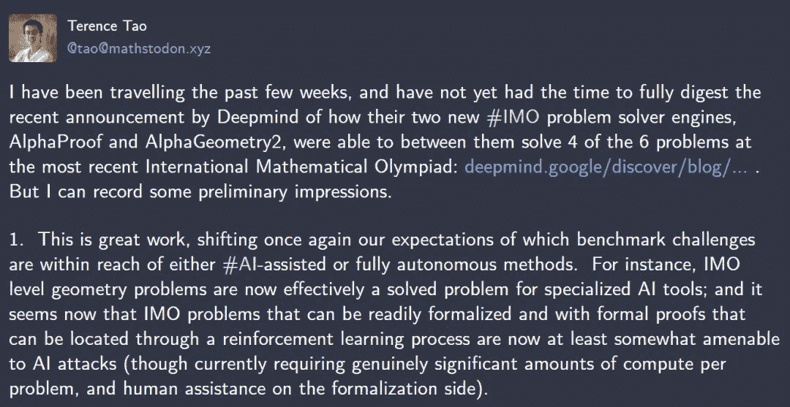
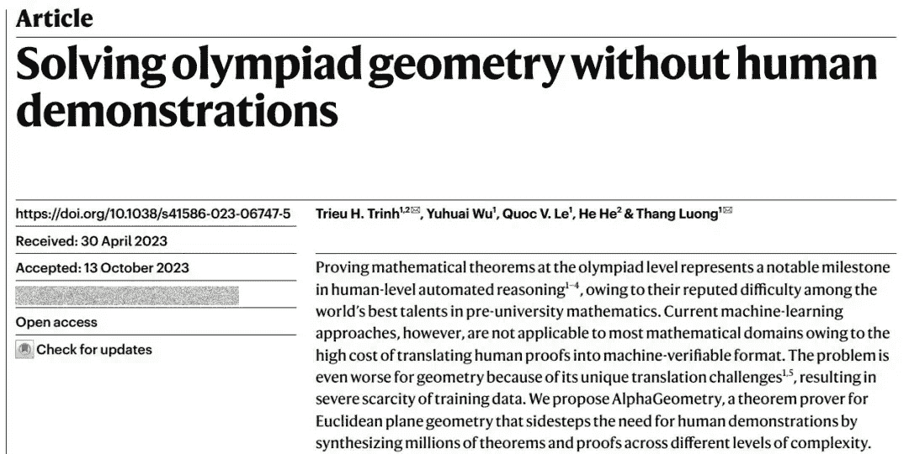

# 陶哲轩点评谷歌AlphaProof：AI在数学竞赛中展现「超凡智慧」

> 来源：[https://agijuejin.feishu.cn/docx/B0VcdkIWbo7BpFxmUtKckEDynYc](https://agijuejin.feishu.cn/docx/B0VcdkIWbo7BpFxmUtKckEDynYc)

> 机器之心｜[阅读原文](https://www.jiqizhixin.com/articles/2024-07-28-2)

> 转载请联系原作者取得授权

在奥数问题面前，AI 的「智商」往往不太够用。

不过，这已经是过去式了。 [谷](http://mp.weixin.qq.com/s?__biz=MzA3MzI4MjgzMw==&mid=2650927541&idx=1&sn=8bf134f825ae3e3a4f08134d3dafe8d1&chksm=84e435cbb393bcdd2a6d0a7dbcf0b3ba3564bdf120c499649e50e609f754f7a1931c80ba4acd&scene=21#wechat_redirect)歌 DeepMind 用 AI 做出了今年国际数学奥林匹克竞赛 IMO 的真题，并且距拿金牌仅一步之遥。 对于 AI 来说，奥数不再是问题了。

IMO 2024 中六个问题的每一个问题满分为 7 分，总分最高 42 分。 DeepMind 的系统最终得分为 28 分，意味着解决的 4 个问题都获得了满分 —— 相当于银牌类别的最高分。

DeepMind 文章连接：https://deepmind.google/discover/blog/ai-solves-imo-problems-at-silver-medal-level/

常用 AI 辅助证明的数学家陶哲轩近期正处在出差的忙碌中，对问题求解引擎 AlphaProof 和 AlphaGeometry2 还未完全消化。但他在自己的博客上对 DeepMind 的 AI 系统参加 IMO 竞赛这件事表达了自己的看法。

陶哲轩谈到，这是一项非常伟大的工作， 再次改变了我们对哪些 基准 挑战可以通过 AI 辅助或完全自主的方法实现的期望。

例如，IMO 级别的几何问题现在对于专用的 AI 工具来说已基本解决。现在看来，通过 强化学习 过程可以找到形式化证明的 IMO 问题至少在某种程度上可以被 AI 攻克。虽然目前每个问题需要相当大的计算量，并且在形式化方面需要人类的帮助。

在陶哲轩看来，这种方法还有一些「buff 加成」，它能使形式化数学更容易自动化，这反过来可能会促进包含形式化成分的数学研究方法。如果更公开地共享由此产生的形式证明 数据库 ，它可能是一个有用的资源。

这种方法（更多地基于 强化学习 而非大型 语言模型 ，有点类似 AlphaGo 的精神，且强调整体方法）非常聪明，事后来看很有道理。正如「AI 效应」所言，一旦解释清楚，它不会给人一种展示人类智能的感觉；但它仍然是我们 AI 辅助问题解决工具集能力的扩展。

「AI 效应」是指当 人工智能 技术取得进展或解决问题时，人们往往会认为这些成就并不是真正的 人工智能 或者不具备真正的智能。换句话说，一旦某项技术被理解或普及，它就不再被认为是智能的。这种现象表明，人们对 “智能” 的定义和期望会随着技术的进步而不断提高。

[本](http://mp.weixin.qq.com/s?__biz=MzA3MzI4MjgzMw==&mid=2650924595&idx=4&sn=06d4333fca334f0a25e686e8952442b7&chksm=84e4224db393ab5beaa98ac1a78bbd1ce82e94fd5002e49c1b18a7ce620fda0ce2d272f127b6&scene=21#wechat_redirect)月月初，陶哲轩在自己的博客中发布 AI 数学奥林匹克竞赛（AIMO 进步奖）的初步成绩已公布的消息。 其中，获得第一名的是 Numina 的团队。

他在最新博客中表示， DeepMind 的这些新工具无法与最近赢得 AIMO 进步奖的 NuminaMath 模型直接比较。NuminaMath 模型完全自动化且资源效率高出数个数量级，并且采用了完全不同的方法（使用大型 语言模型 生成 Python 代码，以蛮力解决区域竞赛级别的数值答案问题）。这个模型也是完全开源的。这也是非常不错的工作，展示了尝试使用 AI 来辅助或自动化数学问题解决过程的不同部分的多维挑战。

[其实 DeepMind 在数学推理方面有着不懈的努](http://mp.weixin.qq.com/s?__biz=MzA3MzI4MjgzMw==&mid=2650904746&idx=1&sn=d39a3d92078cecbd29bd0fc82560d1da&chksm=84e45cd4b393d5c24747f163fa0338761690447904a1a654aacf2344d7a16d36dfa2ac3ccdb0&scene=21#wechat_redirect)力。 在今年年初，它的 人工智能 算法就已经在数学奥林匹克竞赛（IMO）上取得了重大成绩突破。 论文《Solving olympiad geometry without human demonstrations》向世人介绍了 AlphaGeometry，还登上了国际权威期刊《自然》杂志。专家表示，这是 人工智能 朝着具有人类推理能力方向迈进的重要一步。

论文链接：https://www.nature.com/articles/s41586-023-06747-5

未来 DeepMind 还将带给我们怎样的惊喜，我们拭目以待。

参考链接：https://mathstodon.xyz/@tao/112850716240504978