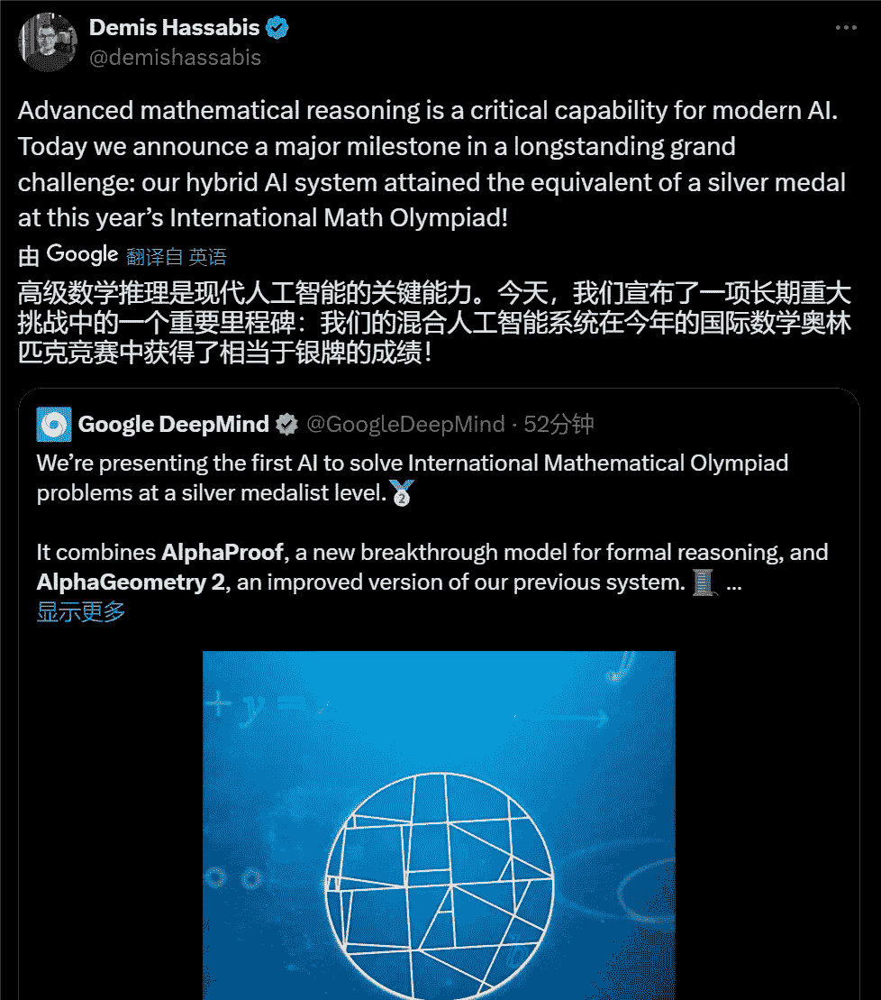
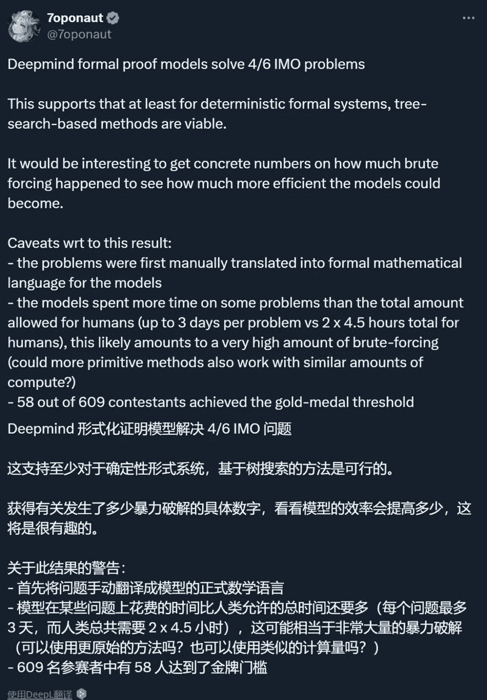
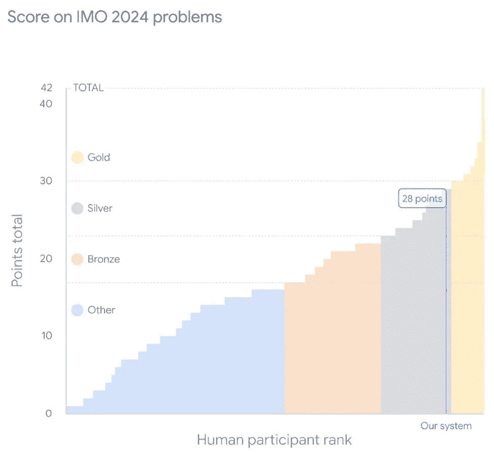
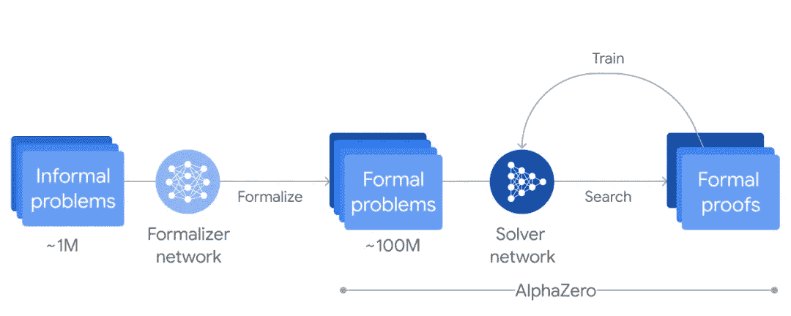
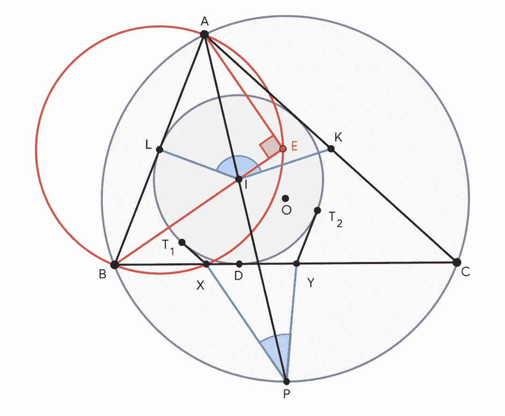
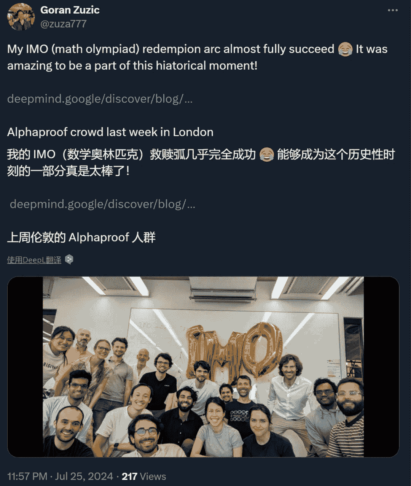
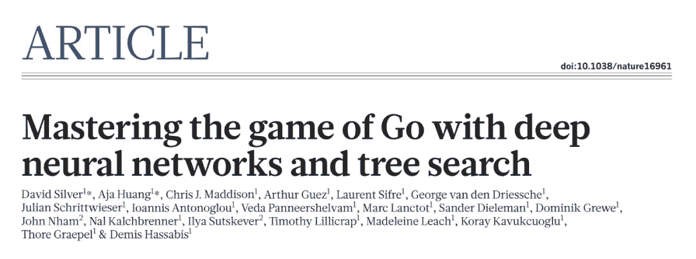
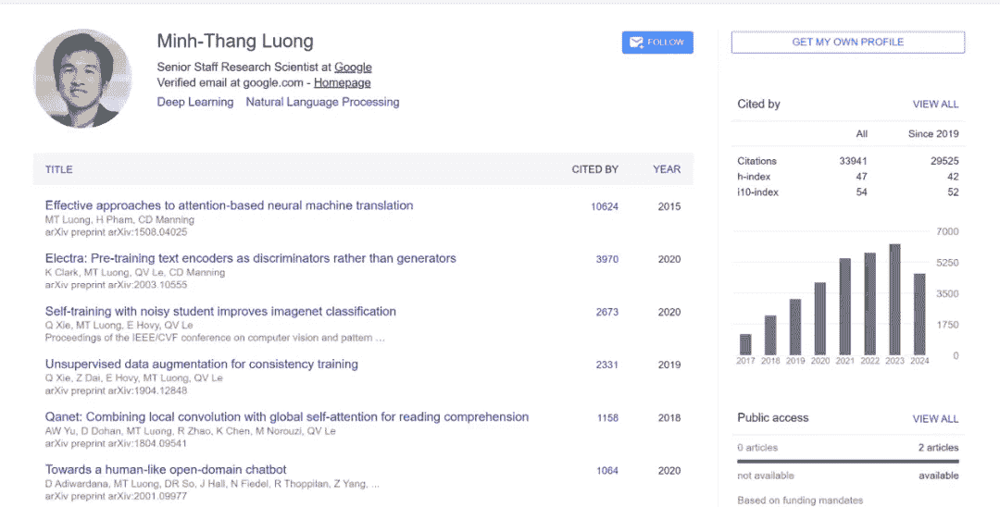

# 谷歌AI拿下IMO奥数银牌，数学推理模型AlphaProof面世，强化学习 is so back

> 来源：[https://agijuejin.feishu.cn/docx/K4A7dkJxKoBGH9xS6THcMgkrnFh](https://agijuejin.feishu.cn/docx/K4A7dkJxKoBGH9xS6THcMgkrnFh)

> 机器之心｜[阅读原文](https://www.jiqizhixin.com/articles/2024-07-26)

> 转载请联系原作者取得授权

对于 AI 来说，奥数不再是问题了。

本周四，谷歌 DeepMind 的 人工智能 完成了一项壮举：用 AI 做出了今年国际数学奥林匹克竞赛 IMO 的真题，并且距拿金牌仅一步之遥。

上周刚刚结束的 IMO 竞赛共有六道赛题，涉及代数、组合学、几何和数论。谷歌提出的混合 AI 系统做对了四道，获得 28 分，达到了银牌水平。

[本月初，UCLA 终身教](http://mp.weixin.qq.com/s?__biz=MzA3MzI4MjgzMw==&mid=2650924595&idx=4&sn=06d4333fca334f0a25e686e8952442b7&chksm=84e4224db393ab5beaa98ac1a78bbd1ce82e94fd5002e49c1b18a7ce620fda0ce2d272f127b6&scene=21#wechat_redirect)授陶哲轩刚刚宣传了百万美元奖金的 AI 数学奥林匹克竞赛 （AIMO 进步奖），没想到 7 月还没过，AI 的做题水平就进步到了这种水平。

IMO 上同步做题，做对了最难题

IMO 是历史最悠久、规模最大、最负盛名的青年数学家竞赛，自 1959 年以来每年举办一次。近来，IMO 竞赛也被广泛认为是 机器学习 领域的一项重大挑战，成为衡量 人工智能 系统高级数学推理能力的理想 基准 。

在今年的 IMO 竞赛上，由 DeepMind 团队研发的 AlphaProof 和 AlphaGeometry 2 共同实现了里程碑式的突破。

其中，AlphaProof 是一种用于形式化数学推理的 强化学习 系统，而 AlphaGeometry 2 是 DeepMind 几何求解系统 AlphaGeometry 的改进版本。

这一突破表明具有先进数学推理能力的通用 人工智能 (AGI) 有潜力开启科学技术新领域。

那么， DeepMind 的 AI 系统是如何参加 IMO 竞赛的？

简单来说，首先这些数学问题被手动翻译成形式化的数学语言，以便 AI 系统理解。在正式比赛中，人类参赛选手分两节（两天）提交答案，每节限时 4.5 小时。AlphaProof+AlphaGeometry 2 组合成的 AI 系统在几分钟内就解决了一个问题，但花了三天时间来解决其他问题。虽然如果严格按照规则来说的话， DeepMind 的系统超时了。有人推测，这里面可能涉及大量的暴力破解。

谷歌表示，AlphaProof 通过确定答案并证明其正确性解决了两道代数问题和一道数论问题。其中包括本次竞赛中最难的问题，在今年的 IMO 上只有五名参赛者解决了。而 AlphaGeometry 2 证明了一道几何问题。

AI 给出的解：https://storage.googleapis.com/deepmind-media/ DeepMind .com/Blog/imo-2024-solutions/index.html

IMO 金牌得主、菲尔兹奖得主 Timothy Gowers 和两届 IMO 金牌得主、IMO 2024 问题选择委员会主席 Joseph Myers 博士根据 IMO 评分规则，对该组合系统给出的解决方案进行了评分。

六个问题中的每一个问题满分 7 分，总分最高 42 分。 DeepMind 的系统最终得分为 28 分，意味着解决的 4 个问题都获得了满分——相当于银牌类别的最高分。今年的金牌门槛为 29 分，正式比赛的 609 名选手中有 58 人获得了金牌。

该图显示了谷歌 DeepMind 的 人工智能 系统在 IMO 2024 上相对于人类竞争对手的表现。在总分为 42 分的情况下，该系统获得了 28 分，达到了与比赛银牌获得者相同的水平。另外，今年 29 分是能拿金牌的。

AlphaProof：一种形式化推理方法

在谷歌使用的混合 AI 系统中，AlphaProof 是一个以形式语言 Lean 来证明数学陈述的自训练系统。它结合了预训练 语言模型 与 AlphaZero 强化学习 算法。

其中，形式语言为形式化地验证数学推理证明的正确性，提供了重要优势。在此之前，这在 机器学习 中的使用一直受限，因为人工编写数据数量非常有限。

相比之下，基于自然语言的方法尽管可以访问更多量级的数据，但会产生看似合理而不正确的中间推理步骤与解法。

谷歌 DeepMind 通过微调 Gemini 模型自动将自然语言问题陈述翻译为形式陈述，在这两个互补领域之间建立了一座桥梁，从而创建了一个包含不同难度形式问题的大型库。

给到数学问题，AlphaProof 会生成候选解题方案，然后通过搜索 Lean 中可能的证明步骤来证明它们。找到并验证的每个证明方案，都用来强化 AlphaProof 的 语言模型 ，增强其解决后续更具挑战性问题的能力。

为训练 AlphaProof，谷歌 DeepMind 在 IMO 比赛前几周内证明或反证明了涵盖广泛难度与主题的数百万个数学问题。比赛期间还应用了训练 loop，以强化自生成竞赛题变体的证明，直到找到完整的解决方案。

AlphaProof 强化学习 训练 loop 过程信息图：约一百万个非形式化数学问题被形式化网络翻译成形式化数学语言。然后，求解器网络搜索问题的证明或反证，通过 AlphaZero 算法逐步训练自己解决更具挑战性的问题。

更具竞争力的 AlphaGeometry 2

[AlphaGeometry ](http://mp.weixin.qq.com/s?__biz=MzA3MzI4MjgzMw==&mid=2650904746&idx=1&sn=d39a3d92078cecbd29bd0fc82560d1da&chksm=84e45cd4b393d5c24747f163fa0338761690447904a1a654aacf2344d7a16d36dfa2ac3ccdb0&scene=21#wechat_redirect)2 是今年登上《自然》杂志的数学 AI AlphaGeometry 的重大改进版本。它是一个神经 - 符号混合系统，其中的 语言模型 基于 Gemini，并在比其前身多一个数量级的合成数据上从头开始训练。这有助于该模型解决更具挑战性的几何问题，包括有关物体运动以及角度、比例或距离方程的问题。

AlphaGeometry 2 采用的符号引擎比上一代产品快两个数量级。当遇到新问题时，新颖的知识共享机制可实现不同搜索树的高级组合，以解决更复杂的问题。

在今年的比赛之前，AlphaGeometry 2 可以解决过去 25 年中所有 IMO 几何历史问题的 83%，而其前身的解决率仅为 53%。在 IMO 2024 中，AlphaGeometry 2 在收到问题 4 的形式化后 19 秒内就解决了它。

问题 4 的示例，要求证明∠KIL 与∠XPY 的和等于 180°。AlphaGeometry 2 提议在直线 BI 上构造点 E，使得∠AEB = 90°。点 E 有助于赋予线段 AB 中点 L 以意义，从而创建许多对相似三角形，如 ABE ~ YBI 和 ALE ~ IPC，以证明结论。

谷歌 DeepMind 还报告说，作为 IMO 工作的一部分，研究人员还试验了一种基于 Gemini 和一种最新的 自然语言推理 系统，希望实现高级的问题解决能力。该系统不需要将问题翻译成正式语言，并且可以与其他 AI 系统相结合。在今年的 IMO 赛题的测试中「显示出了巨大的潜力」。

谷歌正在继续探索推进数学推理的 AI 方法，并计划很快发布有关 AlphaProof 的更多技术细节。

我们对未来充满期待，数学家们将使用 AI 工具探索假设，尝试大胆的新方法来解决长期存在的问题，并快速完成耗时的证明元素——而像 Gemini 这样的 AI 系统将在数学和更广泛的推理方面变得更加强大。

**研究团队**

谷歌表示，新研究得到了国际数学奥林匹克组织的支持，此外：

AlphaProof 的开发由 Thomas Hubert、Rishi Mehta 和 Laurent Sartran 领导；主要贡献者包括 Hussain Masoom、Aja Huang、Miklós Z. Horváth、Tom Zahavy、Vivek Veeriah、Eric Wieser、Jessica Yung、Lei Yu、Yannick Schroecker、 Julia n Schrittwieser、Ottavia Bertolli、Borja Ibarz、Edward Lockhart、Edward Hughes、Mark Rowland 和 Grace Margand。

其中，Aja Huang、 Julia n Schrittwieser、Yannick Schroecker 等成员也是 8 年前（2016 年）AlphaGo 论文的核心成员。8 年前，他们基于 强化学习 打造的 AlphaGo 声名大噪。8 年后， 强化学习 在 AlphaProof 中再次大放异彩。有人在朋友圈感叹说：RL is so back！

AlphaGeometry 2 和 自然语言推理 工作由 Thang Luong 领导。AlphaGeometry 2 的开发由 Trieu Trinh 和 Yuri Chervonyi 领导，Mirek Olšák、Xiaomeng Yang、Hoang Nguyen、Junehyuk Jung、Dawsen Hwang 和 Marcelo Menegali 做出了重要贡献。

此外，David Silver、Quoc Le、哈萨比斯和 Pushmeet Kohli 负责协调和管理整个项目。

参考内容：https://deepmind.google/discover/blog/ai-solves-imo-problems-at-silver-medal-level/