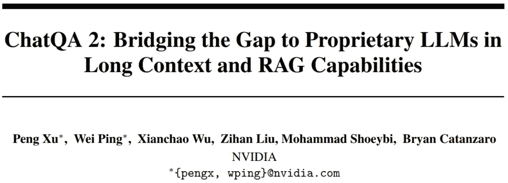
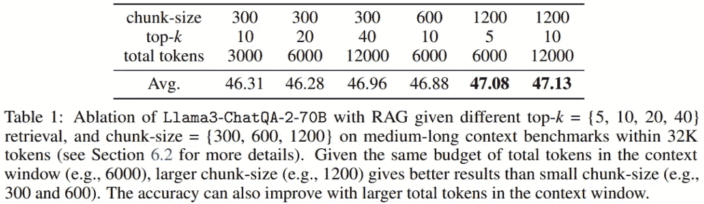
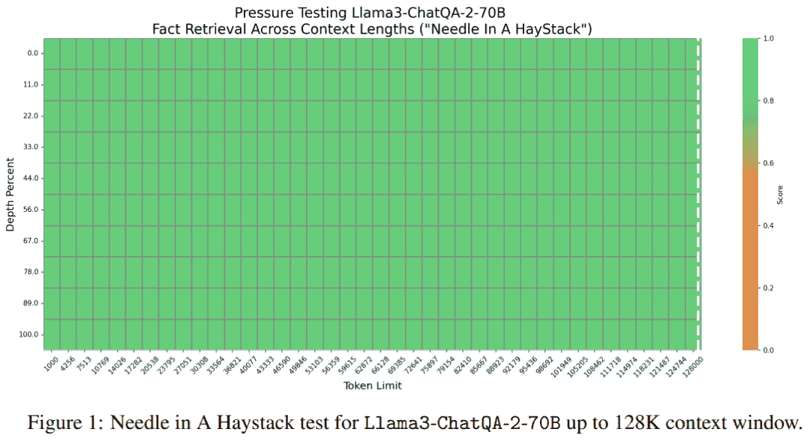
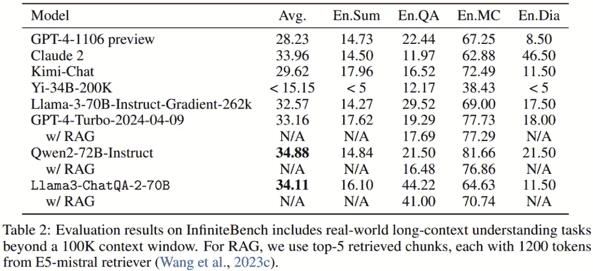
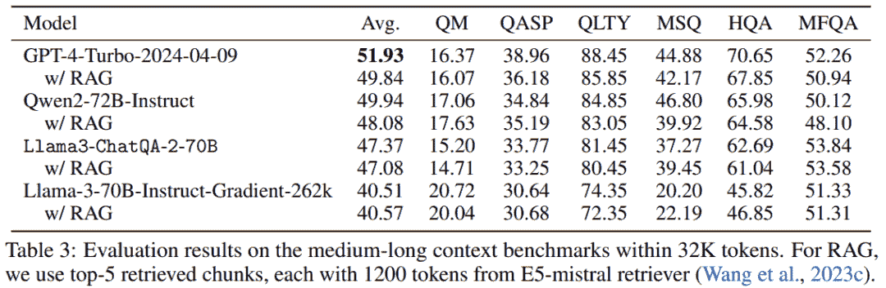
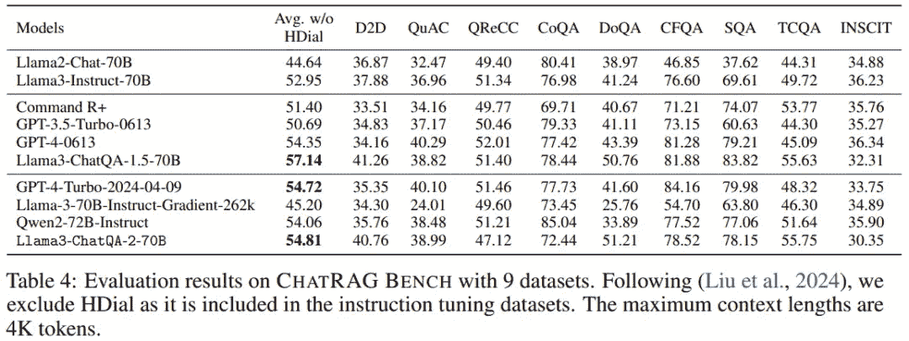
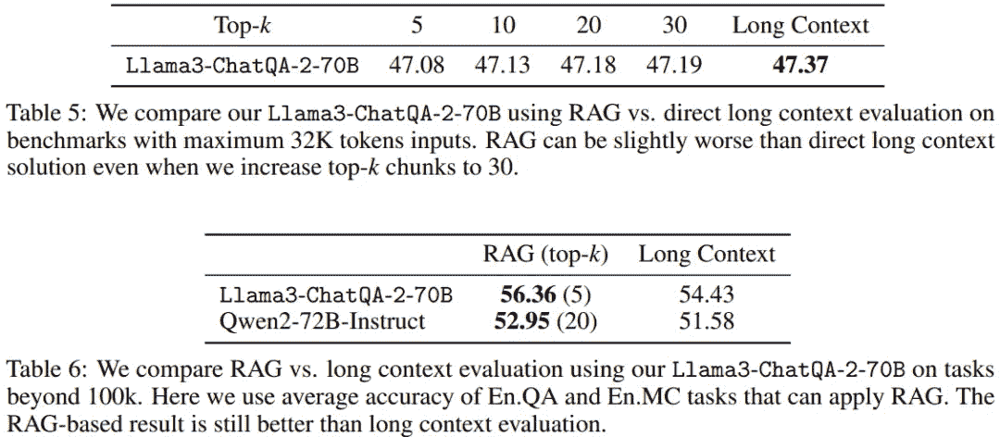

# 英伟达对话模型ChatQA进化到2.0版本，上下文长度提到128K

> 来源：[https://agijuejin.feishu.cn/docx/UexkdWJdLov0zdxmhTscZgTWnsh](https://agijuejin.feishu.cn/docx/UexkdWJdLov0zdxmhTscZgTWnsh)

> 机器之心｜[阅读原文](https://www.jiqizhixin.com/articles/2024-07-25-10)

> 转载请联系原作者取得授权

开放 LLM 社区正是百花齐放、竞相争鸣的时代，你能看到 Llama-3-70B-Instruct、QWen2-72B-Instruct、Nemotron-4-340B-Instruct、Mixtral-8x22BInstruct-v0.1 等许多表现优良的模型。但是，相比于以 GPT-4-Turbo 为代表的专有大模型，开放模型在很多领域依然还有明显差距。

在通用模型之外，也有一些专精关键领域的开放模型已被开发出来，比如用于编程和数学的 DeepSeek-Coder-V2、用于视觉 - 语言任务的 InternVL 1.5（其在某些领域可比肩 GPT-4-Turbo-2024-04-09）。

作[为「AI 淘金时代的卖铲王」，英伟达自身也在](http://mp.weixin.qq.com/s?__biz=MzA3MzI4MjgzMw==&mid=2650905013&idx=3&sn=fa63794d8550f5f2b595d03f7f362d5d&chksm=84e45dcbb393d4dd1fa5a9a49f8694c1e92dcb12fecde64a396a4ab5fc7e1d2ff132d43ad320&scene=21#wechat_redirect)为开放模型领域做贡献，比如其开发的 ChatQA 系列模型，参阅 机器之心 报道 《英伟达新对话 QA 模型准确度超 GPT-4，却遭吐槽：无 权重 代码意义不大》 。今年初，ChatQA 1.5 发布，其整合了检索增强式生成（RAG）技术，在对话问答方面的表现超过了 GPT-4。

现在，ChatQA 进化到 2.0 版，这一次改进的主要方向是扩展上下文窗口。

+   论文标题：ChatQA 2: Bridging the Gap to Proprietary LLMs in Long Context and RAG Capabilities

+   论文地址：https://arxiv.org/pdf/2407.14482

近段时间，扩展 LLM 的上下文窗口长度是一大研究[和开发热点，比如 机器之心 曾报道过的 《直接](http://mp.weixin.qq.com/s?__biz=MzA3MzI4MjgzMw==&mid=2650914273&idx=4&sn=29af9948131fed3d1896147a65f507d1&chksm=84e4799fb393f089bd648df8ff303b62a712b6fd501b7e2f7f96f431189ef6dea95a6d8372b7&scene=21#wechat_redirect)扩展到无限长，谷歌 Infini-Transformer 终结上下文长度之争》 。

所有领先的专有 LLM 都支持非常大的上下文窗口 —— 你可以在单个 prompt 中向其灌输数百页文本。比如 GPT-4 Turbo 和 Claude 3.5 Sonnet 的上下文窗口大小分别为 128K 和 200K。而 Gemini 1.5 Pro 可支持 10M 长度的上下文，让人叹为观止。

不过开源大模型也在加紧追赶。比如 QWen2-72B-Instruct 和 Yi-34B 各自支持 128K 和 200K 的上下文窗口。但是，这些模型的训练数据和技术细节并未公开，因此很难去复现它们。此外，这些模型的评估大都基于合成任务，无法准确地代表在真实下游任务上的性能。比如，有多项研究表明开放 LLM 和领先的专有模型在真实世界长上下文理解任务上依然差距明显。

而英伟达的这个团队成功让开放的 Llama-3 在真实世界长上下文理解任务上的性能赶上了专有的 GPT-4 Turbo。

在 LLM 社区中，长上下文能力有时被认为是一种能与 RAG 竞争的技术。但实事求是地说，这些技术是可以相互增益的。

对具有长上下文窗口的 LLM 来说，根据下游任务以及准确度和效率之间的权衡，可以考虑在 prompt 附带大量文本，也可以使用检索方法从大量文本中高效地提取出相关信息。RAG 具有明显的效率优势，可为基于 查询 的任务轻松地从数十亿 token 中检索出相关信息。这是长上下文模型无法具备的优势。另一方面，长上下文模型却非常擅长文档总结等 RAG 可能并不擅长的任务。

因此，对一个先进的 LLM 来说，这两种能力都需要，如此才能根据下游任务以及准确度和效率需求来考虑使用哪一种。

此前，英伟达开源的 ChatQA 1.5 模型已经能在 RAG 任务上胜过 GPT-4-Turbo 了。但他们没有止步于此，如今又开源了 ChatQA 2，将足以比肩 GPT-4-Turbo 的长上下文理解能力也整合了进来！

具体来说，他们基于 Llama-3 模型，将其上下文窗口扩展到了 128K（与 GPT-4-Turbo 同等水平），同时还为其配备了当前最佳的长上下文检索器。

**将上下文窗口扩展至 128K**

那么，英伟达如何把 Llama-3 的上下文窗口从 8K 提升到了 128K？首先，他们基于 Slimpajama 准备了一个长上下文预训练 语料库 ，使用的方法则来自 Fu et al. (2024) 的论文《Data engineering for scaling language models to 128k context》。

训练过程中他们还得到了一个有趣发现：相比于使用原有的起始和结束 token <BOS> 和 <EOS>，使用 <s> 这样的特殊字符来分隔不同文档的效果会更好。他们猜测，原因是 Llama-3 中的 <BOS> 和 <EOS> token 是告知模型在预训练之后忽略之前的文本块，但这无助于 LLM 适应更长的上下文输入。

**使用长上下文数据进行指令微调**

该团队还设计了一种可同时提升模型的长上下文理解能力和 RAG 性能的指令微调方法。

具体来说，这种指令微调方法分为三个阶段。前两个阶段与 ChatQA 1.5 一样，即首先在 128K 高质量指令遵从数据集训练模型，然后使用对话问答数据和所提供的上下文组成的混合数据进行训练。但是，这两个阶段涉及的上下文都比较短 —— 序列长度最大也不过 4K token。为了将模型的上下文窗口大小提升到 128K token，该团队收集了一个长监督式微调（SFT）数据集。

其采用了两种收集方式：

1. 对于短于 32k 的 SFT 数据序列：利用现有的基于 LongAlpaca12k 的长上下文数据集、来自 Open Orca 的 GPT-4 样本、Long Data Collections。

2. 对于序列长度在 32k 到 128k 之间的数据：由于收集此类 SFT 样本的难度很大，因此他们选择了合成数据集。他们使用了 NarrativeQA，其中既包含真实的总结（ground truth），也包含语义相关的段落。他们将所有相关段落组装到了一起，并随机插入真实总结以模拟用于问答对的真实长文档。

然后，将前两个阶段得到的全长的 SFT 数据集和短 SFT 数据集组合到一起，再进行训练。这里 学习率 设置为 3e-5，批量大小为 32。

长上下文检索器遇上长上下文 LLM

当前 LLM 使用的 RAG 流程存在一些问题：

1. 为了生成准确答案，top-k 逐块检索会引入不可忽略的上下文碎片。举个例子，之前最佳的基于密集嵌入的检索器仅支持 512 token。

2. 小 top-k（比如 5 或 10）会导致召回率相对较低，而大 top-k（比如 100）则会导致生成结果变差，因为之前的 LLM 无法很好地使用太多已 分块 的上下文。

为了解决这个问题，该团队提出使用最近期的长上下文检索器，其支持成千上万 token。具体来说，他们选择使用 E5-mistral 嵌入模型作为检索器。

表 1 比较了 top-k 检索的不同块大小和上下文窗口中的 token 总数。

比较 token 数从 3000 到 12000 的变化情况，该团队发现 token 越多，结果越好，这就确认了新模型的长上下文能力确实不错。他们还发现，如果总 token 数为 6000，则成本和性能之间会有比较好的权衡。当将总 token 数设定为 6000 后，他们又发现文本块越大，结果越好。因此，在实验中，他们选择的默认设置是块大小为 1200 以及 top-5 的文本块。

**实验**

**评估 基准**

为了进行全面的评估，分析不同的上下文长度，该团队使用了三类评估 基准 ：

1. 长上下文 基准 ，超过 100K token；

2. 中等长上下文 基准 ，低于 32K token；

3. 短上下文 基准 ，低于 4K token。

如果下游任务可以使用 RAG，便会使用 RAG。

**结果**

该团队首先进行了基于合成数据的 Needle in a Haystack（大海捞针）测试，然后测试了模型的真实世界长上下文理解和 RAG 能力。

1. 大海捞针测试

Llama3-ChatQA-2-70B 能否在文本之海中找到目标针？这是一个常用于测试 LLM 长上下文能力的合成任务，可看作是在评估 LLM 的阈值水平。图 1 展示了新模型在 128K token 中的表现，可以看到新模型的准确度达到了 100%。该测试证实新模型具有堪称完美的长上下文检索能力。

2. 超过 100K token 的长上下文评估

在来自 InfiniteBench 的真实世界任务上，该团队评估了模型在上下文长度超过 100K token 时的性能表现。结果见表 2。

可以看到，新模型的表现优于许多当前最佳模型，比如 GPT4-Turbo-2024-04-09 (33.16)、GPT4-1106 preview (28.23)、Llama-3-70B-Instruct-Gradient-262k (32.57) 和 Claude 2 (33.96)。此外，新模型的成绩也已经非常接近 Qwen2-72B-Instruct 得到的最高分数 34.88。整体来看，英伟达的这个新模型颇具竞争力。

3. token 数在 32K 以内的中等长上下文评估

表 3 给出了上下文的 token 数在 32K 以内时各模型的性能表现。

可以看到，GPT-4-Turbo-2024-04-09 的分数最高，为 51.93。新模型的分数为 47.37，比 Llama-3-70B-Instruct-Gradient-262k 高，但低于 Qwen2-72B-Instruct。原因可能是 Qwen2-72B-Instruct 的预训练大量使用了 32K token，而该团队使用的持续预训练 语料库 小得多。此外，他们还发现所有 RAG 解决方案的表现都逊于长上下文解决方案，这表明所有这些当前最佳的长上下文 LLM 都可以在其上下文窗口内处理 32K token。

4. ChatRAG Bench：token 数低于 4K 的短上下文评估

在 ChatRAG Bench 上，该团队评估了模型在上下文长度少于 4K token 时的性能表现，见表 4。

新模型的平均分数为 54.81。尽管这个成绩不及 Llama3-ChatQA-1.5-70B，但依然优于 GPT-4-Turbo-2024-04-09 和 Qwen2-72B-Instruct。这证明了一点：将短上下文模型扩展成长上下文模型是有代价的。这也引出了一个值得探索的研究方向：如何进一步扩展上下文窗口同时又不影响其在短上下文任务上的表现？

5. 对比 RAG 与长上下文

表 5 和表 6 比较了使用不同的上下文长度时，RAG 与长上下文解决方案的表现。当序列长度超过 100K 时，仅报告了 En.QA 和 En.MC 的平均分数，因为 RAG 设置无法直接用于 En.Sum 和 En.Dia。

可以看到，当下游任务的序列长度低于 32K 时，新提出的长上下文解决方案优于 RAG。这意味着使用 RAG 可以节省成本，但准确度会有所下降。

另一方面，当上下文长度超过 100K 时，RAG（Llama3-ChatQA-2-70B 使用 top-5，Qwen2-72B-Instruct 使用 top-20）优于长上下文解决方案。这意味着当 token 数超过 128K 时，即使当前最佳的长上下文 LLM，可能也难以实现有效的理解和推理。该团队建议在这种情况下，能使用 RAG 就尽量使用 RAG，因为其能带来更高的准确度和更低的推理成本。