# 1890美元，就能从头训练一个还不错的12亿参数扩散模型

> 来源：[https://agijuejin.feishu.cn/docx/RptudFQ5QoFM2vxAgF9cvaJMnef](https://agijuejin.feishu.cn/docx/RptudFQ5QoFM2vxAgF9cvaJMnef)

> 机器之心｜[阅读原文](https://www.jiqizhixin.com/articles/2024-07-29-4)

> 转载请联系原作者取得授权

> 只用1890美元、3700 万张图像，就能训练一个还不错的扩散模型。

现阶段，视觉 生成模型 擅长创建逼真的视觉内容，然而从头开始训练这些模型的成本和工作量仍然很高。比如 Stable Diffusion 2.1 花费了 200000 个 A100 GPU 小时。即使研究者使用最先进的方法，也需要在 8×H100 GPU 上训练一个多月的时间。

此外，训练大模型也对数据集提出了挑战，这些数据基本以亿为单位，同样给训练模型带来挑战。

高昂的训练成本和对数据集的要求为大规模扩散模型的开发造成了难以逾越的障碍。

现在，来自 Sony AI 等机构的研究者仅仅花了 1890 美元，就训练了一个不错的扩散模型， 具有 11.6 亿 参数 的稀疏 transformer。

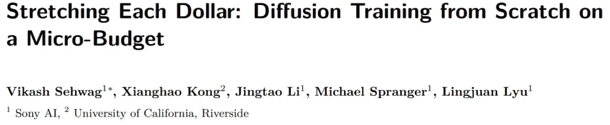

+   论文地址：https://arxiv.org/pdf/2407.15811

+   论文标题：Stretching Each Dollar: Diffusion Training from Scratch on a Micro-Budget

+   项目（即将发布）：https://github.com/SonyResearch/micro_diffusion

具体而言，在这项工作中，作者通过开发一种低成本端到端的 pipeline 用于文本到图像扩散模型，使得训练成本比 SOTA 模型降低了一个数量级还多，同时还不需要访问数十亿张训练图像或专有数据集。

作者考虑了基于视觉 transformer 的潜在扩散模型进行 文本到 图像生成 ，主要原因是这种方式设计简单，并且应用广泛。为了降低计算成本，作者利用了 transformer 计算开销与输入序列大小（即每张图像的 patch 数量）的强依赖关系。

本文的主要目标是在训练过程中减少 transformer 处理每张图像的有效 patch 数。通过在 transformer 的输入层随机掩蔽（mask）掉部分 token，可以轻松实现这一目标。

然而，现有的掩蔽方法无法在不大幅降低性能的情况下将掩蔽率扩展到 50% 以上，特别是在高掩蔽率下，很大一部分输入 patch 完全不会被扩散 transformer 观察到。

为了减轻掩蔽造成的性能大幅下降，作者提出了一种延迟掩蔽（deferred masking）策略，其中所有 patch 都由轻量级 patch 混合器（patch-mixer）进行预处理，然后再传输到扩散 transformer。Patch 混合器包含扩散 transformer 中 参数 数量的一小部分。

与 naive 掩蔽方法相比，在 patch mixing 处理之后进行掩蔽允许未掩蔽的 patch 保留有关整个图像的语义信息，并能够在非常高的掩蔽率下可靠地训练扩散 transformer，同时与现有的最先进掩蔽相比不会产生额外的计算成本。

作者还证明了在相同的计算预算下，延迟掩蔽策略比缩小模型规模（即减小模型大小）实现了更好的性能。最后，作者结合 Transformer 架构的最新进展，例如逐层缩放、使用 MoE 的稀疏 Transformer，以提高大规模训练的性能。

作者提出的低成本训练 pipeline 减少了实验开销。除了使用真实图像，作者还考虑在训练数据集中组合其他合成图像。组合数据集仅包含 3700 万张图像，比大多数现有的大型模型所需的数据量少得多。

在这个组合数据集上，作者以 1890 美元的成本训练了一个 11.6 亿 参数 的稀疏 transformer，并在 COCO 数据集上的零样本生成中实现了 12.7 FID。

值得注意的是，本文训练的模型实现了具有竞争力的 FID 和高质量生成，同时成本仅为 stable diffusion 模型的 1/118 ，是目前最先进的方法（成本为 28,400 美元）的 1/15。

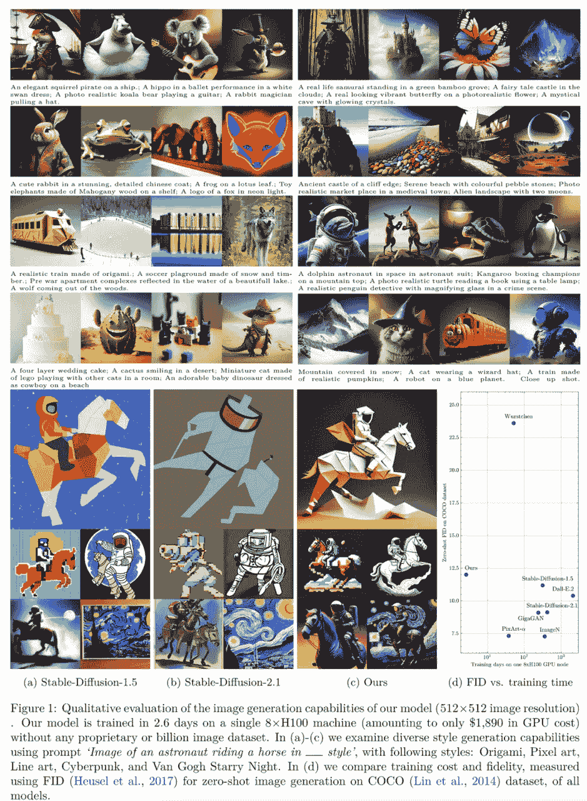

**方法介绍**

为了大幅降低计算成本，patch 掩蔽要求在输入主干 transformer 之前丢弃大部分输入 patch，从而使 transformer 无法获得被掩蔽 patch 的信息。高掩蔽率（例如 75% 的掩蔽率）会显著降低 transformer 的整体性能。即使使用 MaskDiT，也只能观察到它比 naive 掩蔽有微弱的改善，因为这种方法也会在输入层本身丢弃大部分图像 patch。

延迟掩蔽，保留所有 patch 的语义信息

由于高掩蔽率会去除图像中大部分有价值的学习信号，作者不禁要问，是否有必要在输入层进行掩蔽？只要计算成本不变，这就只是一种设计选择，而不是根本限制。事实上，作者发现了一种明显更好的掩蔽策略，其成本与现有的 MaskDiT 方法几乎相同。由于 patch 来自扩散 Transformer 中的非重叠图像区域，每个 patch 嵌入都不会嵌入图像中其他 patch 的任何信息。因此，作者的目标是在掩蔽之前对 patch 嵌入进行预处理，使未被掩蔽的 patch 能够嵌入整个图像的信息。他们将预处理模块称为 patch-mixer。

使用 patch-mixer 训练扩散 transformer

作者认为，patch-mixer 是任何一种能够融合单个 patch 嵌入的神经架构。在 transformer 模型中，这一目标自然可以通过注意力层和前馈层的组合来实现。因此，作者使用一个仅由几个层组成的轻量级 transformer 作为 patch-mixer。输入序列 token 经 patch-mixer 处理后，他们将对其进行掩蔽（图 2e）。

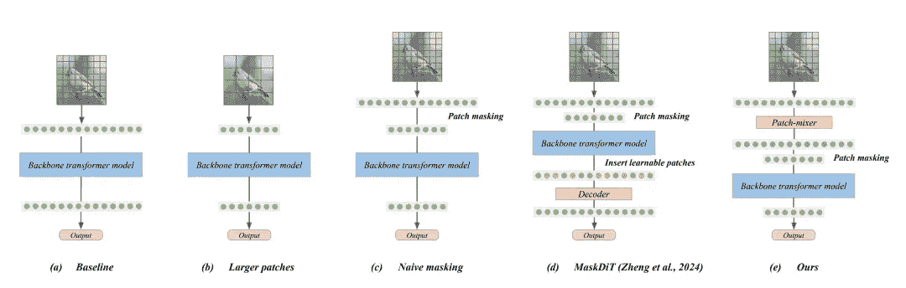

图 2：压缩 patch 序列以降低计算成本。由于扩散 transformer 的训练成本与序列大小（即 patch 数量）成正比，因此最好能在不降低性能的情况下缩减序列大小。这可以通过以下方法实现：b) 使用更大的 patch；c) 随机简单（naive）掩蔽一部分 patch；或者 d) 使用 MaskDiT，该方法结合了 naive 掩蔽和额外的自动编码目标。作者发现这三种方法都会导致 图像生成 性能显著下降，尤其是在高掩蔽率的情况下。为了缓解这一问题，他们提出了一种直接的延迟掩蔽策略，即在 patch-mixer 处理完 patch 后再对其进行掩蔽。除了使用 patch-mixer 之外，他们的方法在所有方面都类似于 naive 掩蔽。与 MaskDiT 相比，他们的方法无需优化任何替代目标，计算成本几乎相同。

假定掩码为二进制掩码 m，作者使用以下 损失函数 来训练模型：

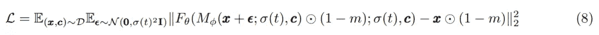

其中，M_ϕ 是 patch-mixer 模型，F_θ 是主干 transformer。请注意，与 MaskDiT 相比，本文提出的方法还简化了整体设计，不需要额外的 损失函数 ，也不需要在训练过程中在两个损失之间进行相应的超 参数 调优。在推理过程中，该方法不掩蔽任何 patch。

**未掩蔽微调**

由于极高的掩蔽率会大大降低扩散模型学习图像全局结构的能力，并在序列大小上引入训练 - 测试分布偏移，因此作者考虑在掩蔽预训练后进行少量的未掩蔽微调。微调还可以减轻由于使用 patch 掩蔽而产生的任何生成瑕疵。因此，在以前的工作中，恢复因掩蔽而急剧下降的性能至关重要，尤其是在采样中使用无分类器引导时。然而，作者认为这并不是完全必要的，因为即使在掩蔽预训练中，他们的方法也能达到与基线未掩蔽预训练相当的性能。作者只在大规模训练中使用这种方法，以减轻由于高度 patch 掩蔽而产生的任何未知 - 未知生成瑕疵。

**利用 MoE 和 layer-wise scaling** 改进主干 transformer 架构

作者还利用 transformer 架构设计方面的创新，在计算限制条件下提高了模型的性能。

他们使用混合专家层，因为它们在不显著增加训练成本的情况下增加了模型的 参数 和表现力。他们使用基于专家选择路由的简化 MoE 层，每个专家决定路由给它的 token，因为它不需要任何额外的辅助 损失函数 来平衡专家间的负载。他们还考虑了 layer-wise scaling，该方法最近被证明在大型 语言模型 中优于典型 transformer。该方法线性增加 transformer 块的宽度，即注意力层和前馈层的隐藏层维度。因此，网络中较深的层比较早的层被分配了更多的 参数 。作者认为，由于视觉模型中的较深层往往能学习到更复杂的特征，因此在较深层使用更高的 参数 会带来更好的性能。作者在图 3 中描述了他们提出的扩散 Transformer 的整体架构。

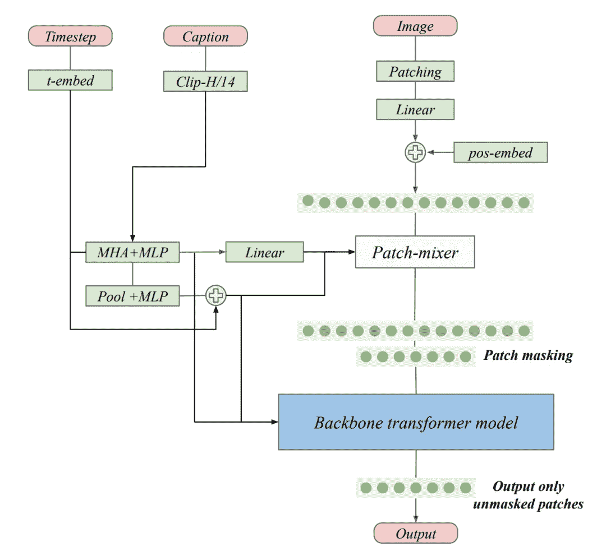

图 3：本文提出的扩散 transformer 的整体架构。作者在骨干 transformer 模型中加入了一个轻量级的 patch-mixer，它可以在输入图像中的所有 patch 被掩蔽之前对其进行处理。根据当前的研究成果，作者使用注意力层处理 caption 嵌入，然后再将其用于调节。他们使用正弦嵌入来表示时间步长。他们的模型只对未掩蔽的 patch 进行去噪处理，因此只对这些 patch 计算扩散损失（论文中的公式 3）。他们对主干 transformer 进行了修改，在单个层上使用了 layer-wise scaling，并在交替 transformer 块中使用了混合专家层。

**实验**

实验采用扩散 Transformer（DiT）两个变体 DiT-Tiny/2 和 DiT-Xl/2。

如图 4 所示，延迟掩蔽方法在多个指标中都实现了更好的性能。此外，随着掩蔽率的增加，性能差距会扩大。例如，在 75% 的掩蔽率下，naive 掩蔽会将 FID 得分降低到 16.5（越低越好），而本文方法可以达到 5.03，更接近没有掩蔽的 FID 得分 3.79。

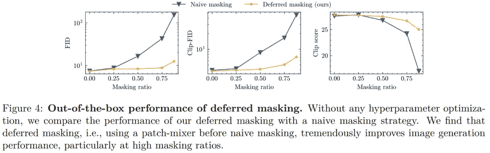

表 1 表明 layer-wise scaling 方法在扩散 transformer 的掩蔽训练中具有更好的拟合效果。

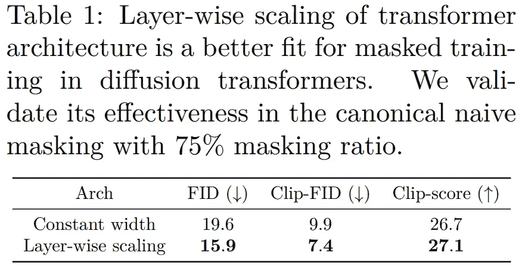

比较不同的掩蔽策略。作者首先将本文方法与使用较大 patch 的策略进行比较。将 patch 大小从 2 增加到 4，相当于 75% 的 patch 掩蔽。与延迟掩蔽相比，其他方法表现不佳，分别仅达到 9.38、6.31 和 26.70 FID、Clip-FID 和 Clip-score。相比之下，延迟掩蔽分别达到 7.09、4.10 和 28.24 FID、Clip-FID 和 Clip-score。

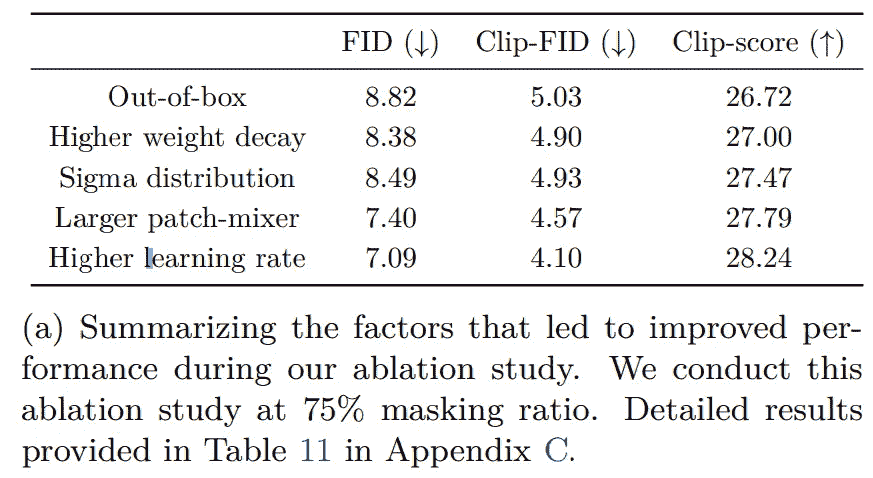

下图为延迟掩蔽 vs. 模型缩小以减少训练成本的比较。在掩蔽率达到 75% 之前，作者发现延迟掩蔽在至少三个指标中的两个方面优于网络缩小。但是，在极高的掩蔽率下，延迟掩蔽往往会实现较低的性能。这可能是因为在这些比率下掩蔽的信息损失太高导致的。

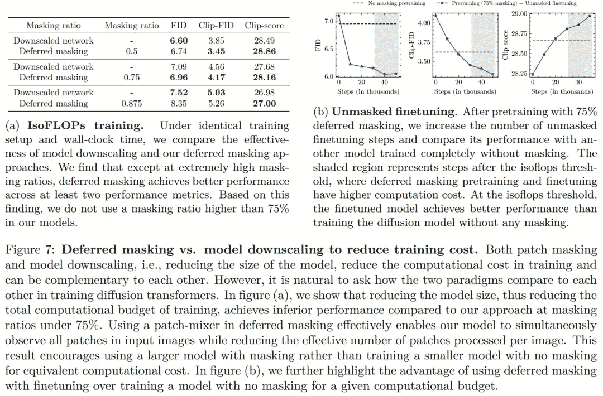

表 5 提供了有关模型训练超 参数 的详细信息。训练过程分两个阶段。

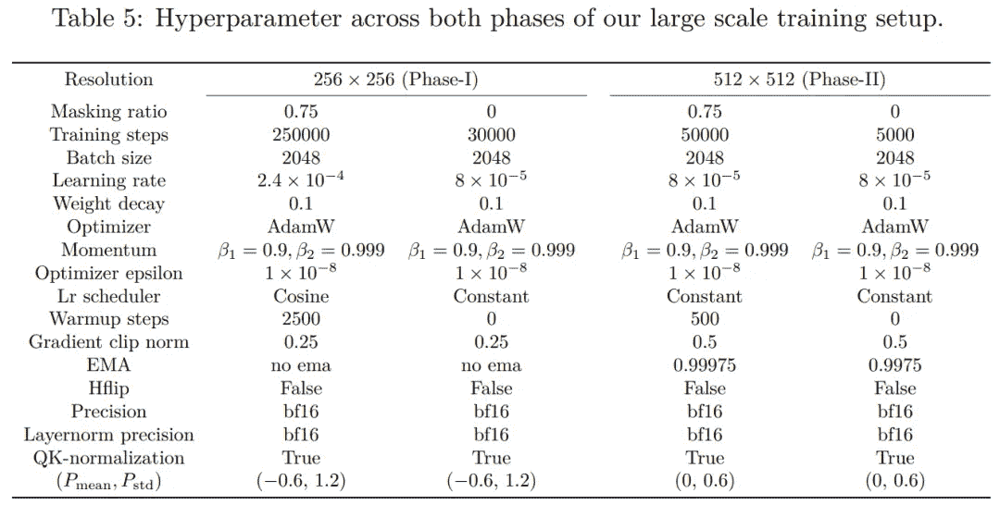

计算成本。表 2 提供了每个训练阶段的计算成本明细，包括训练 FLOP 和经济成本。第 1 阶段和第 2 阶段训练分别消耗了总计算成本的 56% 和 44%。模型在 8×H100 GPU 集群上的总时钟训练时间为 2.6 天，相当于在 8×A100 GPU 集群上为 6.6 天。

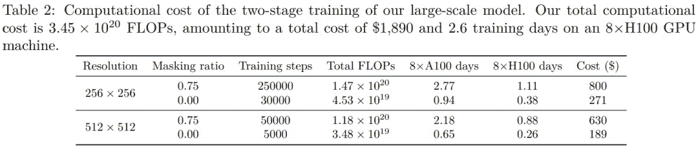

了解更多结果，请参考原论文。