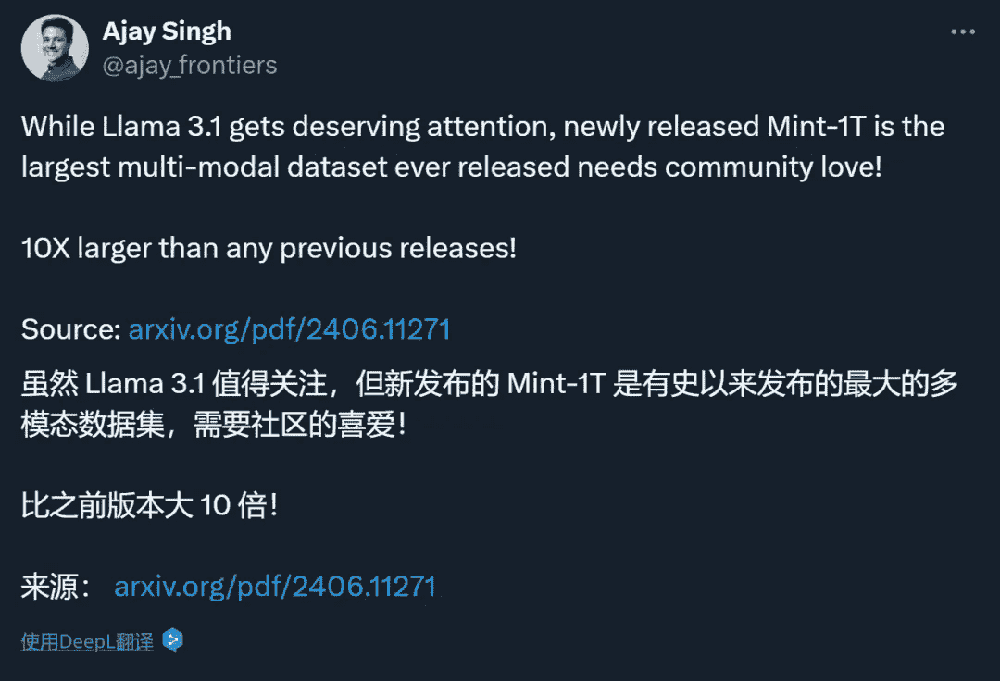
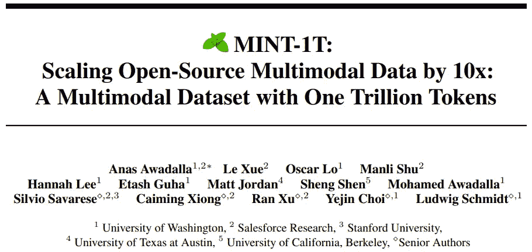
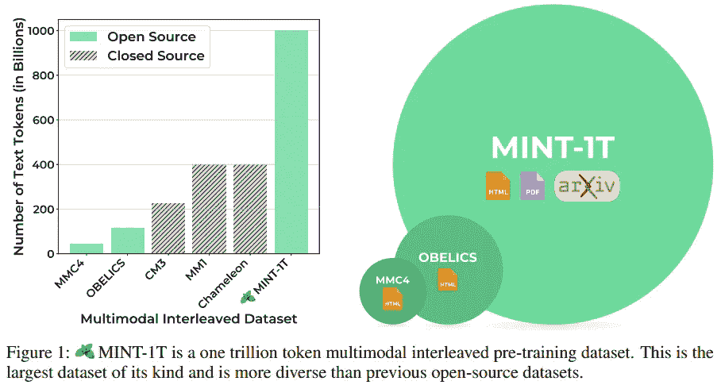
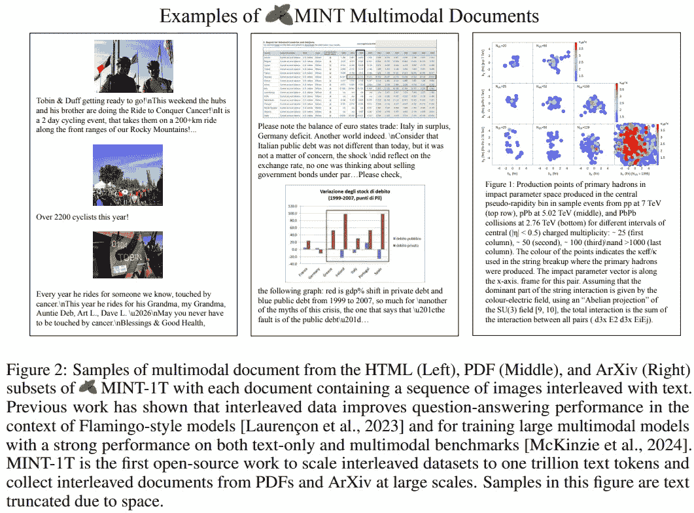
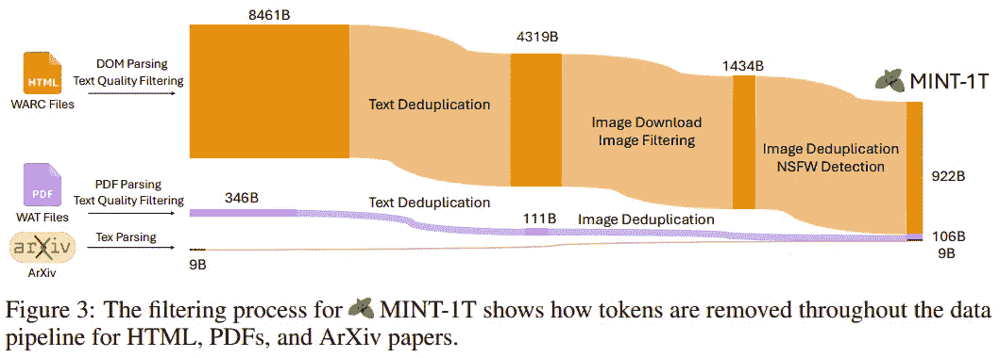
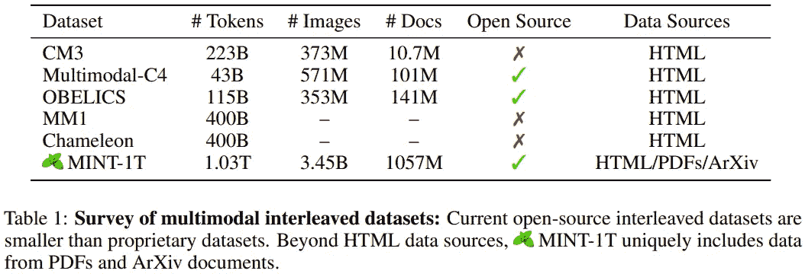
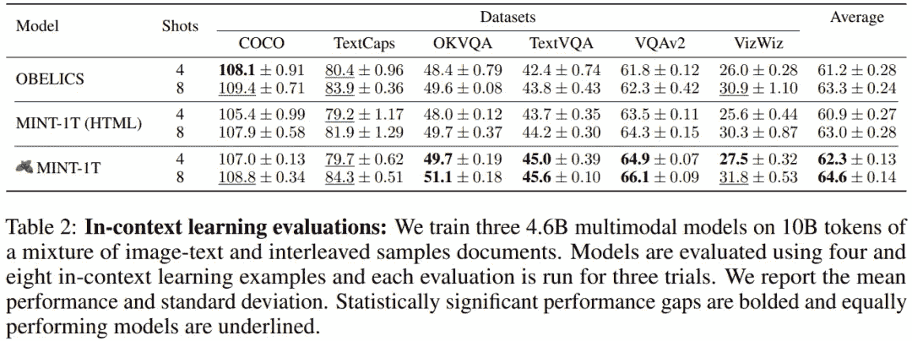
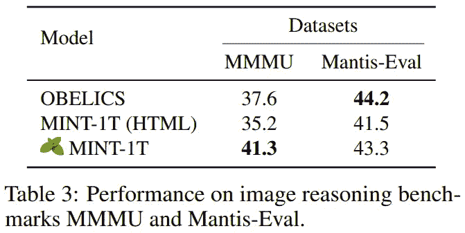

# 万亿token！史上最大多模态数据集诞生

> 来源：[https://agijuejin.feishu.cn/docx/NGDidWDpZo29Khxs8RPcZkrmnAb](https://agijuejin.feishu.cn/docx/NGDidWDpZo29Khxs8RPcZkrmnAb)

> 机器之心｜[阅读原文](https://www.jiqizhixin.com/articles/2024-07-27-2)

> 转载请联系原作者取得授权

> 开源多模态大模型或将开始腾飞。

值此 Llama 3.1 占领各大头条之际，又突然冒出了另一个也非常重要的发布 —— 一个规模空前的开源多模态数据集。

对大模型来说，数据集的重要性无需多言，甚至可以说没有大型数据集就不可能有大模型。现在正是多模态大模型（LMM）发展正盛的时候，规模足够大的优质且开源的多模态数据集已经成为该领域的一大「刚需」。

不过，相比于开源的文本数据集，现有的开源多模态数据集都比较小、多样性也不足，并且来源基本都是 HTML 文档 —— 这就限制了数据的广度和多样性。这无疑限制了开源 LMM 的发展，让开源 LMM 与闭源 LMM 之间的差异变得非常大。

近日，华盛顿大学、Salesforce Research 和斯坦福大学等机构的联合团队填补了这一空白，构建了一个万亿 token 级的交织多模态的开源数据集 MINT-1T（Multimodal INTerleaved）。毫无疑问，这是目前最大的开源多模态数据集。

+   数据集地址：https://github.com/mlfoundations/MINT-1T

+   论文地址：https://arxiv.org/abs/2406.11271

+   论文标题：MINT-1T: Scaling Open-Source Multimodal Data by 10x: A Multimodal Dataset with One Trillion Tokens

MINT-1T 共包含一万亿文本 token 和三十亿张图像，并且其有 HTML/PDF/ArXiv 等多种不同来源。在 MINT-1T 问世之前，该领域最大的开源数据集是 OBELICS，其包含 1150 亿文本 token 和 3.53 亿张图像，并且来源只有 HTML。图 1 比较了这些数据集。

**数据集的构建**

首先，该团队从多样化的来源（包括 HTML、PDF、ArXiv）收集了大量多模态数据，图 2 展示了这些不同来源的多模态文档样本。

然后，为了提高数据质量和安全性，他们执行了文本质量过滤、图像过滤、安全过滤（包括去除 NSFW 图像和可识别个人身份的信息）以及去重。图 3 简要展示了这些数据过滤过程。

最终，他们得到的 MINT-1T 数据集包含 9220 亿 HTML token、1060 亿 PDF token 和 90 亿 ArXiv token。值得注意的是，整个数据处理过程耗费了大约 420 万 CPU 小时数。表 1 对比了一些常见的开源或闭源多模态数据集。

**模型实验**

该团队也实验了使用该数据集训练多模态模型的效果，并与其它数据集进行了比较。

他们使用的模型架构是 Salesforce 的 XGen-MM，评估的则是模型在数据集上学习之后的上下文学习和多图像推理能力。评估 基准 包括：视觉描述 基准 （COCO 和 TextCaps）、 视觉问答 基准 （VQAv2、OK-VQA、TextVQA 和 VizWiz）、多图像推理 基准 （MMMU 和 Mantis-Eval）。

**实验结果**

在 HTML 文档上训练

该团队首先对比了 MINT-1T 的 HTML 部分与 OBELICS；因为 OBELICS 是之前领先的多模态数据集并且也是基于 HTML 文档，他们基于这两个数据集分别用 100 亿多模态 token 训练了两个模型，并评估了它们的上下文学习性能。

表 2 给出了在常见 基准 上的 4-shot 和 8-shot 性能。

可以看到，对于 VQA（ 视觉问答 ）任务，在 MINT-1T HTML 文档上训练的模型表现优于在 OBELICS 训练的模型，但前者在视觉描述任务上表现更差一些。平均而言，OBELICS 比 MINT-1T (HTML) 略好一点。

添加 PDF 和 ArXiv 文档

之后，该团队又在 MINT-1T 全数据集上进行了测试，即同时包含 HTML、PDF 和 ArXiv 文档。他们通常采样了 100 亿多模态 token，其中 50% 来自 HTML、45% 来自 PDF、5% 来自 ArXiv。

结果同样见表 2，可以看到在 MINT-1T 混合数据上训练的模型在大多数 基准 上都优于在 OBELICS 和 MINT-1T (HTML) 上训练的模型。

而在更为复杂的多模态推理任务上，如表 3 所示，用 MINT-1T 训练的模型在 MMMU 上优于用 OBELICS 训练的模型，但在 Mantis-Eval 基准 上不及后者。

更细粒度的测试和模型架构的影响请参考原论文。

这个超大规模的开源多模态数据集能否成为一系列传奇的起点，最终造就一个类似 Llama 系列模型那样的多模态大模型系列呢？让我们拭目以待吧。