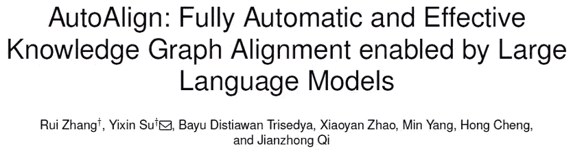
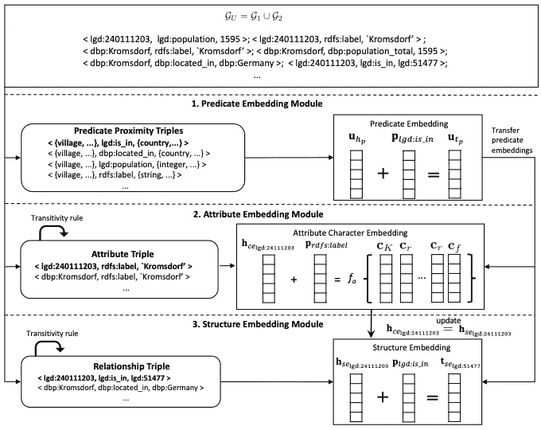
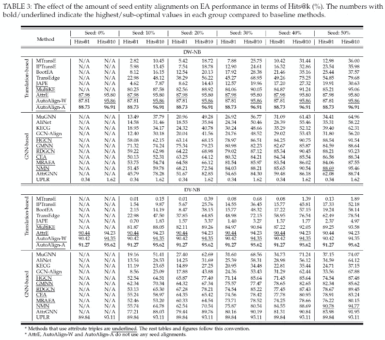

# 彻底摒弃人工标注，AutoAlign方法基于大模型让知识图谱对齐全自动化

> 来源：[https://agijuejin.feishu.cn/docx/ODB6dHZb9oKXhgx4r5xc7k53npf](https://agijuejin.feishu.cn/docx/ODB6dHZb9oKXhgx4r5xc7k53npf)

> 机器之心｜[阅读原文](https://www.jiqizhixin.com/articles/2024-07-26-4)

> 转载请联系原作者取得授权

**本工作由来自 清华大学 、墨尔本大学、香港中文大学、中国科学院大学的 Rui Zhang, Yixin Su, Bayu Distiawan Trisedya, X**iaoyan Zhao, Min Yang, Hong Cheng, Jianzhong Qi 等学者团队联合完成。 该团队专注于大模型、 知识图谱 、推荐搜索、 自然语言处理 、大数据等方向的研究。

知识图谱 作为结构化知识的重要载体，广泛应用于 信息检索 、电商、决策推理等众多领域。然而，由于不同机构或方法构建的 知识图谱 存在表示方式、覆盖范围等方面的差异，如何有效地将不同的 知识图谱 进行融合，以获得更加全面、丰富的知识体系，成为提高 知识图谱 覆盖度和 准确率 的重要问题，这就是 知识图谱 对齐（Knowledge Graph Alignment）任务所要解决的核心挑战。

传统的 知识图谱 对齐方法必须依赖人工标注来对齐一些实体（entity）和谓词（predicate）等作为种子实体对。这样的方法昂贵、低效、而且对齐的效果不佳。来自 清华大学 、墨尔本大学、香港中文大学、中国科学院大学的学者联合提出了一种基于大模型的全自动进行 知识图谱 对齐的方法——AutoAlign。AutoAlign彻底不需要人工来标注对齐的种子实体或者谓词对，而是完全通过算法对于实体语义和结构的理解来进行对齐，显著提高了效率和准确性。

+   论文：AutoAlign: Fully Automatic and Effective Knowledge Graph Alignment enabled by Large Language Models，36 (6) TKDE 2024

+   论文链接：https://arxiv.org/abs/2307.11772

+   代码链接：https://github.com/ruizhang-ai/AutoAlign

**模型介绍**

AutoAlign 主要由两部分组成：

+   **用于将谓词（pre**dicate）对齐的 谓 词嵌入 模块 （Predicate Embedding Module）。

+   **用于将实体（e****ntity）对**齐的实体嵌入学习部分，包括两个模块： 属性嵌入模块 （Attribute Embedding Module）和 结构嵌入模块 （Structure Embedding Module）。

总体流程如下图所示：

**谓 词嵌入 模块 **：谓 词嵌入 模块旨在对齐两个 知识图谱 中代表相同含义的谓词。例如，将“is_in”和“located_in”进行对齐。为了实现这一目标，研究团队创建了一个谓词邻近图（Predicate Proximity Graph），将两个 知识图谱 合并成一个图，并将其中的实体替换为其对应的类型（Entity Type）。这种方式基于以下假设：相同（或相似）的谓词，其对应的实体类型也应相似（例如，“is_in”和“located_in”的目标实体类型大概率属于location或city）。通过大 语言模型 对类型的语义理解，进一步对齐这些类型，提高了三元组学习的准确性。最终，通过图编码方法（如TransE）对谓词邻近图的学习，使得相同（或相似）的谓词具有相似的嵌入，从而实现谓词的对齐。

具体实现上，研究团队首先构建谓词邻近图。谓词邻近图是一种描述实体类型之间关系的图。实体类型表示实体的广泛类别，可以自动链接不同的实体。即使某些谓词的表面形式不同（例如“lgd:is_in”和“dbp:located_in”），通过学习谓词邻近图，可以有效识别它们的相似性。构建谓词邻近图的步骤如下：

+   **实体类型提取 **：研究团队通过获取每个实体在 知识图谱 中的rdfs:type谓词的值来提取实体类型。通常，每个实体有多个类型。例如，德国（Germany）实体在 知识图谱 中可能有多个类型，如“thing”、“place”、“location”和“country”。在谓词邻近图中，他们用一组实体类型替换每个三元组的头实体和尾实体。

+   **类型对齐 **：由于不同 知识图谱 中的实体类型可能使用不同的表面形式（例如，“person”和“people”），研究团队需要对齐这些类型。为此，研究团队利用最新的大 语言模型 （如ChatGPT和Claude）来自动对齐这些类型。例如，研究团队可以使用Claude2来识别两个 知识图谱 中相似的类型对，然后将所有相似类型对齐为统一的表示形式。为此，研究团队设计了一套自动化提示词（prompt），能够根据不同的 知识图谱 进行自动化对齐词的获取。

为了捕捉谓词相似性，需要聚合多个实体类型。研究团队提出了两种聚合方法：加权和基于注意力的函数。在实验中，他们发现基于注意力的函数效果更好。具体而言，他们计算每个实体类型的注意力 权重 ，并通过加权求和的方式获得最终的伪类型嵌入。接下来，研究团队通过最小化 目标函数 来训练谓 词嵌入 ，使得相似的谓词具有相似的向量表示。

**属性嵌入模块和结构嵌入模块 **：属性嵌入模块和结构嵌入模块都用于实体（entity）对齐。它们的思想和谓 词嵌入 相似，即对于相同（或相似）的实体，其对应的三元组中的谓词和另一个实体也应该具有相似性。因此，在谓词对齐（通过谓 词嵌入 模块）和属性对齐（通过 Attribute Character Embeding 方法）的情况下，我们可以通过TransE使相似的实体学习到相似的嵌入。具体来说：

+   **属性嵌入学习 **：属性嵌入模块通过编码属性值的字符序列来建立头实体和属性值之间的关系。研究团队提出了三种组合函数来编码属性值：求和组合函数、基于LSTM的组合函数和基于N-gram的组合函数。通过这些函数，我们能够捕捉属性值之间的相似性，从而使得两个 知识图谱 中的实体属性可以对齐。

+   **结构嵌入学习 **：结构嵌入模块基于TransE方法进行了改进，通过赋予不同邻居不同的 权重 来学习实体的嵌入。已对齐的谓词和隐含对齐的谓词将获得更高的 权重 ，而未对齐的谓词则被视为噪声。通过这种方式，结构嵌入模块能够更有效地从已对齐的三元组中学习。

+   **联合训练 **：谓 词嵌入 模块、属性嵌入模块和结构嵌入模块这三个模块可以进行交替训练，通过交替学习的方式互相影响，通过优化嵌入使其在各个结构的表示中达到整体最优。训练完成后，研究团队获得了实体（entity）、谓词（predicate）、属性（attribute）和类型（type）的嵌入表示。最后，我们通过对比两个 知识图谱 中的实体相似性（如cosine similarity），找到相似性高的实体对（需要高于一个阈值）来进行实体对齐。

**实验结果**

研究团队在最新的 基准 数据集DWY-NB (Rui Zhang, 2022) 上进行了实验，主要结果如下表所示。

AutoAlign在 知识图谱 对齐性能方面有显著提升，特别是在缺少人工标注种子的情况下，表现尤为出色。在没有人工标注的情况下，现有的模型几乎无法进行有效对齐。然而，AutoAlign在这种条件下依然能够取得优异的表现。在两个数据集上，AutoAlign在没有人工标注种子的情况下，相比于现有最佳 基准 模型（即使有人工标注）有显著的提升。这些结果表明，AutoAlign不仅在对齐准确性上优于现有方法，而且在完全自动化的对齐任务中展现了强大的优势。

参考文献：

Rui Zhang, Bayu D. Trisedya, Miao Li, Yong Jiang, and Jianzhong Qi (2022). A Benchmark and Comprehensive Survey on Knowledge Graph Entity Alignment via Representation Learning. VLDB Journal, 31 (5), 1143–1168, 2022.