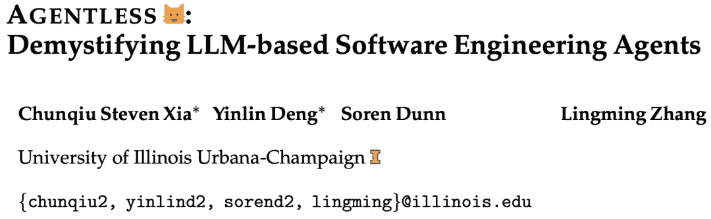
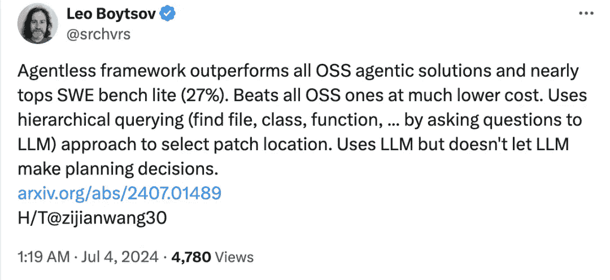
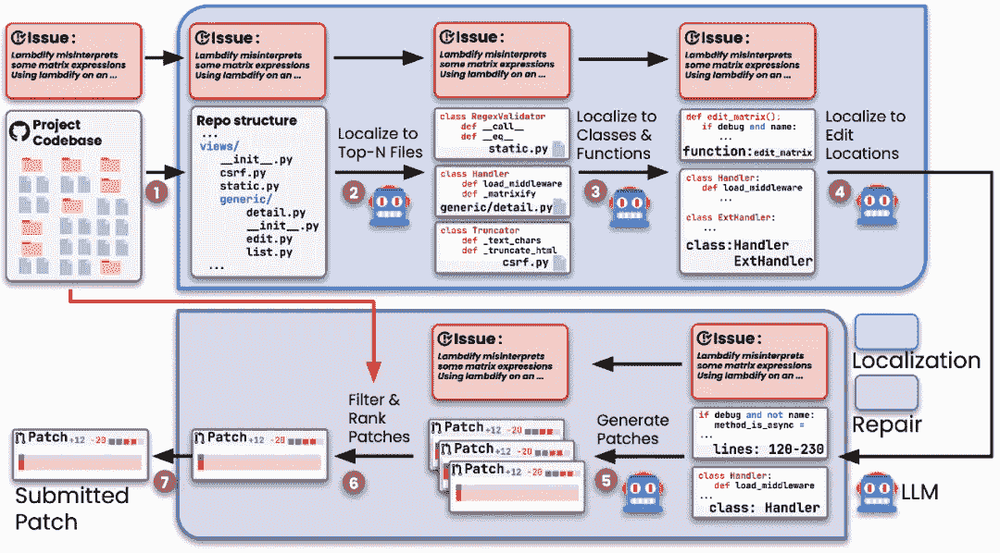
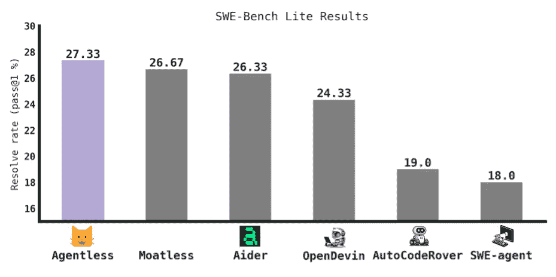
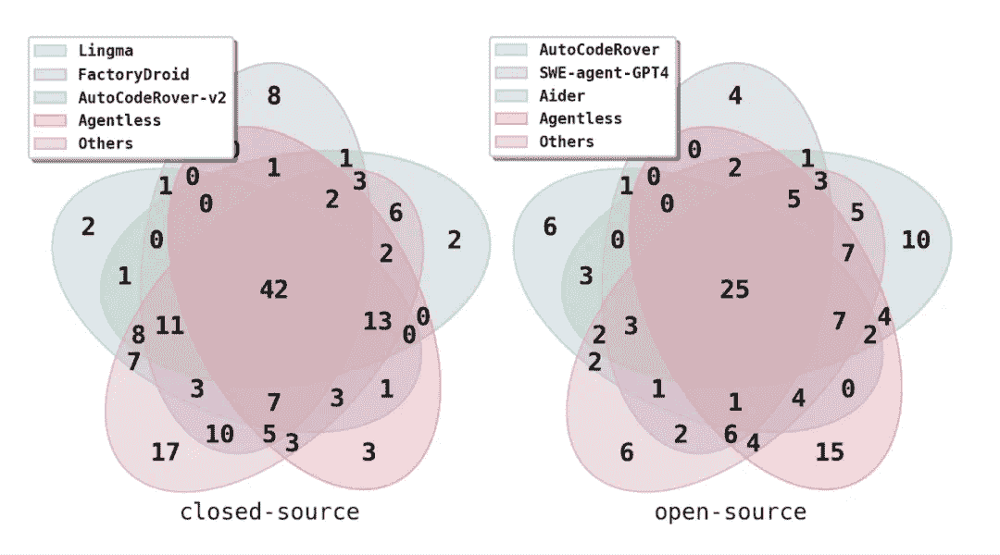
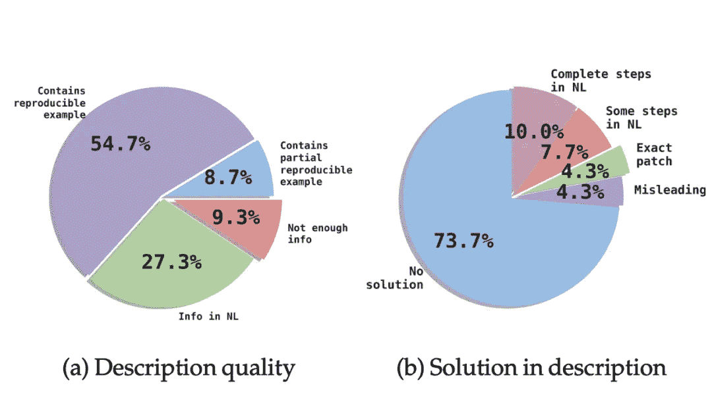
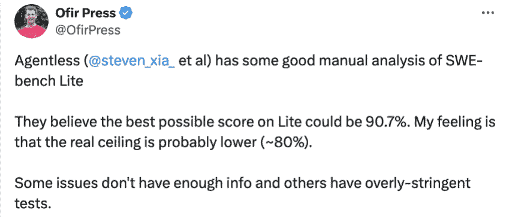

# 登顶开源AI软件工程师榜首，UIUC无Agent方案轻松解决SWE-bench真实编程问题

> 来源：[https://agijuejin.feishu.cn/docx/COrld32U3oJa7cx3cdLcX🐧snke](https://agijuejin.feishu.cn/docx/COrld32U3oJa7cx3cdLcX🐧snke)

> 机器之心｜[阅读原文](https://www.jiqizhixin.com/articles/2024-07-15-12)

> 转载请联系原作者取得授权

**这篇论文的作者均来自伊利诺伊大学香槟分校（UIUC）张令明老师团队，包括：Steven Xia，四年级博士生，研究方向是基于 AI 大模型的自动代码修复；邓茵琳，四年级博士生**，研究方向是基于 AI 大模型的代码生成；Soren Dunn，科研实习生，目前为 UIUC 大三学生。张令明老师现任 UIUC 计算机系副教授，主要从事软件工程、 机器学习 、代码大模型的相关研究。

**更多详细信息请见张老师的个人主页：https://lingm**ing.cs.illinois.edu/

自从 Devin（首个全自动 AI 软件工程师）提出以来，针对软件工程的 AI Agent 的设计成为研究的焦点，越来越多基于 Agent 的 AI 自动软件工程师被提出，并在 SWE-bench 数据集上取得了不俗的表现、自动修复了许多真实的 GitHub issue。

然而，复杂的 Agent 系统会带来额外的开销和不确定性，我们真的需要使用如此复杂的 Agent 来解决 GitHub issue 吗？不依赖 Agent 的解决方案能接近它们的性能吗？

从这两个问题出发，伊利诺伊大学香槟分校（UIUC）张令明老师团队提出了 OpenAutoCoder-Agentless，一个简单高效并且完全开源的无 Agent 方案，仅需 $0.34 就能解决一个真实的 GitHub issue。Agentless 在短短几天内在 GitHub 上已经吸引了超过 300 GitHub Star，并登上了 DAIR.AI 每周最热 ML 论文榜单前三。

+   论文：AGENTLESS : Demystifying LLM-based Software Engineering Agents

+   论文地址：https://huggingface.co/papers/2407.01489

+   开源代码：https://github.com/OpenAutoCoder/Agentless

AWS 研究科学家 Leo Boytsov 表示：“Agentless 框架表现优异，超过所有开源 Agent 解决方案，几乎达到 SWE Bench Lite 最高水平（27%）。而且，它以显著更低的成本击败了所有开源方案。该框架采用分层 查询 方法（通过向 LLM 提问来查找文件、类、函数等）以确定补丁位置。虽然利用 LLM，但不允许 LLM 做出 规划 决策。”

Agentless 是一种自动解决软件开发问题的方法，它使用简单的两阶段方法进行定位和修复，以修复代码库中的 bug。在定位阶段，Agentless 以分层方式来逐步缩小到可疑的文件、类 / 函数和具体的编辑位置。对于修复，它使用简单的 diff 格式（参考自开源工具 Aider）来生成多个候选补丁，并对其进行过滤和排序。

研究者将 Agentless 与现有的 AI Software Agent 进行了比较，其中包括最先进的开源和商业 / 闭源项目。令人惊讶的是，Agentless 可以以更低的成本超越所有现有的开源 Software Agent！Agentless 解决了 27.33% 的问题，是开源方案中最高的，并且解决每个问题平均仅需 $0.29，在所有问题上（包括能解决和未解决的）平均只需要约 $0.34。

不仅如此，Agentless 还有改进的潜力。在考虑所有生成的补丁时，Agentless 可以解决 41% 的问题，这个上限表明补丁排序和选择阶段有显著的改进空间。此外，Agentless 能够解决一些即使是最好的商业工具（Alibaba Lingma Agent）也无法解决的独特问题，这表明它可以作为现有工具的补充。

对 SWE-bench Lite 数据集的分析

研究者还对 SWE-bench Lite 数据集进行了人工检查和详细分析。

研究发现，SWE-bench Lite 数据集中，有 4.3% 的问题在问题描述中直接给出了完整的答案，也就是正确的修复补丁。而另外 10% 的问题描述了正确解决方案的确切步骤。这表明，SWE-bench Lite 中的某些问题可能更容易解决。

此外，研究团队观察到有 4.3% 的问题在问题描述中包含了用户提议的解决方案或者步骤，但这些方案与开发人员的真实补丁并不一致。这进一步揭示了该 基准 测试的潜在问题，因为这些误导性解决方案可能导致 AI 工具仅通过遵循问题描述来生成不正确的解决方案。

在问题描述质量方面，研究者观察到，虽然 SWE-bench Lite 中大部分的任务都包含了足够的信息，并且许多任务还提供了失败示例来复现错误，但是仍有 9.3% 的问题没有包含足够的信息。例如需要实现一个新的函数或者添加一个错误信息，但是特定的函数名或者特定的错误信息字符串并没有在问题描述中给出。这意味着即使正确实现了底层功能，如果函数名或错误信息字符串不完全匹配，测试也会失败。

普林斯顿大学的研究人员，同时也是 SWE-Bench 的作者之一，Ofir Press 确认了他们的发现：“Agentless 对 SWE-bench Lite 进行了不错的手动分析。他们认为 Lite 上的理论最高得分可能是 90.7%。我觉得实际的上限可能会更低（大约 80%）。一些问题的信息不足，另一些问题的测试过于严格。”

SWE-bench Lite-S：经过过滤的严格问题子集

针对这些问题，研究者提出了一个严格的问题子集 SWE-bench Lite-S（包含 252 个问题）。具体来说，从 SWE-bench Lite（包含 300 个问题）中排除了那些在问题描述中包含确切补丁、误导性解决方案或未提供足够信息的问题。这样可以去除不合理的问题，并使 基准 测试的难度水平标准化。与原始的 SWE-bench Lite 相比，过滤后的 基准 测试更准确地反映了自动软件开发工具的真实能力。

**结语**

尽管基于 Agent 的软件开发非常有前景，作者们认为技术和研究社区是时候停下来思考其关键设计与评估方法，而不是急于发布更多的 Agent。研究者希望 Agentless 可以帮助重置未来软件工程 Agent 的基线和方向。