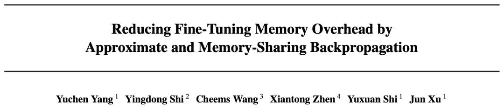
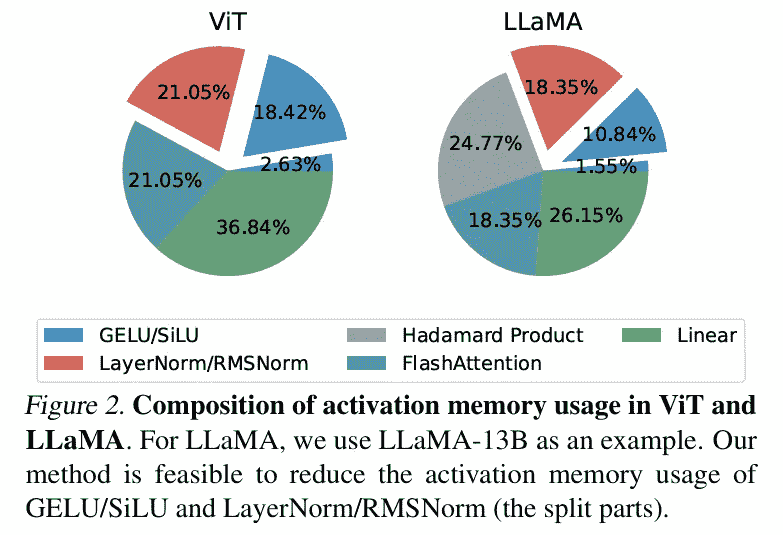
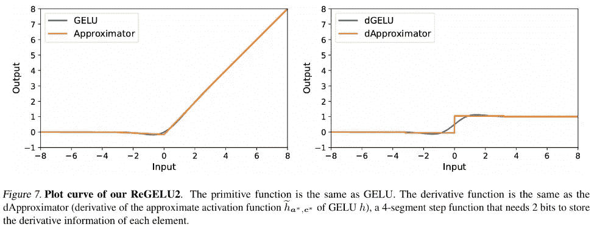
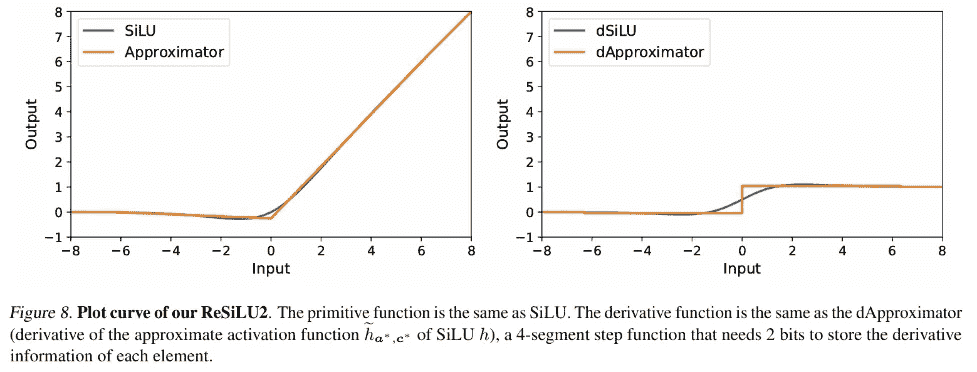
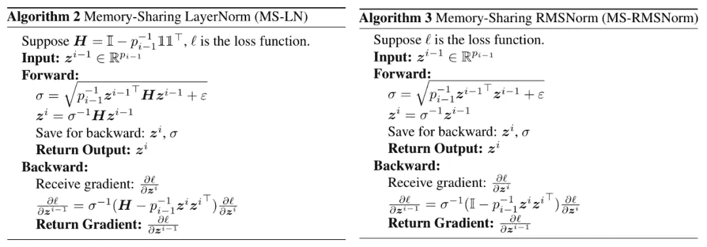
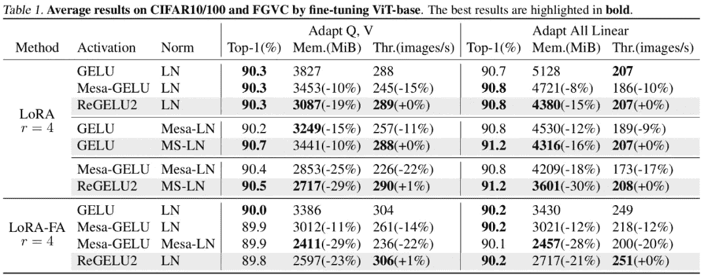
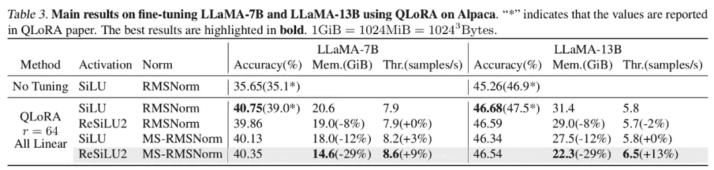
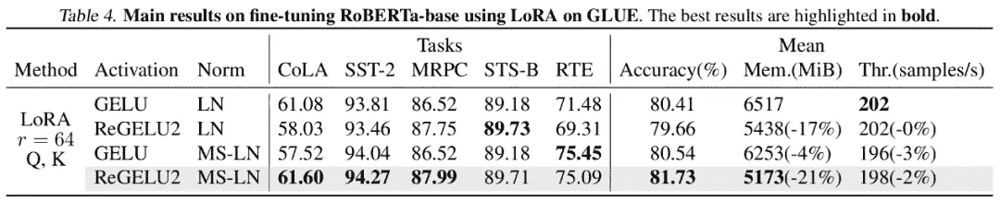

# ICML 2024 | 梯度检查点太慢？不降速、省显存，LowMemoryBP大幅提升反向传播显存效率

> 来源：[https://agijuejin.feishu.cn/docx/IgUhdYKD5oe8yfx9sObc0xxqn6e](https://agijuejin.feishu.cn/docx/IgUhdYKD5oe8yfx9sObc0xxqn6e)

> 机器之心｜[阅读原文](https://www.jiqizhixin.com/articles/2024-07-12-5)

> 转载请联系原作者取得授权

**本文论**文一作是南开大学统计与 数据科学 学院研二硕士生杨雨辰，指导老师为南开大学统计与 数据科学 学院的徐君副教授。徐君老师团队的研究重点是 计算机视觉 、生成式 AI 和高效 机器学习 ，并在顶级会议和期刊上发表了多篇论文，谷歌学术引用超过 4700 次。

自从大型 Transformer 模型逐渐成为各个领域的统一架构，微调就成为了将预训练大模型应用到下游任务的重要手段。然而，由于模型的尺寸日益增大，微调所需要的显存也逐渐增加，如何高效地降低微调显存就成了一个重要的问题。此前，微调 Transformer 模型时，为了节省显存开销，通常的做法是使用梯度检查点（gradient checkpointing，也叫作激活重算），以牺牲训练速度为代价降低反向传播（Backpropagation, BP）过程中的激活显存占用。

最近，由南开大学统计与 数据科学 学院徐君老师团队发表在 ICML 2024 上的论文《Reducing Fine-Tuning Memory Overhead by Approximate and Memory-Sharing Backpropagation》提出通过更改反向传播（BP）过程，在不增加计算量的情况下，显著减少峰值激活显存占用。

+   论文：Reducing Fine-Tuning Memory Overhead by Approximate and Memory-Sharing Backpropagation

+   论文链接：https://arxiv.org/abs/2406.16282

+   项目链接：https://github.com/yyyyychen/LowMemoryBP

文章提出了两种反向传播改进策略，分别是 Approximate Backpropagation（Approx-BP）和 Memory-Sharing Backpropagation（MS-BP）。Approx-BP 和 MS-BP 分别代表了两种提升反向传播中内存效率的方案，可以将其统称为 LowMemoryBP。无论是在理论还是实践意义上，文章都对更高效的反向传播训练提供了开创性的指导。

在理论显存分析中，LowMemoryBP 可以大幅降低来自 激活函数 和标准化层的激活显存占用，以 ViT 和 LLaMA 为例，可以对 ViT 微调降低 39.47% 的激活显存，可以对 LLaMA 微调降低 29.19% 的激活显存。

在实际实验中，LowMemoryBP 可以有效地使包括 ViT, LLaMA, RoBERTa, BERT, Swin 在内的 Transformer 模型微调峰值显存占用降低 20%~30%，并且不会带来训练吞吐量和测试精度的损失。

**Approx-BP**

在传统反向传播训练中， 激活函数 梯度的反向回传是严格对应其导函数的，对于 Transformer 模型中常用的 GELU 和 SiLU 函数，这意味着需要将输入特征 张量 完整地存入激活显存中。而本文的作者提出了一套反向传播近似理论，即 Approx-BP 理论。在该理论的指导下，作者使用分段线性函数逼近 激活函数 ，并用分段线性函数的 导数 （阶梯函数）替代 GELU/SiLU 梯度的反向回传。这个方法导出了两个非对称的内存高效 激活函数 ：ReGELU2 和 ReSiLU2。这类 激活函数 由于使用 4 段阶梯函数进行反向回传，从而使得激活存储只需要使用 2bit 数据类型。

**MS-BP**

BP 网络每一层通常都会将输入 张量 存入激活显存以用作反向传播计算。作者指出如果可以将某一层的反向传播改写成依赖输出的形式，那么这一层和后一层就可以共享同一个激活 张量 ，从而降低激活存储的冗余。

而文章指出 Transformer 模型中常用的 LayerNorm 和 RMSNorm，在将仿射 参数 合并到后一层的线性层之后，可以很好地符合 MS-BP 策略的要求。经过重新设计的 MS-LayerNorm 和 MS-RMSNorm 不再产生独立的激活显存。

**实验结果**

作者对 计算机视觉 和 自然语言处理 领域的若干个代表模型进行了微调实验。其中，在 ViT，LLaMA 和 RoBERTa 的微调实验中，文章提出的方法分别将峰值显存占用降低了 27%，29% 和 21%，并且没有带来训练效果和训练速度的损失。注意到，作为对比的 Mesa（一个 8-bit Activation Compressed Training 方法）使训练速度降低了约 20%，而文章提出的 LowMemoryBP 方法则完全保持了训练速度。

**结论及意义**

文章提出的两种 BP 改进策略，Approx-BP 和 MS-BP，均在保持训练效果和训练速度的同时，实现了激活显存的显著节省。这意味着从 BP 原理上进行优化是非常有前景的显存节省方案。此外，文章提出的 Approx-BP 理论突破了传统 神经网络 的优化框架，为使用非配对 导数 提供了理论可行性。其导出的 ReGELU2 和 ReSiLU2 展现了这一做法的重要实践价值。

欢迎大家阅读论文或者代码去了解算法的详细细节，LowMemoryBP 项目的 github 仓库上已经开源相关的模块。