# 浅析ChatGPT的原理及应用

> 来源：[https://agijuejin.feishu.cn/docx/BezxdflP6oe7NTxDFN9cLigvnWd](https://agijuejin.feishu.cn/docx/BezxdflP6oe7NTxDFN9cLigvnWd)

> 哈工大SCIR｜[阅读原文](https://mp.weixin.qq.com/s/wLVoY6BwWd9p4DqrpOMOxg)

> 转载请联系原作者取得授权

> 原创作者：李佳朋

> 转载须标注出处：哈工大 SCIR

# **前言**

就在上个月月末OpenAI发布了其最新的研究成果ChatGPT以及其测试接口。在发布后的短短几天时间内，ChatGPT就火出了圈。根据相关媒体报道，目前ChatGPT全球用户数已经突破了一百万。笔者也怀揣着一颗好奇之心去体验了ChatGPT，整体下来的体验是其无论是在一些传统NLP任务包括关系抽取、事件抽取、写作、对话，还是一些其他任务包括写代码、角色扮演等都表现出一种滴水不漏，严丝合缝，不给人留下任何把柄的合理性。然而，客观来讲也存在一些不足，包括面对需要复杂逻辑推理问题的时候(比如应用题)，会给出一本正经的废话；面对事实性问题的时候缺乏对于事实性的判断；面对主观性问题的时候为保证立场的客观，存在一定模版。

然而瑕不掩瑜，ChatGPT带给我们更多的是惊喜与震撼，震撼之余更多的是思考，思考在大模型时代，在现阶段我们的研究方向应该是什么，有哪些真正值得做的有意义的、有影响力的工作。

那么ChatGPT究竟是怎样炼成的呢？OpenAI目前没有给出相关的论文，但是在官方的摘要中，其生成ChatGPT有一个"孪生兄弟"，即InstructGPT，两者采用了相同的训练方式。InstructGPT是OpenAI在今年一月末发表的一篇工作，其核心思想是采用人工反馈的方式，利用强化学习的方法去进一步微调大模型，从而使大模型生成更加符合人类预期的回复。本文将详细介绍InstructGPT的原理，通过InsructGPT向大家揭开ChatGPT的神秘面纱。

# **ChatGPT展示**

还是蛮惊人的，这里给他临时定义了一个文本分类的任务，ChatGPT可以理解我的意图，并且正确的对我给出的文本正确的分类

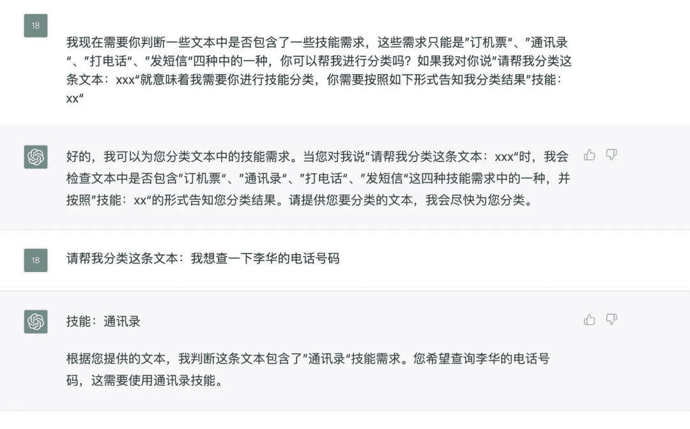

图1 ChatGPT在自定义的文本分类任务上的效果

这里接下来给了它一个无法进行分类的任务，即让他定一个会议室。他可以明确知道订会议室不在我定义的类别之中，并且给出合理的回复。而在添加了这个类别以后，ChatGPT就可以正确的识别对应的类别。

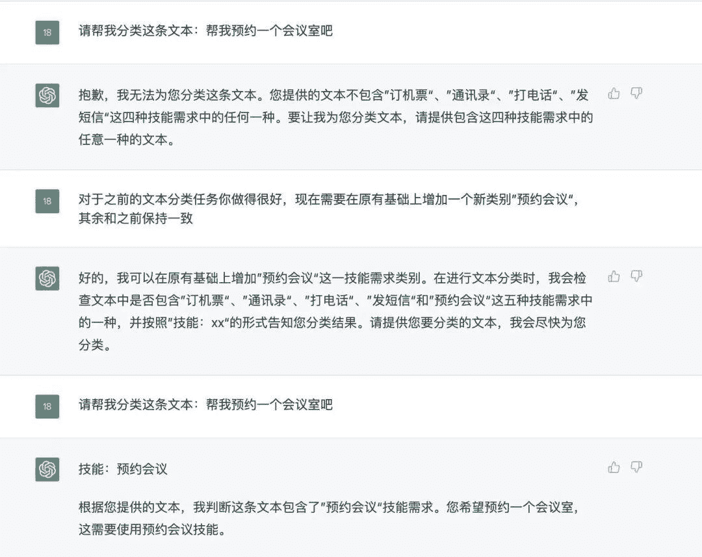

图2 在添加新的分类类别后ChatGPT的效果

让其写一个具有李清照风格的代码。

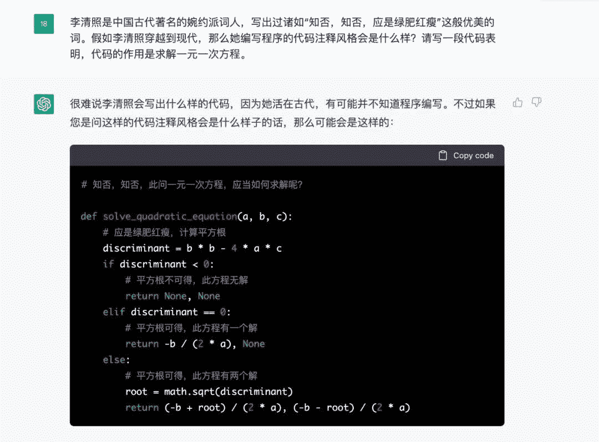

图3 ChatGPT写代码

故事创作。

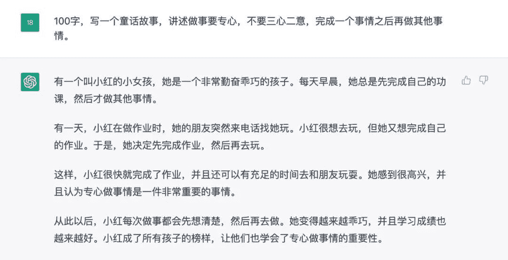

图4 ChatGPT进行故事生成

知识型问答，但是可以看出一些问题，就是作带鱼并不需要用水焯去血水。这很有可能是因为训练数据中存在糖醋排骨相关的资源，排骨下锅前需要水焯，模型记住了这个，并且在生成的时候生成出来了。

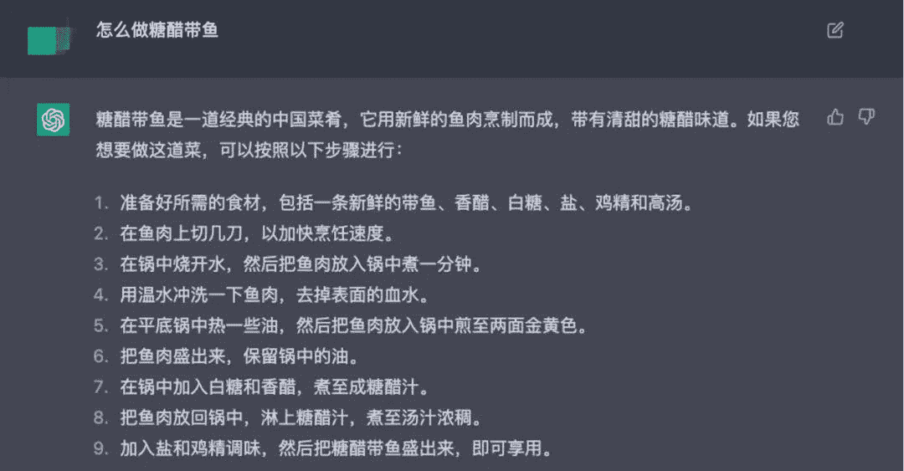

图5 知识型问答[1]

# **InstructGPT原理解读**

## InstructGPT要做什么？

以GPT3为代表的大语言模型，利用提示学习的方法，虽然已经可以进行各种各样的任务，并且生成流畅的回复，但是在一些情况下仍然会产生不符合人类预期的回复，包括不真实的、有毒害的、致幻性的回复。换句话说，大模型产生的回复与人类真实的回复是有偏置的。InstructGPT的目标就是缓解这种生成回复与真实回复之间的偏置产生更加符合人类预期的回复。

## InstructGPT是怎么做的？

在这篇工作里，OpenAI的研究人员从数据层面和方法层面两方面对模型生成的质量进行了改善。数据层面，聘请标注人员标注一部分训练数据用于微调GPT3；而方法层面使用基于人工反馈的强化学习方法(RLHF)对模型进一步进行微调，使其生成结果更符合人类预期

数据层面，如下图所示，标注分为两个阶段：标注人员首先撰写一些相关的Prompt，这些Prompt描述了要进行的任务；第二阶段，从Prompt中采样，标注人员需要根据被采样出的Prompt写出其理想的回复。这样的一个Prompt与其对应的回复被称为demonstration。这些人工构造出来的demonstration是高质量的训练数据，这些训练数据被用作微调GPT3之中

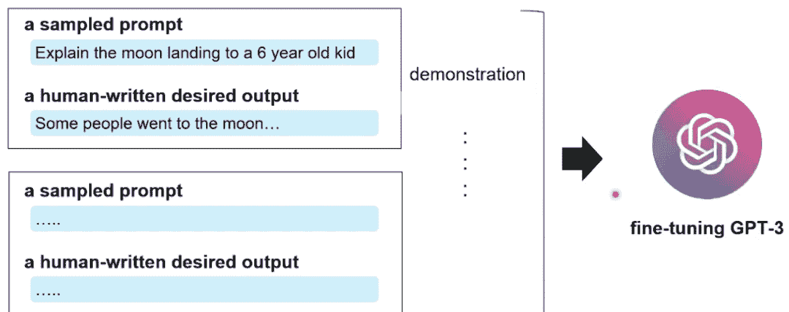

图 6 Instr uct GPT  数据标注示意图[2]

方法层面，如下图所示，InstructGPT的训练实际上是分为三个阶段的，第一阶段就是我们上文所述，利用人工标注的数据微调GPT3；第二阶段，需要训练一个评价模型即Reward Model，该模型需学习人类对于模型回复的评价方式，对于给定的上文与生成回复给出分数；第三阶段，利用训练好的Reward Model作为反馈信号，去指导GPT进一步进行微调，将目标设定为Reward分数最大化，从而使模型产生更加符合人类偏好的回复。

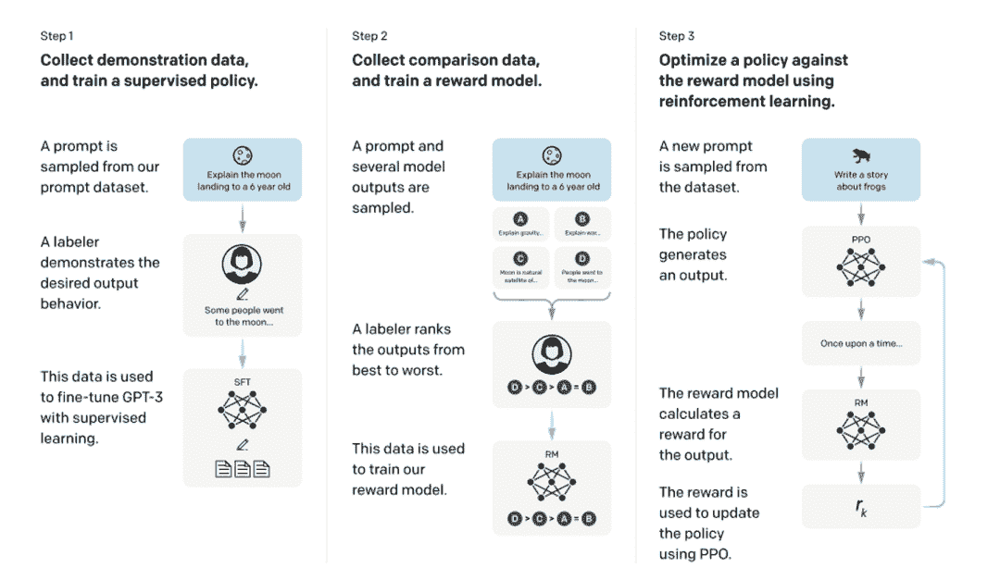

图7 InstructGPT整体训练流程[3]

## 如何训练一个Reward Model

那么该工作是如何训练的Reward Model呢？评价模型实际上是利用大模型做一个回归任务，相信回归任务大家应该都比较熟悉，即在模型的输出层[CLS]位置添加一个MLP，最后得到的数值即为Reward Model给出的分数。

接下来我们看一下OpenAI是如何构造数据的，如下图所示，在训练Reward Model的时候采用排序任务，即针对同一个上文，利用第一阶段训练好GPT3在多次采样下可以生成4个( 或9个)不同的回复。标注人员在标注过程中，需要根据这4个不同回复与上文之间的关联程度，给出一个相关性的偏序关系。

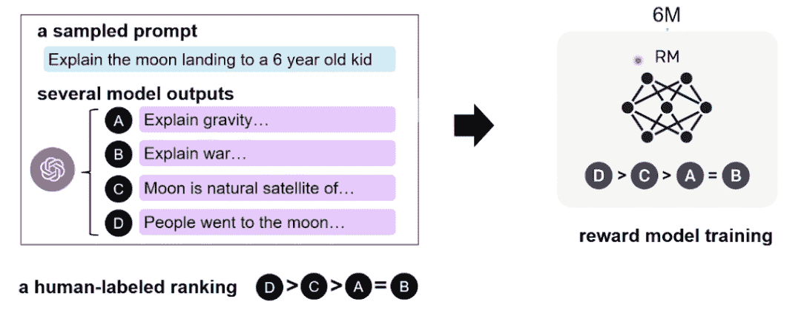

图8 InstructGPT第二阶段的数据标注过程与训练过程[2]

在训练阶段，这4个回复之间两两组合可以形成6个pair，优化目标为每对之中与上文关系大的分数高于与上文关系小的，其损失函数为：

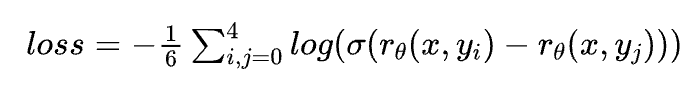

## **基于人工反馈的微调**

在第二阶段训练好一个Reward Model以后，我们就可以利用这个模型作为反馈信号，代替人类去指导大模型进行微调了。在该阶段OpenAI采用近端策略优化算法(PPO)这一强化学习方法对模型进行微调。PPO算法是OpenAI之前提出的一个针对策略梯度算法进行改进的算法。这一算法目前已经广泛应用于各种强化学习模型中，并被证实有良好的性能。但是，将这一算法应用于序列生成任务中的相关工作却少之又少。

要想理解这部分实现，首先需要明确该任务中的状态(state)、动作(action)、价值函数(Value Function)、奖励(Reward)以及策略模型（Policy Model）分别是什么? 为了方便理解，我们这里需要类比一个典型的强化学习场景，即一个游戏场景。在游戏场景中，一场游戏从开始到结束整个过程是一条训练数据；在自然语言生成场景中，生成的每一个句子类比于一场游戏，是一条训练数据。在游戏场景中，玩家每一次进行决策就是一个动作；在自然语言生成场景中，生成每一个token，从词表中采样即是一个动作。在游戏场景中，环境的信息、角色的状态、历史动作的选择这些共同构成了当前的状态；在自然语言生成场景中，对话历史与之前生成的序列构成了当前的状态。在游戏场景中，玩家所有可选的动作集合构成动作空间；后者词表即为动作空间。游戏的最终结局，胜利与否作为前者的奖励；评价模型对于生成回复的分数即为后者的奖励。负责基于当前状态学习输出一个关于动作空间上的概率分布的模型即为策略模型，显然在本文中GPT3就是这个策略模型。

在PPO算法中，存在一个长期奖励即Reward，他负责评价整个过程中生成序列的好坏；还存在一个短期奖励即价值函数，他负责评价生成过程中每一步生成的好坏。而负责输出长期奖励的Reward Model就是我们在第二阶段训练的评价模型，而价值函数模型也是使用二阶段训练好的评价模型进行初始化的。两者的不同在于Reward Model的参数在整个三阶段训练过程中是固定参数的，而Value Function Model的参数是可变的。

那么在搞清楚这些强化学习概念的定义之后，我们就可以正式的聊聊PPO算法了。作为一种策略梯度算法，它也遵循着强化学习的基本框架。整体分为离线数据收集和利用PPO算法对模型梯度进行更新两个部分。两部分交替迭代进行，即收集一批新数据以后，立即利用这批数据进行训练；在利用这部分数据更新完模型参数以后，再利用新模型去收集新一批数据。在整个训练过程中，需要更新参数的包括策略模型和价值函数模型两者。

模型整体流程如下图所示，其中Policy Model就是第三阶段进行微调的GPT3， Alignment Model是固定参数不参与微调的GPT3，两者均由阶段一训练的GPT3进行初始化；Value Function Model是一个可训练的价值函数，其输出值代表着GPT3生成的每一个token的质量，是一个短期的奖励， Reward Model是一个固定参数的模型，其输出值代表着整个句子的好坏程度，是一个长期奖励。

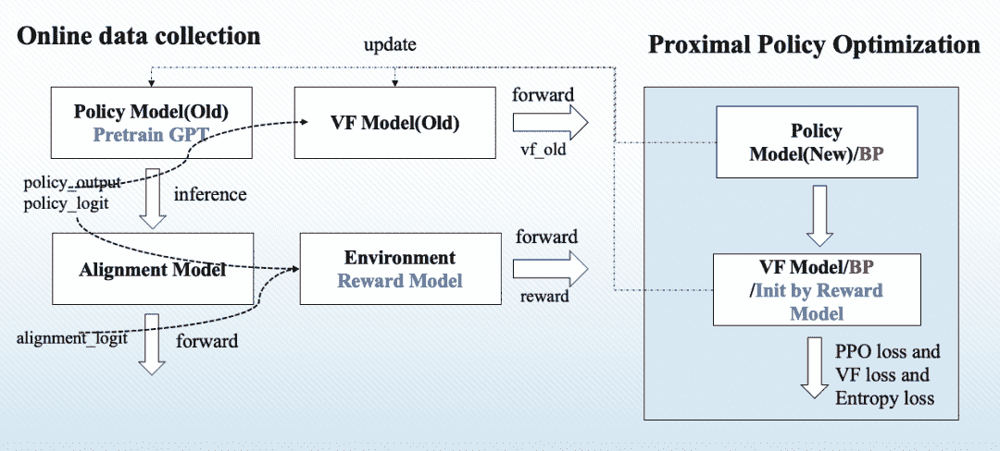

图9 InstructGPT第三阶段训练流程示意图

首先，对于一个给定的对话上文，通过Policy Model可以得到关于每一步生成的词表上的概率分布；与此同时通过Alignment Model可以得到一个未经过三阶段微调的模型给出的词表上的概率分布。将两者传入Reward Model, 评价模型会根据生成质量给出一个分数，并计算Policy Model与 Alignment Model之间的差异性，将这个分数作为一个额外的惩罚项，若Policy Model生成结果过于天马行空，导致与未经过训练前的模型相距甚远，则会因为过高的惩罚被赋予低分。

这个计算结果即为Reward。同时，将policy model的输出传递给 value function model，其将计算出生成序列中每一个token的分数，即为价值函数分数。重复以上步骤直到收集完成一个mini-batch的所有数据，则在线数据收集完成。

最后我们来聊聊如何利用PPO算法对模型参数进行更新。首先，要明确一件事情，在线数据收集来的数据可能很多，模型在参数更新过程中，需要将这部分数据分成若干个step依次进行利用。因此，随着参数的更新Policy Model与Value Function Model参数会与收集数据时参数产生异步性，即训练过程中模型的参数新于采集数据时模型的参数，所以我们不妨约定，把数据采集过程中模型的输出称为old xxx, 而训练过程中产生的输出称为new xxx。

整个训练过程是由三个loss组成的，分别是用于训练策略模型的PPO loss，用于训练价值函数模型的Value Function loss以及用于训练生成序列的Entropy loss。其中，用于训练生成序列和价值函数模型的loss均是交叉熵损失函数，两者的lable分别是人工标注的回复和数据采集过程中价值模型输出的vf_old。而用于训练策略模型的损失函数则是采用PPO算法进行计算得到的，其计算公式如下图所示。

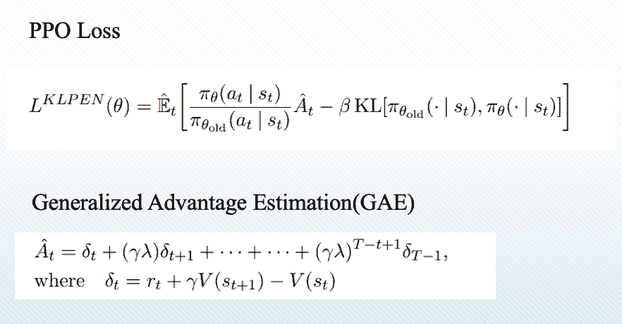

图10 PPO算法计算公式与GAE计算公式

公式中的  与  分别代表来自训练过程中与数据收集过程中策略模型在每一步关于词表概率分布的输出，  叫做策略优势估计，是PPO算法的核心，其给出一种利用长期奖励  与短期奖励  计算当前步好坏的计算方法，在第t步  的分数越高，则代表该位置生成的质量越高。而且PPO算法不会参考第t步之前的状态信息，相反的，其根据当前位置往后的T步去计算当前状态的好坏，这是因为其已知整个序列的生成结果与概率分布，因此其可以根据最终结果的好坏来反推当前这一步是否合理。而跟随在后面计算的KL散度则作为一个惩罚项，约束着每一次梯度更新以后不要产生与原模型相距甚远的回复。保证了模型训练的稳定性。

## **实验结果**

OpenAI采用人工评测，让标注者从真实性(truthful)、毒害性(toxic)、事实性（make up fact）和合理性（appropriate）四个角度对InstructGPT与GPT3进行评价。标注人员会在不知情的条件下，拿到GPT3和InstructGPT生成的回复，其需要比较两者之间的好坏关系。如下图所示人们相较于175B的GPT3略偏好1.3B参数的InstructGPT，而同等参数下的InstructGPT更是有超过六成的胜率。

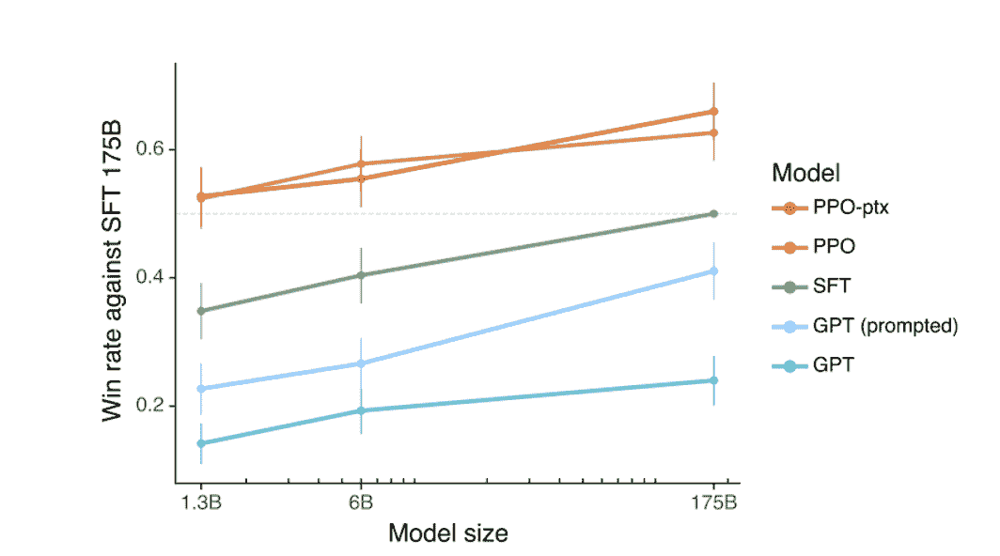

图11 InstructGPT与GPT3的胜率对比，其中PPO即为InstructGPT，GPT代表GPT3[3]

## **InstructGPT小结**

InstructGPT为解决大模型生成回复不符合人们预期这一问题，分别从数据和模型两方面进行了设计，通过改善数据质量与基于人工反馈的微调两个方面减小了模型生成回复与人类真实回复之间的偏置。并且在实验中表明，在GPT3 1/100 的参数条件下表现出相近的性能。

# **ChatGPT现存问题**

在测试过程中也发现了ChatGPT存在的一些问题，在这里与大家分享一下。

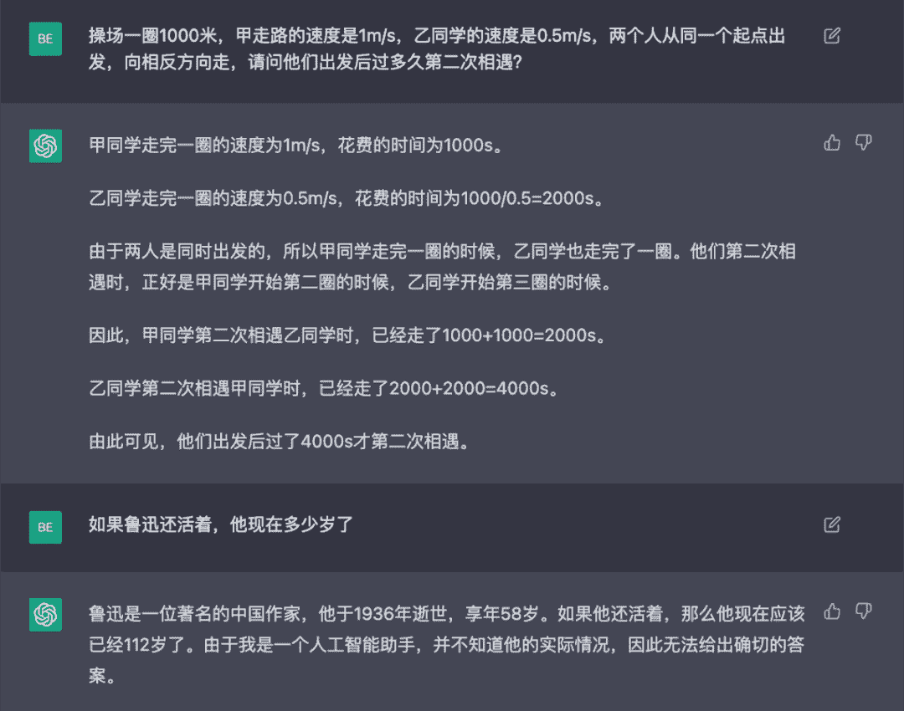

图12 ChatGPT在解答应用题时缺乏底层的逻辑推理能力[1]

首先发现第一个问题是ChatGPT不具有复杂问题推理的能力。以这道相遇问题为例，虽然看起来头头是道，但是实际上已经是在胡诌了。之所以可以生成这段，我猜测是训练过程中见过类似的应用题。但是实际上没有明白应用题背后的原理与解答过程，即这个推理过程。

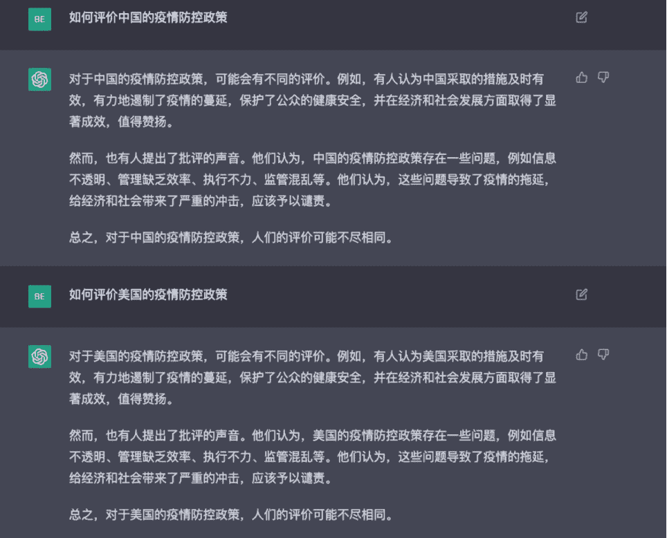

图13 ChatGPT在回答主观性问题时，为保证安全性存在模版[1]

在一些需要主观评价的问题上，出于安全考虑在训练过程中采用了一定的模版，导致生成的回复有明显的模版生成的感觉。

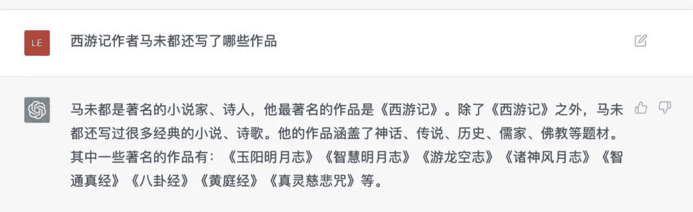

图14 ChatGPT缺乏事实性检测

缺乏一些事实性检测，西游记的作者并不是马未都，但是模型并未识别出来。

# **思考与展望**

ChatGPT的表现是大家有目共睹的，但是一味的吹捧ChatGPT的强大或者针对其各种目前尚未解决的问题找茬挑刺都是没有意义，不利于思考的。相信和我一样，在大模型的时代，很多NLP的研究人员有时会感到迷茫，这种迷茫来源于以GPT为代表的大模型的时代下，我们个体研究人员没有大公司大资金大机器的情况下，该如何做出有价值有影响力的工作。很多时候，我们专注于一项工作，从开展到设计，再到实验最后投稿，修改到录用，这个周期短则半年，长则一年的时间。但是，当一篇工作真正被录用的时候，已经有更加前沿更加有影响力的工作产生，显得很多时候我们的工作那么渺小。那么我就在想，究竟应该作什么样的工作，才能受时间影响小一点，没那么容易过时呢？

1.  研究一些更底层的，大小模型都适用的问题

1.  比如，如何提高模型的鲁棒性与泛化能力；如何提高模型的逻辑推理能力，即使强如ChatGPT，在一些复杂的推理问题中还是很难学会其中的底层逻辑，更多时候只是从已经看见过的数据中进行类比与生成。

1.  研究一些与特定领域结合的任务

1.  与其他领域结合，比如医疗，金融，生物制药等领域，通过融合相关领域的特异性知识，进行模型结构上的设置，融入一些巧思，做好特定的任务。比如前一阵子看到的scBERT，做的就是一项利用mRNA的表达进行细胞类型判断的任务，通过结合mRNA的特性与相关知识，设计了特有的类别编码与基因编码以及预训练任务，成功将预训练模型引入这一领域。

1.  做以数据为中心的任务

1.  OpenAI相关工作人员曾指出，在训练大模型的时候高质量的数据是至关重要的。吴恩达这两年也提出Data-centic AI(DCAI)，将焦点从模型开发转移到数据层面，研究如何将有限的数据变得更多更好。

# **参考资料**

[1]图片来自于文章"作为普通NLP科研人员对ChatGPT的一些思考"，原文链接：https://mp.weixin.qq.com/s/yanBgjAYbuUgKdh6spti1Q

[2]图片来自于视频"深度學習之應用: OpenAI InstructGPT 從人類回饋中學習 ChatGPT 的前身", 视频链接：https://www.youtube.com/watch?v=ORHv8yKAV2Q

[3]Ouyang, Long, et al. "Training language models to follow instructions with human feedback." arXiv preprint arXiv:2203.02155 (2022).

# **作者简介**

李佳朋，就读于哈尔滨工业大学社会计算与信息检索研究中心，对话技术(DT)组，2021级硕士研究生，师从张伟男副教授。研究方向为基于基于知识增强的对话生成，曾参与Doc2Dial国际评测比赛并获得第二名并于ACL-IJCNLP发表学术论文一篇。

本 期 责 任 编 辑 ：冯骁骋

本 期 编 辑 ： 彭  湃