# AI研究的主要推动力会是什么？ChatGPT团队研究科学家：算力成本下降

> 来源：[https://agijuejin.feishu.cn/docx/Unfhd57EOoPmKQxfFPNc22Hsn5c](https://agijuejin.feishu.cn/docx/Unfhd57EOoPmKQxfFPNc22Hsn5c)

> 机器之心｜[阅读原文](https://www.jiqizhixin.com/articles/2024-06-17-8)

> 转载请联系原作者取得授权

AI 研究发展的主要推动力是什么？在最近的一次演讲中，OpenAI 研究科学家 Hyung Won Chung 给出了自己的答案。

近日，斯坦福大学《CS25: Transformers United V4》课程迎来了一位我们熟悉的技术牛人：Hyung Won Chung。

Chung 是 OpenAI ChatGPT 团队的研究科学家，博士毕业于麻省理工学院，之后曾在谷歌从事了三年多的研[究工作，参与了 PaLM、Flan-T](http://mp.weixin.qq.com/s?__biz=MzA3MzI4MjgzMw==&mid=2650893355&idx=1&sn=5911ccc05abf5177bb71a47ea5a748c8&chksm=84e4a855b39321434a2a386c9f359979da99dd441e6cf8f88062f1e909ad8f5b9b24198d1edb&scene=21#wechat_redirect)5 和 BLOOM 等多个重要项目。 机器之心 之前曾报道过他的另一个热门演讲： 《OpenAI 科学家最新大 语言模型 演讲火了，洞见 LLM 成功的关键》 。

在这次演讲中，他将阐述 AI 研究的主要推动力并尝试通过 Transformer 的发展（尤其是编码器 - 解码器 Transformer 和仅解码器 Transformer 的比较）来理解这个主要推动力。因此，这并不是一次关注技术细节的演讲，而是侧重于分享观点。

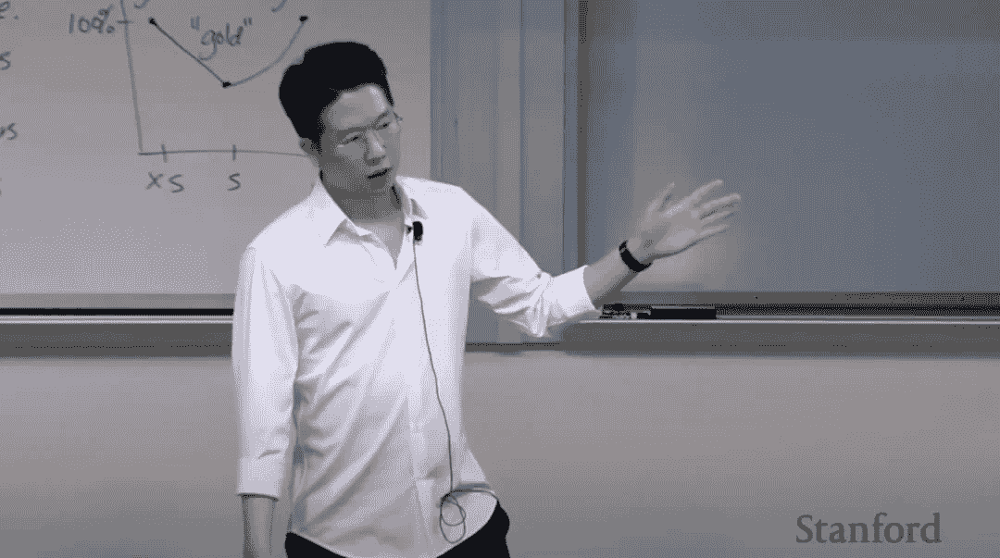

演讲开篇，Chung 向来听讲的学生表示了鼓励：「这间教室中的某些人将会塑造 AI 的未来。」

而要洞见未来，我们必须了解历史。这就引出这次演讲的核心：Transformer 的早期历史以及一些 Transformer 架构。

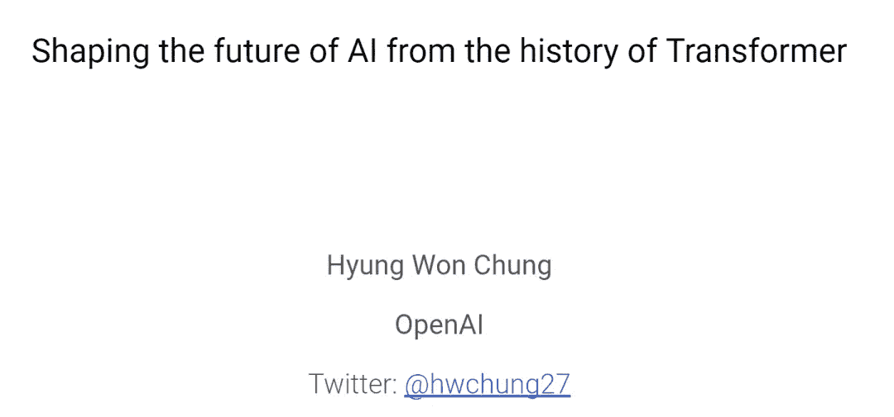

众所周知，AI 领域发展很快，让人难以追赶，而且就算是经验丰富的研究者，也不可能了解所有最新进展；与此同时，人们对过去的关注却不够，因为它们看起来似乎已经过时无用了。

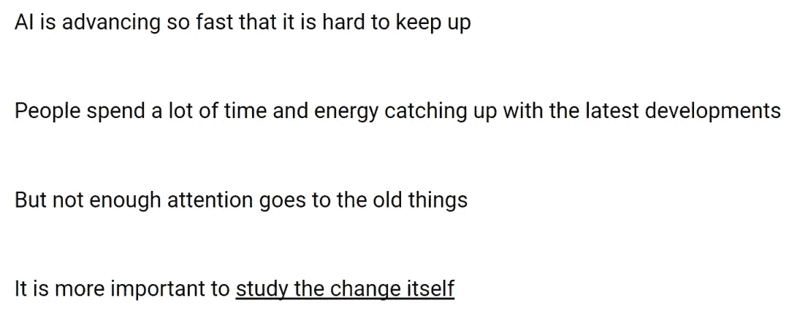

但 Chung 认为回首过去是很重要的，当然他所指的并不是去研究过去的技术，而是研究「变化（change）」本身，也就是通过了解过去来理解现在，从而洞见从过去到现在的发展之路，然后基于此展望未来。

具体来说，为了研究「变化」，我们可以按以下三步进行：

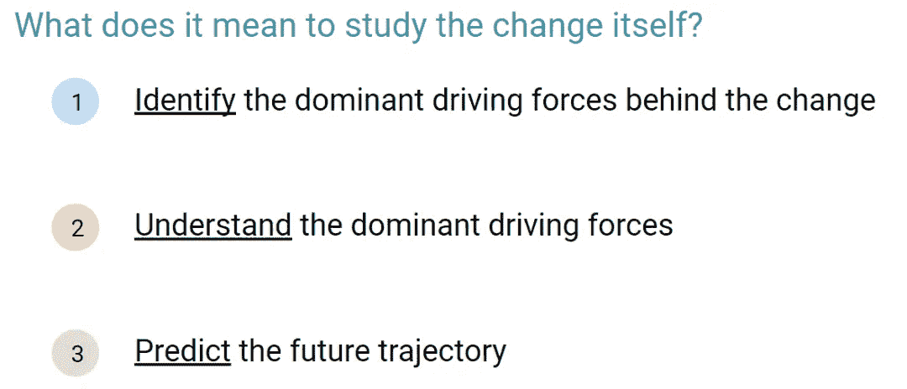

首先，我们需要找到这一变化背后的主要推动力。当然，变化的推动力往往很多，这里关注的是主要推动力。然后，理解这些主要推动力。之后便可以基于这些理解来预测未来的发展方向。

为了佐证自己的观点，Chung 在现场做了一个小实验：丢笔。

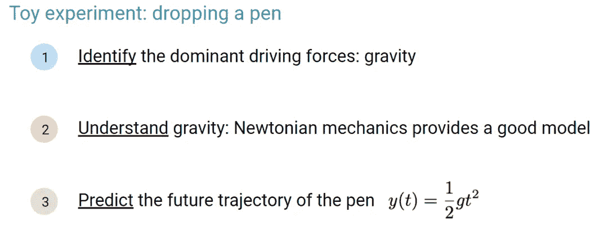

首先，找到导致笔落下的主要推动力：重力。这里忽略摩擦力等其它因素。

接下来理解重力：牛顿力学能提供一个很好的模型。

之后，基于该模型，我们就能预测这支笔的未来运动轨迹。

当然，这个示例非常简单。在日常生活和工作中，一般意义上的预测未来却非常困难，因为其涉及大量复杂驱动力的互相交织，以至于我们几乎无法办到。如下图所示，预测难度会随主要推动力的数量增长而大幅提升。

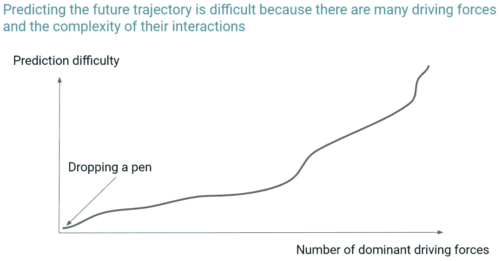

那这和 AI 领域有什么关系呢？

如今的 AI 领域堪称百花齐放，几乎每天都有新技术、新模型、新智能体、新 基准 、新产品等等出现，人们已经无力紧跟每一项最新进展了，那么我们该如何预测 AI 研究的未来呢？

**AI 研究的主要推动力是什么？**

类似地，我们首先需要找到 AI 研究的主要推动力。Chung 认为确实存在着一个推动大量甚至全部 AI 研究的主要推动力，而且这个推动力可能比我们之前预想的更简单一些 —— 也就是更靠近以上图表的左侧。

那么这个主要推动力是什么呢？

首先来看 Rich Sutton 做的一张图。其中，y 轴是 1 美元所能买到的算力（请注意这是对数刻度）, x 轴是时间。

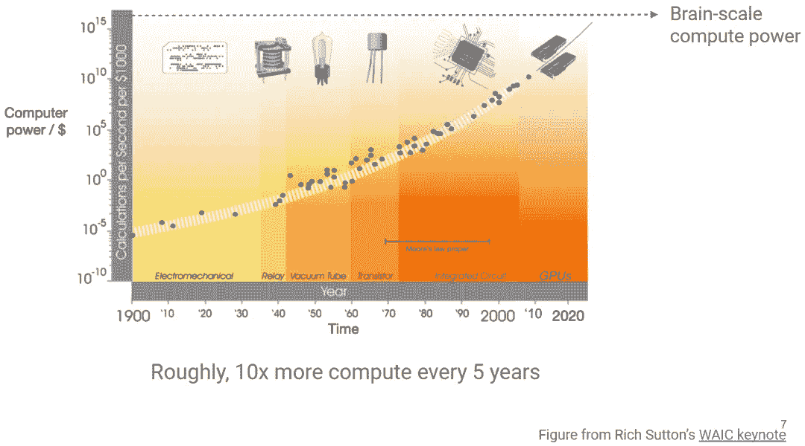

**可以看**到，其变化趋势几乎就是指数级的 —— 每隔 5 年，算力成本就会降低 10 倍。这是一个非常强大且已经持续了 100 多年的趋势。这种趋势是无可抗拒的；我们需要思考该如何去利用这样的趋势。事实上，这正是 AI 研究的主要推动力，是 AI 实现 scaling（规模扩展）的基础。

算力成本指数级下降如何推动了 AI 研究呢？

这要从 AI 研究者的工作谈起。AI 研究者的工作是教会机器学会普适性的思考，而人们通常采用的方式以某种数学方式建模我们自身思考的方式，然后将其集成到机器之中。

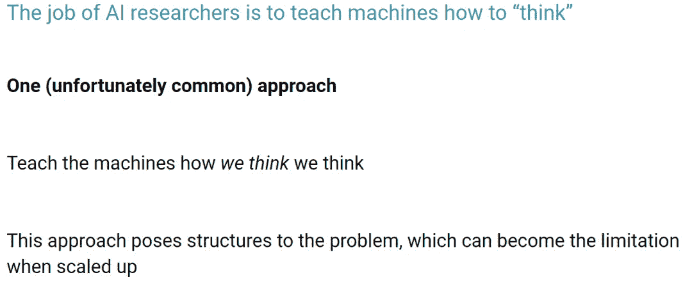

但问题来了：我们并不完全理解我们自身的思考方式。因此，AI 研究者其实是在建模一种他们根本不了解的东西。这种方法自然存在根本性缺陷。

如果采用这种范式，也确实能得到一些解决问题的结构，然后 AI 研究者可以基于此写出一些研究论文并开发出一些工具，但之后这就会变成一个瓶颈，限制进一步的扩展。更根本的问题是，这会限制给予机器的自由度，进而在某个时候造成适得其反的结果。

Chung 表示，这种情况已经持续了几十年。他谈到了[ Rich Su](http://mp.weixin.qq.com/s?__biz=MzA3MzI4MjgzMw==&mid=2650908360&idx=4&sn=9999edc950e928b03584247df2ca7b7e&chksm=84e462b6b393eba0793d2b52b912f18e037fdb45103e54216709e62dbab31c15863f15c07d8c&scene=21#wechat_redirect)tton 写的一篇文章 《苦涩的教训》 ，他也认为这是「AI 领域最重要的一篇文章」。

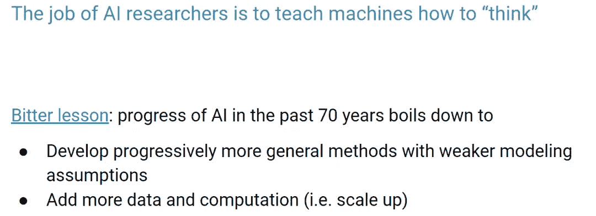

简单总结起来，这篇文章写到过去 70 年 AI 领域的发展可总结成使用越来越弱的建模假设来开发越来越通用的方法，同时使用更多数据和计算量（即规模扩展）。举个例子，从技术角度看，2000 年左右的 AI 的设计方法就比现在 AI 的更困难。

这是 AI 研究领域一直以来的范式，并没有什么新奇的地方。

但现在的 AI 却远比 2000 年的 AI 强大。Chung 在此给出了自己的关键洞见：计算成本的下降是指数级的，这就意味着成本降低的速度超过了 AI 研究者精进自身的速度，而 AI 研究者不应该去对抗这种大势，而应当尽力去利用它。

接下来 Chung 通过一张图表进行了说明。

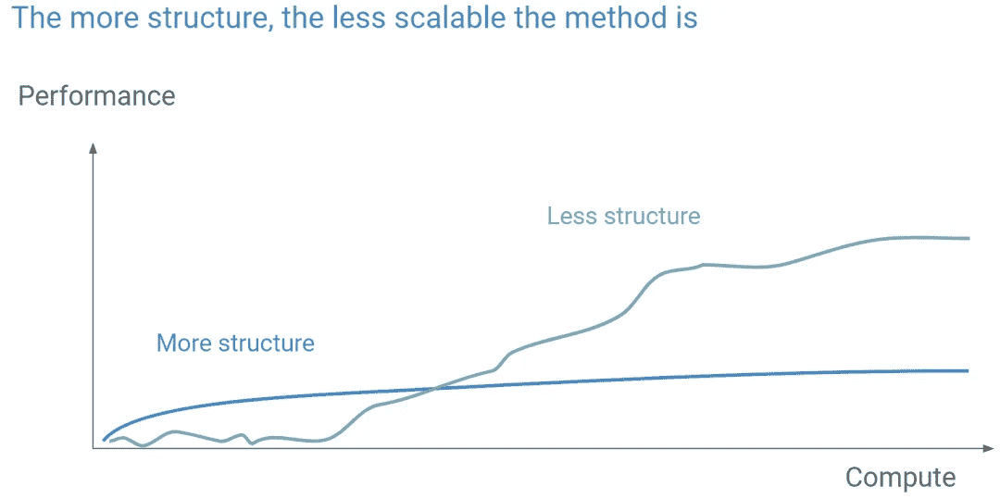

图中，x 轴是计算量，y 轴是性能，两条线则各自表示一种范式。More structure（更多结构）是指采用更多建模假设、更精妙的数学形式等复杂设计的范式，相对的就是 Less structure（更少结构）范式。

可以看到，当计算量较少时，更多结构范式的表现通常更好，但是由于某种结构上的瓶颈，就算增大计算量，其性能也难再进一步提升。而对于更少结构范式，由于模型的自由度更高，因此一开始其效果不佳，而随着其获得的计算量增长，它也开始有效果了并还越来越好。因此这种范式更具扩展性。

这就意味着我们应该直接选择结构最少、模型最自由的方法吗？

答案当然是否定的。

我们可以思考一下结构还要进一步更少的情况，如下图中的红线所示。此时要让模型有效，所需的计算量将大幅增长。

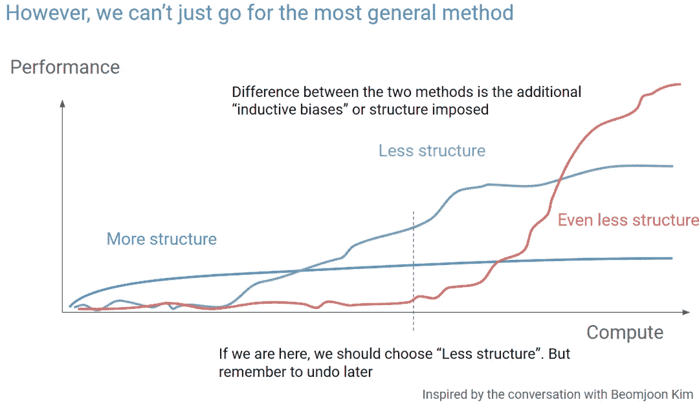

因此，结构的多少取决于我们现在的实际情况。我们不可能什么都不做，只是无限地等待下去，直到出现最通用的情况。

假设我们现在处于图中竖直虚线的位置，那么选择「更少结构」就比选择「进一步更少结构」更好，因为后者对现在的我们毫无用处。

但关键需要记住：添加一些结构的原因是算力不够。之后算力足够时，我们可以移除这些结构。

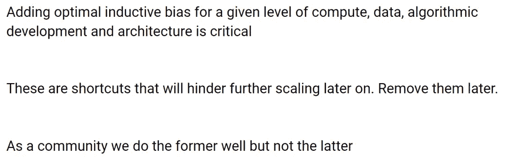

也就是说，在给定的计算量、数据、算法和架构下，存在一个最优的归纳偏置或结构。这实际上也是当前 AI 领域各种进展的原因。但是，这些归纳偏置或结构会阻碍未来进一步的规模扩展，因此当未来有更多算力或更少的算法等时，就需要将它们移除。

Chung 表示，AI 研究社区在添加结构方面做得很好，因为这能用来发论文；但在移除结构方面做得还不够，因为这没多少好处。他呼吁 AI 研究社区更多关注这一方面。他说这也是一个苦涩的教训，并表示：「长期来看更好的东西在短期来看几乎必定更糟糕。」

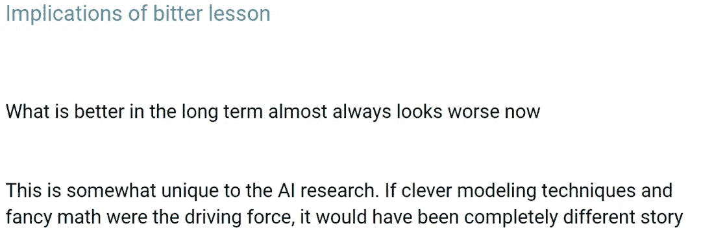

他认为这算是 AI 研究领域的一个特有现象，因为当前的 AI 研究范式是基于学习的方法，也就是说让模型自由地选择学到什么。而正因为模型获得了学习的自由，所以早期的时候情况显得很混乱，效果也不好。然后，随着投入的算力增多，模型也越来越好。

总结一下：AI 研究背后的主要推动力是：成本指数级下降的算力和相关的规模扩展。

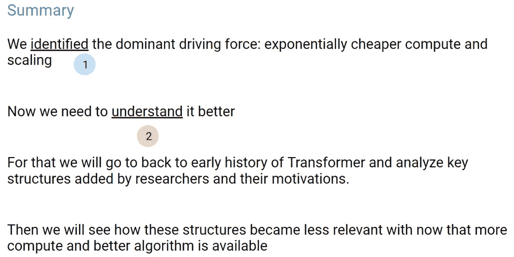

用 Transformer 的发展历程理解 AI 研究的主要推动力

找到了 AI 研究的主要推动力，接下来我们就需要理解它，这也是 Chung 这次演讲的重点。为此，Chung 将带我们一道回顾 Transformer 的发展历史，分析不同时期研究者做出的关键结构选择及其原因 —— 这些结构选择在当时是否为最优的可能已经不重要，我们现在或许也应该移除它们了。

现在稍微加点技术内容：Transformer 架构是怎样的？

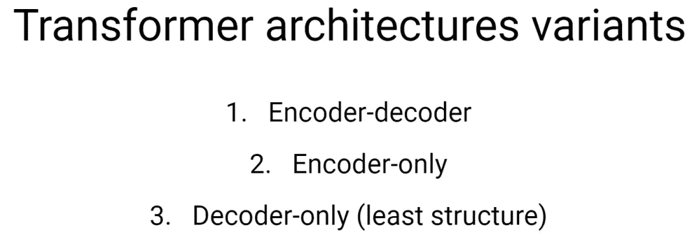

Transformer 有多种变体。Chung 将探讨其中三种：编码器 - 解码器、仅编码器、仅解码器。其中编码器 - 解码器 Transformer 是原始版本的 Transformer，其结构也更多；仅编码器 Transformer 的代表是 BERT；而仅解码器 Transformer 家族则包括 GPT-3 等 语言模型 ，其结构远少于编码器 - 解码器版本。

仅编码器 Transformer 虽然有些用途，但实际上在大多数情况下并不很有用，因此 Chung 先简单谈了谈它，然后重点比较了编码器 - 解码器 Transformer 与仅解码器 Transformer。

我们首先在一个非常高的层级上看看 Transformer：Transformer 是一种序列模型，而序列模型的输入为一个序列，而序列中的元素可以是词或图像等等。这是一个普适的概念。

在下图的示例中，序列元素是词，而词构成的序列就是句子：「Unicode characters like emojis may be split.」。

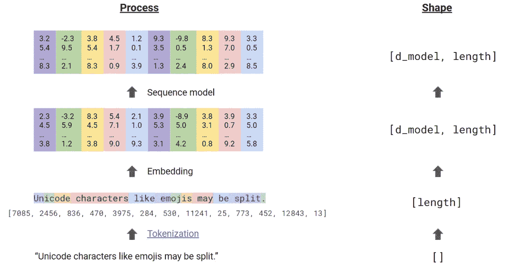

首先，第一步是 token 化。这需要某种编码方案，从而以计算机能理解的方式表示词。这里是将序列 token 化为一定数量的整数，从而得到一个整数序列。

然后，现在的主导范式是将每个序列元素表示成一个向量，从而得到一个向量序列。

最后就要用到序列模型了，其目标是建模序列元素之间的交互关系，具体的做法就是计算这些向量元素之间的点积。如果点积较高，则可以说它们关联得更紧密。

Transformer 这类特殊的序列模型使用了所谓的注意力（attention）来建模这种交互关系。

编码器 - 解码器 Transformer

下面深入原始的编码器 - 解码器 Transformer 的细节：

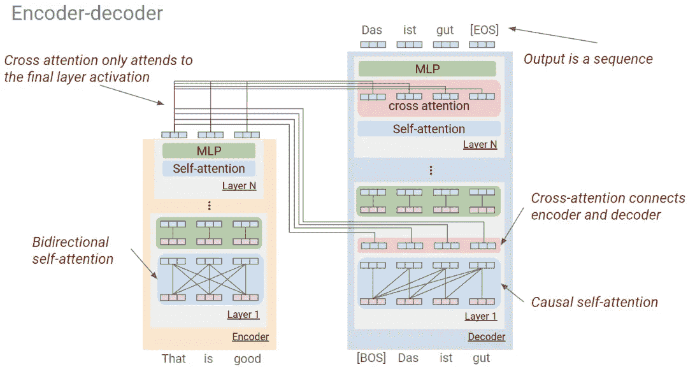

可以看到，它有很多组件，而它在这里需要执行一个 机器翻译 任务：将英语「That is good」翻译成德语。

我们先看向左侧，这是其中的编码器。首先，它需要将那句英语编码成密集向量（图中表示成了大小为 3 的向量）。然后，执行点积，也就是图中的线 —— 可以看到，这里的每个 token 都连接了所有其它 token。这被称为双向 自注意力 （bidirectional self-attention）。

之后是一些 MLP 或前向层。它们不进行交互，只是为各个 token 执行一些乘法。

而这只是其中一层，实际的 Transformer 编码器会重复 N 层。

最后会得到一个向量序列，其中每个向量都表示一个序列元素（这里是词）。这就是编码器的输出。

然后看向右侧的解码器。同样这也会 堆叠 很多层。

训练时，向解码器输入应该得到的答案：[BOS] Das ist gut。其中 [BOS] 是指「序列开始」。

同样，将其编码成密集向量，只是之后使用的注意力是因果 自注意力 （causal self-attention），也就是说时间步骤 t 的 token 只能关注 t 以及之前的 token，因为当模型开始生成翻译结果时，它无法看到未来的 token。在训练时，这可以通过掩码（masking）方法来实现。

之后，同样的重复 N 层，最后得到输出序列：Das ist gut [EOS]。其中 [EOS] 是指「序列结束」。因此这是一种 序列到序列 的 映射 。

这就是编码器 - 解码器 Transformer 的总体概况。接下来 Chung 指出了某个重要的注意力模式，也就是将解码器和编码器连接起来的跨 注意力机制 （cross-attention mechanism）。具体来说，对于编码器输出的序列中的每个向量表征，解码器应该关注其中一些。有趣的是，解码器中的所有层关注的都是解码器最终层的输出。

仅编码器 Transformer

暂时请记住这一设计，后面会用。我们先看另一种架构：仅编码器 Transformer。

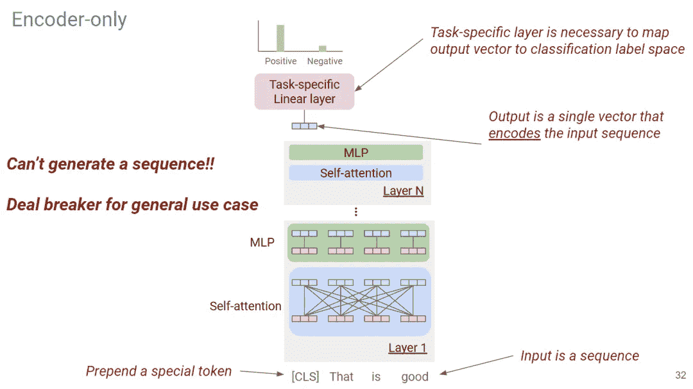

可以看到，仅编码器 Transformer 与编码器 - 解码器架构的编码器部分基本一样。

以同样的输入为例（前面增加了一个特殊 token [CLS]），经过编码器处理后，这里会得到表示整个序列的单个向量（而不是一个序列）。

假如这里的任务是情绪分析，就需要在后面增加针对该特定任务的层，以将这个向量 映射 成分类标签（这里是积极和消极）的概率。

这类架构的杰出代表是 BERT。2018 年 BERT 刚问世就在语言理解任务 基准 GLUE 上刷榜了，因为大多情况都可以将序列放入分类标签中。

Chung 表示这就是当时 AI 领域取得的进步。在我们考虑解决问题时，我们通常希望简化问题，然后向问题添加结构来取得进展，但这里新增的结构其实是放弃生成部分。这样一来，问题就简单多了：不再是 序列到序列 ，而是序列到分类标签。

基于此，在 2018 和 2019 年那两年，涌现了很多研究 BERT 的论文。Chung 打趣地说：「我们称之为 BERT 工程。」实际上就是对 BERT 做一些细微的修改，使之在 GLUE 基准 上提升一点点，然后写一篇论文。那时候很混乱，但如果高屋建瓴地看，放弃生成序列的做法确实能带来很大的性能增益，但难以长期持续，所以实际上用处不大。因此，后面也不会过多谈及仅编码器 Transformer。

仅解码器 Transformer

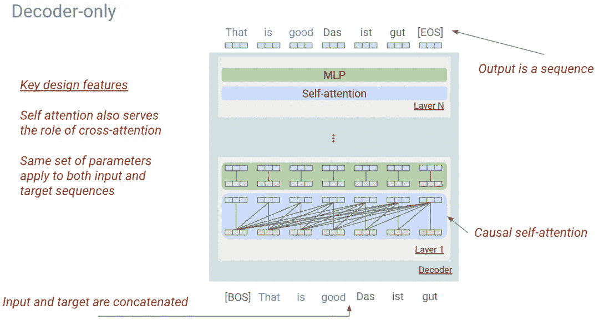

Chung 表示仅解码器 Transformer 是他的最爱。乍一看这似乎很复杂，但那其实都是注意力，这个架构实际上很简单。

对于仅解码器 Transformer，有的人有一个误解：该架构的作用是语言建模的下一 token 预测，不能用来 监督学习 。但实际上可以做到，其诀窍就是将输入与目标输出连接起来。这样一来，就变成了简单的 序列到序列 。

其中因果 自注意力 机制的作用有两个：处理目标序列和输入序列之间的交叉注意力以及实现每个序列之中的 自注意力 学习。这里的关键设计是 自注意力 也能作为跨注意力，并且输入和目标在一定程度上共享 参数 。

将编码器 - 解码器变成仅解码器

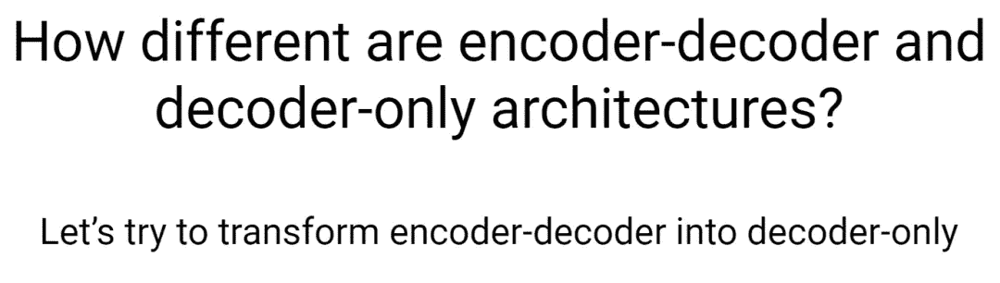

接下来，通过将结构更多的编码器 - 解码器 Transformer 变成仅解码器 Transformer，Chung 将带我们看到并理解这两种架构之间的差异。

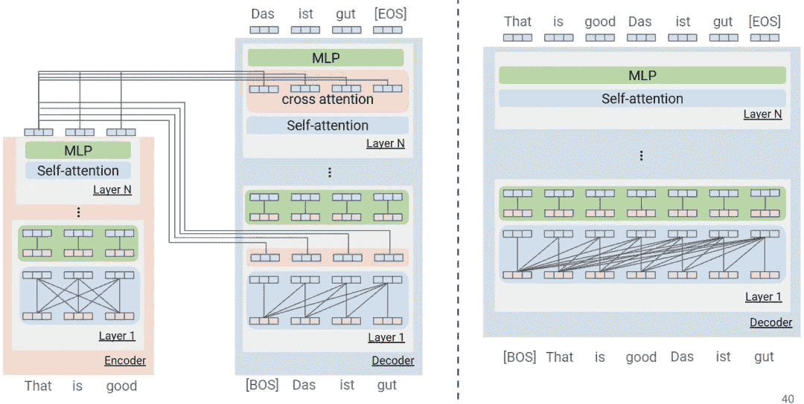

首先在跨注意力方面，如上图所示，左侧的编码器 - 解码器有粉色标记的跨注意力，而右侧的仅解码器没有。如果我们想把左侧架构变成右侧的，那么就需要去掉这些跨注意力。 注意力机制 大概有 4 个投射矩阵，并且 自注意力 和跨注意力实际上有同样的 参数 量和形状，因此可以选择共享它们。这样一来，它们就变成了基本一样的注意力。

第二个差异是 参数 共享，也就是说在输入和目标序列之间，编码器 - 解码器架构使用了不同的 参数 ，而仅解码器只有一个堆栈，也就是使用了共享 参数 。因此，如果要将左边变成右边，就需要共享左边的编码器 参数 。

第三个差异是目标到输入的注意力模式。在编码器 - 解码器架构中，这是通过跨注意力实现的；而在仅解码器架构中，都是 自注意力 。差异在于，在编码器 - 解码器架构中，解码器中的每一层都关注编码器的最终层输出；而在仅解码器架构中，则是在各层本身之中。为了将左侧变成右侧，就需要将注意力带回各层之中。

最后一个差异是输入注意力。编码器 - 解码器架构有双向注意力，而仅解码器有单向注意力。为了让它们匹配，这里的做法很简单：直接去掉编码器 - 解码器架构中的一个方向。

这样一来，这两种架构就几乎一模一样了，只在跨注意力有一点差异，但它们的 参数 量是一样的。Chung 表示，如果使用同样的方法和数据针对同样的任务训练它们，那么得到的结果也会差不多，因此可以说它们是一样的。

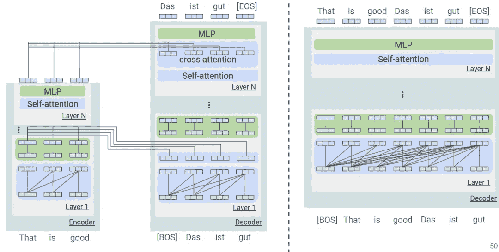

下表总结了这四项差异：

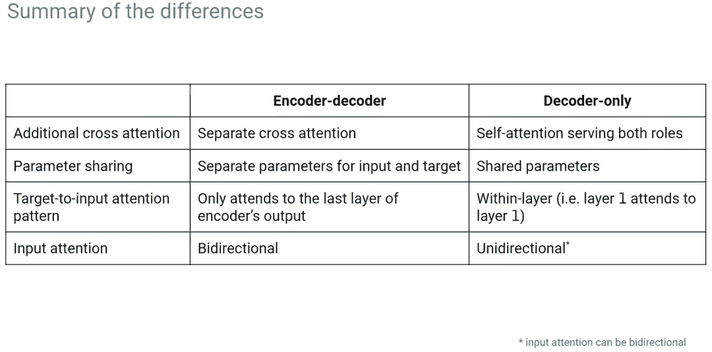

那么相比于仅解码器 Transformer，编码器 - 解码器架构多了哪些结构呢？

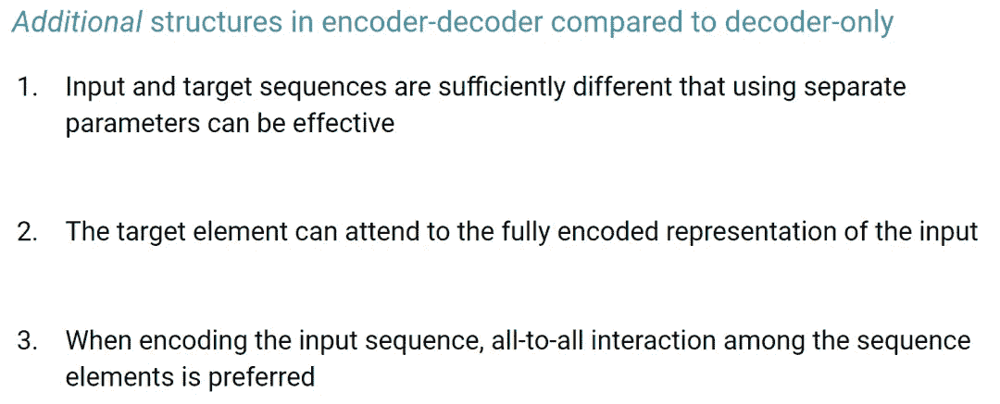

首先，在编码器 - 解码器架构中，输入序列和目标序列足够不同，因此对该架构而言，分开使用不同的 参数 是有效的。

Chung 继续以 机器翻译 为例进行了说明。在 2017 年 Transformer 刚诞生的时候，翻译是一个非常受欢迎的任务，因为其难度还很大；而且这还是一个 序列到序列 任务，可以通过一个 GLUE 分数来度量，从而为研究者提供一个优化 基准 。

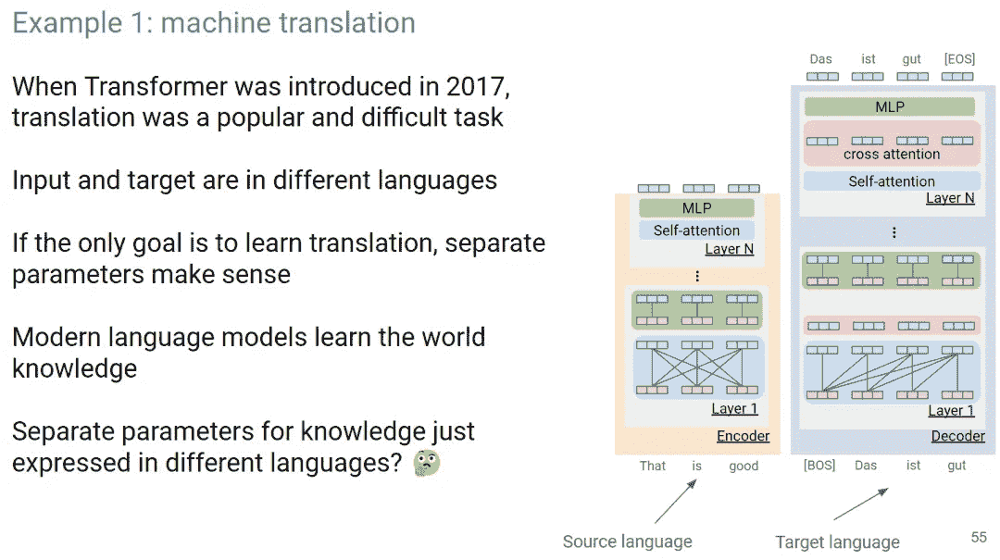

在 机器翻译 任务中，输入和目标是不同语言的序列。如果模型的学习目标就只是执行翻译，那么让编码器中的 参数 处理英语并让解码器中的 参数 用于德语就是非常合理的做法，也是很自然的做法。

但现在的 语言模型 就不只是执行翻译了，甚至都可以说不只是关于语言的，而是为了学习知识。Chung 表示这些能力都是「下一 token 预测的副产品」。那么，在这种情况下，对于同样的知识，如果只是语言不同，再将 参数 分开还合理吗？Chung 认为这并不合理，也不自然。而且也正是因为没有分开，现代 语言模型 所能做的事情要多得多。

Chung 又给出了另一个例子。这是他两年前还在谷歌时做的一项有关指令微调的研究《Scaling Instruction-Finetuned Language Models》。简单来说，该研究就是使用学术数据集来微调已经完成预训练的模型。

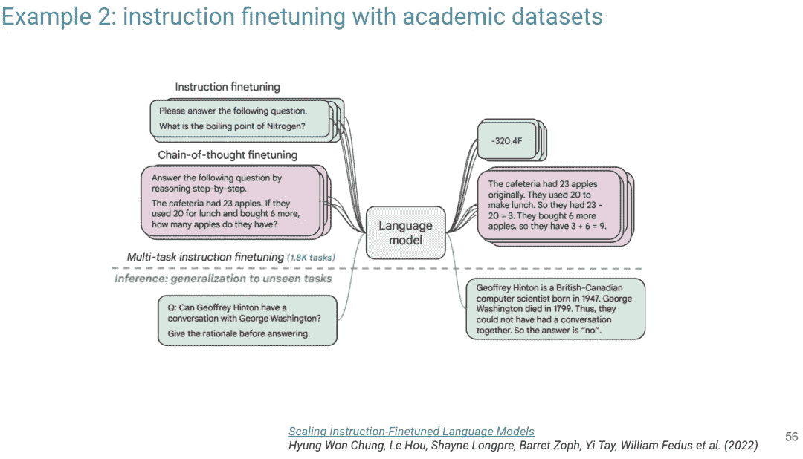

这里我们来看看对两个不同的架构进行指令微调所获得的增益。如下图所示，上面五个数据基于模型 Flan T5，这是一种编码器 - 解码器架构的模型；下面的 PaLM 则是仅解码器架构。

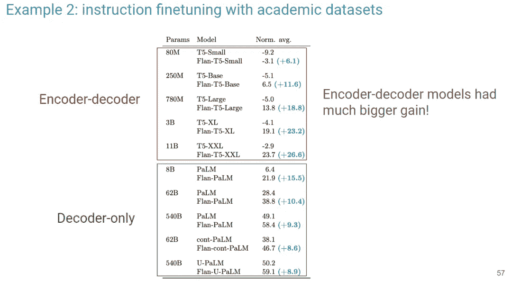

Chung 表示，他们花了大量时间来优化 PaLM，而对于 T5 则仅仅用了三天，结果 T5 获得性能增益却要大得多。

Chung 说：「我当时对此深感困惑。」因此在这篇论文发表之后，他又做了进一步的研究，希望找到这一现象背后的原因。他的假设是这与长度有关。

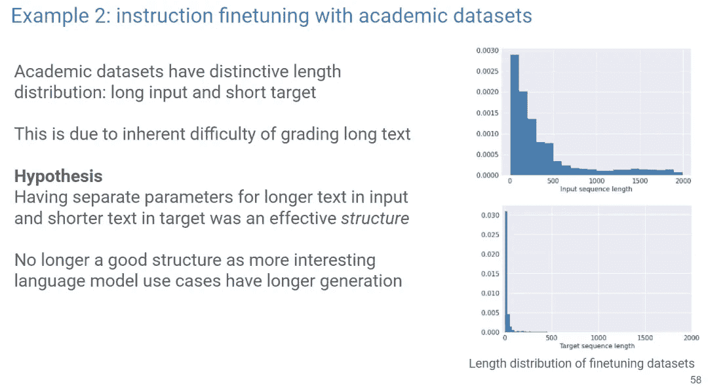

他们使用的学术数据集包含 1832 个任务。这些任务基本都有一个特点：输入长但目标输出短。输入长的原因是让任务变得复杂和困难，而目标短则是为了方便评估。因此，输入序列的长度分布就如以上上图所示，目标序列的长度分布则是以上下图那样。对于编码器 - 解码器架构，就是编码器和解码器分别处理一种不同类型的序列，而它也正好擅长这种情况 —— 适合处理这个学术数据集。Chung 说：「我认为这就是一个意外。」

现在，越来越多用例涉及到生成更长的目标序列，并且像是聊天这样的应用还涉及到将这一轮的输出用作下一轮的输入，编码器 - 解码器架构的这种针对非常特定数据集的优势就没有了。毕竟如果下一轮的输入和上一轮的输出一样，那么为输入和目标分开配置 参数 就没有道理了。

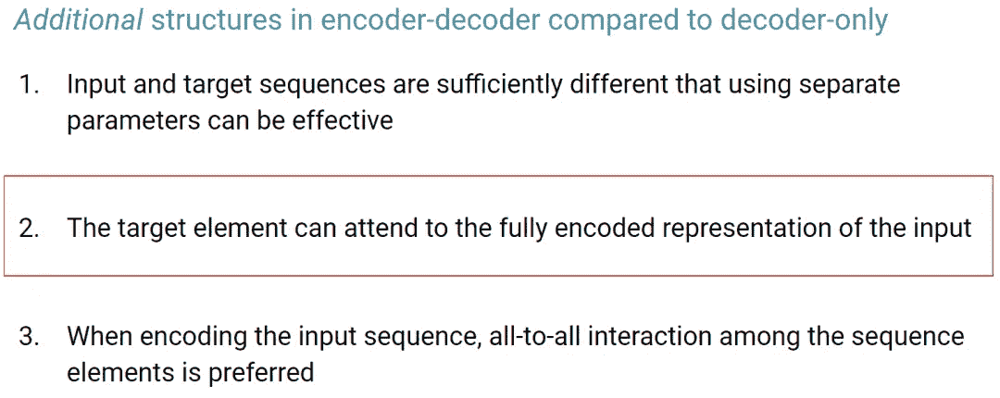

这是编码器 - 解码器中的第一个归纳偏置或结构，另一个结构则是其目标元素只能关注已经完全编码的元素，即编码器的最终输出。

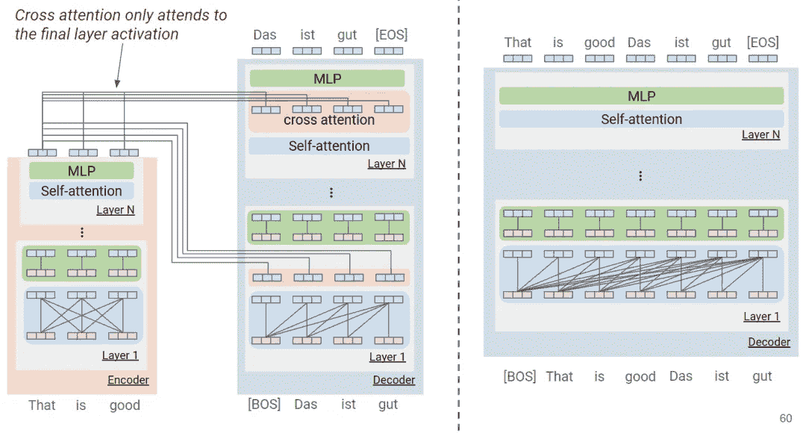

通常而言，在 深度神经网络 中，较低层和较高层编码信息的层级是不一样的。比如在 计算机视觉 模型中，较低层编码的是线条、点、颜色等基础特征，而更高层会将这些特征组合起来，编码更复杂的信息，比如猫脸。因此，这种 深度学习 也被称为分层 表征学习 。

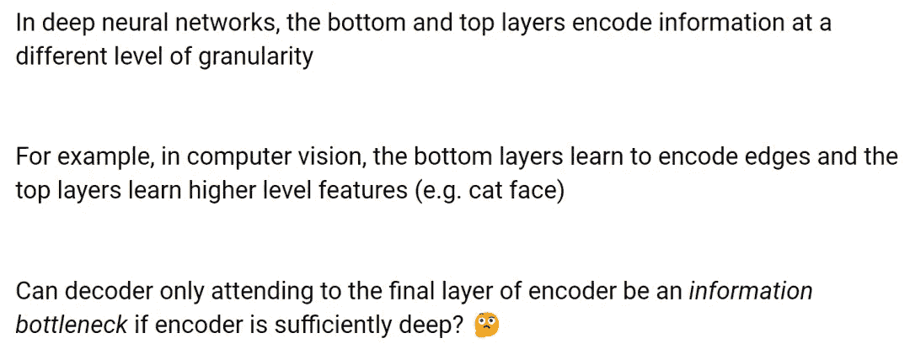

那问题就来了：如果解码器的第 1 层也是关注编码器的最终层（它们可能有非常不同的信息层级），那么这是否会成为一个信息瓶颈呢？

当然，Chung 也指出在实践中，这还不成问题，因为 T5 的编码器层也不过 20 多层，但如果编码器的层数再多十倍乃至百倍呢？

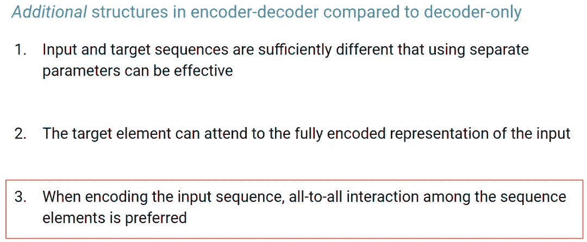

然后就是编码器 - 解码器架构比仅解码器多的最后一个结构：双向的输入注意力。

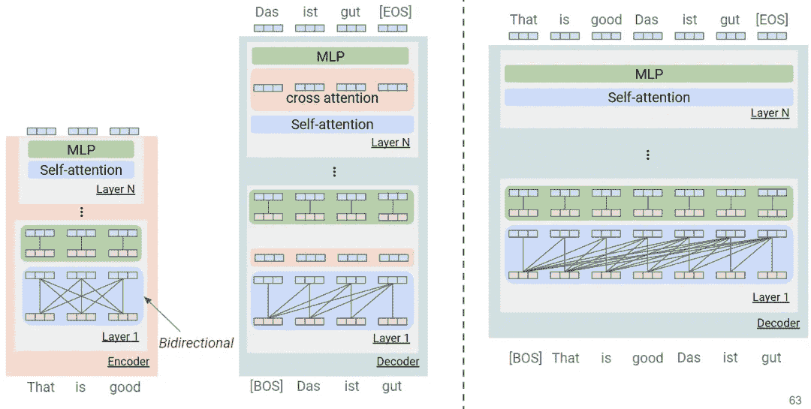

2018 年诞生的 BERT 中的「B」便是指双向（bidirectional）。那时候，人们在竞相解决问答 SQuAD 任务 —— 这是一个非常困难的任务。这种新增的技巧能带来很大收益。双向对于此类任务还是很用的，大概将 SQuAD 分数提升了大约 20 点 —— 很大的进步。

但是，Chung 表示，一旦规模变得足够大，这种增加双向性质的技巧就不重要了。他及团队用 Flan 2 尝试了双向和单向微调，结果性能差异不大；但对于多轮聊天等应用，开发双向注意力的难度很大。

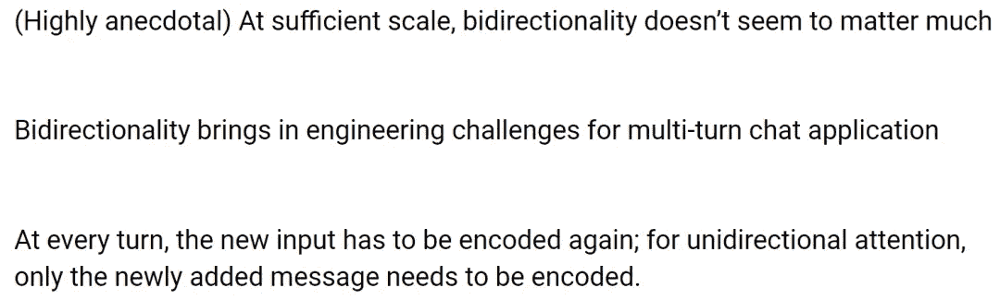

原因也很容易理解。对于每一轮对话，都必须重新编码新的输入。对于单向架构来说，编码新输入的消息就够了。但对于双向架构，每一轮都需要再次编码新输入，如下图的例子所示。

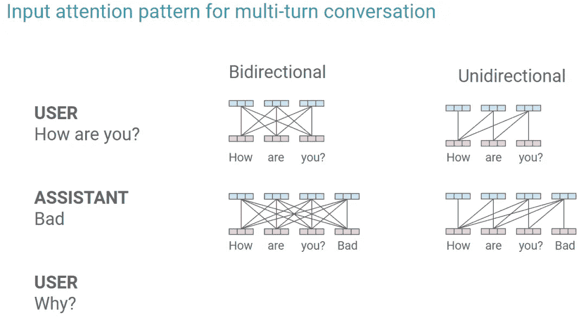

也就是说，在 2018 年表现很好的双向注意力已经被规模扩展接替了，而且由于双向注意力的工程开发难度更大，我们也不需要它了。

**结语**

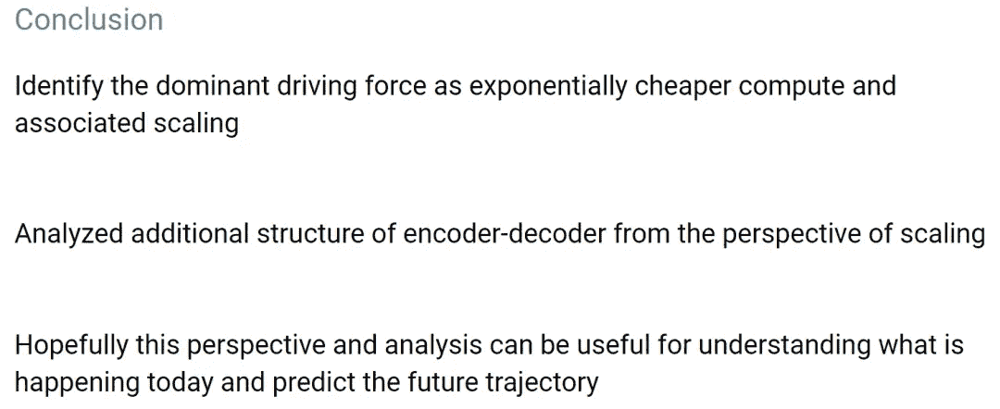

最后，Chung 简单总结了这次演讲的内容：

+   找到了 AI 研究的主要推动力，即计算成本呈指数级下降以及相关的规模扩展；

+   为了理解这种主要推动力，分析了编码器 - 解码器 Transformer 比仅解码器 Transformer 多的结构并从规模扩展角度思考了其意义。

他表示，分析过去的架构并非毫无用处，这能为我们提供一个更加统一的视角，帮助我们了解有哪些结构其实最终可能被规模扩展接替。他说：「我们能很好地共同塑造 AI 的未来。」