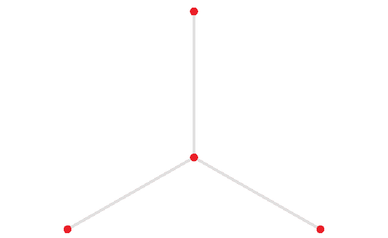
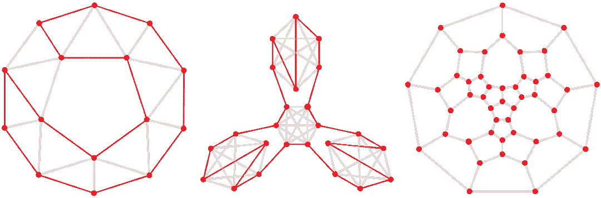
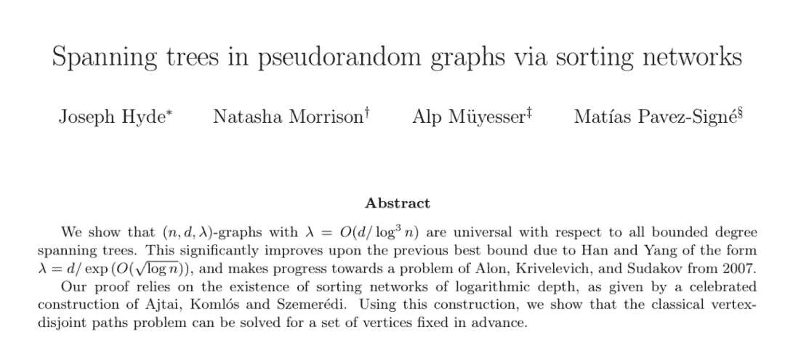
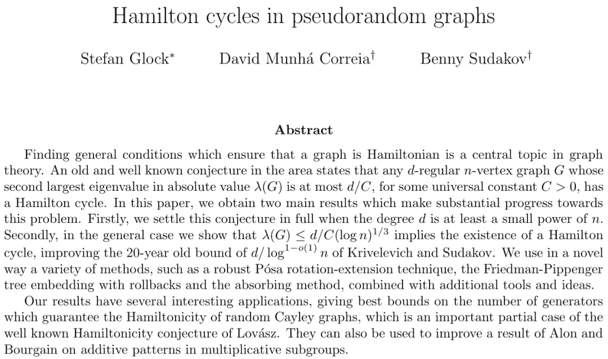

# 有望解决一个千禧年大奖难题，这个20多年前的猜想终于得到证明

> 来源：[https://agijuejin.feishu.cn/docx/M0r2d6stJosvmGxrpOkcTDOinVh](https://agijuejin.feishu.cn/docx/M0r2d6stJosvmGxrpOkcTDOinVh)

> 机器之心｜[阅读原文](https://www.jiqizhixin.com/articles/2024-06-16-7)

> 转载请联系原作者取得授权

在数学抽象方面，最简单的莫过于图（graph）了。在平面上散放一些点，用线将其中一些连接起来，这就是一个图了。

但图却非常强大。人们已经用它来解决各种各样的问题，从建模大脑中的 神经元 到为路上的送货卡车设计路径。在数学领域，图常被用于分类一种重要的代数对象，即群（group），其能以多种不同的方式来描述扭结（knot）。

图论 中有一个核心问题：寻找能刚好经过图中每个点一次的路径，之后再回到起点。这些路径被称为 哈密顿 回路（Hamiltonian cycle），得名于 19 世纪的数学家威廉・罗文・ 哈密顿 （William Rowan Hamilton）。

许多图都有这样的回路。但在另一些图中，不管你多么努力想要找到一条 哈密顿 回路，你都无法做到：也许你会被困在图中某个孤立的范围内，没有前往所有点的路径，也可能你会被迫多次经过某些点。

对于较小的图而言（如上图这个），通过试错就能相对轻松地确定是否存在 哈密顿 回路。在上图的案例中，并不存在。

但如果你的图包含成千上万的点和线 —— 在 图论 中分别称为节点（node）和边（edge），那么这个任务就会变得非常困难。在确定给定的大图是否包含 哈密顿 回路方面，还没有已知的高效方法。如果某人能找到这样一个算法，那么数学和计算机科学领域的许多问题就将迎刃而解。（该算法也能解决千禧年大奖难题中剩余六个中的一个，然后从克雷数学研究所拿走百万美元奖金。）

图中左和中图各描绘了一个 哈密顿 回路，而右图中则无法找到 哈密顿 回路。

一些数学家则选择了另一种策略：不再尝试构建一个求解 哈密顿 回路的通用算法，而是去证明某些特定类型的图包含 哈密顿 回路 —— 这个问题更简单。

2002 年时，特拉维夫大学的 Michael Krivelevich 和如今在苏黎世联邦理工学院的 Benny Sudakov 推测：一类名为 expander 图的重要图全都包含 哈密顿 回路。今年二月，与其他四位数学家一起，Sudakov 成功证明了他在 20 多年前首次提出的这一猜想。

**探寻回路的旅程**

在 Krivelevich 和 Sudakov 提出自己的猜想之前，数学界一直在尝试确定图中必定有 哈密顿 回路的条件。

1952 年，丹麦数学家 Gabriel Dirac（著名物理学家保罗・狄拉克的继子）证明：对于一个有 n 个节点的图，如果该图中每个节点都与其它至少 n/2 的节点相连，那么其必定包含一个 哈密顿 回路。但该回路中的边非常多。之后许多年时间里，许多数学家都致力于降低 哈密顿 图必须包含的边的数量。

1976 年时，匈牙利数学家 Lajos Pósa 证明：通过随机绘出边而构建的某种特定的图几乎必定包含 哈密顿 回路。

再到 2001 年，Krivelevich 和 Sudakov 以及另外两位同事再连同另一个竞争研究团队为另一类不同的图证明出了类似的结果。

Krivelevich 和 Sudakov 认为他们明白了随机构建的图很可能包含 哈密顿 回路的原因。随机图有两个关键性质。第一个性质涉及到这个问题：如果检查图中两个大范围且不重叠的节点群，会发现什么？在一个随机图中，非常有可能至少有一条边连接着这两个节点群。

第二个性质则与小型节点群有关。取一个小型节点群并称之为 A。现在，将与 A 中节点相连的每个节点都加入进来，从而使 A 扩大。数学家将这个更大的群称为 A 的「邻域」。在一个随机图中，A 的邻域很可能远比 A 本身大。所以数学家将这个过程说成是：A「扩展」成了大邻域。

具备这两个性质（大节点群很可能有共享边以及小节点群会扩展成远远更大的节点群）的图被称为「expander 图」。如果 A 的邻域比 A 大 c 倍，则该图就被称为一个 c-expander。

尽管许多随机图都算是 expander 图，但 expander 图并不一定随机。按剑桥大学的 Tom Gur 说法是：expander 图「具有随机图的属性，但不需要随机性。」

由于 expander 图必定满足上述条件，因此其必定是高度连接的，这就意味着以相对较少的步数就能从图的一部分到达另一部分，即便该图中的边的数量并不多。Gur 说：expander 体现了连接性和稀疏性之间的张力。

有关 expander 图的早期研究受到了 神经元 网络的启发，并且该图也已经出现在其它领域。某些大型在线社交网络就是 expander 图，并且 expander 图可用于构建高效的纠错码以及提升随机算法的准确度。

Krivelevich 和 Sudakov 在他们 2002 年的论文中证明特定类型的 expander 有 哈密顿 回路。他们认为更广义的 expander 也有这样的回路，但他们当时尚不能证明。Krivelevich 说：「我们坚信这个猜想是正确的，我们也坚信（证明）这个猜想会非常非常困难。」

过去二十年里，Sudakov 不时回头研究这个问题，但一直都没有进展。

**终得证明**

2023 年 3 月时情况发生了变化，当时 Sudakov、他的学生 David Munhá Correia 以及帕绍大学的 Stefan Glock 正在改进 2002 年的结果，结果发现一类稍大一点的 expander 图必定包含 哈密顿 回路。

「我们提出了许多想法，然后在某个时刻意识到能以正确的方式将它们组合起来。」Sudakov 说，「David 和 Stefan 对这个问题一直都充满热情，不愿意放弃。」

后一个月，华威大学的 Richard Montgomery 和伦敦大学学院的 Alexey Pokrovskiy 到苏黎世拜访 Sudakov。Montgomery 曾在 2010 年代初在剑桥攻读博士期间尝试过证明 Krivelevich 和 Sudakov 提出的猜想，但最后放弃了，因为他认为没有解决该难题的适当工具。

看到了 Sudakov、Munhá Correia 和 Glock 近期的研究进展，Montgomery 觉得可以再试一次了。Montgomery 说：「我提议继续研究这个问题，但并不一定认为我们会取得任何重大进展。」

在接下来的两周时间里，Montgomery、Sudakov 和 Pokrovskiy 提出了一个策略。他们使用一种名为 Pósa rotation 的技术来收集长路径并得到一个集合，他们希望最终能将这些长路径连接起来组成 哈密顿 回路。Montgomery 在得到证明之前就回到了华威，但却是带着新的乐观情绪回去的。Sudakov 说：「我们有这种感觉：不管怎样，我们终于应该是有了得到结果的正确思路。」

到 2023 年底时，Munhá Correia 和 Sudakov 的一位刚毕业的学生 Nemanja Draganić 告诉 Sudakov 他们也在研究这一猜想。Munha Correia 和 Draganić 的想法是使用一种名为拣选网络（sorting network）的机制将路径连接成 哈密顿 回路。该想法源自 2023 年 11 月的一篇论文《Spanning trees in pseudorandom graphs via sorting networks》。

+   论文标题：Spanning trees in pseudorandom graphs via sorting networks

+   论文地址：https://arxiv.org/pdf/2311.03185

Munhá Correia 说：「我们聚到一起，意识到将所有这些思路组合起来也许能解决这个问题。」

拣选网络是指包含两个匹配集合 A 和 B 的图。拣选网络的结构比较特别：无论将 A 与 B 中的节点怎么配对，都有可能找到能将 A 中每个节点与 B 中对应节点连接起来的不相交路径。「你告诉我你怎么进入的，然后你告诉我你想怎么出去。」Sudakov 解释说，「拣选网络有一种性质 —— 每个顶点都有一条到目的地的路径。」

11 月的那篇论文包含一项证明：某些特定类型的 expander 图必定包含拣选网络。

Draganić、Montgomery、Munha Correia、Pikrovskiy 和 Sudakov 认识到如果能将拣选网络与 Pósa rotation 组合起来，就能够证明该猜想。

他们使用那篇论文中的技术证明 expander 图也必定包含拣选网络。然后，通过将集合 A 和 B 作为使用 Pósa rotation 创建的路径的端点，他们发现可以将长路径集合组合成 哈密顿 回路。Sudakov 说：「我们明确了证明所需的所有关键概念。」

到今年 2 月份时，该团队就完成了论文。其中不仅证明了 Krivelevich 和 Sudakov 在 2002 年时提出的原始猜想（使用了狭义的 expander 定义），而且还有更强的证明：只要 c 足够大，任意 c-expander 都有 哈密顿 回路。并且他们的方法能实际生成 哈密顿 回路，而不仅仅是抽象地证明其存在。

+   论文标题：Hamilton cycles in pseudorandom graphs

+   预印本地址：https://people.math.ethz.ch/~sudakovb/hamiltonicity-spectral-gap.pdf

Sudakov 将论文草稿转发给了 Krivelevich。Krivelevich 回复说：「我曾很怀疑能在我们有生之年看见它得到证明。」

**结语**

这个新证明能解决多个与 哈密顿 回路有关的问题。举个例子，其证明某些类型的与群有关的图（凯莱图）必定具有 哈密顿 回路。

但探寻仍未结束。

数学家仍在继续努力，希望找到扩展因子 c 可能存在的最低边界值，以及证明一类范围更广的图（tough graphs）必定包含 哈密顿 回路。（Sudakov 说尽管这是个好愿望，但得到其证明还「远不可及」，并且他也警告说：「甚至还没有足够的证据表明这个猜想是正确的。」）

未参与此项研究的 Gur 表示：其确立了「计算机科学核心的两个对象之间的根本联系。」他说，这种联系会有重要的应用。「我不知道它会以何种形式出现，只是看起来这必定会很有用。」

原文链接：https://www.quantamagazine.org/in-highly-connected-networks-theres-always-a-loop-20240607/