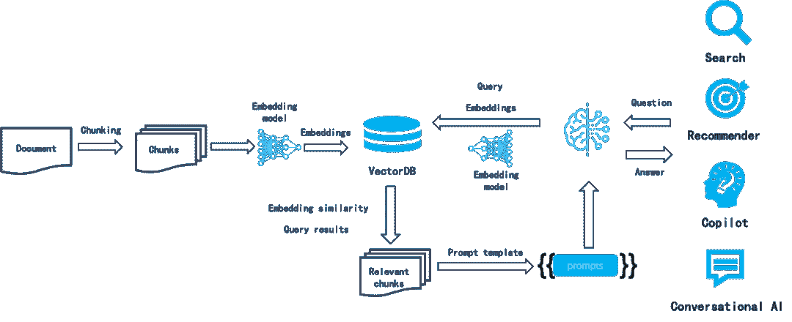
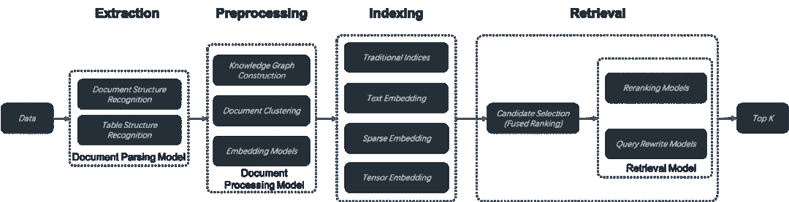

# RAGFlow开源Star量破万，是时候思考下RAG的未来是什么了

> 来源：[https://agijuejin.feishu.cn/docx/TrAodWU50ozaMbxJ8XPcapYbnce](https://agijuejin.feishu.cn/docx/TrAodWU50ozaMbxJ8XPcapYbnce)

> 机器之心｜[阅读原文](https://www.jiqizhixin.com/articles/2024-07-08-5)

> 转载请联系原作者取得授权

**本文作者**为张颖峰，英飞流 InfiniFlow 创始人 CEO，连续创业者，先后负责 7 年搜索引擎研发，5 年 数据库 内核研发，10 年 云计算 基础架构和大数据架构研发，10 年 人工智能 核心算法研发，包括广告推荐引擎， 计算机视觉 和 自然语言处理 。先后主导并参与三家大型企业数字化转型，支撑过日活千万，日均两亿动态搜索请求的互联网电商业务。

搜索技术是计算机科学中最难的技术挑战之一，迄今只有很少一部分商业化产品可以把这个问题解决得很好。大多数商品并不需要很强的搜索，因为这和用户体验并没有直接关系。然而，随着 LLM 的爆炸性增长，每家使用 LLM 的公司都需要内置一个强大的检索系统，才能使得 LLM 可以真正为企业用起来，这就是 RAG （基于检索增强的内容生成）—— 通过搜索内部信息给 LLM 提供与用户提问最相关的内容，来帮助 LLM 做最终的答案生成。

想象一下，LLM 正在针对用户提问回答，如果没有 RAG，那么 LLM 不得不根据自己在训练过程中学到的知识来回忆内容，而有了 RAG 之后，这种问题回答就如同开卷考试，到教科书中去寻找包含答案的段落，因此回答问题变得容易很多。随着 LLM 的演进，新的 LLM 具有更长的上下文窗口，可以处理更大的用户输入，如果可以直接在上下文窗口中载入整个教科书，为什么还需要去教科书中翻答案呢？实际上，对于大多数应用而言，即使 LLM 可以包含上百万乃至上千万 Token 的上下文窗口，搜索依然必不可少：

+   企业通常包含多个版本的类似文档，将它们全部传给 LLM 会导致相互冲突的信息。

+   大多数企业内部场景都需要对传给上下文窗口的内容做访问权限控制。

+   LLM 更容易受到跟问题语义相关但却跟答案无关内容的干扰，从而分心。

+   即使 LLM 能力很强大，也没有必要浪费多很多的成本和延迟来处理跟用户提问不相关的数百万个 Token 。

RAG 从出现到流行只花了很短的时间，这得益于各种 LLMOps 工具迅速将如下的组件串接起来使得整个系统得以运转。

以上这种基于语义相似度的方法已经工作了很多年：首先，将数据 分块 （例如根据段落），然后通过 Embedding 模型把每个块转成向量保存到向量 数据库 。在检索过程中，把提问也转成向量，接着通过向量 数据库 检索到最接近该向量的数据块，这些数据块理论上包含跟 查询 语义最相似的数据。

在整个链路中，LLMOps 工具可以操作的事情有：

+   解析和切分文档。通常采用固定大小来把解析好的文本切成数据块。

+   编排任务，包括数据写入和 查询 时，负责把数据块发到 Embedding 模型（既包含私有化也包含 SaaS API）；返回的向量连同数据块共同发给向量 数据库 ；根据提示词模板拼接向量 数据库 返回的内容。

+   业务 逻辑 组装。例如用户对话内容的生成和返回，对话跟业务系统（如客服系统）的连接，等等。

这个流程的建立很简单，但搜索效果却很一般，因为这套朴素的基于语义相似度的搜索系统包含若干局限：

+   Embedding 是针对整块文本的处理，对于一个特定的问题，它无法区分文字中特定的实体 / 关系 / 事件等 权重 明显需要提高的 Token，这样导致 Embedding 的有效信息密度有限，整体召回精度不高。

+   Embedding 无法实现精确检索。例如如果用户询问 “2024 年 3 月我们公司财务计划包含哪些组合”，那么很可能得到的结果是其他时间段的数据，或者得到运营计划，营销管理等其他类型的数据。

+   对 Embedding 模型很敏感，针对通用领域训练的 Embedding 模型在垂直场景可能表现不佳。

+   对如何数据 分块 很敏感，输入数据的解析、 分块 和转换方式不同，导致的搜索返回结果也会大不同。而依托于 LLMOps 工具的体系，对于数据 分块 的 逻辑 往往简单粗暴，忽视了数据本身的语义和组织。

+   缺乏用户 意图识别 。用户的提问可能并没有明确的意图，因此即便解决了前述的召回精度问题，在意图不明的情况下，也没有办法用相似度来找到答案。

+   无法针对复杂提问进行回答，例如多跳问答（就是需要从多个来源收集信息并进行多步推理才能得出综合答案的问题。

因此可以把这类以 LLMOps 为核心的 RAG 看作 1.0 版本，它的主要特点在于重编排而轻效果，重生态而轻内核。因此，从面世一开始就迅速普及，普通开发者可以借助于这些工具快速搭建起原型系统，但在深入企业级场景时，却很难满足要求，并且经常处于无计可施的状态。随着 LLM 快速向更多场景渗透，RAG 也需要快速进化，毕竟搜索系统的核心是找到答案，而不是找到最相似的结果。基于这些，我们认为未来的 RAG 2.0 可能是这样工作的：

其主要特点为：

1.RAG 2.0 是以搜索为中心的端到端系统，它将整个 RAG 按照搜索的典型流程划分为若干阶段：包含数据的 信息抽取 、文档预处理、构建索引以及检索。RAG 2.0 是典型的 AI Infra，区别于以现代数据栈为代表的 Data Infra，它无法用类似的 LLMOps 工具来编排。因为以上环节之间相互耦合，接口远没有到统一 API 和数据格式的地步，并且环节之间还存在循环依赖。例如对问题进行 查询 重写，是解决多跳问答、引入用户 意图识别 必不可少的环节。 查询 重写和获得答案，是一个反复检索和重写的过程，编排在这里不仅不重要，甚至会干扰搜索和排序的调优。近期知名的 AI 编排框架 LangChain 遭到吐槽，就是同样的道理。

2. 需要一个更全面和强大的 数据库 ，来提供更多的召回手段，这是由于为解决 RAG 1.0 中召回精度不高的痛点，需要采用多种方法混合搜索。除了向量搜索之外，还应该包含关键词全文搜索、稀疏向量搜索，乃至支持类似 ColBERT 这样 Late Interaction 机制的 张量 搜索。

a. 关键词全文搜索是实现精确 查询 必不可少的手段，当用户检索意图明确时，期望的文档却没有返回，这会使他感到沮丧。其次，通过关键词全文搜索，可以查看跟 查询 匹配的关键词，从而更直观地了解检索到该文档的原因，这对于排序的可解释性也非常重要。所以在绝大多数情况下，都不应该把关键词全文搜索排除在 RAG 之外。全文搜索是个很成熟的功能，但并不等于实现它很容易。除了需要能够处理海量数据之外，为符合 RAG 召回的需要，还必须提供默认基于 Top K Union 语义的搜索机制，这是由于 RAG 的 查询 输入通常不是几个关键词，而是整句话。目前市面上大多数声称提供 BM25 和全文搜索能力的 数据库 ，实现的都是阉割版本，既无法高性能搜索海量数据，也无法提供有效召回，不具备企业级服务能力。

b. IBM 研究院最新的研究成果显示，在若干问答数据集的评测中，联合关键词全文搜索、稀疏向量、以及向量搜索 3 种召回方式，取得了 SOTA 的结果。因此，有理由在 数据库 中原生支持这种 3 路混合搜索能力。

c. 张量 搜索是一种很新的检索方式。它来自于以 ColBERT 为代表的 Late Interaction 机制。简单地总结，就是 Cross Encoder 为代表的 Reranker 模型，它能够捕捉 查询 和文档之间的复杂交互关系，因此相比向量搜索能够提供更精准的搜索排序结果。但是它的缺点在于，由于需要在 查询 时对每个文档和 查询 共同经过 Embedding 模型来编码，这使得排序的速度非常慢，因此 Cross-Encoder 只能用于最终结果的重排序。而类似 ColBERT 这样的模型，它仍然把文档在索引阶段就编码好，这一点类似于向量搜索，但不同之处在于，它把文档的每个 Token 都用单独的向量表示，因此是用许多向量或者一个 张量 来表示一个文档，在排序计算时，所有 Token 之间的向量都需要做交叉计算，这一点跟 Cross Encoder 的机制类似，因此比向量搜索损失的信息更少，召回精度更高。而相比 Cross Encoder，它的性能要好得多，因为在 查询 期间无需对每个文档进行编码， 所以可以理解为既拥有接近 Cross Encoder 的召回精度，也拥有接近向量搜索的性能，这样可以在召回阶段就引入更好的模型，具有非常强的实际操作价值。结合 张量 搜索和关键词全文搜索，不失为一种非常值得采用的混合搜索能力。作为 数据库 来说，同样需要为这样的能力提供选择。

近期 OpenAI 收购了 数据仓库 公司 Rockset，这背后的 逻辑 ，其实并不在于 数据仓库 本身对于 RAG 有多么大的价值，而是相比其他 数据仓库 ，Rockset 更是一个索引 数据库 ，它对表的每列数据都建立了倒排索引，因此可以提供类比于 Elasticsearch 的关键词全文搜索能力，再配套以向量搜索，原生具备这 2 类混合搜索能力的 数据库 ，在当前阶段，就已经没有多少选择了，再加上 Rockset 还采用了云原生架构，2 点结合，是 OpenAI 做出选择的主要原因。这些考虑，也是我们在另外开发 AI 原生 数据库 Infinity 的主要原因，我们期望它能原生地包含前述的所有能力，从而可以更好地支撑 RAG 2.0。

3. 数据库 只能涵盖 RAG 2.0 中的数据检索和召回环节，还需要站在整个 RAG 的链路上，针对各环节进行优化，这包括：

a. 需要有单独的数据抽取和清洗模块，来针对用户的数据，进行切分。切分的粒度，需要跟最终搜索系统返回的结果进行迭代。数据抽取模块，需要考虑到用户的各种不同格式，包含复杂文档例如表格处理和图文等，因此它必须依托于若干模型才能完成任务。高质量的数据抽取模块，是保证高质量搜索的前置条件。这部分可以类比为现代数据栈的 ETL，但却比 ETL 更加复杂，后者是以 SQL 为核心的的确定性规则系统，而前者则是以各种文档结构识别模型为核心的非标准化体系。

b. 抽取出的数据，在送到 数据库 索引之前，还可能需要若干预处理步骤，包括 知识图谱 构建，文档 聚类 ，以及针对垂直领域的 Embedding 模型微调等。这些工作，本质上是为了辅助在检索阶段提供更多的依据，从而让检索更加精准。这个步骤不可或缺，它是针对用户的复杂提问，例如多跳问答，意图不确定，以及垂直问答等情况下的必要手段。通过把文档中包含的内部知识以多种方式组织，才能确保在召回结果包含所需要的答案。

c. 检索阶段分为粗筛和精排。精排通常放在 数据库 外进行，因为它需要不同的重排序模型。除此之外，还需要对用户的 查询 不断改写，根据模型识别出的用户意图不断改写 查询 ，然后检索直至找到满意的答案。

这些阶段，可以说每个环节都是围绕模型来工作的。它们联合 数据库 一起，共同保证最终问答的效果。

因此，RAG 2.0 相比 RAG 1.0 会复杂很多，其核心是 数据库 和各种模型，需要依托一个平台来不断迭代和优化，这就是我们开发并开源 RAGFlow 的原因。它没有采用已有的 RAG 1.0 组件，而是从整个链路出发来根本性地解决 LLM 搜索系统的问题。当前，RAGFlow 仍处于初级阶段，系统的每个环节，都还在不断地进化中。由于使用了正确的方式解决正确的问题，因此自开源以来 RAGFlow 只用了不到 3 个月就获得了 Github 万星。当然，这只是新的起点。

RAG 2.0 将会对 LLM 在企业中如何应用产生巨大影响，我们对它作为产品推动力的发展感到振奋，如果你也对此感兴趣，欢迎关注和了解我们的工作：https://github.com/infiniflow/ragflow