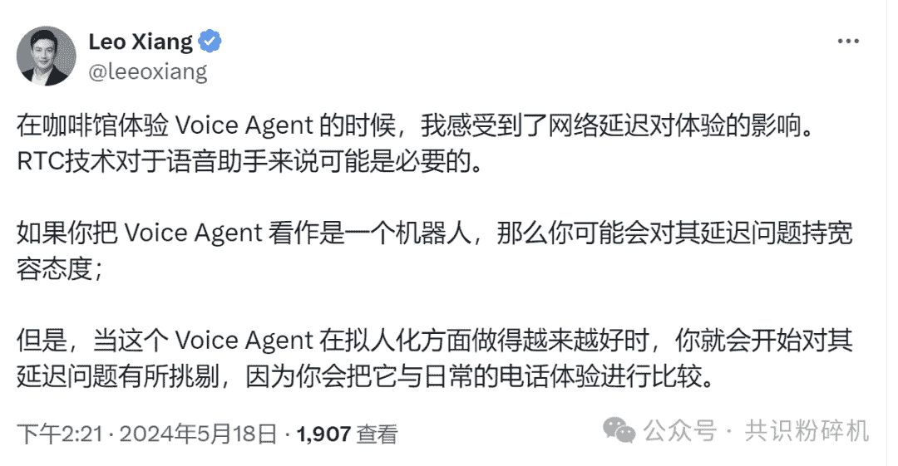
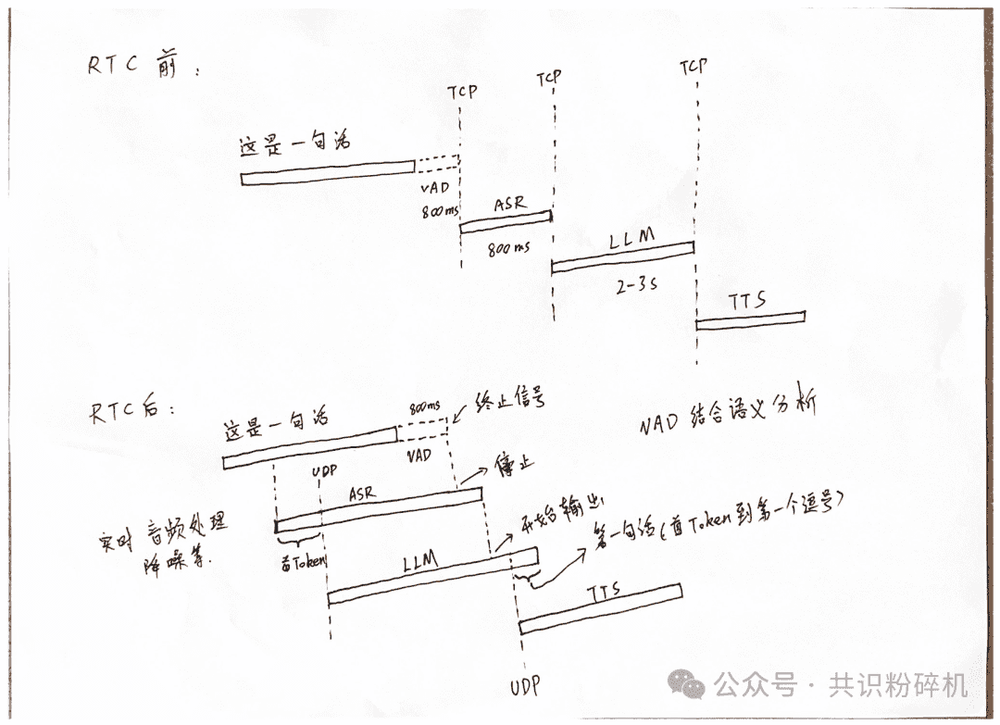

# GPT4o对实时互动与RTC的影响

> 来源：[https://agijuejin.feishu.cn/docx/S5HfdYp1Foytehx9NAFcHUYEnLf](https://agijuejin.feishu.cn/docx/S5HfdYp1Foytehx9NAFcHUYEnLf)

> 共识粉碎机｜[阅读原文](https://mp.weixin.qq.com/s/3zOLJDLSbI3ekMKGWOL2Ag)

> 转载请联系原作者取得授权

> **本期讨论会参与者：**

> **杜金房老师： **烟台小樱桃网络科技有限公司创始人，FreeSWITCH 中文社区创始人，RTS 社区和 RTSCon 创始人，《FreeSWITCH 权威指南》、《Kamailio 实战》、《深入理解 FFmpeg》作者，FreeSWITCH 开源项目核心 Committer。杜老师同时是 RTE 实时互动开发者社区联合主理人。

> **刘连响老师： **资深RTC技术专家，推特@leeoxia ng。

> **史业民老师： **实时互动AI创业者，前智源研究院研究员。

> **徐净文老师： **负责百川的战略、投融资、开源生态、海外等业务。

# **1 ** **GPT4o如何降低延迟**

---

GPT4o前调用OpenAI API延迟极限情况下可以压缩到2秒

+   中美跨海光缆差不多100-200ms，如果考虑丢包，那平均在300-400ms。

+   语音场景需要经过ASR（语音转文本），在大模型无法流式输入的情况下，一般需要说完一句话再喂给大模型，平均需要400-500ms延迟。

+   如果不考虑Planning和RAG等环节，只计算First Token的话过去平均需要700-1000ms延迟。

+   大模型可以流式输出，但一般第一句话节后给TTS（文本转语音），TTS环节也需要400-500ms延迟。

+   所以整体延迟最低可以低到2秒。

+   上述场景主要是考虑的网络良好的情况，如果在室外体验，丢包概率会大幅增加，延迟还会再往上波动。

但在客服等场景中还经常需要做Planning和RAG，延迟会进一步增加

+   上述主要是可以用First Token来判断延迟的场景，对话内容比较简单。

+   像在类似客服等场景， **在First Token前还需要先做Planning和R**AG，就可能还需要经历1-2次完整延迟 ，整体延迟就会远远超过2秒，可能到4-5秒或者更高。

**GPT4o优化延迟的机制**

+   VAD（Voice Activity Detection）提升：VAD主要用于尽早发现用户说完话，用于触发大模型，过去用停顿时间判断，现在可能有了语义理解能力。

+   端到端能力： 端到端可以替换掉ASR和TTS的延迟，开发者未来可以用GPT4o的ASR/TTS，也可以自己做。

+   其他延迟优化还包括流式处理、异步处理，多个模块在向量画的过程中如何统一，在GPT4o的设计上有很多巧思。

**VAD模块可能也应用了LLM**

+   之前有一些简单的VAD判断标准，比如停顿1000毫秒，就默认用户说完话了。

+   但现在GPT4o为了节省时间，单纯用停顿判断肯定不可能，应该要走到语义层面。

+   **最极端或者暴力的方案，可以拿GPT4o的模**型去Finetune一个小的VAD模型 ，模型可以控制在0.5B-1B的规模，类似于向下降维打击的方式实现VAD。

+   这样对于VAD模型来说，Input是Audio，Output就是说完与否的“Yes or No”。

GPT4o后，还可以通过工程并发的方式进一步降低延迟

+   在GPT4o前，工程角度已经可以在一些特殊场景，提前做好RAG等检索工作，然后再将TTS与Output等场景做成并行，通过很多工程做法，在不考虑跨海传输的情况下，有机会将延迟控制在1秒以内。

+   现在在复杂一点的场景，甚至到Planning和RAG相关的场景，也可以尝试做并行进一步压缩延迟。

+   **基于DSL（Domain SPecific Language）结果做RAG、对输入的V**ision和Audio做向量化预处理、刚刚提到的VAD，这三个部分也可以做并行。

+   现在还不确定OpenAI会不会开放着三个接口，从模型工程角度来说，如果这几个部分都做好，几乎可以把RAG的延迟都覆盖掉。

在做应用的时候还可以用一些鸡贼的产品体验进一步降低“延迟感”

+   了提高用户体验，可以在产品层面做一些改动。例如OpenAI的Demo中，在响应时间的过程里，手机中的画面会有波动的动画，在这个过程中，哪怕没有任何的实质性输出，人看到动画也会觉得亲切一些，对延迟的敏感度也会降低。

+   在下面杜金房老师演示的视频中，也可以通过“嘟”的方式给用户起到心理安慰，“AI马上就要说话了”。

+   但这种场景也会有明显的局限，只适合用户已经知道对面是AI的情况，这种情况对延迟的容忍度也会相对较高。在不想让用户知道对面是AI的场景，这类产品功能也会容易暴露对面是AI不是真人。

# **2 ** **GPT4o怎么影响实时互动场景**

---

**有哪些实时互动场景可以开始做了**

+   类似Hume.AI等各种陪伴产品。

+   VR游戏=Vision Pro/PICO场景的互动产品。

+   互动机器人，互动机器人加入实时互动能力后，对用户体验提升帮助很大。

+   AI音箱，可能会出现新的落地场景。

+   还包括现在也有在讨论车载互动能力，让开车的过程中没那么无聊，以及解放双手做一些车内的控制任务。

还有一些典型的行业场景，也很适合实时互动需求

+   这些场景一般都非常个性化。

+   出现的时候会比较紧急，一点点延迟提高都能带来使用者的体验改善。

+   可以通过季节性、年龄等维度进行预处理，进一步减少延迟。

医疗进入实时互动可以大大减缓患者焦虑

+   远程诊断咨询，个性化建议，都可以做非常多的实时性提升。

+   疾病症状季节性集中度非常高，所以在Planning和RAG上可以做非常多预处理，可以压缩模型时间。

+   即时交互可以解决心理焦虑，从用户端体验会变得非常好。 像美国有个机构 H ippocratic AI 正在做，延迟大概在5秒，那等5秒的过程患者会非常焦虑的。因为 机构 H ippocratic AI 是用视频/语音方式来解决的，所以需要差不多5秒延迟。 模型在延迟上小小提升，就可以解决患者焦虑的状态。

+   **医**疗场景中每个人都认为自己的小病是大事，但不一定很严重。如果能够更快的得到权威的回应，就在心理层面有很大的帮助 ，甚至不一定要在物理层面上改善。只要是及时的回答，就可能能解决问题。

+   医疗也要分场景，疾病会有轻重之分。如果是重症，那调用Planning和RAG的成分就会非常多，但大部分的医疗场景中，高频发生的还是小病疾病。比如小朋友发烧、老人摔跤、吃过敏药后忘记医嘱喝了酒等场景，不需要调用非常厚的医疗词典，也不需要让很多专家模型介入，这些场景的延迟改善会更加明显一点。在这些场景，5秒到1秒的改善，对于用户体验的提高是非常大的。

+   目前还没到OTC开药和重症阶段，现在短期还很难因为实时互动改变。 但是比如心理辅助，比如患者就站在桥旁边，那实时互动就能立刻见效。

法律引入实时互动后适合现场处理场景

+   过去的处理周期非常长：形成文档，然后通过人去解决。比如车险报警，过去是拍照上传、交警介入。

+   现在有了GPT4o的实时机制后，非常多的裁决是可以现场发生的，当然最后处理部分还是需要人来介入。

+   除了车险和现场暴力事件，剩下的还是一定程度能接受延迟。

教育引入实时后适合在线解题和语言教学场景

+   GPT4o的Demo上就有在线解题。

+   解题是个高度个性化的过程，还包括题库的应用，结合RAG和模型能力提高，再加上RTC的实时效果，在线教育领域的教学和辅助能力会有巨大提升，也可以做更多市场化的尝试了。

+   过去需要上传，需要等待。那现在变成了更像辅导和学习伴侣的过程，在语言教学等场景，会实质性的改变学生的学习曲线和接受度。

GPT4o后最快会是哪些场景能跑出来

+   最直接的场景是陪伴，因为陪伴对Planning和RAG的要求低，只需要定义好角色背景和音色，而且非常适合应用到GPT4o的端到端场景。很容易就可以把延迟迅速降下来。

+   客服等场景稍微复杂点，需要用到Planning和RAG，延迟没有陪伴降的这么厉害。在这类场景里，延迟不是主要取决于端到端和First Token，还要取决于整个Pipeline的系统级延迟。但如果做好并行机制和各种优化，也可以到1-2秒的延迟。

# **3 ** GPT4o应用到实时也有不完善的地方

---

在触发机制等问题上还无法做到完全实时

+   之前提到VAD的进步是延迟降低的一个关键是因素，需要尽早触发多模态模型，那就需要符合VAD的触发条件，在 用户无法说话，或者用户正在说话过程中的情况，大模型就无法触发。

+   举一 个例子，在OpenAI的Demo里有一个例子是两个人+一个AI互动，但如果假设A停了几秒，B再去说，就会发现AI提前介入，B的话就会被AI抢了。就必须要提前设计好AB角色以及AI对应角色的角色分析，添加更多的限定条件。

+   在实时互动场景中，也需要AI能够在用户沟通中回复一些内容，可以更好激发用户去表达，现那也做不到。

+   如果你 要他说话之前就能回答，那还需要做很多工程工作，中间可能还会有误触发方案，但长期应该可以解决。 这更多是场景决定的需求，例如实时翻译和需要插话的场景，要设置提前触发的请求规则。 但在类似Assistant的场景，就不需要设置插话的提前触发条件。

**具体举一些场景来看的话**

+   例如开着摄像头，要试试去看场景有什么变化，有什么危险，如果不设定定时触发机制，那GPT4o无法实时提醒。

+   例如同声传译和语法纠错场景，需要在说话过程中就进行处理，或者实时纠错。这里也不能直接应用，因为VAD机制需要判断说完话。

+   例如盲人眼睛场景，用户希望的是戴上眼镜就能实时感受路况。但现在的需要用户不断地问有没有违宪，或者工程上设置一个1-2秒的自动请求机制，来帮助GPT4o高频判断。

+   总体来讲，GPT4o如果是从助手级别（接收完人类指令），已经几乎完美了。但到了上述要更进一步的实时交互，还存在失望的地方，可能到下一代GPT5可以满足。

# **4 ** **GPT4o为什么要用到RTC**

---

[0bc3maaaeaaaoiab3vsulntfaygdajqaaaqa.f10102.mp4](https://internal-api-drive-stream.feishu.cn/space/api/box/stream/download/all/ZJRcbxMs7oRzbSxguhacf4KvnHd)

上面视频是杜金房老师在GPT4o发布前实现的

+   在4o发布前，杜金房老师已经将RTC与LLM打通了。当时杜老师在国外要做一个面向外国人的演讲，所以视频用了英文。

+   ASR+TTS+VAD，都是用已有的技术供应商。

+   整体链路是语音识别后，文字发给GPU，反馈结构后，再调用TTS产生声音。

+   为了改善用户提现，在正式回答前加入了“嘟”的音效，可以在听感上降低~100ms延迟。

+   在这个场景中，First Token的延迟更为关键，TTS也可以与Token生成几乎同步，LLM返回来的结果将标点符号切开，做好序号，然后喂给TTS。

GPT4o为什么需要RTC？用RTC的LLM会产生时空穿越？？

+   在GPT4o的RTC场景中有两个方向，Input和Output。

+   Input场景中，LLM需要实时接收用户的视频，人不能加速产生内容，为了降低100-200毫秒的延迟，RTC可以被视作是必须的解决方案。

+   Output场景中，RTC不一定是必须，也可以用WebSocket等方案，链路存在但是开发者还没有大范围集成。

+   **与I**nput场景不同，在Output场景中， LLM生成音视频未来可能做到两倍速，甚至四倍速、八倍速。那Output的Token生成速度会比时间还快，但是播放时候必须是一倍速，这就造成了在倍速场景中会有时空穿越的感觉，延迟实际上是负数。 只要解决首帧、First Token的延迟就可以了。内容会因为生成比播放还快，而先预存在本地，然后再播放，就类似现在听网络小说、看视频一样。

+   如果开发者有很强的优化能力，或者传输数据量没那么大的情况，提前做好ASR/TTS等，那可能可以不用RTC。

LLM可能还会影响新的RTC技术

+   RTC行业发展这么多年了，已经很成熟了，看不到明显的增长了，LLM出来后大家很兴奋，觉得应该能做点事情。

+   最直接的交互方式还是语音和视频，也是RTC的强项，有些人在探索结合，也有直接转型LLM的。

+   GPT4o出来后，大家又看了新挑战，比如做四倍速RTC、八倍速RTC，可能还会有新的RTC技术出来。

+   我们现在很多假设都是RTC一倍的情况，未来RTC可能是两倍、四倍场景。 那在正常情况下，比如RTC是500毫秒延迟，但是弱网可能就是1秒，稍微慢一点也能接受。 但如果未来有了两倍速RTC，那可能网络条件差了点，延迟还是在500毫秒到1秒之间，那也会有很大帮助。

但目前的LLM RTC需求还不复杂

+   主要还是一进一出的场景。

+   **以前RTC场景里复杂的比如小班课，一堂课**可能有几十路RTC，就比一进一出高很多。

+   难度可能还比不上直播连麦的难度，直播间里玩法也非常多样。

+   未来也要看LLM玩法的迭代，越复杂的玩法需求越大

+   RTC国内最大的是社交娱乐和教育，后面来来回回想了很多场景要起来，比如IoT等，但最后还是没起来。 现在还不确定LLM会不会也是这样一个需求，谨慎乐观。

**除了直接延迟外，RTC在网络不好**的场景，以及对打断有需求的场景有明显优势

+   网络好的时候延迟差别不大。 但是网络不好的时候差别很大，比如丢了个包那来回200毫秒就没了，如果再丢一个包那20毫秒又没了。 TCP是最后组件，前面的延迟炸了，后面也会累积。

+   RTC做了很多抗弱网策略，加重传策略，包括猜测下一个声音做补全等。

+   没办法直接给出和CDN延迟差多少，还是Case by Case，只能说不好的情况下差比较多。

+   RTC也适合互相打断，流式传输必备。CDN不适合打断场景。

# **5 ** **怎么选择RTC供应商**

---

**先讲讲RTC的发展历史**

+   Google在2010年收购了WebRTC技术公司，然后再2011年通过Chrome开放了WebRTC源代码，相当于Chrome就具有了实时能力。因为要做一套RTC引擎成本还很高，涉及到算法、编解码、各种规范，Google 开放 WebRTC 之前 有能力把 RTC 做好的并不多。

+   2013-2014就有第一波热潮，那时候出现了很多RTC创业公司，然后很快都接着死了。迎来了第一波低谷。

+   2015年出现了声网，后面国内也有几家。2016-20187，国内出现了上千直播平台，开始有了连麦的需求。然后紧接着2018年在线教育跑起来了。

+   2020年最大的一波来了，疫情期间，包括各种视频会议、在线教育等居家办公需 求。

+   疫情热度过后，RTC需求就开始降温了，进入第二次低谷。

**OpenAI目前选择了LiveKit，但**未来API可能可以不与LiveKit绑定

+   看全球的RTC供应商，除了国内的声网、腾讯TRTC等也多数不能打。

+   OpenAI在选择方案的时候肯定非常谨慎，可能会更多考虑开放标准，也会考虑到中国公司的情况。如果是闭源方法，就会涉及到开发者怎么选择；不能绑定一家商业公司。在这个层面，LiveKit是个非常好的生态位，你想用的话可以用LiveKit的Cloud，也可以自己建。

+   **O**penAI现在也开始自己招人，那和LiveKit可能就是合作关系，前期可能会给一些咨询费一起共建，但后面可能还是会自建。

+   未来可能是ChatGPT产品用LiveKit，API端可能不绑定RTC。

+

未来客户可能也能使用商业RTC方案

+   现在给不出一个准确的答案，这个要取决于OpenAI的决策。

+   **但推测OpenAI可以采用一个开放的标准，让各家产品**都可以接入，这是一个更加平台风格的选择。

+   比如客户想做成商业产品或者在全球应用，那就采用商用方案，这是最省研发成本的。

使用GPT4o不一定必须用其自带的TTS

+   TTS都在一个大模型里面，对开发者不是那么友好。

+   比如Hume.AI，已经带有情感TTS的，那怎么和新4o去闭环；客户不一定能接受OpenAI现在给的几种声音模式，会有更多样化的需求，比如更像某个人的声音（定制化的），或者更卡通化等风格需求。

+   那可能4o API最好同时支持Voice出和Text出。

**各方是怎么看要不要用RTC的**

+   模型公司角度很可能会优选RTC，成熟，可拓展性也好，同时可以开放给开发者不同选择。

+   开发者角度，延迟还是越少越好，越实时互动的场景越需要RTC。

# **6 ** **实时场景对端侧的影响**

---

Vocie Assistant场景对于端侧硬件的要求

+   如果全部使用GPT4o，端侧只接收视频，就几乎不需要算力

+   如果要将VAD技术放在端侧，那端侧就需要一定算力。 但总体会远远低于LLM的算力。

---

杜老师讲了这么多，对杜老师内容感兴趣的欢迎后续买买买杜老师的新书！

**如下是杜老师正在写的编程书：**

**对RTC/RTE感**兴趣的朋友也欢迎访问 RTE开发者社区 ：

https://www.rtecommunity.dev/

**最后我们放**一张本次活动 的听众Agent创业者 王轶老师 参与互动后画的一张图，也比较清晰的展现了RTC引入后LLM的流程变化

