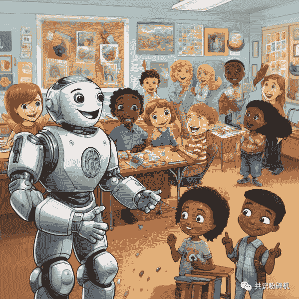

# AI如何重塑教育

> 来源：[https://agijuejin.feishu.cn/docx/ARFfdPoetoTBOdxTGhEc45Sdnnc](https://agijuejin.feishu.cn/docx/ARFfdPoetoTBOdxTGhEc45Sdnnc)

> 共识粉碎机｜[阅读原文](https://mp.weixin.qq.com/s/45Bw0mAD_bfQCbKgPrPvFQ)

> 转载请联系原作者取得授权

> **本期讨论会参与者：**

> **泽宇老师（主持人） **，腾讯投资，有丰富一线教育投资/实践经验。

> **乐老师 **，原网易游戏策划、字节大力教育创新硬件产品经理，现AI+教育领域创业者，兼职绘本&写作课老师，大语文方向。

> 另外一位资深的 **AI教育行业从业者 **，一位资深的 **教育行业投资人 **。

> 以及其他教育公司、AI公司和投资人参与讨论。

# **1 ** **成熟AI教育公司的启示**

---

**多邻国专注于语言的入门阶段 **

+   语言学习分为三段： 入门段例如多邻国，多邻国的第一课很像小学生开始学习英语，从this, what开始； 中段（能力提升段），例如英语流利说，包括一些复杂的单词记忆和发音； 高段，以听力、口语为主，包括1v1（Cambly）和每日英语听力。

+   入门阶段的用户数非常大，但是入门到中段会漏掉特别多用户，从中段高高段的转化比例会高不少，因为已经到中段了，再坚持下去的可能性就大很多了。 教育行业很多场景都是这个转化特征，例如钢琴，1-2级的小孩特别多，但进入3-5级的就会少很多，一旦考上5级往往就会坚持去考6-8级，一旦考上8级，去考9-10级的会更多。

+

多邻国的机制让用户在进入中阶后也少有流失

+   多邻国的用户的上瘾机制很厉害，进入中阶后，用户会发现认识新单词并无坏处，再玩这个游戏也没有坏处，何况不消耗精力而且上瘾。

+   **通过多邻国每天保持语言的接触，这些人甚至会**开启第二门语言的学习。 放弃多邻国确实是一件困难的事情，多邻国的机制设计的厉害之处在于总有一个地方等待你 ，要么是觉得反正玩游戏也是玩不如玩个学习向的，要么是用户觉得自己某一门语言已经学得很好了，是否可以借助多邻国开启下一个语言学习。

+   这与百次斩有相似之处，可以通过其背高中单词，背4级、6级、GRE等等，可以一直背下去。但百词斩在学习过程中，承担作用在变化。因为在入门段时，背单词可能占80%的时间。而到了高阶段后，会将一些工作量投入其他的学习内容中。

多邻国用户行为更类似游戏化，用户结构主要来自英语系国家

+   用户行为比较像三消类小游戏，产品上实现简单、可重复、令人上瘾的游戏机制。将开心消消乐的泡泡换成英语单词或句子，甚至选了英文单词后出来“叮”的声音也类似于三消游戏。

+   **从用户数据来看也表现同样的特征，平均活跃时间1**0分钟/每天，这些表现都非常像休闲游戏 ，而不像教育类工具。目标是通过类似小游戏的体验，保持大脑语感，形成对目标语言的一定接触。

+   ~55%的收入来自于美国和英国（美国45%，英国9%），最大的人群是英语人群学习小语种，例如西班牙语和 法语 。 对他们来说，欧洲很多语言，如拉丁语系和英语都很接近，因此通过入门级产品就可以实现旅游目的，比中国人学习英语容易多了。

多邻国AI应用在C端对话与内容生产端上

+   C端对话功能在Max会员中，支持用户与AI进行自由对话+智能纠错 。AI对话使得体验更加拟人，智能纠错可以告诉你错在哪了，具体是怎么错的，如何修改。

+   **生产端用于内容生产 **，最早内容是通过UGC/众包的方式完成，后来为了将内容做得更好，转为PGC的方式。现在多邻国发现使用AI生产高阶内容会更好，因为其低阶课程以及经过多年打磨非常成熟，而相反高阶内容还比较稀缺。

+   在游戏的关卡设计中应用AI还很困难，三消需要非常频繁的正反馈，高频正反馈最好的方式还是人为制造，每个关卡的设计都非常精细。

+   未来可以尝试探索让用户参与到内容生成过程中，应用AI降低设计门槛，做出一个低门槛的创作工具。

多邻国AI目前还是尝试性的，没有改变产品逻辑

+   多邻国用户主要为入门用户，距离相对自由表达有距离，与AI顺畅交流相对困难。市面上有类似的产品，如网易有道出的Hi Echo。这些产品最早都是从学习callAnnie开始的。在callAnnie纯自由聊天的基础上，添加教育属性。例如判断每句话讲得是否native和natural，提供辅助信息，包括识别发音错误等。

+   **这**些产品面临的问题是漏斗转化到这层，即能够与AI交流提升口语的人比例已经非常小了。而且这部分人自身的学习能力也非常强。 通常，学习能力特别强的人群不愿付钱，会想尽办法找到好的替代工具来避免付费。所以在C端多邻国加入一些AI的能力仅仅是为了尝试，或者是与AI风口结合，保持对AI敏感。

+   从公司披露的数据来看，目前AI对营收的影响也非常小。更多还是产品本身游戏化的机制受欢迎。

Chegg的核心是私有题库，但现在面临LLM生成的挑战

+   Chegg的产品形态是拍搜类，帮用户解答问题，功能本身是垂直搜索。Chegg的核心是其私有题库。

+   拍搜类产品存活下来很重要的原因是其题库不面向Google等搜索平台。但现在LLM出现后，可以不依赖题库，相当于来了一道题直接生成答案，影响了Chegg的商业模式。

+   **Chegg在最开始面对AI很紧张， **但后来发现其面对的主要大学生用户，题目较为复杂，不是LLM现在就能生成的。 以及LLM还包括幻觉、算不对数，对于复杂问题Input要求很高等问题。于大学生，如果学统计，可能会有表格，而在做题的平台上还会有很多复杂的内容等，以及一个题目可能由多个部分组成，包含许多不同的要素，导致目前用户并未将这类查询从拍搜类产品迁移到GPT上。

+   GPT的准确度是一个关键变量。如果GPT准确度进一步提高，可能会对这些产品产生较大影响。这是关键问题。但是GPT准确率需要取决于后续技术迭代的程度。因为对于Chegg来说，它还有核心题库，经过多年筛选后，通过题库能达到一个较高的准确度。然而，即使是GPT 4.0，它的准确率仍然是有限的。

# **2 ** **AI重塑了什么教育场景**

---

从现有的场景来看，AI冲击了什么形式的教育产品

+   所有产品可能分为两种：技术型和生态型。很多产品都有从是从技术领先-产品逐渐去形成-生态这样一个过程。现在技术与生态产品一体化的趋势越来越明显。如果是之前偏重技术性的产品，现在在AI/大模型影响下面对的挑战可能会相当大。Chegg以及国内的作业帮和拍搜这类产品会受到很大影响。比如，大模型可以来解决原来需要拍搜遇到的学习中的问题。

+   但如果要颠覆生态性产品，却比较困难的。 生态型产品可以继续分类两类：一类是内容生态型，另一类是用户生态型。例如多邻国，实际上它本身是一个游戏内容的产品。而新东方，它拥有强大的教研体系，能够创造新的教学内容。而像微信，是有社交用户生态。这些产品都比较难被颠覆。

+   如果你侧重于工具类产品，如AI去练口语或查找答案，这可能会面临非常挑战。未来这类产品可能就是一个AI加交流的AI。但如果你面对的是个生态型产品，大概率可能生态本身的优势很强大，通过单一的工具很难很快颠覆它。

+   之前推出的许多教育产品，包括线上的教育工具，其核心逻辑是将一个老师或优秀老师提供的各种功能和价值拆分成许多细小模块，然后将每个模块单独打造，从而形成产品或陈品组合。例如拍搜，课后的一对一讲题或小班课之类的产品。实际上是将传统教育体系中学校或老师承担的一部分职能拆解出来，然后变成工具，供学生或家长使用。

+   在AI/大模型下 ，更适合反过 来看这件事情： 在原来的教育体系或流程中，有哪些方面值得被进一步丰富？ 如果仅做简单工具，现在大模型加持下工具性产品效率会变得极高，传 统工具的竞争优势非常低，没有竞争壁垒。 而如何将整个教育过程丰富化，则是值得探讨的问题。 或者说，哪些事情是优秀的老师或学校都无法做到的，围绕这一原 则来做产品 可能会更有价值。

**从年龄段来看AI适合的教育场景**

+   3~10岁应试教育压力不大，家长更乐意看到孩子去探索，这个非常适配模型的泛化能力，而对孩子培养的定性没有特别强烈的诉求，这又减少了幻觉带来的问题

+   10岁以上的学生面临更大的升学压力，开始完全以应试为导向。

+   从AI适配来看，应试导向的教育往往注重正确率，而LLM是个概率模型可控性不强，这使得低龄产品更适配大模型

**从学科场景来看AI适配**

+   LLM对语言类任务的处理远胜于数理类任务处理。 因为数学是一门精确科学，非0即1，而模型是一个概率模型，概率分布往往在0-1之间，而文字尤其是中文，更多是意向性语言，同一个意思可以多种表达，容错率很高，所以文科相比理科更加适配现在的LLM算法。

+   从语言类场景来看，简单的 例如小说等纯文字类内容，复杂一点的文字+图片，对于儿童来说还有绘本，以及更游戏化的方式。现今都是比较适配LLM的。

+   **在严肃教育中，容错率并不高。 **** **语文和口语都是训练表达的课程，因此非常开放。但实际上也要分具体情况，如果是表达容错里低，如果是背古文/翻译古文，容错率就低了。

+   在严肃教育之外，寓教于乐的游戏容错率相对较高。但如果给低龄孩子的产品容错率降低，因为涉及基础知识，不能教错孩子。在Robolox这个年龄段的游戏中，容错率可能已经提高，因为孩子本身具备一定的辨别能力。

**LLM在数学场景上面临的问题**

+   LLM解决代数问题非常困难。数学题分为两类，一类是代数，另一类是几何。**目前，代数相对来说大家做得更多，数据相对丰富，但几何问题的数据**依然是一个难点。 相关的有标注的几何数学相关的数据集都很难找到，因为涉及到辅助线。辅助线可能与解题步骤之间存在强关联。 因此，在这一块，涉及到多模态对齐问题，数据本身具有非常大的难点。

+   **从需求角度来看，能解代数但无法解决**几何问题，相当于一半需求可能无法解决。 而且在可解代数问题中的模型准确率较低。因此，从算法成熟度来看，只有30-40%的成熟度。给到c端用户去用，产品成熟度太差，c端很可能直接用脚投票弃用了。长期可能能够解决数据和算法的问题，但短期内想要解决这两座大山的难度相当大。

除了上面的技术难点，LLM目前还很难做到讲懂数学题

+   跳出技术问题，从更高层面来看，一个优秀的数学老师应该具备能力分成三个维度：1）辨别一道题目是否正确，以及学生的答案是否正确；2）了解如果学生答错了，如何进行讲解；3）如何教授学生新知识。

+   知道一个题目是不是正确的只是一个非常浅层的价值，虽然大部分人都有这样的需求。但因为价值低，用户实际上并不会为此买单，付费意愿并不高。付费意愿很高的产品是提供高级服务，包括讲解题目，尤其是根据错误进行讲解。这也是之前制作产品时下功夫的地方，但最终效果可能并不理想。

+   然而，能够明确地感受到这种服务对中国家长来说非常有吸引力，因为大部分中国家长自己都不知道如何做一些题目。所以无论是AI还是真人，如果他们能够把孩子的错题讲清楚，这是虽难但很有价值的。

+   观察到的一些产品，尤其是Khan，做得相对较好，正如刚刚提到的，将所有内容与对话内容紧密相连，因此降低了整个事情的难度。在这基础上，会提供基于现在错误的步骤，或者通过问答式的方法了解整个解题步骤，然后知道哪里有问题，并进行针对性的讲解。这种形态的可行性相对较高。容错在这个过程中是无法避免的。不过，更需要关注的是最终产品递交给用户和家长时，是一种让家长对这个事情容错率要求极高的形态，还是对容错率要求相对较低的形态。

**LLM批改作文**

+   批改完成后效果还行，更多的AI在语言和思想方面的能力可以相信，但AI在中心思想上的能力未必稳定。

+   即使是语文内容，它也更适合低龄儿童使用，反之如高中作文并不容易批改，在于中心思想更复杂，文学性体现要求更高，现在的模型能力可能就很难达到了。

+   如果只是用词不恰当或者怎样写得更好，问题不大。

LLM出现后一些有可能跑通的新场景

+   具身智能的AI玩具：在理想状态下，可以认为玩具是孩子的朋友。在与朋友接触过程中，孩子学会了一些基础 知识，尤其是对于一些幼小的孩子，可能在这个过程中学到了一些良好的生活习惯和品德。一些美国的玩具厂商，生产了很多在陪伴方面效果更好的玩具。而国内的玩具则偏重于不断灌输孩子如何学会新知识，使用方式相当生硬。在这个方面国内玩具厂商有一些改善的机会。

+   类似于可汗学院的MOOC平台：可汗之前与**O**penAI合作，有Khanmigo， migo本身就是朋友的意思。实际体验时，用户在观看视频时，产品会在老师和peer这两个身份中进行灵活的切换，引发很多场景，如辩论。 在学校传统的教育体系中，与老师进行辩论是顶撞老师。而在可汗这样的产品中，创造了一个新的场景，用户可以与智力超群的AI进行问题的深入讨论。这是一种新的教育或学习方法。当然，它如何商业化，或者在短期内让大家看到AI加教育的市场空间仍有待验证。但这是一些有趣的尝试，也相当有价值。

+   互动绘本 ： 由于小孩子的识字量相对有限，他们主要通过图片和辅助部分文字来认知世界。 纵观全球的绘本产品，海外较知名的是故事鸟。 它已经发展10多年，拥有~900多万创作者 ， 但是他还是一个偏创作者效率工具的产品 。 因为 ， 如果能利用AI 直接 对ToC 做 教育产品 进行体验类的提升， 而不是2B2C 进行体验类的提升，AI/大模型 会 是一个很好的方向。 国内 也 就 有一家公司名为话世界（Word to World）。 让小孩子使用平板APP，尤其是对话的时候，一旦词命中某物，会有图画的小动物跳出来。 这类产品是一个互动式推进的绘本故事类产品。 它的AI能力完全可以在c端体验，所以这类产品 形态 具有很大的发展潜力。

+

# **3 ** **AI如何影响教育创业和教育事业**

---

AI教育创业目前更适合做偏内容产品

+   从教育产品角度来看，有两类公司：一类是与传统应试教育体系相匹配，对内部环节进行拆分和量化处理。另一类是提供内容，努力将更多内容交给用户类产品。

+   第一类公司所处的业态需要很多维度的积累，包括品牌、师资、题库、数据以及整套服务体系和运营体系。这实际上是一个庞大的产业链。在市场上已存的头部的教育公司，实际上容易借助AI技术将之前提供的服务进行AI化，进一步降低整个成本，提供更好的服务。然而，对于创业公司来说，刚刚提到的许多要素实际上并不都具备。

+   创业公司在传统教育体系中，如整个作业流程、学习流程或教学练、测流程中寻找机会点的难度较大，与大厂相比，竞争力会非常弱。

+   **但**如果创业公司将其重点转向偏向内容方向，可能会有更多机会。因为内容行业需要不断创新、新形势以及新互动和体验，这方面会更有机会。

+   比如面向儿童或青少年的内 容制造，如互动式绘本或现在很多人在做的故事生成等。当然，在这个领域可能还存在一定技术挑战，因为绘本类或以图片为主要载体的内容形态对图片的延续性和控制性要求非常高，需要相关技术进一步进步和完善。

+   还有些内容生成自由度不那么高的场景，如刚才提到的话世界，是在一个约定的框架内实现AI匹配和反馈给予等，实现难度较低。

AI对教育事业有巨大影响，对教育产业有一定印象，但对教育创业影响有限

+   AI对**教育事业有巨大影响。世界上所有穷人，尤其是穷人中上进**的人，受教育资源的限制比较多。尽管上进，但仍无法突破学习资源的上限，能被平权化的资源仍然是传统资源，像可汗学院的视频是免费的。然而，这些资源不足以直接帮助学生真正学会知识。因为可汗的视频无法帮助学生解决他们不会的卡点问题。 人 被某种东西卡住是很烦的，一旦被卡住，他们就永远被卡住，没有人给他们点拨，他们很难过去。 通过反复观看这个视频，原本不太理解的概念，但大概率仍然不理解。而且没有人会反复观看不懂的内容。

+   **LLM能够起到一些点拨的作用这对教育普惠的作**用是巨大的，也是对教育事业的巨大影响。  Sam Altman提到生成式AI对教育和医疗有巨大作用，其实他考虑的不只是产业的发展，他更多地关注平权、公平以及慈善等方面的作用。教所有人如何使用AIGC，如何避免其产生的错误信息，这个事情会产生巨大的影响。

+   对于教育产业的影响有限，AI的作用更多是节约了一些后端生产成本。对前端的作用都较有限，除了对拍搜这一类垂直搜索影响较大外，对其他方面的影响都相对有限。

+   **对**创业者来说机会并不多。因为大部分事情都是需要现有选手结合AI能力来完成。通过AI能力提升c端体验和降低b端生产成本是关键。

+   前面的影响判断是基于现有的教育目标角度来看的。 当然会有新的教育目标产生。 AIGC的出现，是否会造成教育目标的调整，以面向未来，以及是否真正能满足孩子们的需求，这里面可能会有新的机会。

从教学环节拆解的话，AI的机会可能来自跳出培训和老师的角度

+   传统教育家长们最能认可的价值来自于老师的价值，或者说来自于老师直接的管教以及知识输出带来的分数提升。观察一个孩子受教育的整个过程，实际上老师只是其中的一小部分。从在国内进行很多针对学生、家长和老师的调研，发现优秀老师在中国是稀缺资源。但学生很多时候的学习环境并不完全由老师组织，还包括他们的同伴、学校（社交场合）。

+   寻找新的机会时，不能仅仅从替代老师或拆解老师职能的角度来看待。实际上，也花了较多时间关注同伴的价值。这与刚刚提到的有相似之处。如果不是提供完全支持的权威，而是用AI来提供支持行为，可能从其他维度上为孩子的学习提供帮助。

+   这些帮助可能来自于与同伴建立良好的学习互动。从教育学角度来看，学生之间的互相学习，以及之前很**多人提到的学生之间互相教授知识的学习方法，实际上都来自于学生和**学生之间的互动。 一些未来机会可能来自于跳出培训或老师的角度，来看是否能在其他维度或方式为孩子建构一个更好的学习环境。

# **4 ** **AI教育如何看待/选择大模型**

---

AI Tutor需要最先进的LLM，垂直工具可以用垂直LLM

+   对**于**理想中的AI tutor，应该是一切都会，能教人所有的东西。它不需要一个垂直的大模型。AI tutor就应该基于统一大模型去构造。 产品形态类似于Khanmigo，在这里垂直模型并不关键。尤其是C端用户访问时，大概率更希望在一个统一的tutor去完成。

+   **但对于垂直工具或仅仅依靠大模型处理学习过程中少数环节时，并不打算**让大模型变成一个统一的调度者或前端调度者，而是将其作为现有的环节中的补充能力。 以网易有道为例，可以通过AI改进底层的词典。但只要查词工具就仍然是垂直场景。这类工具可以利用垂直大模型来提升查词体验，因为仅在查词这一件事情，统一模型或泛化模型未必能比他们好很多。而且查词是一个精确查询的事情。需要考虑数据能力。因为只有结合精确数据，大模型才有可能在词典这些强检索方向上与垂类竞争。否则无法准确地做到查询的基本准确。

国内教育公司在使用LLM时候，在Prompt和成本上还要做很多优化

+   例如，给学生回答一个问题。同样一个问题，回答给三年级和六年级的学生，解决问题和讲解方法是不同的。比如，鸡兔同笼，你可以给初中生讲解方程，而你跟小学生讲，就应该使用更口语化的方法，而不是用解方程的方法来解决这个问题。因此，会出现一些外部大模型中并不具备的能力。

+   **可**以在prompt engineering基础上加COT（Chain of Thought）或者Agent里的其他要素，能够解决类似的问题。 鸡兔同笼，如果有用户身份信息，知道用户是几年级，以及之前为对应几年级讲解此类问题的COT。

+   当然方案设计需要考虑一些成本问题。目前如果要用prompting的方式去纠正这个答案，它的单次调度成本可能会较高。但是后续成本会降低。尤其是在11月6号，开发者大会上将要发布的多轮对话session可以客户自己维护，成本会迅速下降，几乎可以忽略。

+   最极致**节**省成本就是通过一轮对话将想要产出的成果产出。但实际上，在试验过程中，反而会导致其他问题。毕竟现在的AIGC本质上是黑盒，通过用一轮对话获得的产物，需要考虑其中的调试可能性，并对其进行优化，以便后续使服务更加稳定。尽管大家觉得使用AIGC似乎  非常费钱，但要获得一个结果需要多轮努力，本质上这是一个更加结构化的，或者说更容易让大家理解的产品背后的技术形态。在这个过程中，对返回结果更容易进行调试，以确保产品内容更稳定。这样对产品长期发展有利。

**教学的计划性使AI教育难以离开Agent**，只有是一个学习体系中的一环时可以不依赖

+   比如想要做一个全能的AI tutor，突破点必然不是大模型本身，除非大模型能完全解决它的幻觉问题。但正因为有幻觉，才能构建如此开放的大模型。

+   **那么在这些先决情况下，需要加强的是信息retrieve能力。 如**果将信息retrieve能力（单点的retrieve和体系的retrieve）视为Agent的一部分，那么在教育场景就永远离不开agent。 教育与娱乐、聊天不同，娱乐聊天没有目的性、计划性，但教学有计划性，不是纯开放的。需要确定教授的内容，以便在教学过程中得到实际帮助，这些应该都是通过Agent中的某些特性来实现的。甚至有可能反过来。

+   就像Khan现在的做法，是个挺好的方法。就是反过来做的，实际上Khan没有去做一个AI tutor，或者没有想去做一个纯AI，想做一个前端就是一个输入框的AI tutor，而是仍利用原学习流程，在过程中把AI加入进去。

+   需要关注产品形态。如果终局是想做成一个对话框的虚拟人，大概率需要调用更多资源来明确学习计划，确保输出的信息准确，以符合教育的特点。如果终局不是一个框架或一个人的产品形态，而是一个学习体系。在过程中仅通过AI来陪伴和答疑，那种情况下可以认为不是Agent了。

+   有一个相对鲜活的比喻，如果觉得现在讨论的很多实际上都是面向AI tutor这样的场景，那么任何一个tutor背后都有一个教研组/教研团队。Agent在一定程度上承担了这样的角色。如果一个老师只是单打独斗，则难以把控内容的稳定性和质量。因此需要为前端交互内容配备一个教研组，需要具备一整套思考逻辑、内容阐述规划和体系。Agent会不断进化，但是也需要一套更加体系化的解决方案。