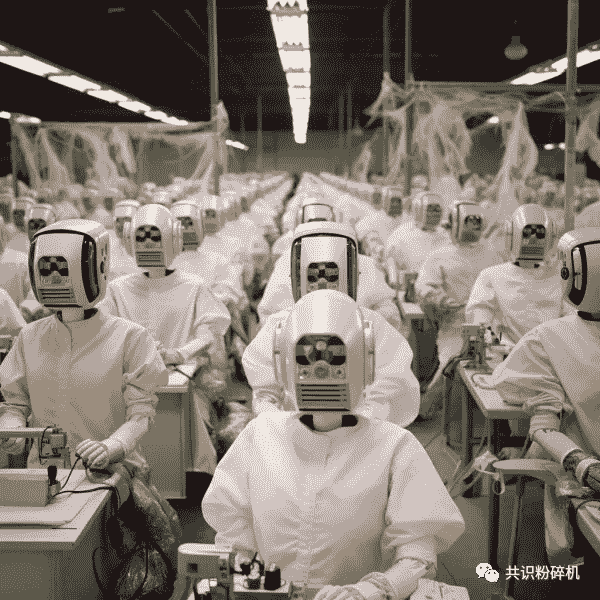

# AI如何改造传统工业

> 来源：[https://agijuejin.feishu.cn/docx/W0V2d4T6PoSwUwxSg4AcKzZRnOc](https://agijuejin.feishu.cn/docx/W0V2d4T6PoSwUwxSg4AcKzZRnOc)

> 共识粉碎机｜[阅读原文](https://mp.weixin.qq.com/s/Zue3Fmi5z0VaB4GapI9ghw)

> 转载请联系原作者取得授权

> **本期讨论会参与者： **

> Neo，AI+工业创业公司MUSEEE.AI创始人

> Jer emy，一线咨询公司负责AI+工业项目

> 以及头部AI企业的管理人员

# **1 ** **大模型在传统工业应用还很初步**

---

工业的信息化程度更接近于2.0数字化，还没到3.0智能化

+   工业的信息化程度有四个阶段：精细化定义为1.0，数字化和互联网为2.0，智能化为3.0，以及工业4.0，现在大多工业企业处于1.5~2.0的阶段。

+   工业4.0主要讨论的内容是：工业不是只是厂房，而是产业链。看到在离散制造企业，问题并非来自自身厂区的管理，而是产业链上下游数据的连通。当上游生产效率下降时，下游节点会产生很大变化。同样下游出现某种情况，对上游的库存等也形成了挑战。这些挑战的处理都需要好的数据的联通和交换。

+   故在第二波中，大多数企业希望在场和场之间建立连接，车间与车间之间进行连接，比如说物流，WMS，希望场-场能连接起来，财务连接起来，然后通过排程等工具调动这些资源。在调度过程中，包括中间厂区的生产保障过程中，会开始采用一些智能化手段。这个层面的问题已经不是简单的问题，而是复杂问题。

+   这些复杂问题依靠人力是无法计算的。以前的负责排程的人员在简单工艺/要求下面，手动排个两三天到一个礼拜，来决定下个礼拜生产多少产品，这是可以接受的。但今天排程工作可能需要以天为单位完成。所以会用一些强化学习或其他机器学习的方式构建算法。将排程时间压缩。在排程问题上，计算并不是最大的问题，而模型怎么和产业链相关环节的需求、数据/策略对齐变得更加重要。

+   举个例子，某个企业上、下游可能存在数据联通或信息集成存在问题，导致一些需求未收集清楚。因此，排程人员无法将准确信息输入系统，所以做出来的计划也不会非常准确。排程本身可能也就1-2个小时，但是数据采集花费时间无数，甚至无法收集到需要的信息。

+   再往下走，整个制造业一直在向少量人力化或无人化的智能工厂发展。自主化这个听起来较为科幻的概念，在一些大型企业的灯塔工厂已经开始实现，包括全自主化生产、排产、维修保养、环境控制以及物流配送。目前这些效果在一些模范车间里实现，尚未大面积铺开。

**大模型目前在工业场景的应用：**

+   虽然努力和尝试的意愿比较强，但是真正的落地并不像努力和意愿那么激进。在具体执行层面，更多还在AI实验阶段，尚未投产到制造层面。

+   **流程生产： **炼化、能源，甚至之前接触过一个酱油公司，为其进行酱油工艺的优化。这与离散制造不太一样。对于流程方面，目前信息化水平相对较高，需要补充的是一些特殊生产过程中数据的问题。以前在某些地方无法安装传感器，造成数据采集不上来，现在这些问题得以解决，或者采用其他数据采集方式来解决问题。

+   研发体系目前应用大模型比较广： 对于大模型意愿和实际尝试都比较强的，有大量基础数据采集、整理工作工作。例如在电池或电瓶制造行业会从上游、下游得到客户需求，用大模型自动化理解这些需求，然后将其转化为结构化数据。之后会从历史上的数百万张设计图纸中进行预训练出来的画图模型，然后基于参数，让这个画图模型生成新的图。以前要求工程师完成类似的任务可能需要1~2个月的时间。现在使用大模型，变成一个几个小时到天以内的工作量。未来至少可以从重复性或可替代性较高的设计工作入手，然后不断规模化，从而取得显著成效。

+   还有的研发主要场景例如论文的提炼： 首先收集论文，然后进行提炼和归纳，最后进行问答。MUSEEE.AI已经帮助客户做了大量Science和Nature等等的论文的解析，包括英文、德语、日文等。利用开源模型学习论文+翻译，对于研发工程师和科学家来说是很大的效率提升。另一方面，可以利用Prompt Engineering，把一些论文信息数据进行结构化。比如说，对于某个一类产品的型号对应性能的信息分布在多篇文章里面，通过大模型，可以生成一个更直观的表格，大大提升了理解效率。

+   **设计： **利用Stable Diffusion类似的模型进行Fine-tune，最后利用它自动化批量生产设计图纸。离散也可以自动化生成许多已有的和重复性较高的设计。但目前来看模型效果还不能完全可控，而且也存在幻觉问题。

+    **预防性维护： **过去在小模型上已经有很多跑通的案例，大模型后对参数预测和质量控制等会有进一步的优化。

+   **营销/客服： **基于自有 数据 深度训练，让模型更懂行业的专有名词或需求，提供更好 的客户体验并且 合规 。 比如在某个客户的共享服务中心，实现了优化40%的成本，这对于传统企业来说确实是一个好的效果。

+   **故障归因和查询： **过去故障排障需要较高级的，有经验的技工来完成这项工作。 那么有了有大模型后，可以将上千页的排障说明书转化为一个灵活的对话工具。 对于两年以内工作经验的新人，也可能快速上手制作技术牌照。

# **2 ** **小模型的应用目前已经非常广泛**

---

传统工业更可能按照1+N+1的模式适用AI：

+   **1+N+1框架： **第一个1是数据平台，即把各个源头，比如数据库，IOT等的数据汇总，统一管理；N是行业的小模型，在垂直方向上实现效果；第二个1是大模型，相当于统一打大脑对每个细分进行管控，然后和管理者进行交互。

+   国内的企业现在在大模型上，有点雷声大雨点小，阻碍主要还是在技术上。一方面是数据的汇总，一方面是大模型很难在所有细分领域上都能应用。但大模型与小模型的配合可以降低难度。

+   在这个结构下，比如说上面讲的R&D方面有许多通用的需求，可以跟大模型做交互，用大模型做需求理解，然后落地到去操作垂直小模型。目前指望大模型帮忙把一些垂直行业的图或者具体的任务给做掉，具有很高的难度。

+   小模型的应用现在已经非常广泛，如APS、预测补货等的模型，还有细的比如可以直接将CAD转换为受力模拟，以节省受力分析的工作量。但这些都是零碎的小模型，不是大模型，可能会承担企业落地AI的主力工作。因此，我们可以考虑1+N+1的模式会成为未来的。

小模型适合更加硬核、更加追求ROI的场景：

+   例如先前大模型场景提到的预测性维护，小模型可以做到更细致、更具有ROI的落地能力。

+   预测性维护是目前小模型最主要的场景之一：利用传感器的收集来的数据，提前判断该修还是该换，过去基于统计学的方法比较多，现在基于AI的公司也慢慢出来了。

+   例如美国的Augury，主要做轴承件的预测性维护，通过震动、CV模式识别进行预判，在风力发电机和轴以及叶片维修保养等方面ROI很好

+   还比如类似国内的一些大型水利工程，每年需要投入大量的人力来做巡检，要求高的场景甚至需要24小时三班倒，有了AI后监测区域会迅速减少。

大模型在模拟数据上可以反哺小模型：

+   **大模型帮助形成数据：小模型训练的数据非常难找，而大**模型在形成模拟数据方面有比较出色的表现。

+   在工厂尤其是R&D领域，有大量专用模型。大模型没有足够的准确性来替代专用模型。 在生产过程中，1%的特殊事件的发生就可能会导致运营事故。 但大模型在模拟设备的运转中确实可以发挥作用。

+   例如特殊生产危险环境和极端化学材料，研发人员会考虑到一些造成风险的问题。然而找到真正的实验数据非常困难。之前是人工方式将这些数据填写出来，以表单方式，模拟结构化数据进行训练。现在完全可以用大模型的方式来实现这些数据的Monitor。在这个过程中，大模型实际上是通过对话方式、设置限制和条件，去找到、生成相应的数据。

+   在此之前很多算法生成数据的方式，比如生成式对抗网络，可以直接用于数据生成，无论是连续、还是离散数据。不仅在制造业，很多金融或消费品公司都可以用这样的生成数据。有很多start-ups的公司也在做类似的事情。在自动驾驶上，也见到了不少厂商利用Unity直接生成复杂路况并交给头部厂商进行模型训练的。

# **3 ** 大模型的出现带动了工业接受AI的能力

---

大模型明显提高了企业对AI的接受能力，但不一定都能实现：

+   现在即使不是大模型，像小模型甚至信息化项目，公司的意愿度都相比一年前有明显提高，信息接受能力更强。

+   ChatGPT是一个非常好的教育案例，大部分的公司管理层都已经使用过了。但到了具体的开源微调，或者在工程级项目上实现的时候，大模型也会因为与管理层的预期差距而导致最终无法实行。

+   **很多客户开始的时候都很渴望将大模型与他们的业**务做结合。 很多客户对fine-tune有很强的信心，认为只需微调这个事情就可以解决以切问题。 部分也会认为AI公司不理解客户的产业没有关系，通过微调都可以解决问题。但事实上很多情况下微调之后不一定比原来的模型更好。因此，AI公司需要帮助客户将场景落地拉回到正常预期。

+   目前今天绝大多数工业企业，用不到真正大体量的模型。 核心问题缺少know-how，而且不确定需要补充多少行业specific的数据大模型犯错后可能会导致选择性遗忘，甚至出现更严重的问题。这些问题都需要尽早跟客户沟通，诸如大模型目前的所能达到的能力，无法指望大模型进行复杂的推理，大模型目前无法判断什么是真实的等等问题。因此在今天整个行业中，有一个主张即对事实进行一致性的检验和核对。这条路可能不能靠大模型自己就能解决，还需要另外一套机制。包括最近科研界有人提出制定时间模型。通过一些新的思路改变模型。大模型无法理解这个世界的真实情况到底是什么样子。但通过强化学习和其他符号学派的方法，将关于事实的内容引入其中。

工业领域接受AI是最讲ROI的 ：

+   传统客户并不传统，工业领域是最讲道理的，因为它所面临的场景的确定性都比较高，所以他们的ROI计算得相当清楚。

+   客户不使用某项技术，并非因为不了解它的优势。实**际**上，很多时候是因为行业的毛利率较低，  切换和迁移成本比较高，一旦出现失误，可能产生无法挽回损失。举例，在一个芯片制造厂进行优化。经过先期诊断，发现价值漏损最多的地方是在电的花费，花费特别多。客户也知道有些fancy方法可以实现这样或那样的电控，但其实这个巨大的电费花费的85%都集中在光刻机上。但一但到了光刻机，客户就不敢做出了任何实际改善了，因为中间有很多配套。为了确保光刻机不断工作，不能出问题，会有整个房间的设备去监控，为确保房间里的监控设备不出问题，还有一个庞大的智能系统。整套系统没有人敢去动任何一个环节，担心一动这个体系就会出现故障。

+   之前一家全球大车企的生产线出现的停机，是由于某个存储的硬盘空间不足所导致。还有一个例子是某个客户的生产线某个数据传输USB接口断掉导致整个工厂停工。所以尽管大家都知道一些改善的方法，知道AI的好处，但是涉及核心的系统，就很难有很大的动作。像芯片公司那个例子，最后帮客户解决的是一些非生产系统的能耗，比如办公室和空调机组等，虽然这些方面也能为客户节省不少钱，但还不是非常核心。

# **4 ** **数据是AI落地工业的一大难点**

---

**收集和对接数据非常繁杂：**

+   收集**数据，现在的解决方法就是依靠各类传感**器，这里面涉及各种IoT公司，比如树根智联。但可能只能解决一半问题。另一个问题是数据收集上来之后，还要对设备做控制，这个环节可能会缺少驱动。因为 许多工业设备比如发那科等的工业系统以及接口驱动等，都是都是闭源的或者缺失的 。例如数控机床，如果不用它的驱动，就无法控制它。但在驱动的原设计阶段，没有考虑到某些未来的功能。在这种情况下，是通过增加一些外挂的方式去驱动还是去找厂商合作接口，都会有很多的工作量。

+   最差的方式就是额外增加人力进行控制，然后就是考虑一些工具型的外挂。遇到过一个比较复杂的case是，最终的控制是员工带个PAD或者手机，把分析的结果发给操作员，然后这个人再去现场更换或操作。稍微好一点的情况是能够要到驱动，然后做一些接口。

+   **而**对于老设备的适配可能可能要进行半年之久，这里面需要投入的资源非常多。这也是AI公司的壁垒之一，这个设备对接过了下一次就节省了大量成本和时间。

+   数据采集过程中，AI公司在搭建平台的时候难度也很高。生产时效性要求非常高，上公有云基本上不太可能实现，客户更接受买光缆。5G通信成本也很高，5G方案落地也很有难度。这里面最好的方式是用盒子，一体化将算力与软件打包进盒子，有些项目需要两三年才能完成。用于基建的硬件/infra成本大约占到这类项目总成本的1/3。

具体看数据对接的话有连接模型、协议、数据治理等关键难点：

+   和传统的数字化集成还不一样。不是简单的把数据搬到平台上就行，这里面需要试错的情况还很多。需要有一定的灵活性，需要与厂里设备的数据物理连接拓扑的变化而进行改变，需要一套IoT数据连接模型。

+   在工业设备与系统之间的协作过程中，需要弄清楚许多协议，现在基本上有很多工具和方法可以做这些事情，相对比较成熟。

+   数据同步完成之后，可能还有一个较大的问题，是数据治理的问题。这部分确实涉及比较多的dirty work。加上时效性影响也较大，让这个事情变得更复杂。因此在项目中需要有专门人员去建设这个底座。

+   **基本**上大约80%的客户的数据源都可以比较方便的接入， 然而剩下20%，主要集中于一些老的工厂，尤其是规模较小的工厂。规模较大、较新的工厂，迭代快，设备、系统相对新。比较麻烦的是那些老厂改造，里面很多设备的提供厂商可能已经都不存在了。

**涉及的底层数据架构：**

+   最大的需求是时序数据库。传统关系型数据库可能写得不够细，对读取和存储方面可能有所欠缺。目前数据架构基本上分为两层：一层是快速反应的那种，会用一些时序数据库，另一层则是非结构化数据库来完成这些工作，部分场景会用到MongoDB。

+   数据库的选型现在不是最大的问题。大量时间和资源还是花在解决通信问题，就是协议等方面。 有些公司可能做得比较好，很多底层的东西已经集成到一些小的边网关里。 基于这些产品做数据平台压力会比较小。 但有些可能不行，必须有额外方案来解决。

# **5 ** 模板库的积累和复用是AI公司的核心能力

---

AI公司需要与行业专家合作构建大量模板库：

+   AI公司为了覆盖多行业，以及不同行业的AI需求场景，需要数十甚至数百的AI模板库。

+   模板的生成或迭代非常需要与行业专家配合，不太能指望领域外的公司去完成。因此，在与具体公司合作时， 需要大数据/AI公司和领域专家公司和客户建立一种联合共创的机制。 相当于，客户/其他三方公司提供领域专家帮助制作一些模板，这些模板的质量和迭代也要靠这些专家。

+   在后期，帮助客户/三方将这些模板推广出去。里面的利益分配也会反映到到最初的交易结构中。所以**，对于工业来说，这是一个朋友圈问题**，只要产业链足够大，朋友圈也会扩大。理论上， 耕耘越久，认识这个体系里的专家会越来越多，这些知识和资产也会变得越来越多。

+   在工业领域的大数据/AI服务公司，最大的竞争差异就会是domain knowledge反应到的模板库，然后才是数据平台、模型能力等方面。

模板库的行业属性也会成为AI公司在行业客户中的壁垒：

+   目前还是分行业，或者根据专家属性和业务属性进行分类。比如为汽车制造积累的know-how往电力行业去迁移就比较难（比如工艺流程不是问题，涉及到的领域知识基本上也不一样，水电站主要解决水电机组发电机轴的瓦温问题，汽车里面比如说解决金属切削问题），这是分类的价值。以及需要考虑，比如一些企业的专家可能无法与某些其他企业合作，这些更细的东西也需要考虑。

+   现在的发展阶段，主要是收集数据。所以针对各个细分行业，建设设备库。另一方面，之前做过一些类似的项目，会有一些模拟产线模板。模拟产线模板基本上都会留在里面，就像一个沙盒一样，后续的专家也会在这个沙盒上进行一些作业。

+   不同服务公司可能在不同的vertical上面有不同的模板，**这可能会对整个行业形成许多垂直的**分化。 如果不在这个产业集群里，很多上下游的知识/信息都拿不到，那么就很难切入。

# **6 ** 工业AI很多场景需要咨询公司参与

---

大型AI项目可能需要咨询公司参与，并协调流程：

+   前期会进行数据中台搭建，解决数据孤岛问题，这需要花很长时间。在这个阶段，咨询公司会先抛出一个完整的设计。告诉客户，需要哪些domain的数据、管理体系是怎么样的，数据owner是谁等。然后平台搭建，可能客户会自己寻找其他数据平台服务商去完成，咨询公司也会帮助客户落地，包括数据治理、管理一体化数据平台开发，以及如何规避数据风险并提高管理效率、采购、扩容或者上云等方面的建议。

+   从技术角度来看，在这个阶段进行data cleaning和 data integration需要花费很大的成本。还有一些是商业上面的，例如爬一些开源数据、调用API或外部数据库，每一步都会涉及许多问题，包括采购流程方面的问题。客户可能不想花这么大价钱/成本获取这些数据，尤其在前期没有看到这些数据能够带来好的效果的情况下。

+   在实施过程中，如果要顺利完成这样的项目，需要向客户高管提前告知我们的工作内容，包括数据整合对项目的重要性以及相关情况。例如，需要3~5个月的时间，而不是一两周内就能完成。也应该给出一个短期的效果的预期，这样才能确保事情顺利进行。

+   在最终阶段，需要考虑如何实施use case，即践行用例驱动。找到许多落地场景，并产生实际效益。无论是模型还是大小模型，以及许多解决方案或最终标准化产品，都会有这些场景。批量找到这些场景，找其中的容易做的场景，先成批做下去，出了效果，然后继续提供更多。

+   在此之后，还必须建立一个良好的监视检查机制在AI系统或工业系统时，有个概念叫System1 和 System2。System1 主要是大模型，包括通用领域和专业模型。 以及LLMOPS的很多系统，例如如何训练微调部署及开发端模型，管理LLM、fine-tune等。这些框架和应用属于System1。

+   此外，还有一个基于规则推理任务的System2，具有较强逻辑性的推理能力。这包括一些专家系统，如推理突破、专有的统计学或物理化学的偏微分导出的计算结果。将这两个System进行结合或进行互相交叉验证，不断精进和优化数据和模型。数据处于正向反馈循环或良性循环，数据越好，大模型效果越好，反过来实际工业系统生成的反馈数据质量也会越好。因此，逐步推进整个生产运转是有益的。

+

在与AI公司或者外部数据公司合作时建立PMO体系：

+   建立一个类似于pmo或转型COE的组织，不断监控项目进展。这样的组织一般会有客户各个部门的部门长和厂长参与。

+    在服务过程中，会把 合作伙伴 的主要职责以及他们的工作排进整体计划中，并在这个组织中进行定期review。 避免项目陷入混乱。