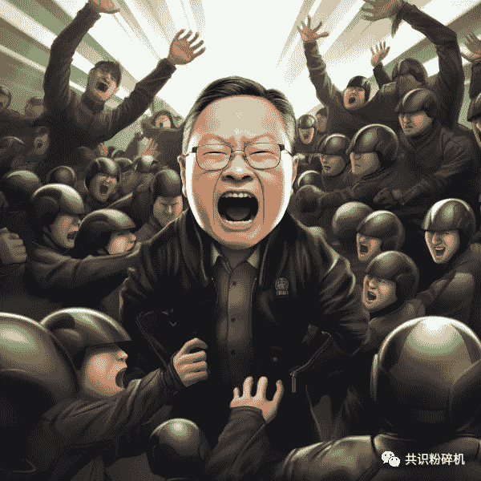
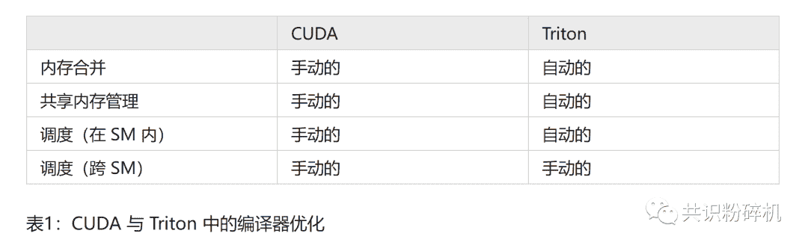
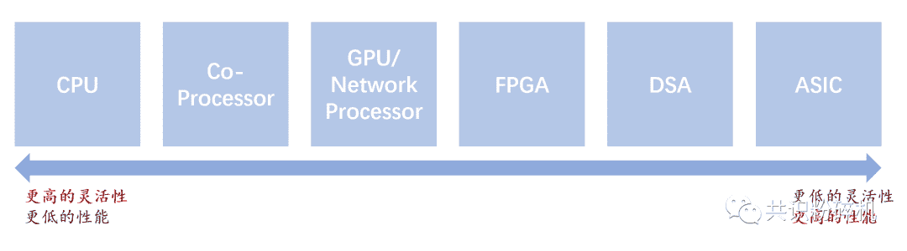
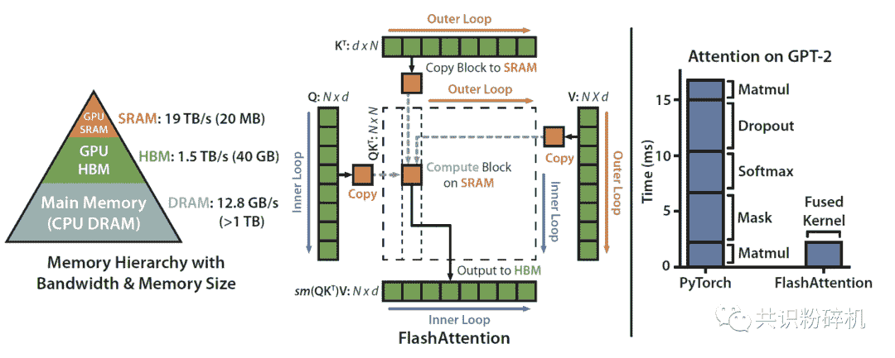
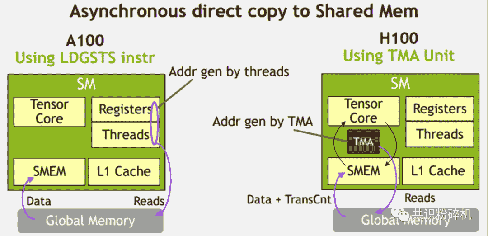
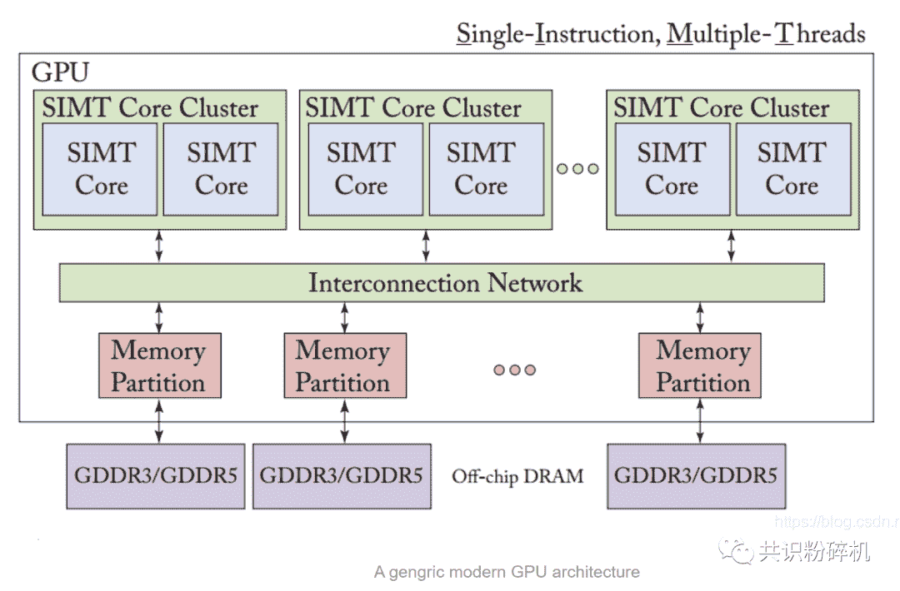
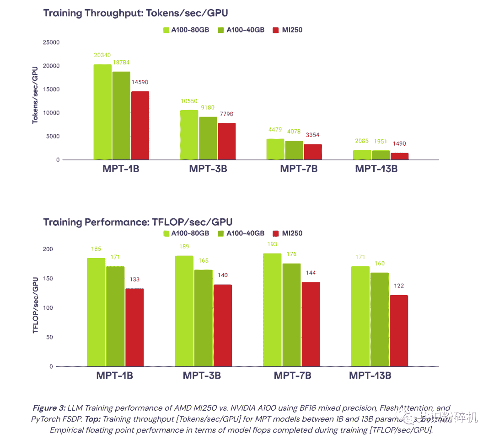
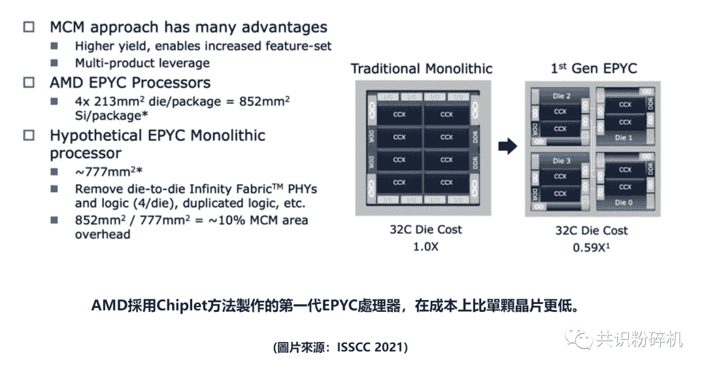
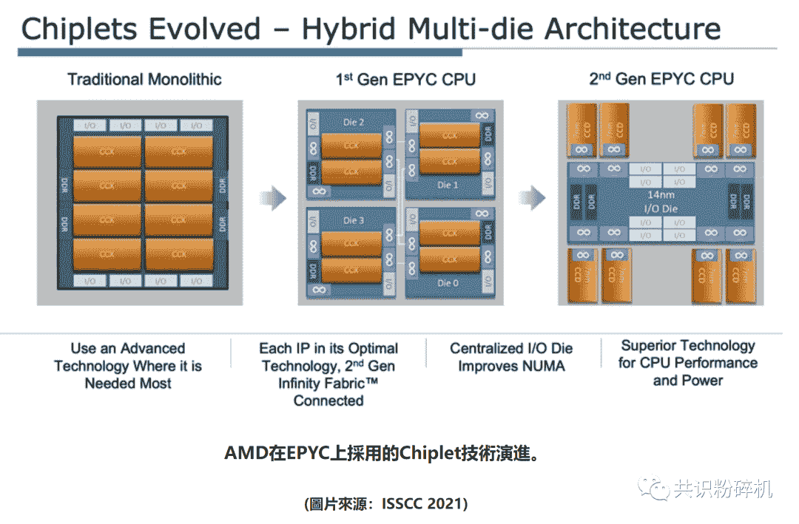
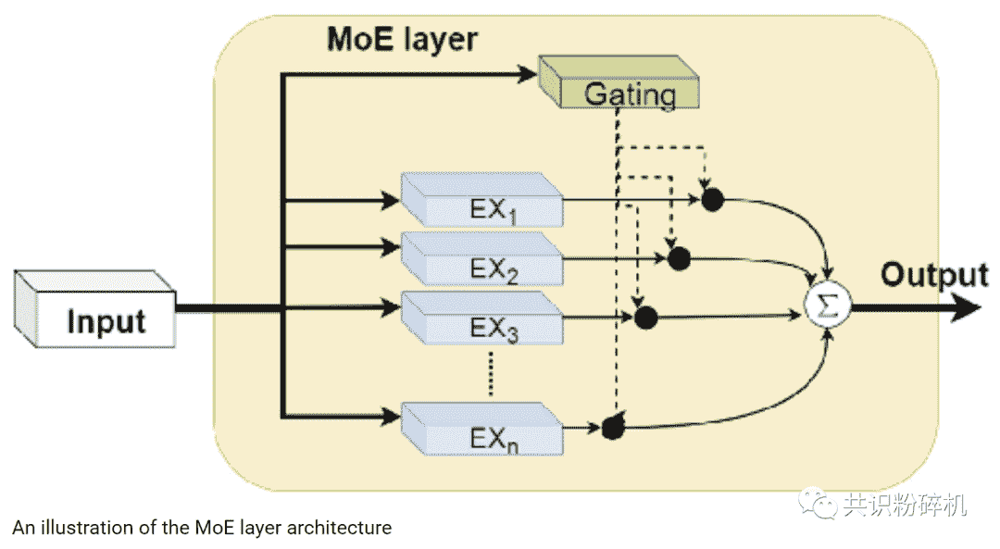

# 如何突破英伟达垄断

> 来源：[https://agijuejin.feishu.cn/docx/Swf3d2fBBoR70Tx1d3ecwMJwnze](https://agijuejin.feishu.cn/docx/Swf3d2fBBoR70Tx1d3ecwMJwnze)

> 共识粉碎机｜[阅读原文](https://mp.weixin.qq.com/s/YHGngJ7ZQi3uYEu0ZUo_8A)

> 转载请联系原作者取得授权

> **本期讨论会参与者： **

> **李乐丁老师 **， 北极光高级顾问，前百度云主任架构师。

> **Eric老师 **，清醒异构首席架构师，有丰富的AMD落地训练/推理经验。

> **王健飞老师 **，NPU架构师，知乎@王健飞。

> 以及一位资深的 **一线ASIC厂商战略负责人。**

# **1 ** 从PyTorch2展开谈CUDA壁垒

---

PyTorch2整体上有一系列重大更新，虽然进展稍慢，但不影响终局

+   PyTorch2是2022年下半年发布的，在2021年就开始了宣传，其中 Torch Dynamo （注1） 是Pytorch2.0中最重要的工作。

+   **2**.0中最大的功能是torch.compile()，这个功能相当于在用户的Python程序和厂商所需要的图上数据流计算构建了之间的桥梁。 在更早的时候，NV可能不需要这样的表示也能保证性能。但随着算力需求不断扩张，NV也开始需要类似的能力。因此，Torch把这部分提上了官方日程。这对所有的ASIC/DSA厂商来说都是利好，因为这部分工作量相当于Torch自己承担了，并会对用户形成一种广泛的教育。

+   从目前情况来看进展比预期稍慢，但已经有初步落地效果 ，进展慢的原因包括Torch Expert等功能还未发布；以及并不是100%的模型结构都能稳定翻译出来，仍然会有corner case。

+   技术上没有风险，预估到2024年会使整个软件栈做得更加鲁棒。 目前Torch提供的两套IR（Intermediate Representation）算子（即ATen算子库和Prims算子库）尚未完全定型，以及Torch Dynamo的Compile系统仍需一年时间的打磨。

+   注1：Torch Dynamo：Python-level JIT compiler designed to make unmodified PyTorch programs faster. TorchDynamo hooks into the frame evaluation API in CPython ( PEP 523 ) to dynamically modify Python bytecode right before it is executed. It rewrites Python bytecode in order to extract sequences of PyTorch operations into an FX Graph which is then just-in-time compiled with a customizable backend. It creates this FX Graph through bytecode analysis and is designed to mix Python execution with compiled backends to get the best of both worlds — usability and performance.TorchDynamo makes it easy to experiment with different compiler backends to make PyTorch code faster with a single line decorator torch._dynamo.optimize() which is wrapped for convenience by torch.compile()

+   Source: https://pytorch.org/docs/stable/dynamo/index.html

**PyTorch2推出的Prims新算子**库与Triton结合可以削弱CUDA壁垒

+   To**rch之前的算子库，叫ATen。这个算子库早时是按照需**要添加，没有明确的算子集合的概念。可以说Torch在Python层面是一致的，但在算子层面内部没有一个良好的定义。因此， 非NV厂商想要对接，会发现这些算子定义不够稳定，可能会在一段时间内发生变化，跟踪起来会很麻烦 ，只能pin到Torch的某个稳定版本上进行迭代，这显然不符合客户的预期。 如果是仅在内部使用，无需定义IR，则并不会影响当前的使用。

+   T**orch2.0 提供了另一套名为Pri**ms的算子库。这套算子库将原来的~2,000多个算子拆解成更原子的算子。 Prims算子的优势在于，因为它的数量较少，所以更容易得到厂商更完善的支持。 它的缺点在于，原本是一个宏观的算子，如Attention这样的算子，在Prims算子上会被拆成很多小算子。拆完后，原来对Attention整个算子有加速设计，现在需要把小算子再拼回来，相比更加麻烦。因此，Torch希望可以用Prims来做保底。如果有一些额外设计，则可以从Attention上接入。

+   Torch2同时添加了新的后端Triton（注2），大致可以理解为类似于Python领域专用的语言，对中间表示进行处理, 接着通过这些中间表示进行优化。最终用IR与GPU相关的中间表示生成代码。如果以CUDA为例，写一个矩阵相乘，如果使用Triton的方法，在某些硬件上能够达到CUDA的90%。若要支持新算子，Torch也有编译的开源栈，能够把一些算子变成Triton的中间表示。实际上，对于AMD与ASIC /DSA 来说，只需要添加一个在Triton上的后端代码生成过程。 因此，Torch2更好地支持了模型编译，这也削弱了CUDA的壁垒。

+   注2： T riton 是一种类似于 Python 的开源编程语言，它使没有 CUDA 经验的研究人员能够编写高效的 GPU 代码——大多数时候与专家编写的代码相当。 Triton 可以用相对较少的努力达到最高的硬件性能； 例如，它可用于编写 FP16 矩阵乘法内核，其性能可与 cuBLAS 的性能相媲美——这是许多 GPU 程序员无法做到的——不到 25 行代码。 相关研究人员已经使用它来生成比等效的 Torch 实现效率高出 2 倍的内核，官方还是很愿意与社区合作，让每个人都能更轻松地进行 GPU 编程。 Source： https://zhuanlan.zhihu.com/p/617731357

AMD与ASIC /DSA 如何通过PyTorch2追赶CUDA

+   从ASIC的角度来说，现在就应该接入Torch。 长得像GPU架构的 keyi 可以 从Triton层面接入 可能更适合长得像GPU架构的 ，工作量 会 小一些。

+   若是其他DSA（Domain Specific Architecture，领域专用架构，注2），例如国外的Graphcore、Tostorent和特斯拉等平台， 还需要在 Triton上（ 可能是一个比CUDA更好 上 的媒介），但还需要 做 一定 扩展， 接下来需要 减少一些功能增加一些功能，比 如增加空间计算能力， 如mesh结构的空间计算，才能用得更好。 或者 直接接入 Graph 自己做编译。

+   **A**SIC /DSA 何时能做得好，实际取决于ASIC /DSA 厂商的能力和努力程度，是个工作量问题。 如果投入足够的人员，看准这个道路并打磨体验，可能在一两年内就能做得较好。 但这个工作量永远在，追赶的厂商需要平衡现有的使用和未来的发展。

+   但无论是生态层还是整个上下游的连接上，当Torch进行任何更新时，都必须确保CUDA接好。这样一来，即使是框架层，它仍在为CUDA适配。那么新厂商永远面临适配框架的问题，因此追赶会相当辛苦。从方向上看，这确实有利，但最终可能是资源、时间和架构技术方面的问题。

+   看NV的Datasheet，当V100时就有Tensor Core了。 如果看到最新的A100或H100，会标出CUDA的FP32和Tensor的FP16。 NV也在不断增强通用计算部分的CUDA Core计算能力。 最新的A100、H100做的Transformer或者各种深度学习网络，加速更好的是在它的DSA-like的架构上。 H100, H800上面表的数字很高的，1个P左右算力都是专用的，不是CUDA Core那种通用算力。

+   注3： DSA针对特定应用场景定制处理引擎甚至芯片，支持部分软件可编程。DSA与ASIC在同等晶体管资源下性能接近，两者最大的不同在于是否可软件编程。ASIC由于其功能确定，软件只能通过一些简单的配置控制硬件运行，其功能比较单一。而DSA则支持一些可编程能力，使得其功能覆盖的领域范围相比ASIC要大很多。Google的TPU是一种典型的DSA产品。 Source: DSA芯片到底是什么？ - 知乎 (zhihu.com)

**如何量化芯片厂商的工作量**

+   会分成几种挡位。如果架构偏向GPU，无论是NV GPU还是AMD GPU都会更好，例如Triton的那种情况。 假设有几十个人就可以完成。如果偏向DSA，以华为为首，需要铺设很多人才行，例如华为整个软件栈，有1000人以上的规模。

+   因此，对于非GPU或非NV公司来说，工作量本身就是一个现实壁垒。即使技术都完善，但要达到NV或CUDA的水平，仍需要时间去追赶。相比NV，还需要保持加速度。

+   NV宣称自己是一 家软件公司。当客户量大的时候，确实需要庞大的软件支撑团队。一方面要打好自己的基础能力，另一方面要帮助客户做适配。因为客户一开始可能不会掏钱或者付出工作量来适配你的平台。作为厂商，需要帮客户将工作量迁移到系统上，无论难易，这个过程一定需要很多软件团队的人。

+   软件团队一方面需要打好基础，例如编译系统等需要资深领域专家参与。在国内，这些团队的数量可能不是特别大。另一方面，例如华为可能有上千人，帮助客户适配模型或算子，如算子加速优化或一类网络模型优化。现在大家都听到 FlashAttention （注4）这种结构，这是一种针对子图的优化方法。然而，客户并不仅仅是这一种结构，还有许多其他的奇特网络结构，全依赖自动来实现的方案并不成熟，实操中仍需要大量人员开发，如FAE等，帮助客户完成这个任务。因此，这些工作确实非常烧人。

+   举个例子，如果今天写一个矩阵乘法，基本上所有人写出来都没有NV的速度快。不是因为算法不够好，而是NV已经根据不同矩阵尺寸和 芯片 代际来分别设计不同的算法。这些算法的参数是NV一遍遍测出来的，这是一个 巨大的 工程工作量。因此，这一块需要大家在一段时间内不断积累工作量才能 追赶和超越 。

+   注4：FlashAttention 是一种重新排序注意力计算的算法，它无需任何近似即可加速 注意力计算并减少内存占用。所以作为目前LLM的模型加速它是一个非常好的解决方案。 Source: https://zhuanlan.zhihu.com/p/626079753?utm_id=0

为什么PyTorch会主动与AMD等加强合作

+   Torch与NV的适配 不需要双方主动做什 么，整个社区生态自然而然就会发生。

+   **但**Torch要面向更广大的开发者，与各种GPU都对接好，就要尽量多的加入硬件加速器成员。与AMD加强合作，也符合Torch框架的自身发展。

+   从AMD的角度来看 ，Torch一直在努力适配AMD，大约在 V ersion  1.8左右能够全面支持AMD。因此 ，若接下来Torch继续发展 ，不仅要支持CUDA，还要支持AMD的ROCm，或者通过编译手段添 加新的算子的方式。

PyTorch与ROCm的合作进度怎样了

+   **从**用户体验的角度来看，现在使用PyTorch + ROCm和PyTorch + CUDA并没有什么特别的差别。 例如，原来底层接的是CUDA，将某个Tensor放到CUDA上跑通。当使用AMD卡时，代码几乎无需改变。从使用体验来看，Torch2.0 + ROCm的感觉越来越好。

+   从性能角度来看，硬件本身的算力可能存在一些差距。 例如，A100和MI210左右的显卡对比，A100的FP16的计算性能，实际上要比MI210好很多。 但是从软件角度来看，差距没有那么大。

**当**用户最终需要使用一些算法时，在加上软件后，算法性能是怎样的？是直接与硬件有关吗？还是实际上也需要结合软件的优化？

+   这与软件肯定有很大关系。 例如，对某一个特定的算子，如矩阵乘，优化的程度是多少，这可能是一个限制。 从目前使用ROCm的角度来看，例如测试矩阵层和内存开销的算子，与CUDA同级别下的算力卡，差距可能达到A100的80%，访存方面可能达到80%。 计算FP32可能达到提供的理论算力的90%，FP16可能达到80%。

**PyTorch + CUDA和PyTorch + ROCm之间的差距是**动态变化的，在整个过程中，两者之间在类似任务上的差距是逐渐缩小的，还是有所增大？

+   从LLM的角度来看。在市场上，较最好的模型（GPT4.0）尚未出现特别大的革新, 故在算子，如矩阵乘，这些算子并没有特别多的新需求。

+   如果从这个角度来考虑，可能ROCm和CUDA的距离会更逐渐接近，因此最终制约两个卡的效率的主要因素可能还是在硬件上，可能不在软件这一层。

+   **实**际上也要关注两个硬件的速度和架构演进程度。例如， NV最新一代增加了许多DSA能力，如TMA等（Tensor Core and Memory Accelerator，注5）。 最早的CUDA实际上连Tensor Torch都没有，只有最基础的Vector运算。Tensor Torch也不是第一个DSA能力，随后增加诸如TMA这样的数据搬运能力，以及多个SM共享的协作计算的能力。这些能力并非基于最原始的SIMT编程模型所有的东西。DSA技术发展后，这些更加不标准这种趋势非常明显，拥有更大的算力以及提高更好的算力利用率，必须也要做这些事情。这也是各种ASIC或DSA能够弯道超车的机会，厂商如果做得比英伟达更好，可能有机会弯道超车。但英伟达自己也在做这些事情， 所以如果其他厂商也不能只单采取跟随策略，而需要跑的比 NV 更快。

+   注5：相关DSA特性包括：TMA/Async warpgroup-level MMA/Distributed Shared Memory/Async transaction barrier，其中，TMA支持img2col，multicast，shared memory swizzle等。 Source: NVIDIA 的「老黄刀法」究竟是个什么梗? - 知乎 (zhihu.com)

现在已经看到AMD生态在追赶英伟达的趋势了吗？

+   **ROCm达到CUDA的能力，还需**要做大量工程方面的工作，另外 对于硬件来说，硬件卡的算力并非是最困难的地方，最难的地方还是在I/O。 一方面是等显存，另一方面是等卡间通信。这其中耗费了大量时间，因此大家会看到很多卡利用率仅为30%~50%。要充分利用这些资源，不仅需要利用显存，还要关注缓存。今年新出的Hopper或4090，花了大量芯片面积放置L2缓存。而AMD选择的是Inifinite Fabric，这实际上也是一种加快缓存的方式。若再仔细观察，SIMT （Sing-Instruction，Multi-Treads，注6）里面也是缓存。

+   因此，无论是TPU论文还是Infinite等论文，大量篇幅都在讨论如何设计缓存问题。实际上，面临的问题与当年CPU面临的问题非常相似。计算Core速度远超过I/O能力，中间会有大量缓存，开发者需要面临大量Cache Line对齐等细节问题。这些都需要AI框架或像ROCm这样的计算库来解决和克服。

+   今天有时候NV做得很快，或者PyTorch做得很快是出于这样的原因：同样的算子，最终映射到**不同卡的算子不一样，而不同卡上的算子在不同参数大小和规格下的性能表现都不一样。** 尽管现在PyTorch2.0迈出了重要一步，中间有IR，但IR只是代表可以从API的角度涵盖不同卡，但IR不能解决不同卡在不同算子上的性能表现不一样的问题。 因此，仍需大量工作来解决不同卡在不同算子上的性能表现不一样，否则会看到像AMD的卡在纸面性能上非常高，尤其是新出的MI300，纸面规格比H100还要强。但实际应用效能可能不如H100。 最近MosaicML（注7），移植后发现MI 250的实际应用效能是A100的80%。如果真正挖掘还有大量性能潜力隐藏在具体细节中，这方面的工程量仍然很大。

+   从过去的实践经验来看，这不仅仅是技术问题，更多的是企业生态建设的决心问题。如果只依赖像AMD这一家公司逐步改进ROCm，很可能永远追不上CUDA。可需要像Google或Meta这样的企业，能够从更上层，比如说PyTorch这一层，或者更往上的层次一起支撑。例如更多地使用Deep-speed（注8）这样的框架，并用自己的生态改进，它的速度可能会很快，就像Google一样。如果真的下决心，它的TPU表现会非常好。从宏观角度来看，同一代TPU效能不如同一代的NV GPU。但Google手中有AI框架，有Tensorflow/JAX等，有自己的领域模型，可以在DSA领域进行专项优化，从而提高效能。因此， 这是整个产业链的事情，不能将压力全部压到像AMD这样的公司上。

+   具象来看AMD的话，计算上的瓶颈可能不大，瓶颈会出现在显存带宽上。前段时间关注到，AMD现在有Chiplet （注9）技术，在片上集成能力可能会更强一些。而NV走的路线是卡之间的互通能力特别强。AMD的策略更倾向于在单卡上将显存做得特别大，这也是AMD可能存在的某种优势。

+   注6：GPU 真正的调度执行模式是按照SIMT(single-instruction multiple-thread)模式，即每个SIMT包含一定数量的core用于执行（GPU中的core一定属于某个SIMRT），在NV中SIMT被称之为wrap, AMD中称之为wavefront，它是硬件调度的并行的 最小单位，即一个SMIT 可以同时并行运行的线程数目。而SM一般由多个或者一个warp组成，一般程序开发人员感知不到warp的存在，只能感知到SM,一个通用别的GPU架构一般由下图组成： Source: https://blog.csdn.net/weixin_42730667/article/details/109838089

+   注7：MosaicML创立于2021年，LLM大模型平台，代表模型MPT-30B和MPT-7B。2023年6月被Databricks收购。2023年6月发布一个AMD和NV相关测评。

+   Source: https://www.mosaicml.com/blog/amd-mi25

+   注8：微软开源，DeepSpeed is a deep learning optimization library that makes distributed Training and inference easy, efficient, and effective. Source: https://github.com/microsoft/DeepSpeed

+   注9： Source: https://www.eettaiwan.com/20210305nt01-amd-shows-its-chiplet-playbooks-at-isscc/

# **2 ** **非NV卡在推理侧的应用**

---

非NV卡在推理侧对LLM的支持程度

+   实际上，现在常见的ASIC /DSA 都可以支持语言模型的推理。但常见的非NV芯片，都需要专门进行人工适配。这里包括一些情况下缺少对算子的支持，或者某些算子的效能不够高。

+   目前LLM的设计主要针对NV卡存在NVLink的情况，它的卡片通信效能非常高，而许多卡片没有这么强的通信效能。通常情况下，以月为单位来完成这种适配。

+   从见到的几款芯片来看，效能确实没有达到NV那么高，但完全可以运行。从技术角度来看，没有特别明显的瓶颈，更多是需要仔细调优，并将生态做好。

+   目前像PyTorch这样的项目已经有大量人投入，支持的算子已经相当丰富，尤其是有了IR之后，ROCm也逐步支持，其他ASIC /DSA 也可以按照Torch的IR去支持。

+   但仍**然**存在生态问题，即许多新出的算法论文在实现时会自己写算子、选择算子，然后根据CUDA自行编写一个优化算子。这样的算子无法出现在任何AI框架和其他库里，因此需要手工移植。这部分就是纯粹的生态问题。 随着PyTorch支持算子越来越丰富，或者其他库的支持越来越丰富，让研究者们逐渐减少对手写算子的需求，移植才会变得更容易，运行也会变得很快。

**适配中如何解决手写算子的问题：**

+   如果遇到手写算子 问题，可以通 过手工翻译来解决。例如，编写了一个新的算子，用CUDA的方式编写。如果希望算子的通用性更好，可以人工将其翻译成PyTorch2.0的算子。如果算子本身不存在，可以提交到社区里，在IR层面再补充一些实现。如果不追求这么强的通用性，而是仅在自己的环境使用，会将CUDA写的翻译成自己的AI芯片算子，然后交付给客户使用。这种方式目前也一直存在。

+   这里面 真正的时间消耗并不在翻译和编写阶段，更多的时间消耗在测试上。 很难保证某一次翻译完全正确，或者性能指标与原先相同。因此，需要大量测试对比以确保这次翻译正确，并确保性能等方面都合格。如果要实际交付客户，还需要与客户的上下游应用进行一次联合调试，这些都会消耗时间。 从之前交付的一些例子来看，是按月计算的。

+   具体要做：1.需要确定迁移的层数有多少。这是一个纯技术面的工作。类似现在大语言模型都是Attention有Key Value层，如果换成新的Linear Attention，Flat Attention，虽然仍有Key Value的层，但Key Value层的性能指标不同，Key Value层的缓存运用方法也有所不同。需要明确原先待迁移的模型是如何实现的。 然后到目标硬件框架上，选择一个合适的技术方案。如果方案确定后，惊醒实操操作。完成实操后，进行点高管测试，确保模型基本功能良好，以及模型准确率等一系列指标达到预期；2. 在实际应用中对模型进行更大规模的测试，以确保外部性；3. 随着一系列测试指标的出现，更清楚地了解该模型应用在该款硬件上的实际运作成本，效果是否符合预期，判断是否需要继续迭代。

+   总的来说，这与通常的软件开发持续迭代的大体工作流程是一致**的，并不因为这是AI就有特别大的不同。 这个过程中，最难的是吸收其中的经验，并沉淀到软件中**去。任何一个模型今天技术层面上都可以迁移，这件事情没有特别神奇的难度。但不希望每次模型迁移都做适配，这才是最大的难度。 不希望每次一个新模型到一个新的芯片上，都需要人力去做适配。也不希望用户因为选的模型从20B降到17B，也需要从头做一遍迁移，从40G的显存变成20G的显存，也需要重新做一次。

+   不希望依赖于迁移流程，而是希望通过每次迁移过程吸收 其中的 经验，将其融入到自己的ROCm或ASIC /DSA 相应框架中，使后续工作更加scale。然而，这面需要较强的架构设计能力，既要了解模型本身的特点、算子、性能特性，也要了解自己的卡的特性，适当地了解PyTorch内部的设计。综合这些因素，选择合适的方式进行迭代，这一块才是最难的。这是一个经验积累的过程。并不在乎一次迁移，而是不能让这种迁移每次都变成一锤子买卖，不吸收经验，这才是最大的难点。

+   经验沉淀是有先发者优势效应的。在后发时，需要面对许多外部限制，例如时间限制，比如将修正commit提交到PyTorch2.0。然而，一旦走这一步，跨国开源社区协作时间通常是按月计算的。如果自己掌握了一个生态良好的AI框架，这件事情会变得容易。

+   今天中国工程师面临的问题并非技术问题。硬件做得相当不错，软件也很好，国内有很多款AI框架，大量模型都是华人工程师和华人科学家制作的。中国不缺基数，而是缺乏生态，缺少别人已经积累了几年甚至十几年的上下游资源。要在这方面切入进入，需要付出大量工作量，甚至需要更巧妙的方法，这样才有机会赶上海外竞品。闷头做10年，突然就超过，这样的情况不会存在。需要通过一些巧妙的办法将我们的生态融入到更大的生态中。

+   以国内厂商为例， **百度**的做法是将产业链上下游打通。百度更愿意采用Google的方式制作芯片，自己做昆仑芯 片，框架做PaddlePaddle（百度飞桨，百度的深度学习框架）、分布式训 练也有Paddle上的一系列产品。 大模型，百度自己做文心，包括数据搜索。如果整个流程都在百度的控制范围内，即使有一些环节做得不如美国，但能控制整个上下游，就可以进行大量领域相关的设计，做specific，这个方案的效果会非常好。

**适配的复杂性是否会制约AMD与AS IC /**DSA 的 客户数量，只能服务超大客户：

+   以海外厂商为例，目前手头拥有较好的AI芯片的是Google，而Google的AI业务量远大于Google Cloud上的AI业务量。也就是说，Google首先服务于自己，先服务好搜索这个super app，来锻炼出来整个平台的能力。与Google同级别的万亿级公司，尽管都有自己的芯片，但他们的成熟度远不如TPU。当然，这里面可能会有各种各样的原因。其他万亿俱乐部公司，他们的AI业务无论是广度、深度，还是对自己存在的必要性都没有Google那么高。可以说搜索孕育了AI，AI也是搜索最大屏障所在。因此，Google一定把AI握在自己手里，所以它在这件事上做得最好。

+   在对外服务方面，大家都面临同样的问题。看到Google在Capex采购中，仍然会采购NV GPU。尽管它的GPU几乎不服务于内部需求，但是Googld Cloud需要。Google可以实现改变自己的工程师的偏好，但不能改变客户工程师的偏好。同样，无论如何AWS再怎么喜欢自己的Inferentia和Trainium，也采购大量的GPU来支持客户，自己的Inf2芯片主要适配部分大客户。实际上，这就是生态的作用。无论是芯片还是软件，最大的壁垒和倚仗都是上下游生态。如果CUDA生态不打破，想在通用场合击败NV将是非常困难的事情。

+   完全技术上的问题基本都可以解决。尽量沉淀到软硬件架构上，对于客户来说，每次更换模型或部署一次推理模型，都要等待几周或一个月，这是不现实的。但从生态的另一个视角来看，还有一个事情是比较难的是客户是否愿意配合你。实际上，很多客户并没有兴趣去配合，已经部署NV用的很好，为什么还要帮忙做迁移。客户也不清楚这个新的芯片公司能活几年，产品如何迭代。也不确定花费是一次性的，还是可以持续作用的。对于买方/甲方来说，他们的意愿实际上很被难撬动。不谈百度或Google这种完全自闭环，如果单纯外部产品，客户意愿是一个难以逾越的槛。换句话说，如果有办法克服这个问题，在积累过程中，如果客户不觉得是一次性事情，他会陪你做这些事。

+   总的来说，现在LLM推理在技术上相对还好，门槛并不高。而且瓶颈也十分明显，是Memory并非算力，这一点对于NV的挑战者，如果能克服前面提到的门槛，会让事情变得直白和简单，NV的premium实际上容易被打下来。举个例子，刚才提到的AMD MI300，MI388。它在显存带宽和size上做了极大优化，当然AMD用了Chiplet，NV还没用，大家在这方面并不太可比，但至少在这个Memory的点上表现得很高，对于推理来说，这是极大的帮助。同时，也看到AMD的MI 300 也愿意降低价格，加上软件生态不错，这实际上也是一种策略。

+   因此， **在推理上，NV的门槛相较于想象中要小很多。尤其是当竞争对手有办法提**供更高性价比，想办法撬动更多客户意愿时。从大客户往小客户来做，理论上会好一些。 因为双方投入都不小。对于算法型小公司来说，不愿意等待，对于芯片厂商来说他们采购量没那么大。所以，先做大客户，寻找配合度高的客户，是芯片厂商最好的策略。

**基于目前情况来看，AMD与ASI C **/DSA 与NV 卡在推理上有多大差距？

+   在国内，大模型推理并没有太多的量，因为国内没有Chatgpt，大家都还好。这里提供一些已经发生过的事情作为参考： 例如在 安防领域，实际上是一些CV视频流分析领域。这是过去几年相对成熟的，采购量明确。在这个领域，NV被蚕食至少20-30%的推理芯片业务。例如海康、大华和华为，当他们有一个成熟的业务后，推理卡和推理算力可以嵌入摄像头或放入边缘机服务器盒子，这是一个追求性价比的东西。在这其中，国产厂商想与NV竞争还是有很多办法。

+   目前AMD在推理方面的差距不大。举个具体例子，推理用不到高端的卡，如MI系列，用消费级显卡，例如AMD的RTX7900和NV4090。他们的memory是24GB，可以容纳相同大小模型，内存带宽差不太多，唯一的差距在4090，FP16的性能可能是AMD的两倍。然而，对于LLM来说，推理主要受限于内存读写，所以计算性能并不是瓶颈。观察到到比较火的LLaMA2 7B、13B上，7900的推理性能通过优化，能达到4090的80%。但7900的价格可能是4070 40%。实际上， AMD能提供优秀的推理性能，同时在价格方面也具有较大优势。

+   从避免走重复路线来看，特别大的芯片厂可以在上下游全部进行，从硬件到软件都做到位。 对于小厂来说，可行的方案可能是依靠开源社区进行机器学习编译，实现自动化编译方案。 像刚刚提到的，能达到推理性能的80%实际上是开源社区付出了努力。 这些努力可以算自动化优化模型。 例如，给一个新卡，也可以通过编译手段在新卡上实现更好的效果。

**在推理时，AMD与A SIC /**DSA 能支 持最大多少参数的LLM模型

+   **以开**源模型为例，目前较为流行的参数应该是7B和13B，再往上可能也能提供支持，但优化效果可能不太理想。 还到不了100B, 因为很多模型实际上不会给你提供100B以上的模型开源，工程实践上可能没有太多这方面的经验。

+   从应用角度来看，目前观察到大约在10B左右的模型实际上就可以进行商用落地，100B的模型可能不太**适合。因此，推理侧芯片不必将精力集中在100B以上，而是将精力投**入到10B左右的优 化上。这部分优化实际上是相当好的。 今天想要完全依靠技术和规格硬碰硬打败NV是一件极其困难的事情，其他人的的机会在于specific，将特定场景和功能做好，然后逐步让星星之火燎原。

+   Inf2最近的SDK提供了对于自回归模型的支持，例如现在**的GPT系列，以前的版本支持得不够好。 关于刚才提到的In**f2支持200B的情况，实际上是12块拼在一起，用互联做了一个200B的推理。 单从spec的容量、互联带宽，从架构角度来看，做推理没有问题。 实际上，对于GPT类模型，它可以以pipeline并行处理，从而将模型轻松切换到几个系统，而且中间的互联带宽需求较少。如果达到400B或600B，只需串联一下即可。 如果GPT3.0是96层，可以在48层分，每个片上只有一半参数，缺点是Latency会稍微长一点 。如果是Gpt 4.0，考虑到其可能是MoE（Mixture-Of-Experts，注10），每个MoE的expert也还好，做pipeline并行后，每个卡上的参数量可能只有几十个G。

+   注10：可以在保证运算速度的情况下，将模型的容量提升>1000倍。将大模型拆分成多个小模型，对于一个样本来说，无需经过所有的小模型去计算，而只是激活一部分小 模型进行计算，这样就节省了计算资源。引入稀疏门机制，即样本输入给这个门，得到要激活的小模型索引，这个门需要确保稀疏性，从而保证计算能力的优化。 Source: https://zhuanlan.zhihu.com/p/335024684

# **3 ** 非NV卡在Fine-tune侧的应用

---

Fine-tune用卡的要求取决于数据规模，但整体要求不高：

+   Fine-tune和推理，两者不宜直接对比**，因为决定他们对总算力要求的因素不同。 Fine-tune是Training的延伸，决定Fine-tune用多**少算力的因素是微调的数据规模。数据规模越大，Fine-tune需要的卡数总算力就越高。而推理则不同，推理是线上服务，使用的总算力仅与总业务量、并发请求量相关。 但宏观上来说，无论是Fine-tune还是推理，现在都可以不使用最好的卡，不必非得用H100、A100。

+   实际运行中，Fine-tune通常会需要十几张卡或二三十张卡，这是比较常见的情况。Fine-tune对于延迟的要求相对较低，实际上还是在Training阶段，对其整体性能诉求偏离线性质，中间断掉也是可以的。它与Training一样，希望数据通过大Batch传输，Batch越大，梯度计算得越准，收敛越快。一般情况下，可以使用Training的卡继续Fine-tune。

+   LLM应用才刚刚起步，对优化这部分工作还处于初步阶段。 优化延迟并非单纯依赖卡片，还需要很多是依赖算法，例如GPT4.0的M oE 等，需要积累一部分请求Batch来充分利用显卡的显存带宽，从而提高总体效能。 总体来说，这方面还有很多优化工作需要完成。

+   在模型方面，首先要用上AI基本三板斧，即量化、蒸馏、剪裁。另外，还需考虑具体算法。例如，Attention有很多优化，如Linear Attention，Key Value Cache等，这些优化都需要考虑。然后再研究如何充分利用手头这张卡的硬件特性来降低延迟。这块工作后面还是相当多的。

+   **最低用的卡可以说低到无底线，因为现在很**多AI框架采用了很多时间换空间的技术。 所以用游戏的4090卡，甚至3060卡都能Fine-tune和推理，无非是用电脑内存充当显存使用，这样牺牲了推理速度。因此，如果纯粹降低成本，卡可以降低到很低。在模型不大的情况下，即使拿树莓派也能运行。但从现实角度来看，从至少能做最基本的商业化部署的角度来看，需要一块像L40的卡才比较合适。

+   LLM训练时，计算缓存比较高，主要是卡算力，而非卡带宽。 推理，如果未来不考虑算法优化，目前来看，它主要是卡带宽。 因此，在 Fi ne-tune方面，对整个卡的能力和软硬件生态软件站的要求会高很多，毕竟是训练算子，容量要求相对较高一两个档次。 但由于计算模式的原因，Fine-tune实际上对带宽的要求较低。 例如，可以观察Open AI最近推出的Fine-tune服务，3.5Turbo的 T raining每千token的成本为$0.008，推理成本为$0.012的input和$0.016的output。 也就是说，Fine-tune成本只有推理的50%。 根据定价可以反推对芯片能力的要求。

AMD在Fine-tune能力的情况：

+   实际上**，**最低下限相当于可以无限降低，因为它采用的是 低秩分解技术 （Low-rank factorization，注11），最差自己电脑都可以Fine-tune。但要真正做好一个Fine-tune，通常会用到8张A100，然后去做一个17B的模型。那么对于AMD的话， 如果仅是8卡这种量级，实际上可以对标一下，例如AMD MI 210或250。AMD完成的这个规模的任务效果还是相对较好的。

+   注11：利用较低维度的向量空间来近似表示原始向量空间中的点集。这种近似表示可以在降低存储和计算成本的同时，尽可能地保留原始数据的主要结构和特征。 Source: https://www.cnblogs.com/lukairui/p/17475149.html

# **4 ** **非NV卡在训练侧的应用**

---

如何突破Infiniband和NVLink ：

+   这一部分与软件的结合较少，更多依赖于网络硬件本身的性能。对标NVLink的技术，AMD有Infinite Fabric，至少在做双卡、4卡互联方面的能力没有太大问题。但是更多卡方面目前尚未发展到NVSwitch这种有较强交换芯片的交换机的级别，也没有做到NVSwitch单独拉出一台交换机，可组成一个像GH200这种256卡集群的能力。而国内厂商更需要硬碰硬的去解决高速带宽的问题。

+   要达到 400G 、 800G 带宽，需用与 IB 类似的高性能**交换机。但从云端角度来看，云可能不太喜欢使用 IB ，兼容性没有以太网那么好。** 云也不太希望同时使用两种方式，因此更喜欢使用 ROCE (RDMA over Converged Ethernet ，注 12 ），仍使用一个以太网交换机。 但无论如何，国内厂商需继续研发高规格交换机，逐步跟进 200G 或 400G 等，到这个水平才能逐渐与 NV 在这个方面进行对比。

+   AMD 卡，单机 8 卡效果可能不错。但是对于多机， NV 有 NCCL （ NVIDIA Collective Communications Library ，注 13 ），是 NV 自己的通信库。 AMD 这边也有对标，称为 RCCL （注 14 ）。实测中， RCCL 出现问题的情况不在于软件本身，而是在整个集群的层面。因为很多机器的节点的性能较依赖于整个集群的稳定性。

+   关于网络，在大规模集群层面是一个相当复杂的问题。NV其实有两方面较强，首先拥有NVLink专有协议，能在机内实现高速互联，并且容易扩展。在国内，如果想要实现大规模集群，目前只有用IB。虽然国内厂商在这方面也在尝试，但NVswitch本身并不容易实现，这是硬通信网络技术方面所面临的挑战。第二个优势是NV在大集群网络方面有丰富的经验。对于芯片行业的后进入者来说，进入大规模集群还有难点。组集群本身也是一个经验活。组建一个千卡以上的集群，过程中会遇到很多问题，如NCCL、IB等，在这个规模方面，如何调整和优化，需要非常多的经验积累。

+   以 175B 或更大的基础模型为例， 1,000 卡起步，芯片厂商首先需要购买机器并建设，这需要投入数亿人民币，半年到一年时间，才能开始实验、迭代系统。因此，门槛不仅仅体现在 NVSwitch 芯片， NVLink 协议的互联，以及 IB 如何购买，更多的是需要资源和时间进行实践。

+   **TP**U的互联做得很不错：TPU V4推出了光互联，而且经典互联内部一直做得挺好的。另外，Tesla Dojo采用的是Mesh结构，与现在常用结构不同。这些都可以作为未来是否能突破NV 网络侧产品/能力的参考。

+   从整体来看还是个系统级问题，从算法、软件和硬件方面进行联合设计。这是一个复杂且大的问题，需要一个大型平台来支持。

+   简单介绍一下训练时模型处理办法，一般来说，训练时，有两种并行方式，一种是单机8卡，即机内进行模型并行。机内模型并行对带宽要求相对较高，需要考虑单个机内的总算力、总带宽或总容量是否足够，AMD搞了Chiplet，让单卡的算力足够大，减少带宽压力。。另外一种是数据并行，有几百上千个节点，每个节点之间都是8卡机，数据并行处理。

+   在 DSA 方面，不论是否使用 Chiplet ，能让同样芯片面积内实现的算力更多是解决带宽压力的一种解决办法。单片算力，比如 NV 单片做 1P ，其他家能做到 3P ，那么互联的要求就会降低一些。 3P 能否实现，目前 DSA 是能够做到的。

+   另一部分是数据并行，这也是一个系统设计。但如果不考虑云，而是考虑HPC（High Performance Computing）形态，可以定制整个系统，那么这时候仍然存在一些操作空间。这里面涉及到软硬件联合设计。在数据并行方面，核心需求是Allreduce（注15），即将所有节点的数据进行交换。实际上，这个核心设计需要在交换机上支持这样的操作，也需要整个软件栈的配合，是一个系统工程。实际上，在NV收购Mellanox（该并购案发生于2019年3月）前，Mellanox很早以前就做了一个交换机的方案，但只有在NV双方合作后，才能真正将整个这个能力发挥作用，因此它是一个系统设计和工程。

+   注12： 基于 Ethernet的RDMA，RoCEv1版本基于网络链路层，无法跨网段，基本无应用。RoCEv2基于UDP，可以跨网段具有良好的扩展性，而且可以做到吞吐，时延相对性能较好，所以是大规模被采用的方案。RoCE消耗的资源比 iWARP 少，支持的特性比 iWARP 多。可以使用普通的以太网交换机，但是需要支持RoCE的网卡 Source: 一文读懂RoCE (sdnlab.com)

+   注13：NCCL是NVIDIA集合通信库（NVIDIA Collective Communications Library）的简称，是用于加速多GPU之间通信的库，能够实现集合通信和点对点通信。NCCL在通信方面做了很多优化，能实现Collective通信和点对点通信，能够在同一节点内或不同的节点之间提供快速的GPU通信服务，支持多种互联技术，在同一节点内包括NVLink、PCIe、Shared-memory、GPU Direct P2P，在不同的节点间支持GPU Direct RDMA、Infiniband、socket。 Source: https://blog.csdn.net/eternal963/article/details/130754512

+   注14：与NCCL类似，AMD推出的通讯协议

+   注15： All reduce is a collective operation which allows collecting data from different processing units to combine them into a global result by a chosen operator. In turn, the result is distributed back to all processing units . Allreduce operates in stages. Firstly, each participant scatters its vector. Secondly, each participant gathers the vectors of the other participants. Lastly, each participant performs their chosen operation between all the gathered vectors. Using a sequence of different allreduce operations with different participants, very complex computations can be spread among many computation units.  Allreduce is widely used by parallel applications in high-performance computing (HPC) related to scientific simulations and data analysis, including machine learning calculation and the training phase of neural networks in deep learning .Source: https://docs.nvidia.com/doca/sdk/allreduce/index.html

训练侧对CUDA依赖具体体现在哪些方面和角度：

+   训练侧对CUDA的依赖比推理侧多，主要原因：训练需要进行反向传播，而推理则不需要。训练阶段，数据batch更大，强依赖NVLink的高带宽和NCCL机制，但推理侧不然。故整体对CUDA算子的依赖深度和广度都比推理要多，相应迁移的过程也会更复杂。

+   推理的工作模式，如有问题需要修改，可以采用适配、测试、验证的workflow。但是在训练侧，尤其在大公司，任务状况并不太适合这种workflow。训练主要工作是设计模型结构和数据处理方法，想要将模型的收敛性调试出来。在训练阶段，作为一个算法工程师，起初也并不清楚模型的好坏，因此没有明确的标准。使用一个不信任或尚未验证过的厂商的硬件，会把这个过程变得更加复杂：不确定算法是否合适，也不知道计算结果是否如期或满足预期。除了本身需要很多设备之外，验证过程也相当困难。相对来说，Fine-tune的过程可能会更好一些，对许多结果有一定的预知性，且虽然不断更新数据，模型结构也不怎么变。当进行迭代时，也不需要频繁验证硬件。所以相对来说，进行预训练，硬件和算法都不确定，用一个新硬件厂商的产品，从业务侧视角的感受不会很好。只有对一个新硬件厂商信任度高，才有可能在Pre-train中使用。

+   **P**re-train时候，瓶颈不只是算力，内存带宽和互联带宽的要求都很高。在这种情况下，芯片设计角度，非常考验硬件物理能力 。虽然NV的CUDA是一个巨大的壁垒，但也可以看到NV的硬件设计能力非常强。在很多时候，从事芯片的人可能会觉得NV不做Chiplet就已经performance很好了，而且不做Chiplet也有不做优势以及编程方面的便捷性。现在H800已经做到光刻单镜，已经达到单镜头尺寸的极限。也就是说，光刻不能更大。在工艺、芯片面积等PPA优化（优化功耗、性能和面积）以及互联各种协议IP方面，NV的研发能力非常强，这块优势会非常明显。

+   训练这边肯定比较复杂，相比推理是训练后单模型应用的规模较大， 训练时研究员很多时候需要进行探索 。探索时，写法可能会改动loss或其他模型设计，导致相对复杂。在小模型中，主要创新主要来自于模型结构的设计。但从整体来看，未来的趋势是这样的，虽然不能确定具体发生时间：大家使用CUDA去编写自定义Kernel的需求会越来越少。

+   Kernel需**求有两种原因，一种是新的计算模式，之前**没有这种；第二种更多是为了解决性能问题。用Torch的算子拼凑，不如写一个Kernel效果好，这会影响训练效率。实际上，这个事情Torch2.0的compile，能将大部分计访存密集算式融合在一起，从而解决大部分效率问题。因此，认为Torch Compile可以解决一部分问题。另一部分问题是因为NV逐步引入DSA，这意味着后面会想写一个高性能的GPU的Kernel，包括自定义算法都会变得越来越难，门槛越来越高。而算法研究员本身的工程能力也一般不会特别强，所以会劝退算法研究员去写自己的CUDA Kernel。 总体来说，写Kernel的需求会越来越少，大家更倾向于用Torch的原生算子。

+   另一个原因是刚才提到的模型设计范式。在AI 1.0时代，由于数据和计算量不够大，许多设计来自于将一些effective FairBatch（模型公平性的批量选择）放入模型中进行设计。然而，随着AI2.0或LLM的大模型时代，会发现模型结构可能不再重要，数据可能更为关键。因此，这也导致在训练时，对模型结构本身的改动会更少。可能会更改为position embedding，更多地可能是改变loss，以引导网络走向目标，设计网络收敛目标，这会更加重要。总体来说，Kernel需求会越来越少，模型结构变得不如数据重要。因此， 总体趋势来看，对CUDA的依赖会更低，会更多依赖Torch的原生算子。

**AMD在训练侧的支持情况：**

+   训练侧，AMD在HPC方面做出了一些努力。有国内客户基于AMD MI 50 进行HPC的建设。

+   芯片本身， AI 训练能力仍有一些差距：与 A100 相比， AMD 的 FP32 是 13TFLOPS ， FP64 是 6TFLOPS ， A100 40GB 的对应是 ~19TFLOPS 和 9TFLOPS ，而 A100 的 TF32 的性能是 156TFLOPS

+   **已经有用AMD卡完成训练77b GPT 2.0模型的案例。在**400个节点大约800张卡上进行运行。 遇到的难点集中在节点经常故障。为了解决大规模可能存在的问题，前期已经进行了好点和坏点的筛选，实际运行时仍存在许多问题，这是系统工程层面的问题。不过对AMD卡来说，已经是非常大的进步。

AMD在HPC中已经有相关案例：

+   公司中的集群和HPC集群的差别：核心差别是规模，对于规模小的公司来说，组建不了HPC那么大集群。其他方面，如硬件配置上可能没有特别大的差别 。

+   HPC通常评价标准是跑传统的矩阵测试，即三角分解，核心算法为LU分解（注16），然后测试集群的性能。

+   训练任务方面，HPC一般的workload类似于华为之前所宣传的做天气预报、网格计算或天文天体物理运动模拟等。

+   HPC计算方式与AI存在一些不同，但一般来说，能用于HPC也可以用于AI。某些国内公司再用自研芯片进行HPC建设，例如地震模拟或天气预测。同时，也训练MoE及训练一些100+B模型。

+   注16：LU分解是矩阵分解的一种，将一个矩阵分解为一个下三角矩阵和一个上三角矩阵的乘积，有时需要再乘上一个置换矩阵。LU分解可以被视为高斯消元法的矩阵形式。在数值计算上，LU分解经常被用来解线性方程组、且在求逆矩阵和计算行列式中都是一个关键的步骤。 Source: LU分解 - 维基百科，自由的百科全书 (wikipedia.org)

ASIC/DSA在训练侧的支持情况：

+    从市场角度来看，在推理、Fine-tune和Pre-train的大模型语言三个阶段中，推理是最容易落地和突破的。

+   如果想搭建数千卡的集群，用非 NV 的产品，并在商用中有机会打磨，需要投入较多时间和资源。

+   **大规模的使用ASIC/DSA去做AI训练，国内一般都是国家队在这么做。需要较高的人力和物力，技术**难度也较高高，需要从底层算子到上层PyTorch到Deep-speed等进行一些列的适配，可能只有国家队有资源这么做。

+   国内主要以 “ 国产替代 ” 为主，从 0 到 1 的角度来说，目前的国产芯片在训练还是推理都可以使用，核心问题是得做适配。适配效果的好坏决定实际性能的高低。国产芯片的理论值可以达到 A100 ，但软件及生态与 NV 存在差距。 CUDA 的高壁垒是无法回避的，这部分的追赶 需要花时间。

+   在国外，T **PU是非GPU架构用于训练的一个相对成功的例子，以及Tesla的Dojo。无论硬件还是软件，技术挑战肯定很大，软件方面的挑战更**甚。但一些数字也显示NV并非不可被挑战，据公开信息推测到今年底，Tesla的Dojo可达到30万片A100的等效算力。 反推，Tesla堆积如此大量算力，说明已经解决了一些问题。Dojo未必是完全替代GPU，Tesla仍然有一个较大的A100和H100训练集群。今年的AI DAY 也值得大家关注，看看能否有进一步的消息。

怎么看待华为GPU芯片最近达到A100水平的新闻？

+   国产芯片厂商具备设计A100级别的芯片的能力，生产端则需要看TSMC是否限制。该芯片理论性能很高，但实际商业上能否取得巨大成功，则与上层软件适配和软件优化及模型本身的结构设计有高度关联。目前担忧的点是软件优化不充分，导致理论设计性能发挥不出来，造成与A100有实质性差距。如果优化得当，实测出来比A100甚至更快是完全可能的。

+   华为的910B是一个典型的DSA架构。将晶体管堆积到合适的面积或数量，这并不特别困难。对国内该行业的玩家来说，都可能有解决方案。但在架构设计方面，NV、Intel等海外老牌厂商已积累多年，有些自身独到之处的。芯片设计永远是一个平衡和妥协的产物，而不仅仅是物理算力堆积。制程总体上对各个厂商还是相对公平的，当然不容否认对NV更友好一些。多大面积能放多少晶体管是个明牌，但如何使用这些晶体管，在芯片架构中是比较复杂事情。当然，它与软件的结合度也很高，因此这就不再详细讲解了。

+   **回**到华为，相信优化好的能力能与A100差不多。在实际应用中，是否能说服客户在训练上使用，还需要回到CUDA的壁垒和客户的使用习惯去考量。

# **5 ** **如何看待L40对行业的影响**

---

**看好L40的部分：**

+   **以Ada Lovelace来看，最新的L40有完整的Tensor Core支持。目前NV的销售**人员或NV的展示出的对该卡的推广方向，部分目标场景是高性价比的微调、训练和推理。

+   **A**da Lovelace是Ampere的下一代，已经看到NV在L40和L40s的AI加速上面做了不少优化 ，定位也是数据中心，在性能上很可能有惊喜。 具备AI Core，性能不错，可以对标A100。其不只是一个单纯的视觉芯片，也不仅 仅与V100对标。

+   从Fine-tune端来看，L40相比之前用游戏卡做Fine-tune要好很多。游戏卡存在的问题是无法进入数据中心中使用。而且显存较小，例如4090的显存仅为24GB，同时GDDR（Graphics Double Data Rate，注17）的功耗较高，这会对数据中心的散热供电产生比较大压力。尽管L40的算力没有变，且有所提价，但其显存大且功耗低，更合适数据中心的使用。

+   注17：GDDR is double data rate (DDR) memory specialized for fast rendering on graphics cards (GPUs). Introduced in 2000, GDDR is the primary graphics RAM in use today. GDDR is technically "GDDR SDRAM" and supersedes VRAM and WRAM.Source: https://www.pcmag.com/encyclopedia/term/gddr

**L40仍然存在的风险：**

+   对L40在AI方面的应用前景仍存疑。架构角度，L40的核心芯片架构Ada Lovelace（Ada Lovelace-next预计2025年推出）与4090这类游戏芯片类似。目前提升算力主要依赖的是DSA，而非SIMT。

+   Ada Lovelace 主要场景是Ray Tracing（光追）。Hopper计算速度快，主要是因为里面T**e****nsor Core专门负**责矩阵乘法。NV财报中也提到，L40除了应用于AI外，还应用于视频编码、元宇宙、绘图等工作。 从规格上来看，它仍然比较像是一个专业绘图卡的数据中心版Credo。因此，是否在AI领域有特别强悍的表现，仍存在疑虑。 产能角度，L40虽然产能爬坡快，但 实际铺货仍处于初期阶段 。后续需要观察该卡在哪种情况下效能是最优的。L40主要对手是像V100这样的老款显卡或者退役下来的A100、A800这种已经有几年折旧 的老卡。

+   Ada Lovelace与Hopper比，这两个架构在设计上有区别。显存方面，L40带宽为864GB/s，H100是3.3TB/s的带宽。因此，对于Fine-tune或小规模的Training，L40这类小带宽芯片仍可用。推理时，取决于对latency的要求。 对延迟要求较高情况仍需使用H系列，因其显存带宽较大。