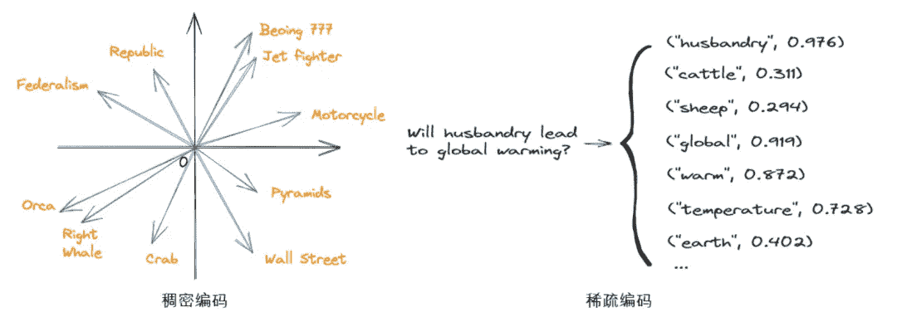
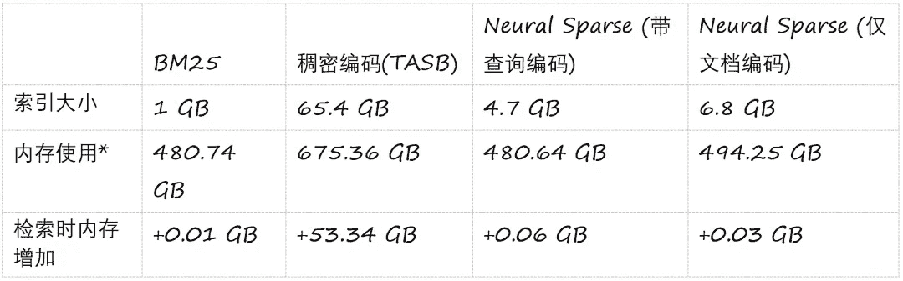
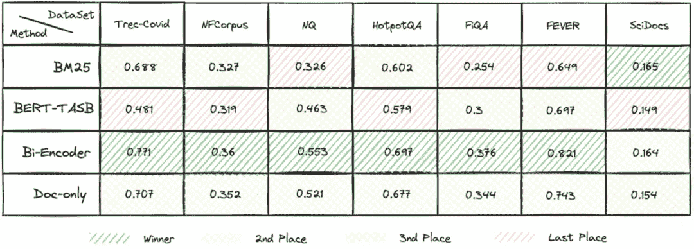
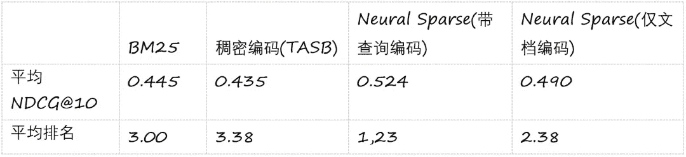
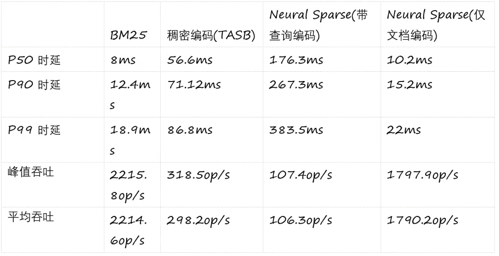
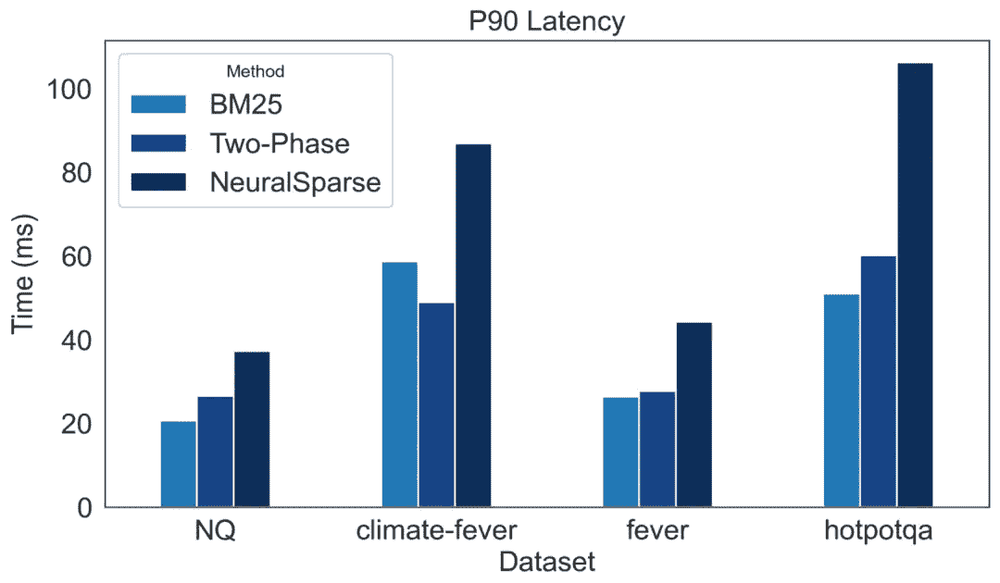

# 亚马逊云创新「神经稀疏检索」：仅需要文本匹配就能实现语义搜索

> 来源：[https://agijuejin.feishu.cn/docx/NjIWd9CCtoCSXaxKhMNcnrKBnrh](https://agijuejin.feishu.cn/docx/NjIWd9CCtoCSXaxKhMNcnrKBnrh)

> 机器之心｜[阅读原文](https://www.jiqizhixin.com/articles/2024-07-01-5)

> 转载请联系原作者取得授权

**本文作**者是来自 OpenSearch 中国研发团队的机器学习负责人杨扬博士以及机器学习工程师耿志超和管聪。OpenSearch 是一个由亚马逊云科技发起的纯开源搜索和实时分析引擎项目。目前软件超过 5 亿下载量，社区在全球拥有 70 个以上的企业合作伙伴。

自从大模型爆火以来，语义检索也逐渐成为一项热门技术。尤其是在 RAG（retrieval augmented generation）应用中，检索结果的相关性直接决定了 AI 生成的最终效果。

目前市面上绝大部分的语义检索实现方案，都是利用语言模型（Language Model）将一串文本编码为一个高维向量，并利用近似 k - 邻近搜索（k-NN）进行检索。面对 VectorDB 和语言模型部署（需要 GPU）高昂的费用，很多人望而却步。

近日，亚马逊 OpenSearch 连同亚马逊上海人工智能研究院，在 OpenSearch NeuralSearch 插件中推出了 Neural Sparse 功能 ，解决了当前语义检索正在面临的以下三个挑战：

+   相关性表现在不同查询上的稳定性 ：zero-shot 语义检索要求语义编码模型在不同背景的数据集上都有不错的相关性表现，即要求语言模型即开即用，无需用户在自己的数据集上 fine-tune。利用稀疏编码与词向量（Term Vector）同源的特性，Neural Sparse 可以在遇到陌生文字表述（行业专有词、缩写等等）的时候向文本匹配降级，从而避免离谱的检索结果。

+   **在线搜索的时间效率 **：低时延对于实时检索应用的意义是显而易见的。目前流行的语义检索方法一般都会包含语义编码以及索引两个过程，这两者的速度决定了一个检索应用端到端的检索效率。Neural Sparse 独特的 doc-only 模式，无需在线编码，即能在与文本匹配相近的时延情况下，达成与一流语言模型相媲美的语义检索的精度。

+   **索引的存储资源消耗 **：商业化的检索应用对存储资源的消耗是非常敏感的。在对海量数据进行索引时，搜索引擎的运行成本与存储资源的消耗强相关。在相关实验中，索引相同规模的数据，Neural Sparse 仅需要 k-NN 索引的 1/10。同时内存消耗也大大小于 k-NN 索引。


Relevance Demo

+   文档主页：https://opensearch.org/docs/latest/search-plugins/neural-sparse-search/

+   项目 Github 地址：https://github.com/opensearch-project/neural-search

**技术亮点**

稀疏编码与原生 Lucene 索引结合

当前语义检索的主要方法来自于稠密编码（Dense Encoding），待检索的文档以及查询文本都会被语言编码模型转换为一个高维空间中的向量。例如 Sentence-BERT 中的 TASB 模型会生成 768 维的向量，All-MiniLM-L6 则会将文本转化为 384 维的向量。这一类高维向量的索引需要用到特殊的 k-NN 搜索引擎，例如最早基于树结构的 FLANN、基于哈希的 LSH、还有后来出现基于邻近图与跳表的 HNSW 以及最新基于量化的 FAISS 引擎。

而稀疏编码（Sparse Encoding）则会将文本转化为一组 token 与权值的组合。这里的 token 是语言编码模型采用分割器对文本进行切割后产生的文字单元。例如使用 WordPiece 分割器，token 可以在一定程度上理解为「单词」，但也会出现单词过长而被切分为两个 token 的情况。



稀疏编码与稠密编码对比

由于稀疏编码所产生的 token - 权值组合，与传统文本匹配方法采用的 term-vector 非常类似，所以在 OpenSearch 中可以采用原生的 Lucene 索引去存储文档稀疏编码。相较于 k-NN 搜索引擎，原生的 Luence 引擎会更加轻便，占用的资源也较少。

下表展示了采用 Lucene 进行文本匹配，采用 k-NN 引擎存储稠密编码以及采用 Lucene 存储稀疏编码的磁盘消耗以及运行时内存（runtime RAM）消耗的比较。



*整个系统在只运行 OpenSearch 时的内存，包括 JVM 的堆内和堆外内存

**在陌生数据集上的自适应性**

根据 BEIR 文章中提及的，由于目前绝大部分的稠密编码模型都是基于 MSMARCO 数据集上精调（fine-tune）得到，模型在该数据集上表现非常优越。然而在其他的 BEIR 的数据集上进行 zero-shot 的测试时，稠密编码模型在大约有 60%～70% 的数据集上的相关性无法超越 BM25。这一点也可以从我们自己复现的对比实验中间看出（见下表）。



部分数据集上几个方法的相关性表现比较

我们在实验中发现稀疏编码在陌生数据集上的表现要优于稠密编码。虽然目前还没有更加详细的量化数据来印证，但根据在部分样本上的分析，其优势主要在两点：1）稀疏编码在近义词的联想方面更加突出，2）在遇到完全陌生的文本表述，例如一些专业术语，稀疏编码会更倾向于增强这些术语 token 的权值而弱化联想出的 token 的权值，使得检索过程向关键词匹配退化，追求的一个稳定的相关性表现。

在 BEIR 基准上的实验中我们可以看到，Neural Sparse 的两个方法相较于稠密编码模型以及 BM25，相关性得分更高。



**极致速度：仅文档编码模式**

Neural Search 同时提供了一种能够提供极致线上检索速度的模式。在这种模式下，仅有待检索的文档会进行稀疏编码。相反，在在线检索的过程中，查询文本并不会调用语言编码模型进行编码。而仅仅使用分割器（tokenizer）对查询文本进行分割。由于省去了对深度学习模型的调用过程，不但大大降低了在线检索的时延，也节省了模型推理所需要的大量计算资源，例如 GPU 算力等。

下表比较了**文本匹配**检索方法 BM25、稠密编码检索 BERT-TASB 模型、稀疏编码检索带查询编码 bi-encoder 方式以及稀疏编码检索仅文档编码 doc-only 在 MSMARCO v2 一百万量级数据集上的速度对比。我们可以清楚地看到仅文挡编码模式具有和 BM25 相近的速度表现，而且从上一节的表格中我们可以看到仅文档编码模式的相关性表现，并没有与带查询稀疏编码的方法差太多。可以说，仅文档编码模式是一个非常具有 性价比 的选择。



还要更快：使用两段式搜索进行加速

前文中提到，在稀疏编码的过程中，文本被转化为一组 token 与权值的组合。这种转化产生了大量权值较低的 token，这些 token 虽然在搜索过程中占用了大部分时间，但对最终搜索结果的贡献并不显著。

因此，我们提出了一种新的搜索策略，首先在第一次搜索中过滤掉这些低权值 token，仅依赖高权值 token 来定位排名较高的文档。随后在这些精选的文档上，重新引入之前被过滤的低权值 token 进行第二次详细评分，从而获取最终得分。

通过这种方法，我们显著减少了两部分的延时：首先，在第一阶段搜索中，仅通过高权值 token 在倒排索引中进行匹配，大幅减少了不必要的计算时间。其次，在精确的小范围结果文档内再次评分时，我们仅对具有潜在相关性的文档计算低权值 token 的分数，进一步优化了处理时间。

**最终，这种改进的方法在仅文档编码模式（doc-only）上实现了与 BM25 搜索接近的延时表现，在带查询编码模**式 (bi-encoder) 上则加快了 5 到 8 倍，极大地提升了 Neural Search 的延时表现和吞吐量 。以下是在四个典型 BEIR 数据集上标准 neural sparse、两阶段 neural sparse、BM25 的时延对比：



两阶段式搜索速度对比

**用 5 步在 OpenSearch 中搭建 **Neural Sparse 语义检索应用

1. 设置启用 Neural Search

首先设置集群配置来使得模型可以在本地集群上运行。

```
PUT /_cluster/settings
{
  &quot;transient&quot; : {
    &quot;plugins.ml_commons.allow_registering_model_via_url&quot; : true,
    &quot;plugins.ml_commons.only_run_on_ml_node&quot; : false,
    &quot;plugins.ml_commons.native_memory_threshold&quot; : 99
  }
}
```

**2. 部署编码器**

Opensearch 目前开源了 3 个模型。相关注册信息都可以在官方文档中获取。我们以 amazon/neural-sparse/opensearch-neural-sparse-encoding-v1 为例，首先使用 register API 来注册：

```
POST /_plugins/_ml/models/_register?deploy=true
{
    &quot;name&quot;: &quot;amazon/neural-sparse/opensearch-neural-sparse-encoding-v1&quot;,
    &quot;version&quot;: &quot;1.0.1&quot;,
    &quot;model_format&quot;: &quot;TORCH_SCRIPT&quot;
}
```

在集群的返回中，可以看到 task_id

```
{
    &quot;task_id&quot;: &quot;&lt;task_id&gt;&quot;,
    &quot;status&quot;: &quot;CREATED&quot;
}
```

用 task_id 来得到详细的注册信息：

```
GET /_plugins/_ml/tasks/
```

在 API 返回中，我们可以拿到具体的 model_id:

```
{
    &quot;model_id&quot;: &quot;&lt;model_id&gt;&quot;,
    &quot;task_type&quot;: &quot;REGISTER_MODEL&quot;,
    &quot;function_name&quot;: &quot;SPARSE_TOKENIZE&quot;,
    &quot;state&quot;: &quot;COMPLETED&quot;,
    &quot;worker_node&quot;: [
        &quot;wubXZX7xTIC7RW2z8nzhzw&quot;
    ],
    &quot;create_time&quot;:1701390988405,
    &quot;last_update_time&quot;: 1701390993724,
    &quot;is_async&quot;: true
}
```

**3. 设置预处理管线**

在索引之前，每个文档需要被编码的文本字段需要被转变成稀疏向量。在 OpenSearch 中，这一过程是通过预处理器来自动实现的。你可以使用以下 API 来创建离线索引时的处理器管线：

```
PUT /_ingest/pipeline/neural-sparse-pipeline
{
  &quot;description&quot;: &quot;An example neural sparse encoding pipeline&quot;,
  &quot;processors&quot; : [
    {
      &quot;sparse_encoding&quot;: {
        &quot;model_id&quot;: &quot;&lt;model_id&gt;&quot;,
        &quot;field_map&quot;: {
           &quot;passage_text&quot;: &quot;passage_embedding&quot;
        }
      }
    }
  ]
}
```

如果需要开启两阶段加速功能 (非必需功能)，则需要建立一个两阶段搜索管线，并在索引建立之后设置为默认的搜索管线。

建立一个默认参数的两阶段加速搜索管线方式如下，更详细的参数设置和意义请参考 2.15 及以后版本的 OpenSearch 官方文档。

```
PUT /_search/pipeline/two_phase_search_pipeline
{
  &quot;request_processors&quot;: [
    {
      &quot;neural_sparse_two_phase_processor&quot;: {
        &quot;tag&quot;: &quot;neural-sparse&quot;,
        &quot;description&quot;: &quot;This processor is making two-phase processor.&quot;
      }
    }
  ]
}
```

**4. 设置索引**

神经稀疏搜索利用 rank_features 字段类型来存储编码得到的词元和相对应的权重。索引将使用上述预处理器来编码文本。我们可以按以下方式创建索一个包含两阶段搜索加速管线的索引（如果不想开启此功能，可把 `two_phase_search_pipeline` 替换为 `_none` 或删除 `settings.search` 这一配置单元）。

```
PUT /my-neural-sparse-index
{
  &quot;settings&quot;: {
    &quot;ingest&quot;:{
        &quot;default_pipeline&quot;:&quot;neural-sparse-pipeline&quot;
    },
    &quot;search&quot;:{
        &quot;default_pipeline&quot;:&quot;two_phase_search_pipeline&quot;
    }
  },
  &quot;mappings&quot;: {
    &quot;properties&quot;: {
      &quot;passage_embedding&quot;: {
        &quot;type&quot;: &quot;rank_features&quot;
      },
      &quot;passage_text&quot;: {
        &quot;type&quot;: &quot;text&quot;
      }
    }
  }
}
```

5. 使用预处理器导入文档并搜索

在设置索引之后，客户可以提交文档。客户提供文本字段，而摄取进程将自动将文本内容转换为稀疏向量，并根据预处理器中的字段映射 field_map 将其放入 rank_features 字段：

```
PUT /my-neural-sparse-index/_doc/
{
   &quot;passage_text&quot;: &quot;Hello world&quot;
}
```

在索引中进行稀疏语义搜索的接口如下，将 <model_id> 替换为第二步中注册的 model_id：

```
GET my-neural-sparse-index/_search
{
  &quot;query&quot;:{
    &quot;neural_sparse&quot;:{
      &quot;passage_embedding&quot;:{
        &quot;query_text&quot;: &quot;Hi world&quot;,
        &quot;model_id&quot;: &lt;model_id&gt;
      }
    }
  }
}
```

**关于 OpenSearch**

OpenSearch 是一种分布式、由社区驱动并取得 Apache 2.0 许可的 100% 开源搜索和分析套件，可用于一组广泛的使用案例，如实时应用程序监控、日志分析和网站搜索。OpenSearch 提供了一个高度可扩展的系统，通过集成的可视化工具 OpenSearch 控制面板为大量数据提供快速访问和响应，使用户可以轻松地探索他们的数据。

OpenSearch 由 Apache Lucene 搜索库提供技术支持，它支持一系列搜索及分析功能，如 k - 最近邻（KNN）搜索、SQL、异常检测、Machine Learning Commons、Trace Analytics、全文搜索等。