# C3.AI：AI时代的埃森哲

> 来源：[https://agijuejin.feishu.cn/docx/XpYGdEUcroZ5JPxOt4ac16zKnob](https://agijuejin.feishu.cn/docx/XpYGdEUcroZ5JPxOt4ac16zKnob)

> 共识粉碎机｜[阅读原文](https://mp.weixin.qq.com/s/v7BcMLEKxyTFwvg_xb8LQg)

> 转载请联系原作者取得授权

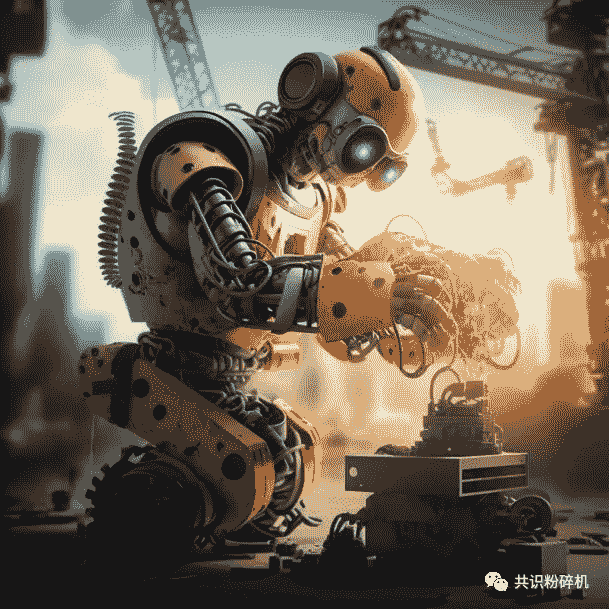

**文：小熊猫**

正如我们上一篇文章 《AI如何颠覆软件：你能为AI打工吗？》 提到的，AI对软件行业的影响是颠覆性的，而对大多数公司的影响现在都还在模糊阶段。

我们也在思考，软件体系内，什么样的公司不易改变，甚至受益于这波AI的浪潮。在云计算的浪潮中，转型及时的Accenture、Infosys、EPAM等作为代表的IT咨询服务商，享受了上云带来的稳稳的幸福。针对大客户提供IT咨询、软件定制开发，甚至托管服务。

而在AI时代，新的Accenture就是C3.AI。

（AI颠覆软件讨论会已办完两期，覆盖了数据库、游戏软件，我们即将举办第三期生成式广告，请感兴趣的朋友拉到文末看报名方式）

# 1 埃森哲的转型故事

---

现在的AI在商业化的发展轨迹，可以循迹于云技术的发展。这里有一家公司可以参考，就是埃森哲。简略看一下Accenture的发展历史：

+ 1989年：安达信咨询公司（Arthur Andersen Consulting）与安达信会计师事务所分开，成为独立的公司，并更名为埃森哲（Accenture）。

+ 1990年代：迅速扩展期，在全球范围内建立多个分支机构，业务领域扩大到战略规划、组织调整、企业运营、IT咨询等领域。

+ 2001年：埃森哲上市，并开始将自己重定位为一家科技咨询和服务公司。

+ 2007年至今：在过去十年中，埃森哲不断发展壮大，并不断寻找新的增长领域。如今，已成为全球领先的咨询和专业服务公司之一，为客户提供全方位的服务和解决方案。

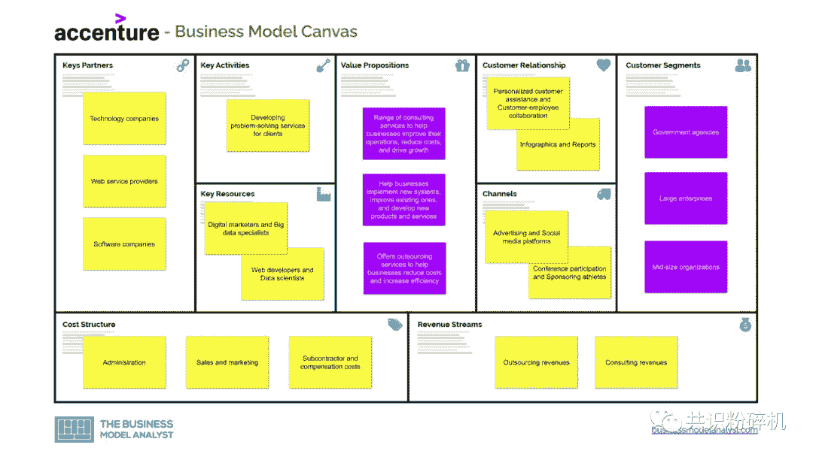

值得注意的是20年9月埃森哲宣布“Accenture Cloud First”的计划，全面将业务向云倾斜。计划在接下来的三年中投入~$30亿来帮助多个行业的客户快速成为"Cloud First"的企业，加速数字化转型，实现更大的速度和规模，创造更大的价值。Accenture在全球投入~7万雇员来践行其“Cloud First”的计划（占员工总比例~15%）。

那么取得的效果如何呢？由下图可见云相关业务飞速发展，占比不断攀升，带动了整体Accenture收入增速提升。

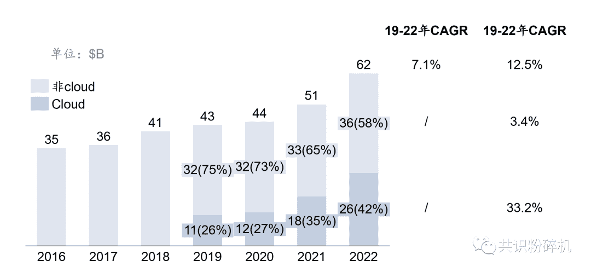

# 2 C3的启程

---

如果说埃森哲是乘上了云的东风，那C3.ai踩中的赛道是大数据和AI。该公司成立于2009年，创始人是Tom Siebel（生于1952年）。对，就是那个做CRM的Siebel Systems的创始人，而Siebel Systems于2006年被Oracle收购（当然Siebel在上世纪80、90年代就是Oracle的高管，只是因为想在Oracle内部孵化CRM系统被拒，所以于1993年离开Oracle成立Siebel Systems）。

这意味着这位创始人既懂`Data Infrastructure`，也懂与数据/AI强相关的应用，CRM。Oracle和Siebel Systems的经历，使得Tom Siebel成为美国IT界非常有声望的一位大佬。

从C3的发展来看，名字的变化足以见证公司的行业扩展和服务能力的扩展。虽然公司改名略显频繁，有蹭热点之嫌，但是整体还是在一个技术栈里面的深化发展。

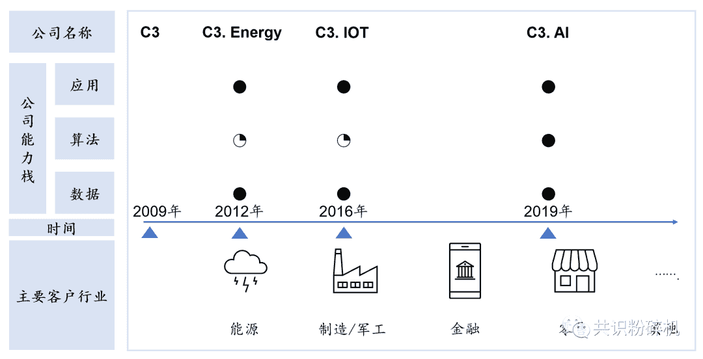

而这样一个切入也是沿着客户数据/AI能力较差，但是行业有比较大的数据量，比较容易产生价值到客户能力高，数据量大，需要较大的努力才能产生效果的的路径去展开的。帮助能力相对弱的客户解决重要问题，产生大的效果，作为GTM的策略，对于长期打磨产品/服务模式有非常大的好处。

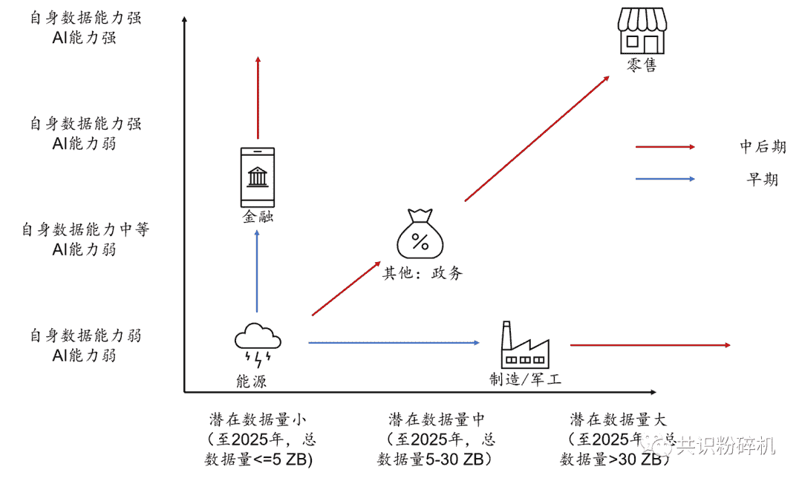

# 3 AI就像10年前的云计算

---

## 全球云市场

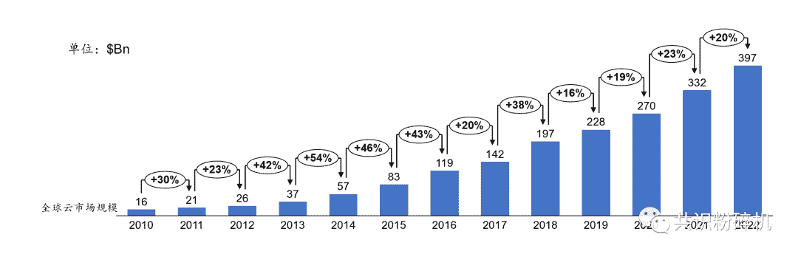

## 全球AI市场

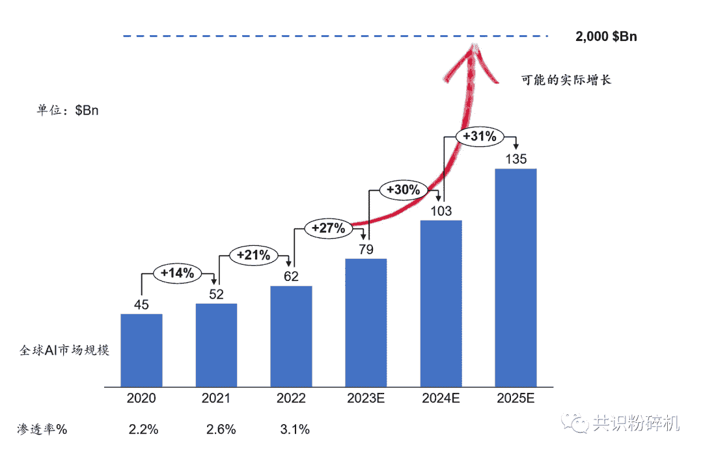

根据Gartner、IDC等机构的数据，可以看到整个云市场走过一个超过10年的超长周期，形成了一个非常可观的市场。而AI现在所处的阶段更像是云在2011年左右的情况（上图数据是Gartner在2021年左右给出的预测），后续将开始加速爬坡。而受到ChatGPT的影响，实际的爬坡速度要超过Gartner曾经给出的预测。而这个市场保守来看会有2,000 $Bn的TAM（Total Addressable Market)，潜力也非常的巨大。

# 4 传统企业为什么需要找C3 vs 之前需要找埃森哲

---

为什么C3这类公司在AI商业化中会起到巨大的作用，那么就有必要看一下Accenture在云时代给客户带来的价值。以云技术的使用渗透来看，基本上延续这样一个路径：

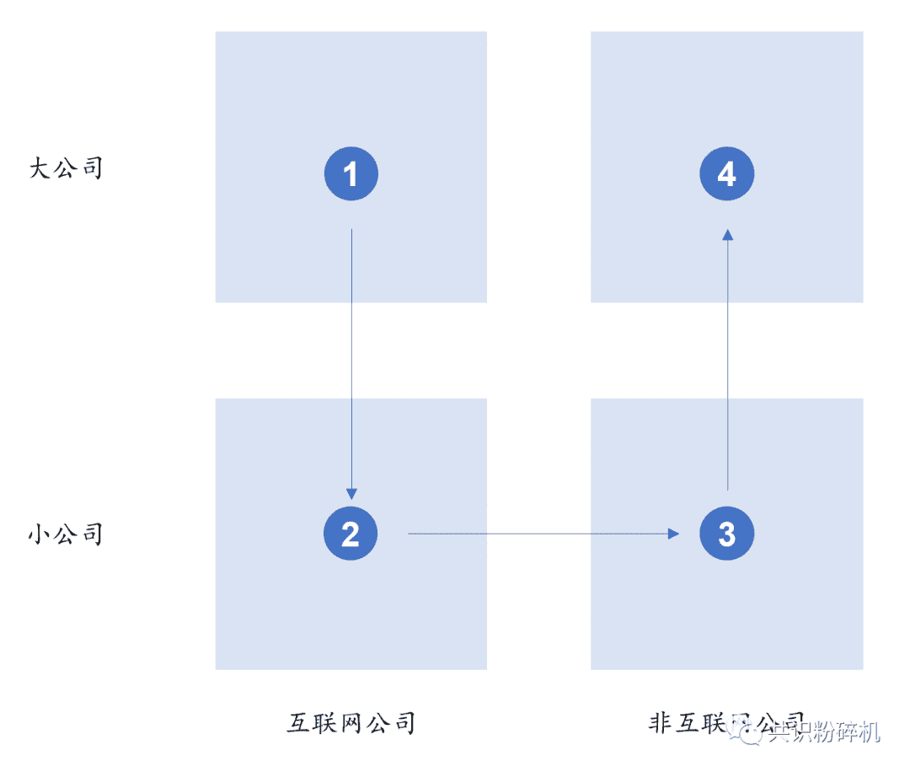

+ 互联网（科技大公司）最先接受云技术（他们是最早期的技术实践者）通过自身的使用做了标杆，甚至能够做云技术输出（如Amazon，微软，Google等）。

+ 一众小的科技公司跟随（试图借助技术红利加速业务成长）。

+ 非互联网的小公司，虽然他们可能对技术产生的实际影响不甚了解（没有专门人才），但价格敏感（新技术有成本红利），而且决策路径比较短，包袱轻，也能较快用上。

+ 最后用起来新技术的是传统大企业，这些公司对技术影响敏感（新技术有没有用先不说，有没有造成主营业务的中断风险可能是第一考量要素），但相关专业人才欠缺造成也不容易判断对业务的影响（这些公司的主业也不是干这个的），对价格不敏感（一些技术红利相比主营业务的利润来说来说不值一提，且人家已经做大做强，说明原来的模式的技术支持是足够的），大规模使用的决策路径很长（已经是大公司了，领导太多决策慢），更加追求差异化（如果用类似的产品那么怎么能确保自己头部的竞争优势呢？），这么多要素的考量，导致他们是新技术的最后的用户。

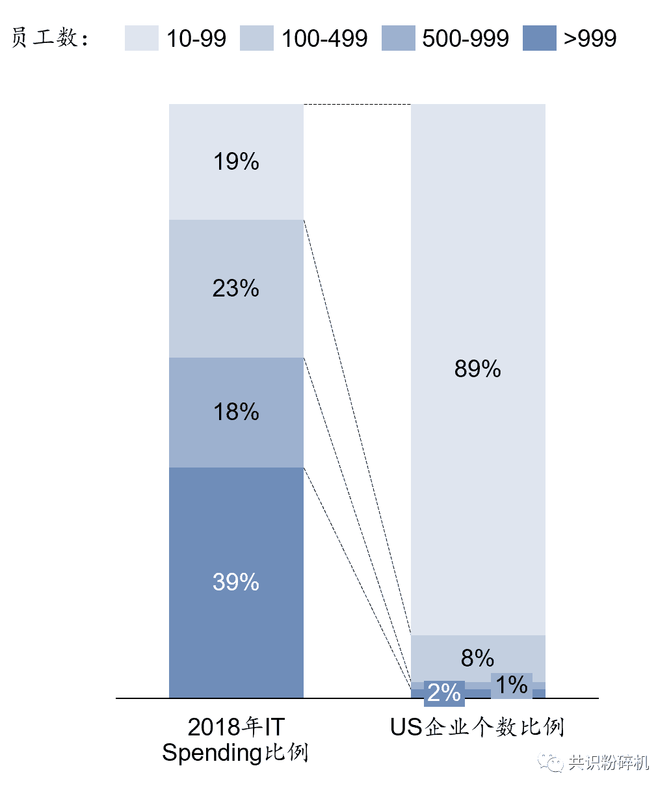

虽然这些传统大客户用得慢，但是人家不差钱啊：上图可以看到虽然传统客户数量少，但是占IT投入比较大的比重。目前能够看到的趋势是：除了很多传统服务大企业的供应商，比如说微软、SAP、Oracle、IBM等等持续服务大客户外。很多靠中小企业起家的Cloud Native的供应商在中小企业市场中形成稳定的收入模式后（如PLG），也会较为积极地向腰部和大客户进发。Zoom通过做Solution和线上、线下场景整合，以Zoom one和Zoom phone向大客户进发，Datadog也在通过增加销售人员和形成监控产品套件的模式进攻大客户等等。也是看中了在中大客户持续稳定的IT投入。

上面也说到传统大客户其实在接受新技术方面有很多摩擦，所以需要咨询公司去作为中间人去润滑技术落地。战略咨询在这里有用，但是最终能够产生可见的巨大价值，需要落地到客户能够自己使用的程度。而且越到技术后期，行业成熟的practice越多，新技术的价值更容易被管理层理解，战略咨询的作用就变得更弱。而且也受限于客户能力，如何能够让新技术在客户公司实现就成为了重要的事情。

Accenture的模式相对来说在其中更容易赚到更多的钱。从架构设计、供应商选型、部署实施、系统整合、定制开发到托管代运营一应俱全，赚的是虽然相对辛苦但是长线的钱。

类比到AI在传统企业这边，其实和云的落地也会有一个类似的路径：

+ 帮助客户量化（其实我开始写的是“理解”，但是在Chatgpt带动下，大家似乎对这一代AI的能够产生巨大价值这个事儿的一致性挺高的，而更多是在具体的客户这边的ROI，让客户决定多快实现AI化）AI的价值。

+ 帮助客户设计方案、选型、部署实施、系统整合、定制开发再到托管代运营。

+ C3的业务中基本上都覆盖了这些要素。

# 5 C3如何成为AI项目的龙头

---

似乎看起来埃森哲这类公司完全可以在AI方面repeat在云的模式，那么C3作为一个后起的公司为什么能够杀出一条自己的路并收割了Shell、DoD、Cargill、Koch、Baker Hughes等200多家传统行业巨头的公司呢？

首先，需要看C3.AI究竟是一个什么公司？更倾向把它定义成为一个咨询服务公司而不是一个单纯的软件产品公司。最大的差异点是不是使用的效果决定能收多少钱：

+ 咨询是个典型按效果收费的业务。虽然经常有消息说MBB做项目不落地，但是我见过挺多请MBB做过10期以上项目的客户，也见过那种做过100多期的长期客户。如果真的没有效果，客户完全可以下一期不请你了。

+ 而软件并不是，尤其是之前卖非SaaS的软件，大多数情况是一锤子买卖。客户买完交付就结束了，客户每年10%-25%的服务费主要是确保买的软件不要坏。并不是一个严格意义上按效果付费的事情。

C3.AI就是个按效果付费得公司，典型的收费方式是一个初级实施费用+按照使用底层计算存储量计算的增量费用。那么如果没有效果，客户底层的计算和存储资源使用的少，那么根据此计算出来的增量费用就会少。

那么沿着咨询的公司的模式看，从运营角度看，怎么样才是一家好的咨询公司。传统咨询公司最原始的方式是卖人头，就是有多少人接多少项目，赚多少钱，非常的线性。利润的好坏在于对项目周期和投入人力成本的控制，即用最便宜的人在最短的工期内做完项目，人力的使用率上升，利润得到优化：

+ 如何缩短周期：在工作总量不变的情况下，增加每天的工时，减少用工天数。所以咨询行业每个人都是超长工时（10h+/day）比较常见。

+ 人才输入输出标准化：标准的人输入（比如只看特定学校的毕业生，比如说入行要看MBTI，咨询会偏好ENTJ和INTJ），通过标准的思维训练（“金字塔模型”），输出present能力，PPT能力的差不多的“标准”顾问。能够让毕业生快速地成为能够做项目、管项目的成熟的顾问（咨询行业中一般的Manager level就可以独立带项目了，相当于一个企业的function leader的角色，这个时间大概在5-6年，而如果是在企业中培养，这个周期要10年左右）是离不开这套养成模式的。

+ 做知识库：比如说形成一个portal，把公司之前做的项目的总结的经验load进去，然后后面的新手可以通过学习前人的经验较为快速地开展项目；还有就是以老带新，对于如果进行knowledge的download也是有成熟的经验。

+ 通过软件技术，固化一些之前项目中的实际成果，形成工具，降低人的工作量。

那么C3把握住了这里面的哪些要素呢：

+ 缩短周期这个更多是管理的艺术，但最本质是给员工多少钱让员工多工作一些时间的简单数学。

+ 压缩单人成本这件事儿中人才输入输出标准化、做知识库这些事情是靠时间沉淀经验形成的，作为后起的C3没啥优势。

+ C3真正的抓手是通过软件工具优化人的工作量。不仅压缩了单人成本，也减少了项目周期。而且这事儿对帮助AI落地也是非常重要。

# 6 底层为什么不好做

---

C3最早做的工具非常像数据中台（蓝圈1），上游打通各种数据源，数据ETL后进行连接整合，然后基于这些数据开始搭建垂直应用，如果涉及AI模型，则先建模再搭建应用（蓝圈2）做久了之后，开始把这一系列的过程的环节标准化和模块化，形成了各种Suites。

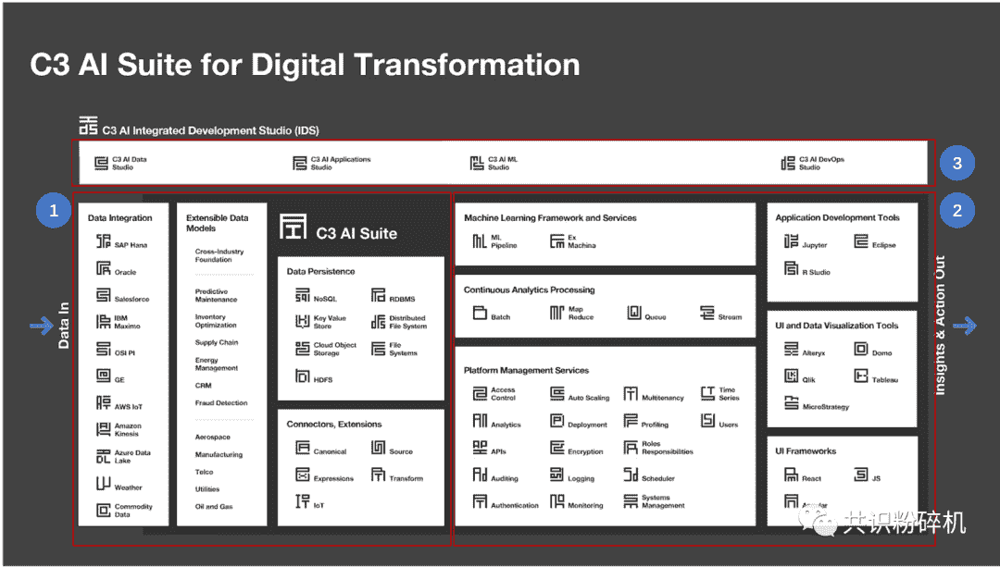

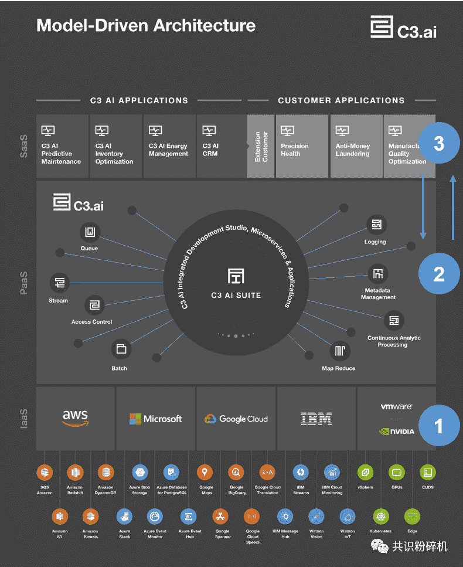

在这个过程中形成的第一竞争的壁垒就在环节1，数据整合。

如果纯用人力，大部分数据（包括AI）相关的任务至少一半以上的时间都花在“清数”。不同source的数据整合在一起需要解决频率一致（比如说有些是年的，有些是月的）、口径一致（比如说统计局接口里面的中年人可能是一个定义，销售口径的中年人又是另一个年龄段）、格式（有的数据是文本格式、有的是整型）等等。

考虑到这块主要的客户是传统大企业，比如说很多诸如可口可乐、Shell等百年老店。里面的IT系统虽然不太可能横跨百年，但是几十年还是有可能的，以为是一家子企业会整整齐齐来的，拆开一看，好家伙，从孙子辈到爷爷辈全都在。

还有一点是，大部分这种巨头企业怕供应商锁定，所以同一件事情上会寻找多个供应商。以公有云为例，一部分会切给微软，一部分切给AWS。而微软和AWS都是根据自己的情况build接口，很有可能这两个存在不一样，进一步复杂化了数据系统。

所以C3.AI花费了比较长的时间和资金，在早期发展过程中，不断去整合和研究各种数据源及其接口，并将他们整合在C3.AI的平台上。而每预先多整合一种data source意味着在客户侧有限的时间内可以更高效地接入数据，对于整个项目周期的压缩和最终形成的应用能够呈现的效果有非常大的帮助。

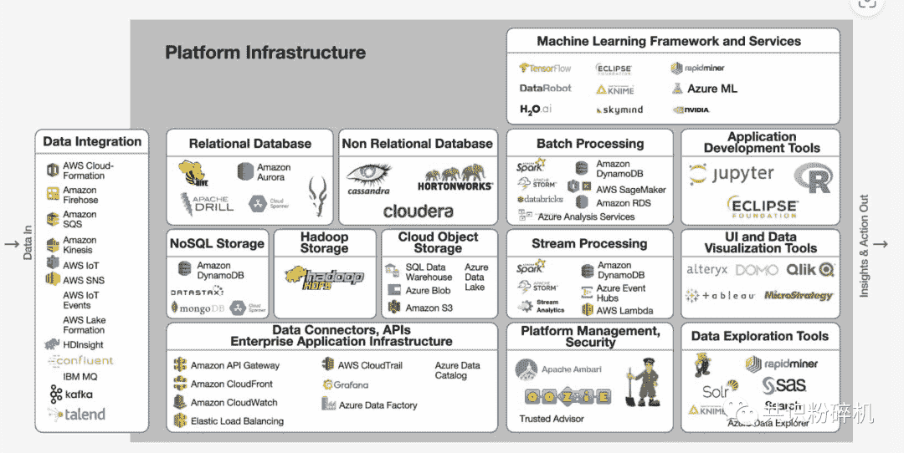

C3.AI与类似业务的Palantir和专业的Data integration软件的比较（官网信息）

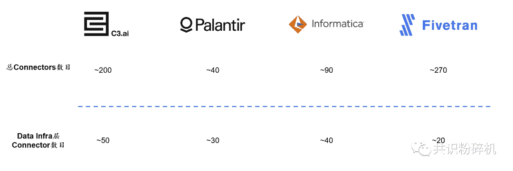

可以看到C3.AI在这个方面还是有充分的积累，相对于专业的informatica和Fivetran也不逞多让。这与C3.AI初期主要做的行业在能源、Oil & Gas非常相关（架构多代积累，客户自身技术水平不高，simplify程度有限等）。

# 7 Knowhow为什么不好做

---

## 第二个门槛就是行业知识

为什么行业知识重要，简单来说客户买软件更像是买了一个血压计（软件/技术）不等于在家就敢给自己治高血压了（解决实际问题）。主要有两个原因：

+ AI为行业赋能，本质上在“侵入式”的解决业务问题（涉及到业务流程的改造），使用AI后的效果非常的重要。在这个“AI-效果-更多AI”的循环中，效果是后续能够扩大实施的基础。好比找大仙算命，大仙一般会采用几个钩子问题，比如说“我觉得你最近不顺，比如说水逆”（肯定有不确定的事儿才会找大仙），然后你会觉得好像确实那么回事儿，就和大仙建立了信任，那么大仙后面的预测你才会相信。大仙的钩子问题，就是建立在行业知识之上（来来往往过来算命的，没那么点忐忑不安的事儿不会来的）。这是信任的基础，也是后续合作的基石。

+ 行业知识决定数据和模型的方向，模型决定效果。行业知识可以帮助AI工程师和数据科学家更好地理解业务需求，设计和实现更加符合实际情况的算法和模型。尤其是数据的采集、模型的features几乎可以无穷尽（曾经见过一个软件，暴力feature engineering，比如说年龄的三次方），但是做出来有没有用是另外一回事。行业知识能够帮助迅速缩小数据采集的范围和模型优化的方向。这对项目周期和成本来说是非常有好处的（不然就是无尽的传感器，和数据工程师、模型工程师无边际的“炼丹”了）。

客户认为你懂，无非就是你真的有那么多在行业里面的专家（国内有家做工业预防性故障诊断和运维的公司，就是广纳行业里面尽可能多的牛逼专家，先不论公司的AI有多厉害，有这个专家“天团”，就能让客户初步形成对服务商是否能够解决问题的信任）。要么就是你有行业牛逼企业作为标杆进行的背书，其他相对小一些的客户会认为能够帮最懂得行业的公司解决问题，你可能比行业最懂的人还懂。C3在前者有一定积累，但是毕竟时间短，也不是行业公司出来的，所以后者的积累更多一些。

C3挑了行业知识比较深的能源和Oil & Gas行业入手，精耕细作出了效果，然后又和这些公司形成JV，借助于行业头部公司的Best Practice进一步撬动其他行业。做过Shell、Exxon Mobile出了效果，沙特阿美你信不信我。做过美国空军，那海军信不信我。从行业knowledge最深的地方入手，利用标杆逐渐滚雪球，是C3.AI积累行业know-how的打法。

至于数据、模型层面的效果，C3.AI本身就召集了行业非常顶尖的数据工程师、科学家，在Know-how的加持下，采集数据更准确，建模更有效，效果更显著也并不奇怪。

# 8 要Topdown卖得慢生意

---

一般来说企业软件的售卖都存在两种方式，Top-down的售卖和Bottom-up的售卖。下面也根据软件需要解决问题的层面看Top-down和Bottom-up更适合什么样的软件：

+ 比如说一些很轻的SaaS软件，如Zoom，就比较适合Bottom-up的方式，比如说一个保险中介公司，一两个保险代理用Zoom同客户进行沟通，发现比较方便效果比较好，付了费，然后推荐给同事使用，同事也买了。可能发展到整个团队都自发用Zoom开展业务。到了后面一年，Zoom的销售看到这个公司的代理都在用Zoom就找上门来和谈是不是可以做公司采购。这就是一种典型的Bottom-up的销售方式。

+ 反之，比如说ERP系统，动辄百万美金的入门投入，涉及生产、财务、人力、物流供应链等等function，这样的软件的决策就很难通过Bottom-up的方式进行售卖。

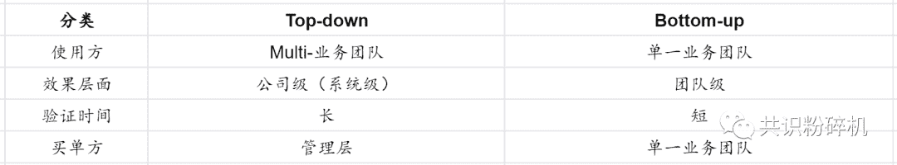

那么回到AI，为什么大项目Top-down售卖要比Bottom-up卖更好。主要在于几个原因：

+ 底层涉及的数据不仅仅是一个部门的事情，而是多个部门协同，拿故障诊断来说，生产、工艺、实验室、控制、设备等部门都要参与进来才能将装置的状态和问题梳理清楚。没有管理层的统筹和协调（拍板），事情很难解决。

+   AI最终改变的是业务的形态，也往往伴随着组织的变化和管理流程的变化，没有管理层的认可，进行配套的调整，比较难长期实施，一个生动例子如下。

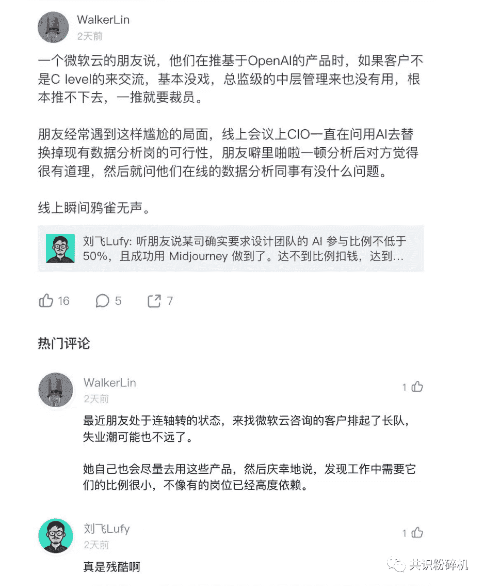

+   管理层的信任是AI能够稳扎稳打做出效果的很关键的保证。如果没有很强的管理层背书的话，那么应用AI的效果就至关重要。这类项目，理论上经常要做半年到一年（梳理数据、设计架构，做实验应用），即便平台成熟也要1-3个月才能进入生产系统，即便进入生产系统也不能代表能出效果。管理层信任度不强的很多AI公司进入客户中就会急匆匆的开始做应用，因为只有到了应用才有效果。但是有效果的应用又涉及到了完备的数据和业务形态/流程，所以很容易欲速则不达。

为了实现这样一种TOP DOWN的销售，C3.AI祭出最强销售，就是Tom Siebel，board成员里面还有将美国前国务卿赖斯，前coursera CEO Richard Levin，还有SAP、Siemen、联想的一堆前高管进入管理层，帮助公司进行站台，通过这些人去给客户公司管理层讲故事，稳住客户。对于公司的销售人员，至今仍然要求最后一面是Siebel亲自面。并且在后续的培养中，始终要求他们能够和客户公司的CXO对话的胆量和能力。

# 9 行业“救火队长”

---

有非常牛逼的老板进行销售，和客户建立了初步信任，有了时间（就有了做项目的空间）。有很强的底层平台，解决了做大数据/AI Settledown时候的很费时费力的问题，加上行业know-how和很强的实施顾问，这是C3.AI能够Deliver 的重要保证。

相比许多其他厂商，在这某个环节上或多或少都有欠缺。最终产生的效果就会打折扣。比如说创业公司，可能没有牛逼的老板在客户那边赢得信任。那么就变成了在尽可能短的时间POC出效果，证明自己。没有功夫去理会那么多数据源整合的事情，非常应用导向，抓到什么**数据用什么**，恰好漏了那么几种关键的。或者说有了时间部署数据整合平台，但是能力上不足，有那么几种源在时间范围**内**搞不定。或者就是都搞定了，不知道客户问题是啥，该用什么数据、什么应用解决，最终结果都会不好。C3更多是求效果好，而不是单纯实施速度快。看过一些C3前员工的访谈，也介绍到， 比如说一个项目PTC和Rockwell可能一个月就能将模型搭建完毕到客户可用状态的，但是C3可能需要4-5个月来做概念验证和平台建设。但是C3这个时间长一点的东西，一定比PTC和Rockwell迭代到4-5个月的效果好非常多。

这不是创业公司才面临的问题，诸如IBM经常也会由于上述问题（比如说客户的数据经常不能稳定正确进入IBM的AI架构里，小批量测发现可能效果还可以，但是上量之后发现又不行了，被迫中止项目）把项目做败掉。所以C3 有一段时间就是去捡IBM做过的客户，去“救火”。

# 10 对比顶尖战略咨询，MBB，C3还有多大差距

---

我觉得从两个方面来看，C3已经形成了做AI咨询的顶配。

As 顶级咨询的配置和运作模式：最强的partner（Tom Siebel）+大量牛逼背景的顾问+好的知识/能力传承（技术平台）；这里非常想提一下C3.AI的顾问水平我觉得丝毫不比MBB的顾问的背景弱：

+   "The average age is 35, all have one or more advanced degrees, 67% have MBAs. On average, they have 12 years of work experience. Many were at or near the top of their classes at West Point, the Naval Academy, MIT, Princeton, Illinois, Michigan, Berkley, Stanford, Ecole Polytechnique, etc. They went on to gain technical advanced degrees at the Army War College, MIT, Georgia Tech, and Carnegie Mellon.

+   Many continued with MBA from Harvard, Booth, Sloan, MCA, etc. They have commanded F-18 squadrons, they have taught in the top gun school, they have worked at DCT and Bain, Merritt and Goldman Sachs, Amazon and SpaceX. We are providing this team with extensive sales training and ongoing sales metering. This program is exceeding our expectations and expect in every respect, and we will continue to expand this new sales force in the coming quarters.--FY22Q2 earnings call

+   "In the second quarter, we received over 23,000 job applications. We interviewed over 2,200 of these applicants, and we hired 90. One of the secular changes of this tech downturn is the increased availability of highly trained professionals who are willing to come into the office, roll up their sleeves and get to work."-FY23Q3 earnings call

**客户口碑：标杆客户（行业Tier1的客户）。**这些大客户本来就决策困难，而且这类项目实施周期比较长，对组织架构影响也比较大，所以特别value标杆的作用。基本上或多或少都会抄一下标杆的做法，确保自己的项目的效果有个基础的保证。而C3.AI恰恰非常重视标杆的建设。并且积累出了非常多的案例

从目前的客户分布来看：**C3.AI在军队和能源工程领域有非常扎实的基础。**新推进的金融、医药、制造和零售也逐渐形成标杆效应。Palantir的主要根据地在情报部门和金融领域。其他行业则分布比较散，标杆效果不明显。而且金融也有被C3蚕食的风险。更下沉的UPTA KE目前标杆还比较少，在此格局之下变成某一两个vertical领域的咨询服务公司的可能性会比较大。

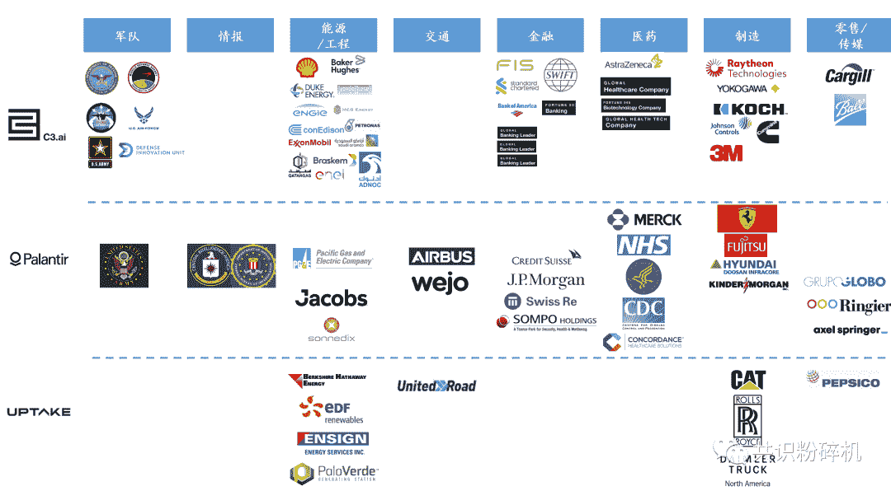

# 11 脏活最终成为了壁垒

---

能做成C3.AI生意门槛是非常高的：

+   不仅要有Infra，还要有Solution：C3在技术平台上面确实投入了10亿USD以上的研发费用进行平台和模块的开发。这在以Partner作为包工头，攒团队揽工的传统咨询行业是比较难以实现的。

+   Sales的要求：通过C3的Top sales们对大客户的管理层布道，然后通过客户管理层再进行IT相关的变革。这样效果比推动客户底层IT去变革会更加彻底，效果更好。但是也需要vendor面子够大。

+   很难再复制一家C3：就和传统咨询公司一样，世间咨询公司无数，最终最广为所知的两只手也能数出来了。然后最头部的MBB其实多年来排名也变化不大。这是一个每个环节都要做好的事情。

**而这样的脏活也最终变成了壁垒：**

+   规模化user case提高了AI准确率：当C3积累的客户案例越多，经验越多，无论是从技术平台上（可能又积累了之前没处理过的接口），build了没有做过的模型，了解了/加深了之前不清楚的行业等等。这些都会沉淀到C3.AI的平台上，促进未来的服务向着更好的方向发展。

+   客户很难能从C3迁移：非常神奇的是，在C3.AI做的应用的内核，即模型对于客户来说是透明的，或者说IP归客户完全所有的，那么客户会不会说我把模型留着，把C3平台换成别的，一个开源的数据/AI平台，或者一个更便宜的供应商呢？大部分情况是不会的，或者说这样做非常难实现同C3的效果。究其原因，C3的应用效果除了模型本身，其实还是有三两东西作支撑的：一个是非常完备的底层平台，第二个是相对较强的行业know-how。这两个都是有时间积累的优势的，不易解耦，对于客户来说，从C3迁出，需要考虑的问题是：C3的平台我不能用了，我在新的平台上需要花多少时间把C3的平台的那些必要的接口给重做出来，然后如果做不出来，我可能要少用一些数据，那么我的模型要调整，能帮我调整的人要知道我要解决的问题，他们的行业know-how是否足够支撑这个事情。这样做对于“选择困难”的大客户来说又是一个很难决策的事情。更关键的是客户自己做也需要协调不同的部门，很多时候客户内部解决这个问题，比技术本身的难度更大。

# 12 C3有可能拔得未来Tier1的头筹

---

## 公有云很难走C3的路径：

+   公有云本质还是走量，追求规模经济的生意。

+   面对大客户，行业know-how不足，逼格不够高，见不到对方CEO

+   而且AI平台和底层公有云架构耦合比较深，在客户多代、多类型的IT底层下，在数据采集等方面会遇到问题。除非客户从后端开始重构，都用某一家公有云。

+   当然这里的变数是Azure，因为Microsoft本身就是个从legacy时代过度来的偏向于系统级解决客户问题的“Solution”公司。对于legacy的各种系统非常熟悉。现在有了核心大模型的独家使用权，在技术方面是有领先优势的。唯一的问题是对于传统大客户的know-how可能还比较欠缺（毕竟主要做通用软件），以及毕竟之前主要做软件生意，缺乏比较重的顾问的团队（公有云公司追求快速增长的规模效应，毕竟咨询服务目前还是人带动的，不那么快速）。我想这也是C3.AI目前能和微软有比较好合作的原因，相对比较互补（技术上C3.AI的平台相当于在微软大模型和infrastructure上加“壳”，咨询服务上C3.AI有团队和经验）

## 一些BI公司/数据平台PaaS公司，比如说Alteryx、SAS、Snowflake，也很难做：

+   这些公司也是缺乏行业背景和知识，之所以走向软件，也是因为不想去做服务这种“重”的事情。对于怎么运作咨询公司并不清楚，也缺乏Top-down的高举高打能力。

+   能做一些function-wise的项目，但是很难做出整体。而且对这些公司的风险其实挺大的。

## 创业公司比起C3缺什么：

+   难做标杆，行业know-how拓展地慢。

+   技术平台也不成熟，一不小心就要变定制化。

+   人力管理如果也不成熟，周期一长，大概率现金流就要出问题。

而PLTR与C3相比，平台和工具化能力相对弱，更偏重人，长期经济性和规模扩张能力不如C3。

**可能会有一些vertical竞对跑**出来，竞争对手更多做C3接不过来的生意：

+   毕竟咨询公司的扩张不像通用软件公司，和客户之间有很多的沟通成本。

+   而且要靠qualified顾问去解决实施过程的沟通问题。这就意味着在市场早期，有一些其他的公司也能接类似的活。就像战略咨询，头部有MBB，但是腰部有RB，有Monitor，有帕特农，有Strategy&，有LEK。

+   腰部公司的存活更多是靠着在某些vertical非常突出的优点才长期存活。比如说RB在汽车行业、Monitor在post-M&A、LEK DD做的比较好等等。但这些公司在客户数量和项目规模上是和头部的MBB有一定差距的。

# 13 未来是什么样？

---

最近Generative AI 很火，Microsoft(OpenAI)出尽了风头，那C3.AI是否能够真的也吃到这波AI升级的红利呢？

一个需求就是做Generative AI 接入和改造的咨询服务（其实就是重新改造UI），如何将诸如OpenAI等的能力和企业的业务更好地结合。

这个需求是比较明确的，就像现在非常多的标准软件公司会宣布对接微软、谷歌等的GPT能力一样，比如说workday，会出结合 OpenAI 能力的 Generative AI 用例，在绩效评估中让LLM 总结绩效委员会的聊天会内容；通过chatGPT、twilio programmable SMS 和`python` 来构建SMS聊天机器人等等。

事实上C3.AI在这个方面做地更加主动一些。23年1月份宣布C3 Generative AI Product Suite：

+   Search ： 通过Generative AI，使用自然语言界面，在企业信息系统的整个语料库中快速定位、检索和呈现所有相关数据。

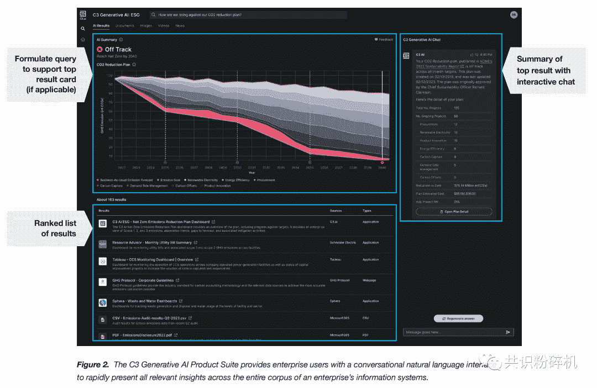

+   能力接入：C3 Generative AI产品套件将来自开放性人工智能、谷歌和其他学术界等组织的最新人工智能能力，以及最先进的模型，如ChatGPT和GPT-3，整合到C3 AI的企业人工智能产品中（AI Platform)。

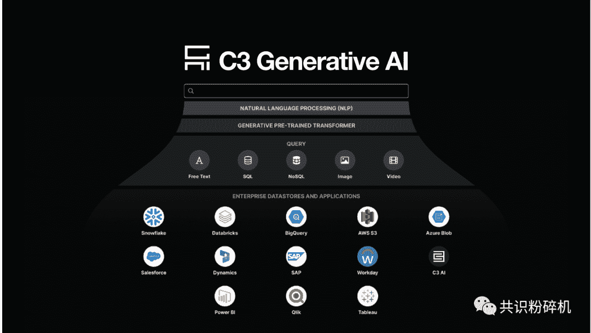

+   产品上升级，提供一个能够做Generative AI 模型的平台，帮大企业实现自身vertical的“大”模型。这个点上我认为有机会，但不一定是C3最合适的。毕竟C3更擅长是做数据整合、做流程优化，把较为成熟的AI能力融入到客户业务中，然后包成应用。而不是做AI算法能力的开发。所以基于更垂直的少量数据做模型养成并形成效果这个事情对于C3来说还有比较大的不确定性。

但传统企业上AI会是一个漫长的过程，分行业，分批，并且每个公司可能要rampup 5年以上。

# 14 有太多事情能让C3去做了

---

C3.AI所在的市场并不像我们所理解面向大多数公司有点像Commodity的各个细分市场。比如说CRM市场、数据库市场、计算平台市场。

如果把在这些不同层级的大块的软件公司比作一块块砖，C3.AI更像是砖之间的水泥。流淌在不同层级之间，看上去在每一层级之间量不多。但是如果从贯穿整个大楼的角度来看，又是一个可观的体量。

而且对于每一层级的其他砖来说，水泥的量也并不多，对砖头们的威胁度很低。所以砖头们也愿意跟水泥进行合作。这也是C3.AI为什么虽然和很多不同层级的软件公司有类似的产品，但是仍然能够和大家建立起广泛的合作关系。

## 看上去“对手”众多的C3.AI

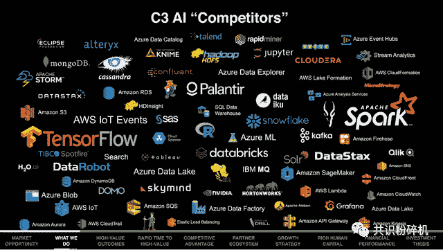

从目前来看，C3.AI已经和AWS、Microsoft、GCP、Backer Hughs、IBM等等公司形成了良好的合作关系。这就是C3.AI相对独特的定位。

**在未来**，C3.AI会更像AI领域的埃森哲吃到比较大的份额和红利。还会有一些规模小一些的公司，要么有独特的场景/能力，吃到小的蛋糕。要么就会成为印度IT咨询+IT外包，主打便宜和灵活。公有云厂商，除了微软，AWS和GCP更多可能在卖计算和存储资源的“水、电、煤”厂商。
