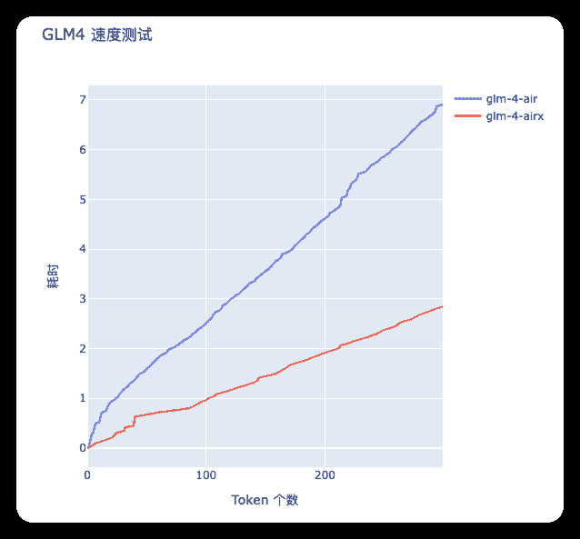

# 国产大模型速度评测（谁是更快大模型？）

> 来源：[https://agijuejin.feishu.cn/docx/KXvjditiZo9Bf7xvwxUczFjgnzg](https://agijuejin.feishu.cn/docx/KXvjditiZo9Bf7xvwxUczFjgnzg)

> Coggle数据科学｜[阅读原文](https://mp.weixin.qq.com/s/2HXa1oy36Z0hpmThVYCeZg)

> 转载请联系原作者取得授权

2024年无疑会被载入史册，各大科技厂商纷纷争先恐后地推出了自家的大模型产品。6月25日OpenAI暂停在我国大陆地区服务，国产大模型表现更加值得期待。

本文将对比较流行的国产大模型进行速度评测，通过不同类型的问题来对比模型的回答速度。统计的标准为 completion tokens 数除以耗时。

## 模型速度对比

### 场景1：通用问答类型问题

> 你是一名专业的人工智能专家，请告诉我如何学习深度学习？

| 模型名称 | token/s |
| --- | --- |
| `ERNIE-3.5-8K` | 18 |
| `Moonshot-v1-8k` | 32 |
| `GLM4-Air` | 47 |
| `GLM4-AirX` | 89 |
| `Qwen-turbo` | 40 |
| `deepseek-chat` | 19 |
| `Spark Max` | 16 |

### 场景2：逻辑推理类型问题

> 如果A+B=12, A-B=10，则A的值是？

| 模型名称 | token/s |
| --- | --- |
| `ERNIE-3.5-8K` | 10 |
| `Moonshot-v1-8k` | 23 |
| `GLM4-Air` | 43 |
| `GLM4-AirX` | 71 |
| `Qwen-turbo` | 29 |
| `deepseek-chat` | 13 |
| `Spark Max` | 17 |

### 场景3：NLP实体识别问题

> 识别下面句子中所有的地名：我将会在明天早上的8 点来到的湖北黄陂的森林公园。

| 模型名称 | token/s |
| --- | --- |
| `ERNIE-3.5-8K` | 18 |
| `Moonshot-v1-8k` | 24 |
| `GLM4-Air` | 26 |
| `GLM4-AirX` | 53 |
| `Qwen-turbo` | 22 |
| `deepseek-chat` | 16 |
| `Spark Max` | 16 |

### 场景4：代码编写类型问题

> 帮我写一个`python` 版本的A*算法。

| 模型名称 | token/s |
| --- | --- |
| `ERNIE-3.5-8K` | 19 |
| `Moonshot-v1-8k` | 45 |
| `GLM4-Air` | 56 |
| `GLM4-AirX` | 118 |
| `Qwen-turbo` | 44 |
| `deepseek-chat` | 19 |
| `Spark Max` | 34 |

### 实验结果

`GLM4-AirX` 在多个场景中都展现出较高的速度，尤其是在通用问答和逻辑推理类型的问题上，其表现明显优于其他模型。另外对于代码编写类问题，`GLM4-AirX` 也表现出色。

### 思考：什么影响了的大模型速度？

在大型语言模型（LLM）的运行逻辑中，随着规模大小的增加，语言生成的质量会随着提高。不过，这也导致了推理延迟的增加，从而对实际应用构成了重大挑战。

从系统角度来看，LLM 推理主要受内存限制，主要延迟瓶颈源于加速器的内存带宽而非算术计算。这一瓶颈是自回归解码的顺序性所固有的，其中每次前向传递都需要将完整的模型参数从高带宽内存传输到加速器缓存。

自回归 LLM 在只有数千个参数的情况下运行得很好，但对于实际模型来说就太慢了。

```
def generate(prompt: str, tokens_to_generate: int) -&gt; str:
    tokens = tokenize(prompt)
    for i in range(tokens_to_generate):
        next_token = model(tokens)
        tokens.append(next_token)
    return detokenize(tokens)
```

加速推理的一个直接方法就是购买更好的硬件（通常是某种加速器 ——`GPU` 或 `TPU`）。此外比如连续批处理（continuous batching）和`KV`缓存技术，这些方法可以减少模型权重的重复计算，提高效率。

至于`GLM4-AirX` 的速度为何如此之快，可能涉及到其内部的优化算法、模型架构设计、硬件加速等方面的优势。后续我们将持续关注这方面的进展，以便更好地理解这些大模型的性能表现。

## 模型效果对比

> 原始提问：如何缓解`XGBoost`模型过拟合的情况？

### `ERNIE-3.5-8K` (耗时 30 秒)

```
为了缓解XGBoost模型过拟合的情况，可以采取以下几种方法：

1. **变量筛选和降维**：
   - 首先观察模型变量是否过多，特别是是否包含大量无效变量（噪音变量）。
   - 如果噪音变量太多，进行变量筛选，踢除无效变量。
   - 使用降维手段如PCA（主成分分析）等进一步减少特征维度。

2. **设置XGBoost参数**：
   - 设置`eval_set`、`eval_metric`和`early_stopping_rounds`参数，以在模型在验证集上的性能连续若干次迭代不再提升时提前停止训练。
   - 调整模型复杂度，例如减少树的数量（`n_estimators`或`num_boost_round`）、减少树的深度（`max_depth`）或增大惩罚系数（`reg_alpha`和`reg_lambda`）。

3. **使用Early Stopping方法**：
   - 监控模型在训练集和验证集上的性能表现。
   - 当模型在验证集上的性能连续多次迭代不再提升时，自动停止训练过程。
   - 这有助于避免模型在训练集上过度拟合，而牺牲在验证集和测试集上的性能。
```

### `Moonshot-v1-8k` (耗时 18 秒)

```
XGBoost（eXtreme Gradient Boosting）是一种非常强大的机器学习算法，但在某些情况下，它可能会过拟合。以下是一些建议来缓解XGBoost模型的过拟合问题：

1. **增加树的数量（n_estimators）**：增加树的数量可以提高模型的复杂度，但同时也可能导致过拟合。在这种情况下，需要调整其他参数以平衡模型的性能。

2. **调整学习率（learning_rate）**：降低学习率可以使模型在训练过程中收敛得更慢，有助于避免过拟合。学习率通常设置在0.01到0.3之间。

3. **增加最大深度（max_depth）**：限制树的最大深度可以减少模型的复杂度，降低过拟合的风险。通常，树的深度设置在3到10之间。

4. **使用正则化参数（正则化项）**：XGBoost提供了两种正则化项：L1正则化（alpha）和L2正则化（lambda）。增加这些正则化项的值可以降低模型的复杂度，从而减少过拟合。

5. **使用早停法（early stopping）**：在训练过程中，使用交叉验证来监控模型的性能。如果验证集上的性能在连续几个迭代中没有显著提高，可以提前停止训练，以避免过拟合。

6. **调整列抽样（colsample_bytree）和行抽样（subsample）**：通过减少每棵树中使用的样本数量和特征数量，可以降低模型的复杂度。这有助于减少过拟合的风险。
```

### `GLM4-Air` (耗时 10 秒)

```
缓解XGBoost模型过拟合的情况可以通过以下几种策略实现：

1. **调整正则化参数**：
   - **`alpha`（L1正则化）**：增加`alpha`的值可以增加模型对正则化的重视，从而减少模型的复杂度，防止过拟合。
   - **`lambda`（L2正则化）**：增加`lambda`的值可以促使模型权重更加平滑，防止模型在训练数据上过度拟合。

2. **减少模型复杂度**：
   - **`max_depth`**：减少决策树的最大深度可以限制模型的学习能力，防止模型学习到训练数据中的噪声。
   - **`min_child_weight`**：增加子节点的最小权重可以防止模型生成过多的叶节点，从而减少过拟合的风险。

3. **使用交叉验证**：
   - 应用交叉验证可以帮助评估模型的泛化能力，通过在不同的数据子集上训练和验证模型，可以更准确地估计模型在未知数据上的表现。

4. **早停法（Early Stopping）**：
   - 在训练过程中，如果验证集的错误率不再下降或者开始上升，可以提前停止训练，以防止模型在训练集上过度拟合。
```

### `GLM4-AirX` (耗时 5 秒)

```
缓解XGBoost模型过拟合的情况可以通过以下几种策略实现：

1. **参数调优**：
   - **正则化参数**：增加正则化参数（如`alpha`和`lambda`），可以减少模型复杂度，防止过拟合。`alpha`是L1正则化的系数，而`lambda`是L2正则化的系数。
   - **学习率**：降低学习率（`eta`参数），使得模型在训练过程中更加谨慎地更新权重，有助于防止模型在训练数据上过度拟合。
   - **树的最大深度**：设置较小的树的最大深度（`max_depth`），可以限制模型的复杂度，防止模型学习到训练数据中的噪声。
   - **子采样比率**：使用子采样比率（`subsample`），即从训练集中随机抽取一部分样本来训练每棵树，有助于提高模型的泛化能力。

2. **交叉验证**：
   - 使用交叉验证来评估模型的泛化能力，并选择交叉验证分数最高的参数组合。

3. **早停法**：
   - 在训练过程中使用早停法，当验证集的误差不再改善或开始增加时停止训练，以防止模型在训练数据上过度拟合。
```

### `Qwen-turbo` (耗时 15 秒)

```
XGBoost模型，作为一种强大的梯度提升算法，可能会出现过拟合的情况，特别是在数据量较小或者特征复杂度较高的情况下。以下是一些缓解XGBoost过拟合的方法：

1. **调整超参数**：
   - `max_depth`：限制决策树的最大深度，深度越深，模型复杂度越高，容易过拟合。
   - `min_child_weight`：最小叶子节点样本权重和，防止小部分样本驱动分裂。
   - `gamma`：用于限制节点分裂的最小损失降低，可以减少模型复杂度。
   - `subsample` 和 `colsample_bytree`：分别对样本和特征进行随机采样，减少过拟合。
   - `reg_alpha` 和 `reg_lambda`：L1和L2正则化项，可以控制模型复杂度。

2. **早停法（Early Stopping）**：在训练过程中监控验证集的性能，当验证集性能不再提升或开始下降时停止训练，避免过拟合。

3. **集成学习（Ensemble Learning）**：使用多个模型的平均预测结果，如Bagging、Boosting（如XGBoost本身就是一种Boosting方法）或Stacking等。
```

### `deepseek-chat` (耗时 27 秒)

```
XGBoost（eXtreme Gradient Boosting）是一种高效且强大的机器学习算法，但在某些情况下可能会出现过拟合的问题。以下是一些缓解XGBoost模型过拟合的策略：

1. **增加训练轮数（early stopping）**：
   - 使用early stopping可以在验证集上的性能不再提升时停止训练，从而防止过拟合。

2. **调整树的复杂度**：
   - 减少`max_depth`参数，限制树的最大深度，避免过于复杂的树结构。
   - 增加`min_child_weight`参数，提高叶子节点的最小样本权重和，使得模型更倾向于生成更简单的树。

3. **正则化**：
   - 增加`lambda`（L2正则化）和`alpha`（L1正则化）参数，通过惩罚模型中的大权重来防止过拟合。

4. **减少学习率（learning rate）**：
   - 降低`eta`（学习率）参数，使得模型在每次迭代中更保守地更新权重，从而减少过拟合的风险。

5. **增加样本或特征的随机性**：
   - 使用`subsample`参数，随机选择一部分样本进行训练，引入样本层面的随机性。
   - 使用`colsample_bytree`或`colsample_bylevel`参数，随机选择一部分特征进行训练，引入特征层面的随机性。
```

### `Spark Max` (耗时 47 秒)

```
XGBoost是一种基于梯度提升的优化算法，它以高效性和准确性受到广泛欢迎。然而，与许多其他机器学习模型一样，XGBoost也可能遇到过度拟合的问题，尤其是在模型复杂度高或训练数据具有较多噪声时。以下将探讨如何缓解XGBoost模型的过拟合现象：

1. **降低模型复杂度**
   - **限制树的最大深度**：通过设置`max_depth`参数，可以控制决策树的最大深度。较小的深度有助于减少模型学习到的噪音，从而减轻过拟合。
   - **设置最小样本数**：通过调整`min_child_weight`和`gamma`等参数，可以增加叶子节点分割所需的最小样本数，进而降低模型复杂度，提高模型的泛化能力。

2. **正则化**
   - **L1和L2正则化**：XGBoost中的`alpha`和`lambda`参数分别对应L1和L2正则化。这些正则化项能够有效防止模型权重过大，减少过拟合的风险。

3. **控制列重要性**
   - **特征选择**：在建模之前进行特征选择，剔除无效变量或噪声变量，可以减少模型对不相关特征的关注，降低过拟合的可能性。
   - **降维**：应用`PCA`、`t-SNE`等降维技术，可以在保留最重要信息的同时减少输入特征的数量，进而减轻过拟合问题。

4. **使用Early Stopping**
   - **early_stopping_rounds**：通过设置此参数，可以在模型验证指标不再提升时停止训练，有效防止过拟合。
   - **eval_set和eval_metric**：结合Early Stopping使用，监控验证集上的性能，以确保模型在验证数据上的表现随着迭代次数的增加而不会恶化。
```

### 模型结果分析

在提供的模型效果对比中，`GLM4-AirX`的速度最快，耗时仅为5秒。`Qwen-turbo`的回答确实比较宽泛，它提供了一些常见的策略来缓解`XGBoost`模型的过拟合问题，但并没有给出具体的参数调整建议或详细的解释。

## GLM4 使用案例

### 支持模型

> `https://open.bigmodel.cn/modelcenter/square`

+   `GLM-4-0520`：当前平台最先进的模型，指令遵从能力提升了18.6%，具有128k上下文容量。

+   `GLM-4-Air`：性价比最高的版本，综合性能接近GLM-4，具有128k上下文，速度快，价格实惠。

+   `GLM-4-AirX`：`GLM-4-Air`的高性能版本，效果不变，推理速度达到2.6倍，具有8k上下文。

+   `GLM-4-Flash`：速度最快，价格最实惠的版本，适用于简单任务，具有128k上下文。

+   `GLM-4V`：支持视觉问答、图像字幕、视觉定位、复杂目标检测等图像理解任务。

智谱 AI 模型介绍与价格比较实惠：：

+   `glm-4-flash` ：每百万 token 的输入价格为 0.1 元，输出价格为 0.1 元

+   `glm-4-air` ：每百万 token 的输入价格为 1 元，输出价格为 1 元

+   `glm-4-airx` ：每百万 token 的输入价格为 10 元，输出价格为 10 元

+   `glm-4-0520` ：每百万 token 的输入价格为 100 元，输出价格为 100 元

### 非流式调用方法

> `https://open.bigmodel.cn/dev/api#glm-4`


```
from zhipuai import ZhipuAI
client = ZhipuAI(api_key="") # 填写您自己的APIKey
response = client.chat.completions.create(
    model="glm-4",  # 填写需要调用的模型名称
    messages=[
        {"role": "user", "content": "作为一名营销专家，请为智谱开放平台创作一个吸引人的slogan"},
        {"role": "assistant", "content": "当然，为了创作一个吸引人的slogan，请告诉我一些关于您产品的信息"},
        {"role": "user", "content": "智谱AI开放平台"},
        {"role": "assistant", "content": "智启未来，谱绘无限一智谱AI，让创新触手可及!"},
        {"role": "user", "content": "创造一个更精准、吸引人的slogan"}
    ],
)
print(response.choices[0].message)
```

### GLM4 流式接口速度

流式传输可以将部分响应立即返回给用户，而不是等待整个响应完成。这样可以减少用户的等待时间，让用户能够更快地看到部分结果。

```
from zhipuai import ZhipuAI
client = ZhipuAI(api_key="填入token") 
response = client.chat.completions.create(
    model="glm-4-airx",  # 填写需要调用的模型名称
    messages=[
        {"role": "system", "content": "你是一个乐于解答各种问题的助手，你的任务是为用户提供专业、准确、有见地的建议。"},
        {"role": "user", "content": "我对太阳系的行星非常感兴趣，特别是土星。请提供关于土星的基本信息，包括其大小、组成、环系统和任何独特的天文现象。"},
    ],
    stream=True,
)

for chunk in response:
    print(chunk.choices[0].delta)
```

我们也对 `GLM-4-Air` 和 `GLM-4-AirX` 进行了速度测试，结果如下图所示。可以看出模型在接受到请求后马上就有第一个token的输出，并且后续输出也没有卡壳的情况。



### 流式输出原理

> `https://github.com/MetaGLM/zhipuai-sdk-python-v4/blob/main/zhipuai/core/_sse_client.py`

Server-Sent Events（SSE）是一种允许服务器向客户端推送实时数据的技术。以下是对SSE技术及其实现步骤的介绍：

+ 原理和工作机制 SSE基于HTTP协议，允许服务器向客户端发送新数据，而无需客户端的请求。当客户端发起SSE请求后，服务器会保持连接打开，并通过这个连接周期性地发送数据。数据以文本流的形式传输，使用事件流格式，其中包括事件类型和数据内容。

+ 与传统轮询的对比 相比于传统的轮询机制，SSE具有以下优势：

+ **减少请求**：轮询需要客户端定时发送请求，而SSE通过服务器推送减少不必要的请求。

+ **降低服务器负载**：由于减少了请求次数，服务器的负载也相应降低。

+ **实时性**：SSE可以即时推送数据，提高数据的实时性。
