# Bengio团队提出多模态新基准，直指Claude 3.5和GPT-4o弱点

> 来源：[https://agijuejin.feishu.cn/docx/Lv00dhYLeoT6HTxRpXhcbMf4nCg](https://agijuejin.feishu.cn/docx/Lv00dhYLeoT6HTxRpXhcbMf4nCg)

> 机器之心｜[阅读原文](https://www.jiqizhixin.com/articles/2024-06-28-17)

> 转载请联系原作者取得授权

**本文作者张天宇，就读于加拿大Mila 人工智能 研究所，师从图灵奖得主Yoshua Bengio教授。博士期间的主要工作聚焦于多模态、GFlowNet、多智能体 强化学习 、AI于气候变化的应用。目前已在ICML、ICLR、**ICASSP等 机器学习 顶会发表论文。代表作为Large-scale Contrastive Language- Audi o Pretraining with Feature Fusion and Keyword-to-Caption Augmentation (CLAP)。

想要达成通用 人工智能 AGI 的终极目标，首先要达成的是 模型要能完成人类所能轻松做到的任务 。为了做到这一点，大模型开发的关键指导之一便是 如何让机器像人类一样思考和推理 。诸如 注意力机制 和思维链（Chain-of-Thought）等技术正是由此产生的灵感。

**然而，可能很多人并**没有意识到，很**多对人类来说 很简单**的认知任务 也往往伴随着 非常复杂的推理过程 。举个栗子，请大家试试根据下方的图片填补被遮挡的文字空白：

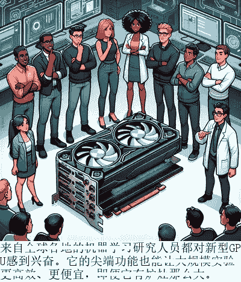

（正确答案：来自全球各地的 机器学习 研究人员都对新型 GPU 感到兴奋。它的尖端功能也能让大规模实验更高效、更便宜，即使它有炉灶那么大。）

对大多数中文母语者而言，这个任务应该不难，相信大家不需要几秒钟就可以得到答案。但想从露出的**部分文字推断完整**文字仍然需要十分复杂的推理过程：当代 神经科学 研究表明，复原 被部分遮挡物体 需要能进行高级决策的前额叶皮质的高度参与。

我们知道，当前的视觉 语言模型 （Vision-Language Models, VLM）可以非常精确地进行 物体识别 和文字识别。但是，当被遮挡的部分是文字；当模型的 光学字符识别 （OCR）失效；当仅有的关键信息只有被遮挡文字的几个像素，模型能够模拟人类的推理过程完成这一任务吗？

为此，来自图灵奖得主 **Yoshua Bengio 的团队 提**出了全新的 视觉问答 任务： 视觉字幕恢复（Visual Caption Restoration，VCR） 。让我们借由这个任务对视觉 语言模型 的推理能力一探究竟： 当前的视觉 语言模型 距离人类的认知水平还有多长的路要走？

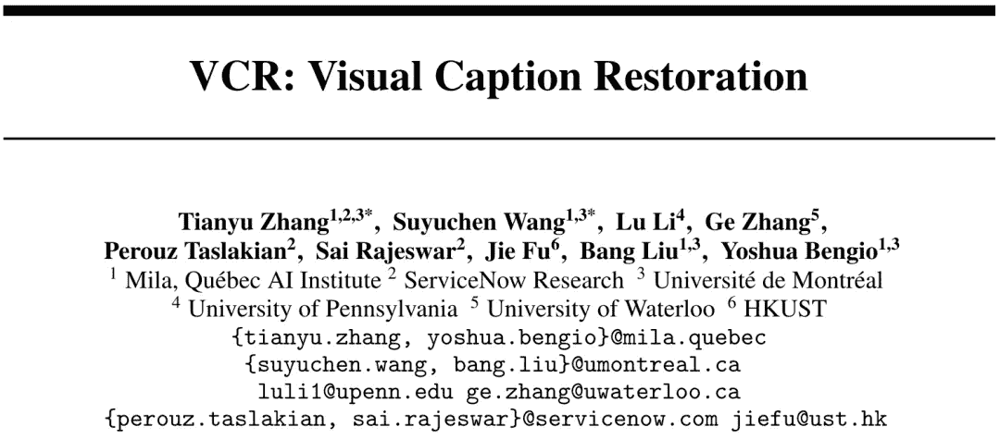

+   论文标题：VCR: Visual Caption Restoration

+   论文链接：arxiv.org/abs/2406.06462

+   代码仓库：github.com/tianyu-z/VCR （点击阅读原文即可直达，包含评用于模型评测和预训练的数据生成代码）

+   Hugging Face 链接：huggingface.co/vcr-org

**VCR 数据集简介**

为了开发 VCR 任务**，研究人员构建了一个 由图像**** - 文字生成** VCR 合成图像的流程 。在该流程中可以通过 控制遮住文字的白色矩形大小 来改变图像中文本的可见性，从而 控制任务难度 。

**借由该数据生成流程，研究人员**通过 维**基百科的主图 - **介绍对 生成了 VCR-wik**i 数**据集。对两种**语言均**设置 “ 简单 ” 和 “ 困难 ” 两个难度级别。其中：

+   “简单” 难度 VCR 任务 **能使得 OCR 模型失效 **；

+   “困难” 难度 VCR 任务则 对每个被遮挡的文本只保留上下各 1-2 个像素的高度 ，但依然能让对应语言的使用者完成任务。

每种语言和难度中，测试集和 验证集 各有 5000 个样本，剩下的样本都在训练集中。

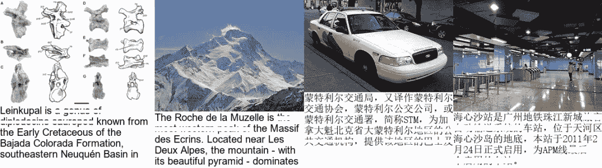

图例：从左到右分别为，英文简单难度、英文困难难度、中文简单难度、中文困难难度

难度进一步提升后，人类 vs 模型

文章开头的例子对人类而言只是一个小挑战，不能很好地展示人类做这个任务的极限水平以及人类在解题的时候运用的思维和技巧。下面展示了一个 “困难” 难度的 VCR 任务样例。读者可以更专注地尝试自己填补下方被遮挡的文字空白。

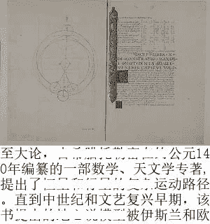

（正确答案：至大论，古希腊托勒密在约公元 140 年编纂的一部数学、天文学专著，提出了恒星和行星的复杂运动路径。直到中世纪和文艺复兴早期，该书提出的地心说模型被伊斯兰和欧…）

人类是如何补全被部分遮挡的文字的？

**教育学和认知科学中有**一个概念叫做 元认知（meta-cognition） 。在设计 AI 的时候，我们人类作为教师，可以通过 监控自己的思维过程 当作参考来帮助作为模型的学生提高学习效率。因此，思考 “人类是如何完成 VCR 任务的” 可以对模型设计有指导意义。

下图展示了一种笔者对 VCR 任务的解题思路作为参考：

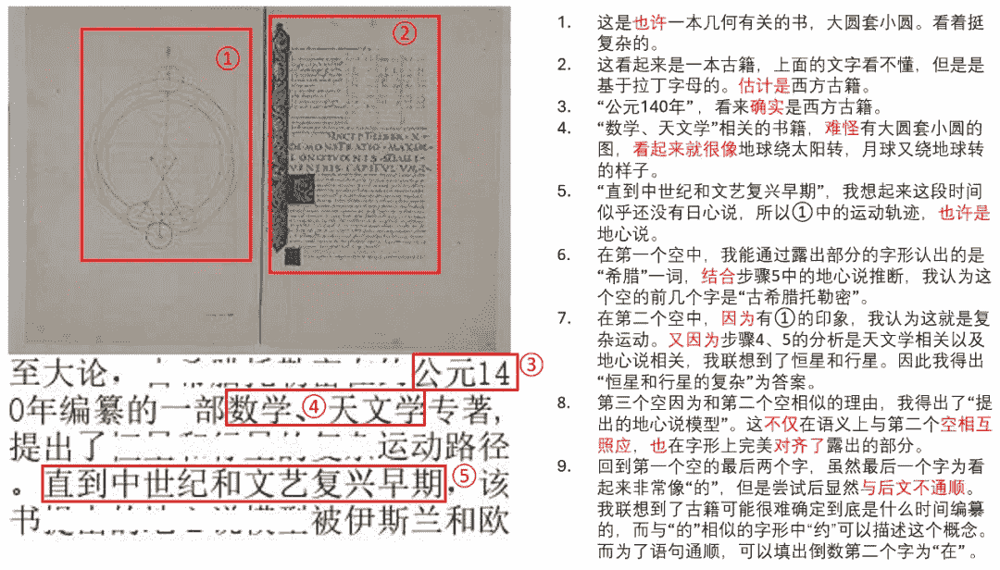

**看似步骤很多，其实就**是在不断通过不同的区域 获取信息再反复验证 来增加回答的置信度。

最开始看到图片时，心里只有一个模糊的猜测，在不断阅读图片获取新信息的过程中，逐步验证猜测。阅读完毕后，开始填空时，仍然没有停止通过信息的不同方面来相互对照，印证答案。当 “假设” 无法与其他信息保持一致时，就会推翻 “假设”，重新尝试新的假设。

**人类评测结果**

人类在 VCR 任务下的水平如何呢？ 下图中展示了母语者或各语言的流利使用者在英 / 中两种语言的简单 / 困难设定下的准确度：

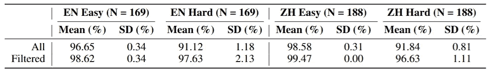

**如果考虑包含时间、地名、人名的错误， 人类在简单难度下的中文平**均正确率约为 98.58% ，在困难难度下的中文平均正确率约为 91.84% 。而去掉这些因为时间、地名、人名的错误，人类在简单难度的中文下几乎接近满分，而 中文困难难度下正确率也达到了 96.63% 。可以看出， VCR 任务对于人类而言是非常简单的 。

**现有模型结果**

作者测试了 “全明星阵容”：Claude 3 Opus, Claude 3.5 Sonnet, Gemini 1.5 Pro, GPT-4o, GPT-4 Turbo, Qwen-VL-Max, Reka Core 以及一些目前性能最好的开源模型。

下图中展示了在 VCR-Wiki 中文的简单难度上各个模型的性能：

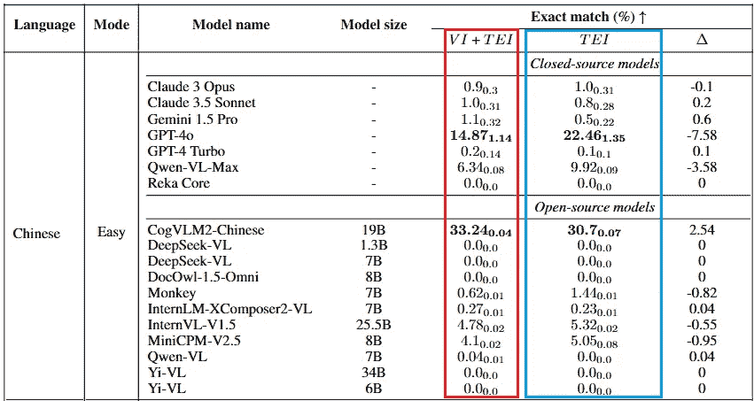

红框测量指标包括代表包含了 **图像（VI） **和 **图像中的文字（TEI） **两部分作为上下文信息，模型能还原出被遮住的文字的 准确率 。蓝色框内表示仅包含图像中的文字（TEI）的作为上下文信息，并不包含图像（VI），模型能还原出的遮住文字的 准确率 。

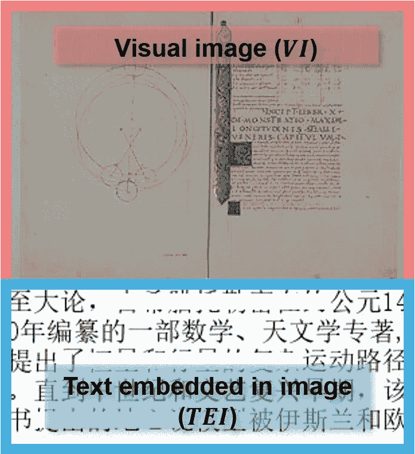

结果表明：

+   绝大多数模型目前都不能胜任这个任务；

+   **绝大多数模型没有利用好图像信息，没**有因为图像信息（VI）而提高 准确率 。

**在中文的困难难度上 ****，模型遇到**了更大的麻烦。表现得**最好的是 GPT-4o，但其只有 2.2% 的 准确率 。**除了 CogVLM2-Chinese 和 Qwen-VL-Max，绝大多数模型的 准确率 都接近 0% 。

可以观察到，在困难模式下， 原始模型很难在本问题上以显著的比例答对 ，更不用说接近人类了。

**英文 VCR 评测结果**

作者同样对目前最优的开源和闭源视觉 - 语言模型 在英文 VCR-Wiki 上做了测试。在展示测试结果之前，请先看两个英文 VCR-Wiki 任务的样例：

英文简单样例：

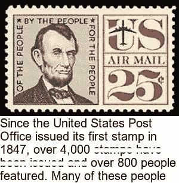

（正确答案：Since the United States Post Office issued its first stamp in 1847, over 4,000 stamps have been issued and over 800 people featured. Many of these people...）

英文困难样例：

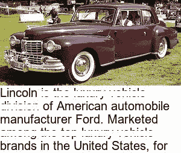

（正确答案：Lincoln is the luxury vehicle division of American automobile manufacturer Ford. Marketed among the top luxury vehicle brands in the United States, for...）

文中展示的英文 VCR-Wiki 的测试结果如下：

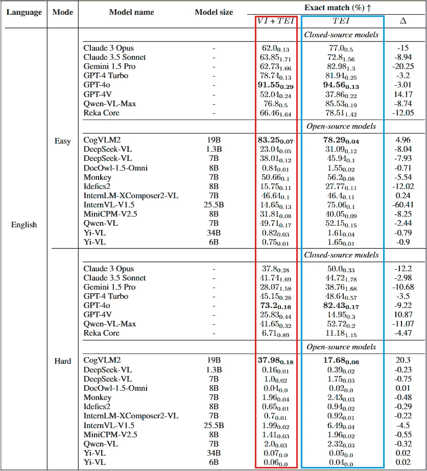

从结果整体来看， **模型在英文的简单模式**和困难模式下都分别比中文表现得要好 。这个结果与我们一般认为的 "因为特殊的模块化构形，残缺的 中文更加容易被补全 " 的直觉不一致。或许这是由于在预训练过程中，英文在数据量和数据质量上相比中文有更大的优势。

在所测试的众多模型中， **GPT-4o 是闭源模型中的效果最佳的，**CogVLM2 是开源模型中表现最佳的 。

一个很有趣的现象是加入了图片对 CogVLM2 来说有了明显的帮助（在困难模式下提升了 20.3%），而对于 GPT-4o 而言反而结果有下降。在中文测试中，也有相似的现象。笔者认为这是模型的结构所导致的。具体的细节，欢迎读者参阅 CogVLM 系列的论文以及代码。

另外，闭源模型普遍取得了比开源模型更优的结果，这可能归功于更优的训练策略或是更多的模型 参数 。但即使如此，模型依然在 “困难” 设定下遇到了很大的挑战。开源模型虽然可以部分完成 “简单” 设定，但在困难设定下，大多数开源模型都无法完成这个对人类而言十分简单的任务。

**相关任务简介**

**VQA**

视觉问答 （Visual Question Answering, VQA）任务要求模型根据输入的图像和自然语言问题生成自由形式的回答。 由于没有唯一的标准答案，评估 VQA 具有很大的挑战性 。传统的 VQA 方法主要集中于图像中可见元素的直接 查询 ，而不涉及图像中嵌入的文本内容与整体图像上下文之间的复杂关系。

在一些文字在图片中信息占比比较大的 VQA 评测中，模型的视觉模块甚至可能完全不需要与语言模块对齐就可以胜任。此类流程为：图像输入给 OCR 视觉模块，OCR 视觉模块输出图像中的字符信息并以此为上下文输入给语言模块。这样就导致了 VQA 任务退化成了不需要图像信息的 QA 任务。原本比较不同的 VLM 需要的视觉模块对齐能力被忽视而 OCR 能力被重视。

**OCR**

光学字符识别 （Optical Character Recognition, OCR）任务通常输入图像中的完整字符，并输出表示图像中字符的字符串文本，而无需考虑图像上下文。

预训练过 OCR 的模型能够从输入图像中提取嵌入的文本，即使这些文本是不完整或模糊的。然而， 随着文本组件模糊或被遮挡的程度增加 ，只利用可见部分恢复原始文本变得困难， OCR 方法在这种情况下效果有限 。

可以看出，VQA 任务没有标准答案，评估模型回答的质量仍然是一个开放性问题。而 OCR 任务不需要通过上下文来完成，无法检验模型是否真的学会利用了上下文中的信息。

**VCR 任务的不可替代性**

**视**觉字幕恢复（Visual Caption Restoration, VCR）任务旨在恢复图像中被遮挡的文本 ，这一任务 在 VQA 和 OCR 之间架起了桥梁 。

+   VCR 任务的独特挑战在于要求 模型在视觉和文本信息之间进行精确的对齐 ，这与 OCR 的简单文本提取任务形成鲜明对比。在 OCR 中，主要关注的是识别可见字符，而无需理解它们在图像叙事中的上下文相关性。相比之下，VCR 要求模型协同 利用可用的部分像素级文本提示和视觉上下文来准确地重建被遮挡的内容 。这不仅测试了模型处理嵌入文本和视觉元素的能力，还考验了其保持内部一致性的能力， 类似于人类通过上下文和视觉线索进行理解和响应的认知过程 。

+   与 VQA 不同， VCR 任务的问题有唯**一的答案** ，这使得评估可以通过 准确度 进行，使评测指标更加明确。

+   通过调整文本的遮盖比例，可以控制任务的难度 ，从而提供一个丰富的测试环境。

+   与 OCR 任务一样，VCR 任务也可以充当 VLM 的训练任务。作者开放了 transform 代码，可以生成任意给定图像 - 文字对的 VCR 任务图。

**小结**

本文提出的视觉字幕恢复（VCR）任务通过看似简单的字幕恢复任务巧妙地揭开了现有模型图像 - 文本对齐的局限性，以及模型与人类在高级认知任务上的推理能力差异。相信这一任务可以启发未来更加有效的 VLM 训练、评测和推理方法，进一步拉近多模态模型和人类认知能力的差距。