# 70倍极致压缩！大模型的检查点再多也不怕

> 来源：[https://agijuejin.feishu.cn/docx/SF17d8oFSoTNy0xrW0ccWraynae](https://agijuejin.feishu.cn/docx/SF17d8oFSoTNy0xrW0ccWraynae)

> 机器之心｜[阅读原文](https://www.jiqizhixin.com/articles/2024-08-05-3)

> 转载请联系原作者取得授权

**该论文**的作者均来自于 华为 诺亚实验室，第一作者为李文硕，通讯作者为王云鹤和陈醒濠。相关团队团队近年来在ICML、CVPR、NeurIPS、ICCV、ECCV等顶会上有多项代表性工作发表，在高效大 语言模型 、视觉模型等领域都有丰富的成果产出，和知名高校和科研机构合作广泛。

大模型作为当下 AI 工业界和学术界当之无愧的「流量之王」，吸引了大批学者和企业投入资源去研究与训练。随着规模越做越大，系统和工程问题已经成了大模型训练中绕不开的难题。例如在 Llama3.1 54 天的训练里，系统会崩溃 466 次，平均 2.78 小时一次！

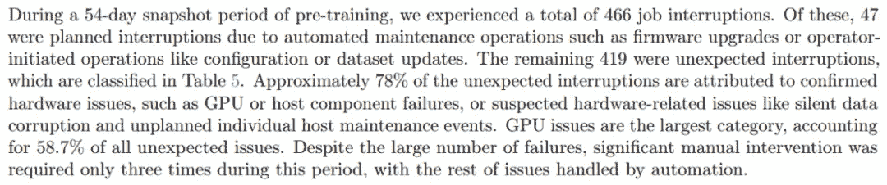

那么，频繁存储检查点就显得十分必要。但存储检查点本身也是一个大工程。

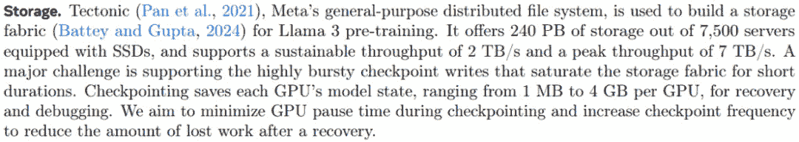

Meta 做了很多努力来加速存储检查点时间和增加存储频率，来对抗频繁出现的系统失效。但频繁存储也意味着大量的存储资源开销，其训练集群配备了 240PB 的 SSD 来应对这一挑战，光存储这一项的耗费就要亿元！

华为 诺亚的 ExCP 方法也就应运而生，为了应对存储带来的巨大开销，他们提出了极致压缩检查点技术，能够无损压缩模型 70 倍，大幅降低训练中的存储开销。

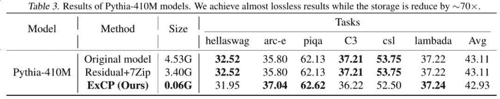

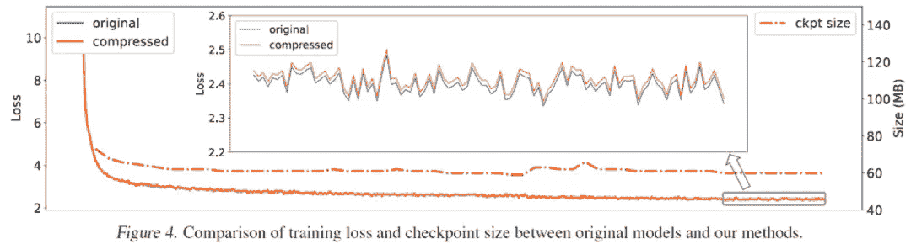

代码目前已经开源，在 Apache 2.0 框架下发布，issue 中已经有小伙伴成功复现了结果。

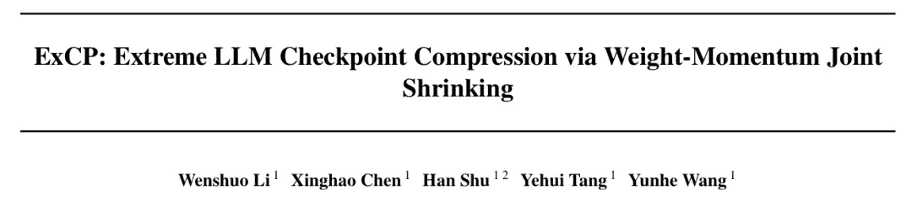

+   文章地址：https://arxiv.org/abs/2406.11257

+   仓库地址：https://github.com/Gaffey/ExCP

方法也很有创新性，文章中提到了两个重要的概念，一个是利用训练中检查点的残差信息，通过时间序列上信息的稀疏性实现更高的 剪枝 比例；另一个是将 优化器 和 权重 联合起来进行压缩，实现整体的高压缩率。

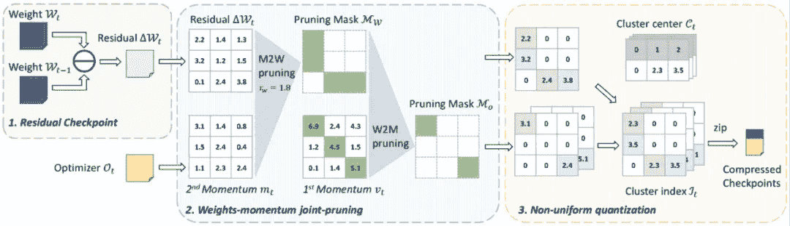

**具体方法**

**1. 检查点残差**

在训练过程中，当前的 参数 可以看作上一个检查点存储的 权重 加上逐次迭代时梯度更新的总和，这部分是相对稀疏的，包含的信息量较少，因此对这一残差进行压缩，可以获得更好的压缩比例。而与此相反的， 优化器 中存储的 动量 是梯度一阶矩和二阶矩的滑动平均值，对于一阶矩来说，它的滑动平均默认的 参数 是 0.9，在数百到数千个迭代之后与上一次检查点存储的内容已经没有太大的关联，所以对于 优化器 直接压缩其本身的值而非残差。最终待压缩的检查点表示为

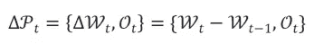

2. 权重 - 优化器 动量 联合压缩

目前已有的模型压缩相关的工作一般只关注于模型的推理性能，或者是模型最终存储检查点的大小，而不关注模型在整个训练过程中对储存空间的开销。因而已有工作只对 权重 进行压缩，而忽略了 Adam 等常见 优化器 中实际上存储了两倍于 权重 数量的 动量 。这一工作一方面将两者一起进行了压缩，显著提升了整体的压缩比例；另一方面也利用了 权重 和 优化器 动量 的关联性，进一步提升彼此的压缩比例。

权重 剪枝 ：由于 剪枝 的 权重 是残差值， 优化器 动量 的二阶矩可以大致表示在过去一段时间内 权重 残差值的变化幅度，所以可以使用 优化器 动量 的二阶矩作为指标来确定不同层的 剪枝 比例。 剪枝 策略如下文公式所示

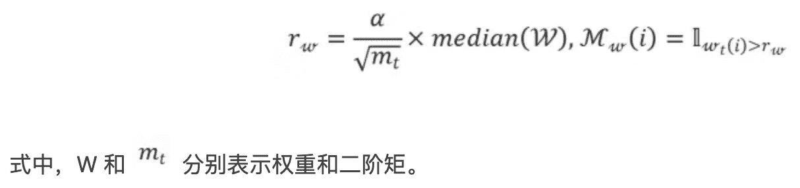

优化器 动量 剪枝 ：对于 动量 剪枝 ，可以使用一阶矩作为指示器来进行 剪枝 ，论文中有关于可 收敛 性的一个简要证明。同时，如果一个位置的 权重 已经被 剪枝 ，那么对应位置的 优化器 动量 也应该同步被处理，所以 剪枝 策略如下文公式所示

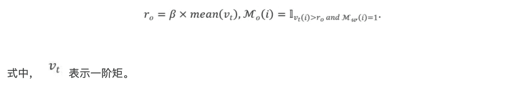

**3. 整体压缩流程**

整体压缩流程如 Algorithm 1 所示，依次进行计算 权重 残差 / 联合压缩 / 非均匀 量化 / 编码压缩等步骤，得到最终的压缩结果。

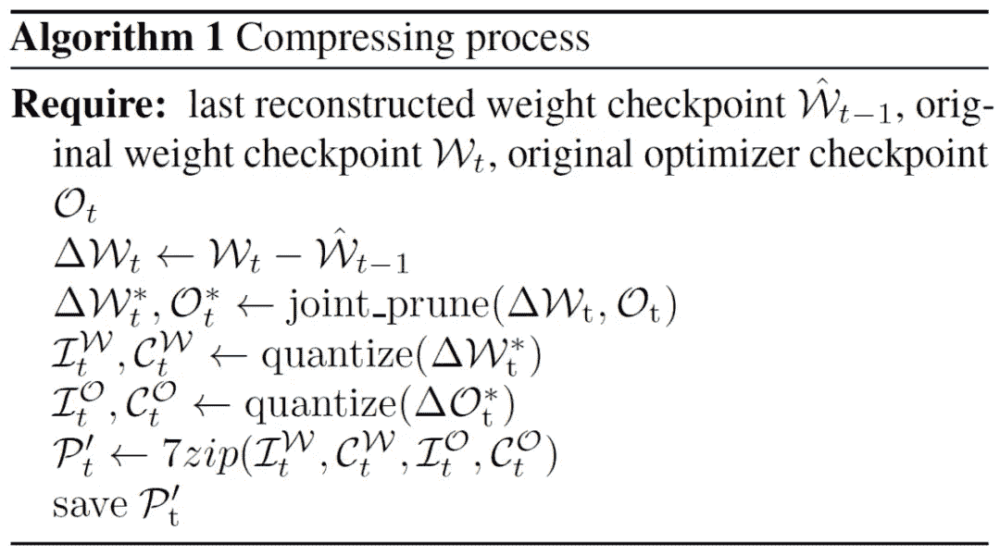

而恢复出检查点完整文件的流程则如 Algorithm 2 所示，进行解压缩之后，首先从非均匀 量化 后存储的码本和下标中恢复出浮点结果，然后再与 基准 权重 （上一个检查点的原始 权重 或恢复出的重建 权重 ）相加，得到检查点完整文件。而恢复出整个训练流程中的检查点文件的流程如 Algorithm 3 所示，在完成训练后只保存初始化 权重 的随机种子和每个检查点存储的压缩结果，然后依次对检查点进行恢复以得到完整的检查点序列，以供从其中选择某个或多个检查点恢复训练 / 进行测试等。

**实验结果**

文章中不仅对于大 语言模型 做了评估，在 ViT-L32 这样较大的视觉模型上这一方法也能取得很好的效果。

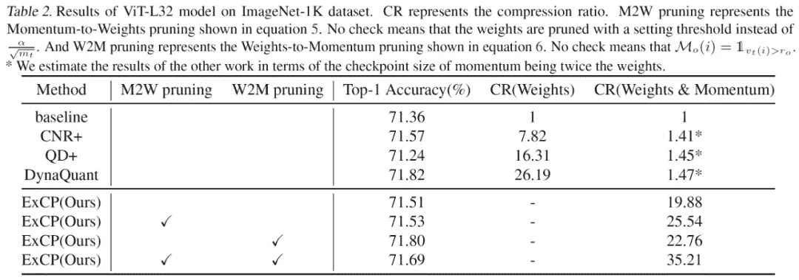

从消融实验里也可以看出，采用残差 剪枝 的方 法大大 减少了 剪枝 带来的损失。

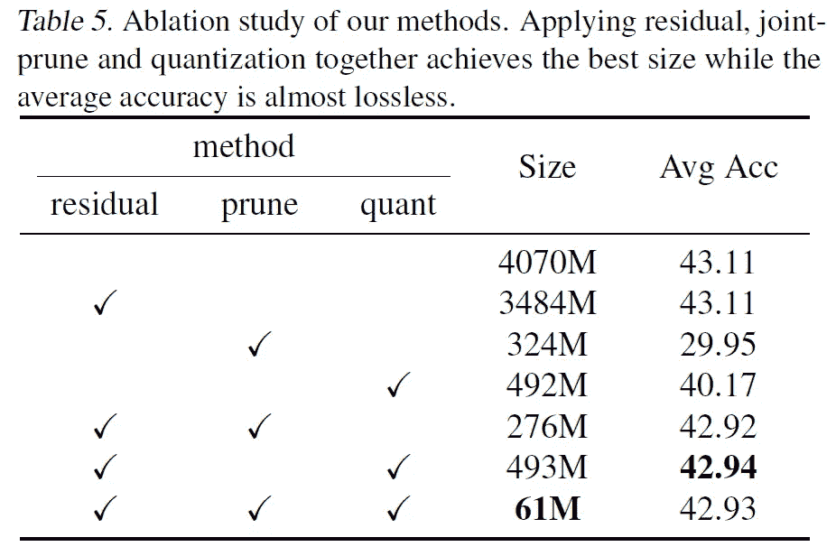

文章中还提供了大 语言模型 压缩前后问答的样例，可以看到压缩本身对于模型的问答能力也没有造成损害。

