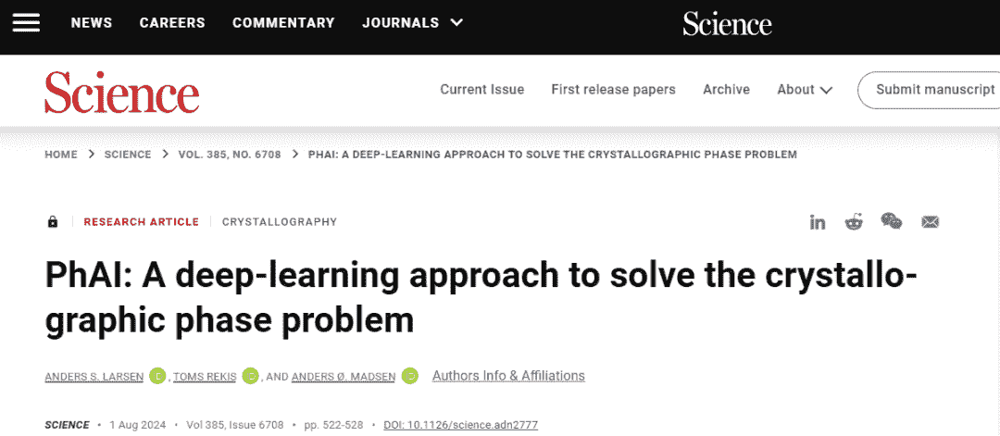
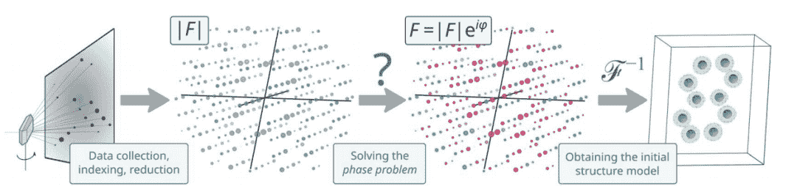
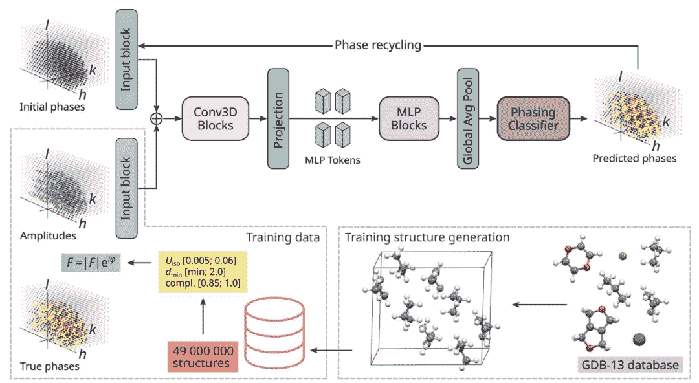
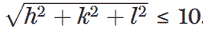
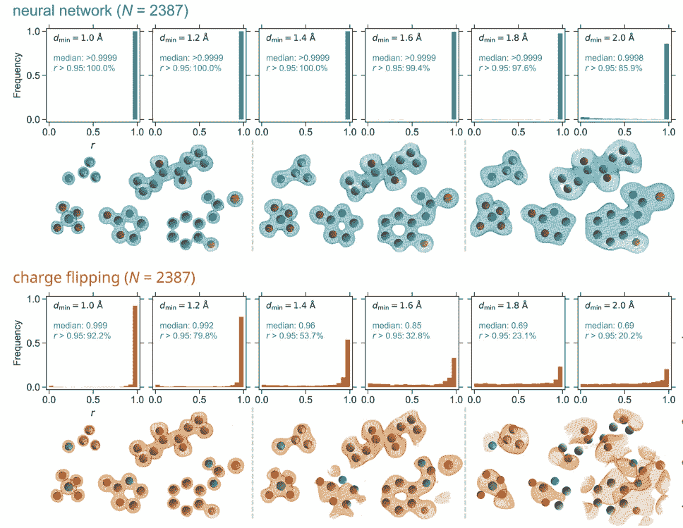

# 数百万晶体数据训练，解决晶体学相位问题，深度学习方法PhAI登Science

> 来源：[https://agijuejin.feishu.cn/docx/LYZ7dhC6DoPA5TxAXr0cZsRpnse](https://agijuejin.feishu.cn/docx/LYZ7dhC6DoPA5TxAXr0cZsRpnse)

> [机器之心](https://www.jiqizhixin.com/articles/2024-08-08-3) ScienceAI｜ 阅读原文

> 转载请联系原作者取得授权

编辑 | KX

时至今日，晶体学所测定的结构细节和精度，从简单的金属到大型膜蛋白，是任何其他方法都无法比拟的。然而，最大的挑战——所谓的相位问题，仍然是从实验确定的振幅中检索相位信息。

丹麦哥本哈根大学研究人员，开发了一种解决晶体相问题的深度学习方法 PhAI，利用数百万人工晶体结构及其相应的合成衍射数据训练的深度学习神经网络，可以生成准确的电子密度图。

研究表明，这种基于深度学习的从头算结构解决方案方法，可以以仅 2 埃的分辨率解决相位问题，该分辨率仅相当于原子分辨率可用数据的 10% 到 20%，而传统的从头算方法通常需要原子分辨率。

相关研究以《 PhAI: A deep-learning approach to solve the crystallographic phase problem 》为题，于 8 月 1 日发布在《 Science 》上。

论文链接： https://www.science.org/doi/10.1126/science.adn2777

晶体学是自然科学中的核心分析技术之一。X 射线晶体学为晶体的三维结构提供了独特的视角。为了重建电子密度图，必须知道足够多的衍射反射的复杂结构因子 F 。在传统实验中，只能获得振幅 | F |，而相位 ϕ 会丢失。这是晶体学相位问题。

图示：标准晶体结构测定流程图。（来源：论文）

20 世纪 50 年代和 60 年代取得了重大突破，Karle 和 Hauptmann 开发了用于解决相位问题的所谓直接方法。但直接法需要原子分辨率的衍射数据。然而，原子分辨率的要求是一种经验观察。

近年来，传统的直接方法已被对偶空间方法所补充。目前可用的从头算方法似乎已达到极限。相位问题的普遍解决方案仍然未知。

从数学上讲，结构因子振幅与相位的任何组合都可以进行逆傅里叶变换。然而，物理和化学要求（例如具有原子状电子密度分布）对与一组振幅一致的相位的可能组合施加了规则。深度学习的进步使得人们能够探索这种关系，也许比目前的从头算方法更深入。

在此，哥本哈根大学的研究人员采用了数据驱动的方法，使用数百万个人造晶体结构及其相应的衍射数据，旨在解决晶体学中的相位问题。

研究表明，这种基于深度学习的从头算结构解决方案方法，可以在仅最小晶格平面距离（ d min）= 2.0 Å 的分辨率下执行，只需要使用直接方法所需数据的 10% 到 20%。

**神经网络的设计与训练**

构建的人神经网络称之为 PhAI，接受结构因子振幅 | F | 并输出相应的相位值 ϕ 。PhAI 的架构如下图所示。

图示：PhAI 神经网络方法解决相位问题。（来源：论文）

晶体结构的结构因子数量取决于晶胞大小。根据计算资源，对输入数据的大小设置了限制。输入结构因子振幅是根据 Miller 指数 ( h、k、l ) 服从

的反射来选择的。

也就是，限制在原子分辨率下晶胞尺寸约为 10 Å 的结构。此外，选择了最常见的中心对称空间群 P21/c。中心对称性将可能的相位值限制为零或 π rad。

研究使用主要包含有机分子的人工晶体结构训练神经网络。创建了大约 49,000,000 个结构，其中有机晶体结构占 94.29%，金属有机晶体结构占 5.66%，无机晶体结构占 0.05%。

神经网络的输入由振幅和相位组成，它们由卷积输入块处理，添加并输入到一系列卷积块（Conv3D）中，然后是一系列多层感知器（MLP）块。来自线性分类器（相位分类器）的预测相位通过网络循环 Nc 次。训练数据是通过将 GDB-13 数据库中的金属原子和有机分子插入到晶胞中生成的。生成的结构被组织成训练数据，从中可以计算出在采样温度因子、分辨率和完整性时的真实相位和结构因子振幅。

**解决真实结构问题**

经过训练的神经网络在标准计算机上运行，计算需求适中。它接受 hkl 索引列表和相应的结构因子振幅作为输入。不需要其他输入信息，甚至不需要结构的晶胞参数。这与所有其他现代从头算方法有着根本区别。网络可以即时预测并输出相位值。

研究人员使用计算得出的真实晶体结构的衍射数据测试了神经网络的性能。共获得 2387 个测试用例。对于所有收集的结构，考虑了多个数据分辨率值，范围从 1.0 到 2.0 Å。为了进行比较，还使用了电荷翻转方法来检索相位信息。

图示：相位和真实电子密度图之间的相关系数 r 的直方图。（来源：论文）

经过训练的神经网络表现出色；如果相应的衍射数据分辨率良好，它可以解决所有测试结构（N = 2387），并且在从低分辨率数据中解决结构方面表现出色。尽管神经网络几乎没有针对无机结构进行训练，但它可以完美地解决此类结构。

电荷翻转法在处理高分辨率数据时表现优异，但随着数据分辨率的降低，其产生合理正确解的能力逐渐下降；然而，它仍然以 1.6Å 的分辨率解决了大约 32% 的结构。通过进一步试验和更改输入参数（例如翻转阈值），可以改善通过电荷翻转确定的结构数量。

在 PhAI 方法中，这种元优化是在训练期间执行的，不需要由用户执行。这些结果表明，在晶体学中必须有原子分辨率数据才能从头算相位的普遍观念可能被打破。PhAI 仅需要 10% 至 20% 的原子分辨率数据。

这一结果清楚地表明，原子分辨率对于从头算方法来说不是必需的，并为基于深度学习的结构测定开辟了新途径。

这种深度学习方法的挑战是扩展神经网络，也就是说，较大晶胞的衍射数据将需要大量的输入和输出数据以及训练期间的计算成本。未来，需要进一步研究，将该方法扩展到一般情况。