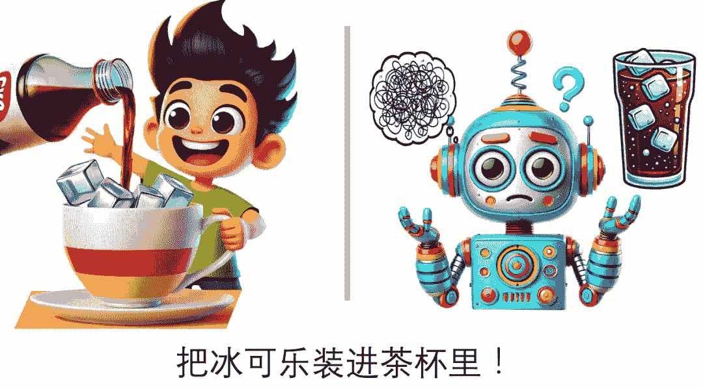
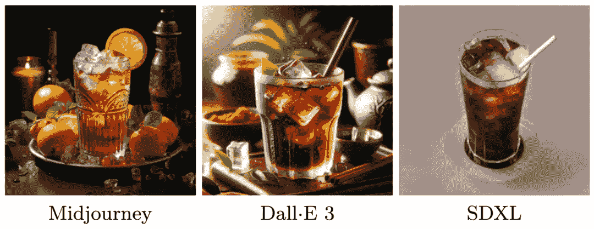
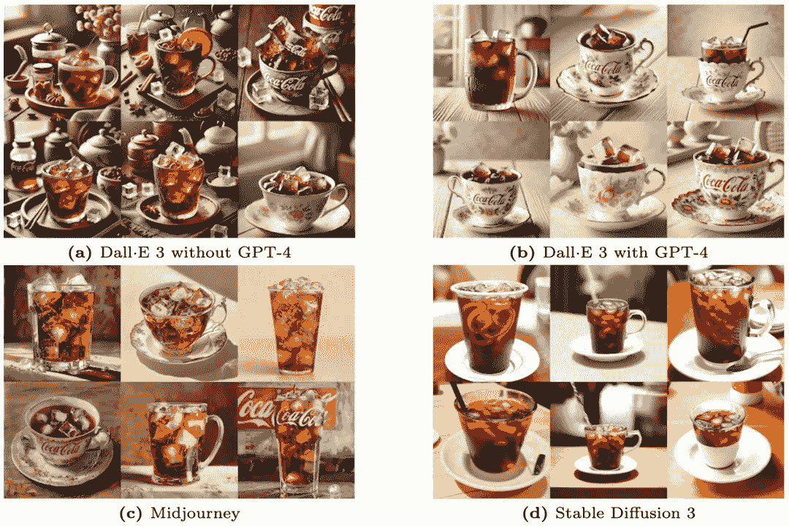
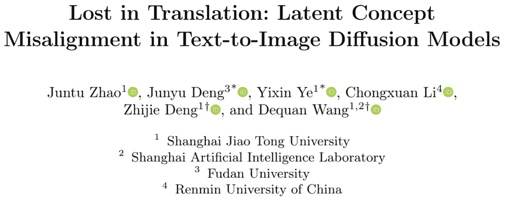
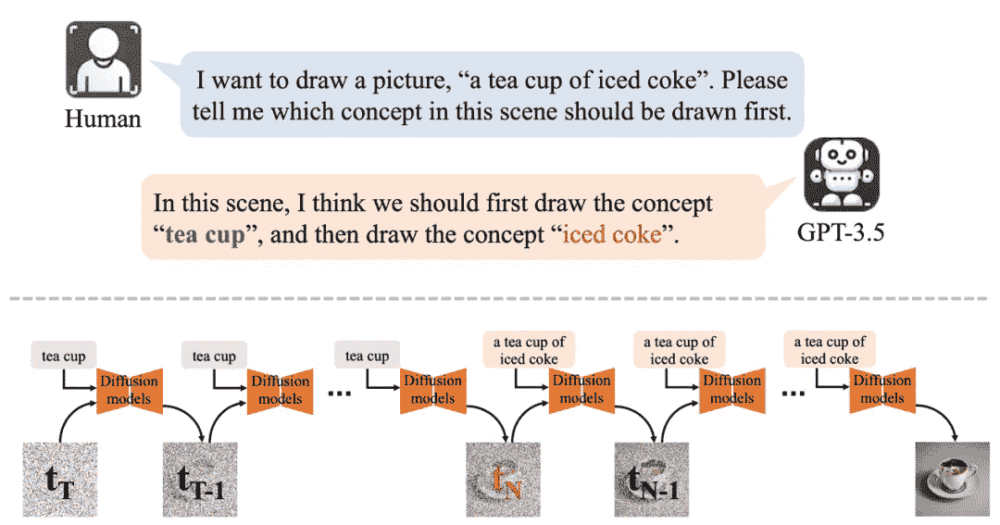
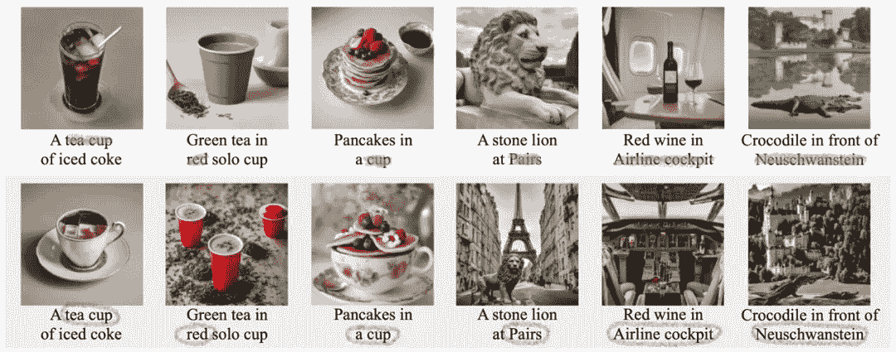
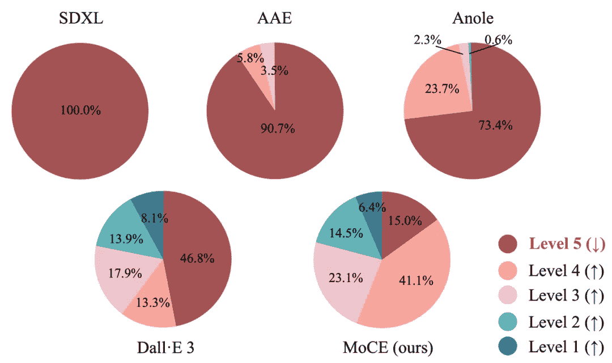
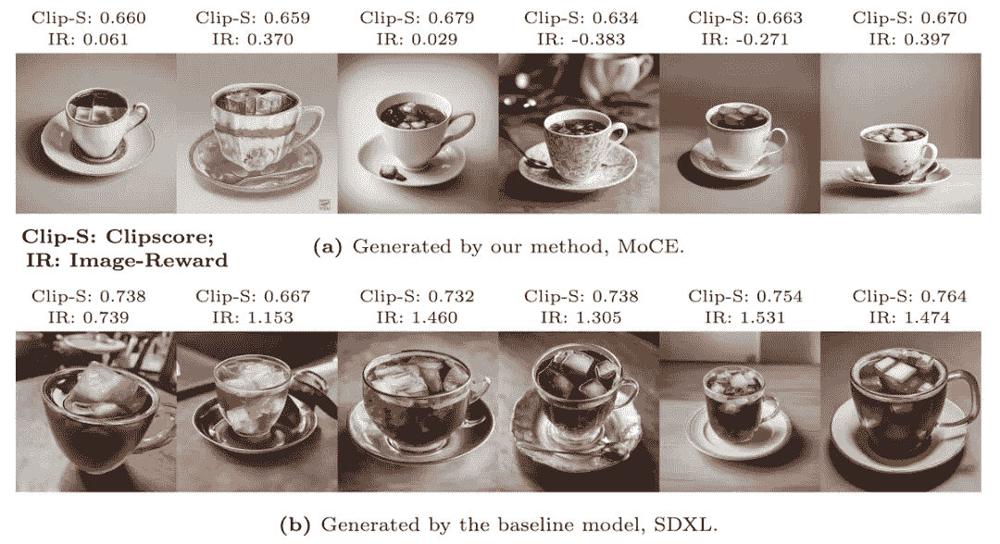

# AI画家的「滑铁卢」：为什么冰可乐不愿意住进茶杯里？

> 来源：[https://agijuejin.feishu.cn/docx/YVe1dJzvhoFdE9xSEmucLwFUnx4](https://agijuejin.feishu.cn/docx/YVe1dJzvhoFdE9xSEmucLwFUnx4)

> 机器之心｜[阅读原文](https://www.jiqizhixin.com/articles/2024-08-06-11)

> 转载请联系原作者取得授权

**文章的第一作者是上海交通大学博士研究生赵峻图（主页：https://juntuzhao.run），他的研究方向包括 计算机视觉 和 人工智能 赋能的生**命科学。此外，他还担任上海交通大学校田径队队长。文章的通讯作者为上海交通大学长聘教轨助理教授、博士生导师王德泉（主页：https://dequan.wang）。

设想一下，如果让你画一幅 “茶杯中的冰可乐” 的图片，尽管茶杯与冰可乐的组合可能并不恰当，你仍然会很自然地先画出一个茶杯，然后画上冰块与可乐。那么，当我们给 AI 画家提出 “画出茶杯中的冰可乐” 的要求时，会发生什么呢？在 2023 年 10 月大规模 AI 图像生成 模型刚刚兴起时，我们便进行了这种尝试，得到了以下结果：

考虑到 AI 模型更新换代带来的性能提升，我们在 2024 年 7 月又使用了最先进的模型进行了同样的尝试：

可以看出，即使是最先进的 AI 画家（例如 Dall・E 3），也无法凭空构建 “茶杯中的冰可乐” 的场景，它们往往会摸不着头脑，纠结良久后画出一个装满冰可乐的透明玻璃杯。即使是拥有昂贵数据标注基础以及 ChatGPT-4 加持下的最新 Dall・E 3 也无法稳定地 “将冰可乐装进茶杯里”，这一问题在学术界被归类为文生图模型的文本图像不对齐问题（text-image misalignment）。最近，上海交通大学王德泉老师课题组在论文《Lost in Translation: Latent Concept Misalignment in Text-to-Image Diffusion Models》中深入探索了这一问题的新分支，该论文即将发表在 2024 年 10 月份的第 18 届欧洲 计算机视觉 大会（ECCV）上。

+   论文链接：https://arxiv.org/abs/2408.00230

+   项目链接：https://lcmis.github.io

文本图像不对齐问题是 图像生成 领域中的一个重要方向，与传统不对齐问题不同的是，在传统不对齐问题中，人们主要关注的是一组概念对中两个概念的相互影响，例如给定 “一个苹果和一个梨” 的需求，得到的图像要么是两个苹果，要么是两个梨，不会出现第三种概念。而在 “茶杯中的冰可乐” 这一例子中，有一个关键的隐藏变量 “透明玻璃杯”，其从未在文本提示中出现，却替代 “茶杯” 出现在了图像中。这种现象在本文中被称为包含隐藏变量的不对齐问题（Latent Concept Misalignment，简称 LC-Mis）。

为了更深入地探索为什么茶杯会消失在图像中，我们首先希望收集一些与 “茶杯中的冰可乐” 存在相似问题的数据。然而，“茶杯中的冰可乐” 问题源于人类的奇思妙想与 AI 的死记硬背之间的冲突，如果仅依靠人类专家冥思苦想来创造新的概念对，效率将会非常低下。因此，我们设计了一个基于大 语言模型 （LLMs）的系统，利用 LLMs 体内蕴含的人类思维来帮助我们快速收集与 “茶杯中的冰可乐” 存在类似问题的概念对。在这个系统中，我们首先向 LLMs 解释 “茶杯中的冰可乐” 问题背后的 逻辑 ，然后简单地将这一问题划分为几个类别，让 LLMs 按照不同类别的 逻辑 生成更多的类别和概念对，最后我们使用文生图模型来绘制图像进行检查。然而，我们在后续实验中发现，现有的自动化评价指标在 “茶杯中的冰可乐” 这一新问题上存在一定缺陷。因此，我们只能采用人工评估的方式，我们对每组概念对生成 20 张图像，并根据这 20 张图中正确画出的数量为这组概念对给予 1 至 5 的评级，其中第 5 级表示所有 20 张图像均未能正确生成。

为了找回图像中的茶杯，我们提出了一种名为 Mixture of Concept Experts (MoCE) 的方法。我们认为，如果不从人类处理问题的角度来进行思考，那么 人工智能 的一切都是毫无道理的。在当今最火热的文生图模型 diffusion models 中， 注意力机制 会同时处理文本提示中的可乐与茶杯，但这并不符合人类按照概念顺序作画的规律。因此，我们将顺序作画的规律融入到 diffusion models 的多步采样过程中，成功地将消失的茶杯找了回来：

具体来说，LLMs 会首先告诉我们应该先画一个茶杯。接下来，我们将茶杯这一概念单独输入给 diffusion models，完成 T-N 步的采样。而在余下的 N 步采样中，再提供完整的文本提示，“茶杯中的冰可乐”，最终生成一张干净的图像。在此过程中，N 起到了至关重要的作用，因为它决定了为 “茶杯” 分配的采样步数。于是，我们使用一个多模态模型来衡量图像与茶杯以及冰可乐的契合度评分。当图像和两个概念的评分之间相差很大时，说明有一个概念很可能被模型忽略了，于是就需要相应地调整 N 的取值。由于 N 的取值与概念在图中出现概率之间的关系是正相关的，因此这一调整过程是由二分查找来完成的。

最后，我们使用 MoCE 以及各种 baseline 模型在收集到的数据集上进行了广泛的实验，并展示了以 “茶杯中的冰可乐” 为首的可视化修复结果，以及在整个数据集上人类专家评估的结果对比。和几种 baseline 模型相比，我们提出的 MoCE 方法显著地降低了第 5 级 LC-Mis 概念对的占比。另外值得注意的是，MoCE 的性能在一定程度上甚至超越了需要大量数据标注成本的 Dall・E 3（2023 年 10 月版本）：

此外，正如在上文中提到的，现有的自动化评价指标在 “茶杯中的冰可乐” 这一新问题上存在一定缺陷。我们首先仔细挑选了一些带把的透明玻璃杯图像，它们虽然具有茶杯的形状，但是由于其透明玻璃的材质而不能称之为茶杯。我们将这些图像与 MoCE 生成的 “茶杯中的冰可乐” 图像进行了对比，如下图所示：

我们使用了两种当前流行的评价指标，Clipscore 和 Image-Reward，来计算图像与 “冰可乐” 之间的契合程度。图像与冰可乐的契合程度越高，得分就越高。然而，这两种评价指标均对茶杯中的冰可乐给予了明显更低的评分，而对透明玻璃杯中的冰可乐赋予了明显更高的评分。因此，这表明现有的自动化评价指标可能无法识别出茶杯中的冰可乐，因为其模型内部仍存在 “冰可乐 = 冰块 + 可乐 + 玻璃杯” 的偏见，从而导致其无法有效参与 LC-Mis 问题的评价。

总的来说，我们受到 “茶杯中的冰可乐” 例子的启发，介绍了一种文本图像不对齐问题的新分支，即包含隐藏概念的不对齐问题 (LC-Mis)。我们在大 语言模型 和文生图模型的帮助下，开发了一个系统来收集 LC-Mis 概念对。接下来，我们受到人类绘画规律的启发，将绘画顺序引入 diffusion models 的采样过程，提出了 MoCE 的方法，缓解了 LC-Mis 问题。最后，我们还通过代表例子 “茶杯中的冰可乐” 展示了当下文本图像对齐问题的评价指标存在的缺陷。在未来的工作中，我们将持续深入研究生成式 AI 技术，推动 AI 更好地满足人类的实际需求，通过不断的努力和创新，我们期待见证 AI 在理解和再现人类创造力方面的突破。