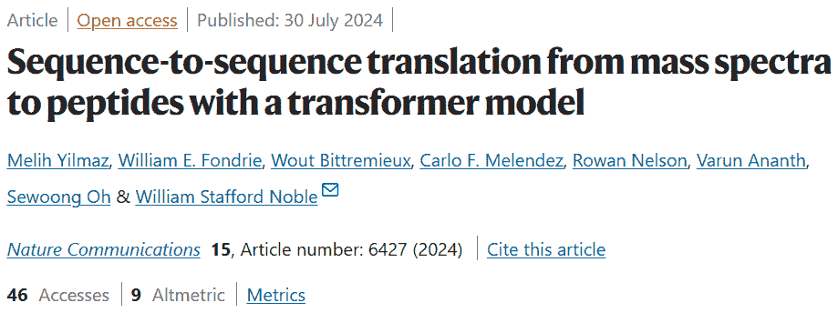
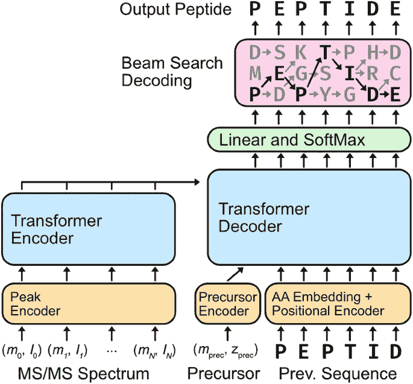
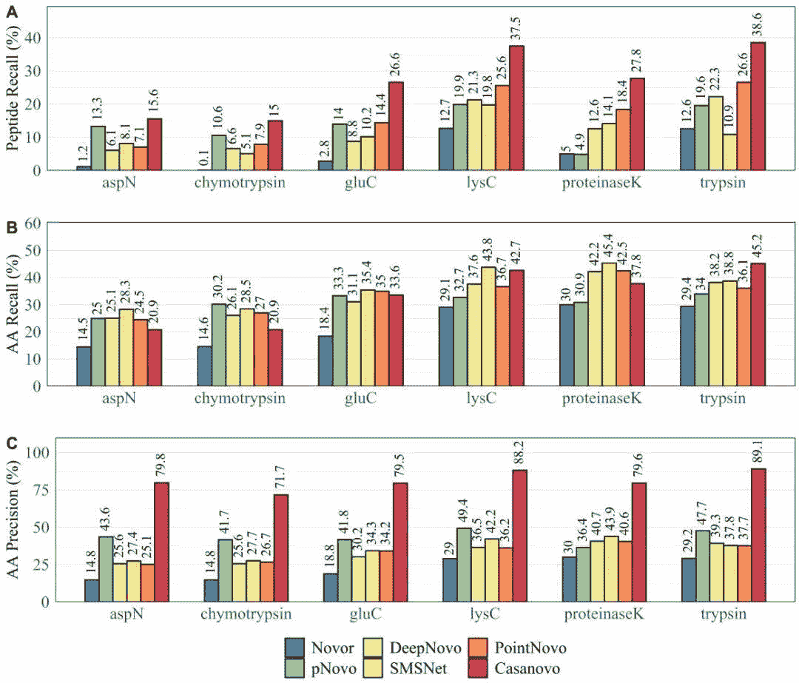
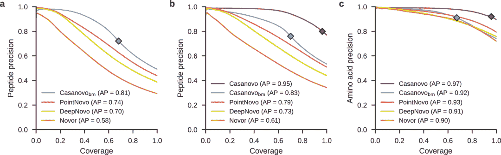

# SOTA性能，华盛顿大学开发Transformer模型将质谱转化为肽序列，登Nature子刊

> 来源：[https://agijuejin.feishu.cn/docx/CyW9dR8npoCynaxcf92cvF2NnRh](https://agijuejin.feishu.cn/docx/CyW9dR8npoCynaxcf92cvF2NnRh)

> 机器之心 ScienceAI｜[阅读原文](https://www.jiqizhixin.com/articles/2024-08-11-14)

> 转载请联系原作者取得授权

编辑 | 萝卜皮

基于质谱的蛋白质组学的一个基本挑战是识别产生每个串联质谱的肽。利用已知肽序列数据库的方法无法检测意外肽，在某些情况下可能不切实际或无法应用。

因此，无需先验信息（即从头肽测序）即可将肽序列分配到串联质谱中的能力对于抗体测序、免疫肽组学和元蛋白质组学等任务非常有价值。

尽管已经开发出许多方法来解决这个问题，但它仍然是一个悬而未决的挑战，部分原因是难以对串联质谱的不规则数据结构进行建模。

在这里，华盛顿大学（University of Washington）的研究人员描述了 Casanovo，这是一种机器学习模型，它使用 Transformer 神经网络架构将串联质谱中的峰序列转换为构成生成肽的氨基酸序列。

该团队根据 3000 万个标记光谱训练了 Casanovo 模型，并证明该模型在跨物种基准数据集上的表现优于几种先进方法。

该团队还开发了一个针对非酶肽进行微调的 Casanovo 版本。该工具改善了免疫肽组学和宏蛋白质组学实验的分析，并使科学家能够更深入地研究暗蛋白质组。

该研究以「 Sequence-to-sequence translation from mass spectra to peptides with a transformer model 」为题，于 2024 年 7 月 31 日发布在《 Nature Communications 》。

质谱法是目前最主流的分析技术，用于鉴定蛋白质组，识别和量化复杂生物系统中的蛋白质。但是，串联质谱 (MS/MS) 技术产生的数据非常复杂，将这些光谱转换成蛋白质氨基酸序列的过程非常具有挑战性。

与许多其他领域一样，深度学习已成为从头肽测序的首选解决方案。不过，它们仍然存在一些局限性。与序列数据库搜索相比，从头测序工具通常只能注释少数 MS/MS 光谱，它们难以原生编码高分辨率 MS/MS 数据，并且它们采用了复杂的神经网络架构和后处理步骤。

为了解决这些问题，华盛顿大学的研究人员介绍了 Casanovo，它将从头肽测序任务重新定义为机器翻译问题：就像将句子中的单词序列从一种语言翻译成另一种语言一样，Casanovo 将 MS/MS 光谱中的峰序列翻译成生成肽的氨基酸序列。

他们使用了 Transformer架构，允许 Casanovo 直接使用构成 MS/MS 光谱的 m/z 和强度值对，而无需对 m/z 轴进行离散化，并直接输出预测的肽序列，而无需复杂的动态编程步骤。该团队之前曾使用多物种基准的有限质谱集训练 Casanovo。

在最新的研究中，研究人员对 Casanovo 进行了重大改进，并展示了其在应对从头肽测序常见挑战方面的有效性。

他们扩展了训练集，使用了从 6.69 亿个光谱的海量集合中得出的 MassIVE-KB 光谱库，并结合了极其严格的 FDR 控制。

具体来说，数据是在 1% FDR 下搜索的，之后只保留每个独特前体的前 100 个 PSM，相当于 3000 万个高质量 PSM（与原始搜索相比，FDR 均为 0%）。而且添加了波束搜索解码程序来预测每个 MS/MS 光谱的最佳肽。

图示：Casanovo 使用 Transformer 架构执行从头肽测序。（来源：论文）

Casanovo 的出色表现源于两个方面：一方面是拥有大量高质量训练数据，另一方面就是用了 Transformer 架构。

Transformer 架构特别适合将可变长度序列的元素置于语境中，因此在自然语言建模方面被证明非常成功。与循环神经网络相比，Transformer 架构能够学习序列元素之间的长距离依赖关系，并且可以并行化以实现高效训练。

Casanovo 将质谱峰编码为序列，类似于将句子中的单词标记化，利用 Transformer 架构的优势和大型语言模型的快速发展来改进 MS/MS 光谱的从头肽测序。

有一个重要的未决问题是模型参数的数量如何影响从头测序性能，研究人员表示将此留待未来研究。

Casanovo 的应用场景非常多。最明显的是，任何肽数据库不可用、不完整或非常大的应用都可能受益于从头测序，例如古蛋白质组学、法医学或天体生物学。

然而，即使在分析人类或模式生物数据时，Casanovo 也可以协助检测「外来」光谱，即数据库中不存在的肽产生的光谱。此类外来光谱可能对应于实验过程中引入的污染物，但它们也可能代表微生物物种、遗传变异或转接肽。

总的来说，研究人员设想将 Casanovo 用作在标准数据库搜索过程中未能分配肽的光谱的后处理器，类似于级联搜索的最后阶段。

Casanovo 团队尚未探索的从头测序的一个重要应用是抗体测序。不过，德国 BAM 的 Denis Beslic 团队的一项研究对包括 Casanovo 在内的六种从头测序工具在抗体测序问题上进行了系统比较。

图示：Novor、pNovo 3、DeepNovo、SMSNet、PointNovo 和 Casanovo 对 IgG1-Human-HC 上不同酶的总体召回率和精确度。（来源：论文）

相关链接： https://academic.oup.com/bib/article/24/1/bbac542/6955273?login=false

结果显示，Casanovo 在考虑的所有指标上都远远优于竞争方法。需要注意的是，这次比较采用了贪婪解码的 Casanovo 版本，并且仅对 200 万张光谱进行了训练。

Casanovo 团队用九种物种基准测试对 Casanovo 进行了评估。下图表明，从 3000 万张光谱中训练的 Casanovo 新版本能产生更好的抗体测序性能。

图示：Casanovo 在九种物种基准测试中表现优于 PointNovo、DeepNovo 和 Novor 等模型。（来源：论文）

未来，Casanovo 模型将有很多机会针对特定应用进行微调。研究人员对非酶模型的分析表明，Casanovo 的酶偏差可以通过使用相对较少的训练数据进行调整。

因此，短期内，该团队计划训练适用于各种不同裂解酶的 Casanovo 变体。Casanovo 软件使这种微调变得简单，因此任何有兴趣将模型调整到特定实验设置的用户都应该能够这样做。

从长远来看，理想的模型将光谱以及相关元数据（例如消化酶、碰撞能量和仪器类型）作为输入，并准确预测多种不同类型的实验设置。

深度学习方法在提高从头测序能力方面的潜力现已得到广泛认可。在该论文接受审查期间，至少有六种其他深度学习从头测序方法已发表，包括 GraphNovo、PepNet、Denovo-GCN、Spectralis、π-HelixNovo 和 NovoB。显然，对这一不断发展的工具领域进行全面而严格的基准比较将使该领域受益。

与此相关的是，现阶段该领域的主要瓶颈之一是缺乏严格的从头测序置信度评估方法。

在宏蛋白质组学分析中，研究人员将 Casanovo 预测与目标和相应的诱饵肽数据库进行了匹配，但这种方法忽略了从头测序将肽分配给外来谱的能力。

因此，一个悬而未决的问题是，对于给定的数据依赖型采集数据集，Casanovo 是否在检测肽的统计能力方面优于标准数据库搜索程序。

研究人员表示，通过足够大的训练集进行训练，也许可以结束数据库搜索在 DDA 串联质谱数据分析领域的统治地位。

论文链接： https://www.nature.com/articles/s41467-024-49731-x