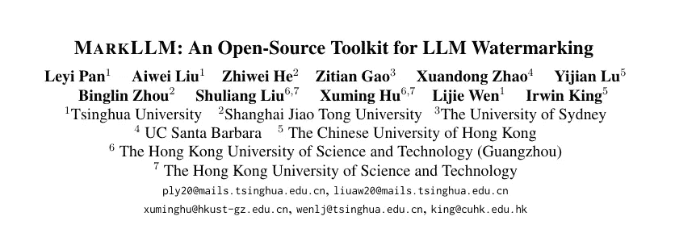
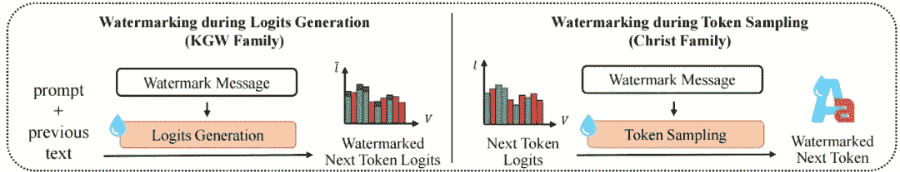
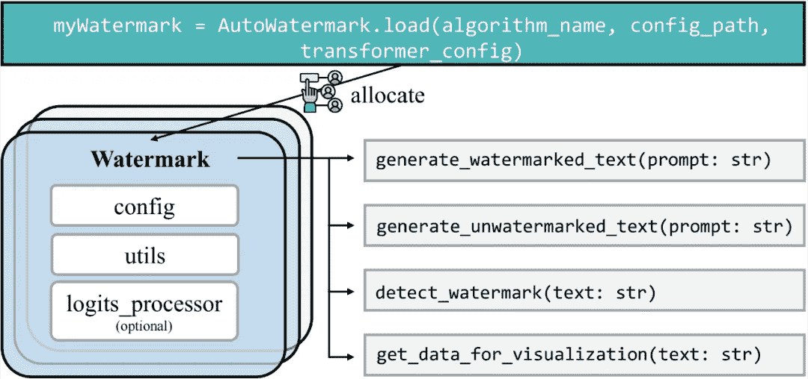
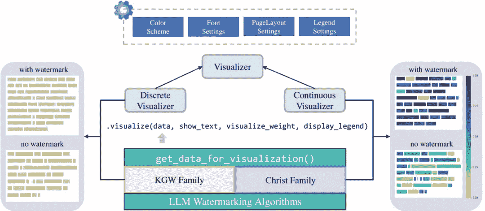
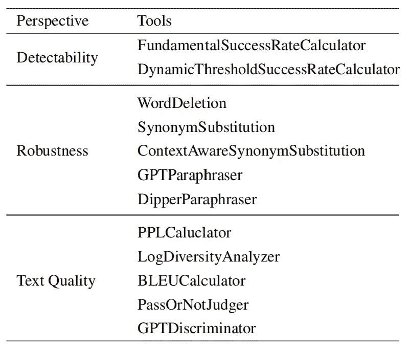
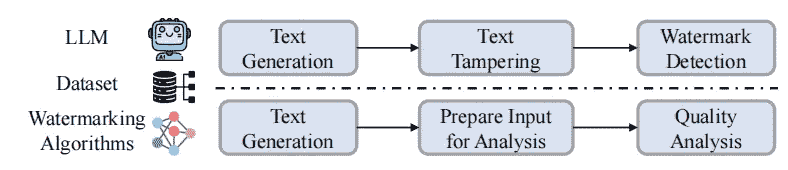
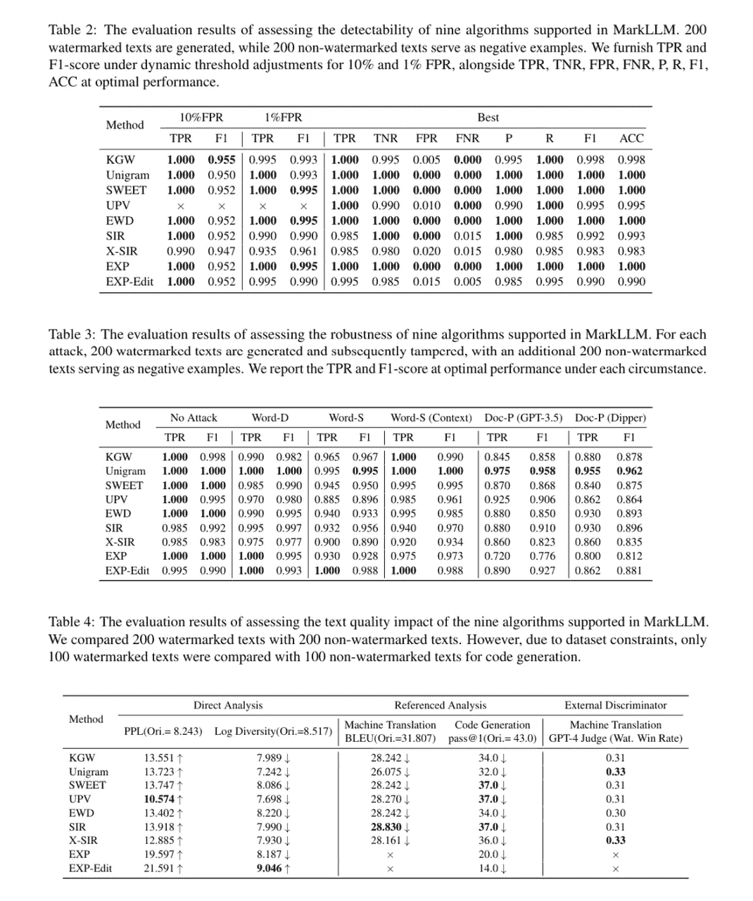
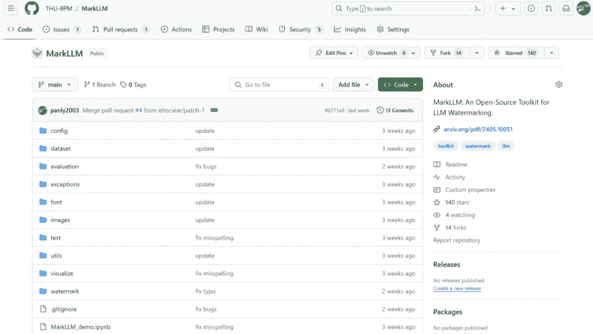

# 清华等高校推出首个开源大模型水印工具包MarkLLM，支持近10种最新水印算法

> 来源：[https://agijuejin.feishu.cn/docx/G7JAdmatMoYNJex3jFscBhcznUe](https://agijuejin.feishu.cn/docx/G7JAdmatMoYNJex3jFscBhcznUe)

> 机器之心｜[阅读原文](https://www.jiqizhixin.com/articles/2024-06-18-2)

> 转载请联系原作者取得授权

**本文由 清华大**学 、上海交通大学、悉尼大学、UCSB、香港中文大学、香港科技大学、香港科技大学（广州）联合完成。主要作者包括：潘乐怡（第一作者）， 清华大学 本科生，研究方向为大模型水印等；刘瑷玮， 清华大学 博士生，研究方向为安全可信大模型等；何志威，上海交通大学博士生，研究方向为大模型水印、大模型智能体等;高梓添，悉尼大学本科生，研究方向为大模型水印；赵宣栋，UCSB博士生，研究方向为可信生成式AI等；胡旭明，香港科技大学/香港科技大学（广州）助理教授，研究方向为安全可信大模型、 信息抽取 等；闻立杰， 清华大学 长聘副教授，研究方向为流程挖掘， 自然语言处理 。

本⽂介绍由清华等⾼校联合推出的⾸个开源的⼤模型⽔印⼯具包 MarkLLM。MarkLLM 提供了统⼀的⼤模型⽔印算法实现框架、直观的⽔印算法机制可视化⽅案以及系统性的评估模块，旨在⽀持研究⼈员⽅便地实验、理解和评估最新的⽔印技术进展。通过 MarkLLM，作者期望在给研究者提供便利的同时加深公众对⼤模型⽔印技术的认知，推动该领域的共识形成，进⽽促进相关研究的发展和推⼴应⽤。

+   论⽂名称：MarkLLM: An Open-Source Toolkit for LLM Watermarking

+   论⽂链接：https://arxiv.org/abs/2405.10051

+   代码仓库：https://github.com/THU- BPM/MarkLLM

⼤模型⽔印技术的发展现状 & 仍然⾯临的问题

⼤模型⽔印是近期新兴的⼀项技术，通过在模型⽣成⽂本过程中植⼊特定的特征，来实现机⽣⽂本的辨别和来源追溯。它可⽤于虚假新闻检测、维护学 术诚信、数据和模型版权保护等场景。

⽬前主流的⼤模型⽔印算法是在⼤模型推理阶段植⼊⽔印，这类⽅法主要分为两⼤算法家族：

+   KGW 家族：通过⼲预打分向量添加⽔印，将词表分为红绿列表，给绿⾊词加偏置，使输出偏好绿⾊词汇；

+   Christ 家族：在打分向量⽣成后，⽤伪随机数⼲预采样过程，使⽔印⽂本与该随机数更相关，以此植⼊⽔印。

然⽽，就像所有新兴技术⼀样，⼤语⾔模型⽔印技术在使⽤和理解上也⾯临⼀些挑战。

1. 如何便捷地使⽤各个⼤模型⽔印算法进⾏⽔印添加和检测？

各类⼤模型⽔印算法不断涌现。然⽽它们的实现⼤都基于作者⾃⾝的需求，缺乏统⼀的类和调⽤接⼝设计，使得研究⼈员和⼤众需要投⼊⼤量精⼒去使⽤和复现这些算法。

2. 如何直观地理解各个⼤模型⽔印算法的内部机制？

⼤模型⽔印算法的底层机制相对复杂，涉及对⼤模型⽣成⽂本过程中打分向量⽣成以及采样过程的⼲预，不便于研究者和⼤众理解。

3. 如何便捷、全⾯的评估各个⼤模型⽔印算法？

评估⻆度和指标多样（包含可检测性、鲁棒性、对⽂本质量的影响等），且⼀次评估涉及多步骤，全⾯快速评估算法性能极具挑战。

MarkLLM：⾸个开源⼤模型⽔印多功能⼯具包

针对刚才提到的 3 个问题，作者设计并实现了⾯向⼤语⾔模型⽔印技术的⼯具包 MarkLLM。

MarkLLM 的主要贡献可总结如下：

**1. 功能⻆度**

+   统⼀的⼤模型⽔印算法实现框架：⽀持两个关键⽔印算法家族（KGW 家族和 Christ 家族）的 9 种具体算法。

+   ⼀致、⽤⼾友好的顶层调⽤接⼝：1 ⾏代码实现添加⽔印、检测⽔印等各类操作。

+   定制化的⼤模型⽔印算法机制可视化解决⽅案：使⽤⼾能够在各种配置下可视化不同⼤模型⽔印算法的内部机制。

+   全⾯、系统的⼤模型⽔印算法评估模块：包含覆盖 3 个评估⻆度的共 12 个评估⼯具，以及两类⾃动化评估流⽔线。

**2. 设计⻆度 **：模块化、松耦合架构设计，具有极⾼的可扩展性和灵活性。

**3. 实验⻆度 **：作者⽤ MarkLLM 作为研究⼯具，对⽀持的 9 种算法做了 3 个评估⻆度的全⾯实验，在证明 MarkLLM 的实⽤性的同时，为后续研究提供了宝贵的数据参考。

**4. 对开源社区的影响⼒ **：MarkLLM 在 GitHub **上线 以来已经获得了较**多关注，⽬前已有 140+ stars ， 并吸引了同⾏通过 Pull Request 进⾏代码贡献，以及在 issue 栏⽬进⾏交流讨论。

作者衷⼼希望 MarkLLM ⼯具包在为研究⼈员提供便利的同时，提⾼⼤众对⼤语⾔模型⽔印技术的理解和参与度，促进学术界和公众之间就该技术达成共识，推动⼤语⾔模型⽔印研究和应⽤的进⼀步发展，为⼤语⾔模型使⽤安全贡献⼒量。

作者真诚欢迎⼤家提出宝贵意⻅、相互交流学习， 也⼗分欢迎通过 pull request 贡献代码，通过⼤家的共同努⼒维护更好的⼤模型⽔印技术⽣态！