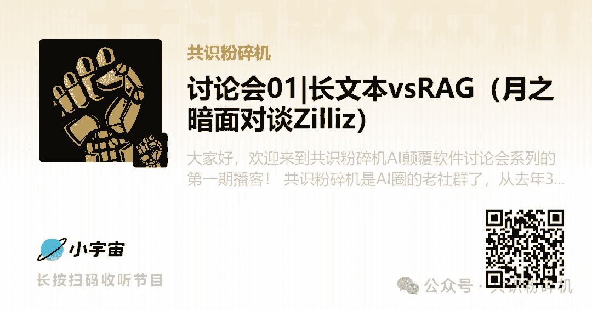

# 长文本vsRAG(月之暗面对谈 Zilliz)

> 来源：[https://agijuejin.feishu.cn/docx/QW11dZuOYoonx1xQhHAc0uVznLg](https://agijuejin.feishu.cn/docx/QW11dZuOYoonx1xQhHAc0uVznLg)

> 共识粉碎机｜[阅读原文](https://mp.weixin.qq.com/s/1lIjwQGJ3yn-e6X-GQp54g)

> 转载请联系原作者取得授权

> **本期讨 论会参 与者：**

> **陈将老师： **Zilliz 生态和 AI 平台负责人

> **唐飞虎老师： **月之暗面研发工程师，开发者关系负责人

> **主持人：**

> **周默： **共识粉碎机，前美元对冲基金投资人，曾在腾讯与微软从事战略与投资业务

# **1 ** **长文本与RAG通用对比**

---

准确率：通常情况下长文本优于RAG

+   长文本：可更加综合的去分析所有相关的内容，提取相关数字，生成图表，效果尚可。

+   RAG：更适合找到一段或者是几段可能相关的段落。如果希望大模型能够对问题有全局的认识，比较困难。如，根据上市公司的2020年财务报表，绘制图表，直接用RAG可能效果就不是很好。

长文本在准确性上表现好的原因，以及长度与准确性选择

+   长文本处理之后，会做对齐和专门的Benchmark测试调整。 比如说之前的大海捞针以及腾讯的数星星的Benchmark，这些是更难一些要求，不仅要找到相关的位置，还得把具体的数字给出来。

+   现在也出现了一些新的关于长文本模型的bench mark，比如legal bench，它就是专门测长文本模型的retrieval 和reasoning 的能力。然后如果大家对这个方面的推理有兴趣的话，可以去搜，最近有一些论文是比较相关的。

+   从实际应用出发，其实几十 k token的输入量量并不算很多，现在一般的大语言模型都能满足。用额外的辅助，就有点像为了10本书，去搞一个图书馆，可能不太需要。但是如果对这 10 本书有什么特殊的需求，没准也需要搞一个图书馆，需要搞一个机器人去帮你拿书。比如说是10本某个伟人的手记。就是这个取决于具体的情况。

+   在现实情况中，只有十本书的情况毕竟不多。在数据量较大的场景，RAG还是非常适合。

+   而且基准是在变化，趋势来看大语言模型的文本的 context window会变得越来越长的。如果它普遍的都变得特别长，如果推理的成本，做了很多优化，能够显著的降低，那可能就是这么小的文本可能真的不需要去再费功夫给它搞一个数据库去做这个 efficient retrieval，靠模型本身就能高效地把这些信息全部扫一遍了。

+   对于效果，前面讲的大海捞针都是在几百万的 token 这个量级下去讲的，如果几十k，可能就不算大海捞针，在这个量级上把注意力集中到用户所问的那些问题上，不是一个特别难的事情，从观测用户使用的情况来看单纯用大模型效果已经很好了。

长度与性能关系：RAG线性，长文本受限因素更多

+   长文本：受限的因素比较多。比如并发性能会随着上下文长度的增加反比下降，预填充的延迟也是会随上下文长度的增长平方级别的增长；解码延迟和上下文切换的开销也是会线性的增加；最成瓶颈的是预填充延迟，因为它是会平方级别的增长，这也是构成目前长上下文推理的主要难度。

+   RAG：线性变化为主。

展开看上下文长度对长文本成本、延迟的影响

+   目前主流的长文本推理，是根据 token 数去计算最后的价格，所以价格看起来是线性的关系。

+   但是背后的长文本模型，实际推理成本受很多因素影响。需要有一个推理集群，然后做优化。

+   **Context window越大除了成本会增长之外，首 token 延迟会显著的增加**。比如128K的模型，如果全用满，需要大概几十秒钟的时间才能返回首token。

+   部分厂商提供了更加长上下文的模型。 比如月之暗面之前有一个 200 万字的模型 ，包括像Claude也有一个更长的模型。这些模型，一次推理，可能延迟需要等几分钟。

+   在很多目前的场景下，这样的延迟导致模型不能投入实际使用。所以说主要是推理成本和首token的延迟这两个问题，以及再把长上下文在进一步扩大的时候，还会遇到很多技术上的困难，在很多场景下，动辄可能需要数据是比如说几GB，甚至有更大场景，用长上下文就不是特别好的选择。

上下文长度在长文本与RAG的边界

+   有一些数值的参考坐标，如果讲分chunk，大概就是500， 1000， 1500，甚至两三千token，大概这个量级。所以如果是500个token，不需要搜索，搜索里边的最小单元都比这个大。

+   几十 k 处在中间状态，大语言模型 context window，可能是几十 k 这个量级16K、 64K 或者更多的。embedding 模型如果要做搜索的话，需要能够把这一段片段塞到embedding 模型的窗口里边。之前的embedding 模型跟大语言模型的架构有一些不同，然后现在有一些embedding模型直接用大语言模型的架构去实现。量级大概也就是典型的像 16K context window 的，然后长一点儿的，比如有64K，但没有太长的。

+   文本如果比较多，就适合用知识库的方式管理。海量的文本做分段落，每个段落用embedding提取向量，存到向量数据库里。

长文本如何优化First Token延迟问题

+   工程层面：比如说Flash attention。

+   硬件层面：比如说英伟达有一些新的技术。

+   算法的层面： 用的比较多的是KV cache。 可以把一些共同的长上下文先预处理出来，然后当需要用的时候，就直接调用，把 Preview 的时间就给省掉了，但是额外需要付出存储的代价，以及维护存储时间的开销。

**RAG的成本原理**

+   输入阶段：输入内容的大小、类型会有很大差别。在RAG环节也会分离线和在线。离线是预先所有内容用Embedding模型等处理一边，切分然后生成向量入库，甚至在中间还可以做数据挖掘提取各种标签用于搜索中做过滤。在这其中，也可以将总结同步生成出来，是否要生成总结以及是否伴随细节，都会对成本直接影响。

+   入库成本的天花板：用小的Embedding模型把所有内容刷一遍，然后再用大模型把内容提取标签或总结，所产生的成本基本是一次性入库成本的天花板。

+   输出阶段（Serving）：每次的 serving 的服务成本，取决于retrieve 出来多少。这和业务逻辑设计的有关，可以是TOP3或者TOP5。然后取这里边的乘积，比如说五个片段，每一个片段的平均长度是 1, 000 个tokens，那每一个平均的 context 长度就已经是 5, 000 个tokens。再加上用户的query，一般情况下长度还是远小于长文本方案的长度，按极限来说长文本是每次付出两个 milliontoken 的推理成本，那 RAG 的方案可能就是 5, 000 个token，每次的推理成本大概是这么一个感觉，但还要考虑到 RAG 有一次性的入库成本，包括除了入库之外，存储还有成本，但是存储成本相对低。

+   其他成本：需要维护data pipelines，即需要长期的维护数据。做数据更新，即增删改查，还有很多工程成本。

+   总体分配： **推理**成本不一定是最大的部分，如果是使用量非常大的服务，推理可能是成本大头。但如果使用量很小，比如说企业知识库文档量极多，但大多数文档的使用频率非常低。那一次性入库和存储成本变成主要部分。

**长文本的降本方向**

+   降本方面有一篇paper就是关于那个长文的推理的一个总结，来自于付瑶的博客的最新的一篇，从四个角度去分析了目前有可能去降低成本的这个方向。包括https://character.AI他们最近也发了一篇博客，就介绍了他们在这方面的一些努力。

**具体的选择比较需要看场景**

+   单纯从学术上，长文本跟RAG有非常大的差别，没有太多互相之间比较的点。很多指标虽然是同样的指标但是要求千差万别。在AI场景里面，需要根据不同的场景分析特点。

+   **需要从业务实际的情况去考虑，支持的业务的性质是什么？所需要工具有什**么主要特点？比如关注延迟，关注整个系统的运维成本、机器成本？还是关注用户体验？ 比如问答愿意花 10 美金，只要这个问答能答对就有价值。

+   长文本是大语言模型能力增长非常好的体现，但是大语言模型肯定不只有这一个能力，那么即便是短文本里边，比如 reasoning 能力，数理逻辑的感知，在实际业务中非常重要；然后 RAG虽然说是叫 retrieval augmented generation，其实大家主要的关注点是在retrieval上，功能类似于搜索。

+   现在在新的AI体系下，包括新的技术软件的基建，包括像向量数据库大语言模型，也是数据处理或者说数据挖掘的工具之一。以上重新组装成了一套搜索的系统，包括数据流转和处理系统，然后这套系统再去支撑业务，在应用中是否合适？在不同的业务下应该有什么样的变化？应该选用什么样的变种？应该根据实际去判定。

# **2 ** **部署落地与权限安全差别**

---

**RAG部署有许多系统化优化点 **

+   **RAG分化程度非常高，因为RAG是许多东西的组**成，类似大数据生态，里边有非常多的环节 ，从数据抓取、数据清洗、数据挖掘，然后预处理，再经过模型分析，比如说embedding模型生成向量，然后再做数据的持久化，serving stack，就是怎么能够非常 efficiently 把东西检索出来。

+   然后到检索层面上整个serving链路，从某个 query 的语义识别到解析，可能要路由到不同的业务逻辑上。有的是用向量检索，有的直接通过规则，有的通过大语言模型进行回答。然后最后再加一些guardrails，比如说要检查一下这个是否符合价值观，或者不安全的内容，然后再去作为回答的后处理。

+   各个环节基本上把数据基础软件的环节都涉及到了，还涉及到模型的hosting，machine learning infra stack 里边的东西，包括部署到生产环境之中，要有 continuous evaluation，要有监控 observability ，涉及到的方面会非常多。

+   所以在实际部署的时候，客户有的是自研一部分，然后用一部分开源的组件，有的用第三方的服务商所提供的组件，也有全部交给集成商去做、交给云厂去做的，还有用self service 方式，就是用一个定制化程度不高，但是前前后后全都给做了公开服务的套件，这里边的情况比较复杂。采用什么方法取决于客户业务是什么样的诉求，尤其是对定制化，对功能有没有客户自己特殊的要求等等，造成解决方式的多样性和可选方案的多样性。

**长文本（大模型）的部署相对简单**

+   大模型的部署要么用开放的API服务， 比如说月之暗面提供的公有云上的服务 ，要么客户自己私有化部署的开源方案，或者大模型厂商提供的私有部署方案主要是这两种情况。

+   就从部署技术而言，能解决这个问题的人大部分都是大的云厂和大模型公司本身，或者有一些开源项目，如vLLM 能做一些inference的优化。这一块的分化程度是比较低的。

+   长文本做得比较好的一些模型厂商，一般提供的都是闭源模型。可能因为对于长文本模型来说，部署和推理中间牵扯到比较复杂，现在还没有一个特别好的开源长文本模型，支持用户的本地化部署。

RAG可以做到很高精度的权限划分

+   权限可以分为大权限和小权限。大权限，比如数据根本不能上网，需要放在本地一体化的硬件数据中；或者说数据可以联网，但是只能在存储在客户私有的IDC 里，但IDC不能连接公有云或者不能使用公有云厂提供的第一方服务。小权限，不限制云服务使用方式，但是需要保证不同部门不能访问他部门内限制数据。

+   从大权限到小权限中间是连续的光谱，采用RAG的方案，只要保证基础软件，包括machine learningstack 的组装都符合对应的权限的需求即可。

+   保证权限的统一性。比如有不能联网的要求，所有stack的行为就必须得在盒子里边发生，或者说是我都在公有云上，但是不同用户能访问什么要被 stack 里的每一个步骤里边都要遵守。

+   有的客户数据的某些处理可以是上网的，某些处理是必须在私有环境中进行，那么这种情况会稍微复杂一点，需要根据场景定制化一个方案。但一般来说这种方案都是可以实施的，因为在每一个成熟的组件里边，比如向量数据库，像Zilliz其实支持了各种部署方式，从私有的到公有的，有的用开源，有的用商业化服务，只要保证每一个组件都能够满足整条业务链路对于前线的要求就可以了。

长文本在权限上更取决于数据架构设计

+   在权限处理上，类似问题在没有大模型的时候也会遇到，跟具体用什么样的模型关联不是特别大，因为模型技术并不涉及这方面的细节，主要还是数据架构设计和权限管理。这个取决于各家的标准。

企业落地RAG时克服冷启动、降低落地难度的方法

+   落地里边是有很多挑战的，尤其对于传统企业，没有成熟的AI技术栈，又有非常复杂的业务诉求，很难通过通用的方案去解决。这个现状造成落地具有很大挑战，但这也是商业上的机会。

+   **Zilliz选择的方式： **一方面先做好基础设施，同时跟生态，比如开源的做逻辑串联，或者做某一个方面，比如像知识图谱，或者 evaluation 这些项目做集成、做合作，然后给大家提供更多的工具选择；另外一方面也跟商业项目形成伙伴，这里边有很多落地的咨询服务、定制化服务，甚至本地部署解决数据的管理和安全问题。这些需要一些有服务能力的商业项目去做实施，Zilliz也选择合作。

+   需要整个生态，包括大模型厂商，应用厂商、咨询能力的公司一起构建开发者或者说服务矩阵，通过多层的能力去解决客户的实际问题。

月之暗面在长文本使用中的配套方案

+   目前， **月 **之 暗面和谷歌的Gemini，现在都有上线长上下文缓存的服务给开发者。月之暗面之前在founder park 的 AGI Playground 上面做了发布，现在也可以直接使用。

+   以客服群里的文档机器人举例，其实只有 32K 的长度，但每小时有 20 次提问，这其实是很容易达到的。只要群里面随便跟同这个文档机器人聊天几句，就能达收支平衡，就是推理的开销就超过存储的开销。如果是一些爆款应用，比如说之前很火的M.Riddle、哄哄模拟器、拜年模拟器等，可能在短时间内，比如说几个小时内有一个瞬时的爆发性流量，用这种方法也是非常的合适的。

+   **这个是**目前对开发者来说最容易接触到的推理优化方案。之前月之暗面也发了一篇叫mooncake的论文，具体阐述了 KV cache的推理集群是如何优化的，并且这个优化方案已经在Kimi智能助手上线了相当长的时间。上了这个方案之后，让 Kimi 智能助手每天能够处理的推理量增加了80%。

# **3 ** 场景：客服与Sales Agent

---

客服与Sales Agent选择取决于知识库复杂度

+   场景所需要的文档量级会直接影响选择，例如几千字或者几万字规模适合长文本模型+上下文缓存的方式，不仅能优化价格，还可以优化First Token的延迟。

+   例如营销群里的段问题，多数已经不需要人工介入，大模型能回答得很好，并且延迟可以控制在2-3秒。

+   例如游戏客服的文档在几万字，也符合上面的要求。还有一些特定场景，请求比较频繁，共同的上下文比较集中，例如AI翻译、针对AI文档的回答等，也适合长文本。

+   但到了更加复杂的场景，例如大型呼叫中心或者作业辅导，就需要长文本+RAG；如果长度特别长，那可能就需要主要依靠RAG。

长文本在相对简单知识库时候的优势

+   单纯从开发角度来说，只用长文本会有优势，开发比较简单，基本上不需要复杂的机构或者使用其他的第三方工具，只需要把文本转化成text，然后全部给大模型的message里即可，这个不在于使用效果有多大的差别，而是对于开发者的负担比较小。

+   如果用户侧问经常问一些刁钻的问题，比如模型的推理价格报表，或一些比较复杂的问题，比如用 a 模型相较于 b 模型能省多少钱？可能这个时候用长文本是一个比较合适的选择。

+   还是要看具体场景。可能有些场景，比如说简单的客服，RAG和长上下文它的效果都可以，都可以满足日常的需求。

**对准确率要求高的场景如何选择**

+   要看具体的场景，需要开发人员去测一下。一般来说，RAG肯定是相对多一些准确度的损耗。因为最后还是要把过RAG的信息给到大模型（RAG本身的准确度损耗+大模型的准确度损耗 vs 只有大模型的准确度损耗）。

+   但也要具体看用的是什么样的长上下文的模型，部分情况也会存在lost in middle 的现象。如果能更精准的把相关内容给到模型，那模型回答的是一定更准的，因为噪音少了。

# **4 ** **场景：AI Coding**

---

**AI Coding如何选择**

+   在很长一段时间内，这两种技术都是需要去搭配使用的。产品经理在做技术选型的时候，需要更深入的了解这两个技术，去设计场景。

+   在AI coding细分赛道，已经变得越来越专业，对模型的要求也越来越高。对于场景如何去获取信息，要求也越来越高。

+   比如GitHub，推出了Github copilot workspace，这是更加专业的场景。

+   包括字节、腾讯和Google ，都推出浏览器VScode 的插件，甚至一些IDE能力。这样他们可以更加全面的做代码推理，不仅仅是代码补全，还包括一跨文档的能力，比如在一处进行修改，能够帮助把相关联的地方全部都做修改，但这也需要更加复杂的产品设计能力。

+   现在什么代码放到Context Window，什么放到RAG里没有Best Practise。这类工作，具体先要划分出核心逻辑，比如用 MVC(model-view-controller)的话，是model 层面的逻辑，然后把view层面的逻辑给弱化，除非具体问到的时候再把它们加进来。需要要看具体的项目去做具体调整。

**业务场景看代码库大小**

+   如果是前端代码，可能很多都是跟业务没什么关系的代码，可能就不那么的关键。

+   如果是一个智能合约，其核心逻辑非常短，百行之内就能把核心的逻辑描述清楚。

+   产品类型也非常有关。像一些dify的代码，大概在几十行，就把核心的逻辑表述出来。

+   但比如游戏代码，大概一大半的代码是引擎。真正涉及到核心逻辑的代码会很分散，这种的实现就会更困难。

1mn Context Windown对于大部分科技公司还不够用

+   **百**万代码量可能是一个很小的代码库，千万代码量可能也是小代码库。一个项目稍微复杂点的就能做到百万的量级的代码量。

+   像 Google这样大的体量，2015 年有 20 亿行，一行一般几十个token，所以代码量在稍微大一点的软件工程的场景下时巨大的。

+   如果能够限定问题所在的代码范围，比如说某些文件夹，那么代码量并不大，一个文件夹里面的几个files，可能 5, 000 行，什么1万行就到头，然后几十个token一行，总计大概在几十万token。

+   稍微上体量的中等公司，根据业务的情况，也有可能达到千万甚至更多的代码行数，这样token 数也要上亿了。

对于代码库大的企业可以不用RAG吗？

+   可以不用RAG，但是需要有办法把代码筛选出来。

+   RAG背后是向量，向量搜索是基于语义的 similarity 去搜，对代码的搜索除了语义还能利用其他信息。因为代码是有结构的，对于能够解析的结构，就不一定需要全用Vector similarity 去search。

+   比如可以根据项目名称，模块名称先去找到大概的范围，当然这个范围有多大的代码量可能预先并不不知道，如果量特别大，可以结合长文本。

+   如果量大且对成本的考量比较敏感，可以再用向量搜索的方式去做一些切块，然后把里边的部分代码通过语义的 similarity 去搜出来，甚至可以结合标签，根据标签的similarity，或者根据大语言模型线下给这一部分代码做的总结去搜索。这里边有很多工程化方法。

客户如何针对代码进行结构解析和工程优化

+   通用代码结构解析的能够做到的程度：比如Java 的项目，因为 Java 的语法是相对标准，所以能够解析出来它的类（function）的结构，然后建立结构化树，该树用来做从项目名到模块的路由。这部分是有通用性的，因为各家用的Java的项目结构大体都是一样，甚至有一些框架带有一定结构，然后这个框架是通用的。

+   不能通用的部分：比如，某个模块是由某个团队管理，该团队要负责给该模块写说明，因为代码里几乎找不出来它跟业务逻辑之间的关系。这一段代码，具体是给哪个模块，给哪个业务里边的哪个功能的，如果没有历史背景，只有维护这个东西的团队知道，甚至维护的团队时间久了也不知道了。

+   企业实际应用中会遇到这类 “三不管”代码，是个比较现实的问题。这个现实问题就很难用通用的方法去解，可能有的甚至要通过组织架构的方式去解，这些就需要做很多定制化的东西。

+   一些开源的项目会相对容易，host 在 GitHub 上，各方面的文档的read me，各种描述软件，比如说各种 function 的使用文档都是内嵌在 code 里边，有了这些前置条件，这属于比较容易触达到这个问题的核心相对好用通用的办法去解决。

+   但如果是个对知识产权有很强的诉求的公司，组织架构非常复杂，代码的管理也比较的粗糙，然后文档什么的建设都不健全，如果是这样的场景，解决起来就非常困难。

# **5 ** **场景：搜索**

---

**搜索场景的选择**

+   **这种选择大概率是出于成本等的考量，不能承担太高的推理成本的**。因为搜索是商业服务，而不是慈善业务。

+   所以如果每一个免费用户都花几美金的成本去承担query的成本，这肯定是付不起的。所以背后一定是做了大量的优化，Perplexity 宣称做了一些小一点的模型，并单独为这个场景做了模型优化，这样它能够把成本降下来。

+   大家会觉得RAG 就是成本很低，但量大情况也不一定。如果使用的体量非常大的话，向量数据库本身的存储成本，还有进行服务 的serving 成本也是很高，也需要做一些优化。

+   **比如Zilliz最近在做的冷热存储的切换，将价值不高、访问频**次不高的数据放到冷存储里，以节省成本。 如果用 RAG 都有成本的问题，那全都用大语言模型去付出高昂的推理成本，应该说在这些商业的产品里边一般是不现实的。

+   甚至刚才所说的coding场景成本下降都不一定很明显。举之前有客户疑问： Github Copilot 做的不错，是否拿长文本做的 ，"我把整个项目给丢进去了，然后我去问的时候，他这个回答的效果就很好，就是说他好像方方面面都照顾到了，那不就是长文本吗"。如果一个建库就需要超过 10 分钟，背后大概率是离线做了索引。当搜的时候，每一个 query的延迟，非常短，瞬间搜出来了，采用的技术一定不是长文本， 是结合了RAG的。Github Copilot的建库时间较长，单次搜索延迟很短，应该是采用了RAG的方案。

**AI搜索的语义提取颗粒度**

+   分两部分，第一部分是做语义检索，语义检索本质上是粗颗粒度的模糊的搜索，把这一篇网页分成 50 个片段，每个片段 500 个字，然后整个片段就生成一个向量，然后向量代表了这个网页抽象语义，或者是它的一个指纹或表征，这是一种抽取的方式，它并没有逻辑的关系。

+   至于向量怎么生成出来，拿深度神经网络模型训出来的，然后对齐了一些业务场景对模型的需求，就是语义相似的东西，就给把这个向量给分布到相似的空间里边的位置上，然后这是一部分的抽取。

+   另外一部分就是给提取出来的东西标签、关键字，或者根据它的内容提出来一些描述性的标签。这个一般也是通过模型来实现，有的是用大语言模型做的，有的是专有模型来做。

+   这两种情况在互联网公司，因为技术能力会比较强，一般都是存在的。

类似百度和Google已经采用AI搜索，还是会偏传统更多采用倒排？

+   是用到向量检索去检索到一些内容，然后再搭配关键字的倒排和一些其他标签。Web 搜索里叫token base retrieve，把那些 token 相关的东西都去除。然后对所有这些拿出来的东西放在一起进行 merge，这个merge 是根据业务和渠道的特点做重排序。

+   然后重排序里边，像互联网的话，业务是占主流的，即要达到什么商业目的，重排序要与根据商业目的对齐。

+   对企业知识库谈不上商业考量的场景，更多是根据问答质量去考量。

**现在有一些做AI搜索公司，宣称壁垒是靠去做缓存到的网页的语义索引来积累语义索引库。按照合格逻辑，对于百**度和谷歌的工作来讲，它其实已经建立了全网网页细粒度的索引库的话，那么对于 AI 搜索的创业公司，大厂还是有领先优势的吗？

+   不好判断。创业公司可能在商业层面上，比如说他根据场景做的一些定制，或者说从流量获取就是纯商业运营的角度上有自己的独特玩法。

+   具体的价值不一定全是在技术层面上。从技术层面上也很难讲。因为不知道创业公司具体做的事情是什么，可能他们有自己独特的东西，比如说根据一些具体场景去训的模型，比如说对二次元的内容，专门做了优化什么。存在大一点体量公司所忽视的细分场景，这些都有可能成为创业公司的机会。

# **6 ** **其他场景**

---

涉及数值计算以及Text2SQL的选择

+   Text to SQL可以看到成熟度越来越高。但总体而言数值计算，并不太适合用大语言模型这种概率模型直接去做。数值计算比较适合使用逻辑模型或者规则工具去做，比如说SQL。大语言模型在里面起到的作用是把自然语言所表达的问题，拆解成有逻辑关联的步骤，然后将这些步骤转化sql。达到的效果是输入自然语言，输出是SQL 的查询语句，然后SQL查询语句进入数据库运行，这是一种比较好的方式。

+   如果非要用大语言模型去解决这样的问题，即仍然依赖于概率分布，不去借助类似计算器这样的工具，则需要给大语言模型很多例子，至少告诉大语言模型怎么计算步骤的拆解。但是大语言模型还是摆脱不了next token predictor的情况 ，即知道自然语言的分布是怎样的，回答的结果就是概率分布的结果。比如说之前 3.11 和3.8比大小的情况，大预言模型会认为3.11更大，是因为大语言模型可能理解的是两个版本号，比如Python的3.11和3.8。大语言模型理解的是3.11版本比3.8版本更晚出现，肯定更强，所以更大，而不是不是按照人类日常使用的小数规则。

+   这样的例子非常多，有一些非常识性的问题，人类可能不可能犯的错误。但是大型语言模型可能是语料被污染，或者是人类语言自然就有的歧义，可能就会弄错。对于非常严肃的计算场景，则一般需要额外的verify手段保证大语言模型做的是正确。

# **7 ** **技术爬坡**

---

**长文本的技术爬坡方向**

+   **推理质量不能有所下降，如何在保质保**量的做长文本的推理，是一件非常困难的事。

+   解决了能力问题之后，还要解决贵且慢的问题。前面讲到两个瓶颈，一个是推理成本会特别高，一个是首token会特别慢。在一个阶段解决好这两个问题之后，待上下文窗口再提升到下一个里程碑，这两个问题又会出现。

+   但还是要持续去研究expand context window, 因为有一个现象表明，当长文本能力上去之后，有很多附带的能力会涌现出来。

+   具体到以后长度能到多长，现在行业没有共识。具体的技术，从实验室环境到真正的生产环境，会有很大的gap。10 Million 的模型， 100 Million的模型可能已经有了，但是可能推不到生产。主要是延迟特别高，或者精度特别的差。

**RAG的技术爬坡方向**

+   整个链路变得更长了，远远比半年之前变得更复杂，开始有更多的技术栈被加入进来。

+   大概 6- 12 个月之前，市场对于 RAG 的印象是：先embedding 模型抽象出一个向量，然后导入向量数据库里边，然后搜索出向量背后代表的短文本块，放入大语言模型。

+   6个月之前，甚至三五个月之前，出现了一种说法，如果不用向量数据库，把整个文章输入大语言模型就解决问题了，所以在Twitter等自媒体上，开始有了长文本vsRAG 的提法，这个故事很抓眼球。但后来实际的情况没这么简单，这里边是一整个链路的问题，这两个东西不是简单就能比较的。

+   **开始大家都觉得只应该用向量。但慢慢的发现其实向**量检索只是很复杂技术栈中间的一块而已。 包括有人觉得向量数据库是不是有能力做端到端服务，或者向量数据库是不是能做端到端服务，直接提供搜索业务，但实际不然。

+   实际情况比向量检索加大语言模型拼接更复杂。最近新涌现出来的技术栈提供了很多其他的解决方式，比如知识图谱，包括长文本用于离线数据的挖掘，即给很长的文本进行压缩，总结出来一些信息，然后这个信息更容易进行搜索。或者因为有长文本，所以对文本档案的切分就不用那么精益求精了，稍微长一点也没有关系。甚至于其他新的embedding 模型类型，根本就不在意切断的具体方法，但这个主要还是在学术界领域在讨论，实际应用的比较少。

+   从语义的识别，query serving角度来说，原来觉得query 就应该直接去匹配文本段，但实际上不是所以情景都适合这样做。很多时候 query 不是一个简单拿一个文本段就能回答了。很可能query 含有一个复合问题，需要分为好几步才能够解答，比如说是需要比较分析的问题，比如A和B之间的区别是什么？如果是人去做这类问题的回答，可能会先看 A 是什么，然后 B 是什么，这两者都充分理解后，然后再去做一个比较，这就是一个多步问题。

+   大语言模型的进展除了长文本本身之外，包括推理和逻辑的能力也在提升，然后就出现了用大语言模型去解析query语义，将其拆成多步，甚至产生了是交互式的问题解答，即先解答一步，然后根据该步的返回的情况，再让大语言模型去决后面一步要解决什么样的问题。这样复杂的 query 的解析和路由的方式已经开始出现了，而且在前期生产应用的效果看起来也不错。

+   整个过程是需要online和offline的结合：传统搜索，就有offline的部分， offline 就是像管理图书馆中的图书一样，怎么分门别类的把书放好，这样进行检索的的时候更容易。另外一部分是online 的部分， online 的时候就是用户要过来查这个书了，那怎么能够快速把这书找到，依赖于线下做的事情，然后这两块现在都有进化，都有新的技术栈的加入，整体来看实现效果包括应用情况也比 6 个月之前要好了很多。

+   **可以看**到整个市场中，越来越多的人开始探索更细节的问题，比如语义识别应该怎么做？用什么模型比较好？该用大的模型还是小的模型，还是几个模型堆在一起做gate，像基层链路关系。然后单纯的问 RAG是什么的问题越来越少，说明已经慢慢的开始解决落地的问题，而不只是概念验证的问题。

**长文本与RAG也在融合部署**

+   比如说开始有离线做数据挖掘的情况出现了，比如说最简单的数据挖掘就写一个总结。除了给这一整本书的很长的内容做了场景切分之外，还去把这一本书在离线的时候都读了，就是拿大语言模型长文本的能力去读了一遍，然后写了一个总结，这个总结本身也是作为召回的语料之一。

+   然后在serving的阶段，原来大家会谨小慎微的往里边塞东西，现在可能多塞几个片段，甚至切分 chunking 都不用切的特别小，可以切很大的chunk。然后把几个很大的 chunk 加在一起，非常长的东西扔进去，只要能承担这个成本。

+   这里边也会有一些问题，有trade off，比如说放了很长的东西，对大语言模的稳定性要求就很高，就是刚才提到大海捞针或者数星星的这种能力要逐步的增强。还有推理的能力，大模型需要注意到这些任务里面有自相矛盾的内容，它应该有判断。

+   整个进步是螺旋上升的，就是一边在系统层，比如说搜索数据处理在提升。另外一方面，大语言模型作为框架里边非常重要的工具，本身也要提升。整个系统会采用大语言模型工具提升的能力来，甚至有新的用法，就比如说刚才提到的做总结，做数据挖掘这类事情。

# **8 GraphRAG**

---

**GraphRAG 带来的启发？GraphRAG的技术路线**是否是目前的best practice？

+   GraphRAG是一个价值很高的项目。对于知识图谱的提取，应用都做了开源的实现，填补了市场上的空白

+   知识图谱在实际应用领域需求非常强，因为语义检索只能解决一部分问题，如果对检索的可靠性、可预测性的要求比较高的话，应该加入一些基于规则化的检索。知识图谱是一个非常好的系统化解决知识结构化的问题。因为如果单纯是用专家系统，可能用人去编辑能覆盖的范围比较有限，体量也会受到限制。但是用知识图谱，具有知识图谱的抽取，就是三元组的抽取，知识图谱构建，包括在实际 serving 的过程中，也可以把实体做向量化，相关的实体作为标量一起存储，召回时也参考相关实体的信息，实验发现效果提升很明显。同时因为知识图谱是一个很好的系统整理信息的工具，也适合基于知识图谱做数据挖掘，比如先聚类然后再做总结。

**G**raphRAG在一些方面填补了知识图谱的空白，但实际上它做的不是一个典型传统的知识图谱，GraphRAG做了两件事情：

+   一是创造了community的概念，本质上是利用知识图谱进行数据挖掘。通俗点说，把一个很长的一个文档，或者说文档库里边的内容先做了切分，这个有点像 RAG 里边做 chunking ，切分后对于每一个单元去提取里边的知识三元组，比如说一个实体和另外一个实体中间是什么关系。比如说奥巴马是美国总统，这样的关系提取出来。

+   二是还把知识图谱跟向量检索做了结合。一方面用知识图谱做了数据挖掘，建立树形的信息结构，这个叫community，相关的 entity 聚合成小的community，然后把多个小的 community聚合成大的community，相当于采用金字塔型的结构整理了信息，并做了总结。使得每一个三元组成为信息单元。对知识三元组本身也做了向量化。然后将所有这些东西放在向量数据库里边，根据语义去做召回。 GraphRAG召回的方法的设计也比较全面，考虑到小的entity，也考虑到总结性的信息。最后把这一套东西做了开源的实现，这是价值比较大的点。