# MOE系列模型-浅谈

> 来源：[https://agijuejin.feishu.cn/docx/YRFldsQ4Eou3D5xM2QicVEo1nmc](https://agijuejin.feishu.cn/docx/YRFldsQ4Eou3D5xM2QicVEo1nmc)

> [NLP工](https://mp.weixin.qq.com/s/dQGbcy8Z95DPPFjJt4t9YQ)作站 Kevin吴嘉文｜阅读原文

> 转载请联系原作者取得授权

在本文中，梳理了近期 （24年7月前）部分 MOE 大模型的关键信息，包括它们的主要特点、亮点以及相关资源链接。涉及模型 Mixtral 8x7B，Mixtral 8x22B，DeepSeek-MoE，Qwen1.5-MoE，DeepSeek-V2。

```
原文：https://zhuanlan.zhihu.com/p/712676995
```

##  混合专家模型的 Transformer 模型

对于[** MOE 的基础**](https://mp.weixin.qq.com/s?__biz=Mzg5MTU1NTE1OQ==&mid=2247487892&idx=1&sn=5a9c492728fec50685a423c8820f119f&scene=21#wechat_redirect)，相比 dense model，MOE 的预训练速度更快，推理速度更快，但需要大量的显存。此外，MOE 的训练也有一些独有的 tips，详细的 MOE 混合专家模型基础，推荐参考： 混合专家模型基础

[**对于一些经典的 MOE **](https://mp.weixin.qq.com/s?__biz=Mzg5MTU1NTE1OQ==&mid=2247489098&idx=1&sn=fdfa5c6f4c3d1bb681eeb87149511851&scene=21#wechat_redirect)架构模型，可以参考： 详解MoE模型的前世今生

##  **Mixtral 8*7B **

```
论文: https://arxiv.org/abs/2401.04088
huggingface 模型权重: https://huggingface.co/mistralai/Mixtral-8x7B-Instruct-v0.1
官方博客: https://mistral.ai/news/mixtral-of-experts/
huggingface 模型代码: https://github.com/huggingface/transformers/blob/main/src/transformers/models/mixtral/modeling_mixtral.py
```

官方给出的评分来看，mixtral 8*7 和 GPT3.5 有的一比。

+   **发布时间： **23年12月

+   **模型大小 **：8 个 expert MLP 层，一共45B 大小。

+   **训练： **除了预训练外，Mixtral MOE 后续还开源了一个经过 SFT + DPO 微调的版本。

+   **模型效果：**

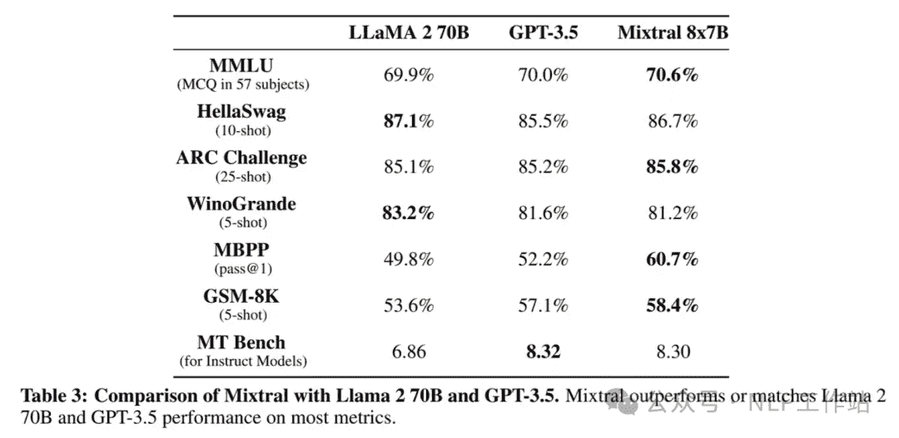

+   **架构： **Mixtral 的 MOE 架构类似于，在 MoE 模型中，只有 FFN 层被视为独立的专家，而模型的其他参数是共享的。大致参数为：

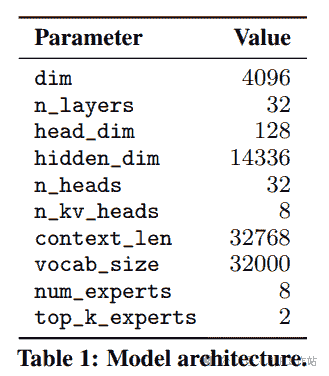

对 moe 架构不太了解的朋友，可以参考这篇博客 混合专家模型基础（推荐）。

参考 huggingface 中的 mixtral 和 mistral 实现对比，差异在于 mixtral 中将传统 transformer decoder layer 中的 FFN 替换为了 block_sparse_moe 。

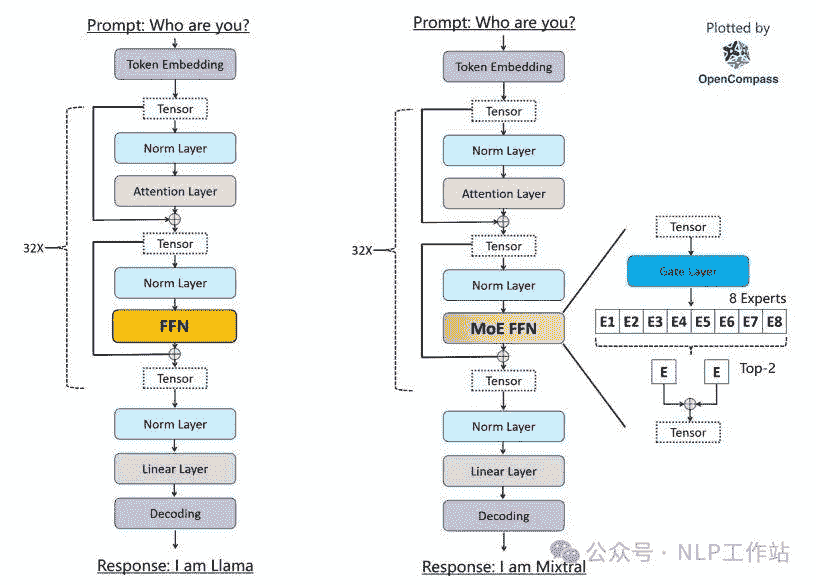

https://github.com/open-compass/MixtralKit

主要逻辑为：

其中  为专家对应的网络，具体展示为下面 huggingface 实现中的 MixtralBlockSparseTop2MLP 。mixtral 中采用了 8 个 expert，每次推理使用选取 top 2 的 expert 进行推理。比如输入一句话 你好，今天 ，那么我们每个 token 都会选出 top 2 的 expert 来负责这个 token 的预测，因此在推理 你好，今天 时， 有概率所有 expert 都会参与到计算当中 ，具体可以参考 MixtralSparseMoeBlock 的实现。

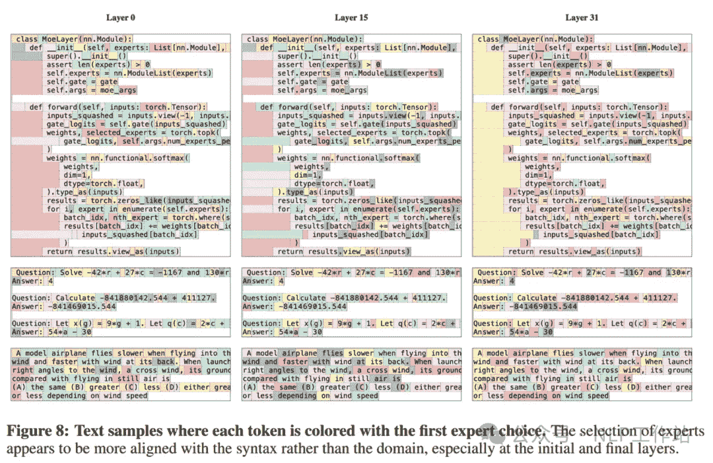

mixtral 论文中提到专家分配在不同主题（如ArXiv论文、生物学和哲学文档）中没有明显的模式，只有在DM数学中显示出边际上的差异，这可能是由于其数据集的合成性质和有限的自然语言覆盖范围所致。router 在某些句法结构上表现出一定的结构化行为（比如 python 的 self 等），同时连续标记通常被分配给相同的专家。

+   huggingface 中的 mixtral 核心代码：

```
class MixtralDecoderLayer(nn.Module):
    def __init__(self, config: MixtralConfig, layer_idx: int):
        super().__init__()
        self.hidden_size = config.hidden_size
        self.self_attn = MIXTRAL_ATTENTION_CLASSES[config._attn_implementation](config, layer_idx)

        self.block_sparse_moe = MixtralSparseMoeBlock(config)
        self.input_layernorm = MixtralRMSNorm(config.hidden_size, eps=config.rms_norm_eps)
        self.post_attention_layernorm = MixtralRMSNorm(config.hidden_size, eps=config.rms_norm_eps)

    def forward(
        hidden_states: torch.Tensor,
        attention_mask: Optional[torch.Tensor] = None,
        # 此处省略参数 ..
    ) -&gt; Tuple[torch.FloatTensor, Optional[Tuple[torch.FloatTensor, torch.FloatTensor]]]:

        residual = hidden_states
        hidden_states = self.input_layernorm(hidden_states)
        hidden_states, self_attn_weights, present_key_value = self.self_attn(
         # 此处省略参数 
        )
        hidden_states = residual + hidden_states
        residual = hidden_states
        hidden_states = self.post_attention_layernorm(hidden_states)
        
        # Mixtral 将原本的 hidden_states = self.FFN(hidden_states) 替换为了：
        hidden_states, router_logits = self.block_sparse_moe(hidden_states)
        
        hidden_states = residual + hidden_states
        outputs = (hidden_states,)

        return outputs

```

huggingface 中 block_sparse_moe 的实现（省略部分次要代码）：

```
class MixtralSparseMoeBlock(nn.Module):
    def __init__(self, config):
        super().__init__()
        self.hidden_dim = config.hidden_size
        self.ffn_dim = config.intermediate_size
        self.num_experts = config.num_local_experts
        self.top_k = config.num_experts_per_tok

        self.gate = nn.Linear(self.hidden_dim, self.num_experts, bias=False)
        self.experts = nn.ModuleList([MixtralBlockSparseTop2MLP(config) for _ in range(self.num_experts)])

        self.jitter_noise = config.router_jitter_noise

    def forward(self, hidden_states: torch.Tensor) -&gt; torch.Tensor:
        batch_size, sequence_length, hidden_dim = hidden_states.shape
        hidden_states = hidden_states.view(-1, hidden_dim)
        router_logits = self.gate(hidden_states)  # (batch * sequence_length, n_experts)

        routing_weights = F.softmax(router_logits, dim=1, dtype=torch.float)
        routing_weights, selected_experts = torch.topk(routing_weights, self.top_k, dim=-1)
        routing_weights /= routing_weights.sum(dim=-1, keepdim=True)
        # we cast back to the input dtype
        routing_weights = routing_weights.to(hidden_states.dtype)

        final_hidden_states = torch.zeros(
            (batch_size * sequence_length, hidden_dim), dtype=hidden_states.dtype, device=hidden_states.device
        )

        # One hot encode the selected experts to create an expert mask
        # this will be used to easily index which expert is going to be sollicitated
        expert_mask = torch.nn.functional.one_hot(selected_experts, num_classes=self.num_experts).permute(2, 1, 0)

        # Loop over all available experts in the model and perform the computation on each expert
        for expert_idx in range(self.num_experts):
            expert_layer = self.experts[expert_idx]
            idx, top_x = torch.where(expert_mask[expert_idx])

            # Index the correct hidden states and compute the expert hidden state for
            # the current expert. We need to make sure to multiply the output hidden
            # states by `routing_weights` on the corresponding tokens (top-1 and top-2)
            
            current_state = hidden_states[None, top_x].reshape(-1, hidden_dim)
            # current_state: shape (n_i, hidden_dim)
            # 所有 current_state 的长度 n 总和为 batch * sequence_length
            current_hidden_states = expert_layer(current_state) * routing_weights[top_x, idx, None]

            # However `index_add_` only support torch tensors for indexing so we&#x27;ll use
            # the `top_x` tensor here.
            final_hidden_states.index_add_(0, top_x, current_hidden_states.to(hidden_states.dtype))
        final_hidden_states = final_hidden_states.reshape(batch_size, sequence_length, hidden_dim)
        return final_hidden_states, router_logits
```

其中： MixtralBlockSparseTop2MLP 长这样：

```
class MixtralBlockSparseTop2MLP(nn.Module):
    def __init__(self, config: MixtralConfig):
        super().__init__()
        self.ffn_dim = config.intermediate_size
        self.hidden_dim = config.hidden_size

        self.w1 = nn.Linear(self.hidden_dim, self.ffn_dim, bias=False)
        self.w2 = nn.Linear(self.ffn_dim, self.hidden_dim, bias=False)
        self.w3 = nn.Linear(self.hidden_dim, self.ffn_dim, bias=False)

        self.act_fn = ACT2FN[config.hidden_act]

    def forward(self, hidden_states):
        current_hidden_states = self.act_fn(self.w1(hidden_states)) * self.w3(hidden_states)
        current_hidden_states = self.w2(current_hidden_states)
        return current_hidden_states
```

根据模型参数量 45B 来推理的话，如果用 fp16 的话推理的话，得需要至少 90GB 以上的显存，如果用 4 bit的话，30GB 显存就够了。量化的生成速度，可以参考下面 redis 中的评论，大致为 ：

| 推理精度 | 设备 | 速度 tokens/s |
| --- | --- | --- |
| Q4_K_M | 单卡 4090 + **7950X3D** | 20 |
| Q4_K_M | 2 x 3090 | 48.26 |

```
redis: https://www.reddit.com/r/LocalLLaMA/comments/18jslmf/tokens_per_second_mistral_8x7b_performance/
```

如果有 100+GB 以上显存，可以用 vllm 快速搭建测试 api：

```
docker run --gpus all \
    -e HF_TOKEN=$HF_TOKEN -p 8000:8000 \
    ghcr.io/mistralai/mistral-src/vllm:latest \
    --host 0.0.0.0 \
    --model mistralai/Mixtral-8x7B-Instruct-v0.1 \
    --tensor-parallel-size 2 # 100+GB 显存 \
    --load-format pt # needed since both `pt` and `safetensors` are available
```

NVIDIA 的 TensorRT-LLM 博客中发出了对 Mixtral 8*7B 的吞吐量 benchmark （using input and output sequence lengths of 128）：

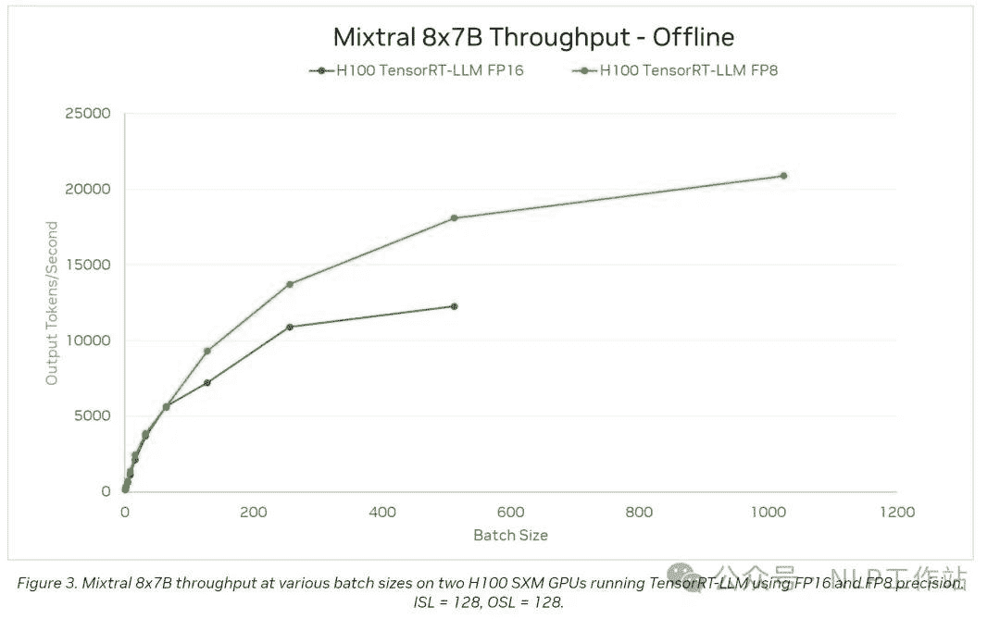

文中没有给出当 sequence lengths 最大时候的吞吐量，但根据上图数据，可以猜测 2个 H100 部署 8*7B 正常服务用户时，平均吞吐量应该可以大于 7500Tokens/秒，根据 H100 的功耗计算电费成本的话，生成 1M token 需要耗约为 0.02 度电。

##  **DeepSeek-MoE **

```
github: https://github.com/deepseek-ai/DeepSeek-MoE
论文: https://arxiv.org/pdf/2401.06066
```

+   **训练： **整个模型在 2T 的中英文预料上训练，实现了和 DeekSeek 7B 及 LlaMA 2 7B 差不都的效果。

+   **模型效果： **DeepSeekMoE 16B 推理时候，只用到了2.8B 的参数，整体的 FLOPs 是 LlaMA 2 7B 的 39.6%；推理速度更快的同时，效果也不差。

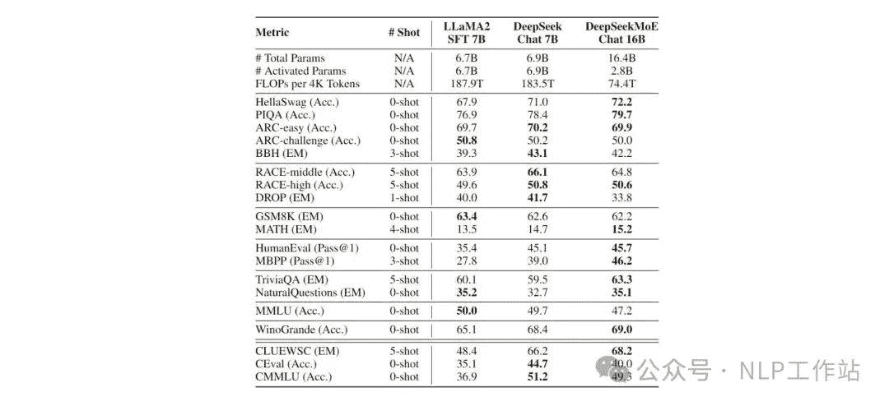

+   **架构： **DeepSeekMoE 16B 主要亮点在于 fine-grained expert segmentation 和 shared experts isolation.

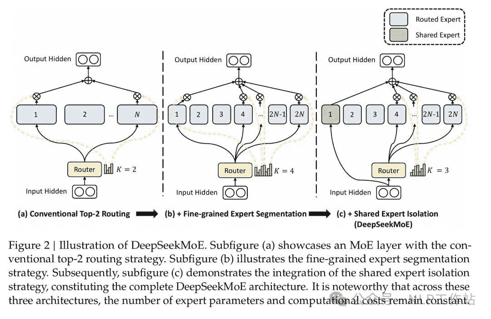

Fine-grained Expert Segmentation

如上图B，DeepSeek-MoE 在减少了每个 expert FFN intermediate hidden dimension 的同时，增加激活的 expert 的数量，依次保证总体激活的 expert 的参数量一致。DeepSeekMoE 论文种认为，组合数量的提升，有利于 gate 更准确地选择 expert。

如当我们有 16 个 expert，然后选 top 2 进行推理时，activate expert 的组合数量有  种组合，但当将每个 expert 参数缩小 4 倍，expert 个数增加为 64 时，选取 top 8 进行推理时， activate expert 的组合书来给你就有  种。

Shared Expert Isolation

如上图C，设立一部分 Shared Expert，每次推理的时候都会激活。

##  **Qwen1.5-MoE **

```
官方博客: https://qwenlm.github.io/zh/blog/qwen-moe/
github: https://github.com/QwenLM/Qwen2
huggingface 权重: https://huggingface.co/Qwen/Qwen1.5-MoE-A2.7B-Chat
```

+   **架构重点： **类似于 DeepSeek-MoE，Qwen1.5-MoE 也尝试了 Finegrained experts，整个模型总共设计了 64 个 expert；而后在 routing 机制种也尝试了 Shared Expert Isolation ：采用了 4个总是被激活的共享expert和每次只激活其中4个的60个routing expert。

+   **训练： **官方博客种表示：从零开始训练MoE模型可能效率低下，且难以提升至预期的最优性能水平。因此，Qwen1.5-MoE 首先利用已有的Qwen-1.8B，将其改造为Q wen1.5-MoE-A2.7B。此外，在初始化阶段引入随机性可以显著加快收敛速度，并在整个预训练过程中带来更好的整体性能表现。

+   **模型效果： **模型在推理时，总的激活参数为 2.7B。但实现的效果也不错：

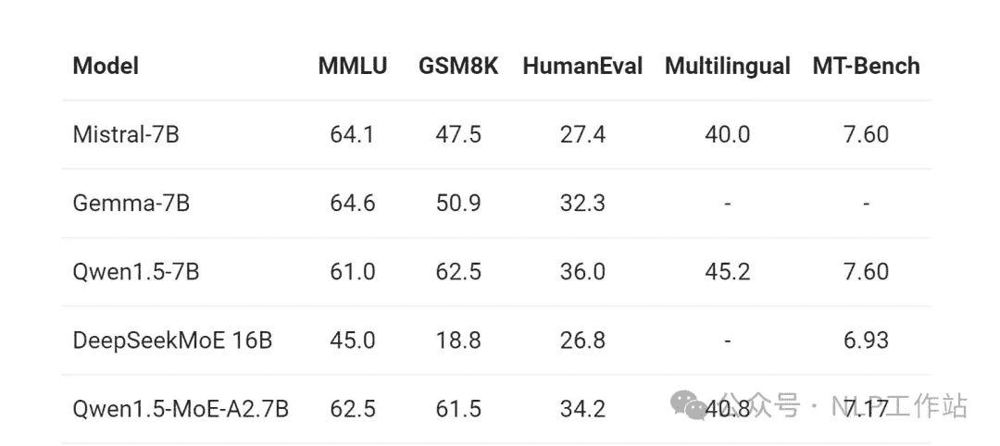

官方博客中发布了采用 vllm 部署时候的性能(单个NVIDIA A100-80G GPU 部署 Qwen1.5-7B和Qwen1.5-MoE-A2.7B)：

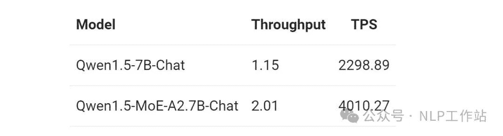

看来 MoE 架构在不牺牲生成质量的情况下，的确可以极大提高吞吐量，降低大模型生成成本。

##  **DeepSeek-V2 **

```
github: https://github.com/deepseek-ai/DeepSeek-V2
论文: https://arxiv.org/abs/2405.04434
权重下载: https://huggingface.co/collections/deepseek-ai/deepseek-v2-669a1c8b8f2dbc203fbd7746
huggingface 模型代码: https://huggingface.co/deepseek-ai/DeepSeek-V2-Chat-0628/blob/main/modeling_deepseek.py
```

DeepSeek-V2 文中推出了 DeepSeek-V2-Lite 与 DeepSeek-V2 一小一大 2个版本。

+   **模型大小： **DeepSeek-V2 整个模型有 236B 参数，其中推理激活参数为 21B。具体的架构参数可以查看：huggingface DeepSeek V2 config

+   **模型效果：**

推理速度：

DeepSeek V2 首先对模型进行了 KV Cache 量化，将参数转换为了 FP8。在单机 8卡 H800 的节点上部署 DeepSeek-V2，可以达到约 50K tokens/秒 的吞吐量

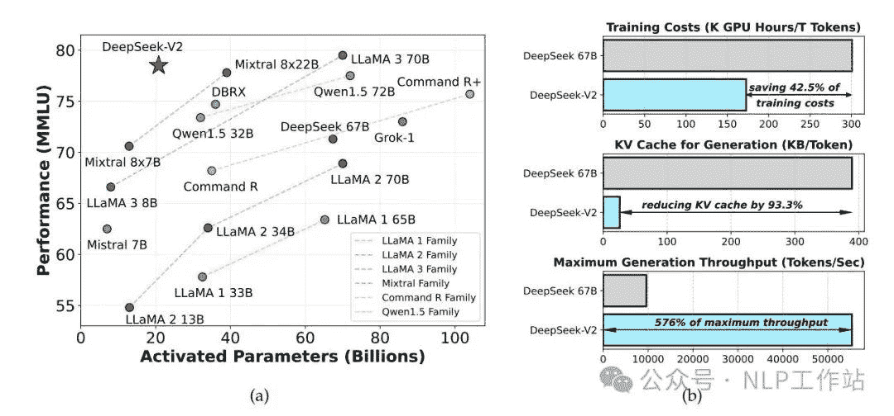

推理效果，中文水平更强一些，英文水平于 Mixtral 8*22B 有的一比：

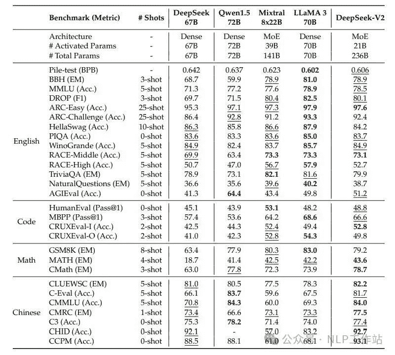

+   **模型架构重点 **：其中，架构采用了 **MLA **取代 MHA，同时 MOE 架构采用了 DeepSeekMoE 的 fine-grained expert segmentation 和 shared experts isolation。整体的 DeepSeek Layer 架构如下：

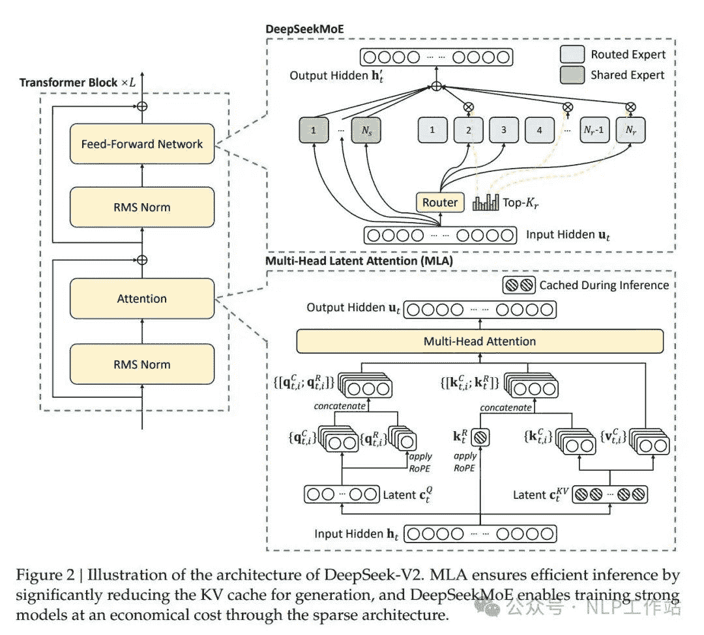

+   **DeepSeekMoE**

如上图展示的，DeepSeek-V2同样采用了 DeepSeekMoE 的策略，其中有 2 个 shared experts ， 160 个 routed experts（每次只激活 6 个）

+   Multi-Head Latent Attention

DeepSeek-V2 中着重讲了这一部分的优化。

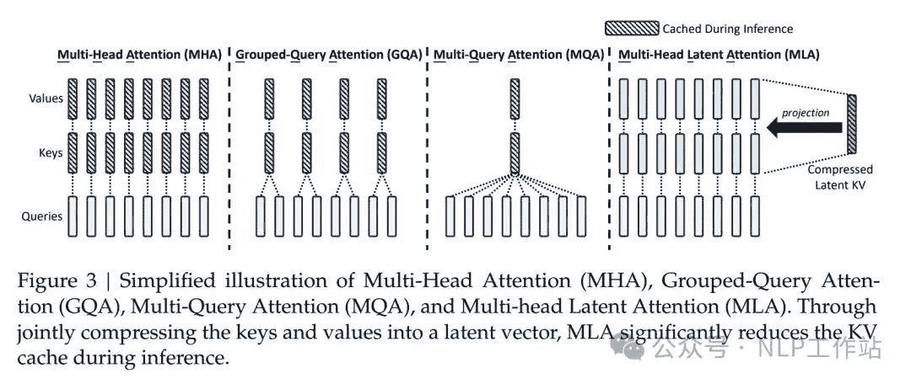

**Low-Rank Key-Val**ue Joint Compression

为了减少 KV cache，MLA 提出将 k, v 的计算方式变为：

其中，

q 的计算方法变为：

其中，

因此，k，v 均从  进一步计算得来。在推理时候，传统 MHA 需要 cache  ，但通过以上变化后，只需要 cache  即可。这样，  点积就变成了。

推理过程中，可以合并  ，以此达到减少 cache 同时，不会增加太多的计算量。

Decoupled Rotary Position Embedding

以上方案的一个问题是，不兼容 RoPE。由于 RoPE 的存在，

不再是单纯的  ，而是需要内积上相对位置矩阵  ，因此就无法简单得合并  。

MLA 采用了以下 decoupled RoPE 方案：

大概思路是，在原先的 qk 中，增加几个维度，用来注入 RoPE 位置信息，比较值得注意的是，k 新增加的维度  是所有 head 共享的。其中，  ,  , 因此，q,k 的维度增加到了  。

更深入的 MLA 解读，可以参考：缓存与效果的极限拉扯：从MHA、MQA、GQA到MLA 或 deepseek v2 原论文。

文中给出了 MLA 与 MHA, GQA 的效果对比：

MLA 的 KV 的 cache 数量比 MHA, GQA 少了不少。

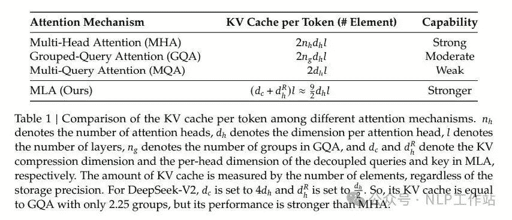

MLA KV cache 比 MHA 小的同时，效果也不会太差。

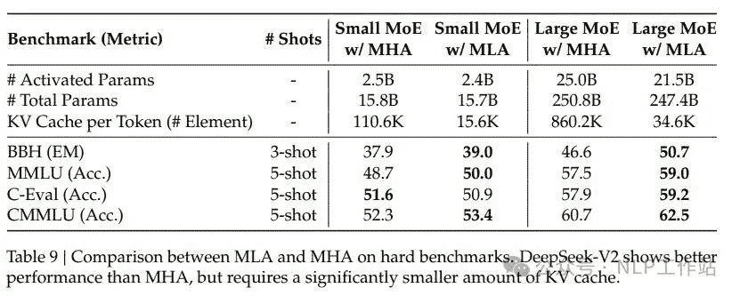

+   **预训练： **相比于 DeepSeek 67B，DeepSeek-V2 训练集中有更多的中文数据，同时 DeepSeek V2 对数据过滤算法进行了改进，包括筛除有争议的内容等；DeepSeek V2 使用于 DeepSeek 67B 同样的 tokenizer，vocab size 为 100k，预训练语料约有 8.1T tokens，其中中文比英文多了 12%。整个预训练花费了172.8K GPU hours 的算力。

+   **超长上下文： **在适配了 Yarn 之后，额外在 32k 的数据集上训练了 1000 steps，batch size 为 576。文中表示，尽管是在 32K 数据集上训练，但在 128K 的大海捞针测试中，模型表现也不错：

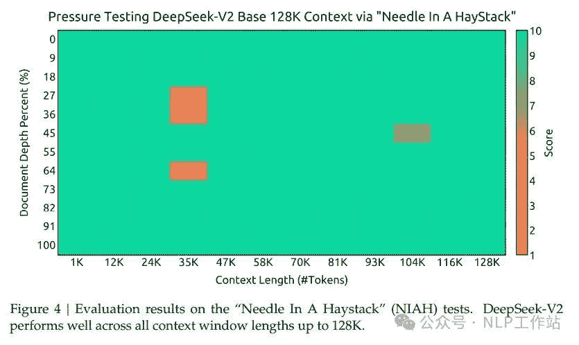

+   **SFT **：在包含了 1.5M 组训练实例的数据集上，微调了 2 个 epoch。

+   **RLHF： **采用了 GRPO 来节省 RL 训练的成本，主要是将 PPO 过程中的 advantage 替换成了 ，因此在 RLHF 过程中就不需要 Value model 了。具体算法如下：

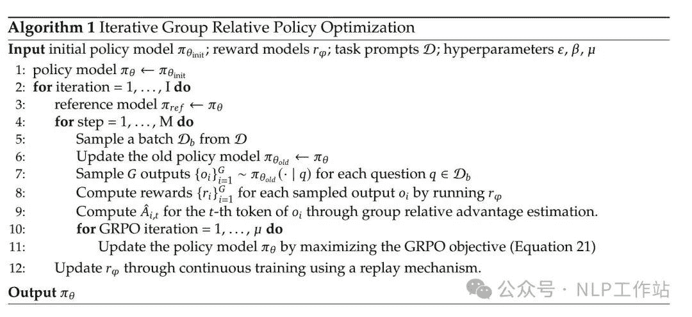

在 RLHF 训练过程中，采取了 2 阶段训练。首先进行了 reasoning alignment，而后进行 human preference alignment。

更多训练细节欢迎参考 DeepSeek-V2 论文

##  **Mixtral 8*22B **

```
官方博客: https://mistral.ai/news/mixtral-8x22b/
huggingface 开源模型: https://huggingface.co/mistralai/Mixtral-8x22B-Instruct-v0.1
```

+   架构：架构与 mixtral 8*7B 架构一样，在 huggingface 中使用的都是 MixtralForCausalLM ，但 22B 的各方面参数大一点，比较特别的是 context window 从 32k 升级到了 65k， vocab_size 也更大一些。

+   支持 function calling，不过好像没有透露具体的 function calling 训练细节。

+   数学和 coding 能力明显超越 llama2 70B

+   似乎对中文的支持不是很好。

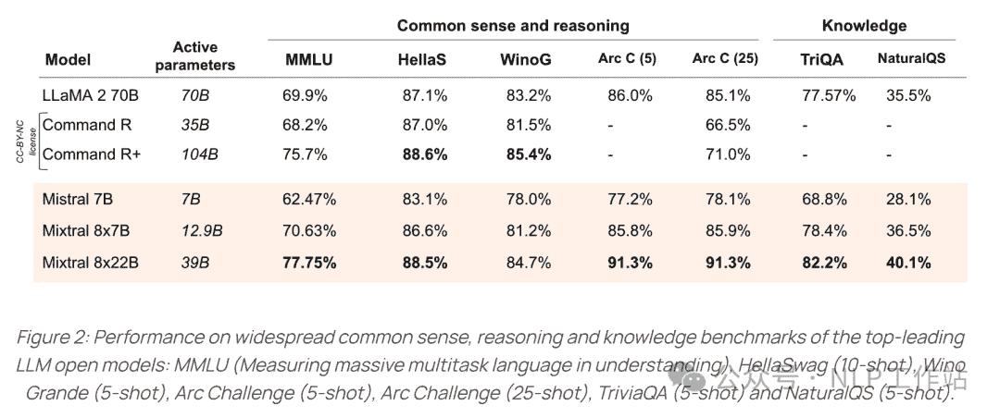

Mistral 团队开源的模型，都比较注重 coding 和 math 的能力，Mixtral 系列的模型在这方便表现也是比较好：

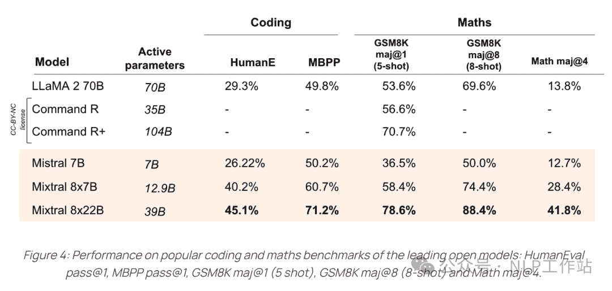